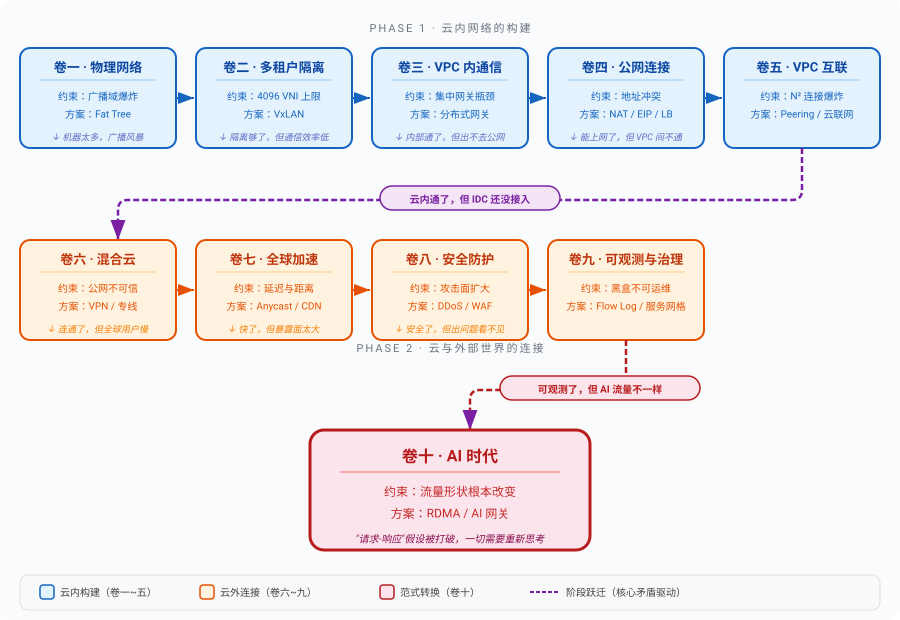

# 写在前面

## 为什么写这本书

我在学习云网络的过程中，遇到了一个让人沮丧的困境：能找到的资料要么太细节，要么太表面。

太细节的那类，是内核开发者写的：conntrack 的哈希表实现、OVS 的 datapath 流表匹配、DPDK 的内存池管理。每一篇都写得极好，但读完之后你知道了一棵树的年轮纹理，却不知道这棵树长在哪片森林里。太表面的那类，是云厂商的产品文档：创建 VPC，选择地域和可用区，配置 CIDR 为 10.0.0.0/16，点击确定。操作步骤清晰明了，但你不知道为什么要这样做，不知道这个产品解决的是什么问题，不知道它的设计里藏着哪些权衡。

中间那一层：这个产品为什么存在、它解决的是什么问题、它的背景是什么，它的代价是什么，几乎是空白的。

这不是某一家厂商的问题，而是整个行业的现状。云网络的知识散落在 RFC 文档、内核邮件列表、架构师的会议 PPT、和少数工程师的个人博客里。没有人把它们串成一条因果链，让你看见VPC 为什么设计成这个样子、NAT 网关为什么不能省掉、负载均衡器为什么要分四层和七层。

我决定自己把这条链补上。

最初只是个人的学习笔记，搜集资料、画架构图、把零散的知识点串成因果关系。写着写着发现，这些笔记对同事也有用。再写着写着发现，它可能对更多人有用。于是笔记变成了章节，章节变成了卷，卷变成了这本书。

## 这本书在讲什么

一句话概括：**云网络的每一个产品，都是被某个约束逼出来的结果。** 这本书要做的事情，是把这个逼出来的过程完整地展示给你看。

全书从最朴素的问题开始：两台机器怎么通信。然后机器变多了，广播域炸了；多个租户共用一张网，互相干扰；VLAN 的 4096 上限撑不住云的规模；VxLAN 解决了隔离但引入了 VTEP 的落点问题，等等。每一章解决上一章遗留的问题，每一章的解法又引入新的约束，催生下一章的问题。

这条问题链从物理网络的边界出发，经过多租户隔离、VPC 内部通信、公网连接、VPC 互联、混合云、全球加速、安全防护，一直延伸到可观测与流量治理。九卷三十一章，一条不断生长的因果链。

写作思路上，每一章遵循同样的模式：

- 先让你感受到问题：没有这个方案时，世界面临的具体困境是什么
- 然后走进那个看起来对的方向：你最可能先想到的方案，为什么在某个边界上撑不住
- 接着推导出新方案：不是公布答案，而是展示约束把解法空间压缩到了什么范围
- 最后呈现权衡：新方案解决了什么，同时引入了什么新的代价

我希望你读完每一章时的感受不是哦，原来答案是这个，而是如果是我，在这些约束下，大概也会走到这个方向。希望你不仅仅知道 What，更要知道 Why。

## 适合谁读

这本书不是入门教材，也不是运维手册。

如果你是这几类人，这本书可能对你有用：

**云网络的使用者**：你每天在控制台上创建 VPC、配置安全组、挂载 EIP，但不太清楚这些产品背后的设计动机。你想知道为什么 VPC 不能跨 Region、为什么 NAT 网关有端口数限制、为什么专线比 VPN 贵那么多但还是有人用。

**网络工程师转云方向**：你熟悉传统网络的协议和设备，但对云网络的虚拟化层感到陌生。你想知道 VxLAN 和你熟悉的 VLAN 是什么关系，分布式网关和你机房里的物理网关有什么区别，SDN 控制面到底改变了什么。

**后端开发者**：你写的服务跑在云上，偶尔遇到网络问题（延迟抖动、连接超时、跨 VPC 不通），但排查时感觉在黑箱里摸索。你想建立一个云网络到底是怎么工作的的整体认知，下次遇到问题时知道该往哪个方向查。

**架构师**：你在做技术选型和架构设计，需要理解不同云网络产品的适用场景和边界。你想知道什么时候该用对等连接、什么时候该用云联网、什么时候该用 PrivateLink，以及这些选择背后的权衡逻辑。

这本书假设你有基本的网络知识，知道 IP 地址、TCP、DNS 是什么。不需要你精通内核或者读过 RFC，但如果你完全没接触过网络，建议先读一本入门书籍。

## 怎么读

全书九卷，每一卷聚焦一个主题域。卷与卷之间有因果递进关系，但不是严格的线性依赖。

如果你时间充裕，从头读到尾是最好的体验，你会看到一条完整的问题链如何从一根网线，一步步生长到服务网格去管理微服务之间的流量。

如果你时间有限，可以按需跳读。每卷开头有一段导读，告诉你这一卷要解决什么问题、从哪里来、到哪里去。你可以根据自己的兴趣和工作需要，选择从任何一卷开始。只是偶尔会遇到这个概念在第 X 章讲过的引用，回去翻一下就好。

最后一点：这本书不涉及任何代码。全书只讲产品设计动机、网络协议原理、架构权衡。如果你想看配置命令或者编程实现，这本书不是你要找的目标。但如果你想在动手之前先想清楚为什么要这样做，这本书或许能帮上忙。

## 全书结构：约束链的九次跃迁

> 如果你在阅读中间章节时感到迷失，回来看这张图——找到你当前所在的位置，看看它从哪里来、往哪里去。每条虚线上的文字就是驱动跃迁的核心矛盾：上一卷的解法解决了问题，同时暴露出新的约束，推动你进入下一卷。
