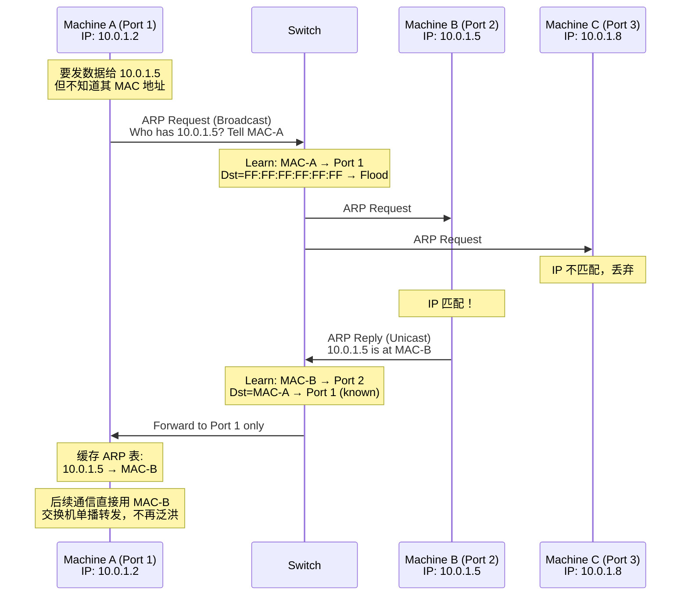
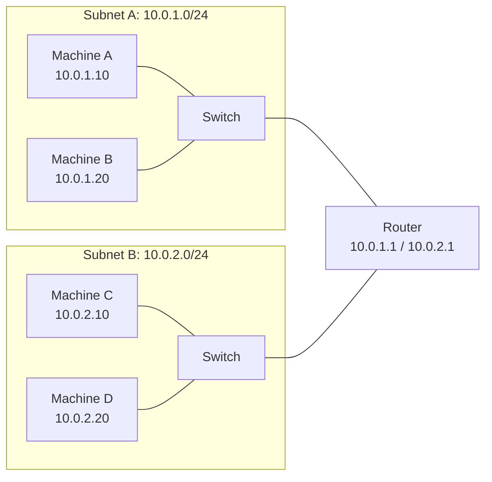

# 1. 一根网线，两头是谁

网络的所有机制都是一层一层长出来的。   
不是有人坐下来画了一张七层模型的图，然后按图施工。每解决一个问题，就会暴露出下一个问题，每一个新问题都逼出一层新的机制。如果你翻开任何一本网络教材，上来就是 OSI 七层模型、TCP/IP 四层架构，仿佛这些分层是某个天才在某个下午一次性设计出来的。事实恰恰相反，每一层抽象的出现，都是上一层方案在某个规模上撑不住之后，被现实逼出来的。最初的问题极其朴素：两台机器之间拉一根线，数据怎么送到对的人手里？机器从两台变成一百台时，谁来转发？当一百台机器的广播开始互相淹没时，又该怎么隔离？

## 1.1 两台机器，一根线

我们从最简单的场景开始：一根网线，两头各插着一台机器。A 机器要给 B 机器发一段数据。

这件事看起来很简单，线是通的，电信号从一头跑到另一头，物理上没有任何障碍。物理层的铜芯（或者光纤里的光信号）忠实地把比特从发送端搬运到接收端，它不关心这些比特是什么意思，只管搬运。

但问题藏在"搬运完之后"。B 机器的网卡收到了一串比特流，它怎么知道这段数据是发给自己的？在只有两台机器的场景下，这个问题不是问题，线上只有你和我，收到的数据当然是给我的。可一旦有第三台机器加入，情况就变了：线上跑着的数据可能是给 C 的，B 不应该处理它。

所以每台机器需要一个唯一的身份标识，就像每个人有身份证号一样，让接收方能判断"这个数据是不是给我的"。这个标识就是 **MAC 地址**（Media Access Control Address），一个 48 位的地址，在网卡出厂时就被烧录进去了。前 24 位由 IEEE 分配给网卡制造商（称为 OUI，Organizationally Unique Identifier），后 24 位由制造商自行编号。这套简单的编址方案保证了理论上不会有两块网卡拥有相同的 MAC 地址。

但光有地址还不够。物理层传输的只是一串连续的 0 和 1，或者说，一段持续的电压变化。接收方的网卡看到的是一条没有边界的比特河流。它怎么知道哪些比特属于同一份数据？从哪里开始，到哪里结束？这份数据是给谁的？里面装的是什么？物理层本身不回答这些问题，它只负责搬运。上层需要在"裸奔"的比特流上构建出可解读的信息结构。解决方案是**封装**（Encapsulation）：发送方把原始数据装进一个结构化的"信封"，信封上标注收件人、寄件人、数据类型等元信息，信封末尾附上校验码。这个"信封"就是帧（Frame）。有了帧，比特流就被切割成了一个个独立的、有边界、可解析的单元。

有了 MAC 地址和帧封装，数据就不再是一堆裸奔的比特流了。发送方把数据装进一个"信封"，**以太网帧**（Ethernet Frame），信封上写着收件人（目的 MAC 地址）和寄件人（源 MAC 地址），信封里装着实际要传递的数据（Payload），信封末尾附上一段校验码（FCS，Frame Check Sequence），用来检测传输过程中有没有出错。

**图 1.1：以太网帧的基本结构**

```
┌──────────┬──────────┬────────────┬─────────────────────┬──────┐
│ Dst MAC  │ Src MAC  │ Type/Len   │      Payload        │ FCS  │
│ (6 bytes)│ (6 bytes)│ (2 bytes)  │   (46-1500 bytes)   │(4 B) │
└──────────┴──────────┴────────────┴─────────────────────┴──────┘
```

这就是二层通信的最小单元。两台机器直连时，A 把数据装进以太网帧，写上 B 的 MAC 地址，通过网线发出去；B 的网卡收到帧，检查目的 MAC 是不是自己的，是就收下，不是就丢弃。FCS 校验码的作用是检测传输错误，如果比特在传输过程中因为电磁干扰或线缆质量问题发生了翻转，FCS 校验会失败，接收方直接丢弃这个帧，不会把错误的数据交给上层处理。

两台机器直连的通信模型就是这么朴素：装信封、写地址、发出去、对面拆开看看是不是给自己的。

## 1.2 从集线器到交换机

两台机器直连只需要一根线。三台机器两两直连需要三根线。四台需要六根。N 台机器全互联需要 N×(N-1)/2 根线，这是一个随规模平方增长的数字，十台机器就需要 45 根线，一百台需要 4950 根。显然，点对点全互联不是一个可扩展的方案。

最朴素的解决思路是找一个"中间人"，所有机器都连到它上面，由它负责转发。最早承担这个角色的设备叫**集线器**（Hub）。集线器的工作方式极其简单：任何一个端口收到的信号，原封不动地复制到所有其他端口。A 发给 B 的数据，C、D、E 都会收到一份。

这解决了布线问题，每台机器只需要一根线连到集线器，但引入了两个新的问题。第一，所有机器共享同一条"线路"，任何时刻只能有一台机器在发送数据，否则信号就会冲突（collision）。当两台机器同时发送时，信号在线路上叠加，变成无法解读的噪声，两台机器都需要等待一段随机时间后重新发送。机器越多，冲突越频繁，网络的有效吞吐量急剧下降。第二，A 发给 B 的数据，C 也收到了，这既浪费带宽，也带来安全隐患，C 可以看到所有不属于自己的数据。

真正需要的是一种"定向投递"的能力：A 发给 B 的数据，只有 B 能收到，C 完全不知情。这就要求中间人不能再无脑复制，它得知道每台机器在哪个端口后面，然后精确地把数据只往那个端口发。能做到这件事的设备叫**交换机**（Switch）。交换机和集线器的外观几乎一样，都是一个盒子，上面插满了网线，但内在逻辑完全不同。

交换机内部维护着一张 **MAC 地址表**（也叫 CAM 表，Content Addressable Memory Table），记录的是"哪个 MAC 地址在哪个端口后面"。当交换机收到一个帧，它先看源 MAC 地址，记下"这个 MAC 在这个端口后面"；再看目的 MAC 地址，查表决定往哪个端口转发。如果目的 MAC 在表里，就只往对应端口发，这叫**单播转发**。如果不在表里，交换机不知道该往哪发，只能把帧从除了来源端口之外的所有端口都发一份，这叫**泛洪**（Flooding）。泛洪的效果和集线器一样，但它只在"不知道目的地"的时候才发生。

交换机不是天生就知道每台机器在哪个端口后面的，它的 MAC 地址表是通过"观察流量"逐步建立起来的。那么问题来了：交换机刚启动时，MAC 表是空的，第一个帧一定会被泛洪。更关键的是，发送方在发帧之前，自己就面临一个问题，以太网帧的信封上必须写目的 MAC 地址，但发送方往往只知道对方的 IP 地址（可能是用户手动指定的，也可能是 DNS 查询返回的），并不知道对方的 MAC 地址。没有 MAC，帧就发不出去。

MAC 地址是网卡出厂时烧录的，IP 地址是网络管理员分配的，两者之间没有数学关系，无法从 IP 推算出 MAC。同一块网卡今天配 IP 10.0.1.5，明天可以改成 10.0.2.10，MAC 地址不会变。反过来说，同一个 IP 今天在这块网卡上，明天可能换到另一块网卡上。IP 和 MAC 是两个独立维度的标识，它们之间的对应关系，只能通过"问"来获知。

**ARP 协议**（Address Resolution Protocol，地址解析协议）就是干这件事的：已知 IP 地址，查询对应的 MAC 地址。A 在网络里喊一声"谁的 IP 是 10.0.1.5？请把你的 MAC 地址告诉我。"这个喊话就是 **ARP 请求**，它被封装在一个以太网帧里，目的 MAC 地址填的是广播地址 FF:FF:FF:FF:FF:FF，意思是"所有人都听一下"。

交换机收到这个广播帧，把它从所有端口发出去（泛洪）。网络里的每一台机器都会收到这个 ARP 请求，但只有 IP 地址匹配的那台机器（假设是 B）会回复。B 的回复是一个 **ARP 应答**，目的 MAC 直接写 A 的 MAC（因为 ARP 请求里带了 A 的 MAC），所以应答是**单播**的。A 收到应答，就知道了 10.0.1.5 对应的 MAC 地址，把这个映射缓存在本地的 **ARP 表**里，后续发往 10.0.1.5 的帧就不用再广播查询了。

注意这个过程中，交换机也在"偷偷学习"。A 的 ARP 请求从端口 1 进来，交换机记下"MAC-A 在端口 1"；B 的 ARP 应答从端口 2 进来，交换机记下"MAC-B 在端口 2"。一次 ARP 交互，交换机就学会了两台机器的位置。后续 A 和 B 之间的通信，交换机就能精确地单播转发，不再需要泛洪了。

**图 1.2：ARP 请求与交换机学习的联动过程**



这就是交换机网络中通信的完整链条：**先通过 ARP 广播查到目的 MAC，再用目的 MAC 封装以太网帧发送，交换机根据 MAC 地址表精确转发**。ARP 解决的是"IP 到 MAC 的映射"，交换机解决的是"MAC 到端口的映射"，两者配合，才让多台机器之间的定向通信成为可能。

MAC 地址表不是永久的。每条记录都有一个老化时间（通常是 300 秒），如果在这段时间内没有再收到来自某个 MAC 地址的帧，这条记录就会被删除。这是因为网络是动态的，机器可能被拔掉网线、换了端口、或者关机了。如果 MAC 表不老化，过时的记录会导致帧被发到错误的端口。

交换机的出现还带来了一个重要的概念：**广播域**（Broadcast Domain）。所有连在同一台交换机上的机器，构成一个广播域。在这个域里，任何一台机器发出的广播帧（目的 MAC 为 FF:FF:FF:FF:FF:FF），所有其他机器都会收到。ARP 请求就是最典型的广播帧，每一次地址查询，都会打扰广播域内的所有机器。广播域是一个逻辑边界，域内的广播帧自由传播，域外的机器听不到。

在几十台机器的规模下，交换机工作得很好。MAC 地址表能装下所有机器的地址，ARP 广播微不足道。但规模再大一些呢？

## 1.3 广播域的膨胀

交换机解决了多台机器之间的精确转发问题，但它没有消灭广播，它只是把广播限制在了一个域内。问题在于，这个域可以很大。

当多台交换机通过级联（uplink）连接在一起时，它们共同构成一个更大的广播域。一台交换机连 48 台机器，十台交换机级联起来就是 480 台机器共享一个广播域。广播帧从任何一台机器发出，会穿过所有级联的交换机，到达这 480 台机器中的每一台。

当广播域里有 10 台机器时，一次 ARP 请求产生 10 份广播帧，无关紧要。当有 100 台时，产生 100 份，仍然可以接受。但如果广播域里有 1000 台机器，每台机器每分钟发几次 ARP 请求，那么每台机器每分钟要接收和处理几千个与自己无关的 ARP 广播帧。这些帧消耗网络带宽，消耗每台机器的 CPU（网卡收到广播帧后要交给操作系统处理，操作系统发现不是给自己的再丢弃），而且这个开销随着广播域内机器数量的增长线性增加。

ARP 不是唯一的广播来源。DHCP（动态主机配置协议）的发现过程也是广播，新加入网络的机器通过广播来寻找 DHCP 服务器。某些服务发现协议也依赖广播。每增加一种广播协议，广播域内的背景噪声就增加一层。这个问题没有什么巧妙的优化方案，广播的本质就是"对所有人喊一声"，你没法让一个人喊得更小声，只能减少房间里的人数。

广播域的膨胀不仅仅是性能问题，还有安全问题。广播域内的所有机器在物理上是"互通"的，任何一台机器发出的广播帧，所有人都能收到。如果有人在广播域内运行一个抓包工具，理论上可以看到所有的 ARP 请求，从而知道这个域内有哪些 IP 地址和 MAC 地址在活动。在一个只有自己人的企业网络里，这可能不是大问题；但如果这个广播域里有不信任的第三方，信息泄露就变成了安全威胁。

一个自然的追问浮出水面：能不能把一个大的广播域切成几个小的？让不同组的机器互相听不到对方的广播？

## 1.4 跨越广播域的路由器

交换机的能力边界到这里已经很清晰了：它只认 MAC 地址，只在同一个广播域内转发。如果目标机器不在同一个广播域里，交换机无能为力，它的 MAC 地址表里根本没有那台机器的记录。

要跨越广播域的边界，需要一种新的地址和一种新的设备。

MAC 地址解决的是"你是谁"的问题，它是网卡的身份证号，出厂时就固定了，不会因为你把机器从北京搬到上海而改变。但"你是谁"不等于"你在哪里"。一封信上只写了收件人的身份证号，邮局是没法投递的，它还需要知道收件人的地址：哪个省、哪个市、哪条街。

**IP 地址**解决的就是"你在哪里"的问题。它不是烧录在硬件里的，而是由网络管理员分配的，可以随时更改。IP 地址的结构天然包含了"位置"信息：一个 IP 地址分为网络号和主机号两部分，网络号标识"你在哪个网络"，主机号标识"你是这个网络里的第几台机器"。同一个网络里的机器共享相同的网络号，就像同一条街上的住户共享相同的街道名。

那怎么区分一个 IP 地址里哪部分是网络号、哪部分是主机号？靠的是**子网掩码**（Subnet Mask）。子网掩码是一个和 IP 地址等长的 32 位数字，前面连续的 1 标记网络号的位数，后面连续的 0 标记主机号的位数。比如子网掩码 255.255.255.0，换成二进制就是前 24 位全 1、后 8 位全 0，意思是"IP 地址的前 24 位是网络号，后 8 位是主机号"。为了书写方便，通常用斜杠加数字来简写，`/24` 就表示"前 24 位是网络号"。所以 `10.0.1.5/24` 描述的是一个子网：所有 IP 地址前 24 位相同（即 10.0.1.x）的机器属于同一个**子网**（Subnet）。同一个子网内的机器可以直接通过交换机互相通信，不同子网的机器之间则需要一个"中间人"来转发。

一个包从 A 到 B 的旅程中，IP 地址始终不变（标识最终目的地），但 MAC 地址在每一跳都会改变（标识下一跳的身份）。MAC 地址管的是"同一个房间里谁在哪个位置"，IP 地址管的是"从一个房间到另一个房间怎么走"。两者缺一不可。

**路由器**（Router）就是那个能跨越广播域边界、充当不同子网之间"中间人"的设备。它至少有两个网络接口，每个接口连接一个不同的广播域（不同的网段）。当路由器收到一个数据包时，它不看 MAC 地址，那是二层的事，它看的是 IP 地址。路由器内部维护着一张**路由表**，记录的是"目标 IP 网段 → 从哪个接口发出去"。

**图 1.3：同网段 vs 跨网段的通信路径**



A 要给 B 发数据，两者在同一个子网（10.0.1.0/24），交换机直接根据 MAC 地址转发，路由器完全不参与。但 A 要给 C 发数据，C 在另一个子网（10.0.2.0/24），A 发现目标 IP 不在自己的网段内，就把数据包发给自己的**默认网关**，也就是路由器在本网段的接口（10.0.1.1）。路由器收到包，查路由表，发现 10.0.2.0/24 这个网段在另一个接口上，就把包从那个接口发出去，最终到达 C。

这个过程中有一个容易被忽略的细节：A 发给路由器的帧，目的 MAC 地址是路由器接口的 MAC，而不是 C 的 MAC。路由器收到帧后，剥掉二层头部，看到 IP 包的目的地址是 C，查路由表找到出接口，然后重新封装一个新的二层帧，这次目的 MAC 是 C 的 MAC（或者下一跳路由器的 MAC）。IP 地址在整个过程中不变，但 MAC 地址在每一跳都被替换。

路由器有一个至关重要的特性：**广播帧不会穿过路由器**。这是它和交换机的根本区别。交换机会把广播帧发到所有端口，路由器不会。路由器的每个接口连接的是一个独立的广播域，域与域之间的广播互不干扰。

这意味着路由器天然地切割了广播域。前面那个"一千台机器的广播风暴"问题，路由器给出了一个答案：把一千台机器分成十个网段，每个网段一百台，用路由器连接这十个网段。每个网段内部的广播只在本网段传播，不会扩散到其他网段。

但这个方案有一个显而易见的代价：每多一个隔离的网段，就需要路由器多一个物理接口和一段物理线路。路由器的端口数量是有限的，而且每个端口的成本不低。如果需要把一百台机器分成二十个隔离组，每组五台，就需要路由器有二十个接口，这在物理上和经济上都不现实。有没有一种方式，能在不增加物理端口的前提下，用软件逻辑来切割广播域？这个问题的答案，要等到我们真正面对多租户隔离的需求时才会揭晓。

到这里，物理网络的基本工具箱已经齐了。MAC 地址解决了"你是谁"，以太网帧解决了"数据的边界在哪里"，交换机解决了"帧往哪个端口发"，ARP 解决了"IP 到 MAC 的映射"，IP 地址和子网解决了"你在哪个网络"，路由器解决了"跨网络怎么走"。这些机制层层叠加，构成了一张能工作的物理网络。

但这张网络有一个隐含的假设：所有接入它的机器都属于同一个组织，彼此信任。当这个假设不再成立，当成千上万个互不信任的租户共享同一张物理网络时，新的问题就会浮出水面。
