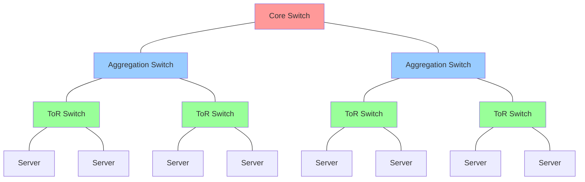
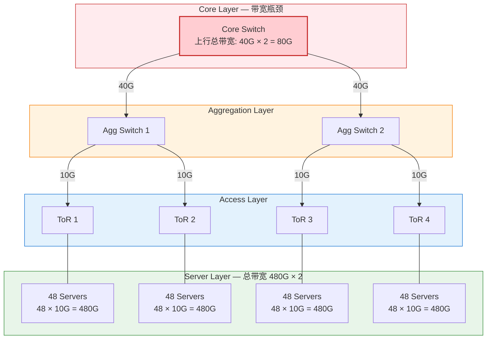
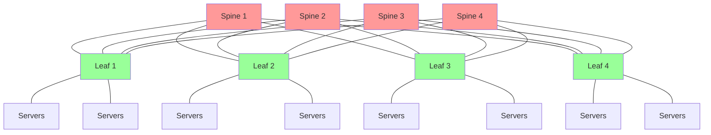
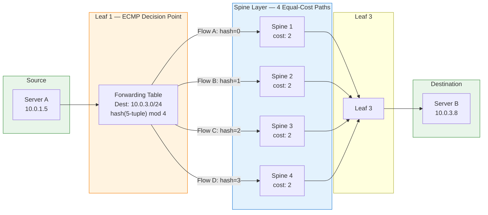

# 2. 十万台机器的网络

一台交换机连几十台机器，交换机学会了谁在哪个端口后面，广播域也还在可控范围内。但数据中心不是几十台机器的世界，它是几千个机架、十万台服务器、每秒要处理数以亿计的内部数据包。规模不是简单的数量增长，它改变了网络架构的基本假设。那些在小规模下"够用"的方案，交换机、路由器、VLAN，放进十万台机器的场景里，哪些会先撑不住？

## 2.1 数据中心的物理层次

首先可以肯定的是，没有哪台交换机有十万个端口。即使有，十万根网线从四面八方汇聚到一个点，物理上也不可能实现。规模本身就决定了网络必须分层组织，不是因为分层更优雅，而是因为没有别的办法。

数据中心的物理组织遵循一个简单的层次结构。最底层是**机架**（Rack）：一个标准机架里垂直堆放着几十台服务器，机架顶部安装一台交换机，叫做 **ToR**（Top of Rack）交换机。机架内的所有服务器都通过短网线连接到这台 ToR 交换机上。这是接入层，每台服务器进入网络的第一跳。

> **ToR 是什么？**
>
> ToR（Top of Rack，机架顶部交换机）是数据中心里最靠近服务器的一层交换机。它物理上安装在机架的顶部（或底部），通过短距离铜缆连接机架内的所有服务器。每台服务器的网络流量都要先经过 ToR 交换机，再进入上层网络。ToR 是数据中心网络的"接入层"，它决定了服务器的第一跳连接方式，也是很多网络功能（如 VTEP、ACL）的潜在执行点。

多个机架组成一个 **Pod**。Pod 内的 ToR 交换机不能直接互联，如果有 20 个机架，ToR 之间两两互联需要 190 根线，又回到了点对点全互联的老路。所以 Pod 内会有一层**汇聚交换机**（Aggregation Switch），所有 ToR 交换机都连接到汇聚交换机上，由汇聚交换机负责 Pod 内部的流量转发。

多个 Pod 之间再通过**核心交换机**（Core Switch）互联，形成整个数据中心的网络骨架。

**图 2.1：传统数据中心三层网络架构**

接入层、汇聚层、核心层，这三层结构是传统数据中心网络的标准组织方式。但"三层结构"说的是物理层次，不是网络协议的层次。在很多传统数据中心里，接入层的 ToR 交换机和汇聚层的交换机都工作在**二层**，它们靠 MAC 地址转发帧，做的是以太网交换。整个 Pod 内部（一台汇聚交换机下面挂的所有 ToR 和服务器）构成一个大的**二层广播域**。只有核心层的交换机才工作在**三层**，做 IP 路由，负责跨 Pod 的流量转发。

这意味着 Pod 内部的通信享受二层交换的低延迟，但也继承了二层的老问题，广播、泛洪。几百台服务器共享一个广播域，ARP 请求在 Pod 内部扩散，MAC 地址表的规模也随之膨胀。这些问题在小规模下可以忍受，但十万台机器意味着几十个 Pod，每个 Pod 内部几百上千台机器，二层广播域的压力已经不容忽视。

十万台机器意味着几千个机架、几十个 Pod，每一层交换机都要处理巨大的流量。两台机器之间看似简单的一次通信，数据包实际上要穿越这些物理层次，从 ToR 到汇聚到核心再下来，或者如果运气好，可以在同一个 Pod 内就能完成。

## 2.2 东西流量的爆发

三层架构是为一种特定的流量模型设计的：用户在外面，服务器在里面，流量主要是进进出出。用户从公网发起请求，流量从外部进入数据中心，服务器处理后把响应送出去，这种纵向的、进出方向的流量叫做**南北流量**。三层架构为此而生：流量从下往上穿越接入层、汇聚层、核心层，到达外部网络，或者反过来。

但数据中心内部还有另一种流量：应用服务器访问数据库服务器、缓存服务器之间同步数据、微服务 A 调用微服务 B。这些流量不出数据中心，在内部横向流动，叫做**东西流量**。

在传统企业网络里，东西流量不多，三层架构的设计假设是大部分流量是纵向的。但现代数据中心的流量模型发生了根本性的变化。分布式系统、微服务架构、大数据计算，这些应用模式下，一个用户请求进来之后，内部可能触发几十次甚至上百次服务间调用。一次外部请求产生的南北流量可能只有几 KB，但它在内部引发的东西流量可能是几 MB。在典型的云数据中心里，东西流量占总流量的 70% 到 80%。

流量模型变了，但网络架构还是为南北方向优化的。如果大部分流量是东西方向的，任意两台机器之间都可能需要高带宽通信，这套上下穿越的三层架构还撑得住吗？

## 2.3 传统三层架构的瓶颈

答案是撑不住，而且撑不住的方式很具体。

前面提到，传统三层架构里"下面是二层、上面是三层"，Pod 内部的通信走二层交换，速度快、延迟低；但跨 Pod 的通信必须上行到核心层的三层路由器，经过路由转发再下来。这种混合结构在南北流量为主的时代运转良好，但东西流量一旦爆发，问题就暴露了。

第一个问题是**路径太长**。两台分属不同 Pod 的机器要通信，流量必须从 ToR 上行到汇聚交换机，再上行到核心交换机（这里才进入三层路由），然后下行到目标 Pod 的汇聚交换机，再下行到目标 ToR，最后到达目标机器。四跳。如果两台机器在同一个 Pod 的不同机架里，也要上行到汇聚层再下来。每一跳都增加延迟，而东西流量的特点是频繁、密集、对延迟敏感。

第二个问题是**带宽收敛**。下层的带宽总和远大于上层的带宽，这是三层架构的固有特征。假设一个 Pod 里有 48 台服务器，每台服务器接入带宽 10 Gbps，下行总带宽是 480 Gbps。但 ToR 到汇聚交换机的上行链路可能只有 40 Gbps。这意味着**收敛比**（Oversubscription Ratio）是 12:1，48 台服务器争抢 40 Gbps 的上行带宽，高峰时每台服务器平均只能用到不到 1 Gbps 的跨 Pod 带宽。在南北流量为主的时代，这个收敛比是可以接受的，因为不是所有服务器同时都在跨 Pod 通信。但东西流量为主的时代，任意两台机器之间随时可能需要大带宽通信，12:1 的收敛比就成了瓶颈。

**图 2.2：三层架构的带宽收敛**

> 红色 = 带宽瓶颈（Core 层），橙色 = 汇聚层，蓝色 = 接入层，绿色 = 服务器层。每个 Pod 下行总带宽 480G，但上行到 Core 只有 40G，**收敛比 = 480G ÷ 40G = 12:1**。这意味着跨 Pod 通信时，48 台服务器争抢 40G 带宽，高峰期每台平均不到 1G。

第三个问题是 **STP 对冗余链路的浪费**。Pod 内部是二层交换域，为了可靠性，交换机之间通常会部署冗余链路，如果一条链路断了，还有备用的。但二层以太网有一个致命的弱点：环路。如果交换机之间存在环路，广播帧会在环路中无限循环，迅速耗尽所有带宽。所以需要一种机制来打破环路，哪怕代价是牺牲一部分链路。**STP**（Spanning Tree Protocol，生成树协议）就是这样一种机制，它通过计算一棵"生成树"，把多余的链路阻塞掉，确保网络中没有环路。

> **STP 是怎么工作的？**
>
> STP 的核心逻辑是在所有交换机中选举一台作为"根桥"（Root Bridge），然后从根桥出发，计算出一棵覆盖所有交换机的最短路径树，生成树。不在这棵树上的链路会被置为阻塞状态，不转发任何数据帧。这样就保证了网络中任意两点之间只有唯一一条路径，环路被消除了。

但 STP 的代价是：那些被阻塞的链路虽然物理上存在，却不能承载任何流量。你花钱买了冗余链路，STP 却把其中一半关掉了。在东西流量为主的场景下，每一条链路的带宽都弥足珍贵，STP 的这种"为了安全而浪费带宽"的做法变得越来越难以接受。

路径太长、带宽收敛、冗余链路被浪费，这三个问题的根源都指向同一个地方：传统三层架构"下面二层、上面三层"的混合结构。二层交换域内部没有多路径能力（STP 只允许一棵树），跨域又必须绕行核心路由器。有没有一种拓扑，能从根本上消除这些瓶颈？

## 2.4 Fat Tree：让每条路都能走

解决思路其实藏在问题本身里。传统三层架构的瓶颈来自"下面二层、上面三层"的混合结构，二层交换域内 STP 阻塞冗余链路，跨域流量又必须汇聚到少数核心路由器。如果把整个网络都推到三层，让每台交换机都做 IP 路由，会怎样？

三层路由天然支持多路径。路由协议（比如 BGP 或 OSPF）可以发现多条到达同一目的地的等价路由，路由器可以同时使用这些路径，不需要 STP 来防止环路，因为三层路由靠 IP 地址和 TTL（生存时间）来防止环路，不存在二层广播帧无限循环的问题。

> **BGP 是什么？**
>
> BGP（Border Gateway Protocol，边界网关协议）是互联网上使用最广泛的路由协议。它的核心工作方式是：每台路由器把自己知道的"可达网段"告诉邻居，邻居再传播给它的邻居，最终所有路由器都知道如何到达网络中的每个子网。在数据中心的 Leaf-Spine 架构中，BGP 被用来让每台 Leaf 交换机自动发现到达其他 Leaf 下面子网的所有路径，包括经过不同 Spine 的多条等价路径。

基于这个思路，如果把传统的树形结构倒过来想：不是让流量汇聚到少数几个核心节点，而是在每一层都提供足够多的路径，让任意两个底层节点之间都有多条等价的路可走，这就是 **Fat Tree**（胖树）拓扑的核心思路：越往上越"胖"，路径越多，而不是越往上越窄。

Fat Tree 最常见的实现形式是 **Leaf-Spine** 架构。它只有两层交换机：底层是 **Leaf**（叶子交换机，相当于 ToR），上层是 **Spine**（脊交换机）。关键在于两点，第一，连接方式：**每一台 Leaf 都连接到每一台 Spine**，如果有 4 台 Spine 和 8 台 Leaf，那就是 32 条链路，任意两台 Leaf 之间都有 4 条等价路径可走；第二，**Leaf 和 Spine 全部工作在三层**，每台设备都做 IP 路由，不再有二层交换域的概念。

**图 2.3：Leaf-Spine（Fat Tree）拓扑**

这种全互联 + 全三层的结构带来了几个关键变化。

首先，任意两台 Leaf 之间有多条等价路径，不存在单一的汇聚瓶颈。如果 Spine 层有 N 台交换机，任意两台 Leaf 之间就有 N 条路径可选。带宽不再随着层级上升而收窄，理论上，如果 Spine 的数量和带宽配置得当，可以实现**无收敛**（Non-blocking），即任意两台服务器之间可以同时以线速通信。

其次，所有链路都是活跃的。因为整个网络工作在三层，路由协议天然支持多路径，不需要 STP，也就不存在被阻塞的冗余链路。

在超大规模的数据中心里，两层的 Leaf-Spine 可能不够，Spine 交换机的端口数量限制了能连接的 Leaf 数量。这时会引入第三层：**Super Spine**，形成三级 Fat Tree。多个 Leaf-Spine "Pod" 通过 Super Spine 互联，原理不变，只是多了一层。

Fat Tree 的代价也很明确：需要大量的交换机和线缆。每台 Leaf 都要连到每台 Spine，布线复杂度和硬件成本显著上升。但在东西流量为主的数据中心里，这个代价是值得的，带宽是生产力，被 STP 阻塞掉的链路是纯粹的浪费。

不过，Fat Tree 解决了路径"有没有"的问题，还没有解决路径"怎么用"的问题。四条等价路径摆在那里，如果所有流量都走同一条，其他三条就是摆设。

## 2.5 ECMP：多条路径如何均衡使用

Fat Tree 提供了多条等价路径，但路径摆在那里不等于会被用起来。

> **ECMP 是什么？**
>
> ECMP（Equal-Cost Multi-Path，等价多路径路由）是一种路由策略：当路由表中存在多条到达同一目的地的等价路由（跳数相同、开销相同）时，不再只选一条，而是把流量分散到所有等价路径上。分散的方式通常是对数据包的五元组（源 IP、目的 IP、源端口、目的端口、协议号）做哈希，保证同一条连接的包始终走同一条路径（避免乱序），不同连接的包走不同路径（实现均衡）。ECMP 是 Fat Tree / Leaf-Spine 架构能够充分利用多条物理链路的关键机制。

先看路由器是怎么知道有多条等价路径的。在 Leaf-Spine 架构中，每台交换机都运行路由协议（通常是 BGP）。每台 Leaf 把自己直连的子网通告出去，Spine 收到后再转发给其他 Leaf。当 Leaf 1 要到达 Leaf 3 下面的某台服务器时，它会从 Spine 1、Spine 2、Spine 3、Spine 4 分别收到一条路由通告，这四条路由的目的地相同、跳数相同、开销相同，它们是**等价路由**。

传统路由协议的做法是从中选一条"最优"的，其余丢弃。但在 Fat Tree 里，这四条路由完全等价，选哪条都一样。**ECMP**（Equal-Cost Multi-Path，等价多路径路由）改变了这个逻辑：路由器不再只选一条路，而是把这四条等价路由全部保留在转发表里，然后按某种规则把不同的流量分配到不同路径上。

**图 2.4：ECMP 在 Leaf-Spine 中的工作方式**

> 橙色 = ECMP 决策点（Leaf 1），蓝色 = 4 条等价路径（Spine 层）。不同的 TCP 连接（Flow A/B/C/D）因五元组不同，哈希值不同，被分配到不同的 Spine 路径上。同一条连接的所有包始终走同一条路径，避免乱序；不同连接均匀分散，充分利用所有链路带宽。

"某种规则"通常是**哈希**。路由器取出数据包的五元组，源 IP 地址、目的 IP 地址、源端口、目的端口、协议号，计算一个哈希值，用这个哈希值对路径数量取模，决定走哪条路径。同一条 TCP 连接的所有包，五元组相同，哈希值相同，走同一条路径；不同的连接，五元组不同，大概率走不同的路径。

为什么不能按包分配，比如第一个包走路径 1，第二个包走路径 2？因为不同路径的延迟可能不同，按包分配会导致同一条 TCP 连接的包到达顺序被打乱。TCP 对乱序非常敏感，接收端会把乱序的包当作丢包的信号，触发重传和拥塞控制，性能急剧下降。按流分配保证了同一条连接的包始终走同一条路径，避免了乱序问题。

但按流分配有一个已知的弱点：**大象流**（Elephant Flow）。如果某条流的带宽特别大，比如一次大规模数据迁移或者一个长时间的大文件传输，它会独占一条路径的大部分带宽，而其他路径可能很空闲。哈希是均匀的，但流量不是，少数大象流可能占据了总流量的大部分，ECMP 的均衡效果就打了折扣。

应对大象流有一些思路：**Flowlet 调度**利用 TCP 流量的突发特性，在流量的间隙（两个 burst 之间的空隙）切换路径，既避免了乱序，又实现了更细粒度的均衡；**随机喷洒**（Packet Spray）则更激进，直接按包分配到不同路径，配合接收端的重排序缓冲区来处理乱序。但这些方案都有各自的代价，Flowlet 调度需要精确检测流量间隙，随机喷洒需要接收端有足够的缓冲区和重排序能力。

ECMP 不是完美的，但它是 Fat Tree 拓扑的必要搭档。没有 ECMP 的 Fat Tree，就像修了四车道的高速公路却只开放一条车道，基础设施在那里，但没有被用起来。

## 2.6 规模下的隔离困境

Fat Tree 解决了拓扑问题，ECMP 解决了路径均衡问题。十万台机器之间有了足够的带宽和多条等价路径。但把整个网络推到三层之后，一个新的问题浮出了水面：**同子网通信怎么办？**

在传统的二层交换网络里，同一个子网内的机器直接通过 MAC 地址通信，不需要路由器参与。但 Leaf-Spine 架构里，每台 Leaf 交换机都是一个三层路由边界。Leaf 1 下面的服务器和 Leaf 2 下面的服务器，即使配置了同一个子网的 IP 地址，它们之间的流量也必须经过三层路由，因为中间隔着 Spine，而 Spine 是路由器，不是交换机。

这意味着**二层广播域被限制在了每台 Leaf 交换机下面**。Leaf 1 下面的几十台服务器是一个广播域，Leaf 2 下面的几十台是另一个广播域，它们之间不能直接二层通信。

从广播风暴的角度看，这其实是好事，广播域越小，ARP 风暴的影响范围越小。如果十万台机器都在同一个二层广播域里，每一次 ARP 请求都是十万份广播帧在网络中扩散，这是灾难性的。Leaf-Spine 的三层架构天然地把广播域切小了。

但从网络管理的角度看，这带来了新的麻烦。传统的运维习惯是把一组相关的机器放在同一个子网里，同一个子网意味着同一个广播域，ARP 能直接解析，IP 地址连续分配便于管理。但在 Leaf-Spine 架构下，每台 Leaf 就是一个路由边界，跨 Leaf 的机器即使配了同一个子网的 IP，也无法直接二层通信，ARP 广播过不了 Spine 这道三层关卡。更实际的问题是，虚拟机的部署位置往往由调度系统决定，不可能保证同一组业务的机器都落在同一台 Leaf 下面。子网被物理拓扑撕裂了。

这还只是"一个管理员管一张网"的场景。但数据中心网络不是自己用的，这十万台机器要卖给成千上万个租户同时使用。每个租户都需要自己的隔离网络、自己的 IP 地址段、互不干扰的通信空间。物理网络能提供带宽和路径，但它不知道"租户"是什么。

拓扑问题，Fat Tree 给出了答案。路径均衡问题，ECMP 给出了答案。但当成千上万个互不信任的租户被扔进同一张物理网络，会发生什么？
