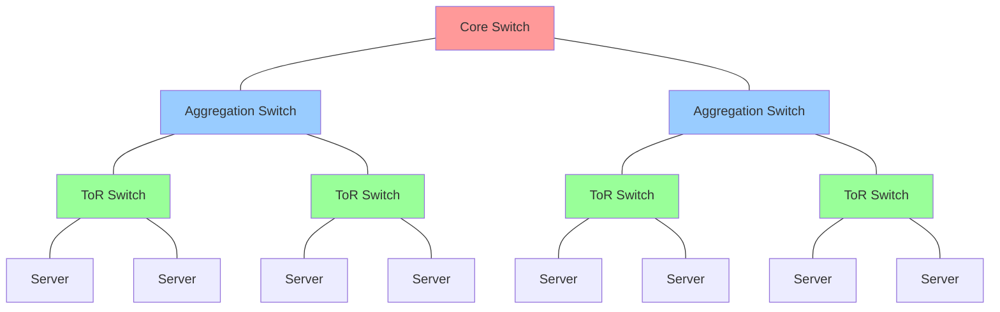
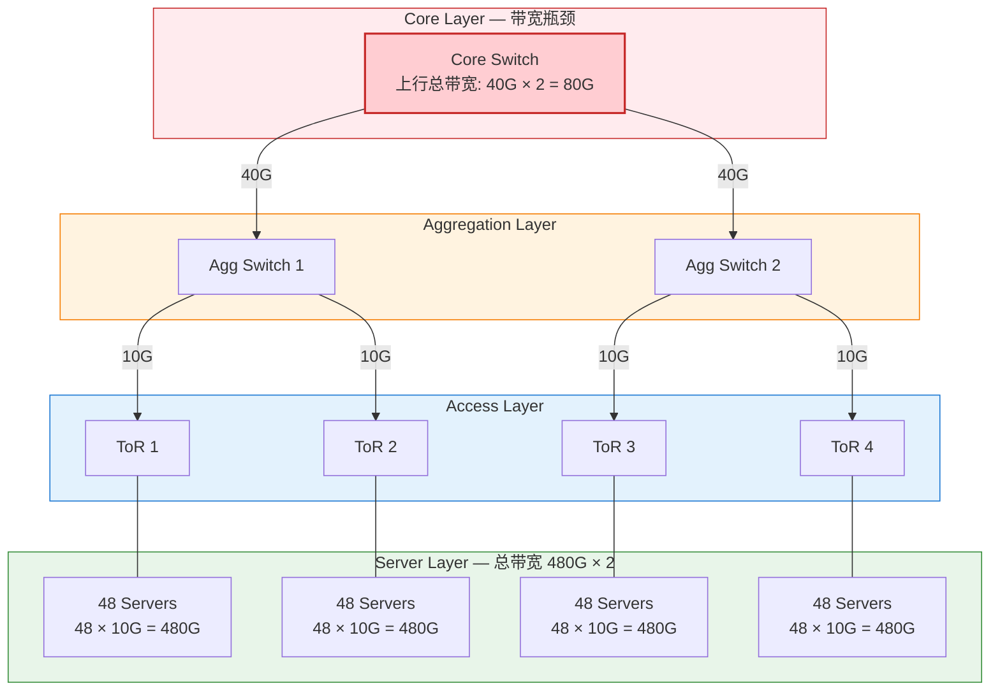
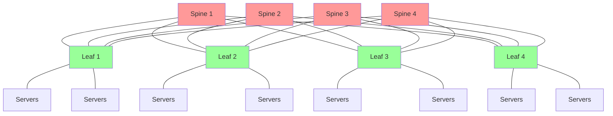
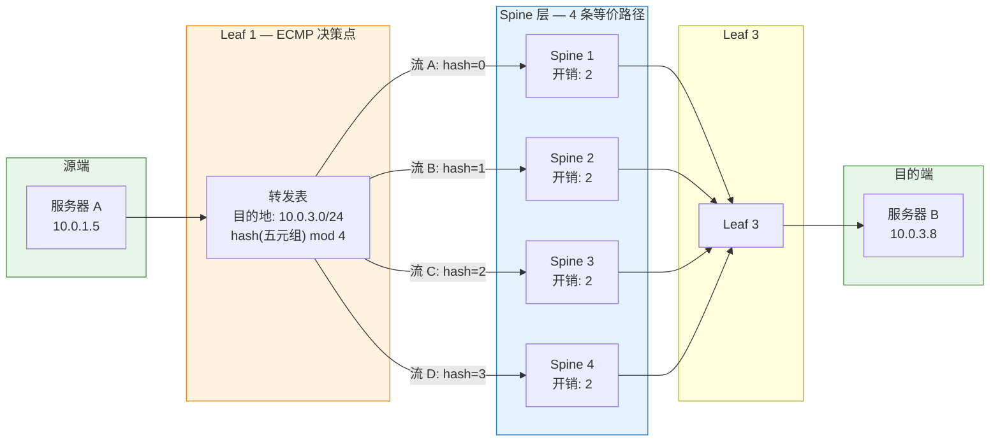

# 2. 十万台机器的网络

一台交换机连几十台机器，交换机学会了谁在哪个端口后面，广播域也还在可控范围内。  

但数据中心不是几十台机器的世界，它是由几千个机架、十万台服务器组成，每秒要处理数以亿计的内部数据包。规模的增长不只是数字变大，它改变了网络架构的基本假设。那些在小规模下够用的方案，交换机、路由器、VLAN，放进十万台机器的场景里，哪些会先撑不住？

## 2.1 数据中心的物理层次

首先可以肯定的是，没有哪台交换机有十万个端口。即使有，十万根网线从四面八方汇聚到一个点，物理上也接不过来。规模本身就决定了网络必须分层组织——不是为了好看，而是因为没有别的办法。

数据中心物理上是分层组织的。最底层是**机架**（Rack）：一个标准机架里垂直放着几十台服务器，机架顶部装有一台交换机，叫 **ToR**（Top of Rack）交换机。机架里的服务器都用短网线插到这台 ToR 交换机上。这就是接入层，是每台服务器进入网络的第一跳。

> **ToR 是什么？**
>
> ToR（Top of Rack，机架顶部交换机）是数据中心里最靠近服务器的一层交换机。它物理上安装在机架的顶部（或底部），通过短距离铜缆连接机架内的所有服务器。每台服务器的网络流量都要先经过 ToR 交换机，再进入上层网络。ToR 是数据中心网络的接入层，它决定了服务器的第一跳连接方式，也是很多网络功能（如 VTEP、ACL）的潜在执行点。

多个机架组成一个 **Pod**。Pod 内的 ToR 交换机不能直接互相连起来。如果有 20 个机架，ToR 之间两两互联需要 190 根网线，这就又回到了点对点全互联的老路。所以 Pod 内会有一层**汇聚交换机**（Aggregation Switch），所有的 ToR 交换机都连到汇聚交换机上，由它来负责 Pod 内部流量的转发。

在 Pod 之上，多个 Pod 之间通过**核心交换机**（Core Switch）实现互联，最终构成整个数据中心主干的物理骨架。

**图 2.1：传统数据中心三层网络架构**

接入层、汇聚层、核心层，这三层结构是传统数据中心网络的标准组织方式。但三层结构说的是物理连线层次，不是网络协议的层次。在很多传统数据中心里，接入层的 ToR 交换机和汇聚层的交换机都工作在**二层**，也就是靠 MAC 地址来转发包。整个 Pod 内部（也就是汇聚交换机下面挂的所有 ToR 和服务器）构成一个大的**二层广播域**。只有最上面的核心层交换机才工作在**三层**，做 IP 路由，负责跨 Pod 的流量转发。

这样设计，Pod 内部的通信能享受二层交换的低延迟，但也继承了二层的经典问题：广播和泛洪。几百台服务器共享一个广播域，一旦有大量的 ARP 请求，就会在 Pod 内部到处扩散，交换机的 MAC 地址表也会跟着变大。小规模下这没什么，但当服务器到了十万台，这就意味着有几十个 Pod，每个 Pod 内部有几百上千台机器，二层广播域的压力就会变得非常大。

在十万台机器的规模下，每一层交换机都要处理巨大的流量。两台机器之间看似简单的一次通信，数据包实际上要在这些物理层次里跑个来回，从 ToR 上行到汇聚，甚至核心，再走下去；只有运气好时，才能在同一个 ToR 内部直接发过去。

## 2.2 东西流量的爆发

传统三层架构是为一种特定的流量模型设计的：用户在外面，服务器在里面，流量主要是进进出出。用户从公网发起请求，流量进入数据中心，处理完后再送出去，这种纵向的、进出方向的流量叫做**南北流量**。三层架构就是为了南北流量设计的：流量从下往上穿过接入、汇聚、核心，然后出网。

然而，现代数据中心内部还涌现出了另一种流向的流量：比如应用服务器访问数据库、缓存服务器之间同步数据、微服务 A 调用微服务 B。这些流量不出数据中心，只在内部横向流动，叫做**东西流量**。

在传统企业网里，东西流量不多，所以三层架构默认大部分流量是南北向的。但现代数据中心的情况变了。在分布式系统和微服务架构下，用户发来一个请求，内部可能会触发几十次甚至上百次的服务间调用。一次外部请求产生的南北流量可能只有几 KB，但在内部引发的东西流量可能高达几 MB。在现代云数据中心里，东西流量已经占到了总流量的 70% 到 80%。

流量模型变了，但网络架构还是老样子。当大部分流量变成了横向通信，任意两台机器之间随时都需要大带宽，这套上下折返的三层架构就很难撑住了。

## 2.3 传统三层架构的瓶颈

显然是撑不住的。前面提到，在传统三层结构里，跨 Pod 通信必须一路上行到最上面的核心交换机，路由转发后再走下来。这种设计在南北流量时代很合适，但东西流量爆发后，瓶颈就出来了。

第一个问题是**路径太长**。两台分属不同 Pod 的机器要说话，数据包必须从 ToR 跑到汇聚，再爬到核心交换机，然后下行到目标 Pod 的汇聚和 ToR，最后才到目标机器。整整跑了四跳。哪怕两台机器就在同一个 Pod 的邻近机架里，数据包也得往上跑到汇聚层再折返下来。这种频繁的上下折返会增加延迟，而东西流量针对这些情况往往非常敏感。

第二个问题是**带宽收敛**。下层的带宽总和远大于上层的带宽，这是树状架构的固有特点。假设一个机架里有 48 台服务器，每台服务器是 10 Gbps 接入，下行总带宽就是 480 Gbps。但是 ToR 交换机到汇聚交换机的上行链路可能只有 40 Gbps。这就意味着**收敛比**（Oversubscription Ratio）达到了 12:1。48 台服务器要争抢 40 Gbps 的出口，在业务高峰需要跨机架大流量传输时，这个收敛比就会成为瓶颈。

**图 2.2：三层架构的带宽收敛**

第三个问题是 **STP 对冗余链路的浪费**。为了防止单点故障，交换机之间通常会连多条备用链路。但二层以太网怕环路，广播包一旦进入环路就会无限循环，直到把网络挤爆。所以必须用生成树协议（STP）把多余的链路逻辑上阻塞掉，确保全网没有环路。

但这样做的代价是：被阻塞的链路虽然接好了网线，却不能跑任何流量。相当于你花钱买的带宽，被 STP 强行废掉了一半。在东西流量极其珍贵的场景下，这种为了无环而浪费链路的手段，让人很难接受。

路径太长、带宽收敛、冗余链路浪费，这三个痛点的根源都是一样的：传统架构里“下面二层、上面三层”的限制。二层网络里因为 STP 只能保留单路径（一棵生成树），而跨 Pod 通信又必须绕道核心交换机。有没有一种拓扑，能解决这些老毛病？

## 2.4 Fat Tree：让每条路都能走

解决的思路其实就在问题本身。既然“下面二层、上面三层”的混合边界会带来限制，那如果我们把整张网络都推到三层，让每一台交换机都做 IP 路由，会怎么样？

三层路由天然支持多路径。像 BGP 或 OSPF 这样的路由协议，可以自动发现多条到达同一个地方的路径。路由器能同时使用这些路径，而不需要像 STP 那样把多余的路径关掉。因为 IP 报文里有 TTL（生存时间）等机制来防环，不会像二层广播包那样无限循环。

> **BGP 是什么？**
>
> BGP（Border Gateway Protocol，边界网关协议）是互联网上使用最广泛的路由协议。它的核心工作方式是：每台路由器把自己知道的可达网段告诉邻居，邻居再传播给它的邻居，最终所有路由器都知道如何到达网络中的每个子网。在数据中心的 Leaf-Spine 架构中，BGP 被用来让每台 Leaf 交换机自动发现到达其他 Leaf 下面子网的所有路径，包括经过不同 Spine 的多条等价路径。

基于这个思路，我们可以把传统的树形结构“倒过来”设计：不再让流量往少数核心节点汇聚，而是在每一层都修足够多的路，让任意两台机器之间都有好几条路可走。这就是 **Fat Tree**（胖树）拓扑的核心思路：越往上越宽，路越多，而不是越往上越窄。

Fat Tree 最常见的方式是 **Leaf-Spine** 架构。它把网络简化成了扁平的两层：底层是 **Leaf** 交换机（相当于 ToR），上层是 **Spine** 交换机。这种架构有两个要点：第一，连接方式上**每台 Leaf 都要连到每台 Spine**，比如 4 台 Spine 和 8 台 Leaf 之间会有 32 条线，任意两台 Leaf 之间都有 4 条平行的等价路径；第二，**Leaf 和 Spine 全部工作在三层**，设备之间跑路由，没有了跨交换机的大二层网络。更准确地说，Leaf 交换机就是二层的终点，每台 Leaf 下面的服务器构成自己独立的小广播域，跨 Leaf 的通信全部通过路由解决。

**图 2.3：Leaf-Spine（Fat Tree）拓扑**

这种全互联 + 全三层的结构带来了几个关键变化。

首先，任意两台 Leaf 之间有多条等价路径，不存在单一的汇聚瓶颈。如果 Spine 层有 N 台交换机，任意两台 Leaf 之间就有 N 条路径可选。带宽不再随着层级上升而收窄，理论上，如果 Spine 的数量和带宽配置得当，可以实现**无收敛**（Non-blocking），即任意两台服务器之间可以同时以线速通信。

其次，所有链路都是活跃的。因为整个网络工作在三层，路由协议天然支持多路径，不需要 STP，也就不存在被阻塞的冗余链路。

在超大规模的数据中心里，两层的 Leaf-Spine 可能不够，Spine 交换机的端口数量限制了能连接的 Leaf 数量。这时会引入第三层：**Super Spine**，形成三级 Fat Tree。多个 Leaf-Spine Pod 通过 Super Spine 互联，原理不变，只是多了一层。

Fat Tree 的代价也很明显：需要大量的交换机和线缆，每台 Leaf 都得连到每台 Spine，布线复杂度和硬件成本都会上去。但在东西流量为主的数据中心里，这个代价是完全划得来的，带宽就是生产力，被 STP 强行关掉的备用链路才是真正的浪费。

不过，Fat Tree 解决了路径有没有的问题，还没有解决路径怎么用的问题。四条等价路径摆在那里，如果所有流量都走同一条，其他三条就是摆设。

## 2.5 ECMP：多条路径如何均衡使用

Fat Tree 提供了多条等价路径，但路径摆在那里不等于会被用起来。

先看路由器是怎么知道有多条等价路径的。在 Leaf-Spine 架构中，每台交换机都运行路由协议（通常是 BGP）。每台 Leaf 把自己直连的子网通告出去，Spine 收到后再转发给其他 Leaf。当 Leaf 1 要到达 Leaf 3 下面的某台服务器时，它会从 Spine 1、Spine 2、Spine 3、Spine 4 分别收到一条路由通告，这四条路由的目的地相同、跳数相同、开销相同，它们是**等价路由**。

传统路由协议的做法是从中选一条最优的，其余丢弃。但在 Fat Tree 里，这四条路由完全等价，选哪条都一样。**ECMP**（Equal-Cost Multi-Path，等价多路径路由）改变了这个逻辑：路由器不再只选一条路，而是把这四条等价路由全部保留在转发表里，然后按某种规则把不同的流量分配到不同路径上。

> **ECMP 是什么？**
>
> ECMP（Equal-Cost Multi-Path，等价多路径路由）是一种路由策略：当路由表中存在多条到达同一目的地的等价路由（跳数相同、开销相同）时，不再只选一条，而是把流量分散到所有等价路径上。分散的方式通常是对数据包的五元组（源 IP、目的 IP、源端口、目的端口、协议号）做哈希，保证同一条连接的包始终走同一条路径（避免乱序），不同连接的包走不同路径（实现均衡）。ECMP 是 Fat Tree / Leaf-Spine 架构能够充分利用多条物理链路的关键机制。

**图 2.4：ECMP 在 Leaf-Spine 中的工作方式**

上文提到的某种规则通常是**哈希**。路由器取出数据包的五元组，源 IP 地址、目的 IP 地址、源端口、目的端口、协议号，计算一个哈希值，用这个哈希值对路径数量取模，决定走哪条路径。同一条 TCP 连接的所有包，五元组相同，哈希值相同，走同一条路径；不同的连接，五元组不同，大概率走不同的路径。

为何不能采用逐包转发的分配策略（例如首包走路径1，次包走路径2）？这是由于不同链路的物理传输延迟存在微小差异，逐包负载均衡极易导致 TCP 数据包发生乱序。而 TCP 协议栈对于报文乱序极其敏感，一旦乱序发生，接收端会判定网络出现了丢包，从而频繁触发快速重传并主动调小拥塞窗口，导致吞吐率雪崩。因此，按流分配确保了同一 TCP 会话的所有报文皆走同一路由路径，彻底避免了乱序隐患。

然而，基于流的五元组哈希分配存在一个天然缺陷：大象流（Elephant Flow）。如果在网络中产生了一次超大规模的数据迁移或持续的数据库同步，该大象流将独占其中一条 Spine 链路的带宽，而其他平行路径则处于闲置状态。哈希函数在数学分布上虽然是均匀的，但业务流量的实际载荷却并非如此。少数大象流的存在，会让 ECMP 的实际均衡效果大打折扣。

针对大象流的治理，业界也有相关探索：**Flowlet 调度**利用 TCP 数据流的突发特性，在流突发（Burst）的静默间隙内安全地切换出口路径，兼顾了多路径均衡与报文保序；而**随机喷洒**（Packet Spray）则更为激进地执行逐包负载均衡，但需要网卡硬件或接收端具备强大的重排序缓冲区。这些改进方案在提升链路利用率的同时，也对软硬件的实现复杂度提出了更高的要求。

尽管 ECMP 并不完美，但它依然是 Leaf-Spine 拓扑不可或缺的底层支柱。缺少了等价路由调度，Leaf-Spine 拓扑就像是修筑了四车道的高速公路却仅允许单车道行驶，虽有充裕的物理资源，却无法转化为实际的吞吐性能。

## 2.6 规模下的隔离困境

Fat Tree 架构铺平了拓扑道路，ECMP 调度则实现了路径的按需均衡，十万台服务器自此获得了高弹性的多路互通能力。但当我们将整个网络架构推进到三层边界时，另一个更底层的工程冲突开始显现：**跨 Leaf 节点的同网段通信该如何进行？**

在传统的二层以太网中，处于相同逻辑子网的服务器可以通过二层帧与 MAC 地址直接寻址。但在 Leaf-Spine 架构中，每台 Leaf 交换机均构成了三层路由的边界。处于 Leaf 1 下的服务器与 Leaf 2 下的服务器，即便被配置了同一个子网的 IP 地址，它们之间的流量也必须经由 Spine 的三层路由转发，因为连接两者的上层 Spine 是路由器而非二层交换机。

由此导致的结果是，二层广播域被严格限制在单台 Leaf 交换机之下。Leaf 1 下挂的服务器与 Leaf 2 下挂的服务器分属不同的广播域，无法通过原生的二层机制直接通信。

从抑制广播风暴的视角看，这无疑是一次架构上的进步。广播域的极度缩小意味着 ARP 风暴被限制在个位数机架的局部范围内。如果十万台服务器被置于同一个大二层广播域中，任何一次 ARP 广播都可能引发全局性的网络瘫痪。

然而，从网络管理的视角看，这引入了系统性的运维难题。经典的计算资源管理极度依赖“同子网即同广播域”的默认规则——在同一个子网内分配连续的 IP 地址、通过 ARP 广播直接解析物理 MAC。但在全三层 Leaf-Spine 拓扑中，虚拟机的部署位置由计算调度算法动态决定，根本无法保证同一业务系统的机器能够恰好收拢在同一台 Leaf 交换机下。逻辑上的子网，就此被物理拓扑撕裂了。

更宏观的挑战在于，这十万台机器并非交付给单一组织使用，而是要托管成千上万个互不信任的云租户。每个租户都需要独立的地址规划、完全隔离的通信边界。底层的物理路由网络虽然能输出强大的带宽与路径转发能力，却无法在底层协议中感知“租户”的概念。

拓扑结构由 Fat Tree 承载，路径均衡由 ECMP 调度，但当成千上万个互不信任的云租户同时共享这套物理网络时，又会碰撞出怎样的安全与隔离冲突？
