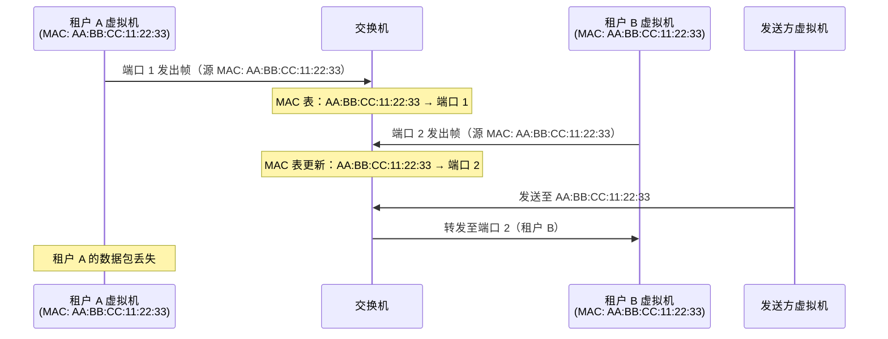
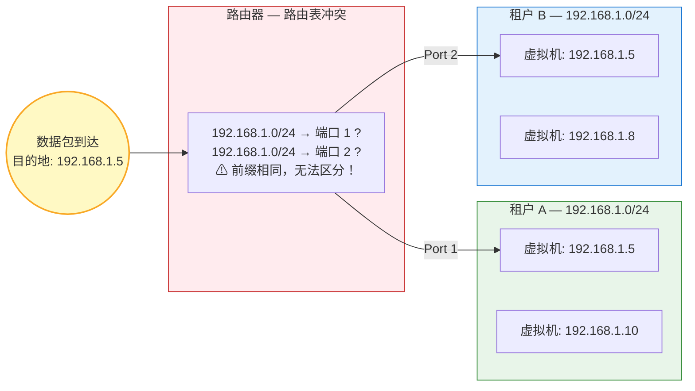
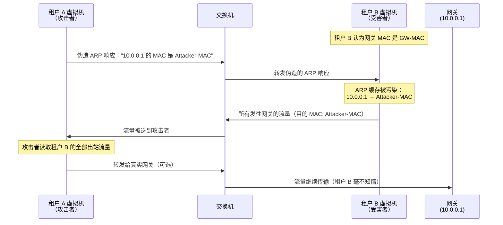

# 3. 共用网络的噩梦

假设你是一家云厂商的网络工程师。你的数据中心里有十万台服务器，Leaf-Spine 拓扑已经搭好，ECMP 在均衡地分配流量，物理网络本身运转良好。现在，销售团队告诉你：这些服务器要卖给一百万个客户使用。每个客户都会在上面创建虚拟机，配置自己的 IP 地址，跑自己的业务。

这些虚拟机全都挂在同一张物理网络上。

每个客户付了钱，他们的预期很简单：我的网络是我的，别人看不到我的流量，也不会干扰我的业务。但现实是，你还没有做任何隔离，租户 A 的虚拟机和租户 B 的虚拟机可能被调度到同一台物理服务器上，它们的流量会经过同一块网卡、同一根网线、同一台 Leaf 交换机；即使落在不同的 Leaf 下面，它们的路由表项也共享同一张全网路由空间。物理网络里没有租户这个概念，它只认 MAC 和 IP。

有人会想：第 2 章不是说 Leaf-Spine 全三层、二层广播域已经被限制在每台 Leaf 下面了吗？几十台机器的广播域，问题不该没那么严重？

物理拓扑确实帮忙缩小了广播域，但缩小不等于消除。同一台 Leaf 下的几十台服务器可能承载着几十个不同租户的虚拟机，它们仍然共享同一张 MAC 表、同一个 ARP 广播域；而 IP 层的冲突根本不受二层边界保护，路由是全网的，租户 A 在 Leaf 1、租户 B 在 Leaf 2 都用 192.168.1.0/24，路由器一样区分不了。

接下来发生什么？

## 3.1 一张网，一百万个租户

云计算的商业模型建立在一个核心假设之上：物理资源可以被虚拟化，然后按需分配给不同的客户。CPU 可以切分成虚拟核，内存可以按 GB 分配，磁盘可以按卷划分。网络也不例外，一张物理网络要被切分成许多份，每份卖给一个租户。

每个租户拿到的是一组虚拟机。这些虚拟机运行在不同的物理服务器上，但租户不关心物理位置，他只关心自己的虚拟机之间能通信，自己的数据不被别人看到。从租户的视角看，他拥有一个独立的、私有的网络环境，就像自己买了一批服务器搭了一个内网一样。

但从物理网络的视角看，所有租户的虚拟机都是接在同一张网上的节点。租户 A 的虚拟机和租户 B 的虚拟机可能运行在同一台物理服务器上，通过同一块网卡、同一根网线、同一台 Leaf 交换机收发数据。物理网络并没有租户这个概念，它只看到 MAC 地址和 IP 地址。在它眼里，所有虚拟机都是平等的网络节点，没有谁属于谁的区分。

这种物理共享、逻辑独立的需求，是云计算区别于传统 IT 的根本特征。传统企业网络只有一个管理员，所有设备都属于同一个组织，信任关系是天然的，网络里的每台机器都是自己人。但云网络上跑着成千上万个互不信任的租户，他们之间不仅没有信任关系，甚至可能是竞争对手。租户 A 是一家电商公司，租户 B 是它的竞争对手，租户 C 可能是一个安全研究员，租户 D 可能怀有恶意。所有这些角色的虚拟机，都挂在同一张物理网络上。

传统网络的安全模型建立在边界信任之上，防火墙守住外围，内部网络默认可信。但云网络没有内部和外部的区分，所有租户都在内部，而他们之间互不信任。这是一个根本性的信任模型变化，传统网络的设计假设在这里完全失效。

如果云厂商什么隔离都不做，直接把租户的虚拟机扔进这张物理网络，灾难不是可能发生，而是一定发生。而且不是一种灾难，是一连串的、互相叠加的灾难。

## 3.2 MAC 地址冲突与 ARP 广播风暴

第一个问题出在最底层，MAC 地址。

物理网卡的 MAC 地址是出厂时烧录的，全球唯一，不会冲突。但虚拟机的网卡是软件模拟的，MAC 地址是软件生成的。云厂商的虚拟化平台在创建虚拟机时，需要为每块虚拟网卡分配一个 MAC 地址。如果分配算法不够好，或者不同的物理服务器上的虚拟化平台各自独立生成 MAC 地址而没有全局协调，两台虚拟机拿到相同 MAC 地址的概率并不低。

MAC 地址是 48 位的，理论上有 2^48（约 281 万亿）个可能的值，看起来冲突概率极低。但虚拟化平台通常不会使用全部地址空间，它们会使用特定的 OUI 前缀（前 24 位），只有后 24 位是随机生成的。24 位意味着约 1677 万个可能的值。当一个数据中心里有几十万台虚拟机时，根据生日悖论，MAC 冲突的概率远比直觉上高得多。

> **什么是生日悖论？**
>
> 生日悖论是概率论中一个违反直觉的结论：在一个房间里，只需要 23 个人，就有超过 50% 的概率出现两个人生日相同。365 天里才 23 个人就能过半，这比大多数人的直觉低得多。背后的数学原理是：我们比较的不是某个人和特定日期是否匹配，而是任意两个人之间是否匹配，而两两配对的组合数随人数增长非常快（23 个人有 253 种配对）。推广到 MAC 地址的场景：24 位随机空间有约 1677 万个可能值，看起来很大。但根据生日悖论的公式（k ≈ 1.2 × √N），只需要约 4900 台虚拟机，冲突概率就超过 50%，1677 万分之一的单次碰撞概率，在不到五千台机器的规模下就变成了大概率事件。而一个数据中心动辄几十万台虚拟机，冲突几乎是必然的。

MAC 地址冲突会导致什么？交换机的 MAC 表记录的是这个 MAC 地址在哪个端口后面。如果两台虚拟机的 MAC 地址相同，交换机会在两个端口之间反复跳动，刚学到 MAC-X 在端口 1 后面，下一秒又发现 MAC-X 从端口 2 发来了帧，于是更新为端口 2。结果是，发给 MAC-X 的帧时而被送到租户 A 的虚拟机，时而被送到租户 B 的虚拟机。租户 A 的数据库响应包被送到了租户 B 那里，租户 B 莫名其妙收到了一堆不属于自己的数据。

**图 3.1：MAC 地址冲突导致的转发混乱**

这个问题不仅导致数据丢失，还导致数据泄露，租户 B 收到了本应发给租户 A 的数据。对于处理敏感信息的业务（金融交易、医疗记录、用户隐私数据），这是不可接受的安全事故。

即使 MAC 地址不冲突，第二个问题紧随其后，ARP 广播的信任泄露。

ARP 请求是广播帧，广播域内的每台机器都会收到。第 2 章讲过，Leaf-Spine 的三层架构已经把广播域切小了，一台 Leaf 下面通常只有几十台服务器，广播风暴的规模问题很大程度上被物理拓扑吸收了，这是好消息。

但坏消息是，**广播域小不等于广播里没有敏感信息**。同一台 Leaf 下的几十台服务器上，跑着的可能是几十个互不相识的租户的虚拟机。企业内网里，所有机器都是自己人，谁在找谁无关紧要；到了云网络，监听者可能就是竞争对手。每一个 ARP 请求都在公开宣告我是 10.0.1.3，我在找 10.0.1.5。租户 B 的虚拟机只要被动接收 ARP 广播，就能知道同一台 Leaf 下的租户 A 有哪些虚拟机、用了哪些 IP 地址、正在和谁通信。网络拓扑和通信模式，就这样被广播出去了。

## 3.3 IP 地址段冲突

MAC 地址冲突影响的是二层转发，IP 地址冲突影响的是三层路由，问题更深，也更难解决。

租户 A 给自己的虚拟机配了 192.168.1.0/24 这个网段，租户 B 也配了 192.168.1.0/24。在传统的单租户网络里，这不是问题，整个网络只有一个管理员，IP 地址由他统一规划，不会冲突。但在云计算的多租户场景下，每个租户都有自己的 IP 规划习惯。

为什么不能让云厂商统一分配 IP，禁止租户自选？因为很多企业有自己的内部网络，IP 地址段是多年前就规划好的。当这些企业把业务迁移到云上时，他们希望保留原有的 IP 地址规划，应用程序里硬编码的 IP、防火墙规则里写死的网段、运维脚本里的地址范围，全都不想改。如果云厂商强制分配新的 IP 段，迁移成本会高到让企业放弃上云。

这不是少数企业的特殊需求。几乎所有有一定规模的企业都有自己的 IP 规划，而且大量企业不约而同地使用了相同的私有地址段，10.0.0.0/8 和 172.16.0.0/12 是最常见的选择。其中 10.0.0.0/8 尤其受欢迎，因为它提供了约 1677 万个地址，足够大多数企业内部使用。当几千家企业同时上云，它们的子网之间几乎必然存在重叠，不仅仅是两个租户恰好选了同一个网段，即使选了不同的子网（比如一个用 10.1.0.0/16，另一个用 10.0.0.0/8），路由表中也会出现前缀重叠的问题。

所以云厂商必须允许租户自选 IP 地址段，但这就带来了冲突。

当两个租户都使用 192.168.1.0/24 时，路由器收到一个目的地为 192.168.1.5 的数据包，它应该送给租户 A 还是租户 B？路由表里只有一条 192.168.1.0/24 的记录，路由器无法区分。要么包被送到了错误的租户那里，要么路由表直接冲突，后写入的记录覆盖了先写入的，其中一个租户的网络彻底断掉。

**图 3.2：IP 地址段冲突导致路由无法区分**

这个问题的根源比 MAC 冲突更深，MAC 冲突可以通过全局协调分配来避免，毕竟 MAC 地址是云厂商生成的，可以控制。但 IP 地址段是租户选择的，云厂商不能强制干预。而且私有地址空间本身就是有限的，RFC 1918 定义的三个私有地址段（10.0.0.0/8、172.16.0.0/12、192.168.0.0/16）总共约 1770 万个地址。一百万个租户瓜分这些地址，冲突几乎是必然的。

更麻烦的是，IP 地址冲突不像 MAC 冲突那样只影响单台交换机的转发，它影响的是整个路由体系。路由器是按照最长前缀匹配来查找路由的，当两条完全相同的路由出现在路由表里，路由器的行为是未定义的，不同厂商的实现可能不同，有的选第一条，有的选最后一条，有的直接报错。无论哪种行为，结果都是至少一个租户的网络不可用。

## 3.4 流量越界与安全边界消失

前面三个问题，MAC 冲突、ARP 广播、IP 冲突，本质上都是效率和正确性的问题。接下来的问题性质不同：它关乎**安全**。

在没有隔离的共享网络里，租户 A 的虚拟机发出的数据帧，可以到达租户 B 的虚拟机的网卡。这不需要任何特殊技巧，在同一个二层广播域里，只要知道目标的 MAC 地址，帧就能被交换机送到目标端口。而获取目标的 MAC 地址也不难，监听 ARP 广播就行了，每一个 ARP 请求都在公开宣告自己的 IP 和 MAC 映射关系。

更危险的是**混杂模式**（Promiscuous Mode）。正常情况下，网卡只接收目的 MAC 地址是自己的帧，其他帧直接丢弃。但如果把网卡设为混杂模式，它会接收经过自己的**所有**帧，不管目的地是谁。

> **混杂模式是什么？**
>
> 混杂模式（Promiscuous Mode）是网卡的一种工作状态。正常模式下，网卡只接收目的 MAC 地址与自己匹配的帧，其余一律丢弃。开启混杂模式后，网卡会接收经过它的所有帧，无论目的地是谁。这个功能最初是为网络调试和抓包设计的（tcpdump、Wireshark 等工具依赖它），但在共享网络中，它也可以被用于窃听其他节点的流量。在云环境中，宿主机通常会禁止 VM 开启混杂模式，以防止租户之间的流量窃听。

在共享的二层网络里，交换机在学习 MAC 地址的过程中，会把未知目的地的帧泛洪到所有端口。一台开启了混杂模式的虚拟机，可以捕获广播域内大量的流量，包括其他租户的数据。

这意味着租户 A 可以看到租户 B 的数据库查询结果、API 请求内容、用户登录凭证，任何在网络上传输的未加密数据，都暴露在所有人面前。即使数据是加密的，流量模式本身也是有价值的情报，租户 A 可以通过分析租户 B 的流量模式，推断出它的业务高峰时段、服务器数量、甚至业务类型。

没有任何访问控制使情况更加恶化。租户 A 的虚拟机可以主动向租户 B 的数据库端口发起连接，没有防火墙、没有安全组、没有任何东西阻止这件事。如果租户 B 的数据库恰好没有设置强密码（在内网环境里，很多管理员会放松安全意识，认为反正是内网，不需要太强的密码），租户 A 就能直接访问租户 B 的数据。

最具破坏力的攻击是 **ARP 欺骗**。

**图 3.3：ARP 欺骗实现中间人攻击**

ARP 协议没有任何认证机制，这是它在 1982 年被设计时的一个有意的简化。在当时的网络环境里，所有机器都属于同一个组织，信任是默认的。任何一台机器都可以发送 ARP 响应，声称自己是任意 IP 地址的拥有者，接收方没有任何手段来验证这个声明的真实性。

租户 A 的虚拟机可以伪造一个 ARP 响应，告诉租户 B 的虚拟机：网关 10.0.0.1 的 MAC 地址是我的 MAC 地址。租户 B 的虚拟机信以为真，更新自己的 ARP 缓存，把所有发往网关的流量都发给了租户 A。租户 A 就成了中间人，它可以查看、修改、甚至丢弃租户 B 的所有流量，而租户 B 完全不知情。如果租户 A 在查看完数据后再把流量转发给真正的网关，租户 B 的通信看起来一切正常，中间人攻击可以长期持续而不被发现。

在没有隔离的共享网络里，一个恶意租户可以窃听所有人的通信、劫持任何人的流量、伪造任何人的身份。这不是技术漏洞，这是架构缺失。网络从设计上就没有考虑过不信任的多方共用同一张网这个场景。

值得注意的是，这些安全问题不需要攻击者有多高的技术水平。ARP 欺骗的工具在互联网上随处可得，混杂模式抓包只需要一条命令。在没有隔离的共享网络里，攻击的门槛极低，而防御的成本极高，因为问题出在架构层面，不是某个软件的 bug 可以打补丁修复的。

## 3.5 问题清单

把前面暴露的所有问题整理出来，每一个都是真实的、具体的、必须被解决的：

| 编号 | 问题 | 影响层次 | 影响 |
|------|------|---------|------|
| Q3-1 | MAC 地址冲突 | 二层 | 同一 Leaf 下 MAC 表混乱，帧被送到错误的租户 |
| Q3-2 | ARP 广播的信任泄露 | 二层 | 同一 Leaf 下的租户互相看得到对方的 IP-MAC 映射和通信意图 |
| Q3-3 | IP 地址段冲突 | 三层 | 全网路由表无法区分不同租户的相同网段，路由失效 |
| Q3-4 | 流量越界 | 二层/三层 | 同一广播域内租户之间数据帧可达，混杂模式可窃听 |
| Q3-5 | 安全边界消失 | 全层次 | 无访问控制、ARP 欺骗、中间人攻击，信任体系崩塌 |

这五个问题不是孤立的，它们共同指向一个根本缺失：**物理网络不知道租户是什么**。Leaf-Spine 只解决了带宽和路径的问题，广播域被切小是它顺手带来的副产品，但它从来不是为多租户隔离设计的。二层的 MAC 表和 ARP 广播不区分租户，三层的路由表也不区分租户，流量越界和安全边界消失贯穿所有层次。任何一个单独拿出来都足以让云服务无法商用，五个叠加在一起，就是一场系统性的灾难。

这些问题之间还存在互相放大的效应，MAC 冲突导致帧被送到错误的目的地，这本身就是一种流量越界；ARP 广播泄露了所有虚拟机的 IP-MAC 映射，为 ARP 欺骗提供了完美的情报；IP 地址冲突让路由器无法正确转发，可能导致一个租户的流量被送到另一个租户的网段里。每一个问题都在为其他问题创造条件，形成一个恶性循环。

从商业角度看，这些问题中的任何一个被公开曝光，都足以摧毁一家云厂商的信誉。租户 A 的数据被租户 B 看到了，这一条新闻就够了。云计算的商业模型建立在信任之上：租户相信云厂商能保护他们的数据安全和网络隔离。一旦这个信任被打破，不仅当事租户会离开，整个市场对这家云厂商的信心都会动摇。安全和隔离不是锦上添花的功能，而是云计算能否存在的前提条件。信任一旦崩塌，再建难于登天，这不是技术问题，而是生死问题。

解决这些问题需要的不是修修补补，而是从根本上在共享的物理网络之上建立隔离机制。最直接的思路是什么？数据中心里有一个现成的、成熟的、所有交换机都支持的隔离方案：VLAN。它能把广播域切开，给不同的租户分配不同的 VLAN ID。

但 VLAN 能撑住云计算的规模吗？
