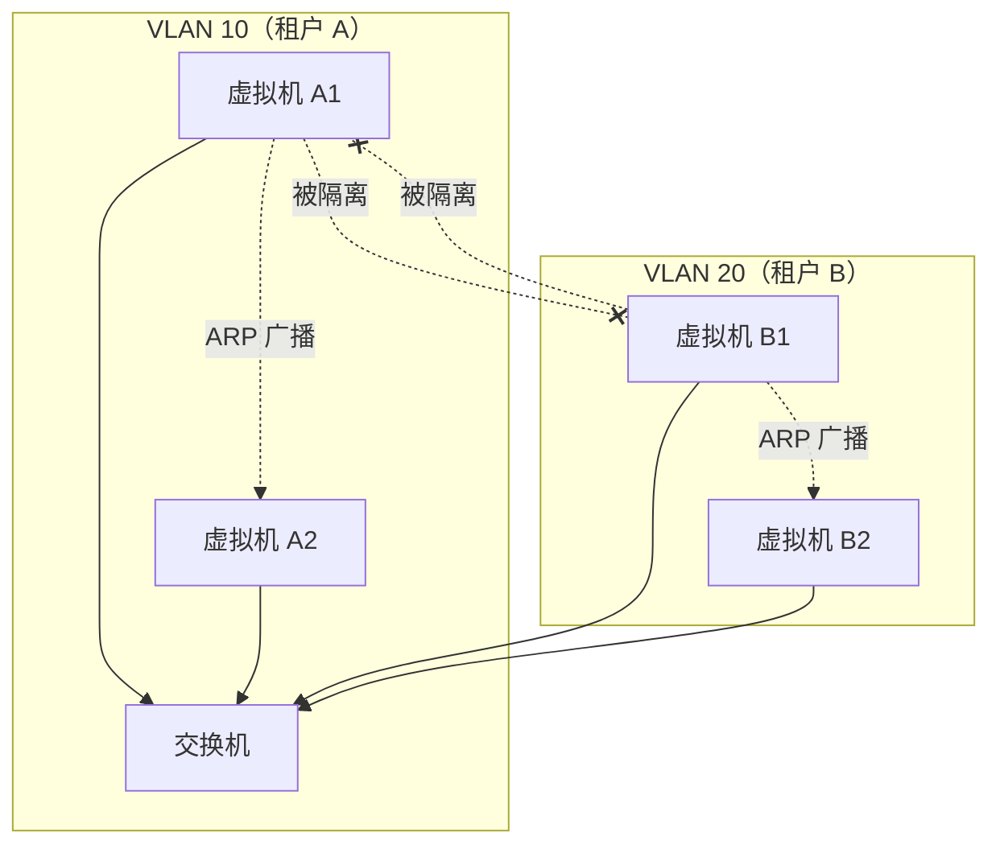
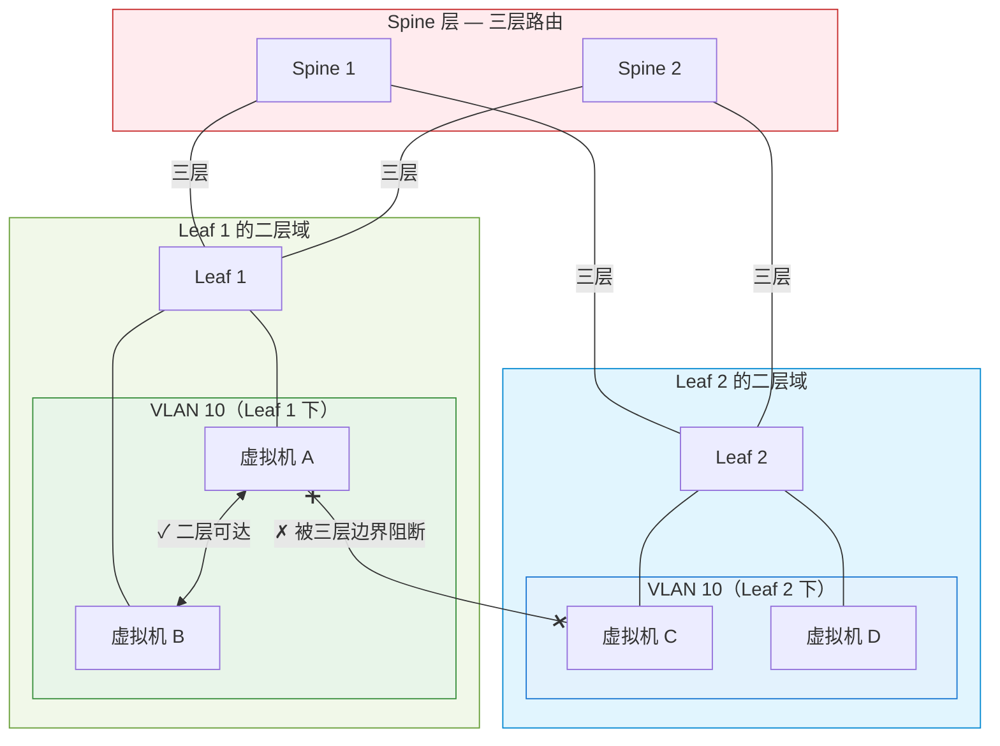

## 4. VLAN 的边界

面对第 3 章暴露的那些灾难，MAC 冲突、ARP 信息泄露、IP 地址段冲突、流量越界、安全边界消失，最自然的反应是去找一个现成的隔离方案。不需要发明什么新技术，数据中心里早就有一个广泛部署的、所有交换机都支持的工具：VLAN。给不同的租户分配不同的 VLAN ID，同一台 Leaf 下的二层域就被进一步切开，二层层面的大部分问题似乎都能迎刃而解。

VLAN 确实是一个好方案，在小规模的企业网络里，它简单、成熟、可靠。但云计算不是小规模的企业网络。当租户数量从几十个变成几十万个，当虚拟机分布在几千个机架上，VLAN 还撑得住吗？

## 4.1 VLAN 能解决什么
**VLAN**（Virtual Local Area Network，虚拟局域网）的思路很直接：在同一台交换机上，用一个标签把端口分组，不同组之间的广播互不可见。

实现机制是这样的：在以太网帧的头部插入一个 4 字节的 **802.1Q Tag**，其中包含一个 12 位的 **VLAN ID**。交换机根据 VLAN ID 把端口划分成不同的组，同一个 VLAN 的端口之间可以互相通信，不同 VLAN 的端口之间完全隔离。广播帧只在同一个 VLAN 内传播，不会泄漏到其他 VLAN。

当一个帧从某个端口进入交换机时，交换机会检查这个端口属于哪个 VLAN（这是管理员预先配置好的）。如果帧没有 VLAN Tag，交换机会给它打上这个端口所属的 VLAN Tag；如果帧已经有 Tag，交换机会检查 Tag 是否和端口的 VLAN 配置匹配。然后，交换机在转发时只会把帧发到属于同一个 VLAN 的端口，其他 VLAN 的端口完全看不到这个帧。

> **802.1Q Tag 的结构**
>
> 802.1Q 是 IEEE 定义的 VLAN 标准。它在以太网帧的源 MAC 地址和 EtherType 之间插入 4 个字节：2 字节的 TPID（固定为 0x8100，标识这是一个带 VLAN Tag 的帧）和 2 字节的 TCI（包含 3 位优先级、1 位 DEI 标志、以及 12 位的 VLAN ID）。交换机看到 TPID 为 0x8100，就知道后面跟着 VLAN 信息，据此决定这个帧属于哪个广播域。
>
> ```
> ┌──────────┬──────────┬──────────────┬────────────┬──────────────────┬──────┐
> │ Dst MAC  │ Src MAC  │  802.1Q Tag  │ Type/Len   │    Payload       │ FCS  │
> │ (6 bytes)│ (6 bytes)│  (4 bytes)   │ (2 bytes)  │ (46-1500 bytes)  │(4 B) │
> └──────────┴──────────┴──────┬───────┴────────────┴──────────────────┴──────┘
>                              │
>                     ┌────────┴────────┐
>                     │   802.1Q Tag    │
>                     ├─────┬───┬───────┤
>                     │TPID │PCP│ VID   │
>                     │0x8100│3b │12 bit│
>                     │     │+1b│       │
>                     └─────┴───┴───────┘
> ```

回到第 3 章的问题清单，逐一对照：

**MAC 地址冲突**，如果租户 A 在 VLAN 10，租户 B 在 VLAN 20，即使两台虚拟机的 MAC 地址相同，交换机也不会混淆。因为 MAC 表是按 VLAN 分开维护的，"MAC-X 在 VLAN 10 的端口 1 后面"和"MAC-X 在 VLAN 20 的端口 2 后面"是两条独立的记录，互不干扰。这就像同一栋楼里可以有两个301 室，只要它们在不同的单元，门牌号相同也不会搞混。


**ARP 广播的信任泄露**，ARP 请求是广播帧，但广播只在同一个 VLAN 内传播。同一台 Leaf 下面就算混住着几十个租户，VLAN 把他们各自圈起来之后，租户 A 的 ARP 请求不会到达租户 B 的虚拟机。租户 B 听不到租户 A 在找谁，也就无从推断它的拓扑和通信模式。不仅如此，广播域从一台 Leaf 下的几十台机器进一步缩小到一个租户的几台机器，ARP 广播的规模也同步降了一个数量级。

**流量越界**，不同 VLAN 之间的帧无法互相到达。租户 A 的虚拟机即使知道租户 B 的 MAC 地址，发出的帧也会被交换机拦截，因为它们不在同一个 VLAN 里。混杂模式也没用，网卡只能收到同 VLAN 内的帧。交换机在转发时会检查帧的 VLAN ID 和端口的 VLAN 归属，不匹配的帧直接丢弃，不会出现在其他 VLAN 的端口上。

**ARP 欺骗**，ARP 欺骗的前提是攻击者和受害者在同一个广播域内。VLAN 把广播域切开后，租户 A 的伪造 ARP 响应根本到不了租户 B 的虚拟机。攻击者发出的 ARP 欺骗帧被限制在自己的 VLAN 里，跨 VLAN 的中间人攻击从物理上被阻断了。

**图 4.0：VLAN 隔离效果示意**



四个问题，VLAN 解决了三个半，MAC 冲突、ARP 广播、流量越界被完全解决，ARP 欺骗在跨租户场景下也被阻断。唯一没有触及的是 **IP 地址段冲突**，VLAN 是二层隔离，它不管三层的 IP 地址。两个 VLAN 里的虚拟机可以用相同的 IP 地址段，在各自的 VLAN 内部通信没有问题。但当它们需要跨 VLAN 通信（比如访问公网）时，路由器仍然会面对地址冲突的问题，路由表里出现两条相同的目的网段，路由器不知道该往哪个 VLAN 转发。

而且 VLAN 的隔离是在交换机的硬件层面实现的，ASIC 芯片在转发每一个帧时都会检查 VLAN ID，不匹配的帧在硬件层面就被丢弃了，不需要任何软件参与。这意味着 VLAN 的隔离性能几乎没有开销，不会影响正常的转发速度。

> **ASIC 是什么？**
>
> ASIC（Application-Specific Integrated Circuit，专用集成电路）是为某一类特定任务定制的芯片。和 CPU 这种通用处理器不同，ASIC 的电路在设计阶段就把功能焊死在硅片上：查 MAC 表、解析 VLAN Tag、匹配转发规则、更新 TTL、重写头部，这些原本在 CPU 上要跑成百上千条指令的操作，在 ASIC 里被固化成硬件流水线，一个时钟周期就能完成一步。
>
> 这带来了两个直接后果。一是速度极快，一台数据中心交换机的 ASIC 可以做到每秒转发数十亿个包、几十 Tbps 的吞吐，这是通用 CPU 完全达不到的量级。二是不灵活，芯片流片之后功能就定型了，想让它支持一个新协议、一个新的头部字段，只能等下一代芯片。

仅就隔离而言，VLAN 的表现相当出色。物理连接没有任何变化，线还是那些线，交换机还是那台交换机，但交换机用软件逻辑把一个广播域切成了多个。这是一个值得停下来体会的时刻：网络的边界第一次可以由软件逻辑决定，而不是由物理连接决定。一台机器从 VLAN 10 移到 VLAN 20，不需要拔网线换端口，只需要在交换机上改一条配置。用软件重新定义网络的物理边界，此例一开，覆水难收。后面整本书讲的故事，某种意义上都是这个思路的延伸和放大。

如果故事到这里就结束了，VLAN 就是完美的答案，但故事不会在这里结束。

## 4.2 4096 的天花板

VLAN ID 是 802.1Q Tag 中的一个 12 位二进制字段。12 位意味着取值范围是 0 到 4095，其中 VLAN 0 用于标识优先级标记帧（Priority Tagged Frame），VLAN 4095 是保留值，实际可用的 VLAN ID 是 1 到 4094。

4094 个 VLAN。

这个数字在企业网络里绰绰有余，一家企业可能有几十个部门，每个部门一个 VLAN，再加上管理 VLAN、访客 VLAN，总共不过几十到几百个，4094 远远够用。即使是一个中等规模的校园网，几千个终端设备分成几十个 VLAN，也完全不会碰到上限。

但云计算的规模完全不同，一个 Region（区域）可能有几十万甚至上百万个租户。每个租户至少需要一个隔离网络，很多租户需要多个，开发环境一个、测试环境一个、生产环境一个。如果每个隔离网络需要一个 VLAN ID，那么一个拥有十万个租户的 Region，即使每个租户只要一个 VLAN，也需要十万个 VLAN ID。

4094 和十万之间，差了一个数量级。和百万之间，差了三个数量级。

这不是差一点的问题，不是通过优化分配策略能弥补的差距。你不能说让多个租户共享一个 VLAN ID，那就回到了第3章的噩梦，隔离的意义就没有了。你也不能说用完了就回收，VLAN ID 是静态分配的，一个 VLAN 只要还有一台虚拟机在用，这个 ID 就不能释放。在云计算的场景下，租户的创建和销毁是持续不断的，VLAN ID 的分配和回收会变成一个极其复杂的全局协调问题。

4094 是一道硬墙，它写在 802.1Q 标准里，刻在每一台交换机的硬件 ASIC 芯片上。交换机的转发芯片按 12 位来解析 VLAN ID，这是硬件逻辑，不是软件配置。想把 12 位改成 24 位？那意味着全世界所有的交换机都要换掉，所有的网卡驱动都要重写，所有依赖 802.1Q 的协议栈都要修改。802.1Q 标准从 1998 年发布至今，已经被嵌入了数以亿计的网络设备中。这不是一个可以通过发布新版本来解决的问题，它是一个需要替换整个生态系统的问题。

有人尝试过绕路，**QinQ**（802.1ad）的思路是在一个 VLAN Tag 外面再套一个 VLAN Tag，外层 Tag 标识服务提供商，内层 Tag 标识租户。理论上，4094 × 4094 ≈ 1677 万个组合，数量上似乎够了。

> **QinQ 是怎么工作的？**
>
> QinQ 在原有的 802.1Q Tag 外面再插入一个 Tag，形成双层标签结构。外层 Tag（S-Tag，Service Tag）由服务提供商管理，内层 Tag（C-Tag，Customer Tag）由租户管理。交换机先看外层 Tag 决定属于哪个服务提供商的域，再看内层 Tag 决定属于该域内的哪个租户。这样每个服务提供商域内可以有 4094 个租户 VLAN，不同域之间互不冲突。

但 QinQ 有自己的问题，两层 Tag 增加了交换机的解析复杂度，每个帧多了 4 个字节的头部，交换机需要解析两层标签才能做出转发决策，转发性能会受到影响。更关键的是，QinQ 仍然是一个二层方案，它解决了数量问题，但没有解决下一节要讲的结构性问题。

而且 VLAN ID 的管理本身也是一个运维负担，在一个大型数据中心里，几千个 VLAN 的分配、回收、跨交换机的一致性维护，都需要人工或自动化工具来协调。VLAN ID 是一个全局资源，如果 Leaf 1 上分配了 VLAN 100 给租户 A，那么 Leaf 2 上的 VLAN 100 也必须是租户 A 的，否则跨交换机的 Trunk 链路上就会出现混乱。这种全局一致性的要求，在几十台交换机的规模下还可以手动管理，在几千台交换机的规模下就变成了一个严峻的自动化挑战。

数量是第一道墙，但即使数量问题被解决了，VLAN 还有第二道墙。

## 4.3 VLAN 跨不过三层

VLAN 是二层技术，它的 Tag 只在交换机之间传递，交换机看到 VLAN Tag，知道这个帧属于哪个广播域；但路由器看到 VLAN Tag，会把它剥掉。帧一旦经过路由器转发，就从一个广播域进入了另一个广播域，原来的 VLAN 身份在这个过程中被抹去了。

把这个事实套回第 2 章的 Leaf-Spine 架构，后果就很直接了。Leaf 与 Spine 之间已经全部跑在三层，每台 Leaf 本身就是一个路由边界。VLAN Tag 走不过 Spine，也就意味着 **VLAN 的生效范围被限死在了单台 Leaf 交换机下面**。Leaf 1 下面的 VLAN 10 和 Leaf 2 下面的 VLAN 10，虽然 VLAN ID 相同，却是两个完全独立的广播域，之间无法直接二层通信。

**图 4.1：VLAN 在 Leaf-Spine 架构中的边界**



这对云计算来说是一个致命的限制，一个租户的虚拟机不可能都落在同一台 Leaf 下面，调度系统根据 CPU、内存、磁盘的可用情况来决定虚拟机的部署位置，它追求的是资源利用率的最大化，不可能为了网络隔离的方便而牺牲调度的灵活性。机架 A 里有租户 X 的 VM-1，机架 B 里有租户 X 的 VM-2，两个机架之间经过了 Spine 的三层路由，VLAN 到这里就断了。租户 X 的两台虚拟机虽然在同一个 VLAN 里，却无法直接二层通信。

这意味着什么？意味着租户 X 的虚拟机之间如果需要二层互通（比如同一个子网内的直接通信），它们必须被限制在同一台 Leaf 下面。一台 Leaf 交换机通常连接一到两个机架，每个机架几十台服务器。租户 X 的所有虚拟机都被限制在几十台服务器的范围内，这严重限制了云厂商的调度能力和资源利用率。

换一个角度理解这个限制，假设一个租户需要 100 台虚拟机，分布在 10 个不同的子网里。如果用 VLAN 来隔离这些子网，那么每个子网的虚拟机都必须在同一台 Leaf 下面。但这 10 个子网的虚拟机加起来有 100 台，可能需要分布在多个机架上才能找到足够的 CPU 和内存资源。VLAN 的二层边界和调度系统的资源分配逻辑产生了直接冲突，网络要求虚拟机集中，调度要求虚拟机分散。

这个矛盾在小规模下可以通过人工协调来缓解，比如预留特定机架给特定租户。但在云计算的规模下，几十万个租户、几百万台虚拟机、几千个机架，人工协调完全不可行。调度系统必须能够把虚拟机放到任意有资源的机架上，而网络隔离方案必须能够跨越任意机架之间的三层边界。

有没有办法让 VLAN 跨越三层边界？有人尝试过，把整个数据中心做成一个巨大的二层网络，让所有 Leaf 和 Spine 之间都工作在二层，VLAN 就能覆盖所有机架。**TRILL**（Transparent Interconnection of Lots of Links）和 **SPB**（Shortest Path Bridging）就是这类方案的代表。它们试图在二层网络上实现多路径转发，消除 STP（生成树协议）的限制，让二层域可以扩展到整个数据中心。

> **TRILL 和 SPB 是什么？**
>
> 传统二层网络用 STP 来防止环路，代价是阻塞冗余链路，网络中只有一棵树能走，其余链路全部闲置。TRILL 和 SPB 都试图解决这个问题，让二层网络也能像三层路由一样使用多条路径。
>
> **TRILL** 由 IETF 标准化（RFC 6325），它的做法是给每台交换机（在 TRILL 中叫 RBridge）分配一个编号，然后在二层帧外面再套一层 TRILL 头部，用这个编号来做转发。交换机之间运行 IS-IS 路由协议来计算最短路径，这样二层帧就可以沿着多条等价路径转发，而不是被 STP 限制在一棵树上。
>
> **SPB**（IEEE 802.1aq）的思路类似，但实现方式不同。它同样用 IS-IS 来计算拓扑，但不需要额外的封装头部，而是利用已有的 802.1Q 标签和 MAC-in-MAC（802.1ah）封装来实现多路径转发。SPB 的优势是与现有以太网标准兼容性更好，但复杂度也不低。
>
> 两者的共同目标是：让二层网络摆脱 STP 的单路径限制，支持大规模的二层域。但它们也有共同的代价，需要在所有交换机上运行路由协议来维护全局拓扑状态，这在大规模网络中会带来显著的控制面开销。

> **IS-IS 是什么？**
>
> IS-IS（Intermediate System to Intermediate System）是一种链路状态路由协议，最初由 ISO 为 OSI 网络设计，后来被扩展用于 IP 网络（称为 Integrated IS-IS）。它和 OSPF 属于同一类协议，每台路由器把自己直连的链路信息广播给所有邻居，所有路由器据此构建出完整的网络拓扑图，然后各自用最短路径算法（SPF，Dijkstra 算法）计算路由。
>
> IS-IS 在数据中心和运营商网络中被广泛使用，部分原因是它的协议设计与网络层无关，它直接运行在二层之上，不依赖 IP，因此天然适合为 TRILL 和 SPB 这类二层多路径方案提供拓扑发现和路径计算能力。在 TRILL/SPB 中，每台交换机通过 IS-IS 交换链路状态信息，构建出整个二层网络的拓扑视图，然后计算出到达每个目的交换机的最短路径。

但大二层带来了新的灾难。第 3 章里那些本来被 Leaf 边界压制在几十台机器规模内的问题，一旦广播域变回数据中心量级，就会被同步放大到全网。ARP 广播不再只在一台 Leaf 下传播，而是泛滥到数据中心的每一台机器；故障域也同步变大，一台交换机的配置错误、一个软件 bug 导致的广播环路，可能导致整个数据中心的二层网络瘫痪，而不是只影响一个机架。控制面的复杂度随着网络规模指数级增长，TRILL 需要在所有交换机之间运行 IS-IS 路由协议来维护二层拓扑，SPB 也有类似的开销。当交换机数量从几十台增长到几千台，控制面的收敛时间和状态维护成本都会急剧上升。

大二层不是答案，它试图用扩大二层的方式来解决二层的局限性，结果是把二层的所有问题也一起放大了。广播域变大了，广播风暴的风险变大了；故障域变大了，单点故障的影响范围变大了。这是一个方向性的错误，问题不在于二层域不够大，而在于二层这个抽象层次本身不适合承载数据中心规模的网络。

回过头来看，VLAN 和大二层的困境揭示了一个更深层的矛盾：云计算需要的隔离是**逻辑上独立、物理上不受限**的，虚拟网络的边界应该由软件定义，不应该被物理拓扑的任何边界截断。但 VLAN 的隔离恰恰是被物理拓扑绑定的，它的生效范围取决于二层域的大小，而二层域的大小取决于物理交换机之间的连接方式。

这个矛盾指向一个清晰的方向：新方案必须把隔离逻辑从物理网络中彻底解耦出来。

## 4.4 VLAN 的边界与下一步

两道墙摆在面前：4094 的数量上限，和跨不过三层路由的结构限制。VLAN 在企业网络的舒适区里依然好用，但云计算需要的是百万量级的隔离域、跨任意机架的覆盖范围、以及不更换现有设备的落地路径，这三个要求，VLAN 一个都满足不了。

二层的工具箱已经翻遍了，VLAN 数量不够，QinQ 治标不治本，大二层把问题放得更大。每一种尝试都在二层的框架内打转，而二层的框架本身就是问题所在。

出路不在改造二层，而在利用三层。Leaf-Spine 架构已经提供了一张高效的三层 IP 网络，如果把它当作基础设施，在上面虚拟出互相隔离的二层网络呢？物理网络负责搬运数据包，虚拟网络负责隔离和寻址，两者各管各的，互不干扰。不改动物理网络的任何设备和协议，只在端点上做文章，不破旧的，在旧的之上，建新的，这就是下一章的主题。
