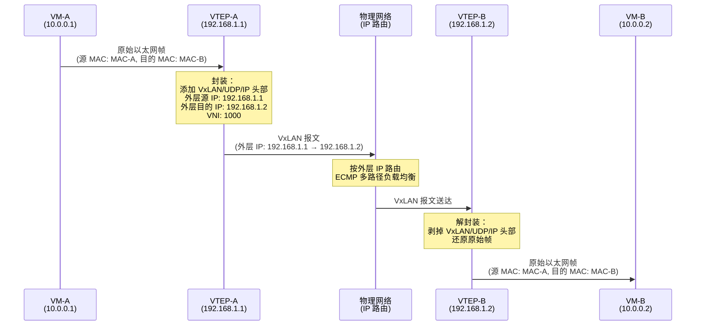
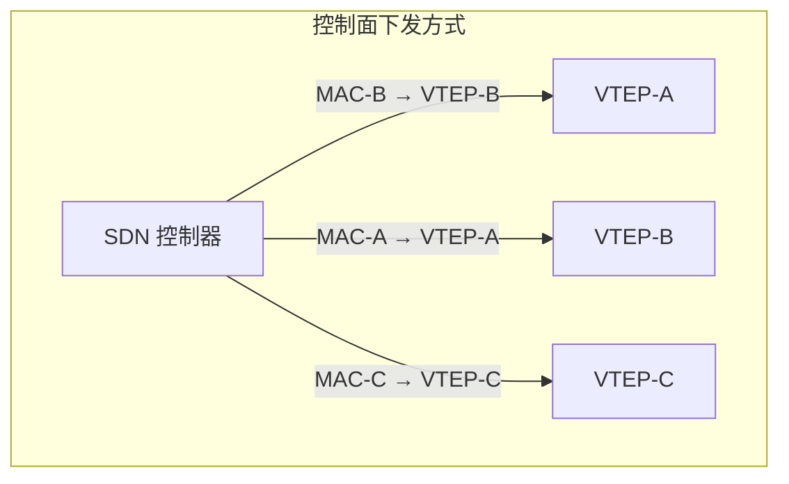
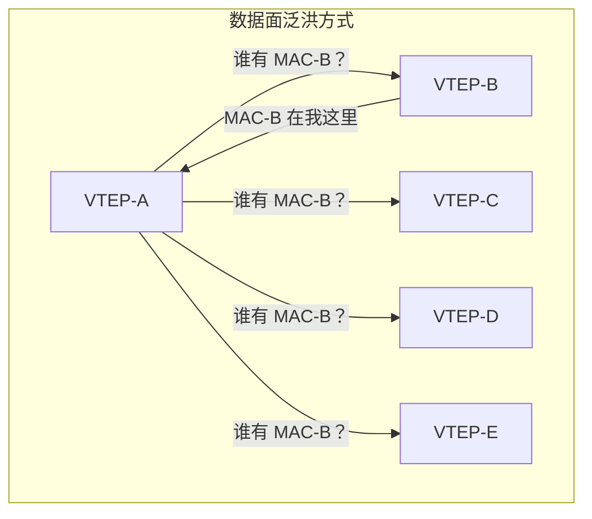

# 5. 给包裹再套一层：VxLAN 与 Overlay 网络
云计算需要的是百万量级的隔离，而且必须跨越 Leaf-Spine 架构中无处不在的三层路由。大二层的尝试已经证明此路不通，把二层域扩大到整个数据中心，只会把广播风暴和故障域一起放大。

物理网络已经是一张运转良好的 IP 网络，Leaf-Spine 拓扑、ECMP 均衡、全三层路由，这些能力不需要推倒重来。真正需要的是一种方案，能在这张 IP 网络之上，凭空造出一层新的网络。不改动任何物理设备，不触碰任何路由协议，只在端点上做控制。这个思路有一个名字：Overlay。

> **Overlay 与 Underlay**
>
> 云网络中最基本的空间划分，就是 Overlay 和 Underlay 这两层。理解这对概念，是理解后续所有章节的前提。
>
> **Underlay**（底层网络）是物理世界里真实存在的网络，交换机、路由器、光纤、网线，以及运行在它们之上的路由协议。数据中心里的 Leaf-Spine 拓扑、ECMP 多路径、BGP 路由，都属于 Underlay。Underlay 的地址是物理网络的 IP 地址，由基础设施团队统一规划和管理。Underlay 的职责只有一个：把 IP 包从 A 点搬运到 B 点，高效、可靠、不关心包里装的是什么。
>
> **Overlay**（叠加网络）是在 Underlay 之上用软件虚拟出来的网络。它不对应任何一根物理线缆或一台物理交换机，而是通过在端点上做封装和解封装，在逻辑上凭空创造出一张新的网络。Overlay 有自己独立的地址空间、自己的转发规则、自己的隔离边界，租户看到的私有网络就是 Overlay。Overlay 的数据包在传输时，会被封装进 Underlay 的 IP 包里，借助 Underlay 的路由能力到达目的地，到达后再被解封装还原。
>
> 两者的关系可以类比为：Underlay 是公路系统，路面、立交桥、收费站，由市政部门建设和维护；Overlay 是跑在公路上的快递网络，快递公司自己定义路线、分拣规则和派送区域，但每一个包裹最终都要靠公路来运输。公路不需要知道包裹里装的是什么，快递网络也不需要自己修路。两层各管各的，互不干扰。


## 5.1 Tunnel 的思想：包中包

在已有的 IP 网络之上构建虚拟网络，这句话听起来抽象，但它的实现方式出奇地直接。

假设 VM-A 要给 VM-B 发一个帧，这个帧有自己的源 MAC、目的 MAC、源 IP、目的 IP，这些都是虚拟网络里的地址。物理网络不认识这些地址，物理交换机的路由表里查不到它们。如果直接把这个帧丢到物理网络上，它哪儿也去不了。

那换一个思路：不让物理网络看到这个帧。把它整个塞进一个新的 IP 包的 payload 里，在外面套上一层新的 IP 头，这层 IP 头用的是物理网络的地址，物理交换机认识它，能按正常的路由规则把它从源头转发到目的地。到了目的地之后，外层的 IP 头被剥掉，里面那个原始的帧被还原出来，交给 VM-B。

这就是 Tunnel 封装的全部思想。

一个直觉可能有助于理解：这就像把一封信装进一个快递包裹。信封上写着收件人的名字和地址，这是虚拟网络里的地址。但快递公司不看信封，它只看包裹外面贴的快递单，这是物理网络的地址。快递公司按照快递单上的地址把包裹送到目的地，收件人拆开包裹，取出信封，看到的是原始的信。信封里的地址可以和快递单上的地址完全不同，互不干扰。

这个思路带来了一个关键突破：**虚拟网络的地址空间和物理网络的地址空间完全解耦了**。租户 A 可以用 10.0.0.0/24，租户 B 也可以用 10.0.0.0/24，它们在各自的虚拟网络里互不冲突，因为物理网络根本看不到这些地址。物理网络只看到外层的 IP 头，而外层的 IP 地址是由基础设施统一分配的，不会重叠。

而且，因为外层是标准的 IP 包，物理网络的所有能力，三层路由、ECMP 多路径均衡、跨机架转发，都可以直接利用。虚拟网络不需要关心底层的物理拓扑是什么样的，它只需要知道对端的 IP 地址是什么，剩下的交给物理网络的路由去处理。

Tunnel 封装不是一个新发明，GRE（Generic Routing Encapsulation）早在 1994 年就被提出来了，IPSec 的隧道模式也用了同样的思路。但在云计算的场景下，Tunnel 封装需要解决一个核心问题：**多租户隔离**。云计算需要的是在同一张物理网络上同时运行成千上万个互相隔离的虚拟网络，每个虚拟网络都有自己的地址空间、自己的广播域、自己的转发规则。

> **GRE 是什么？**
>
> GRE（Generic Routing Encapsulation，通用路由封装）是最经典的 Tunnel 封装协议之一，由 RFC 2784 定义。它的封装结构非常简洁：在原始数据包外面套一层 GRE 头部和一层外层 IP 头。GRE 头部最小只有 4 个字节，2 字节的标志位和 2 字节的协议类型（标识内层包是什么协议）。
>
> GRE 的基础版本确实没有内置多租户标识字段。但 RFC 2890 为 GRE 定义了一个可选的 **Key 字段**，32 位，当头部的 Key Present 标志位置 1 时，GRE 头部会多出 4 个字节来携带这个 Key。32 位意味着超过 40 亿个可能的取值，比 VxLAN 的 24 位 VNI（约 1677 万）还要大得多。利用这个 Key 字段，GRE 完全可以实现多租户隔离，不同的虚拟网络使用不同的 Key 值，隧道端点根据 Key 来区分流量属于哪个租户。
>
> ```
> ┌──────────────────────────────────────────────┐
> │           Outer IP Header                    │
> ├──────────────────────────────────────────────┤
> │ Src IP: Tunnel-A │ Dst IP: Tunnel-B          │
> │ Protocol: GRE (47)                           │
> ├──────────────────────────────────────────────┤
> │           GRE Header                         │
> ├──────┬──────┬──────────────────┬─────────────┤
> │Flags │ Ver  │ Protocol Type    │ Key (32-bit)│
> │(K=1) │      │ (0x6558=L2 frame)│ (optional)  │
> ├──────────────────────────────────────────────┤
> │           Inner Ethernet Frame               │
> └──────────────────────────────────────────────┘
> ```
>

GRE 通过 Key 字段能做多租户隔离，这一点没问题。但它直接跑在 IP 之上（协议号 47），没有 UDP/TCP 端口。在大规模 Leaf-Spine 网络里，这带来一个实际的不便：物理交换机做 ECMP 哈希时，可用维度更少，同一对隧道端点之间的所有流量容易被压到同一条路径上，多路径的能力发挥不出来。加上 NAT 穿透、硬件卸载生态等因素，GRE 在数据中心 Overlay 场景里并不是最顺手的选择。

真正把 Overlay 推上主流的，是另一条设计路径。

## 5.2 VxLAN 报文格式与 VNI

VxLAN（Virtual Extensible LAN）用 24 位的 VNI 把租户空间从 4094 扩展到 1677 万，用 UDP 封装让二层帧能借助 IP 路由跨机架转发。ECMP 哈希更友好，是选择 UDP 之后顺带带来的好处。它的封装结构是这样的：

**图 5.1：VxLAN 封装结构**

```
┌─────────────────────────────────────────────────────────────┐
│                    Outer Ethernet Header                    │
├─────────────────────────────────────────────────────────────┤
│ Outer MAC Dst │ Outer MAC Src │ EtherType (0x0800)          │
├─────────────────────────────────────────────────────────────┤
│                    Outer IP Header                          │
├─────────────────────────────────────────────────────────────┤
│ Src IP: VTEP-A │ Dst IP: VTEP-B │ Protocol: UDP (17)        │
├─────────────────────────────────────────────────────────────┤
│                    Outer UDP Header                         │
├─────────────────────────────────────────────────────────────┤
│ Src Port: hash │ Dst Port: 4789  │ Length │ Checksum        │
├─────────────────────────────────────────────────────────────┤
│                    VxLAN Header (8 bytes)                   │
├─────────────────────────────────────────────────────────────┤
│ Flags │ Reserved │ VNI (24-bit) │ Reserved                  │
├─────────────────────────────────────────────────────────────┤
│                    Inner Ethernet Frame                     │
├─────────────────────────────────────────────────────────────┤
│ Inner MAC Dst │ Inner MAC Src │ Inner IP │ Payload          │
└─────────────────────────────────────────────────────────────┘
```

从外到内看这个结构：最外层是一个普通的以太网帧头，让物理交换机能在二层转发；接着是外层 IP 头，源地址和目的地址都是物理网络上的地址，让路由器能把包送到正确的目的地；然后是一个 UDP 头，目的端口固定为 4789（IANA 为 VxLAN 分配的知名端口，接收端靠它识别这是 VxLAN 流量）；再往里是 VxLAN 自己的头部，8 个字节；最里面是原始的以太网帧，VM 发出来的那个帧，原封不动地被包在里面。

VxLAN 头部里最关键的字段是 **VNI（VxLAN Network Identifier）**，24 位。

24 位意味着什么？2 的 24 次方，大约 1677 万。和 VLAN 的 12 位（4094 个）相比，隔离空间扩大了 4000 多倍。一个 VNI 对应一个虚拟网络，租户 A 的网络用 VNI 1000，租户 B 的网络用 VNI 2000，不同 VNI 之间的流量天然隔离，就像不同 VLAN 之间的流量互不可见一样。而 1677 万这个数字，足以覆盖任何规模的云计算场景。

为什么选择 UDP 作为外层传输协议？两个原因。第一，UDP 是无连接的，封装简单，不需要像 TCP 那样维护连接状态，每个包独立封装、独立转发。第二，也是更重要的原因：物理网络上的 ECMP 可以利用 UDP 源端口做哈希。VxLAN 封装时，源端口不是固定的，而是根据内层帧的某些字段（通常是内层的源 IP、目的 IP、源端口、目的端口）计算出一个哈希值作为 UDP 源端口。这样，不同的内层流量会被哈希到不同的 UDP 源端口，物理网络的 ECMP 就能把它们分散到不同的路径上，实现负载均衡。

你可能会问：那为什么不直接像 GRE 那样，放在 IP 之上封装，不用套一层 UDP？关键就在这里，UDP 给了 ECMP 更多可用的哈希维度。很多物理交换机做 ECMP 时，会优先看五元组；有了 UDP 头，就多了源端口和目的端口这两个字段，交换机更容易把不同的 Overlay 流量分散到不同链路上。直接使用 IP 协议号封装也不是不行，但哈希时可用的信息更少，流量更容易集中到少数几条路径上。在大规模 Leaf-Spine 网络里，这种路径利用率的差异会被放大。

## 5.3 VTEP：隧道的起点和终点

VxLAN 的封装和解封装不会凭空发生，需要有一个组件来做这件事，把 VM 发出的原始帧封装成 VxLAN 包，以及把收到的 VxLAN 包还原成原始帧。

这个组件叫 **VTEP（VxLAN Tunnel Endpoint）**，隧道端点。

每个 VTEP 有自己的 IP 地址，这个地址是物理网络上的地址，用于 VxLAN 包外层 IP 头的源地址和目的地址。你可能会疑惑，VTEP 怎么知道目标 VM 在哪个 VTEP 后面？这个问题先放一放，下一节专门讨论。先看封装和转发的过程本身：

**图 5.2：VxLAN 封装与转发过程**



VM-A 发出一个普通的以太网帧，目的 MAC 是 VM-B 的 MAC 地址。这个帧到达 VTEP-A，VTEP-A 查自己的转发表，MAC-B 在 VTEP-B 后面，VTEP-B 的 IP 是 192.168.1.2，然后给这个帧套上 VxLAN 头、UDP 头和外层 IP 头，外层目的 IP 填 192.168.1.2，VNI 填 1000。封装完成后，这个包被丢到物理网络上。物理网络只看到一个普通的 UDP/IP 包，按正常的路由规则把它从 VTEP-A 所在的机架转发到 VTEP-B 所在的机架。VTEP-B 收到包后，检查 VNI 是 1000，确认属于自己管理的虚拟网络，剥掉外层头部，把原始帧交给 VM-B。

对 VM-A 和 VM-B 来说，整个过程是透明的。它们以为自己在同一个二层网络里直接通信，VM-A 发出帧，VM-B 收到帧，中间经历了什么它们完全不知道。实际上，这两台 VM 可能在不同的机架、不同的 Leaf 下面，中间隔了好几跳三层路由。但 VxLAN 的封装把这些物理距离全部隐藏了。

VTEP 要完成转发，需要一张关键的表：**MAC 地址到远端 VTEP IP 的映射**。"MAC-B 对应 VTEP-B 的 IP 192.168.1.2"，没有这条记录，VTEP-A 不知道该把封装后的包发给谁。这张表怎么建立，是 VxLAN 架构中最核心的问题之一。

## 5.4 转发表的建立：泛洪还是控制器

传统交换机建立 MAC 表的方式很简单：不知道目标在哪里，就往所有端口泛洪，目标回应后记住它在哪个端口。VxLAN 的 VTEP 能不能用同样的方式？

技术上可以，当 VTEP-A 不知道 MAC-B 在哪个远端 VTEP 后面时，它可以把这个 VxLAN 包发给所有已知的 VTEP，这叫 **BUM（Broadcast, Unknown unicast, Multicast）泛洪**。每个 VTEP 收到后检查内层帧的目的 MAC，如果不是自己管理的 VM，就丢弃；如果是，就回应。VTEP-A 收到回应后，记住"MAC-B 在 VTEP-B 后面"，下次就不用再泛洪了。

这个方案在小规模下能工作，但想象一下云计算的规模：一个数据中心里有几千台宿主机，每台宿主机上运行一个 VTEP。一次泛洪意味着把同一个包复制几千份，发给几千个 VTEP。如果每秒有一百次未知目标的查询，那就是每秒几十万份无效的包拷贝。而且 VM 的创建和迁移非常频繁，每次新建一台 VM，它的第一个 ARP 请求就会触发一次全网泛洪。在十万台宿主机的规模下，泛洪的开销会吞噬大量的网络带宽和 VTEP 的处理能力。

泛洪的问题本质上和第三章里广播风暴的问题是同一类，规模放大后，告诉所有人的成本变得不可承受。

那有没有办法让 VTEP 不需要泛洪就知道目标在哪里？

有。如果有一个集中的控制器，它知道每台 VM 在哪台宿主机上、MAC 地址是什么、对应的 VTEP IP 是什么，那它可以直接把这些映射关系下发给每台 VTEP。VTEP 收到 VM 的帧后，查本地的转发表就能找到目标，不需要泛洪。

**图 5.3：控制平面下发 vs 数据平面泛洪**





这就是**控制平面（Control Plane）** 和 **数据平面（Data Plane）** 的分工（后文简称控制面和数据面）。数据面负责封包、解包、转发，这是 VTEP 干的活。控制面负责维护全局的网络拓扑信息，告诉每个 VTEP 当前的转发规则是什么，这是控制器干的活。

两种思路各有代价。泛洪不需要控制器，实现简单，但规模上不去。控制器消除了泛洪，但引入了中心化依赖，如果控制器挂了，新的映射关系就无法下发，新建的 VM 就无法通信。控制器本身也需要处理海量的状态更新，每次 VM 创建、销毁、迁移，都需要更新映射关系并下发到相关的 VTEP。

在云计算的规模下，这个选择几乎没有悬念。几千台、几万台宿主机的环境里，泛洪的开销完全不可接受。所有大规模云环境都选择了控制面下发的方式。控制器的高可用性可以通过冗余和分布式架构来保障，但泛洪的带宽浪费是无法通过架构优化来消除的。

> **SDN 是什么？**
>
> SDN（Software-Defined Networking，软件定义网络）的核心思想是把网络设备的控制平面和数据平面分离。传统网络设备（交换机、路由器）自己决定怎么转发，控制逻辑和转发逻辑在同一台设备上。SDN 把控制逻辑抽出来，放到一个集中的控制器上，由控制器统一计算转发规则，再下发给网络设备执行。设备只负责按规则转发，不再自己做决策。这种分离让网络的行为可以通过软件来编程和自动化，而不是逐台设备手动配置。

## 5.5 同类方案：GRE 与 GENEVE

VxLAN 不是唯一的 Overlay 封装方案。在它之前和之后，都有其他方案在解决同样的问题。

前面介绍过，**GRE** 通过 32 位 Key 字段完全具备多租户隔离能力。GRE 的封装开销更小（头部最少只有 4 字节，带 Key 也只有 8 字节），但它缺少 UDP 层，物理交换机做 ECMP 哈希时可用维度更少，在大规模 Leaf-Spine 网络中流量容易集中到少数路径上。VxLAN 用 UDP 封装换来了更好的多路径负载分散能力，代价是多了 16 字节的头部开销（UDP 头 8 字节 + VxLAN 头 8 字节）。两者的核心差异不在隔离能力，而在对物理网络 ECMP 的利用效率。

**GENEVE（Generic Network Virtualization Encapsulation）** 走了另一个方向。它的头部支持可变长度的 TLV（Type-Length-Value）选项，可以在封装头里携带任意的元数据，不仅仅是一个 VNI，还可以带安全策略标识、服务链信息、调试标记等等。这种灵活性让 GENEVE 能适应更多样的场景，但也意味着解析头部的逻辑更复杂。

> **TLV 是什么？**
>
> TLV（Type-Length-Value）是一种通用的数据编码格式。每个数据项由三部分组成：Type 说明这是什么类型的数据，Length 说明数据有多长，Value 是实际的数据内容。这种格式的好处是可扩展，想加新的数据类型，只需要定义一个新的 Type 值，不需要改动已有的格式。很多网络协议用 TLV 来实现可选字段，让协议头部能灵活地携带不同种类的信息。

三者的共同点大于差异：都是 Overlay 封装，都是包中包的思路，都需要隧道端点做封包解包。VxLAN 之所以成为当前部署最广泛的方案，一方面是因为它在隔离能力（24 位 VNI）和封装简洁性之间取得了平衡，另一方面是因为它的标准化较早（RFC 7348 发布于 2014 年），硬件厂商的支持最广泛，大多数物理交换机和网卡都能在硬件层面加速 VxLAN 的封包解包。

不过趋势在变化，AWS 已经在其网络架构中采用了 GENEVE，因为 TLV 选项的灵活性对于复杂的云网络策略非常有价值。GENEVE 正在成为下一代 Overlay 封装的标准选择，但 VxLAN 在存量部署中仍然占据主导地位。理解了 VxLAN 的原理，切换到 GENEVE 只是头部格式的差异，核心的 Overlay 思想完全一样。

## 5.6 Overlay 的代价与新问题

VxLAN 解决了 VLAN 解决不了的问题：隔离空间从 4094 扩展到 1677 万，虚拟网络可以跨越三层路由边界，不需要改动物理网络的任何设备和协议。这是一个优雅的方案，利用已有的 IP 网络能力，在上面叠加一层虚拟网络，物理网络和虚拟网络各管各的，但封装不是免费的。

每个包都要经过一次封装、一次解封装。封装时要查转发表、构造外层头部、计算 UDP 源端口的哈希值；解封装时要校验 VNI、剥掉外层头部、把原始帧交给正确的 VM。这些操作消耗 CPU 周期。当一台宿主机上跑着几十台 VM，高峰时每秒有数百万个包需要处理，封包解包的 CPU 开销可能占到宿主机总 CPU 的 10% 到 20%。这些 CPU 本来可以卖给租户跑业务，现在被网络虚拟化吃掉了。

MTU 的缩减是另一个代价。50 字节的额外头部意味着以太网标准 MTU 1500 字节中，留给内层帧的有效载荷只剩 1450 字节。这里有一个反直觉的事实：TCP 应用通常感知不到 MTU 变小了，因为操作系统和 TCP 栈会自动协商 MSS（Maximum Segment Size），自动适配。但对于 UDP 应用，这个问题是静默的，UDP 没有 MSS 协商机制，如果应用发送了一个超过有效 MTU 的 UDP 包，它会在 VxLAN 封装后超过物理网络的 MTU，被中间设备分片或直接丢弃，导致难以排查的间歇性丢包。这个问题可以通过在物理网络上启用 Jumbo Frame（把 MTU 提高到 9000 字节）来缓解，但它需要物理网络的所有设备都支持并配置一致的 Jumbo Frame，这在大规模数据中心里不是一件小事。

排障的复杂度也上升了，物理网络上抓包看到的都是外层的 UDP/IP 包，传统的网络监控工具看不到内层的真实流量。一个 VM 报告网络不通，运维人员需要先定位到它的 VTEP，在 VTEP 上解封装后才能分析内层的帧，排障的链路变长了，需要的工具和技能也不一样了。

但这些代价都是可以接受的，毕竟 Overlay 解决的问题比它引入的代价大得多。世上没有免费的抽象层，每一层封装都有它的代价，但好的抽象让你觉得物有所值。还有一个不能回避的问题是：封包解包这件事，到底应该由谁来做、在哪里做？这个问题的答案，决定了整个网络虚拟化架构的走向。
