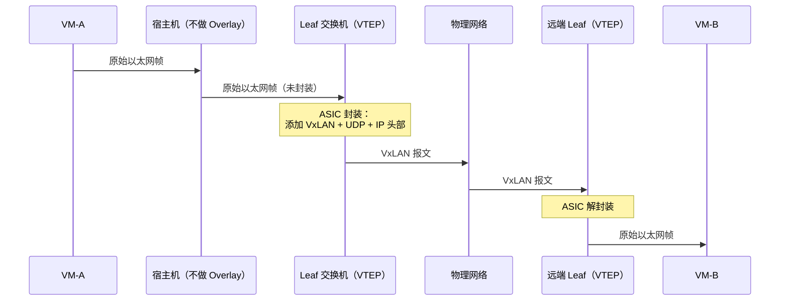

# 6. Tunnel 在哪里终止：VTEP 的落点

封包解包这件事，在哪里做？由谁做？

VTEP 可以放在宿主机的操作系统内核里，用软件完成封包解包。可以放在接入交换机上，用专用 ASIC 芯片完成。也可以放在服务器的网卡上，一种叫 SmartNIC 或 DPU 的专用硬件。每种选择都有自己的代价，每种代价都指向不同的架构方向。

## 6.1 软件 VTEP：在内核里做封包解包

最直接的思路是让宿主机自己来做。

宿主机的操作系统内核本来就管着整个网络协议栈，TCP/IP 的收发、路由表的查找、网卡驱动的调度。在内核里加一个 VxLAN 模块，让它负责封包解包，逻辑上是最简单的。不需要额外的硬件，不需要改动物理网络，只需要在每台宿主机上部署一段软件。

Linux 内核从 3.7 版本（2012 年）开始原生支持 VxLAN。管理员可以直接创建一个 VxLAN 类型的网络接口，指定 VNI 和远端 VTEP 的 IP 地址，内核就会自动完成封装和解封装。VM 发出的帧到达宿主机的虚拟交换机后，被内核的 VxLAN 模块拦截，套上外层头部，变成一个普通的 UDP/IP 包，从物理网卡发出去。对端宿主机收到这个 UDP 包后，内核的 VxLAN 模块识别出目的端口是 4789，剥掉外层头部，把原始帧交给对应的 VM。

在实际的云环境中，软件 VTEP 通常不是直接用 Linux 内核的原生 VxLAN 模块，而是通过 OVS 来实现。OVS 提供了更丰富的流量控制能力，它可以根据流表规则决定哪些包需要 VxLAN 封装、封装到哪个远端 VTEP、使用哪个 VNI。这种灵活性是原生内核模块做不到的。

> **OVS 是什么？**
>
> OVS（Open vSwitch）是一个运行在宿主机上的软件虚拟交换机。它在内核态完成数据包的快速转发，在用户态提供管理接口。OVS 支持 VxLAN 封装，同时提供流表匹配、QoS 限速、端口镜像等高级功能。在云计算环境中，OVS 通常替代 Linux 原生的 bridge，作为 VM 流量的第一跳转发节点。SDN 控制器通过 OpenFlow 协议向 OVS 下发流表规则，控制每个包的转发行为。

软件 VTEP 的优势很明显。部署灵活，不依赖特定的硬件型号，任何一台装了 Linux 的服务器都能跑。升级方便，改软件比换硬件容易得多，一个内核模块的升级可以在几分钟内完成，而更换一台物理交换机可能需要几个小时的停机窗口。功能迭代快，新的封装协议、新的转发策略、新的安全功能，都可以通过软件更新来支持，不需要等硬件厂商发布新固件。

代价也很明显：CPU。

每个包的封装和解封装都消耗 CPU 周期。封装时，CPU 需要查转发表（MAC → 远端 VTEP IP 的映射）、构造 50 字节的外层头部（以太网头 + IP 头 + UDP 头 + VxLAN 头）、计算 UDP 源端口的哈希值、计算外层 IP 头的校验和。解封装时，CPU 需要解析外层头部、校验 VNI、剥掉外层头部、把原始帧交给正确的虚拟网卡。每个包都要走一遍这个流程。

当一台宿主机上只跑几台 VM，网络流量不大时，这个开销微不足道。但云计算的密度在持续增长。2010 年前后，一台宿主机上可能跑 5-10 台 VM，每秒处理几十万个包，VxLAN 封包解包占用的 CPU 不到 5%。到了 2015 年，单台宿主机上的 VM 数量增长到 20-30 台，每秒处理的包数量达到百万级，封包解包的 CPU 开销上升到 10%-15%。再往后，容器化让单台宿主机上的工作负载数量进一步爆炸，一台机器上可能跑几十个 Pod，高峰时每秒需要处理 200 万甚至更多的包，VxLAN 的 CPU 开销可能占到 15%-20%。这些年代和占比只是量级示意，实际取决于机型、流量模型和内核版本，各家的实测差别不小。

如果你是 2014 年某家云厂商的网络架构师，面对这条增长曲线，你会怎么选？继续用软件扛，还是把封包解包从 CPU 上移走，交给专用硬件？这个问题的答案，推动了整个行业从软件到硬件的功能下移。

这些 CPU 本来可以卖给租户跑业务，现在被网络虚拟化吃掉了，对云厂商来说，这是真金白银的损失。一台 128 核的服务器，如果 20% 的 CPU 被网络虚拟化占用，就相当于 25 个核心无法出售，乘以数据中心里几万台服务器，这是一个巨大的数字。

软件 VTEP 不是一个错误的方案，在云计算的早期阶段，2008 到 2015 年左右，它是完全合理的选择。那时候单台宿主机的 VM 密度不高，CPU 开销在可控范围内，而软件方案的灵活性和快速迭代能力对于还在快速演进的云网络架构来说至关重要。但随着服务器密度的提升和网络流量的增长，软件 VTEP 的 CPU 开销从可以接受变成了不可忽视，最终变成了必须解决。

规模变了，权衡的条件就变了。

## 6.2 硬件卸载：从 Leaf 交换机到 SmartNIC

既然软件做封包解包太消耗 CPU，一个自然的想法是：把这件事交给专用硬件来做。通用 CPU 擅长处理复杂的、多变的逻辑，但对于每个包都执行相同的固定操作这种任务，专用硬件的效率要高几个数量级。

硬件卸载有两条路径。

**第一条路径：把 VTEP 下推到 Leaf 交换机。**

Leaf 就是第 2 章 Leaf-Spine 架构里最靠近服务器的那一层，每个机架顶部一台，所有服务器的网线都插在它上面。如果让 Leaf 承担 VxLAN 的封包解包，宿主机就完全不需要做 Overlay 处理，宿主机上的 vSwitch 只做二层桥接，把 VM 的原始帧直通到 Leaf。Leaf 根据帧的入口端口和标签识别出这属于哪个租户网络，再由 ASIC 完成 VxLAN 封装，通过物理网络发送到远端 Leaf，远端 Leaf 解封装后把原始帧交给目标宿主机。

**图 6.1：Leaf 交换机作为 VTEP 的数据路径**

这条路径的优势是宿主机 CPU 完全解放。网络处理在 Leaf 的专用 ASIC 芯片上完成，ASIC 的包处理速度可以达到每秒数十亿个包，比通用 CPU 快两到三个数量级。宿主机的所有 CPU 核心都可以卖给租户，没有任何浪费。

但代价是灵活性，Leaf 的 ASIC 芯片是固定功能的，它能做什么、不能做什么，在芯片设计阶段就决定了。每次网络策略变更，比如新增一个 VNI、修改转发规则、支持一种新的封装协议，都需要更新 Leaf 的固件或配置。物理交换机的固件升级周期远长于软件：一次固件升级可能需要几周的测试和验证，还可能需要短暂的停机窗口。在云计算这种需要快速迭代的环境里，这个节奏太慢了。

更深层的问题是耦合，当 VTEP 在 Leaf 上时，网络虚拟化的逻辑和物理网络的硬件绑定在了一起。云厂商的网络团队想要调整 Overlay 策略，必须和物理交换机的厂商协调，"你的 ASIC 支不支持这个新功能？什么时候能出新固件？"这种依赖关系在云计算的早期就被证明是不可接受的：云厂商需要对自己的网络架构有完全的控制权，不能被硬件厂商的开发节奏卡住。

**第二条路径：SmartNIC / DPU。**

**SmartNIC**（智能网卡）和 **DPU**（Data Processing Unit，数据处理单元）的思路是在服务器的网卡上集成专用的处理芯片。这块芯片不是通用 CPU，而是专门为网络处理设计的，它可以在硬件层面完成 VxLAN 的封包解包、流表匹配、QoS 限速等操作，速度接近 ASIC，但比 ASIC 更灵活。

> **SmartNIC / DPU 是什么？**
>
> SmartNIC（智能网卡）和 DPU（Data Processing Unit，数据处理单元）是在传统网卡基础上集成了可编程处理芯片的网络硬件。传统网卡只负责收发数据帧，所有网络处理（封包解包、流表匹配、安全过滤）都由宿主机 CPU 完成。SmartNIC/DPU 把这些工作卸载到网卡上的专用芯片，释放宿主机 CPU 给租户使用。两者的区别主要在定位上：SmartNIC 侧重网络功能卸载，DPU 的野心更大，试图接管整个基础设施层（网络、存储、安全）的虚拟化工作。AWS 的 Nitro、阿里云的神龙 MOC 卡、Azure 的 Catapult FPGA 都属于这一类。

**图 6.2：三种 VTEP 位置的架构对比**（图中 NIC 即网卡，Network Interface Card）

```mermaid
graph TB
    subgraph optA["Option A: Software VTEP"]
        direction LR
        A_VM["VM"] --> A_OVS["OVS / Kernel<br/>(VTEP)"]
        A_OVS --> A_NIC["NIC"]
        A_NIC --> A_NET["Physical Network"]
    end

    subgraph optB["Option B: Leaf as VTEP"]
        direction LR
        B_VM["VM"] --> B_NIC["NIC"]
        B_NIC --> B_TOR["Leaf Switch<br/>ASIC (VTEP)"]
        B_TOR --> B_NET["Physical Network"]
    end

    subgraph optC["Option C: SmartNIC / DPU"]
        direction LR
        C_VM["VM"] --> C_DPU["SmartNIC / DPU<br/>(VTEP on chip)"]
        C_DPU --> C_NET["Physical Network"]
    end

    style A_OVS fill:#fce4ec,stroke:#c62828
    style B_TOR fill:#fff3e0,stroke:#f57c00
    style C_DPU fill:#e8f5e9,stroke:#388e3c

    style optA fill:#fafafa,stroke:#999
    style optB fill:#fafafa,stroke:#999
    style optC fill:#fafafa,stroke:#999
```

SmartNIC 的优势在于它同时解决了软件 VTEP 和 Leaf VTEP 的核心痛点。和软件 VTEP 相比，它解放了宿主机 CPU，封包解包在网卡芯片上完成，宿主机的 CPU 不需要参与。和 Leaf VTEP 相比，它保留了灵活性，SmartNIC 的固件可以独立于物理交换机升级，云厂商可以自主控制网络虚拟化的迭代节奏。而且 SmartNIC 是插在服务器上的，每台服务器独立升级，不需要像 Leaf 那样影响整个机架。

但需要付出更多的经济成本。一块支持 VxLAN 卸载的 SmartNIC，价格从几百到几千元不等。一个数据中心有几万台服务器，每台都配一块 SmartNIC，硬件采购成本是一笔巨大的投入。而且 SmartNIC 的生态还在成熟过程中，编程模型、调试工具、驱动兼容性，都不如通用 CPU 上的软件栈那么完善。当 SmartNIC 上的网络处理出了 bug，排查的难度比软件 VTEP 高得多，你不能像调试内核模块那样打断点、加日志，硬件上的问题往往需要抓包分析和固件级别的排查。

三种方案，三个维度的权衡：

| 维度 | 软件 VTEP | Leaf VTEP | SmartNIC/DPU |
|------|-----------|----------|--------------|
| CPU 开销 | 高     | 无   | 无   |
| 灵活性 | 高   | 低     | 中   |
| 硬件成本 | 无   | 无（已有设备）  | 高     |
| 升级周期 | 分钟级 | 周级 | 天级 |
| 排障难度 | 低 | 中 | 高 |

没有一种方案在所有维度上都是最优的。选择取决于你更不愿意接受哪个代价。

但如果把时间轴拉长，会发现一个有趣的经济学规律：**规模效应决定了最终方案**。

2012-2015 年，云厂商的服务器规模在几万到几十万台，软件 VTEP 的 CPU 开销虽然存在，但每台服务器的 CPU 本来就有富余（早期虚拟化密度低），免费的 CPU 比昂贵的 SmartNIC 更经济。2016-2019 年，单台服务器的虚拟化密度急剧上升（容器化），CPU 变得稀缺，每 1% 的 CPU 开销都意味着少卖一份算力给租户。此时 SmartNIC 的采购成本虽然高（每块几百到几千元），但释放出的 CPU 可以卖给租户产生收入，当 CPU 的机会成本超过 SmartNIC 的采购成本时，硬件卸载就变得经济上合理了。

这也是为什么规模最大的云厂商（比如 AWS 的 Nitro）起步很早，而中小云厂商往往晚几年才跟进 SmartNIC 方案。不是技术判断不同，而是经济拐点到来的时间不同。规模越大，CPU 的机会成本越高，硬件卸载的经济合理性越早到来。

## 6.3 分布式网关：VTEP 兼任路由器

到目前为止，VTEP 做的事情是二层转发：VM-A 发一个帧给 VM-B，VTEP 查 MAC 表，找到远端 VTEP 的 IP，封装，发送。但如果 VM-A 在 10.0.1.0/24，VM-B 在 10.0.2.0/24，这就是一次跨子网通信，需要三层路由。路由器放在哪里，是 VTEP 位置问题的延伸：可以放在一台集中设备上，所有跨子网流量都绕过去；也可以让每台宿主机上的 VTEP 自己兼任路由器。两种放法的取舍，第 9 章会完整展开，这里只看它对 VTEP 落点的影响。

分布式网关这个选择，和 VTEP 的位置是耦合的。如果 VTEP 在宿主机内核里（软件 VTEP），分布式网关也在内核里做，OVS 的流表同时处理二层转发和三层路由。如果 VTEP 在 SmartNIC 上，分布式网关的路由逻辑也要卸载到 SmartNIC 的芯片上，这对 SmartNIC 的功能要求更高，不仅要做封包解包，还要做路由查找和 ARP 处理。

VTEP 的角色正在从隧道端点扩展为虚拟网络的全功能节点，它既是二层的转发者，又是三层的路由者。第 9 章会把这件事讲完。

## 6.4 各大云厂商的选择

同一个问题，不同的云厂商给出了不同的答案。这些差异不是因为谁对谁错，而是因为每家的起点不同、约束不同、优先级不同。

**AWS** 的路径最具代表性。早期，AWS 的虚拟化基于 Xen，网络处理主要由宿主机上的软件承担。随着实例密度和网络性能要求的提高，这部分开销变得越来越难以接受，AWS 于是转向自研专用硬件，最终的产物是 **Nitro** 系统。Nitro 的核心是一块定制的芯片（本质上是一种 DPU），它接管了网络虚拟化、存储虚拟化和安全管理的所有工作。宿主机的 CPU 被完全解放，100% 的算力都可以卖给客户。Nitro 的意义不仅仅是性能，它让 AWS 实现了裸金属级别的虚拟化，虚拟机的网络性能和物理机几乎没有差异。

**阿里云** 走了类似的路径。自研的 **神龙架构** 通过 MOC 卡（一种类似 SmartNIC 的定制硬件）把网络和存储的虚拟化开销从宿主机 CPU 上卸载下来。MOC 卡不仅处理 VxLAN 封包解包，还承担了虚拟交换机的流表匹配、安全组规则的执行、以及存储 IO 的虚拟化。和 AWS 的 Nitro 一样，目标是让宿主机的 CPU 完全服务于租户的业务负载。

**Azure** 选择了一条不同的技术路线：**FPGA**。Azure 的 SmartNIC（代号 Catapult）使用可编程的 FPGA 芯片来实现网络功能卸载。FPGA 的优势在于可编程性，它的逻辑可以在部署后通过重新烧录来更新，不需要像 ASIC 那样等下一代芯片。这让 Azure 能够在不更换硬件的前提下，持续迭代网络虚拟化的功能。代价是 FPGA 的单位性能不如 ASIC，而且 FPGA 的编程门槛很高，需要硬件描述语言（HDL）的专业人才，开发周期比软件长得多。

**Google Cloud** 的 **Andromeda** 虚拟网络在早期以软件为主，利用 Google 在软件工程上的深厚积累来优化软件 VTEP 的性能。Google 的思路是通过极致的软件优化（比如内核旁路、批量处理、零拷贝）来尽可能压低 CPU 开销，同时逐步引入硬件卸载。这条路径的优势是不需要在早期就投入巨大的硬件研发成本，但随着规模的增长，Google 也在向硬件卸载的方向演进。

这些选择背后有一个共同的方向：**从软件做一切向关键路径硬件卸载演进**。至少在头部云厂商里，已经很难找到还停留在纯软件 VTEP 的，规模不允许。但演进的节奏和路径各不相同：AWS 和阿里云选择了自研 ASIC/定制芯片，追求极致的性能和成本控制；Azure 选择了 FPGA，追求可编程性和灵活性；Google 选择了软件优先、逐步卸载的渐进路线。

每家的选择都取决于自身的条件：AWS 有足够的规模来摊薄自研芯片的研发成本，当你有几百万台服务器时，每台服务器省下的 CPU 乘以总量，足以覆盖芯片研发的投入。Azure 有微软在 FPGA 领域的长期积累，Catapult 项目最初是为 Bing 搜索加速设计的，后来被复用到网络虚拟化。Google 有全球顶尖的软件工程能力，在别人需要硬件才能达到的性能，Google 有时候用软件优化就能逼近。

这些路径之间没有对错，只有约束不同下的合理性。但它们都指向同一个结论：**在规模足够大之后，你不得不为网络虚拟化专门造芯片。** 区别只在于造什么样的芯片、什么时候开始造、以及用什么技术路线来造。

## 6.5 VTEP 确定了，控制面在哪里

无论 VTEP 放在宿主机内核里、Leaf 交换机上还是 SmartNIC 里，它都面临同一个问题：**谁来告诉它当前的转发规则是什么？**

VTEP 需要知道的信息很多。   
- VNI 1000 对应哪些 VM？这决定了哪些帧需要被封装。
- MAC-B 在哪个远端 VTEP 后面？这决定了封装后的包发给谁。
- 10.0.2.0/24 这个子网的下一跳是什么？如果 VTEP 兼任分布式网关，它还需要路由信息。   

这些信息 VTEP 自己发现不了。第 5 章（5.4）讲过，泛洪在云的规模下不可接受，转发规则只能有人明确告知。

告知 VTEP 的那个角色，就是**控制面**。

控制面维护全局的拓扑信息：哪个 VM 在哪台宿主机上、属于哪个 VNI、MAC 和 IP 是什么，再把这些信息翻译成 VTEP 能执行的转发规则（流表），下发到每台 VTEP。新 VM 上线、VM 迁移，所有相关 VTEP 的转发表都要跟着更新。

这个过程的规模不小。一个大型数据中心可能有几万台宿主机，每台宿主机上运行一个 VTEP；一个 VPC 可能有几千台 VM，分布在几千台宿主机上。每次 VM 的创建、销毁、迁移，都会触发一次或多次转发表的更新，推送给所有相关的 VTEP。控制面必须扛得住这样的更新频率，并且及时下发。

VTEP 是数据面，它负责搬运每一个包。控制面负责告诉数据面怎么搬。数据面的位置（软件、Leaf、SmartNIC）决定了搬运的效率；控制面的设计决定了搬运规则的正确性和时效性，两者缺一不可。

到这里，数据面和控制面的技术骨架已经搭好了。但用户不会直接和 VTEP 打交道，也不会手动给控制面下指令。用户在云控制台上看到的是VPC、子网、路由表这些产品概念，这些概念和底层的 VNI、VTEP、流表，到底是怎么对应起来的？

## 参考资料

1. [Linux Kernel Documentation: Virtual eXtensible Local Area Networking](https://docs.kernel.org/networking/vxlan.html)。6.1 节内核原生 VxLAN 设备，以及网卡对 UDP 隧道的卸载。
2. [The Design and Implementation of Open vSwitch (NSDI 2015)](https://www.usenix.org/conference/nsdi15/technical-sessions/presentation/pfaff)。6.1 节 OVS 作为软件 VTEP 时的流表匹配与转发设计。
3. [AWS Nitro System](https://aws.amazon.com/ec2/nitro/)。6.2 与 6.4 节 AWS 把网络、存储等虚拟化功能卸载到专用硬件的做法。
4. [Azure Accelerated Networking: SmartNICs in the Public Cloud (NSDI 2018)](https://www.usenix.org/conference/nsdi18/presentation/firestone)。6.2 与 6.4 节基于 FPGA 的 SmartNIC 卸载网络虚拟化。
5. [Andromeda: Performance, Isolation, and Velocity at Scale in Cloud Network Virtualization (NSDI 2018)](https://www.usenix.org/conference/nsdi18/presentation/dalton)。6.4 节 Google 以软件为主、绕过内核、逐步引入硬件的路线。
