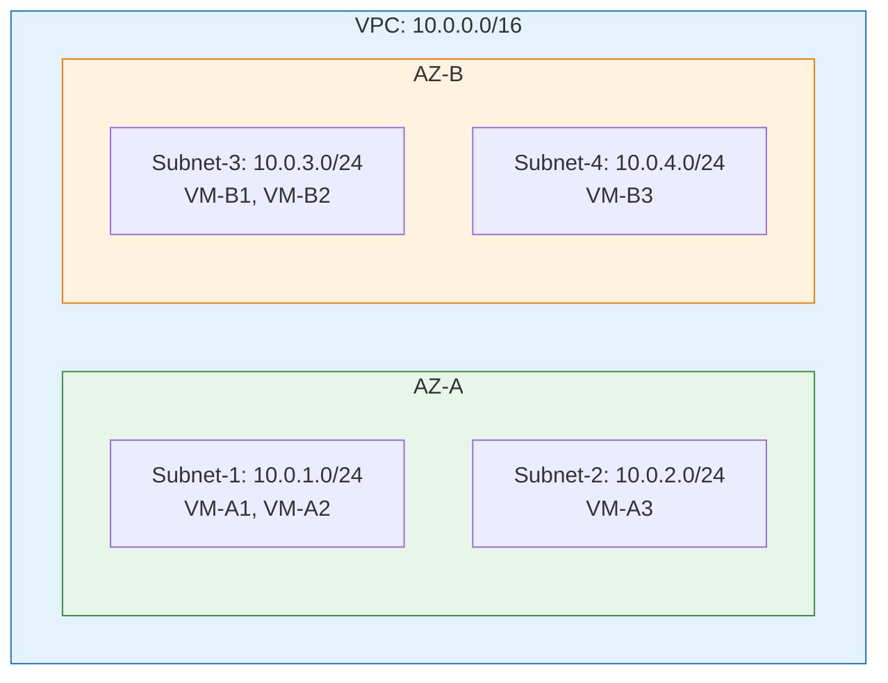
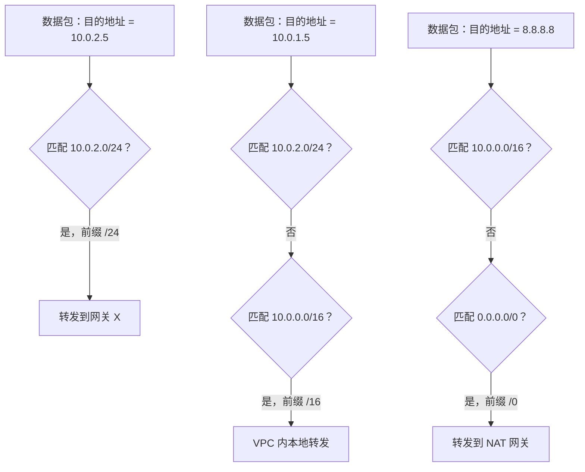
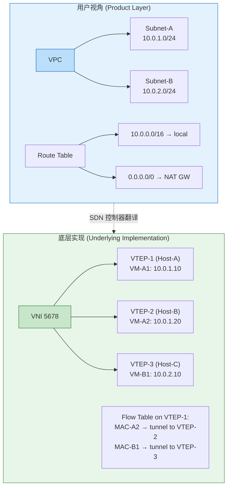
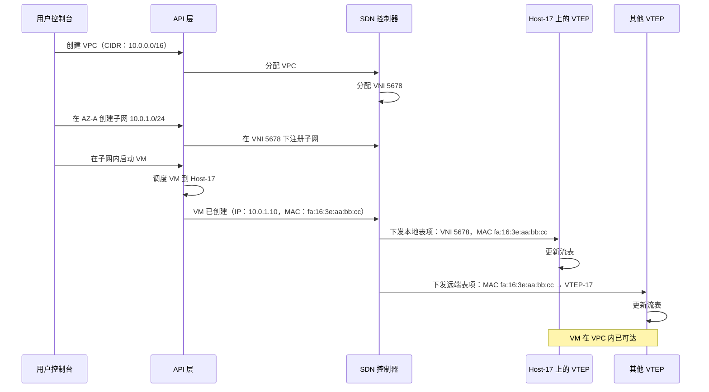

# 7. VPC 是什么：从网络技术到云产品

通过前面的介绍，我们已经把多租户隔离的技术积木凑齐了：VxLAN 做封装，VNI 做隔离标识，VTEP 做封包解包，控制面下发转发规则。但这些都是基础设施团队看到的东西，隧道、流表、封装头。

用户看到的是另一个世界。用户在云控制台上点"创建 VPC"，得到一个私有网络，别人看不到、进不来、干扰不了。至于底下用的是 VxLAN 还是 GRE，VNI 是 24 位还是 32 位，VTEP 在内核里还是在 SmartNIC 上，这些和用户没有关系。用户买的是一个产品，不是一套技术方案。

现在我们要把这两个世界连起来：用户点击"创建 VPC"的那一刻，底层到底发生了什么？子网、路由表、安全组这些产品概念，和前面讲的 VNI、VTEP、控制面，是怎么对应起来的？

## 7.1 VPC 的产品边界

一个 VPC（Virtual Private Cloud，虚拟私有云），在产品层面的定义很简洁：一个逻辑上隔离的私有网络空间。

用户在这个空间里拥有完全的网络控制权，可以自己划分子网，自己定义路由规则，自己设置访问控制策略。VPC 内部的 VM、容器、数据库实例，都挂在这个私有网络上，彼此之间可以通信。VPC 外部，公网、其他租户的 VPC、云厂商自己的管理网络，默认情况下看不到 VPC 内部的任何东西，也进不来。

VPC 的边界就是隔离的边界。

用户对 VPC 的核心预期可以归结为一句话：这是我的网络，和别人的完全隔开。MAC 地址不会冲突，ARP 广播不会泄漏，IP 地址段可以自由选择，哪怕两个不同租户的 VPC 都用了 10.0.0.0/16，也互不干扰。这些正是前面几章讨论的多租户隔离问题，VPC 是这些技术方案在产品层面的最终呈现。

但 VPC 不对应任何一台物理交换机，也不对应任何一段物理线路。一个 VPC 里的 VM 可能分布在不同的机架上，不同的 Pod 里，甚至不同的可用区中。从物理拓扑的角度看，这些 VM 之间隔着若干台交换机和路由器，走的是完全不同的物理路径。但从 VPC 的视角看，它们在同一个私有网络里，就像插在同一台交换机上一样。

这种逻辑上在一起，物理上分散的能力，正是 Overlay 网络的精髓。VPC 是 Overlay 之上的一层产品抽象，它把底层的 VxLAN 隧道、VNI 隔离、VTEP 转发这些技术细节，包装成了用户能理解的私有网络概念。

VPC 内部包含什么？子网、路由表、安全组、网络 ACL（Access Control List，访问控制列表），以及挂在网络上的各种计算资源，VM、容器 Pod、托管数据库实例、负载均衡器。VPC 外部是什么？公网、其他租户的 VPC、云厂商的管理平面。两者之间有一道清晰的边界，所有跨越这道边界的流量，无论是出公网还是访问其他 VPC，都需要显式的配置才能通过。

## 7.2 子网：VPC 内的地址空间划分

用户创建 VPC 时，第一件事是指定一个 CIDR（Classless Inter-Domain Routing，无类别域间路由）块，比如 10.0.0.0/16。这个 CIDR 定义了 VPC 的地址空间：VPC 内所有资源的私有 IP 地址，都必须从这个范围内分配。

> **CIDR 是什么？**
>
> CIDR（Classless Inter-Domain Routing，无类别域间路由）是一种 IP 地址分配和路由方式。传统的 IP 地址分为 A、B、C 三类，每类的网络号长度固定（8 位、16 位、24 位），分配粒度很粗，要么给你 1600 万个地址（A 类），要么只给 256 个（C 类）。CIDR 打破了这个限制，用"斜杠+数字"（如 /16、/24、/28）来灵活指定网络号的长度。比如 10.0.0.0/16 表示前 16 位是网络号，后 16 位是主机号，共 65536 个地址；10.0.0.0/28 表示前 28 位是网络号，只有 16 个地址。CIDR 让 IP 地址的分配可以按需裁剪，不再受限于固定的类别划分。

但一个 /16 的地址空间有 65536 个地址，不可能把所有 VM 都扔进同一个扁平的地址池里。用户需要把这个大的地址空间切成更小的块，每一块就是一个**子网**。

比如，把 10.0.0.0/16 切成三个子网：10.0.1.0/24（Web 层）、10.0.2.0/24（应用层）、10.0.3.0/24（数据库层）。每个子网有 256 个地址（实际可用的少几个，云厂商会保留一些地址用于网关和管理），不同层次的服务放在不同的子网里，方便后续做差异化的路由和访问控制。

子网还有一个重要的属性：**可用区绑定**。

在大多数云厂商的实现中，一个子网绑定一个可用区（Availability Zone，AZ）。可用区是物理上隔离的故障域，不同的 AZ 通常位于不同的建筑、不同的供电和制冷系统，甚至不同的物理园区。一个 AZ 出了故障（比如断电），不会影响其他 AZ。

子网绑定 AZ 意味着：这个子网内的所有 VM，都运行在同一个 AZ 的物理机上。如果用户想要跨 AZ 的高可用部署，比如 Web 层在 AZ-A 和 AZ-B 各放一组 VM，就需要在两个 AZ 各创建一个子网。

为什么子网要绑定 AZ，而不是让一个子网跨越多个 AZ？因为子网不只是地址块，它还隐含了一组底层的转发假设。同一子网内的 VM 被默认看作距离很近，它们共享同一段地址空间，很多实现里还共享同一组二层转发规则。把子网限制在一个 AZ 内，意味着这些 VM 都位于同一个故障域、同一片物理网络里，VTEP 之间的 Underlay 路径更短，延迟更低，转发路径也更可预期。如果让一个子网跨 AZ，同子网内的通信就可能频繁穿越 AZ 之间的长距离链路，从产品语义上看它们像在一个本地网络里，从物理现实上看却隔着一个跨园区链路，延迟、带宽成本和可靠性都会出现错位。子网绑定 AZ，本质上是在让产品语义和物理拓扑保持一致。

**图 7.1：VPC 的子网与可用区绑定**

从底层实现的角度看，一个子网对应一组 VTEP 上的转发规则。同一子网内的 VM 在 Overlay 层面属于同一个 VNI（或同一组 VNI），它们之间的通信走二层转发，VTEP 查 MAC 表，找到对端 VTEP，封装发送。不同子网之间的通信需要三层路由，这个路由在哪里做、怎么做，是后续章节的内容。

VPC 还可以同时配置 IPv4 和 IPv6 的地址空间。比如在 10.0.0.0/16 的基础上，再关联一个 2001:db8::/56 的 IPv6 CIDR。子网内的 VM 同时拥有 IPv4 和 IPv6 两个地址，VxLAN 的内层帧可以是 IPv4 也可以是 IPv6，外层封装通常仍然是 IPv4。当前大多数云上业务仍以 IPv4 为主，IPv6 主要用于合规需求和面向未来的规划，但双栈的基础设施已经就位。

## 7.3 路由表：VPC 内的包如何被转发

子网划分了地址空间，但地址空间本身不决定包往哪里走。决定包的去向的，是**路由表**。

每个 VPC 有一张默认路由表。这张路由表里有一条自动生成的规则：VPC CIDR 范围内的流量，在 VPC 内部转发。比如 VPC 的 CIDR 是 10.0.0.0/16，那么所有目的地址在 10.0.0.0/16 范围内的包，都会被路由到 VPC 内部对应的子网和 VM。这条规则不需要用户配置，它是 VPC 的本地路由，VPC 内部的流量默认互通。

但 VPC 内部互通只是起点，用户还需要控制其他方向的流量。

比如，VPC 里的 VM 要访问公网，用户需要在路由表里添加一条规则："0.0.0.0/0 → NAT 网关"。NAT（Network Address Translation，网络地址转换）网关的作用是把私有 IP 替换成公网 IP，然后把包发出去。这条规则的意思是：所有目的地址不在 VPC CIDR 范围内的流量（也就是公网流量），都发给 NAT 网关处理。

再比如，用户有两个 VPC 需要互通，可以在路由表里添加一条规则："172.16.0.0/16 → VPC 对等连接"。这条规则把发往另一个 VPC 地址段的流量，引导到对等连接的隧道上。

不同的子网可以关联不同的路由表。Web 层的子网可能需要访问公网（关联一张带 NAT 网关路由的路由表），而数据库层的子网可能不允许任何出公网的流量（关联一张只有本地路由的路由表）。通过路由表与子网的关联，用户可以实现差异化的路由策略。

当多条路由规则同时匹配一个目的地址时，路由表使用**最长前缀匹配**（Longest Prefix Match）来决定走哪条。比如路由表里同时有 10.0.0.0/16 → local 和 10.0.2.0/24 → 某个网关，那么发往 10.0.2.5 的包会匹配 /24 这条更精确的规则，而发往 10.0.1.5 的包会匹配 /16 的本地路由。前缀越长，匹配越精确，优先级越高。

**图 7.2：路由表的匹配逻辑**

路由表是用户在产品层面看到的东西，一张规则列表，每条规则是"目的地址段 → 下一跳"。但在底层，用户对路由表的每一次修改，都会被翻译成 VTEP 上的流表更新。路由表是产品层面的抽象，流表是数据面的实现。谁来做这个翻译？这就是 SDN 控制器的角色。

## 7.4 VNI 与 VPC 的映射

到这里，产品层面的概念已经清楚了：VPC 是隔离边界，子网是地址划分，路由表是转发规则。但这些产品概念和底层的 VxLAN 技术之间，到底是什么关系？

核心的对应关系是：**VPC 的隔离语义，最终由 VNI 在数据面上保证。**

VNI 是 VxLAN 层面的隔离标识，不同 VNI 的流量在数据面上完全隔离，就像不同 VLAN 的流量互不可见一样。VPC 是产品层面的隔离标识，不同 VPC 的网络互不干扰。两者之间需要一个映射关系。

最简单的模型是：一个 VPC 对应一个 VNI。VPC 内所有子网共享同一个 VNI，子网之间的区分靠 IP 路由来完成。同一个 VPC 内的 VM-A（子网 10.0.1.0/24）和 VM-B（子网 10.0.2.0/24）共享同一个 VNI，跨子网通信走三层路由。这种模型简单直接，VNI 的数量等于 VPC 的数量。

另一种模型更复杂：一个 VPC 内的不同子网对应不同的 VNI。子网 10.0.1.0/24 用 VNI 5678，子网 10.0.2.0/24 用 VNI 5679。同子网内的通信在同一个 VNI 内完成（二层转发），跨子网的通信需要在不同 VNI 之间做路由转发。这种模型的隔离粒度更细，但 VNI 的管理也更复杂。

两种模型的取舍，本质是**控制面同步与失败域的粒度**。

前者把整个 VPC 塞进一个 VNI，控制面每一次变更（新建 VM、迁移、下线、路由改动），都要同步给 VPC 内**所有**宿主机，推送范围是 VPC 全量；一个 VNI 的配置或流表出问题，波及面也是整个 VPC。子网虽然在 IP 层被划开了，但在 VNI 这一层没有被隔开，这些成本没有被切分。

后者把 VNI 切到子网粒度，控制面同步、失败域，都从 VPC 全量缩到子网粒度。每台宿主机维护的转发表项也只保留本地 VM 涉及的子网，不再是 VPC 全量。代价是跨子网通信要在不同 VNI 之间做三层转发，实现上更绕；控制面要管理的 VNI 数量也从 VPC 数变成子网数，多一个数量级。

规模小、子网少的时候，两种做法差别不大。规模一上去，前者的下发范围和失败域会先撑不住。这也是 EVPN/VxLAN 标准以及主流商用云分布式网关都走每子网一个 L2 VNI这条路的原因，牺牲一点控制面复杂度和 VNI 管理成本，换数据面和运维面的可扩展性。

但这里核心逻辑是一致的：VPC 的隔离承诺，最终要落实到数据面的 VNI 隔离上。用户在控制台上看到的是 VPC 和子网，底层跑的是 VNI 和 VTEP。

**图 7.3：VPC 产品概念与底层实现的映射**

用户不需要关心 VNI 是什么。VPC 是产品抽象，VNI 是实现细节。用户只需要操作 VPC、子网、路由表，底层的 VNI 分配和管理由云厂商的控制面自动完成。用户创建一个 VPC，控制面分配一个 VNI；用户删除一个 VPC，控制面回收这个 VNI。整个过程对用户完全透明。

## 7.5 SDN 控制器：翻译者

用户在控制台上点击"创建 VPC"、"添加子网"、"修改路由表"，这些操作是产品语义的。底层 VTEP 需要执行的是在 VNI 5678 下添加一条流表：目标 MAC-X 走 VTEP-23，这是数据面语义的。

两种语义之间需要一个翻译者。这个翻译者就是 **SDN 控制器**。

> **SDN 控制器是什么？**
>
> SDN（Software Defined Networking，软件定义网络）的核心思想是把网络设备的控制逻辑从设备本身抽离出来，集中到一个独立的控制器上。传统网络中，每台交换机自己运行路由协议、自己学习 MAC 表、自己做转发决策。SDN 的做法是：交换机只负责按规则转发（数据面），转发规则由控制器统一计算和下发（控制面）。控制器通过 OpenFlow 等协议与交换机通信，告诉它收到什么样的包，做什么动作。

SDN 控制器需要维护一份全局状态：所有 VPC 的拓扑信息、所有 VM 的位置信息（在哪台宿主机上、MAC 地址是什么、IP 地址是什么、属于哪个 VNI）、所有子网的路由规则。每当这份状态发生变化，新建了一台 VM、删除了一个子网、修改了一条路由，控制器就需要把变更翻译成 VTEP 能理解的流表更新，推送到所有相关的 VTEP。

这个翻译过程是实时的。用户在控制台上修改了路由表，期望几秒钟之内新的路由规则就生效。控制器必须在这个时间窗口内完成：解析用户的操作 → 计算受影响的 VTEP 列表 → 生成新的流表规则 → 下发到每台 VTEP → 确认生效。

控制器本身不能是单点故障。如果控制器挂了，所有新的网络变更都无法生效，新建的 VM 无法通信，修改的路由规则无法下发。所以控制器通常以集群方式部署，状态在多个节点之间同步，任何一个节点故障都不影响整体服务。

但有一个关键的设计：**控制面和数据面是解耦的**。控制器负责下发规则，VTEP 负责按规则转发。一旦规则下发完成，VTEP 就可以独立工作，即使控制器短暂不可用，已经下发的流表仍然生效，现有的 VM 之间的通信不会中断。只是在控制器恢复之前，新的变更（比如新建 VM、修改路由）无法生效。

这种解耦是刻意的，数据面的可用性要求远高于控制面，数据面每秒处理数百万个包，任何中断都会导致业务受损；控制面处理的是配置变更，频率低得多，短暂的不可用影响有限。把两者解耦，让数据面不依赖控制面的实时可用性，是云网络架构中一个重要的设计决策。

但"控制面和数据面解耦"这句话，在 SDN 的历史上并不是一开始就设计为今天这个样子的。

SDN 最初的旗舰协议叫 OpenFlow。它的愿景比今天的云网络控制器激进得多：每一条转发规则都由控制器实时下发，交换机不做任何自主决策，只是一个哑管道。控制器看到网络中的每一个新流，为它计算路径，下发流表项，交换机严格执行。这是一种绝对集中控制的哲学：网络的行为完全由软件定义，硬件只是执行器。

在学术论文和小规模实验中，这个模型很优雅。但当云厂商试图把它用在十万台宿主机的生产环境时，三个问题浮出了水面。

第一，**流表容量**。OpenFlow 交换机用 TCAM（Ternary Content-Addressable Memory）存储流表，TCAM 的容量通常只有几千到几万条规则。一个大型 VPC 可能涉及几十万条转发规则：几万台 VM 的 MAC 映射、几千条路由、几百条 ACL。TCAM 根本装不下。要么把规则做聚合（牺牲精度），要么频繁换入换出（引入延迟），两条路都不好走。

第二，**控制器瓶颈**。OpenFlow 的 reactive 模式下，交换机遇到流表中没有匹配项的包，会把包上送控制器做决策。在百万级并发连接的数据中心里，每秒可能有几十万个新流需要控制器处理。控制器的处理能力成为整个网络的吞吐上限，网络的转发性能不再取决于交换机的线速能力，而取决于控制器的 CPU。

第三，**故障域过大**。控制器掌握所有转发决策权，一旦控制器不可用，交换机对任何新流都无法做出决策。虽然可以做控制器集群，但集群的状态同步在十万台设备的规模下本身就是一个分布式系统难题。

最终，云厂商走向了一条更务实的路线：**集中编排，分布决策**。控制器不再实时下发每一条流表，而是把策略意图翻译成分布式协议能理解的路由信息，让网络设备通过 BGP EVPN 等协议自行收敛。集中的是策略编排：用户创建 VPC、修改路由表，控制器把这些操作翻译成网络配置；分布的是转发决策：VTEP 根据已有的路由信息自主转发，不需要每个包都问控制器。

这就是今天云网络 SDN 控制器的实际形态。它继承了 OpenFlow 控制面和数据面分离的核心思想，但放弃了每条流都由控制器决策的极端集中模式。OpenFlow 的教训是：在网络这个对延迟和可用性极度敏感的领域，绝对集中的代价太高。适度的集中（编排层）加上分布式的执行（转发层），才是规模化的答案。

## 7.6 一次 VPC 创建的全链路

把前面所有概念串起来，看一个完整的流程：用户从零开始创建一个 VPC，到第一台 VM 可以通信，底层经历了哪些步骤。

**第一步：用户在控制台点击"创建 VPC"，指定 CIDR 为 10.0.0.0/16。**

API（Application Programming Interface，应用程序编程接口）层接收请求，分配一个 VPC ID（比如 vpc-abc123），记录 CIDR 10.0.0.0/16。SDN 控制器为这个 VPC 分配一个 VNI，比如 VNI 5678。此时 VPC 只是一个空壳：有了隔离标识（VNI），但还没有任何子网和 VM。

**第二步：用户创建子网 10.0.1.0/24，绑定可用区 AZ-A。**

API 层记录子网信息，SDN 控制器在 VNI 5678 下注册这个子网的地址范围。子网创建完成后，用户可以在这个子网里启动 VM 了。

**第三步：用户在子网 10.0.1.0/24 内启动一台 VM。**

云平台的调度器根据资源情况，把这台 VM 放到 AZ-A 的某台宿主机上，比如 Host-17。VM 被分配了一个 IP 地址 10.0.1.10 和一个 MAC 地址 fa:16:3e:aa:bb:cc。

**第四步：SDN 控制器通知 Host-17 的 VTEP。**

控制器下发一条指令：VNI 5678 下新增了一台 VM，MAC 是 fa:16:3e:aa:bb:cc，IP 是 10.0.1.10，在你本地。Host-17 的 VTEP 更新本地流表，开始为这台 VM 做 VxLAN 封包解包。

**第五步：SDN 控制器通知同，VPC 下所有其他 VTEP。**

如果这个 VPC 里已经有其他 VM 分布在其他宿主机上，控制器会向这些宿主机的 VTEP 推送更新：VNI 5678 下的 MAC fa:16:3e:aa:bb:cc 在 VTEP-17（Host-17 的物理 IP）后面。这些 VTEP 更新自己的转发表，知道了如何把发给这台新 VM 的包送到正确的地方。

**图 7.4：VPC 创建的全链路时序**

至此，这台 VM 可以和 VPC 内的其他 VM 通信了。整个过程中，用户只做了三个操作：创建 VPC、创建子网、启动 VM。底层经历了 VNI 分配、子网注册、VM 调度、VTEP 流表下发、全局转发表同步，这些全部由 SDN 控制器自动完成，用户完全无感知。

这就是产品操作 → 控制面翻译 → 数据面生效的全链路。用户看到的是 VPC 这个产品，底层运转的是 VNI、VTEP 和 SDN 控制器构成的技术体系。两者之间的映射关系，就是云网络从技术方案变成云产品的关键一步。

VPC 建好了，子网划分了，路由表配置了，VM 启动了，VTEP 的流表也下发了。从产品的角度看，一切就绪。

但就绪不等于能用，产品层面的创建成功，和数据面上的第一个包能走通，中间还隔着一段不短的路。VPC 里有两台 VM，VM-A 要给 VM-B 发一个 ping 包，这个包在数据面上到底怎么走？VM-A 知道 VM-B 的 IP 地址，但不知道它的 MAC 地址。在传统网络里，VM-A 会发一条 ARP 广播来问。但在 VPC 里，这两台 VM 可能分别运行在不同机架的不同物理机上，中间隔着整个 Overlay 网络。一个简单的 ARP 广播，在这里会变成什么？
