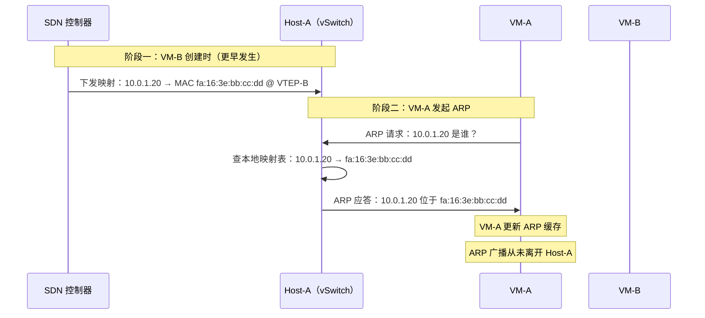
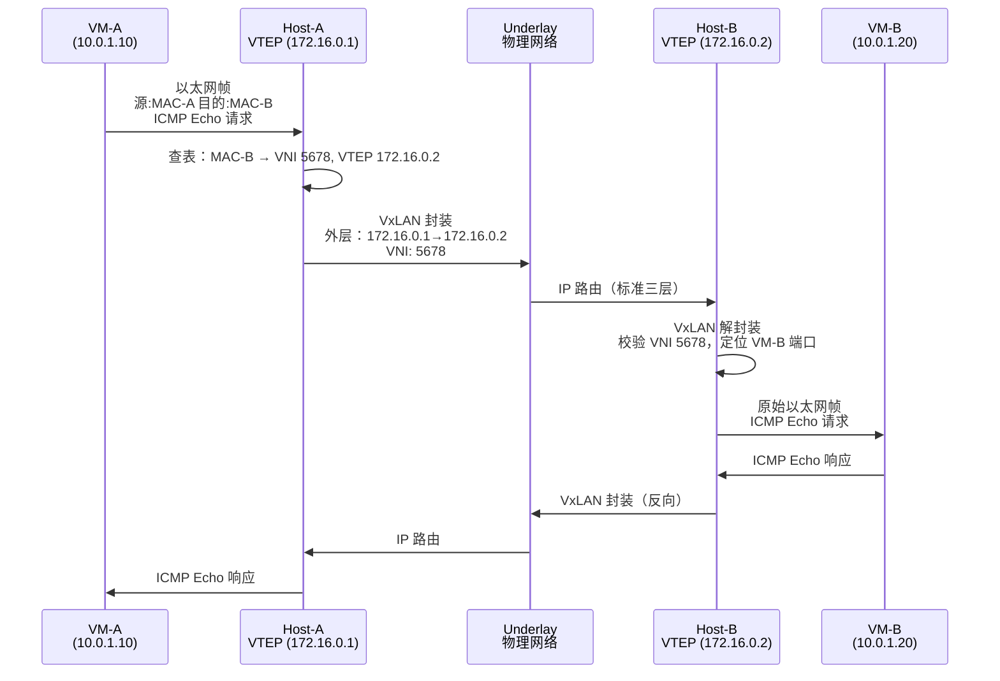
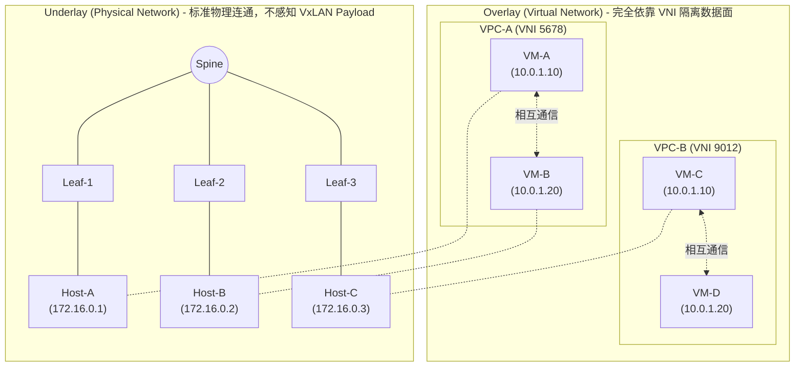

# 8. 同一个子网内的通信：ARP 代答与封包

我们来看一个简单的场景：两台 VM 在同一个 VPC、同一个子网里，M-A 要 ping VM-B。

在传统物理网络里，这不过是一次 ARP 广播加一个 ICMP 包的事，几毫秒就能完成，简单到没人会多想。但在 VPC 里，这两台 VM 可能分别运行在不同机架的不同物理机上，中间隔着整个 VxLAN Overlay 网络。VM-A 发出的以太网帧不会直接到达 VM-B，它需要被封装、穿越物理网络、再被解封装。

一个简单的 ping，在 VPC 里要经历多少环节？

## 8.1 一个 ping 包的旅途

假设 VM-A 的 IP 是 10.0.1.10（MAC 为 fa:16:3e:aa:bb:cc），VM-B 的 IP 是 10.0.1.20（MAC 为 fa:16:3e:bb:cc:dd）。两台 VM 在同一个子网 10.0.1.0/24 内，但分别运行在不同的宿主机上，VM-A 在 Host-A，VM-B 在 Host-B。

VM-A 要发一个 ping 包给 VM-B。ping 的本质是一个 ICMP Echo Request，它需要被封装在一个 IP 包里，而 IP 包又需要被封装在一个以太网帧里。以太网帧有两个关键字段需要填写：源 MAC 地址和目的 MAC 地址。

源 MAC 是 VM-A 自己的网卡地址，这个它知道。目的 MAC 呢？VM-A 只知道 VM-B 的 IP 地址是 10.0.1.20，不知道它的 MAC 地址是什么。

在传统物理网络里，解决这个问题的方式很直接：VM-A 发一条 ARP 广播：谁是 10.0.1.20？请把你的 MAC 地址告诉我。这条广播帧的目的 MAC 填全 F（FF:FF:FF:FF:FF:FF），交换机收到后会向同一广播域内的所有端口泛洪。VM-B 收到这条广播，发现目标 IP 是自己的，就用单播回复：10.0.1.20 的 MAC 是 fa:16:3e:bb:cc:dd。VM-A 拿到这个回复，把 IP-MAC 映射写入自己的 ARP 缓存，然后就可以填好以太网帧的目的 MAC，把 ping 包发出去了。

在传统网络里，这条 ARP 广播只需要在本广播域内泛洪，一个 VLAN 里可能有几十台、上百台机器，代价完全可控。

但在 VPC 里，情况完全不同。VM-A 和 VM-B 不在同一台物理机上，中间隔着 VxLAN Overlay。这条本来只在一个 VLAN 内泛洪几十份的 ARP 广播，一旦跨到 Overlay 上，会变成什么样子？

## 8.2 为什么不能让 ARP 直接广播

一条 ARP 广播帧要在 Overlay 上送达同一个 VNI 里的所有 VM，源 VTEP 只有两种办法。

一种是**组播**：把同一 VNI 的所有 VTEP 加入一个组播组，广播帧沿着组播树分发。这需要物理网络支持并运行 IGMP、PIM 一整套组播协议，很多机房设备对组播的支持并不完善，运维成本也高。大多数云厂商在实践中都不选这条路。

> **IGMP 和 PIM 是什么？**
>
> 这两个是 IP 组播（Multicast）赖以运转的一对协议。组播的思路是：一份数据由发送方发出，网络中间的路由器和交换机负责按需复制，只把它送到想收的接收方那里。谁想收、路径怎么走，就是这两个协议的分工。
>
> IGMP（Internet Group Management Protocol）跑在主机和最靠近它的路由器之间，作用是报名，主机告诉路由器：我要加入某个组播组，请把发给这个组的流量给我。交换机上还有个配套的 IGMP Snooping，用来听这些报名消息，避免把组播帧在整个 VLAN 里无差别泛洪。
>
> PIM（Protocol Independent Multicast）跑在路由器之间，负责根据这些报名信息，在整张网络里构建一棵组播分发树，让数据沿着树被复制、转发到所有订阅者。它有多种模式（PIM-SM、PIM-DM 等），部署和调优都不算简单。
>
> 组播能力好用，但要求全路径的设备都正确支持并配置这套协议。数据中心的网络设备对组播的支持参差不齐，加上运维复杂度高，所以云厂商在 VxLAN 场景里通常绕开它。

另一种是**头端复制**：源 VTEP 把广播帧复制 N 份，逐一封装、逐一发给其他所有 VTEP。这条路不依赖物理网络的能力，但代价压在了 VTEP 自己身上。VNI 里 VM 越多、宿主机越多，复制的份数就越多，CPU 和带宽都要为此埋单。

两条路都能让广播跑通，但都不便宜。真正的问题在于，ARP 是一种**高频、周期性、且没有业务价值**的广播：VM 启动要发、ARP 缓存过期要发、访问新目标还要发。让这种流量在 Overlay 上无差别泛洪，VTEP 的资源会被它吃掉一大块，真正承载业务的包反倒要排队。

更麻烦的是，ARP 不像未知单播那样可以简单丢弃。VM-A 拿不到 VM-B 的 MAC，包就发不出去，通信从第一步就断了。

于是问题变成：广播不能泛洪，ARP 又必须回答，谁来答？
## 8.3 ARP 代答：控制面预先回答

换一个角度想这个问题。ARP 广播的本质是什么？VM-A 不知道 VM-B 的 MAC 地址，所以需要问。在传统网络里，没有人事先知道这个信息，所以只能靠广播去发现。

但在 VPC 里，情况不一样。VM-B 是云平台创建的，它的 IP 地址是云平台分配的，它的 MAC 地址是云平台生成的，它运行在哪台宿主机上是云平台调度的。SDN 控制器在 VM-B 创建的那一刻，就已经知道了 VM-B 的全部网络信息：IP 10.0.1.20，MAC fa:16:3e:bb:cc:dd，位于 Host-B 的 VTEP 后面。

既然控制面已经知道答案，为什么还要让数据面再去发现？

这就是 ARP 代答的核心思路：**不让 ARP 广播出去，由宿主机直接回答。**

具体的工作方式是这样的：SDN 控制器在 VM-B 创建时，就把 VM-B 的 IP-MAC-VTEP 三元组下发到了相关的宿主机节点（在云的网络实践中，通常是按需下发到运行了同一 VPC 内 VM 的宿主机，以减少控制面广播风暴）。Host-A 上的虚拟交换机（OVS 或类似组件）本地维护着一张局部的映射表，里面记录了当前它需要通信的同 VPC 内 VM 的 IP 和 MAC 的对应关系。

当 VM-A 发出 ARP 请求时，这个请求首先到达 Host-A 上的虚拟交换机。虚拟交换机拦截这个 ARP 请求，检查目标 IP 10.0.1.20，在本地映射表里一查，找到了：10.0.1.20 对应的 MAC 是 fa:16:3e:bb:cc:dd。

虚拟交换机直接构造一个标准的 ARP 应答帧：把 fa:16:3e:bb:cc:dd 填入应答的发送方 MAC 字段，把 10.0.1.20 填入发送方 IP 字段，然后把这个应答帧返回给 VM-A。

VM-A 收到 ARP 应答，把 10.0.1.20 → fa:16:3e:bb:cc:dd 这对映射写入自己的 ARP 缓存。从 VM-A 的视角看，它发了一个 ARP 请求，收到了一个 ARP 回复，和在传统网络里的体验完全一样。它不知道这个回复是宿主机代替 VM-B 回答的，也不需要知道。

**图 8.1：ARP 代答的时序**



整个过程中，ARP 请求没有离开 Host-A。没有广播，没有泛洪，没有 N 倍的流量放大，一次本地查表，一次本地回复，问题就解决了。

ARP 请求本身携带的信息很简单：发送方的 IP 和 MAC（我是谁），以及目标 IP（我要找谁），目标 MAC 留空。代答只需要把目标 MAC 填上，构造一个标准的 ARP 应答帧返回即可。这个过程对 VM 完全透明，VM 的网络协议栈不需要做任何修改，它甚至不知道自己运行在一个虚拟化的网络环境中。

## 8.4 ARP 抑制与静默网络

ARP 代答解决了 ARP 广播的问题，但 ARP 不是 VPC 里唯一的广播源。

VM 启动时会发 DHCP Discover 广播，我需要一个 IP 地址，谁能给我？IPv6 环境下有 NDP（Neighbor Discovery Protocol）的邻居请求。还有各种应用层的广播和组播流量。每一种广播，如果放任它在 Overlay 上泛洪，都会产生同样的 N 倍放大问题。

云网络的设计理念是：**VPC 内的网络应该是静默的**。

所谓静默，就是尽可能消除所有不必要的广播和泛洪流量。ARP 用代答解决，DHCP 同样可以由宿主机本地代答，VM 的 IP 地址本来就是云平台分配的，宿主机完全有能力直接回复 DHCP 请求，不需要广播到网络上去找 DHCP 服务器。对于未知单播（目标 MAC 不在本地映射表中的单播帧），传统交换机的做法是泛洪，发给所有端口，看谁回应。但在 VPC 里，VTEP 不会泛洪未知单播，而是直接丢弃或上报控制面。

这种静默网络的设计有一个前提：**控制面必须足够准确和及时**。

传统网络的数据面有自学习能力，交换机通过 ARP 广播和响应来学习 MAC 表，不需要任何集中管理，即使没有控制面，数据面也能自己工作。但 VPC 网络把这个能力上移到了控制面：所有的 IP-MAC 映射、所有的转发规则，都由 SDN 控制器预先下发。如果映射表不完整，比如 VM-B 刚创建，控制器还没来得及把映射推送到 Host-A，ARP 代答就无法回答 VM-A 的请求。如果映射表过期，比如 VM-B 已经迁移到了另一台宿主机，但旧的映射还没更新，代答给出的信息就是错误的。

完全禁止广播，意味着完全依赖控制面的正确性和时效性。这是一个权衡：用控制面的复杂性，换取数据面的简洁和高效。在云的规模下，这个权衡是值得的，但它对控制面的可靠性提出了很高的要求。

## 8.5 VxLAN 封包：数据面的完整路径

ARP 代答完成了。VM-A 的 ARP 缓存里已经有了 VM-B 的 MAC 地址 fa:16:3e:bb:cc:dd。现在，VM-A 可以发出真正的 ping 包了。

我们现在来看下这个包的旅程:

**第一步：VM-A 构造以太网帧。**

VM-A 的网络协议栈构造一个 ICMP Echo Request，封装在 IP 包里（源 IP 10.0.1.10，目的 IP 10.0.1.20），再封装在以太网帧里（源 MAC fa:16:3e:aa:bb:cc，目的 MAC fa:16:3e:bb:cc:dd）。这个帧从 VM-A 的虚拟网卡发出。

**第二步：帧到达宿主机的虚拟交换机。**

Host-A 上的虚拟交换机收到这个帧，查流表。目的 MAC fa:16:3e:bb:cc:dd 属于 VNI 5678，对端 VTEP 是 Host-B 的物理 IP 172.16.0.2。这条信息是 SDN 控制器预先下发的，和 ARP 代答用的映射表来自同一个数据源。

**第三步：VTEP 封装。**

Host-A 的 VTEP 开始封装。原始的以太网帧作为 payload，外面依次套上四层头部：

**图 8.2：VxLAN 封装后的完整报文结构**

```
┌─────────────────────────────────────────────────────────────┐
│                  Outer Ethernet Header (14B)                │
│  Dst MAC: Next-hop MAC  │  Src MAC: Host-A MAC  │  0x0800   │
├─────────────────────────────────────────────────────────────┤
│                  Outer IP Header (20B)                      │
│  Src IP: 172.16.0.1 (Host-A)  │  Dst IP: 172.16.0.2 (Host-B)│
│  Protocol: UDP (17)                                         │
├─────────────────────────────────────────────────────────────┤
│                  Outer UDP Header (8B)                      │
│  Src Port: hash  │  Dst Port: 4789  │  Length  │  Checksum  │
├─────────────────────────────────────────────────────────────┤
│                  VxLAN Header (8B)                          │
│  Flags  │  Reserved  │  VNI: 5678 (24-bit)  │  Reserved     │
├─────────────────────────────────────────────────────────────┤
│                  Original Ethernet Frame                    │
│  Dst MAC: fa:16:3e:bb:cc:dd  │  Src MAC: fa:16:3e:aa:bb:cc  │
│  IP: 10.0.1.10 → 10.0.1.20  │  ICMP Echo Request            │
└─────────────────────────────────────────────────────────────┘
```

VxLAN 头中填入 VNI 5678，这是 VM-A 和 VM-B 所属 VPC 的隔离标识。外层 UDP 的目的端口是 4789（VxLAN 的标准端口），源端口是根据内层帧的某些字段做哈希计算得出的，这个哈希值的作用是让物理网络的 ECMP（等价多路径）能够把不同流的包分散到不同的物理链路上，避免所有 VxLAN 流量都走同一条路径。外层 IP 的源地址是 Host-A 的物理 IP 172.16.0.1，目的地址是 Host-B 的物理 IP 172.16.0.2。

封装完成后，这个包从 Host-A 的物理网卡发出，进入物理网络。

**第四步：Underlay 路由。**

物理网络看到的只是一个普通的 IP 包，源 172.16.0.1，目的 172.16.0.2，协议 UDP。物理交换机不知道也不关心这个 UDP 包里面装的是什么。它按照正常的三层路由规则，把包从 Host-A 所在的 Leaf 转发到 Spine，再从 Spine 转发到 Host-B 所在的 Leaf，最终送到 Host-B 的物理网卡。

**第五步：VTEP 解封装。**

Host-B 的网络协议栈收到这个 UDP 包，发现目的端口是 4789，这是 VxLAN 的标识。VTEP 开始解封装：剥掉外层以太网头、外层 IP 头、UDP 头、VxLAN 头，取出里面的原始以太网帧。

VTEP 检查 VxLAN 头中的 VNI：5678。在本地查找 VNI 5678 对应的虚拟网络，找到目的 MAC fa:16:3e:bb:cc:dd 对应的虚拟端口，VM-B 的虚拟网卡。

**第六步：VM-B 收到 ping 包。**

原始的以太网帧被交给 VM-B。VM-B 的网络协议栈看到的是一个完全正常的以太网帧：源 MAC fa:16:3e:aa:bb:cc，目的 MAC fa:16:3e:bb:cc:dd，里面是一个 ICMP Echo Request。VM-B 回复一个 ICMP Echo Reply，过程反向再走一遍，VM-B 的回复帧被 Host-B 的 VTEP 封装，通过 Underlay 送到 Host-A，Host-A 的 VTEP 解封装后交给 VM-A。

**图 8.3：同子网 ping 包的完整数据路径**



一个 ping，六步完成。VM-A 和 VM-B 都以为自己在一个普通的局域网里，发帧、收帧，和物理网络没有任何区别。但实际上，这个帧穿越了整个 VxLAN Overlay：被封装、被路由、被解封装，中间经过了虚拟交换机、VTEP、物理交换机等多个环节。

## 8.6 Underlay 路由：物理网络的角色

封装后的包进入物理网络后，物理网络扮演的角色其实很简单：**把包从 A 送到 B。**

物理交换机看到的是一个标准的 IP 包，源 IP 是 Host-A 的物理地址，目的 IP 是 Host-B 的物理地址。物理网络不知道这个包里面装的是 VxLAN，不知道里面有一个 VM-A 发给 VM-B 的 ICMP 包，也不需要知道。它只需要按照自己的路由表，把包送到目的地。

这就是 Overlay 和 Underlay 的职责分离。

Overlay 负责租户隔离和虚拟网络的语义，VNI 区分不同的 VPC，VTEP 做封包解包，SDN 控制器管理转发规则。Underlay 负责物理连通，把封装后的包从一台宿主机送到另一台宿主机，用的是标准的三层路由（BGP、OSPF 或静态路由），走的是 Leaf-Spine 或其他物理拓扑。

两层网络各管各的，Underlay 可以独立演进，从三层 Clos 架构换成其他拓扑，不影响上面跑的任何 VPC。Overlay 可以独立扩展，新建 VPC、新增子网、启动 VM，不需要在物理网络上做任何配置变更。这种优雅的分层是云网络能够快速弹性伸缩的基础。

不过，VxLAN 封装会让包变大，50 字节的额外头部意味着封装后的包会超过标准以太网 1500 字节的 MTU。这个问题以及它的解决方式（Jumbo Frame、MSS 适配），在第五章已经详细讨论过，这里不再展开。需要记住的是：Underlay 网络的 MTU 必须为 Overlay 封装留出足够的余量，否则就会出现分片或丢包。

**图 8.4：Overlay 与 Underlay 的职责分离**



两个 VPC 可以使用完全相同的 IP 地址段（都是 10.0.1.0/24），但因为 VNI 不同，它们在数据面上完全隔离。物理网络只看到宿主机及其之间的 IP 包，对 VPC 的存在一无所知。

同子网内的通信路径，到这里已经完整了。从 ARP 代答到 VxLAN 封包，从 Overlay 封装到 Underlay 路由，一个 ping 包穿越了虚拟交换机、Overlay 隧道、物理交换机三重世界。但这一切都建立在一个前提上：源和目的在同一个子网里。当目的 IP 不在本子网范围内，二层转发走不通的时候，包该往哪里去？
