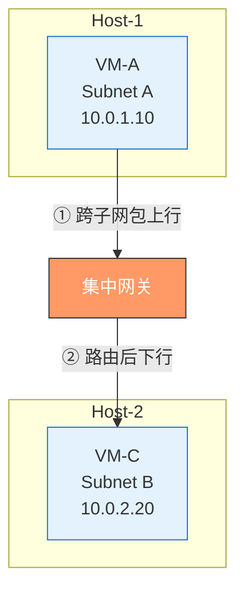
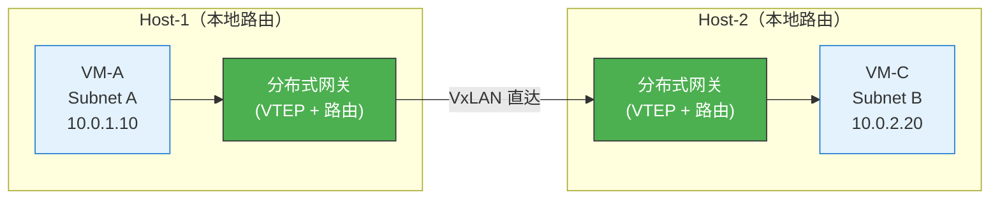
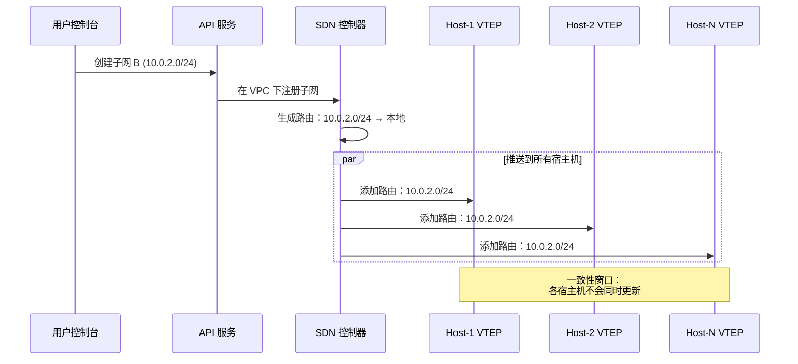
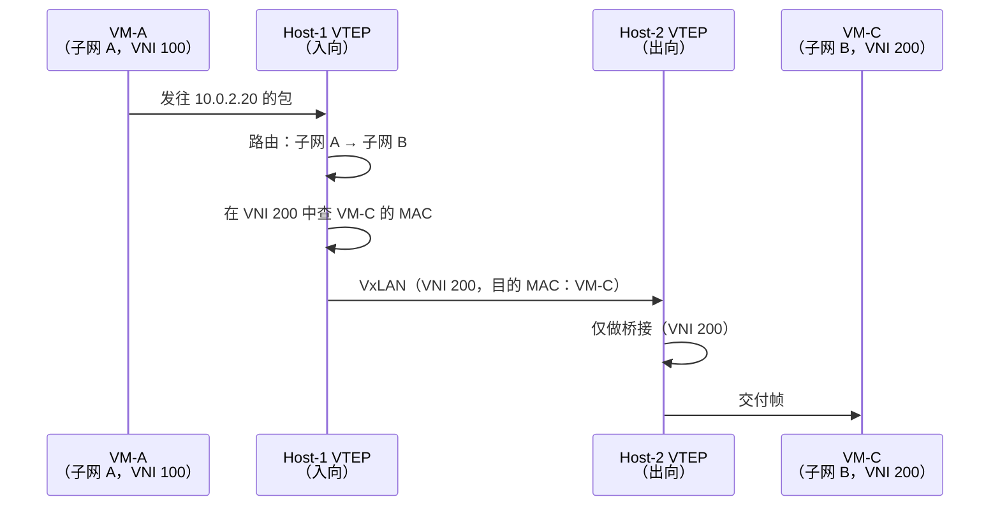
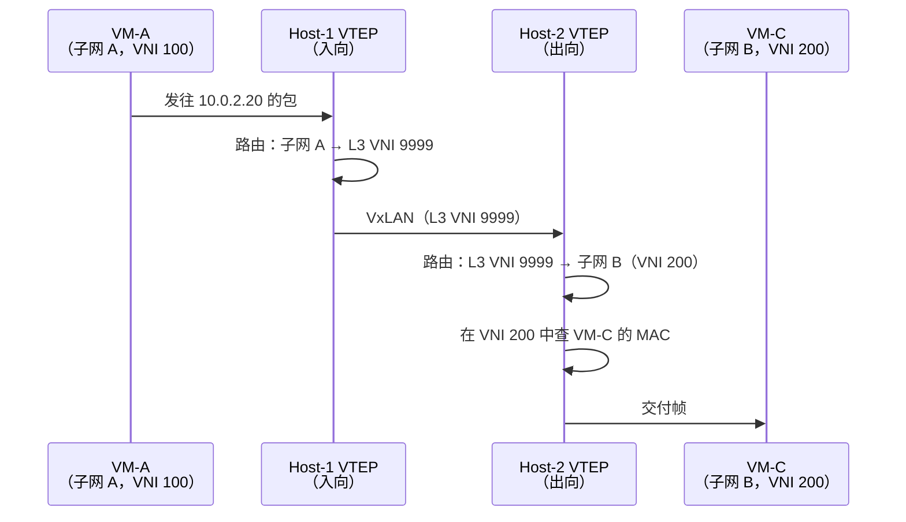
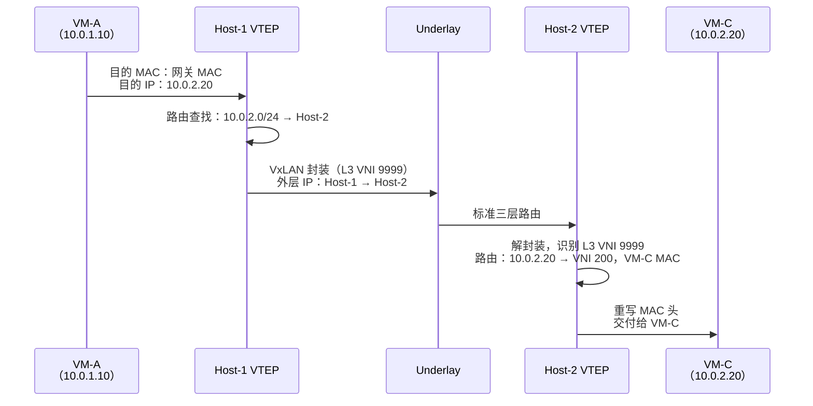

# 9. 跨子网通信：分布式网关与三层路由

一个典型的 VPC 不会只有一个子网。Web 服务器在子网 A，应用服务器在子网 B，数据库在子网 C，分层部署是常态。子网 A 里的 VM-A 要访问子网 B 里的 VM-C，目的 IP 不在自己的子网范围内，二层转发走不通。

在传统网络里，跨子网意味着需要一台路由器。在 VPC 里，这台路由器在哪？是一台专门的设备，还是某种分散在各处的能力？

## 9.1 跨子网意味着什么

假设 VM-A 在子网 A（10.0.1.0/24），IP 是 10.0.1.10。VM-C 在子网 B（10.0.2.0/24），IP 是 10.0.2.20。VM-A 要给 VM-C 发一个包。

VM-A 的网络协议栈做的第一件事是判断目的 IP 是否在本子网内。它把目的 IP 10.0.2.20 和自己的子网掩码 255.255.255.0 做与运算，得到 10.0.2.0，和自己所在的子网 10.0.1.0 不一样。结论很明确：目的地不在本子网，二层直接转发走不通。

二层转发走不通，就需要三层路由。VM-A 不会尝试直接给 VM-C 发帧，它知道 VM-C 不在自己的广播域里，ARP 请求也找不到 VM-C，VM-A 会把包发给自己的**默认网关**。

在传统物理网络里，默认网关通常是一台路由器或三层交换机的接口 IP。VM-A 先 ARP 解析网关的 MAC 地址，然后把包发给网关。网关收到包后，查路由表，找到目的子网 10.0.2.0/24 对应的出接口和下一跳，修改以太网帧的 MAC 头，源 MAC 换成网关自己的 MAC，目的 MAC 换成 VM-C 的 MAC（或下一跳的 MAC），然后把包转发出去。IP 头不变，只有 MAC 头被改写，TTL 减 1。

这就是三层路由的本质：**根据目的 IP 查路由表，决定下一跳，改写 MAC 头，转发。**

在 VPC 里，这个过程的逻辑完全一样。但问题是：这个网关在哪里？是一台专门的设备，还是分散在每台宿主机上？

## 9.2 集中式网关的瓶颈

最直觉的方案是部署一组专门的网关节点，几台高性能的路由设备或虚拟路由器，所有跨子网的流量都先送到网关，网关做完路由再发往目标。

这是最容易想到的设计：路由本来就是一件集中的事。传统企业网里，一台核心路由器承担所有 VLAN 间的路由；换到 VPC 场景，把这几台设备虚拟化，摆成一组集中网关，所有跨子网流量都绕过来一趟，网关查表、改 MAC、再发走。物理拓扑无关紧要，不管底下是 Leaf-Spine 还是别的什么，逻辑上就是路由能力堆在少数几个点上。

**图 9.1：集中式网关的流量路径**

看起来简单，但算一笔账就知道问题在哪：

**发卡弯。** VM-A 在 Host-1 上，VM-C 在 Host-2 上，两台宿主机可能就在相邻的机架里。但跨子网的包必须先从 Host-1 发到集中网关，网关做完路由再发到 Host-2。包走了一个 U 形的路径，从 Host-1 上行到网关，再从网关下行到 Host-2。如果 VM-A 和 VM-C 恰好在同一台宿主机上，这个绕路就更荒谬了：包从宿主机出去，到网关，再回到同一台宿主机。这种流量路径叫**发卡弯（hairpin）**，包像发卡一样折了个弯。

**带宽瓶颈。** 一个 VPC 内所有跨子网的流量都要经过网关。在云环境中，东西向流量（VM 之间的流量）远大于南北向流量（进出数据中心的流量）。一个大型 VPC 可能有几千台 VM，东西向流量可以达到 Tbps 级别。所有这些流量都压在几台网关上，网关的吞吐量就是整个 VPC 跨子网通信的上限。

**单点故障。** 网关挂了，整个 VPC 的跨子网通信全部中断。即使做主备冗余，主备切换期间也有秒级的中断。对于在线业务来说，秒级中断意味着大量的请求失败和超时。

**扩容困难。** 随着 VPC 规模增长，网关需要横向扩展。但流量怎么在多台网关之间分配？路由状态怎么在网关之间同步？扩容不是简单地加机器，而是一个分布式系统的状态管理问题。

几个问题指向同一个方向：集中式网关在云的规模下撑不住。那如果换一个思路，不设集中网关，让每台宿主机自己具备路由能力呢？

## 9.3 分布式网关的思路

如果每台宿主机上的 VTEP 不仅能做二层转发（同子网），还能做三层路由（跨子网），那跨子网的包就不需要离开宿主机去找网关了。

VM-A 发出跨子网的包，目的 IP 是 10.0.2.20。这个包到达 Host-1 上的虚拟交换机，虚拟交换机发现目的 IP 不在 VM-A 所在的子网内，需要路由。它本地查路由表，找到 10.0.2.0/24 这个子网的信息，查到 VM-C 的 MAC 地址和所在的 VTEP（Host-2），直接做 VxLAN 封装，把包发给 Host-2。

包从 Host-1 直接到 Host-2，中间不经过任何集中节点。

**图 9.2：分布式网关的流量路径**

> 每台宿主机自带路由能力，跨子网流量从 Host-1 直达 Host-2，不绕道任何集中节点。

集中式网关的三个问题，在分布式网关下都消失了。

发卡弯消失了，流量从源宿主机直接到目的宿主机，不绕道。即使 VM-A 和 VM-C 在同一台宿主机上，路由在本地完成，包甚至不需要离开宿主机。

带宽瓶颈消失了，路由能力分散在所有宿主机上，每台宿主机独立处理自己上面 VM 的跨子网流量。总吞吐量随宿主机数量线性增长，100 台宿主机就有 100 份路由能力，1000 台就有 1000 份。

单点故障消失了，没有集中网关节点，就没有单点。每台宿主机独立做路由决策，一台宿主机出问题只影响它上面的 VM，不影响其他宿主机。

但分布式网关不是没有代价。

每台宿主机都需要维护完整的路由表和 MAC 映射表，VPC 内有多少个子网、每个子网有多少台 VM、每台 VM 的 IP 和 MAC 是什么、在哪台宿主机上。这些信息全部要推送到每一台宿主机。VM 新建、删除、迁移时，所有宿主机的表项都需要更新。控制面的下发压力比集中式网关大得多。

路由能力从集中走向分散，但路由信息的管理仍然是集中的。这是一个重要的区分：**数据面是分布式的，控制面仍然是集中式的。**

## 9.4 路由表的下发

分布式网关的路由能力在每台宿主机上，但路由表从哪来？

答案还是 SDN 控制器，和 VNI 分配、MAC 映射下发是同一个角色。SDN 控制器不仅管理二层转发信息（IP-MAC-VTEP 三元组），还管理三层路由信息（子网路由、默认路由、自定义路由规则）。

路由表的来源有两类。一类是**自动生成的本地路由**：用户在 VPC 里创建了子网 A（10.0.1.0/24）和子网 B（10.0.2.0/24），控制器自动生成两条路由，10.0.1.0/24 → 本地，10.0.2.0/24 → 本地。本地的意思是这两个子网都在本 VPC 内，可以直接通过 Overlay 到达。另一类是**用户自定义的路由规则**：用户在 VPC 的路由表中手动添加的条目，比如 0.0.0.0/0 → NAT 网关（默认路由指向公网出口）。

控制器把这些路由规则翻译成宿主机上 VTEP 能理解的流表项，推送到同一 VPC 内的所有宿主机。推送不是每次全量，当路由表发生变更时（新建子网、删除子网、修改路由规则），控制器只推送变化的部分，这就是**增量更新**。

但增量更新在分布式系统中有一个固有问题：**一致性窗口**。

控制器把一条新路由推送给 100 台宿主机，不可能 100 台同时收到。总有先后，可能 Host-1 在第 10 毫秒收到了新路由，Host-50 在第 50 毫秒才收到。在这 40 毫秒的窗口内，Host-1 已经知道新子网的路由，Host-50 还不知道。如果恰好有一个包需要 Host-50 做路由决策，它可能因为找不到路由而丢弃这个包。

这个一致性窗口是分布式系统的固有代价。控制面的更新速度和可靠性决定了这个窗口有多长，毫秒级的窗口在大多数场景下可以接受，但秒级的窗口就可能导致用户可感知的丢包。

**图 9.3：路由表下发的链路**

分布式网关的控制面和数据面形成了一个清晰的分工：控制面集中管理路由信息，保证全局一致性；数据面分布式执行路由转发，保证性能和可用性。这种"集中控制、分布执行"的模式，是云网络架构的一个核心范式。

## 9.5 非对称 IRB 与对称 IRB

分布式网关的思路确定了，每台宿主机自己做路由。但具体怎么做，业界有两种不同的模型。展开之前先框定范围：下面讨论的都建立在第 7 章交代过的每子网一个 L2 VNI映射之上。如果整个 VPC 只共用一个 VNI，跨子网通信在同一个 VNI 内完成，宿主机只做路由加二层转发，两种模型的区分并不存在。

要理解这两种模型，先要区分两类 VNI。

之前提到的 VNI 用来标识一个子网的二层域，子网 A 对应 VNI 100，子网 B 对应 VNI 200。同一个 VNI 内的 VM 可以二层互通。这类 VNI 叫 **L2 VNI**。

但跨子网路由需要一个新的标识，不是标识某个子网，而是标识整个 VPC 的三层路由域。一个 VPC 可能有多个子网，但它们共享同一个路由表、同一个路由域。标识这个路由域的 VNI 叫 **L3 VNI**。一个 VPC 有一个 L3 VNI，但可以有多个 L2 VNI（每个子网一个）。

> **IRB 是什么？**
>
> IRB（Integrated Routing and Bridging）是指路由和桥接在同一台设备上完成。传统网络中，路由器只做路由，交换机只做桥接，两者是分开的设备。IRB 把两种能力集成在一起，同一台设备既能在子网内做二层桥接，又能在子网间做三层路由。在分布式网关场景下，每台宿主机的 VTEP 就是一个 IRB 设备。

有了 L2 VNI 和 L3 VNI 的区分，两种转发模型就可以讲清楚了。

**非对称 IRB。** VM-A（子网 A，VNI 100）要访问 VM-C（子网 B，VNI 200）。Host-1 的 VTEP 收到 VM-A 的包后，做路由查找，目的 IP 10.0.2.20 属于子网 B（VNI 200），VM-C 的 MAC 是 fa:16:3e:cc:dd:ee，在 Host-2 的 VTEP 后面。Host-1 的 VTEP 完成两件事：路由（从子网 A 切换到子网 B）和桥接（在子网 B 内找到 VM-C 的 MAC）。然后用 **VNI 200**（子网 B 的 L2 VNI）封装 VxLAN 包，发给 Host-2。

Host-2 收到包后，看到 VNI 200，知道这是子网 B 的二层帧。它只需要做桥接，查 VNI 200 内的 MAC 表，找到 VM-C 的虚拟端口，把帧交给 VM-C。Host-2 不需要做任何路由。

非对称的含义就在这里：**入向（Host-1）做了路由+桥接两件事，出向（Host-2）只做了桥接一件事。** 两端的工作量不对称。

**图 9.4：非对称 IRB 的转发路径**

非对称 IRB 有一个要求：Host-1 必须知道子网 B 内所有 VM 的 MAC 信息，因为它要在本地完成从子网 A 到子网 B 的完整路由和桥接。这意味着每台宿主机需要维护 VPC 内**所有子网**的 ARP 表，不仅仅是本地 VM 所在子网的。子网越多、VM 越多，每台宿主机维护的状态量越大。

**对称 IRB** 用另一种方式解决这个问题。

VM-A 的包到达 Host-1，Host-1 做路由查找，目的 IP 10.0.2.20 属于子网 B，下一跳是 Host-2 的 VTEP。但 Host-1 不去查 VM-C 的 MAC，也不用子网 B 的 L2 VNI 封装。它用 VPC 级的 **L3 VNI** 封装，VxLAN 头中填的是 L3 VNI（比如 9999），表示这是一个跨子网的路由包。

这里有一个容易被忽略的前提：**只带 L3 VNI 而不指明子网，Host-2 为什么不会把包路由错？** 因为 L3 VNI 本身就唯一标识了一个 VPC 的路由域。VPC-1 的 L3 VNI 是 9999，VPC-2 的 L3 VNI 是 8888，两者由控制器在全局分配、不重叠。Host-2 上可能同时承载着多个 VPC 的 VM，10.0.2.20 这个 IP 在 VPC-1 里是 VM-C，在 VPC-2 里可能是完全不相干的另一台 VM，但 L3 VNI 一进来，Host-2 就锁定了查哪张路由表：VNI 9999 对应 VPC-1 的路由表，10.0.2.20 在这张表里唯一指向 VM-C。VPC 内部的 IP 地址空间由用户自己规划，本来就在同一个 VPC 内不重复。L3 VNI 圈定 VPC，VPC 内部 IP 唯一，两层拼起来就够了。

Host-2 收到包后，看到 L3 VNI 9999，知道这不是一个普通的二层帧，而是一个需要再做一次路由的包。Host-2 做第二次路由查找，目的 IP 10.0.2.20 属于本地子网 B（VNI 200），VM-C 的 MAC 是 fa:16:3e:cc:dd:ee，在本地虚拟端口上。Host-2 完成路由和桥接，把帧交给 VM-C。

对称的含义：**两端各做一次路由，工作量对称。**

**图 9.5：对称 IRB 的转发路径**

对称 IRB 的关键优势：Host-1 不需要知道子网 B 内 VM 的 MAC 信息。它只需要知道子网 B 可以通过 Host-2 到达，至于 VM-C 的 MAC 是什么，由 Host-2 自己去查。每台宿主机只需要维护本地 VM 所在子网的详细 MAC 表，加上一张全局的子网路由表。状态量小得多，扩展性好得多。

代价是什么？路径多了一跳，非对称 IRB 只在入向做一次路由，对称 IRB 在两端各做一次。多一次路由查找意味着多一点延迟。但在实际场景中，这个延迟是纳秒到微秒级的，远小于网络传输本身的延迟。

两种模型的权衡很清晰：非对称 IRB 路径短但状态量大，对称 IRB 路径多一跳但状态量小。记住这个直觉：**非对称 IRB 让入向 VTEP 做了所有判断，代价是它必须知道整个 VPC 的 ARP 表；对称 IRB 把判断分摊给两端，代价是多一跳。规模越大，非对称 IRB 的状态量越难承受。** 在大规模 VPC 场景下，几十个子网、几千台 VM，对称 IRB 的扩展性优势更明显。大多数云厂商的分布式网关实现采用的是对称 IRB 或其变体。

## 9.6 跨子网通信的完整路径

现在我们把所有环节串起来，走一遍跨子网通信的完整路径。

VM-A（子网 A，10.0.1.10，Host-1）要访问 VM-C（子网 B，10.0.2.20，Host-2）。以对称 IRB 模型为例。

**Step 1：VM-A 发包给默认网关。** VM-A 发现目的 IP 10.0.2.20 不在本子网内，把包发给默认网关。默认网关的 IP 是 10.0.1.1，这个 IP 是 VPC 创建子网时自动分配的，实际上由 Host-1 的 VTEP 虚拟出来。VM-A 先 ARP 解析网关的 MAC（同样是代答机制），然后把包发出去，目的 MAC 填网关的 MAC。

**Step 2：Host-1 做路由。** Host-1 的 VTEP 收到包，发现目的 MAC 是网关的 MAC，这是一个需要路由的包。查路由表：10.0.2.0/24 → 本 VPC 内可达，下一跳 VTEP 是 Host-2。用 L3 VNI 9999 封装 VxLAN 包，外层 IP 指向 Host-2。

**Step 3：Underlay 路由。** 封装后的包进入物理网络，物理交换机按照标准三层路由把包从 Host-1 送到 Host-2。

**Step 4：Host-2 做路由和转发。** Host-2 的 VTEP 收到包，看到 L3 VNI 9999，知道这是跨子网的路由包。解封装后查路由表：目的 IP 10.0.2.20 属于本地子网 B（VNI 200），VM-C 的 MAC 是 fa:16:3e:cc:dd:ee。修改帧的 MAC 头，把帧交给 VM-C。

**Step 5：VM-C 收到包。** VM-C 看到的是一个正常的 IP 包，源 IP 10.0.1.10，目的 IP 10.0.2.20。它不知道这个包经历了两次路由、一次 VxLAN 封装解封装、穿越了整个物理网络。

**图 9.6：跨子网通信的完整数据路径（对称 IRB）**

和同子网通信对比一下：同子网通信只需要二层转发（ARP 代答 + VxLAN 封装，VNI 是 L2 VNI），跨子网通信多了路由查找和 VNI 切换（从 L2 VNI 到 L3 VNI 再到 L2 VNI）。但对 VM 来说，两种场景完全透明，VM 不知道对方在同一个子网还是不同子网，它只管发包，底层的路由和封装由宿主机代劳。

到这里，VPC 内的同子网和跨子网通信都解决了。VM 之间可以自由通信，同子网走二层转发，跨子网走分布式网关路由，整个过程对 VM 完全透明。

但自由通信真的是用户想要的吗？VPC 隔离了外面的人，可 VPC 内部呢，所有 VM 之间默认全通，没有任何访问限制，路通了，但门还没设。
