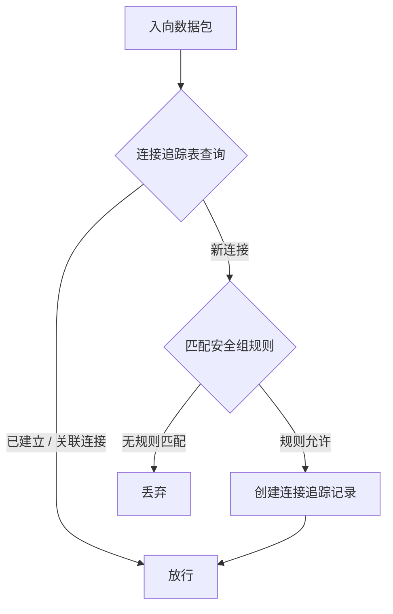
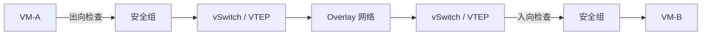
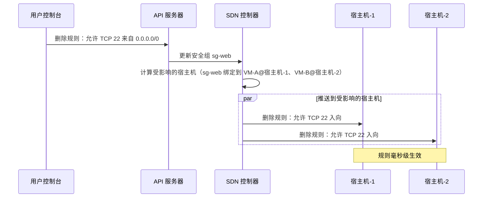
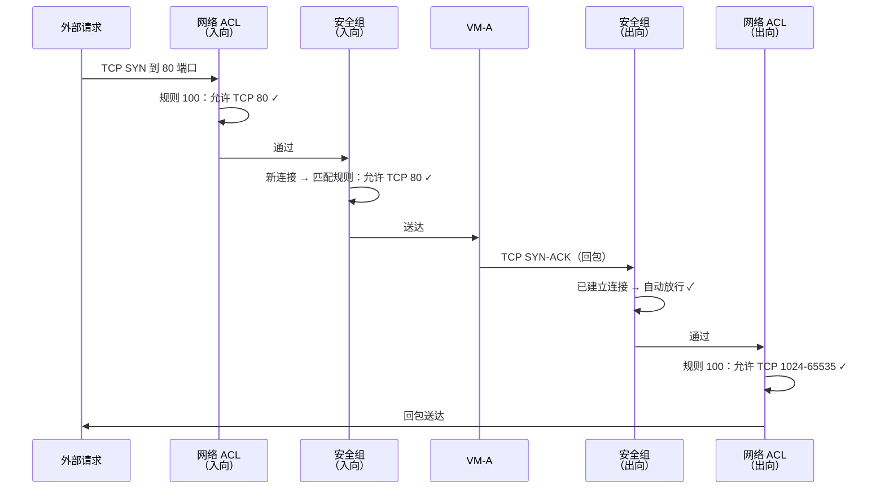

# 10. 谁来守门：安全组与网络 ACL

VPC 把不同租户的网络隔开了，VPC 内部的通信管道也铺好了。但管道里该流什么、不该流什么，这个问题还没有答案。

同一个 VPC 内的所有 VM 之间默认全通，没有任何访问限制。这就像你给小区装了一道坚固的大门，但小区里每户人家都不锁门。外面的人进不来，但只要有一个人混进来了，他可以随意串门。

通信能力是基础，但没有控制的通信是危险的。问题不是要不要控制，而是在哪里控制、控制到什么粒度。

## 10.1 没有门锁的大院子

默认全通的后果比想象中更具体。

一台 Web 服务器只需要对外暴露 80 和 443 端口，但实际上它的所有端口，22（SSH）、8080（管理后台）、9090（监控接口），对 VPC 内的每一台 VM 都是可达的。数据库只应该接受来自应用服务器的连接，但实际上 VPC 内任何一台 VM 都能连它的 3306 端口。一台开发环境的测试 VM，可以 SSH 到生产环境的数据库服务器。

这不是理论上的风险。安全团队收到告警，数据库的数据被大量导出。排查发现，攻击者利用 Web 服务器上一个未修补的远程代码执行漏洞拿到了 shell，然后直接连上了数据库的 3306 端口，整个过程没有触发任何拦截。在实际的云环境中，横向移动是最常见的攻击路径之一，攻击者拿下一台低价值的 VM，利用 VPC 内部的全通网络，逐步渗透到高价值目标。一台不起眼的测试机，可能是整个生产环境沦陷的起点。

这类事故反复上演，安全领域早就沉淀出一条通用准则，**最小权限原则**：每台 VM 只暴露它需要暴露的端口，只接受它应该接受的来源。Web 服务器的 80/443 端口对外开放，22 端口只对运维 IP 开放，其他端口全部关闭。数据库的 3306 端口只接受来自应用服务器的连接，其他一律拒绝。

但这里有两种不同粒度的需求。一种是针对单台 VM 的，这台数据库只接受来自应用服务器的 3306 连接。另一种是针对整个子网的，子网 C 不允许任何来自外部的直接入向流量。

一个直觉的想法是在网络设备上做访问控制，在交换机或路由器上配置 ACL 规则，过滤不该通过的流量。在传统数据中心里，这是标配做法。但在 VPC 的分布式网关架构下，跨子网的流量从源宿主机直接到目的宿主机，中间不经过任何集中的网络设备。没有集中设备，就没有地方插入集中的 ACL。

访问控制的执行点，必须跟着流量走。流量在宿主机上产生和终结，访问控制就得在宿主机上执行。

## 10.2 安全组：实例级的有状态过滤

需要的是一种绑定到每台 VM 实例的访问控制机制，规则跟着 VM 走，不管 VM 在哪台宿主机上，规则都在它身边生效。

这种机制叫**安全组（Security Group）**。

每个安全组是一组规则的集合，可以绑定到一个或多个 VM 实例。规则定义了允许什么样的流量进出这台 VM。每条规则有四个维度：

- **方向**：入向（Ingress）还是出向（Egress）
- **协议**：TCP、UDP、ICMP，或者全部协议
- **端口范围**：单个端口（如 3306）、端口范围（如 8000-9000）、或全部端口
- **源/目的**：一个 IP 地址范围（CIDR），或者另一个安全组的 ID

安全组的默认行为是：**拒绝所有入向流量，允许所有出向流量**。用户需要显式添加入向规则来放行特定的流量。这个默认策略本身就体现了最小权限原则，除非你明确说允许，否则一律拒绝。

一个典型的 Web 服务器安全组可能只有两条入向规则：允许任意来源的 TCP 80 和 TCP 443。数据库的安全组可能只有一条入向规则：允许来自安全组 sg-app（应用服务器所在的安全组）的 TCP 3306。

注意这里的一个设计：规则的源可以是另一个安全组的 ID，而不是 IP 地址范围。允许安全组 sg-app 的 3306 入向，这意味着不管应用服务器的 IP 怎么变、不管它在哪台宿主机上、不管它扩容到多少台，只要它属于 sg-app，就能访问数据库，这比写死 IP 范围灵活得多。

安全组还有一个关键特性：**有状态**。

允许 TCP 80 入向，好，但回包呢？你一定想过：如果只配置入向规则，服务器的 TCP SYN-ACK 响应是出向流量，按理说应该配置出向规则允许它。但你在控制台里从来不需要这样做，为什么？这不是云厂商的便利设计，而是背后有一套有状态的过滤机制，**连接追踪（conntrack）**。
内核维护一张连接追踪表。表的每一条记录对应一个连接，key 是五元组：源 IP、目的 IP、源端口、目的端口、协议。每当一个新的包到达，内核先查连接追踪表：

- 如果这个包属于一个已经存在的连接（五元组匹配），并且连接状态是 **ESTABLISHED**（双向都有包，连接已建立），直接放行，不再检查安全组规则。
- 如果这个包是一个全新的连接（五元组不在表中），状态标记为 **NEW**，然后去匹配安全组规则。如果规则允许，在连接追踪表中创建一条记录；如果规则拒绝，丢弃。
- 如果这个包与一个已有连接相关联（比如 FTP 的数据通道与控制通道的关系），状态标记为 **RELATED**，同样自动放行。

**图 10.1：安全组的有状态过滤流程**

这里要问一个问题：为什么安全组要做成有状态的？做成无状态、每个包独立判断，实现更简单，也不用维护那张 conntrack 表。

答案在使用场景里。安全组是给 VM 用户配的，用户的心智模型是我这台服务器对外开放 80 端口，一句话说完。如果安全组无状态，这句话就要拆成两条规则：入向允许目的端口 80，出向允许源端口 80，目的端口 1024-65535 之间的任意值。回包的目的端口是客户端的临时端口，客户端用哪个临时端口服务端事先不知道，所以出向规则必须放开一大段端口范围。用户不仅要写两条，还要理解 TCP 的临时端口机制，一旦漏配一条或范围写错，症状就是请求能进来，响应出不去，客户端超时，这类问题排查起来极其耗时间。

安全组管的是每一台 VM，配置错误的成本会放大到每一个业务。所以把连接追踪的复杂度收进平台内部，让用户只关心允许谁访问我的什么端口，回包的事平台自己搞定。这不是便利设计，而是把一类必然会犯的错从用户手里拿走。

## 10.3 安全组在哪里执行

安全组的规则配好了，但它在数据路径上的什么位置被检查？

答案是：**在宿主机上，紧贴 VM 的虚拟网卡**。

包从 VM 出来，经过虚拟网卡，第一站就是安全组的出向检查。包到达目的 VM 之前，最后一站就是安全组的入向检查。安全组像一层透明的膜，包裹在每台 VM 的虚拟网卡外面。

**图 10.2：安全组在数据路径上的位置**

为什么在宿主机上执行，而不是在某台集中的防火墙上？

原因和分布式网关一样，安全组是实例级的，每台 VM 绑定不同的安全组，只有宿主机知道每个虚拟网卡对应哪个 VM、绑定了哪个安全组。如果把安全组的检查放在集中设备上，所有流量都要绕道集中设备，又回到了集中式网关的老问题：发卡弯、带宽瓶颈、单点故障。

安全组的执行在 Linux 内核中有两种主要的实现方式。

传统方式是 **Netfilter/iptables**。Linux 内核的网络栈在几个关键位置预留了钩子点（hook point），Netfilter 框架允许在这些钩子点插入规则链。安全组的规则被翻译成 iptables 规则，挂在虚拟网卡对应的链上。每个包经过钩子点时，依次匹配规则链中的规则。这种方式成熟稳定，但有一个问题：规则是线性匹配的。一台 VM 如果绑定了几十条规则，每个包都要从头到尾匹配一遍。VM 多了、规则多了，性能下降明显。

> **Netfilter 是什么？**
>
> Netfilter 是 Linux 内核中的包过滤框架。它在内核网络栈的五个关键位置（PREROUTING、INPUT、FORWARD、OUTPUT、POSTROUTING）设置了钩子点，允许外部模块在这些位置注册回调函数，对经过的每个包做检查、修改或丢弃。iptables 是 Netfilter 的用户态管理工具，用户通过 iptables 命令配置规则，规则实际上由 Netfilter 在内核中执行。

更现代的方式是 **eBPF**。在网卡的 TC（Traffic Control）层或更底层的 XDP（eXpress Data Path）层注入 BPF 程序，直接在包到达内核网络栈之前做过滤。BPF 程序会被即时编译成高效的机器码，匹配效率远高于 iptables 的线性规则链。代价是开发复杂度更高，需要编写和维护 BPF 程序，调试也更困难。

不管用哪种实现方式，安全组对每个包都要做一次检查，至少查一次连接追踪表。在高 PPS 场景下（比如一台 VM 每秒处理几百万个小包），这是显著的 CPU 开销。iptables 的线性匹配在规则少时没问题。但一台宿主机上同时运行 50 个 Pod、每个 Pod 绑定 20 条规则，就是 1000 条线性匹配规则，每个包都要做一次。这是真实的性能损耗，是腾讯云、阿里云等公司切换到 eBPF 的真实动机。宿主机的 CPU 不仅要处理 VxLAN 封装解封装，还要处理安全组的包过滤和连接追踪。这也是 DPU/SmartNIC 的一个重要应用场景，把安全组的过滤逻辑卸载到硬件，释放宿主机的 CPU。

## 10.4 规则变更的实时生效

安全组不是配一次就不动了，用户随时可能在控制台添加一条新规则、删除一条旧规则、或者修改规则的端口范围。这个变更需要尽快生效，如果用户删除了一条允许 SSH 的规则，期望是这台 VM 立刻不再接受 SSH 连接，而不是等几分钟。

变更的链路和路由表下发类似：用户在控制台操作 → API 服务器接收请求 → SDN 控制器计算受影响的宿主机 → 把新规则推送到对应的宿主机 → 宿主机更新本地的过滤规则。

**图 10.3：安全组规则变更的下发链路**

但这里有一个微妙的问题：**已有连接怎么处理？**

用户删除了"允许 TCP 22 入向"的规则。此时有一个 SSH 会话正在进行，这个连接已经在 conntrack 表中，状态是 ESTABLISHED。新规则生效后，这个已建立的 SSH 连接会被立刻断开吗？

答案取决于实现策略。一种做法是**只影响新连接**，已经在 conntrack 表中的 ESTABLISHED 连接继续放行，直到连接自然结束或超时。规则变更只对变更之后的新连接生效。另一种做法是**同时清理已有连接**，规则变更时，同步清除 conntrack 表中与被删除规则匹配的记录，已有连接立刻中断。

两种做法各有道理。前者更温和，不会突然中断正在进行的业务；后者更严格，安全策略立刻生效，不留窗口。不同云厂商的选择不同，有些提供配置选项让用户自己决定。

还有一个分布式系统的固有问题：同一个安全组可能绑定了几十台 VM，分布在不同宿主机上。控制器把新规则推送给所有宿主机，不可能同时到达。总有一个时间窗口，有些宿主机已经生效了新规则，有些还在用旧规则。这个一致性窗口通常在毫秒到百毫秒级别，对大多数场景可以接受，但用户需要知道它的存在。

## 10.5 网络 ACL：子网级的无状态过滤

安全组解决了实例级的访问控制。但有些场景需要更粗粒度的策略，不是针对某台 VM，而是针对整个子网。

比如：整个数据库子网（子网 C）不允许任何来自 VPC 外部的直接入向流量。这条规则和具体哪台 VM 无关，它是子网级别的策略。用安全组也能实现，给子网 C 里的每台 VM 都绑定同样的规则。但如果子网 C 里有 50 台 VM，每台都要绑定，新加一台 VM 也要记得绑定。漏绑一台就是一个安全漏洞。

需要的是一种直接绑定到子网的访问控制机制，规则对整个子网生效，子网内的所有 VM 自动受到保护，不需要逐台绑定。这种机制叫**网络 ACL（Network Access Control List）**。

到这里定义就出来了，接下来的问题是：既然已经有安全组了，网络 ACL 该怎么设计？沿用安全组那套（有状态、规则取并集）最省事，但云厂商没这么做。网络 ACL 的两个关键设计：**无状态**和**有序匹配**，都和安全组反着来。

先看无状态。

如果网络 ACL 也做成有状态，用户体验会更好：只写允许 TCP 80 入向一条规则，回包自动放行，跟安全组一样。但这里有一个前提问题：一个包从外部进来到达 VM，它会先过 ACL、再过安全组。安全组已经把这个连接记进了自己的 conntrack 表。如果 ACL 也维护自己的一张 conntrack 表，同一个连接就有两份状态。

两份状态就意味着两份不一致的可能。ACL 侧的连接超时时间到了，记录被清掉；安全组那边还认为连接活着，回包过安全组这一层时正常放行，过 ACL 这一层被当成没有前置请求的孤儿包丢弃。反过来也一样。这种问题排查起来极其难，因为规则表看着都对，问题出在两张状态表的时序上。

再看职责。安全组管连接级的精细控制，配到具体 VM 的具体端口，这层已经在做 conntrack 了。网络 ACL 管的是子网边界，职责是这类流量整个子网都不许进，粒度比连接粗一个量级。让粗粒度的层去追踪细粒度的连接状态，收益不匹配。

所以选择是：ACL 不碰状态，每个包独立判断。用户的代价是入向和出向必须分别配置，配 80 端口入向的同时得记得配临时端口出向。收益是实现简单、行为可预测、和安全组之间没有状态耦合。这是把配置复杂度留给用户，换掉一类平台自己也讲不清楚的边界 bug。

再看有序匹配。

安全组的规则是并集：任何一条规则允许，包就放行；没有规则匹配，就默认拒绝。这套规则里没有拒绝这个动作，因为不需要，默认已经是拒绝，用户只写允许即可。

网络 ACL 不能这么设计，原因是它的典型使用场景里有明确的拒绝需求。子网级的策略经常设置成这样：允许 10.0.0.0/16 整个 VPC 段访问，但里面 10.0.1.0/24 这个子网除外。用并集规则表达不了"允许一大片，除了其中一小块"，你没法写一条拒绝规则去覆盖已经写过的允许，因为并集里拒绝没有位置。

要支持这种表达，就必须引入两个东西：规则里要有拒绝这个动作，规则之间要有先后顺序。先匹配到拒绝 10.0.1.0/24，直接丢弃，后面允许 10.0.0.0/16 的规则不再看。这就是有序匹配的由来，不是为了让规则更强大，是为了表达例外这个语义。

所以规则的顺序变得重要，编号写错了策略就反了。安全组不用考虑顺序，因为并集里怎么排都一样；ACL 必须考虑，写规则时得想清楚哪条在前哪条在后。

无状态和有序匹配，本质上都是同一个逻辑的产物：ACL 是子网级的门岗，粗粒度、边界式、可能包含黑名单。它不需要连接级的细节，也不能和安全组抢连接状态；它需要能表达排除的语义，所以必须有拒绝动作和顺序。安全组是实例级的贴身检查，粒度细、以白名单为主、需要连接状态。两层一粗一细、一无状态一有状态、一并集一有序，配合起来才是一套完整的访问控制。

理清了动机，剩下的就是把这两个设计落到细节上。

先说执行位置。子网有边界，直觉上应该有一台专门的 ACL 设备守在子网入口，可实际上并没有。和安全组一样，网络 ACL 也在宿主机上分布式执行，没有独立的 ACL 硬件或软件设备。

原因和安全组一样：VPC 的子网边界是逻辑概念，不是物理设备。在分布式网关架构下，跨子网的流量从源宿主机直接到目的宿主机，中间不经过任何集中的网络设备。既然没有集中设备，ACL 的检查就只能在宿主机上完成。

具体来说，宿主机的 vSwitch 在处理每个包时，会根据包的源 IP 和目的 IP 判断这个包是否跨越了子网边界。如果是，就在安全组检查之前（入向）或之后（出向）额外插入一次网络 ACL 的规则匹配。安全组紧贴虚拟网卡，是实例级的贴身保镖；网络 ACL 在安全组的外层，是子网级的门岗，但两者物理上都在同一台宿主机的内核网络栈中执行。

**图 10.4：网络 ACL 与安全组在数据路径上的位置**

这也解释了一个实现细节：同一个子网内两台 VM 之间的流量，不跨越子网边界，所以不会触发网络 ACL 的检查，只有安全组会生效。网络 ACL 只在流量进出子网时才起作用。

**图 10.5：安全组 vs 网络 ACL 的对比**

| 对比维度 | 安全组（Security Group） | 网络 ACL（Network ACL） |
| --- | --- | --- |
| 绑定层级 | 实例（VM） | 子网 |
| 执行位置 | 宿主机上，紧贴 VM 的虚拟网卡 | 宿主机上，位于子网逻辑边界 |
| 状态性 | 有状态（依赖 conntrack） | 无状态（逐包判断） |
| 匹配方式 | 所有规则取并集 | 按规则编号有序匹配，命中即止 |
| 默认行为 | 拒绝所有入向，允许所有出向 | 拒绝所有（末尾隐含规则） |
| 回包处理 | 自动放行 | 必须显式配置放行规则 |
| 规则动作 | 只支持允许 | 支持允许和拒绝 |

## 10.6 两道门的协同

安全组和网络 ACL 不是二选一的关系，它们是两道门，一个包必须同时通过两道门才能到达目标 VM。

一个外部请求到达 VPC，要访问子网 A 中 VM-A 的 80 端口。这个包经历的检查路径是：

1. 包到达子网 A 的边界 → **网络 ACL 入向检查**。按规则编号依次匹配，如果匹配到一条允许规则，放行；如果匹配到拒绝或没有匹配到任何规则，丢弃。
2. 包到达 VM-A 的虚拟网卡 → **安全组入向检查**。先查 conntrack 表，如果是已有连接的一部分，直接放行；如果是新连接，匹配安全组规则。
3. VM-A 处理请求，生成回包。
4. 回包从 VM-A 出去 → **安全组出向检查**。因为安全组是有状态的，这个回包属于已建立的连接（ESTABLISHED），自动放行。
5. 回包到达子网 A 的边界 → **网络 ACL 出向检查**。因为网络 ACL 是无状态的，回包需要匹配出向规则。如果没有配置允许回包的出向规则，回包会被丢弃，请求能进来，但响应出不去。

**图 10.6：两道门的检查路径**

网络 ACL 是无状态的，入向规则和出向规则完全独立。如果只配置了入向规则允许 TCP 80，但忘记配置出向规则允许临时端口范围（1024-65535）的回包，结果就是请求能进来，但响应永远出不去，这是非常容易踩坑的地方。从客户端的视角看，连接超时，TCP 三次握手的 SYN 发出去了，SYN-ACK 永远收不到。这个坑我见过不止一个团队踩过，配完网络 ACL 后信心满满地测试，发现怎么连不上，排查半天才发现是出向规则忘了配。有状态和无状态的区别，在这一刻会变得刻骨铭心。

在实际使用中，两道门的配合原则通常是：**网络 ACL 保持宽松，安全组做精细控制**。网络 ACL 用来拦截明确禁止的流量（黑名单式），比如封禁某个已知的恶意 IP 段。安全组用来精确控制每台 VM 的访问权限（白名单式）。大多数场景下，安全组已经足够，网络 ACL 作为额外的防护层，并非每个 VPC 都需要配置网络 ACL。
