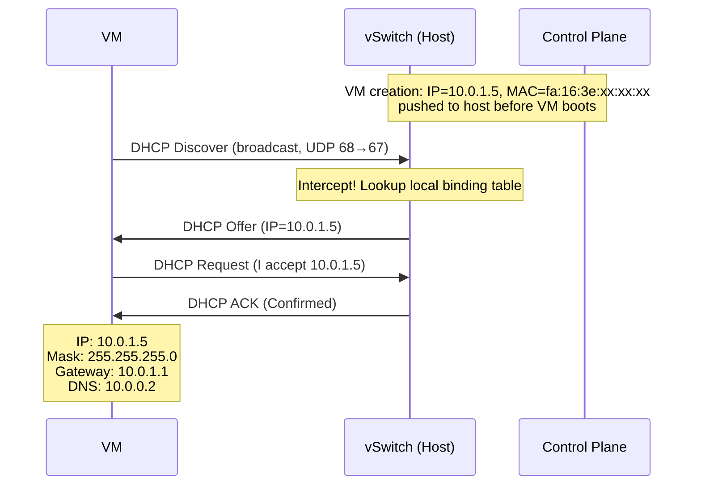
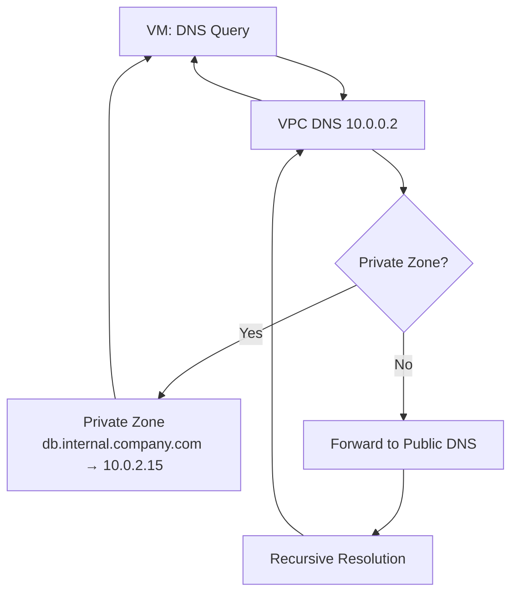
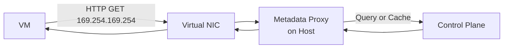
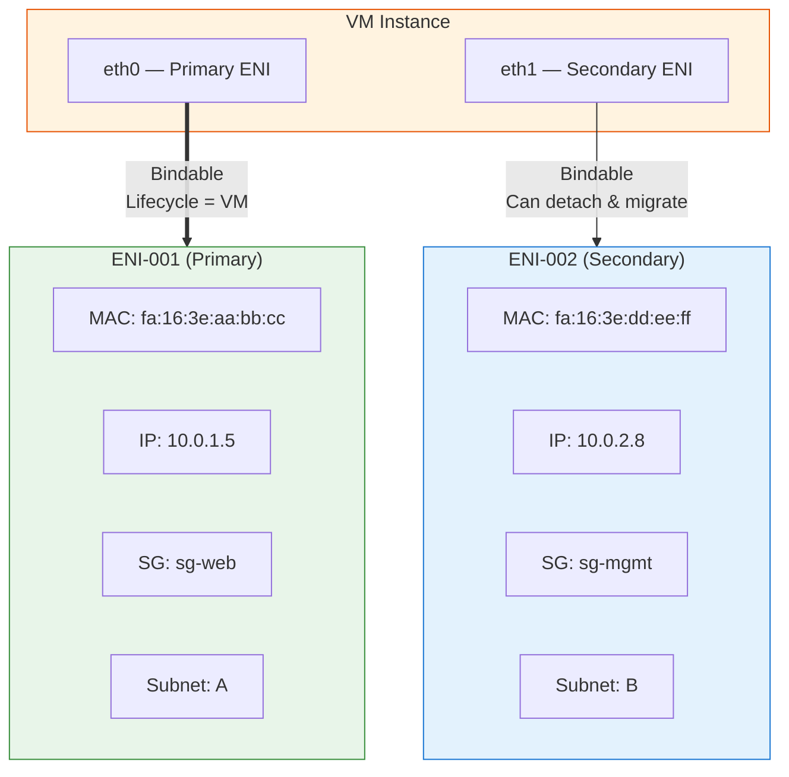
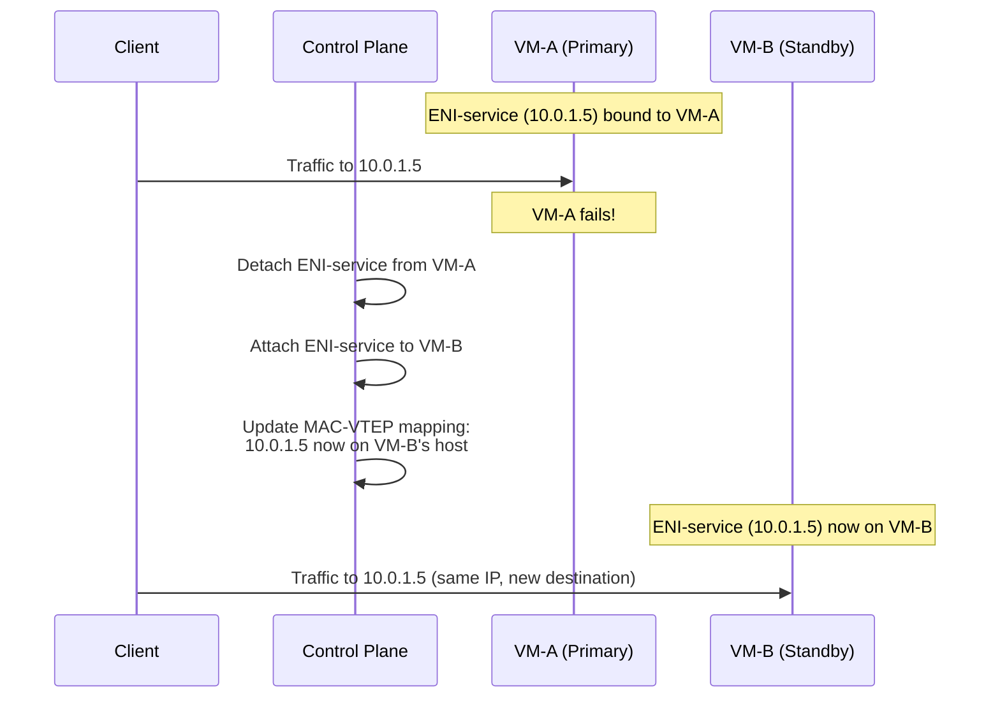

# 11. VPC 内的基础网络服务：DHCP、DNS、元数据与弹性网卡

一台刚启动的 VM，网卡驱动加载完毕，操作系统等着配置网络，但它什么都不知道。不知道自己的 IP 地址，不知道默认网关在哪里，不知道 DNS 服务器的地址，不知道自己属于哪个可用区、绑定了什么角色。一台什么都不知道的 VM，和一台关机的 VM 没有本质区别。

在传统数据中心里，这些事情靠广播和预配置就能解决，DHCP（Dynamic Host Configuration Protocol，动态主机配置协议）服务器在局域网里广播应答，DNS 服务器地址写在配置文件里，元数据服务不存在（因为不需要）。但在 VPC 的 Overlay 环境下，广播的代价不可接受，DNS 服务器不在物理网络上，而元数据服务是云环境独有的需求。

有意思的是，这些看似不相关的基础服务，DHCP、DNS、元数据，在 VPC 里的实现方式背后，藏着同一个工程模式。这个模式在前面的章节里已经出现过一次：ARP 代答。

## 11.1 一个模式的反复出现

先回到 VM 启动的那一刻。操作系统的网络栈初始化后，网卡处于"有 MAC 无 IP"的状态。VM 做的第一件事，是发出一个 DHCP Discover 广播，"谁能给我一个 IP？"

在传统网络里，这个广播会被局域网里所有设备收到，DHCP 服务器从地址池里挑一个空闲的 IP 分配给它。但在 VPC 里，这个广播不能被放出去，一个子网可能跨越几百台宿主机，一次 DHCP 广播如果泛洪到所有宿主机，代价和 ARP 广播一样不可接受。

你可能已经想到了：这不就是 ARP 遇到的同一个问题吗？VM 要找目标 MAC 地址，传统做法是广播 ARP 请求，VPC 里不能广播，所以宿主机代答。现在 VM 要找 IP 地址，传统做法是广播 DHCP Discover，VPC 里同样不能广播，解法也一样：宿主机代答。

但 DHCP 代答比 ARP 代答更"理直气壮"。ARP 代答时，宿主机需要查询控制面下发的 MAC-IP 映射表来构造回复。DHCP 代答时，宿主机甚至不需要"查"，答案在 VM 创建的那一刻就已经确定了。用户在创建 VM 时，控制面就已经决定了这台 VM 应该拿到哪个 IP、在哪个子网、绑定哪个 MAC。传统 DHCP 的"发现"过程，客户端广播请求，服务器从地址池里"先到先得"地分配，在 VPC 里完全是多余的。*答案先于问题而存在，VM 还没开口问，宿主机已经知道该回什么了。*

## 11.2 DHCP 代答：把已知的答案填进协议的格式里

传统 DHCP 遵循 DORA 四步交互：

1. **Discover**，客户端广播"谁能给我一个 IP？"（客户端还没有 IP，只能广播）
2. **Offer**，DHCP 服务器回复"我可以给你 x.x.x.x"
3. **Request**，客户端广播"我接受 x.x.x.x"（广播是为了通知其他 DHCP 服务器）
4. **ACK**，DHCP 服务器确认"x.x.x.x 归你了"

整个过程的前两步依赖广播，DHCP 服务器维护一个 IP 地址池，按"先到先得"的方式分配。

在 VPC 里，这两个前提都不成立。广播的代价不可接受，IP 分配也不是"先到先得"，控制面在 VM 创建时就把 IP-MAC 的绑定关系下发到了宿主机。DHCP 的"发现"过程变成了一场形式上的对话：VM 按照协议规范发出 Discover，宿主机拦截后直接构造 Offer 和 ACK 回复。不需要真正的 DHCP 服务器参与，不需要广播泛洪，整个过程在宿主机本地完成。

**图 11.1：VPC 中的 DHCP 代答流程**

DHCP 代答的本质就是把控制面已经确定的信息，填进 DHCP 协议规定的格式里，交给 VM 的网络栈。DHCP 响应中最关键的是 Option 字段：Option 1 携带子网掩码，Option 3 携带默认网关 IP，Option 6 携带 DNS 服务器地址，Option 51 携带租约时间。这些信息都由控制面在 VM 创建时确定，宿主机只是搬运工。

租约在 VPC 里有一个有趣的特殊性。传统 DHCP 的租约到期后，客户端需要续约，否则 IP 被回收，这在地址池有限的传统网络里是合理的。VPC 里 IP 是永久绑定的，只要 VM 存在，IP 就属于它，不存在"被别人抢走"的可能。但宿主机仍然在 DHCP 响应中设置租约时间，因为客户端的 DHCP 协议栈期望收到这个字段。租约到期时客户端会发起续约，宿主机照常回复 ACK，IP 不会变。这是一个典型的"为了兼容协议而保留的仪式"，形式还在，但含义已经变了。

DHCP 代答解决了 IP 分配的问题，但宿主机还顺手承担了另一个职责：**防 IP 欺骗**。VM 发出的每个包，宿主机都会检查源 IP 和源 MAC 是否与控制面下发的绑定关系一致。如果 VM 试图使用一个不属于它的 IP 发包，包会被直接丢弃。DHCP 代答保证了 VM 拿到正确的 IP，源地址检查保证了 VM 只能使用这个 IP，一个给身份，一个验身份，两者配合才构成完整的信任链。

## 11.3 Private DNS：当 IP 地址不再可靠

VM 拿到了 IP 地址，也拿到了 DNS 服务器地址（通过 DHCP 的 Option 6）。应用启动后，第一件事往往是解析依赖服务的域名，比如数据库的地址 db.internal.company.com。

你可能会问：为什么不直接用 IP 地址？应用配置里写死 10.0.2.15，不是更简单吗？

在传统数据中心里，这确实可行，服务器的 IP 地址很少变化，写死 IP 是常见做法。但在云环境里，IP 地址变得不可靠了。VM 可能因为故障被重建，重建后 IP 可能不同。自动扩缩容会动态创建和销毁 VM，每次 IP 都可能变化。数据库做了主备切换，新主库的 IP 和旧主库不一样。如果所有依赖方都写死了 IP，每次变化都意味着一轮配置修改和服务重启。

需要的是一层间接，应用只记住域名，域名背后的 IP 可以随时更新，所有依赖方自动感知。这就是 DNS 的价值。但 VPC 里的 DNS 有一个特殊的需求：这些域名只在 VPC 内部有意义。db.internal.company.com 是一个内部服务地址，公网上不应该能解析到它，否则就等于把内部网络拓扑暴露给了外部。

每个 VPC 有一个内置的 DNS 服务器。它的地址通常是 VPC CIDR 的第二个 IP，如果 VPC 的 CIDR 是 10.0.0.0/16，DNS 服务器地址就是 10.0.0.2。这个地址通过 DHCP 自动下发给每台 VM，不需要手动配置。但这个"DNS 服务器"并不是一台真正的服务器，它是 VPC 网络基础设施的一部分，由云平台托管，对用户透明。VM 向 10.0.0.2 发送 DNS 查询，查询被 VPC 的网络层拦截并处理。

又是同一个模式：VM 发出请求，宿主机（或 VPC 网络层）拦截并代答。

用户可以创建 **Private Zone**（私有域名区域），比如 internal.company.com，在里面添加 A 记录：db.internal.company.com → 10.0.2.15。Private Zone 绑定到一个或多个 VPC，只有绑定了的 VPC 内的 VM 才能解析这些域名。VPC 外部，包括公网和其他 VPC，无法解析。这是网络隔离在 DNS 层面的体现：不只是流量被隔离了，连域名解析也被隔离了。

**图 11.2：VPC 内置 DNS 的解析流程**

VPC 内置 DNS 处理两类查询：私有域名直接从 Private Zone 返回结果；公网域名则转发到公网 DNS 进行递归解析。

还有一种更微妙的场景：**Split-horizon DNS**，同一个域名在 VPC 内和 VPC 外解析到不同的 IP。比如 api.company.com 在 VPC 内解析到私有 IP 10.0.1.100（直接走内网），在公网解析到 EIP 203.0.113.50（走公网入口）。这通过 Private Zone 的优先级实现，VPC 内置 DNS 先查 Private Zone，如果命中就直接返回，不再查公网。对应用来说，同一个域名，在不同的网络位置自动走不同的路径，不需要任何配置变更。

## 11.4 元数据服务：一个不存在的 IP 背后的秘密

IP 有了，DNS 有了。VM 的网络栈已经完全就绪，可以和外界通信了。但云上的应用还需要一种传统网络里根本不存在的东西，**实例元数据**。

一台 VM 需要在运行时知道自己的身份：Instance ID 是什么（用于日志和监控上报）、在哪个 Region 和可用区（用于就近访问存储）、绑定了什么 IAM 角色（用于获取临时安全凭证访问云服务）。这些信息不在操作系统里，也不在 DHCP 响应里，它们是云平台赋予这台 VM 的"身份标签"。

怎么把这些信息交给 VM？一个直觉的想法是：扩展 DHCP 协议，在 DHCP 响应里多加几个 Option 字段，把 Instance ID、可用区这些信息一起带过去。但这行不通，DHCP 的 Option 字段有长度限制，而且元数据的内容是动态变化的（比如 IAM 临时凭证每隔几小时就会轮换），DHCP 只在启动时交互一次，无法满足运行时的持续查询需求。

另一个想法是：让 VM 去访问控制面的某个 API 接口。但控制面的 IP 地址是什么？如果把控制面的 IP 写死在 VM 镜像里，不同 Region 的控制面地址不同，镜像就不通用了。如果通过 DNS 解析控制面地址，那 DNS 本身就是一个依赖，万一 DNS 还没配好呢？

云平台选择了一个巧妙的方案：用一个**所有人都知道、永远不会变、不需要任何配置**的 IP 地址来提供元数据服务。这个地址是 **169.254.169.254**。

为什么是这个地址？169.254.0.0/16 是 Link-Local 地址段，定义在 RFC 3927 中。Link-Local 地址有一个关键特性：它不会被路由，任何路由器都不会转发目的地址是 169.254.x.x 的包。这意味着发往 169.254.169.254 的流量永远不会离开本机（或本链路），不会与用户的 VPC 地址空间冲突，用户不可能把 VPC 的 CIDR 设成 169.254.0.0/16，因为这是保留地址段。

VM 向 169.254.169.254 发送 HTTP GET 请求，请求被宿主机上的元数据代理（Metadata Proxy）拦截并处理。元数据代理根据请求来源的虚拟网卡确定是哪台 VM，然后查询控制面（或使用本地缓存）获取该 VM 的元数据，构造 HTTP 响应返回。整个过程不经过网络，又是那个熟悉的模式：拦截，代答。

**图 11.3：元数据服务的请求路径**

不同的 URL 路径对应不同的元数据项：

- /instance-id → 实例 ID
- /placement/availability-zone → 可用区
- /iam/security-credentials/ → IAM 角色的临时凭证
- /local-ipv4 → 私有 IP 地址

元数据中最敏感的是 IAM 角色的临时安全凭证。如果 VM 上运行了不受信的代码（比如一个存在 SSRF 漏洞的 Web 应用），攻击者可能通过 SSRF 请求 169.254.169.254 来窃取凭证。

> **SSRF 是什么？**
>
> SSRF（Server-Side Request Forgery，服务端请求伪造）是一种攻击方式：攻击者诱使服务端向一个攻击者指定的地址发起请求。比如一个图片下载服务接受用户提供的 URL，攻击者把 URL 设为 http://169.254.169.254/iam/security-credentials/，服务端就会替攻击者去请求元数据服务，把 IAM 凭证返回给攻击者。

为了防范这种攻击，云平台引入了 **IMDSv2**（Instance Metadata Service v2），请求元数据前必须先通过 PUT 请求获取一个临时 Token，后续的 GET 请求必须携带这个 Token。SSRF 攻击通常只能发起 GET 请求，无法完成 PUT + GET 的两步流程。这不是一个理论上的风险，2019 年 Capital One 的数据泄露事件，攻击路径正是通过 SSRF 获取了 EC2 实例的 IAM 凭证。

还有一个容易混淆的概念：**元数据（Metadata）** 和 **用户数据（User Data）**。元数据是云平台生成的实例信息（Instance ID、可用区等），用户数据是用户自己指定的启动脚本或配置文件。两者通过同一个 169.254.169.254 地址提供，但路径不同，元数据在 /meta-data/ 下，用户数据在 /user-data/ 下。

到这里，一台 VM 从启动到就绪的网络初始化链路已经完整了：DHCP 给了它 IP 和网络配置，DNS 让它能解析域名，元数据服务让它知道自己是谁。三个服务，三种不同的协议，但底层是同一个工程模式，控制面已经知道答案，宿主机在本地代答，不让任何请求扩散到网络上。

但这条链路里有一个隐含的假设：VM 和它的网络身份是绑定在一起的。这个假设在大多数时候没有问题，直到 VM 出了故障。

## 11.5 当 VM 故障时，网络身份跟着消失了

一台数据库 VM 的 IP 是 10.0.2.15，所有应用服务器都配置了这个地址（或者通过 Private DNS 解析到这个地址）。某天凌晨三点，这台 VM 所在的宿主机硬件故障，VM 不可用了。

运维团队的第一反应是：在另一台宿主机上重建一台新的数据库 VM。但新 VM 启动后，DHCP 代答给了它一个新的 IP，10.0.2.23。所有应用服务器还在连 10.0.2.15，连接全部超时。

你可能会说：更新 Private DNS 记录，把 db.internal.company.com 指向新的 10.0.2.23 不就行了？可以，但 DNS 有缓存。应用服务器上一次解析拿到的是 10.0.2.15，这个缓存要等 TTL 过期才会刷新。如果 TTL 是 60 秒，就有 60 秒的不可用窗口；如果应用自己还有连接池缓存，窗口可能更长。对于金融交易、在线支付这类业务，几十秒的中断已经是事故了。

问题的根源在于：VM 的网络身份（IP 地址、MAC 地址、安全组关联）和 VM 实例本身是绑死的。VM 被销毁，网络身份就跟着消失了，IP 被释放，MAC 被回收。新建的 VM 是一个全新的实例，拿到全新的网络身份。

需要的是一种能力：把网络身份从 VM 实例上剥离出来，让它成为一个独立的资源。VM 可以来来去去，但网络身份可以保持不变，从一台 VM 迁移到另一台 VM。

## 11.6 弹性网卡：网络身份的解耦

这种独立的网络接口资源叫**弹性网卡（ENI，Elastic Network Interface）**。

ENI 是一个独立于 VM 的网络资源。它拥有自己的 MAC 地址、一个或多个私有 IP、关联的安全组、所属的子网。ENI 可以独立创建，然后绑定到一台 VM；也可以从一台 VM 解绑，再绑定到另一台 VM。绑定和解绑的过程中，ENI 的 MAC、IP、安全组关联都不变。

**图 11.4：ENI 与 VM 的关系**

> 橙色 = VM 实例，绿色 = 主网卡（Primary ENI，随 VM 创建/销毁，不可解绑），蓝色 = 辅助网卡（Secondary ENI，可独立解绑并迁移到其他 VM）。每个 ENI 独立持有 MAC 地址、私有 IP、安全组和子网归属，是 VPC 网络身份的真正载体。

每台 VM 创建时会自动绑定一个**主网卡（Primary ENI）**，这个网卡不能解绑，随 VM 的生命周期创建和销毁。用户可以额外创建**辅助网卡（Secondary ENI）**，手动绑定到 VM 上。辅助网卡可以随时解绑和重新绑定，这就是网络身份迁移的基础。

一台 VM 可以绑定多个 ENI。每个 ENI 在宿主机上对应一个虚拟网卡设备，VM 的操作系统看到的是多块网卡。这适用于需要多网络角色的场景，比如一块网卡接管理网络（运维 SSH），另一块网卡接业务网络（对外服务），两个网络的安全组规则完全独立。

ENI 的底层实现并不复杂，控制面维护 ENI 与 VM、子网、安全组的关联关系，宿主机上为每个绑定的 ENI 创建一个虚拟网卡设备，ARP 代答和 DHCP 代答都按 ENI 的绑定信息工作。实际上，前面讲的所有代答机制，查询的都是 ENI 的绑定信息，ENI 才是 VPC 网络身份的真正载体。

回到前面那个数据库故障的场景。如果数据库 VM 的服务 IP 10.0.2.15 承载在一个辅助 ENI 上，故障发生时，只需要把这个 ENI 从故障 VM 解绑，绑定到备用 VM。备用 VM 立刻拥有了 10.0.2.15 这个 IP 和对应的 MAC 地址，不需要等 DNS 缓存过期，不需要修改任何配置。

## 11.7 高可用切换的底层：一次 ENI 迁移发生了什么

ENI 迁移在产品层面只是"解绑-绑定"两步操作，但底层涉及的联动比看起来要多。

**图 11.5：ENI 迁移实现高可用切换**

SDN 控制器更新了 MAC-VTEP 映射表，10.0.1.5 对应的 MAC 地址现在在 VM-B 所在的宿主机上。控制器把这个更新推送到所有相关的 VTEP。同时，VM-B 的宿主机发出 Gratuitous ARP（免费 ARP, 即主动发出的 ARP 公告），通知同子网的其他节点更新 ARP 缓存。对客户端来说，IP 地址没有变，连接短暂中断后可以恢复。

这里有一个值得注意的细节：ENI 迁移是 VPC 内部的二层身份漂移，MAC 和 IP 一起迁移，在 Overlay 网络内完成。如果这台 VM 还绑定了弹性公网 IP（EIP），EIP 也可以跟着 ENI 一起迁移，实现公网层面的 IP 不变。两者配合，可以做到对内对外的 IP 都不变。

ENI 迁移的速度取决于控制面更新映射表和推送到所有 VTEP 的时间，通常在秒级完成。相比之下，DNS 切换需要等待 TTL 过期（几十秒到几分钟），重建 VM 需要等待启动和初始化（几分钟）。在高可用要求严格的场景下，ENI 迁移是最快的网络层切换手段。

但 ENI 的设计有一个隐含的前提：它是为 VM 设计的。一台 VM 有一个或几个 ENI，IP 生命周期长，数量可控。越来越多的应用正在以容器的方式运行，一台 VM 上可能跑几十个 Pod，每个 Pod 需要独立的 IP，Pod 的创建和销毁以秒计。当 VPC 里的计算单元从 VM 变成了容器，DHCP 代答还来得及吗？ENI 的分配速度还够用吗？这套为 VM 设计的网络体系，正在面对一个它没有预料到的挑战。
