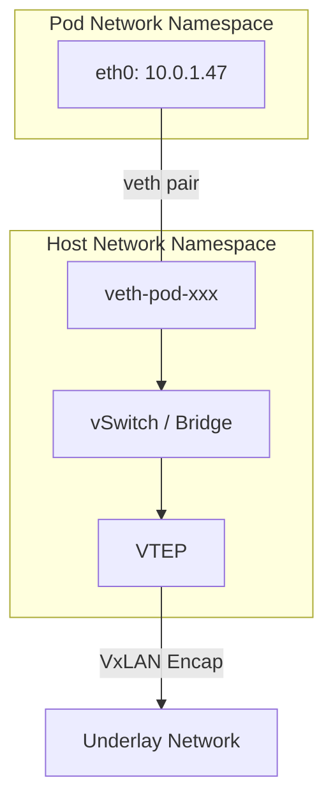
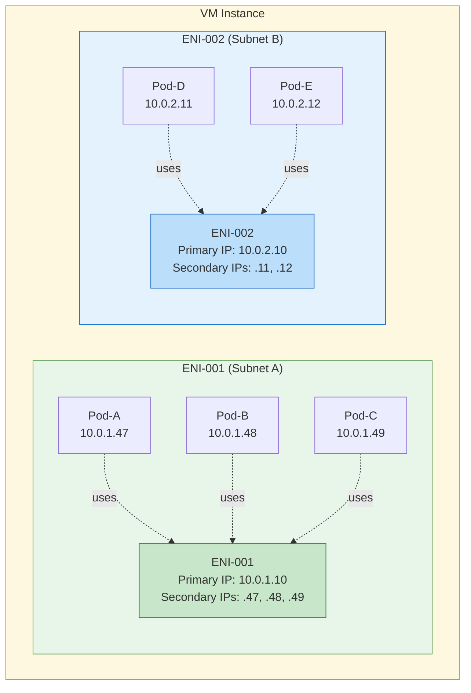
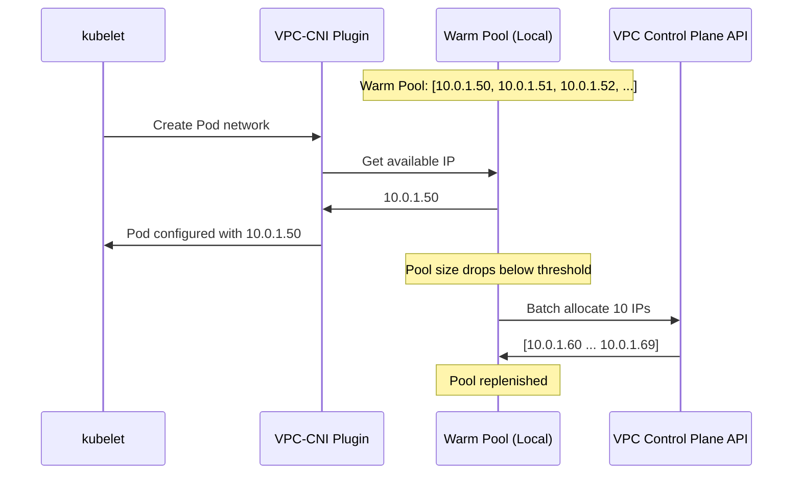
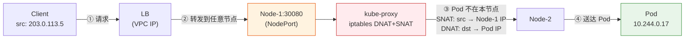
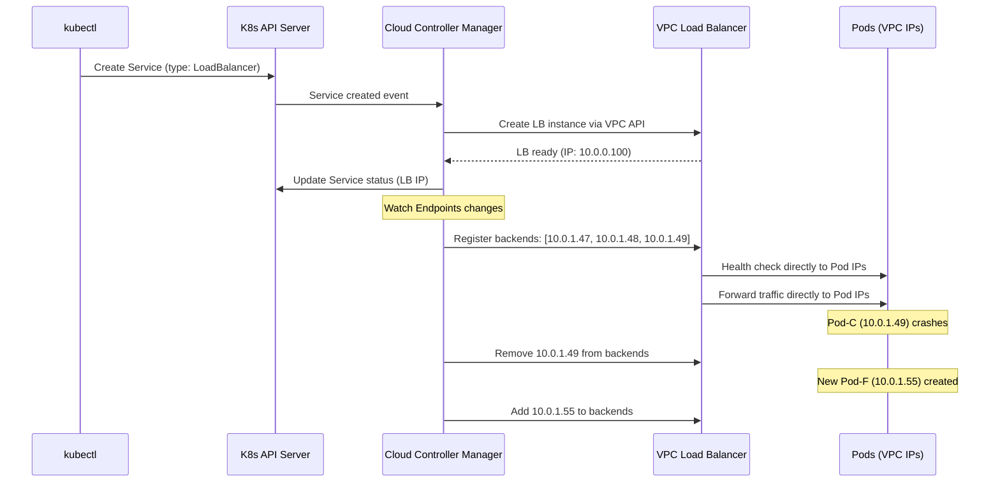

# 12. 容器加入 VPC：Pod 如何获得 VPC IP

VPC 内部的通信体系是为 VM 设计的。每台 VM 有一个或几个网络接口，IP 的生命周期以天甚至月计，一个 VPC 里的 VM 数量通常在几百到几千的量级。IP 分配通过控制面 API 完成，延迟在秒级，没有人觉得这是个问题。

但应用的部署方式正在发生变化。微服务架构把一个单体应用拆成了几十个独立的服务，每个服务可能有几十个副本，部署在容器里。一台 VM 上跑了 50 个 Pod，每个 Pod 需要自己的 IP 地址，Pod 的创建和销毁以秒计。一个 VPC 里不再是几百个 IP，而是几万个。不再是分钟级的分配，而是毫秒级的。VPC 网络为 VM 设计的那套 IP 管理机制，面对容器时代的节奏，还能跟上吗？

## 12.1 当 VM 里跑了几十个容器

一个电商应用，拆分成了用户服务、商品服务、订单服务、支付服务、推荐服务……每个服务独立开发、独立部署、独立扩缩容。VM 的粒度太粗，一台 VM 跑一个服务，资源浪费严重；一台 VM 跑多个服务，隔离性又不够。容器是更自然的部署单元：轻量、启动快、资源隔离。

Kubernetes 成为了容器编排的事实标准。它对网络有一个基本要求：**每个 Pod 有自己的 IP 地址，Pod 之间可以直接通信，不需要 NAT**。这意味着每个 Pod 都是网络上的一个独立端点，和 VM 一样可以被寻址、被路由。

一台 VM 上可能运行 30-50 个 Pod。如果一个 Kubernetes 集群有 200 台 VM 节点，Pod 总数可能达到 6000-10000 个。每个 Pod 一个 IP，这个 IP 从哪里来？

你可能会想：直接调用 VPC API 分配 IP，不就行了？试着算一下：一次 API 调用 500ms，一次滚动更新创建 100 个 Pod，串行调用就是 50 秒。Kubernetes 的默认 Pod 启动超时是 30 秒，这意味着超过一半的 Pod 会因为网络配置超时而被判定为失败。CI/CD 流水线直接卡死。

数量级的变化带来了两个核心挑战：**IP 分配的速度**和 **IP 地址的消耗量**。

## 12.2 两条路：Overlay-on-Overlay vs VPC 直通

容器需要 IP，VPC 有 IP。但怎么把 VPC 的 IP 给到容器，有两条截然不同的路。

第一条路看起来很自然：让容器网络自己管自己。Kubernetes 生态有很多网络插件（如 Flannel），可以在容器层面再建一层 Overlay 网络。Pod 的 IP 由容器网络自己分配（比如 10.244.0.0/16），和 VPC 的 IP 地址空间完全无关。Pod 之间通过容器自己的 Overlay 通信，Pod 访问 VPC 内的 VM 时经过 NAT 转换。

这条路的好处是简单，容器网络和 VPC 网络各管各的，互不干扰。

但仔细想想，VPC 本身已经是一层 Overlay 了。VM 的流量被 VxLAN 封装一次，送到 Underlay 网络传输。如果容器网络再建一层 Overlay，Pod 的流量就要被封装两次，先是容器的 VxLAN，再是 VPC 的 VxLAN。

**图 12.1：Overlay-on-Overlay 的双层封装**

```
┌─────────────────────────────────────────────────────────────┐
│                  Underlay Ethernet Header                   │
├─────────────────────────────────────────────────────────────┤
│                  Underlay IP Header                         │
├─────────────────────────────────────────────────────────────┤
│                  VPC VxLAN Header (VNI: VPC)                │
├─────────────────────────────────────────────────────────────┤
│                  Inner Ethernet Header                      │
├─────────────────────────────────────────────────────────────┤
│                  Inner IP Header                            │
├─────────────────────────────────────────────────────────────┤
│                  Container VxLAN Header (VNI: Container)    │
├─────────────────────────────────────────────────────────────┤
│                  Pod Ethernet Header                        │
├─────────────────────────────────────────────────────────────┤
│                  Pod IP Header + Payload                    │
└─────────────────────────────────────────────────────────────┘
```

双层封装的代价不只是多了几十字节的包头开销。更严重的问题是：**Pod 的 IP 对 VPC 不可见**。

VPC 的路由表里没有 Pod 的 IP（10.244.x.x），安全组规则无法基于 Pod IP 做访问控制，Flow Log 记录的是 VM 的 IP 而不是 Pod 的 IP。VPC 内的 VM 想直接访问某个 Pod，做不到，因为 VM 的路由表里没有到 10.244.0.0/16 的路由。

反过来也一样。Pod 想访问 VPC 内的一台 VM 或者外部服务，Pod 的源 IP 是 10.244.x.x，VPC 不认识这个地址，回包无处可送。怎么办？只能在 Pod 所在的 VM 节点上做一次 SNAT（Source NAT，源地址转换），把 Pod 的源 IP 替换成 VM 的 VPC IP。对端看到的不是 Pod，而是 VM。Pod 和 VM 生活在两个隔离的网络世界里，中间隔着一层 NAT，Pod 出去时要"借"VM 的身份，回来时再"还"回去。

VPC 花了大量精力构建的网络基础设施，安全组、路由表、Flow Log、网络 ACL，对容器流量全部失效。这不是一个小问题。在生产环境中，安全审计要求看到每一条流量的源和目的，运维需要用 Flow Log 排查网络故障。如果容器流量是一个黑盒，这些能力就全废了。

那另一条路呢？让 Pod 直接使用 VPC 的 IP。

Pod 从 VPC 子网中获取 IP 地址，和 VM 使用同一个地址空间。Pod 发出的包直接走 VPC 的 Overlay 网络，不需要额外的容器 Overlay。从 VPC 网络的视角看，Pod 和 VM 没有本质区别，都是一个 IP-MAC-VTEP 的三元组。

只有一层封装，性能好。Pod 和 VM 在网络上平等，互相可以直接通信。VPC 的所有网络基础设施，安全组、路由表、Flow Log，对 Pod 同样有效。

这条路叫 **VPC-CNI**（VPC Container Network Interface）。主流云厂商，AWS、阿里云、腾讯云，都选择了这条路。

## 12.3 VPC-CNI：每个 Pod 一个 VPC IP

VPC-CNI 是一个 Kubernetes 的 CNI 插件，它的核心职责是：Pod 创建时从 VPC 子网分配一个 IP，Pod 销毁时回收这个 IP。

> **CNI 是什么？**
>
> CNI（Container Network Interface，容器网络接口）是 Kubernetes 定义的一套标准接口规范。它规定了容器运行时（如 containerd）在创建和销毁 Pod 时，应该调用哪些接口来配置网络，分配 IP、创建虚拟网卡、设置路由规则。CNI 插件是实现这套接口的具体程序，不同的插件有不同的网络方案：Flannel 用 Overlay 网络，Calico 用 BGP 路由，VPC-CNI 则直接使用云厂商 VPC 的 IP 地址。Kubernetes 本身不实现网络，它把网络能力完全委托给 CNI 插件。

一个 Pod 被调度到某台 VM 节点上，kubelet 调用 CNI 插件，接下来发生了什么？

第一步，CNI 插件从本地预分配的 IP 池中取出一个可用的 VPC IP（这个池子怎么来的，下一节再讲）。

第二步，创建一对 **veth pair**，这是 Linux 内核提供的虚拟以太网设备对，可以理解为一根虚拟网线，两头各有一个网口。一端放进 Pod 的 Network Namespace（Pod 看到的 eth0），另一端留在宿主机的网络命名空间，接入宿主机的虚拟交换机。

> **veth pair 是什么？**
>
> veth pair（Virtual Ethernet Pair）是 Linux 内核提供的一种虚拟网络设备，总是成对出现。可以把它想象成一根虚拟网线，从一端发进去的数据包，会从另一端出来。在容器网络中，veth pair 的一端被放进容器的 Network Namespace（容器看到的 eth0），另一端留在宿主机的网络命名空间，接入虚拟交换机或路由规则。这样容器内部的流量就能"穿越"命名空间的隔离边界，进入宿主机的网络栈，再被转发到外部网络。

第三步，在 Pod 内部配置 IP 地址和路由规则，Pod 的 eth0 被赋予刚才分配的 VPC IP，默认路由指向宿主机端的 veth。

第四步，在宿主机上配置路由，告诉宿主机的网络栈：发往这个 Pod IP 的包，走对应的 veth 设备送进去。

**图 12.2：Pod 的网络配置**



从这一刻起，Pod 的流量路径和 VM 几乎一致：Pod 发包 → veth pair → 宿主机虚拟交换机 → VTEP 封装 → Underlay 路由 → 对端 VTEP 解封装 → 目标 Pod 或 VM。

在某些实现中（比如 AWS 的 VPC-CNI），IP 分配和 ENI 紧密关联。每个 ENI 除了自己的主 IP 之外，还可以绑定多个**辅助 IP（Secondary IP）**。这些辅助 IP 就是分配给 Pod 的 VPC IP。一台 VM 能运行多少个 Pod，受限于它能绑定多少个 ENI，以及每个 ENI 支持多少个辅助 IP，这取决于 VM 的实例类型。

具体的限制有多紧？以 AWS 为例，一台 c5.xlarge 最多绑定 4 个 ENI，每个 ENI 最多 15 个 IP，总共 60 个 IP，减去 4 个 Primary IP，可分配给 Pod 的 IP 最多 56 个。如果业务需要单节点跑 100 个 Pod，这个限制就成了瓶颈。AWS 后来推出了 VPC-CNI 的 **Prefix Delegation** 模式，不再逐个分配 IP，而是把一个 /28 的前缀（16 个 IP）作为一个单元分配给 ENI，大幅提升了单节点的 Pod 密度。这是一个典型的"规模倒逼方案演进"的例子，当容器密度超过了 ENI 模型的设计上限，就必须换一种分配粒度。

**图 12.3：ENI Secondary IP 与 Pod 的映射**



> 黄色 = VM 实例边界，绿色 = ENI-001 及其管辖的 Pod（Subnet A），蓝色 = ENI-002 及其管辖的 Pod（Subnet B）。每个 ENI 的 Primary IP 归 VM 自身使用，Secondary IP 分配给 Pod。从 VPC 控制面看，这些 Secondary IP 和 VM 的 Primary IP 没有本质区别——都是一条 IP → MAC → VTEP 的映射记录。

从 VPC 控制面的视角看，这些 Secondary IP 和 VM 的 Primary IP 没有本质区别，都是一条 IP → MAC → VTEP 的映射记录。控制面把这些映射下发到其他宿主机的 VTEP，其他宿主机就知道这个 IP 在哪台物理机上。Pod 的流量天然经过安全组检查、受路由表控制、被 Flow Log 记录。不需要额外的适配，因为在 VPC 网络看来，Pod 就是一个普通的 IP 端点。

## 12.4 IPAM 的挑战：快速分配与回收

VPC-CNI 让 Pod 拿到了 VPC IP，但 IP 从哪里来、怎么来得够快，是一个真实的工程挑战。

最直接的做法：每次创建 Pod 时，CNI 插件调用 VPC 控制面 API 申请一个 IP。但 VPC API 的延迟通常在几百毫秒，而 Kubernetes 期望 Pod 的网络配置在毫秒级完成。如果一次滚动更新要创建 100 个 Pod，串行调用 API 就是几十秒的等待。这个速度不可接受。

解决思路是**预分配**。

VPC-CNI 在每台节点上维护一个 **IP 预分配池（Warm Pool）**。节点启动时，CNI 插件提前从 VPC 子网批量申请一批 IP，缓存在本地。Pod 创建时，直接从本地池中取一个 IP，不需要实时调用 API。分配延迟从几百毫秒降到了微秒级。

**图 12.4：Warm Pool 的工作机制**



Warm Pool 的管理是一个经典的资源池问题。池子需要维护一个"水位线"：当可用 IP 数量低于下限（比如 5 个），自动向 VPC API 批量申请补充；当空闲 IP 超过上限（比如 20 个），把多余的 IP 回收给 VPC 子网，避免浪费。

回收也有讲究。Pod 销毁时，IP 被放回 Warm Pool 而不是立即归还给 VPC。这样下一个 Pod 可以复用这个 IP，避免频繁的 API 调用。但如果一个 IP 刚被回收就分配给新 Pod，可能会遇到一个微妙的问题：旧 Pod 的 conntrack 条目还没过期，新 Pod 收到的回包可能是发给旧 Pod 的。

这个时间窗口有多短？短到 TCP 的 TIME_WAIT 状态默认是 60 秒。如果一个 IP 在 60 秒内被复用，新旧 Pod 可能共享 conntrack 记录，新连接的回包可能被老 Pod 的连接状态误处理，产生难以复现的间歇性连接错误。实际实现中通常会设置一个短暂的冷却期（cooldown），让旧的连接状态自然过期。

最棘手的场景是**弹性伸缩**。Kubernetes HPA 检测到 CPU 使用率飙升，触发扩容，短时间内要创建几百个 Pod。如果 Warm Pool 的存量不够，CNI 插件需要紧急向 VPC API 申请 IP。API 的响应速度和子网的剩余 IP 数量，直接决定了扩容能不能成功。如果子网的 CIDR 太小（比如 /24 只有 254 个可用 IP），容器密度一高就可能耗尽。生产环境中，为 Kubernetes 集群规划足够大的子网 CIDR，是一个容易被忽视但后果严重的决策。

## 12.5 Service 与 VPC 的集成

Pod 有了 VPC IP，可以被直接访问。但直接用 Pod IP 访问服务有一个根本问题，Pod 是临时的。一次滚动更新，旧 Pod 销毁、新 Pod 创建，IP 地址全变了。调用方不可能追着 Pod IP 跑。Kubernetes 用 **Service** 来解决这个问题：给一组 Pod 一个稳定的访问入口。

Service 有三种类型，层层递进：**ClusterIP** 提供集群内部的虚拟 IP，**NodePort** 在节点上开端口让集群外部能访问，**LoadBalancer** 自动创建云厂商的负载均衡器。三者逐层叠加，每一层在前一层之上增加一种访问方式。

本节不展开 Service 本身的机制，那是 Kubernetes 的内部事务。我们关心的是：**Service 在哪个环节和 VPC 网络产生了交集？交集的质量如何？VPC-CNI 改变了什么？**

答案集中在 LoadBalancer 类型上。这是 Kubernetes Service 与 VPC 网络的核心交汇点。

### 没有 VPC-CNI 时：LB 看不见 Pod

在容器 Overlay 方案下，Pod 的 IP（10.244.x.x）对 VPC 不可见。云厂商的负载均衡器运行在 VPC 网络层，它只认识 VPC IP，也就是 VM 节点的 IP。LB 无法把流量直接发给 Pod，因为它根本不知道 Pod 在哪里。

这时候 Kubernetes 只能退而求其次：用 **NodePort** 做中转。每台节点在自己的 VPC IP 上开一个固定端口（比如 30080），LB 把流量发到节点的这个端口，节点上的 kube-proxy 再通过 iptables/IPVS 规则做 DNAT，把目的地址替换为某个后端 Pod 的 IP，转发过去。

问题来了：LB 选中的节点，不一定是 Pod 所在的节点。如果 Pod 在 Node-2 上，但 LB 把流量发到了 Node-1 的 NodePort，Node-1 收到包后发现本地没有这个 Pod，只能再把包转发给 Node-2，多了一次跨节点的跳转。更糟糕的是，这次转发会做一次 SNAT（把源 IP 替换成 Node-1 的 IP），后端 Pod 看到的客户端 IP 不是真实的客户端，而是 Node-1。源 IP 信息丢失了。

**图 12.5：没有 VPC-CNI 时，LB 必须经过 NodePort 中转**



> ⚠️ 三个问题：**① 多一次跳转**（Node-1 → Node-2 的额外转发增加延迟）；**② 源 IP 丢失**（SNAT 将客户端 IP 替换为 Node-1 IP，Pod 无法获取真实来源）；**③ 健康检查不精确**（LB 只能探测 NodePort 是否存活，节点活着但 Pod 已挂时无法感知）。

这条路径有三个问题：**多一次网络跳转**（延迟增加）、**源 IP 丢失**（审计和限流失效）、**LB 健康检查不准确**（LB 只能探测节点端口是否存活，无法直接探测 Pod，节点活着但 Pod 已经挂了，LB 不知道）。

### 有了 VPC-CNI：LB 直连 Pod

VPC-CNI 改变了这个局面。Pod 的 IP 是 VPC IP，和 VM 的 IP 在同一个地址空间里，对 VPC 网络的所有组件，包括负载均衡器，直接可见。

这意味着 LB 可以跳过 NodePort，把 Pod IP 直接注册为后端目标。流量路径变成了：Client → LB → Pod 所在宿主机 → Pod。一次到位，不需要中转。

但这里有一个关键问题：**LB 怎么知道该把流量发给哪些 Pod IP？Pod 扩缩容时，后端列表怎么自动更新？**

这就是 **Cloud Controller Manager** 的工作。它是 Kubernetes 控制面中负责与云厂商 API 对接的组件。当用户创建一个 LoadBalancer 类型的 Service 时，Cloud Controller Manager 做两件事：

1. **调用云厂商 API 创建一个 LB 实例**（或复用已有的），拿到 LB 的 VPC IP 或域名。
2. **监听 Service 后端 Pod 的变化**，哪些 Pod 被选中（通过 Label Selector）、它们的 VPC IP 是什么、哪些 Pod 健康，然后调用云厂商 API，把这些 Pod IP 注册为 LB 的后端目标。Pod 扩容时自动添加，Pod 缩容或故障时自动摘除。

**图 12.6：Cloud Controller Manager 驱动 LB 与 Pod 的联动**



从 VPC 网络的视角看，LB 到 Pod 的流量就是普通的 VPC 内部通信，源 IP 是 LB 的 VPC IP，目的 IP 是 Pod 的 VPC IP，走 VPC 的 Overlay 网络，经过安全组检查，被 Flow Log 记录。没有任何特殊处理。

LB 的健康检查也变得精确了。LB 直接向 Pod IP 的服务端口发探测包，Pod 活着就通过，Pod 挂了就摘除。不再是"节点活着就算健康"的粗粒度判断。

**图 12.7：两种模式的流量路径对比**


### ClusterIP：集群内部互调，VPC 不参与

以上解决的是外部流量怎么进入集群。但集群内部的 Pod 之间互相调用时，比如前端 Pod 调用后端 Pod 的 API，不会绕道 LoadBalancer，而是通过 Kubernetes 内部的 **ClusterIP** 机制。

ClusterIP（比如 10.96.0.1）是 Kubernetes 内部分配的虚拟 IP，不在 VPC 的地址空间里，VPC 路由表中没有它的路由。前端 Pod 访问 `backend-svc:8080` 时，DNS 解析到 ClusterIP，kube-proxy 在宿主机上通过 iptables/IPVS 规则做 DNAT，把目的地址替换为某个后端 Pod 的真实 VPC IP，这个转换发生在包离开宿主机之前。从这一刻起，VPC 网络接手：把包从前端 Pod 所在的宿主机送到后端 Pod 所在的宿主机。VPC 看到的始终是两个 VPC IP 之间的通信，对 ClusterIP 完全无感知。

这是两个系统的职责边界，**Kubernetes 负责服务发现和负载均衡（选择哪个后端 Pod），VPC 负责网络层的寻址和转发（把包送到那个 Pod）**。VPC 的安全组、Flow Log 看到的是 Pod 的真实 VPC IP，看不到 ClusterIP。

## 12.6 容器与 VPC 安全组

Pod 有了 VPC IP，流量走 VPC 的 Overlay，安全组自然就能管到 Pod。但"能管"和"管得好"之间还有距离。

不同的 Pod 属于不同的服务，需要不同的访问控制策略。前端 Pod 只接受 80 和 443 端口的请求，后端 Pod 只接受来自前端 Pod 的请求，数据库 Pod 只接受来自后端 Pod 的请求。如果所有 Pod 共用一个安全组，策略就太粗了。

VPC-CNI 模式下，Pod 的网卡（veth 的宿主机端）挂在宿主机的虚拟交换机上，安全组规则可以直接应用到这个端点，和 VM 的安全组执行方式一致。不同的 Pod 可以关联不同的安全组，实现 Pod 级别的访问控制。

但 Kubernetes 自己也有一套网络策略机制，**NetworkPolicy**。NetworkPolicy 用 Pod 的标签（Label）来选择目标和来源，比如"允许带有 app=frontend 标签的 Pod 访问带有 app=backend 标签的 Pod 的 8080 端口"。它的表达能力更贴近 Kubernetes 的语义，用标签而不是 IP 来描述策略。

两者可以共存。VPC 安全组在 VPC 网络层执行，基于 IP 和端口；NetworkPolicy 在 Kubernetes 网络层执行，基于标签和命名空间。安全组适合粗粒度的网络隔离（比如不同环境之间），NetworkPolicy 适合细粒度的服务间访问控制。在实际生产中，两者通常配合使用，安全组划定大的边界，NetworkPolicy 在边界内做精细管控。

VPC 内部的通信体系到这里完整了。VM 之间能通信，有路由，有访问控制，有 DHCP、DNS、元数据等基础服务，容器也融入了 VPC 网络。VPC 的"围墙之内"是一个功能完备的网络世界，VM 和 Pod 都使用 VPC IP，共享同一套网络基础设施。

但围墙本身也意味着限制。VPC 内的 VM 和 Pod 使用的是私有 IP 地址，公网路由器不认识这些地址。一台 VM 想下载一个软件包、调用一个外部 API、把日志推送到外部的监控平台，它发出的包，源 IP 是一个私有地址，公网不知道怎么把回包送回来。隔离保护了安全，但也切断了与外部世界的连接。怎么走出这堵墙呢？
