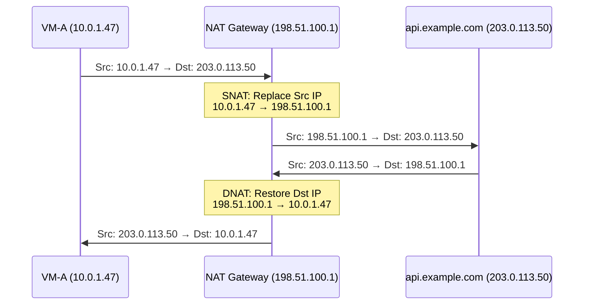
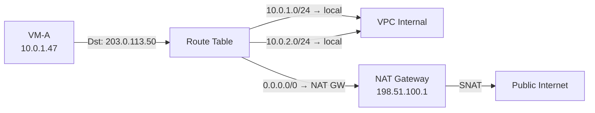
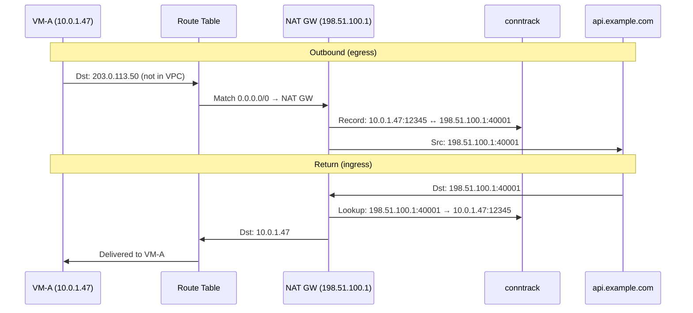
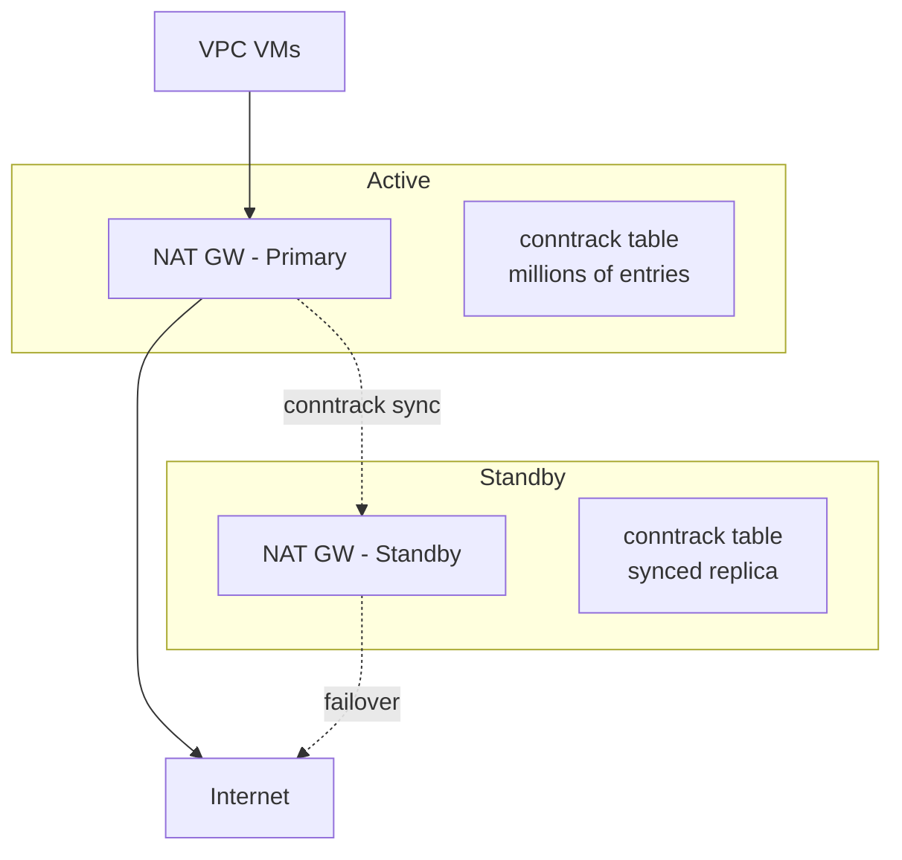

# 13. VM 要上网：NAT 网关的诞生

VPC 的围墙之内，一切井然有序，VM 之间能通信，有路由，有访问控制，有 DHCP、DNS 等基础服务，容器也融入了网络。但围墙本身就是问题。VPC 里的 VM 使用的是私有 IP 地址，公网路由器不认识这些地址。一台 VM 想下载一个软件包、调用一个外部 API、把日志推送到外部的监控平台，它发出的包，源 IP 是一个私有地址，公网根本不知道怎么把回包送回来。

隔离保护了安全，但也切断了与外部世界的连接。怎么在不打破隔离的前提下，给 VPC 开一个受控的出口？

## 13.1 私有 IP 的边界

我们首先看一下问题出在哪里。

VM-A 的 IP 是 10.0.1.47，它要访问公网上的 api.example.com（IP: 203.0.113.50）。VM-A 发出一个包，源 IP 填 10.0.1.47，目的 IP 填 203.0.113.50。这个包经过 VPC 的路由表，被送到 VPC 的边界。然后呢？

公网路由器收到这个包，看到源 IP 是 10.0.1.47。它不会为这个地址转发回包，因为 10.0.0.0/8 是私有地址段，全球有无数个网络都在用 10.0.1.47。公网路由器不知道这个 10.0.1.47 在哪里，也不可能知道。即使 api.example.com 收到了请求，它的回包目的地址是 10.0.1.47，但公网路由器无法把这个包送回正确的 VPC。

这不是一个配置问题，而是一个架构约束。

IPv4 地址总共约 43 亿个。一个大型云厂商的单个 Region 可能有几百万台 VM。如果每台 VM 都分配一个公网 IP，地址早就耗尽了。私有 IP 的价值恰恰在于它可以在不同 VPC 中重复使用，你的 VPC 里有 10.0.1.47，我的 VPC 里也有 10.0.1.47，互不冲突。这是 VPC 隔离的核心收益之一。

但隔离的副作用是：私有 IP 出不了 VPC。但VM 需要访问公网，这是一个真实的、普遍的需求。矛盾很清楚了：隔离保护了安全和地址空间，但也封死了出口。

你可能会想到一个更根本的解法：IPv6。

IPv6 有 2^128 个地址——这个数字大到可以给地球上每一粒沙子分配一个公网 IP，还绰绰有余。如果所有 VM 都用 IPv6 公网地址，每台 VM 都有全球唯一的可路由地址，NAT 不就可以退休了吗？

理论上是的。IPv6 的设计初衷之一就是消灭 NAT——让端到端通信回归本来面目，不再需要中间人翻译地址。但在云上，NAT 并没有因为 IPv6 的存在而下岗。原因不在技术，而在三个工程现实。

**第一，NAT 的"副作用"变成了"需求"。** NAT 最初是为了解决地址不够的问题，但它同时带来了一个副作用：VPC 内的 VM 对公网不可达。公网上的任何人都无法主动发起连接到一台只有私有 IP 的 VM——因为公网路由器不知道怎么把包送到 10.0.1.47。这个"不可达"本身变成了一种安全保障。几十年来，企业的安全架构建立在"内网不可达"这个假设之上：内网的机器默认是安全的，因为外面进不来。如果 VM 直接暴露 IPv6 公网地址，任何人都可以尝试连接它，安全组成了唯一的防线。这不是不能做，但意味着安全模型的根本性转变——从"默认不可达，显式开放"变成"默认可达，显式拒绝"。大多数企业还没准备好做这个转变。

**第二，生态的惯性比协议的优雅更顽固。** 几十年来，企业的内部系统、防火墙规则、运维脚本、监控告警，全部基于 IPv4 私有地址构建。"10.0.x.x 是内网，其他是外网"这个判断逻辑写在了无数的代码和配置里。合作方的 API、第三方服务、CDN 节点，很多仍然只支持 IPv4。VM 即使有了 IPv6 地址，访问这些服务时仍然需要 NAT64（IPv6 到 IPv4 的地址转换）。NAT 没有消失，只是换了一种形态。

**第三，地址不是唯一的约束。** 即使 IPv6 解决了地址耗尽的问题，"多台 VM 共享少量出口 IP"仍然是一个真实需求。安全审计需要知道出口 IP 是哪个，合作方按 IP 做白名单，DDoS 防护需要在出口处集中清洗流量——这些场景都需要一个集中的出口点，而集中出口点天然就是 NAT 网关的形态。

所以现实是：IPv6 在云上的主要角色不是"消灭 NAT"，而是"缓解 IPv4 公网地址的采购成本"。云厂商提供 IPv6 双栈，但 NAT 网关依然是标配产品。技术上可以不要 NAT，但生态上还离不开它。

回到当下的问题：VM 用的是 IPv4 私有地址，需要访问公网。怎么办？

## 13.2 最朴素的想法：换一个源地址

既然公网不认识 10.0.1.47，那在包离开 VPC 之前，把源 IP 换成一个公网 IP 呢？

假设 VPC 的边界上有一个设备，它拥有一个公网 IP：198.51.100.1。VM-A 发出的包经过这个设备时，设备把源 IP 从 10.0.1.47 替换成 198.51.100.1，然后把包发到公网。api.example.com 收到请求，看到源 IP 是 198.51.100.1，这是一个合法的公网地址，公网路由器知道怎么把回包送到 198.51.100.1。

这个"替换源地址"的动作，叫做 **SNAT（Source NAT）**。

**图 13.1：SNAT 的基本动作**



回包到达 198.51.100.1 时，设备再把目的 IP 从 198.51.100.1 替换回 10.0.1.47，送回 VM-A。这个反向替换叫做 **DNAT（Destination NAT）**。一来一回，VM-A 以为自己直接和 api.example.com 通信，api.example.com 以为自己在和 198.51.100.1 通信。两边都不知道中间有人在"翻译"。

这就是 NAT 的精髓：一个透明的地址翻译器。像同声传译，两边各说各的语言（私有 IP 和公网 IP），NAT 在中间实时翻译，双方都以为对方说的是自己的语言。SNAT 和 DNAT 是一对对称操作，出去的时候换源地址，回来的时候还原目的地址。

但这里有一个关键问题：回包到达 198.51.100.1 时，设备怎么知道应该还原成 10.0.1.47 而不是 10.0.2.83？如果 VPC 里有 1000 台 VM 都在通过这个设备访问公网，回包到达时，设备必须知道每个回包属于哪台 VM。

它必须记住每一次地址替换。换句话说，这个设备必须是**有状态的**。

## 13.3 conntrack：NAT 的记忆

NAT 设备需要一张表，记录每一次地址转换的映射关系。这张表叫做 **conntrack（连接跟踪）表**。

> **conntrack 是什么？**
>
> conntrack（Connection Tracking，连接跟踪）是 Linux 内核 Netfilter 框架的核心组件。它维护一张表，记录经过系统的每一条网络连接的状态，用五元组（源 IP、目的 IP、源端口、目的端口、协议）唯一标识一条连接，并跟踪其生命周期（NEW → ESTABLISHED → CLOSED）。conntrack 有两个主要用途：一是为有状态防火墙（如安全组）提供"这个包属于已有连接吗"的判断依据；二是为 NAT 提供地址转换前后的双向映射记录，让回包能被正确还原。conntrack 表的大小是有限的，在高并发场景下表满会导致新连接被丢弃，这是云上常见的性能瓶颈之一。

来看一个具体的例子。VM-A（10.0.1.47）从端口 12345 访问 api.example.com（203.0.113.50）的 443 端口。NAT 设备执行 SNAT，把源 IP 替换为 198.51.100.1，同时在 conntrack 表中写入一条记录：

**图 13.2：conntrack 表的映射记录**

```
┌──────────────────────────────────────────────────────────────────┐
│                      conntrack entry                             │
├──────────────────────────────────────────────────────────────────┤
│ Original:   10.0.1.47:12345 → 203.0.113.50:443  (TCP)            │
│ Translated: 198.51.100.1:40001 → 203.0.113.50:443  (TCP)         │
│ State:      ESTABLISHED                                          │
│ Timeout:    432000s                                              │
└──────────────────────────────────────────────────────────────────┘
```

这条记录用**五元组**（源 IP、源端口、目的 IP、目的端口、协议）唯一标识一条连接，并记录了转换前后的映射关系。当 api.example.com 的回包到达时，目的地址是 198.51.100.1:40001，NAT 设备查 conntrack 表，找到对应的原始五元组，把目的 IP:Port 还原为 10.0.1.47:12345，包就回到了正确的 VM。

conntrack 条目有生命周期。TCP 连接有明确的建立和关闭信号（SYN 和 FIN），conntrack 条目跟随连接的生命周期创建和销毁。UDP 没有连接的概念，conntrack 靠超时机制回收，一段时间没有流量，条目就被清除。

但 conntrack 表不是免费的。每条记录占用内存，大规模场景下，几万台 VM 同时访问公网，每台 VM 几十条并发连接，conntrack 表可能有几百万条记录。表满了，新的连接就无法建立 conntrack 条目，NAT 转换失败，连接被丢弃。这是 NAT 设备的一个隐性瓶颈，在流量突增时尤其容易触发。

如果你还记得第 10 章讲安全组时提到的"有状态"，安全组也依赖 conntrack。安全组用 conntrack 判断"这个包属于一条已有的连接吗"，如果是，就放行回包，不需要额外的入站规则。NAT 的 conntrack 是同一套机制的不同应用，但多了一个维度：不仅记录连接状态，还记录**转换前五元组和转换后五元组之间的双向映射**。安全组只需要回答"放不放行"，NAT 还需要回答"翻译成什么"。

## 13.4 NAPT：一个公网 IP 怎么够用

地址替换的问题解决了，conntrack 记住了映射关系。但新的问题马上浮出水面：如果 VPC 里有 1000 台 VM 都要访问公网，NAT 网关只有一个公网 IP（198.51.100.1），怎么区分这 1000 台 VM 的流量？

仅靠 IP 地址替换是不够的。VM-A 和 VM-B 都访问 api.example.com:443，SNAT 后源 IP 都变成了 198.51.100.1。回包到达时，目的 IP 都是 198.51.100.1，NAT 网关怎么区分这两个回包分别属于谁？

答案是：**不仅替换 IP，还替换端口**。

VM-A 的 10.0.1.47:12345 被映射为 198.51.100.1:40001，VM-B 的 10.0.2.83:23456 被映射为 198.51.100.1:40002。回包通过不同的端口号区分归属，目的端口是 40001 的回包属于 VM-A，目的端口是 40002 的回包属于 VM-B。

这种同时替换 IP 和端口的方式叫做 **NAPT（Network Address Port Translation）**，也是云上 NAT 网关的实际工作方式。

**图 13.3：NAPT 的端口映射**

```
┌────────────────────────────────────────────────────────────────┐
│                    NAT Gateway conntrack table                 │
├────────────────────────────────────────────────────────────────┤
│ VM-A  10.0.1.47:12345 → 203.0.113.50:443                       │
│   ↔   198.51.100.1:40001 → 203.0.113.50:443                    │
├────────────────────────────────────────────────────────────────┤
│ VM-B  10.0.2.83:23456 → 203.0.113.50:443                       │
│   ↔   198.51.100.1:40002 → 203.0.113.50:443                    │
├────────────────────────────────────────────────────────────────┤
│ VM-C  10.0.3.12:34567 → 198.51.100.80:80                       │
│   ↔   198.51.100.1:40003 → 198.51.100.80:80                    │
├────────────────────────────────────────────────────────────────┤
│ VM-A  10.0.1.47:12346 → 198.51.100.80:80                       │
│   ↔   198.51.100.1:40004 → 198.51.100.80:80                    │
└────────────────────────────────────────────────────────────────┘
```

端口号是一个 16 位的数字，范围 0-65535。去掉 0-1023 的知名端口和部分保留端口，NAT 网关可用的端口大约 6 万个。一个公网 IP 最多同时支持约 6 万条并发连接。

6 万条够用吗？一个中型 VPC 有 500 台 VM，每台 VM 平均 100 条并发外网连接，总共 5 万条，一个公网 IP 勉强够用。但如果 VPC 里有爬虫服务、批量数据同步、或者大量微服务频繁调用外部 API，并发连接数可能轻松突破 6 万。

端口耗尽时，新的连接无法建立，NAT 网关没有可用的端口来做映射。解决办法是给 NAT 网关绑定多个公网 IP。两个 IP 就有约 12 万个端口，三个 IP 约 18 万个。NAT 网关在做 SNAT 时，从多个公网 IP 中选择一个来使用。选择策略可以是轮询、随机、或者基于源 IP 的哈希，哈希策略可以让同一台 VM 的流量尽量使用同一个公网 IP，对某些需要出口 IP 一致性的场景（比如合作方按 IP 做白名单）有用。

这里有一个自然的疑问：为什么不让每台宿主机自己做 SNAT，把 NAT 分布化？技术上可以，但有两个现实的约束。第一，公网 IP 是稀缺资源，如果每台宿主机都需要一个公网 IP 来做 SNAT，公网 IP 的消耗量会急剧上升。集中式 NAT 网关的价值恰恰在于"多台 VM 共享少量公网 IP"。第二，某些场景需要出口 IP 可控，合作方按 IP 做白名单，安全审计需要知道出口 IP 是哪个。集中式 NAT 网关让出口 IP 可预测、可管理。分布式 NAT 会让出口 IP 变得不可控，几百台宿主机就是几百个出口 IP，白名单管理变成噩梦。集中式 NAT 不是因为技术上做不了分布式，而是因为"共享"和"可控"这两个需求天然指向集中。

## 13.5 云上 NAT 网关的流量路径

原理讲清楚了，SNAT 替换源地址，NAPT 用端口区分，conntrack 记住映射。接下来的问题是：在 VPC 的实际架构中，流量是怎么到达 NAT 网关的？

答案在路由表里。

用户在 VPC 的路由表中添加一条路由：**0.0.0.0/0 → NAT 网关**。0.0.0.0/0 是默认路由，匹配所有目的地址。但路由表的匹配规则是最长前缀匹配，VPC 内部的子网路由（比如 10.0.1.0/24 → local）优先级更高。所以，目的地在 VPC 内部的流量走内部路由，目的地不在 VPC 内部的流量（即访问公网的流量）才会命中 0.0.0.0/0，被导向 NAT 网关。

**图 13.4：VPC 路由表与 NAT 网关**



NAT 网关是一个托管服务，运行在云厂商的基础设施上。它有自己的公网 IP（或多个），一端连接 VPC 内部网络，另一端连接公网。

出向流量的完整路径：VM 发包 → VPC 路由表匹配 0.0.0.0/0 → 包被送到 NAT 网关 → NAT 网关执行 SNAT（替换源 IP:Port）→ conntrack 记录映射 → 包进入公网 → 到达目标服务器。

回包的完整路径：目标服务器回包 → 公网路由到 NAT 网关的公网 IP → NAT 网关查 conntrack 表 → 执行 DNAT（还原目的 IP:Port）→ 包通过 VPC 内部路由送回 VM。

**图 13.5：出向与回包的完整流量路径**



不同子网可以绑定不同的 NAT 网关，也可以不绑定。只有路由表中有 0.0.0.0/0 → NAT 网关这条路由的子网，其 VM 才能通过 NAT 访问公网。没有这条路由的子网，出向流量到达 VPC 边界就被丢弃，这是一种有意的隔离，某些子网（比如数据库子网）不应该有公网出口。

还有一个细节值得注意：出向流量先经过安全组检查，再到达 NAT 网关。安全组看到的是 VM 的原始私有 IP，SNAT 发生在 NAT 网关上，不在 VM 的宿主机上。这意味着安全组的出站规则可以基于 VM 的私有 IP 做精确控制。

## 13.6 高可用与横向扩展

NAT 网关解决了"私有 IP 访问公网"的问题，但它也制造了一个新的风险点：所有出向流量都经过 NAT 网关，它成了一个关键的单点。NAT 网关挂了，VPC 内所有需要访问公网的 VM 都断网。

最直接的应对是主备部署，两个 NAT 网关实例，主实例处理流量，备实例待命。主实例故障时，备实例接管公网 IP，继续处理流量。

但 NAT 是有状态的。这三个字决定了主备切换不可能像无状态设备那样简单。

conntrack 表里可能有几百万条映射记录。如果备实例没有这些记录，接管后所有已有连接都会断开，回包到达时查不到 conntrack 条目，无法还原目的地址，包被丢弃。所以主备之间需要**实时同步 conntrack 表**。几百万条记录的实时同步，带宽和延迟都是挑战。同步越频繁，切换时丢失的连接越少；但同步本身占用带宽和 CPU。而且在切换的那一瞬间，总有一个时间窗口里的连接是无法保全的，主实例最后一刻建立的连接，还没来得及同步到备实例，主实例就挂了。

有状态的高可用没有完美的解法，只有"能接受多长的切换损失"和"愿意付多少同步成本"之间的取舍。

**图 13.6：NAT 网关主备高可用**



横向扩展面临同样的困境。当单个 NAT 网关的吞吐量不够时，带宽达到上限或每秒包数（PPS）达到上限，需要多个 NAT 网关实例分担流量。但多实例带来一个硬约束：同一条连接的所有包必须走同一个 NAT 网关实例，因为 conntrack 是本地状态。一条连接的出向包走了实例 A，回包却到了实例 B，实例 B 的 conntrack 表里没有这条记录，包会被丢弃。

解决办法是用一致性哈希做分流，根据五元组的哈希值决定流量走哪个实例，保证同一条连接的双向流量始终经过同一个实例。跨可用区部署进一步提升可靠性，单个 AZ 故障不影响出向流量。

这是有状态网络设备的通病：状态越多，扩展越难。无状态的设备可以随意增减实例，有状态的设备每增加一个实例都要考虑状态的分布和同步。记住这个矛盾，后面的章节里你还会反复遇到它，VPN 的主备切换、专线的故障倒换，都是同一个问题的不同变体。

