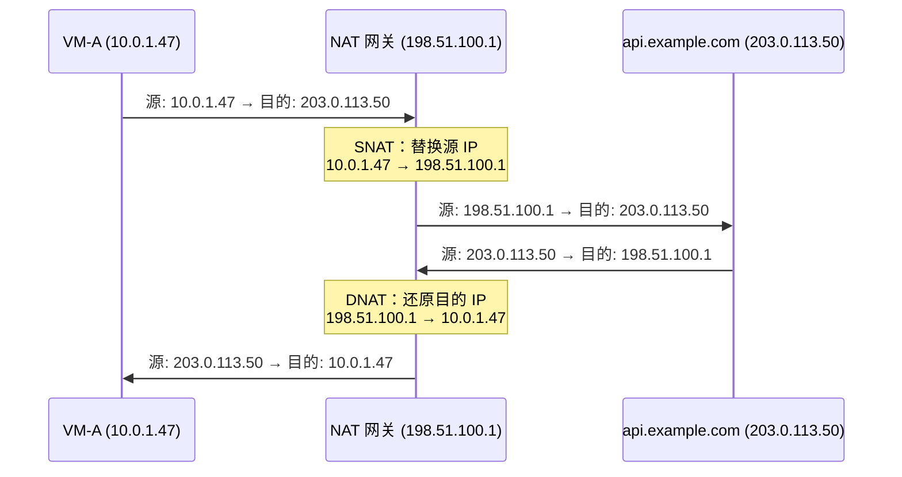
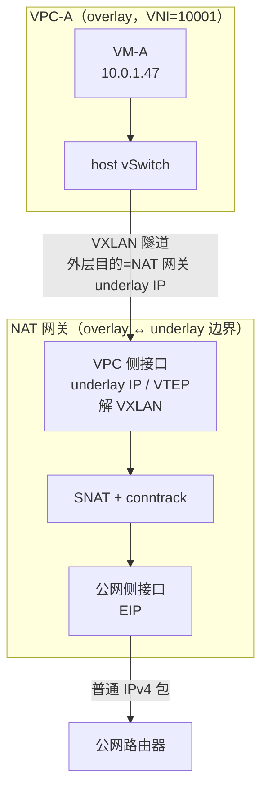
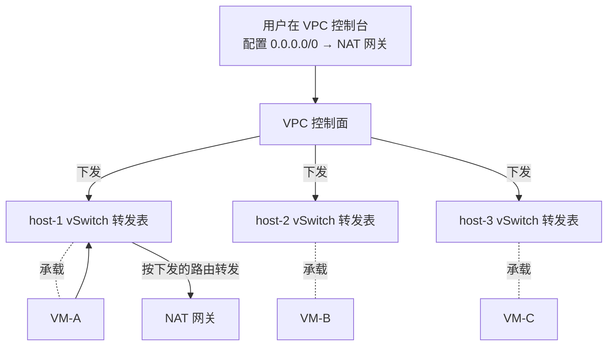
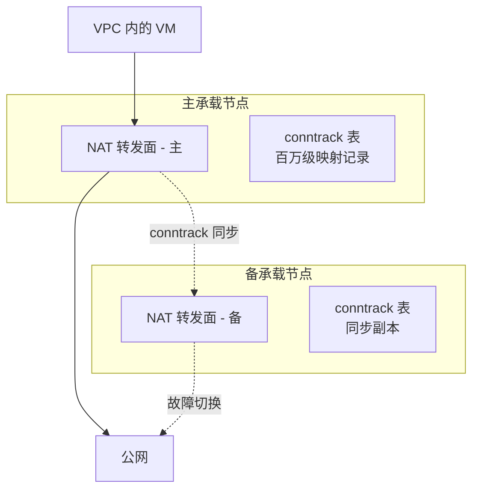

# 13. VM 要上网：NAT 网关的诞生

VPC 的围墙之内，一切井然有序，VM 之间能通信，有路由，有访问控制，有 DHCP、DNS 等基础服务，容器也融入了网络，但围墙本身就是问题。VPC 里的 VM 使用的是私有 IP 地址，公网路由器不认识这些地址。一台 VM 想下载一个软件包、调用一个外部 API、把日志推送到外部的监控平台，它发出的包，源 IP 是一个私有地址，公网根本不知道怎么把回包送回来。

隔离保护了安全，但也切断了与外部世界的连接。怎么在不打破隔离的前提下，给 VPC 开一个受控的出口？

## 13.1 私有 IP 的边界

我们首先看一下问题出在哪里。

VM-A 的 IP 是 10.0.1.47，它要访问公网上的 api.example.com（IP: 203.0.113.50）。VM-A 发出一个包，源 IP 填 10.0.1.47，目的 IP 填 203.0.113.50。这个包经过 VPC 的路由表，被送到 VPC 的边界。然后呢？

公网路由器收到这个包，看到源 IP 是 10.0.1.47。它不会为这个地址转发回包，因为 10.0.0.0/8 是私有地址段，全球有无数个网络都在用 10.0.1.47。公网路由器不知道这个 10.0.1.47 在哪里，也不可能知道。即使 api.example.com 收到了请求，它的回包目的地址是 10.0.1.47，但公网路由器无法把这个包送回正确的 VPC。

这不是一个配置问题，而是一个架构约束。

IPv4 地址总共约 43 亿个。一个大型云厂商的单个 Region 可能有几百万台 VM。如果每台 VM 都分配一个公网 IP，地址早就耗尽了。私有 IP 的价值恰恰在于它可以在不同 VPC 中重复使用，你的 VPC 里有 10.0.1.47，我的 VPC 里也有 10.0.1.47，互不冲突。这是 VPC 隔离的核心收益之一。

但隔离的副作用是：私有 IP 出不了 VPC。但VM 需要访问公网，这是一个真实的、普遍的需求。矛盾很清楚了：隔离保护了安全和地址空间，但也封死了出口。

你可能会想到一个更根本的解法：IPv6。

IPv6 有 2^128 个地址，这个数字大到可以给地球上每一粒沙子分配一个公网 IP，还绰绰有余。如果所有 VM 都用 IPv6 公网地址，每台 VM 都有全球唯一的可路由地址，NAT 不就可以退休了吗？

理论上是的。IPv6 的设计初衷之一就是消灭 NAT，让端到端通信回归本来面目，不再需要中间人翻译地址。但在云上，NAT 并没有因为 IPv6 的存在而下岗。原因不在技术，而在三个工程现实。

**第一，NAT 的副作用变成了需求。** NAT 最初是为了解决地址不够的问题，但它同时带来了一个副作用：VPC 内的 VM 对公网不可达。公网上的任何人都无法主动发起连接到一台只有私有 IP 的 VM，因为公网路由器不知道怎么把包送到 10.0.1.47。这个不可达本身变成了一种安全保障。几十年来，企业的安全架构建立在内网不可达这个假设之上：内网的机器默认是安全的，因为外面进不来。如果 VM 直接暴露 IPv6 公网地址，任何人都可以尝试连接它，安全组成了唯一的防线。这不是不能做，但意味着安全模型的根本性转变，从默认不可达，显式开放变成默认可达，显式拒绝。大多数企业还没准备好做这个转变。

**第二，生态的惯性比协议的优雅更顽固。** 几十年来，企业的内部系统、防火墙规则、运维脚本、监控告警，全部基于 IPv4 私有地址构建。10.0.x.x 是内网，其他是外网这个判断逻辑写在了无数的代码和配置里。合作方的 API、第三方服务、CDN 节点，很多仍然只支持 IPv4。VM 即使有了 IPv6 地址，访问这些服务时仍然需要 NAT64（IPv6 到 IPv4 的地址转换）。NAT 没有消失，只是换了一种形态。

**第三，地址不是唯一的约束。** 即使 IPv6 解决了地址耗尽的问题，多台 VM 共享少量出口 IP仍然是一个真实需求。安全审计需要知道出口 IP 是哪个，合作方按 IP 做白名单，DDoS 防护需要在出口处集中清洗流量，这些场景都需要一个集中的出口点，而集中出口点天然就是 NAT 网关的形态。

所以现实是：IPv6 在云上的主要角色不是消灭 NAT，而是缓解 IPv4 公网地址的采购成本。云厂商提供 IPv6 双栈，但 NAT 网关依然是标配产品。技术上可以不要 NAT，但生态上还离不开它。

回到当下的问题：VM 用的是 IPv4 私有地址，需要访问公网。怎么办？

## 13.2 换源地址：SNAT 与它的记忆

既然公网不认识 10.0.1.47，那在包离开 VPC 之前，把源 IP 换成一个公网 IP 呢？

假设 VPC 的边界上有一个设备，它拥有一个公网 IP：198.51.100.1。VM-A 发出的包经过这个设备时，设备把源 IP 从 10.0.1.47 替换成 198.51.100.1，然后把包发到公网。api.example.com 收到请求，看到源 IP 是 198.51.100.1，这是一个合法的公网地址，公网路由器知道怎么把回包送到 198.51.100.1。

这个替换源地址的动作，叫做 **SNAT（Source NAT）**。

**图 13.1：SNAT 的基本动作**



回包到达 198.51.100.1 时，设备再把目的 IP 从 198.51.100.1 替换回 10.0.1.47，送回 VM-A。这个反向替换叫做 **DNAT（Destination NAT）**。一来一回，VM-A 以为自己在直接和 api.example.com 通信，api.example.com 以为对端就是 198.51.100.1。两边都不知道中间有人在翻译。

这就是 NAT 的精髓：一个透明的地址翻译器。像同声传译，两边各说各的语言，NAT 在中间实时翻译，双方都以为对方说的是自己的语言。SNAT 和 DNAT 是一对对称操作，出去换源地址，回来还原目的地址。

但对称的前提是还原得回去。回包到达 198.51.100.1 时，设备怎么知道该还原成 10.0.1.47 而不是 10.0.2.83？如果 VPC 里有一千台 VM 在共用这个出口，每个回包必须能定位到唯一的 VM。

它必须记住每一次地址替换。换句话说，这个设备是**有状态的**。

记录这些替换的表叫 **conntrack（连接跟踪）表**。

> **conntrack 是什么？**
>
> conntrack（Connection Tracking，连接跟踪）是 Linux 内核 Netfilter 框架的核心组件。它维护一张表，记录经过系统的每一条网络连接的状态，用五元组（源 IP、目的 IP、源端口、目的端口、协议）唯一标识一条连接，并跟踪其生命周期（NEW → ESTABLISHED → CLOSED）。conntrack 有两个主要用途：一是为有状态防火墙（如安全组）提供"这个包是否属于已有连接"的判断依据；二是为 NAT 提供地址转换前后的双向映射记录，让回包能被正确还原。conntrack 表的大小是有限的，在高并发场景下表满会导致新连接被丢弃，这是云上常见的性能瓶颈之一。

VM-A（10.0.1.47）从端口 12345 访问 api.example.com（203.0.113.50）的 443 端口。SNAT 把源 IP 替换为 198.51.100.1，同时在 conntrack 表中写入一条记录：

**图 13.2：conntrack 表的映射记录**

```
┌──────────────────────────────────────────────────────────────────┐
│                      conntrack entry                             │
├──────────────────────────────────────────────────────────────────┤
│ Original:   10.0.1.47:12345 → 203.0.113.50:443  (TCP)            │
│ Translated: 198.51.100.1:40001 → 203.0.113.50:443  (TCP)         │
│ State:      ESTABLISHED                                          │
│ Timeout:    432000s                                              │
└──────────────────────────────────────────────────────────────────┘
```

五元组唯一标识一条连接，记录里保留了转换前后的双向映射。回包到达 198.51.100.1:40001，查表找到原始五元组，目的 IP:Port 还原为 10.0.1.47:12345，包就回到了正确的 VM。

conntrack 条目有生命周期。TCP 有明确的建立和关闭信号（SYN 和 FIN），条目跟随连接创建和销毁。UDP 没有连接的概念，靠超时回收，一段时间没有流量就被清除。

但 conntrack 表不是免费的。每条记录占用内存，大规模场景下几万台 VM 同时访问公网，每台几十条并发连接，表规模能到百万级。表满了，新连接建不出 conntrack 条目，NAT 转换失败，连接被丢弃。这是 NAT 设备的隐性瓶颈，流量突增时最容易触发。

第 10 章讲安全组时提到过有状态，安全组也依赖 conntrack。安全组用 conntrack 判断这个包是否属于已有连接，是则放行，不需要额外的入站规则。NAT 的 conntrack 是同一套机制的不同应用，但多了一个维度：不仅记录连接状态，还记录**转换前五元组和转换后五元组的双向映射**。安全组只回答放不放行，NAT 还要回答翻译成什么。

## 13.3 一个 IP 怎么够用：NAPT 与端口耗尽

地址替换的问题解决了，conntrack 记住了映射。但马上会遇到新问题：如果 VPC 里一千台 VM 都要访问公网，NAT 网关只有一个公网 IP（198.51.100.1），怎么区分这一千台 VM 的流量？

仅靠 IP 替换不够。VM-A 和 VM-B 都访问 api.example.com:443，SNAT 后源 IP 都变成 198.51.100.1。回包到达时，目的 IP 都是 198.51.100.1，怎么区分归属？

答案是：**不仅替换 IP，还替换端口**。

VM-A 的 10.0.1.47:12345 映射为 198.51.100.1:40001，VM-B 的 10.0.2.83:23456 映射为 198.51.100.1:40002。回包通过端口号区分归属，目的端口 40001 属于 VM-A，40002 属于 VM-B。

这种同时替换 IP 和端口的方式叫做 **NAPT（Network Address Port Translation）**，也是云上 NAT 网关的实际工作方式。

**图 13.3：NAPT 的端口映射**

```
┌────────────────────────────────────────────────────────────────┐
│                    NAT Gateway conntrack table                 │
├────────────────────────────────────────────────────────────────┤
│ VM-A  10.0.1.47:12345 → 203.0.113.50:443                       │
│   ↔   198.51.100.1:40001 → 203.0.113.50:443                    │
├────────────────────────────────────────────────────────────────┤
│ VM-B  10.0.2.83:23456 → 203.0.113.50:443                       │
│   ↔   198.51.100.1:40002 → 203.0.113.50:443                    │
├────────────────────────────────────────────────────────────────┤
│ VM-C  10.0.3.12:34567 → 198.51.100.80:80                       │
│   ↔   198.51.100.1:40003 → 198.51.100.80:80                    │
├────────────────────────────────────────────────────────────────┤
│ VM-A  10.0.1.47:12346 → 198.51.100.80:80                       │
│   ↔   198.51.100.1:40004 → 198.51.100.80:80                    │
└────────────────────────────────────────────────────────────────┘
```

端口号是 16 位数字，范围 0–65535。去掉 0–1023 的知名端口和部分保留端口，NAT 网关可用的端口约 6 万个。一个公网 IP 最多同时承载约 6 万条并发连接。

6 万够用吗？一个中型 VPC 有 500 台 VM，每台平均 100 条并发外网连接，5 万条，勉强够。但爬虫、批量数据同步、大量微服务频繁调外部 API，连接数轻松突破 6 万。

端口耗尽的破法是给 NAT 网关挂多个公网 IP。两个 IP 就有约 12 万个端口，三个 IP 约 18 万。SNAT 时从多个公网 IP 里选一个用，策略可以是轮询、随机，也可以基于源 IP 做哈希——哈希能让同一台 VM 的流量尽量落在同一个公网 IP 上，对合作方按 IP 做白名单这种场景有用。

这里有一个自然的疑问：为什么不让每台宿主机自己做 SNAT，把 NAT 分布化？技术上可以，但有两个绕不开的现实。第一，公网 IP 是稀缺资源，几百台宿主机就是几百个公网 IP，成本失控。集中式 NAT 网关的价值恰恰在于多台 VM 共享少量公网 IP。第二，某些场景需要出口 IP 可控——合作方按 IP 做白名单，安全审计要知道出口 IP 是哪个。集中出口让 IP 可预测、可管理；分布式 NAT 让几百台宿主机各出一个 IP，白名单管理变噩梦。集中不是技术做不到分布，而是共享和可控这两个需求天然指向集中。

需要注意的是，这里反复说的 NAT 网关的公网 IP、挂多个公网 IP，不是 NAT 网关自带的属性，而是一种独立的可路由资源，叫 **EIP（Elastic IP，弹性公网 IP）**。EIP 是谁的、谁付费、故障时怎么漂移，属于产品形态和落点问题，下一章会展开。现在只需知道：NAT 网关的公网出口靠挂 EIP 得到，端口容量以 EIP 为单位计算。

## 13.4 NAT 网关站在 VPC 的哪里

前面几节把 NAT 网关当成一个盒子来讲：输入私有 IP 的包，输出公网 IP 的包，中间做 SNAT 和 conntrack。这个抽象够用来讲原理，但遮住了一个基本问题：这个盒子物理上站在哪里？它是 VPC 里的一台虚拟设备，还是站在 VPC 之外？

要回答这个问题，得把前几章的东西接回来。VPC 是叠在物理网络上的 overlay，VM 之间通信靠 host 上的 vSwitch 做 VXLAN 封装。VXLAN 头把 VPC 的隔离编码成 VNI。但公网不认识 VXLAN，公网只认原始 IP 包。这中间必须有一个设备，一只脚踩在 overlay 里，另一只脚踩在 underlay 里，负责脱 VXLAN 头、做地址翻译、再送进公网。

这就是 NAT 网关的位置：**overlay 与 underlay 的边界**。

**图 13.4：NAT 网关的位置剖面**



具体分两侧看：

**面向 VPC 的一侧**，NAT 网关在 underlay 网络里有一个物理 IP，也就是 VTEP 地址，承担 VXLAN 隧道的对端。host vSwitch 把 VM 的包封成 VXLAN，外层目的 IP 就填这个地址。NAT 网关收到后解 VXLAN，还原出原始的 10.0.1.47:12345 → 203.0.113.50:443。

**面向公网的一侧**，NAT 网关挂着 EIP，这个 EIP 配置在一个直接接入运营商网络的物理接口上。SNAT 之后的包不再有 VXLAN 头，就是一个普通 IPv4 包，交给公网路由器即可。

两侧接起来看有一个关键点：**NAT 网关不在任何一个 VPC 内部**。它是服务多个 VPC 的共享基础设施，靠 VNI 或类似的租户标识把不同 VPC 的流量在自己内部隔开。VPC-A 的包封的 VXLAN VNI 是 10001，VPC-B 的是 10002，同一台 NAT 网关看到两种 VNI 时，用不同的租户上下文做 SNAT，用不同的 EIP 作为出口。

## 13.5 一条路由如何生效：控制面

NAT 网关站在 VPC 外面，那 VPC 里的 VM 怎么知道要把包送去它那里？这就是控制面的工作。

用户在 VPC 控制台上其实要做两件事，顺序不能颠倒。

**第一步是创建 NAT 网关实例。** NAT 网关是一个独立的云产品，有自己的产品页、独立的计费、独立的规格。用户下单，云厂商在共享集群里为这个实例分配 underlay 地址，挂上 EIP，完成初始化。实例这时已经能收流量，但 VPC 里的 VM 还不知道它的存在。

**第二步是在 VPC 路由表里加一条路由**：0.0.0.0/0 → 刚创建的 NAT 网关实例。这条路由不是配置在某台中心路由器上等着 VM 的包送上门。VPC 路由表本身是一个逻辑视图，真正的转发发生在每台 host 的 vSwitch 里。

顺序反了会怎样？只有实例没有路由，实例空转，VM 的包根本没方向；只有路由没有实例，控制台会直接拒绝配置，下一跳指向的资源必须先存在。

路由配置提交后，VPC 控制面把它下发到所有承载该子网 VM 的 host，写进 host vSwitch 的转发表。VM-A 发一个目的地 203.0.113.50 的包，进入 host vSwitch，查表：10.0.0.0/16 本地转发，剩下的命中 0.0.0.0/0，下一跳是 NAT 网关实例的 underlay 地址。查表结果决定了 VXLAN 封装的外层目的 IP。

**图 13.5：路由从控制台到 host vSwitch 的下发**



所以默认路由不是生效在 NAT 网关，而是生效在每一台 host 的 vSwitch 上。NAT 网关自己不感知 VPC 路由表，它只负责收到包之后做 SNAT。控制面这一路走下来和第 9 章讲 ARP 代答、第 10 章讲安全组是同一套机制：VPC 控制面 → host agent → 转发面表项。

这也解释了几个之前没明说的行为。不同子网可以绑不同的 NAT 网关，下发时按子网维度区分即可；某些子网可以没有公网出口（比如数据库子网），不下发这条路由，vSwitch 查表落空，包直接丢弃，这是一种有意的隔离；切换 NAT 网关是秒级生效，改的是控制面表项，不是物理链路。

还有一个细节值得注意：出向流量先经过安全组检查，再进入下发到 host 的这条默认路由。安全组看到的是 VM 的原始私有 IP，SNAT 发生在 NAT 网关上，不在宿主机上。这意味着安全组的出站规则可以基于 VM 的私有 IP 做精确控制。

## 13.6 用户创建的实例到底是什么

上一节说用户下单创建 NAT 网关实例，控制台一点，几秒钟就好。这个过程中底层到底发生了什么？是启动了一台专属的机器，还是只在一台已有的设备上加了几行配置？

答案更接近后者。云厂商内部，NAT 网关是一批常驻运行的物理节点（或智能网卡集群）。这些节点在集群建成时就已经就位，各自的 underlay 地址早就配好，跑着 NAT 转发面软件，等着接流量。用户下单创建实例，控制面做的不是启动一台新机器，而是在这个共享集群里刻出一个**逻辑租户视图**：从节点池里挑几台（通常按主备或多活安排）绑定到这个实例，注册 VNI 到租户标识的映射，分配一份配额，再挂一个 EIP 上去。整个过程秒级完成，没有 OS 引导，只有几张表被下发。

用户拿到的实例不是一台机器，而是一份配额切片加一个 EIP。规格（小型、中型、大型）对应配额大小：conntrack 上限多少、PPS 上限多少、带宽上限多少。升规格不是换机器，是把配额切片调大。物理载体在主备切换、故障迁移、扩容时会漂移，但对用户不可见，用户看到的实例 ID 始终指向同一份配额和同一个 EIP。

EIP 才是这一步唯一新分配的地址。节点的 underlay 地址早已在位，租户 VPC 侧不需要给 NAT 网关另占一个内网 IP（host vSwitch 直接把包封成 VXLAN 送到节点的 underlay 地址就够了）。EIP 承担三件事：SNAT 之后包的源 IP、公网回包的目的 IP、主备切换时真正漂移的对象。13.3 里说的挂多个公网 IP 扩端口容量，说的就是给这个实例挂多个 EIP。

EIP 本身是一个独立的云资源，用户单独申请、单独计费，NAT 网关只是把它拿过来挂在实例上。它为什么被抽出来做成独立产品、为什么必须归租户独享、绑定和解绑背后发生了什么，是下一章要专门展开的内容。这里只需要记住：**NAT 网关的公网出口 = 挂在实例上的 EIP**。

少数场景需要物理独占，安全审计要证明物理隔离、性能要求确定性不能被邻居干扰，云厂商会提供专属型或增强型规格作为例外，但那是产品目录的补充，不是主流。

把这点想清楚，接下来要讲的主备切换和横向扩展水到渠成了：底层本来就是一组节点在跑，切换是把配额和 EIP 从一组节点漂到另一组，扩容是把配额切片调大或增加承载节点，都不涉及为用户单独启动物理机。

## 13.7 一个包在物理网络上的样子

到这里已经能把一个出向包在物理网络上走的每一步对上号。VM-A（10.0.1.47）访问 api.example.com（203.0.113.50:443），完整形态如下：

**图 13.6：出向包在物理网络上的封装变化**

**Step ① — VM 发出的原始包（overlay 视角）**

```
+---------------------------------------------------------------+
| Ethernet                                                      |
|   src MAC = VM-A                                              |
|   dst MAC = VPC gateway (VM-A default gw)                     |
|   ethertype = 0x0800 (IPv4)                                   |
+---------------------------------------------------------------+
| IPv4                                                          |
|   src = 10.0.1.47      dst = 203.0.113.50                     |
|   protocol = 6 (TCP)                                          |
+---------------------------------------------------------------+
| TCP                                                           |
|   src port = 12345     dst port = 443                         |
|   flags = SYN                                                 |
+---------------------------------------------------------------+
| Payload (TLS ClientHello ...)                                 |
+---------------------------------------------------------------+
```

**Step ② — host vSwitch 查表命中默认路由，封 VXLAN，外层目的填 NAT 网关 underlay IP**

```
+---------------------------------------------------------------+
| Outer Ethernet                                                |
|   src MAC = host-NIC       dst MAC = ToR / next hop           |
|   ethertype = 0x0800                                          |
+---------------------------------------------------------------+
| Outer IPv4                                                    |
|   src = 10.200.7.15   (host-A underlay IP  / VTEP)            |
|   dst = 10.200.9.22   (nat-gw node underlay IP / VTEP)        |
|   protocol = 17 (UDP)                                         |
+---------------------------------------------------------------+
| Outer UDP                                                     |
|   src port = <hash of inner 5-tuple>   dst port = 4789        |
+---------------------------------------------------------------+
| VXLAN header (8 bytes)                                        |
|   flags = 0x08 (I bit set)                                    |
|   VNI = 10001            (VPC-A tenant id)                    |
+---------------------------------------------------------------+
| Inner Ethernet                                                |
|   src MAC = VM-A           dst MAC = VPC gateway              |
|   ethertype = 0x0800                                          |
+---------------------------------------------------------------+
| Inner IPv4                                                    |
|   src = 10.0.1.47      dst = 203.0.113.50                     |
|   protocol = 6 (TCP)                                          |
+---------------------------------------------------------------+
| Inner TCP                                                     |
|   src port = 12345     dst port = 443                         |
+---------------------------------------------------------------+
| Payload                                                       |
+---------------------------------------------------------------+
```

**Step ③ — NAT 网关解 VXLAN，查 VNI 归属 VPC-A，对内层 IP+TCP 做 SNAT + NAPT，并写入 conntrack**

```
              +--------------------------------------+
              | conntrack entry (VPC-A / VNI=10001)  |
              +--------------------------------------+
   original : | 10.0.1.47:12345  -> 203.0.113.50:443 |
 translated : | 198.51.100.1:40001 -> 203.0.113.50:443|
              +--------------------------------------+

     (Outer Ethernet / Outer IP / UDP / VXLAN header stripped)
     (Inner Ethernet stripped; L3 packet re-emitted on public NIC)

+---------------------------------------------------------------+
| IPv4                                                          |
|   src = 198.51.100.1   (EIP attached to this instance)        |
|   dst = 203.0.113.50                                          |
|   protocol = 6 (TCP)                                          |
+---------------------------------------------------------------+
| TCP                                                           |
|   src port = 40001     dst port = 443                         |
+---------------------------------------------------------------+
| Payload  (unchanged)                                          |
+---------------------------------------------------------------+
```

**Step ④ — 送入公网（无 VXLAN 封装，就是一个普通 IPv4 包）**

```
+---------------------------------------------------------------+
| Ethernet                                                      |
|   src MAC = nat-gw public NIC                                 |
|   dst MAC = upstream router                                   |
+---------------------------------------------------------------+
| IPv4                                                          |
|   src = 198.51.100.1   dst = 203.0.113.50                     |
+---------------------------------------------------------------+
| TCP  src=40001  dst=443                                       |
+---------------------------------------------------------------+
| Payload                                                       |
+---------------------------------------------------------------+
```

回包反向走对称的路径：公网侧到达 198.51.100.1:40001 的包，NAT 网关查 conntrack 还原为 → 10.0.1.47:12345，再按 VNI 封 VXLAN 送回 host，host vSwitch 解封后交给 VM-A。

前面五节讲的事到这里就都对上了。控制面把 0.0.0.0/0 → NAT 网关这条路由下发到 host，决定了 VM 的包在 ② 里封装到哪个 underlay 地址；overlay 与 underlay 的分层决定了 NAT 网关必须同时理解 VXLAN 和原始包，它在 ② 和 ③ 之间做的正是这两层之间的翻译；实例产品形态决定了 ③ 里的源 IP 198.51.100.1 是用户挂上去的 EIP，而不是节点自带的地址。

SNAT 只发生在 ③ 这一步，作用在解封后的内层 IP 上。VXLAN 封装本身不参与地址翻译，它只是把 VPC 隔离从 host 送到 NAT 网关的运输皮。走出 NAT 网关那一刻，皮就脱掉了，剩下一个普通 IPv4 包，交给公网。

## 13.8 高可用与横向扩展

NAT 网关解决了私有 IP 访问公网的问题，但它也制造了一个新的风险点：所有出向流量都经过 NAT 网关，它成了一个关键的单点。NAT 网关挂了，VPC 内所有需要访问公网的 VM 都断网。

最直接的应对是在共享集群内部按主备安排承载节点：一组节点处理该实例的流量，另一组待命。主节点故障时，备节点接管 EIP，继续处理流量。用户看到的实例 ID 不变，变的是底下的物理承载。

但 NAT 是有状态的。这三个字决定了主备切换不可能像无状态设备那样简单。

conntrack 表里可能有几百万条映射记录。如果备节点没有这些记录，接管后所有已有连接都会断开，回包到达时查不到 conntrack 条目，无法还原目的地址，包被丢弃。所以主备节点之间需要**实时同步 conntrack 表**。几百万条记录的实时同步，带宽和延迟都是挑战。同步越频繁，切换时丢失的连接越少；但同步本身占用带宽和 CPU。而且在切换的那一瞬间，总有一个时间窗口里的连接是无法保全的，主节点最后一刻建立的连接，还没来得及同步到备节点，主节点就挂了。

有状态的高可用没有完美解法，只有能接受多长的切换损失和愿意付多少同步成本之间的取舍。

**图 13.7：NAT 网关主备高可用**



横向扩展面临同样的困境。当单个 NAT 网关实例的吞吐不够时，带宽达上限或 PPS 达上限。需要在实例背后多加几台承载节点分担流量。但多节点带来一个硬约束：同一条连接的所有包必须走同一台承载节点，因为 conntrack 是本地状态。一条连接的出向包走了节点 A，回包却到了节点 B，节点 B 的 conntrack 表里没有这条记录，包被丢弃。

解法是用一致性哈希做分流，根据五元组的哈希值决定流量走哪台节点，保证同一条连接的双向流量始终经过同一台。跨可用区部署进一步提升可靠性，单个 AZ 故障不影响出向流量。

这是有状态网络设备的通病：状态越多，扩展越难。无状态设备可以随意增减实例，有状态设备每增加一个实例都要考虑状态的分布和同步。记住这个矛盾，后面章节里你还会反复遇到它：VPN 的主备切换、专线的故障倒换，都是同一个问题的不同变体。
