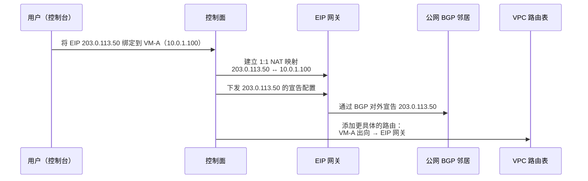
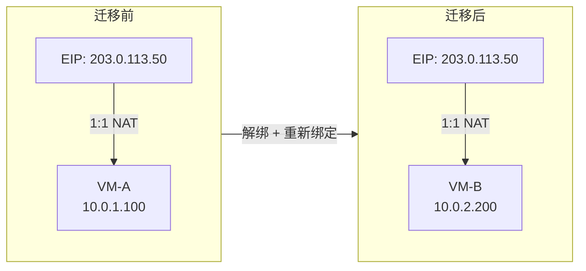
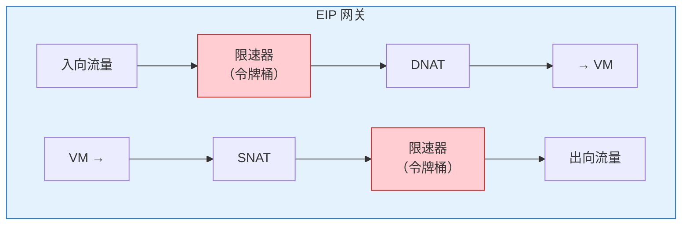
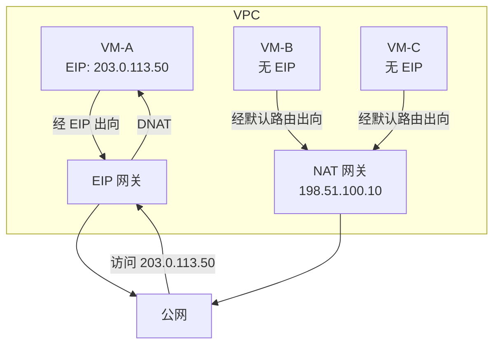

# 14. 固定的公网身份：弹性公网 IP

NAT 网关解决了一个真实的问题，让 VPC 里的 VM 能够访问公网。但它解决问题的方式，本身就带着一个根本性的限制：NAT 是一个共享出口。所有 VM 的流量汇聚到 NAT 网关，换上同一个（或几个）公网 IP 出去。公网看到的是 NAT 网关的 IP，不是 VM 自己的 IP。VM 在公网上没有身份，它是匿名的。

匿名有时候是好事。大量 VM 只需要下载软件包、调用外部 API，不需要被公网认识，共享出口既省 IP 又省钱。但匿名也意味着两件事做不到：公网无法主动找到你，你也无法证明我就是我。如果你在 VPC 里部署了一个 Web 服务器，希望用户从浏览器直接访问它，NAT 网关帮不了你。

## 14.1 NAT 做不到的事

NAT 网关的 conntrack 表是由出向流量触发建立的。VM 先发包出去，NAT 网关记录映射关系，回包到达时根据映射还原目的地址。这个过程有一个的前提：**必须是 VM 先发起连接**。

如果没有 VM 先发包出去，conntrack 表里就没有对应的记录。公网发来的包到达 NAT 网关时，NAT 网关查不到任何映射，它不知道这个包应该送给哪台 VM，只能丢弃。这不是配置问题，而是 NAT 的工作原理决定的：conntrack 是被动建立的，没有出向就没有映射，没有映射就无法反向翻译。

这意味着，一个部署在 VPC 里的 Web 服务器，即使它已经启动并监听了 80 端口，公网用户也无法主动连接它，因为 NAT 网关不知道该把入向流量送给谁。

第二个限制是身份不固定。NAT 网关做 NAPT 时，端口映射是动态分配的，VM-A 这次用了 40001 端口，下次可能用 40002。即使 NAT 网关的公网 IP 不变，端口映射关系也在不断变化。对外暴露的不是一个稳定的身份，而是一个不断变化的端口号。

这两个限制在很多场景下是致命的：

- Web 服务器需要被公网用户直接访问
- 邮件服务器需要固定 IP 做反向 DNS 验证，很多邮件服务商会检查发件 IP 的 PTR 记录，IP 不固定意味着邮件大概率被判为垃圾邮件
- API 服务需要稳定的出口 IP，供合作方加白名单，"你的出口 IP 是什么？""呃，不确定，每次可能不一样"，这个对话在实际的对接中并不罕见

需求很清楚：某些 VM 需要一个**固定的、专属的**公网 IP 地址。不是共享的，不是动态的，而是这个公网 IP 就是我的。

## 14.2 EIP 的绑定：一个公网 IP 与一台 VM 的关联

**弹性公网 IP（EIP，Elastic IP）** 是一个独立的公网 IPv4 地址资源，在 13 章已经简单提到过。它不属于任何 VM，也不属于任何子网，它是一个可以被绑定和解绑的独立对象，像一张可以贴在不同信封上的邮票。

绑定操作很简单：用户把 EIP（比如 203.0.113.50）绑定到 VM-A（私有 IP 10.0.1.100）。绑定完成后，VM-A 对外的公网身份就是 203.0.113.50。公网用户访问 203.0.113.50，流量会被送到 VM-A；VM-A 访问公网，出去的包源 IP 也是 203.0.113.50。

但绑定这个动作，底层发生了什么？

第 13 章讲 NAT 网关时说过，它站在 overlay 与 underlay 的边界上，对内收 VXLAN，对外接公网。EIP 的 1:1 NAT 发生在同一层边界上，只是多了 BGP 宣告和入向承载。工业实现里，这套逻辑可能和 NAT 网关落在同一批物理节点上（只是数据面表项不同），也可能拆成两套独立集群。为了避免和 NAT 网关混淆，后文统一把承载 EIP 的这一层节点叫做 **EIP 网关**，它和 NAT 网关是同一层边界设备的两种角色，不是两台完全独立的机器。

在用户操作绑定后，底层会有三件事发生：

1. **控制面在 EIP 网关上建立 1:1 NAT 映射**，203.0.113.50 ↔ 10.0.1.100。公网 IP 完整对应一个私有 IP，65535 个端口独享，不存在端口竞争
2. **EIP 网关通过 BGP 向公网宣告路由**，告诉公网的路由器 203.0.113.50 可以通过我到达。控制面负责把这条宣告的配置下发到 EIP 网关，真正的 BGP `UPDATE` 报文由 EIP 网关自己发出
3. **更新 VPC 内部的路由规则**，让 VM-A 的出向流量经过 EIP 网关，而不是走 NAT 网关的默认路由

**图 14.1：EIP 绑定时底层的三个动作**

还有一个细节值得注意：VM 自己并不知道 EIP 的存在。你登录 VM-A，执行 `ip addr`，看到的仍然是 10.0.1.100。EIP 的地址转换发生在 VM 外部，EIP 网关或宿主机上，对 VM 完全透明。绑定和解绑因此可以在 VM 无感的情况下完成，不需要重启，也不需要改配置。

## 14.3 FloatingIP：EIP 的流量路径

EIP 绑定后，流量是怎么走的？理解这个问题的关键是一个概念：**FloatingIP**。

> **FloatingIP 是什么？**
>
> FloatingIP（浮动 IP）是一种网络设计模式：一个 IP 地址不固定绑定在某台设备的网卡上，而是浮动在外部的某个网络节点上，通过 NAT 或路由规则与内部的真实 IP 建立映射。之所以叫浮动，是因为这个映射关系可以随时改变，今天指向 VM-A，明天可以切换到 VM-B，而 IP 地址本身不变。OpenStack 最早普及了这个术语，云厂商的 EIP 本质上就是 FloatingIP 的产品化包装。FloatingIP 的核心价值在于：让公网身份可以独立于具体的 VM 实例存在和迁移。

FloatingIP 的核心思想是，EIP 不是真的配置在 VM 的网卡上，而是浮动在 VM 外部的某个网络节点上。这个节点负责做 1:1 的地址转换。EIP 本质上就是一个固定的、专属的 NAT，只不过它只服务一台 VM。

路径本身与第 13 章的 NAT 网关几乎一致。EIP 网关同样站在 overlay 与 underlay 的边界（13.4 的位置剖面）；出向包在 host vSwitch 上被封成 VXLAN，外层目的填 EIP 网关的 underlay 地址，送到网关后解封、做 NAT、再走 underlay 出公网。完整的封包过程就是图 13.6 的四步。入向对称：公网包按 EIP 找到网关，解开后按目的 VM 所在 VPC 的 VNI 重新封 VXLAN，交回 host vSwitch。

真正的差异只在 NAT 那一步，NAT 网关做的是 N:M 的 NAPT，一批 VM 共用少量公网 IP，靠端口区分；EIP 是 1:1 的静态映射，203.0.113.50 与 10.0.1.100 一一对应，出向 SNAT 只改地址不改端口，入向 DNAT 反之。

至于这个EIP 网关具体是一批独立的边界节点，还是被下沉到 VM 所在宿主机上就地完成 1:1 NAT，各家云厂商选择不同，是集中与分布式的常见权衡。对本节而言无关紧要，位置和封包路径同 NAT 网关即可。

1:1 映射还带来了 conntrack 的简化，NAT 网关的 conntrack 表需要记录 N:M 的动态映射，几百台 VM 的连接挤在一张表里，端口竞争激烈，表项数量巨大。EIP 的映射关系是固定的，一个公网 IP 始终对应一个私有 IP，理论上静态 1:1 NAT 不需要 conntrack 来做地址翻译，因为映射关系永远不变。但实际实现中通常仍然使用 conntrack 来跟踪连接状态，安全组需要它来判断这个包属于已有连接吗，流量统计和计费也需要它。关键区别在于：EIP 的 conntrack 表只服务于一台 VM 的连接，压力远小于 NAT 网关。

这里有一个容易被忽略的问题：如果 VM-A 同时绑定了 EIP，VPC 的路由表里又有 0.0.0.0/0 → NAT 网关的默认路由，VM-A 的出向流量走哪条路？答案是路由表的优先级决定。绑定 EIP 后，控制面会为 VM-A 添加一条更具体的路由，优先级高于默认路由。VM-A 的出向流量走 EIP，其他没有绑定 EIP 的 VM 继续走 NAT 网关。最长前缀匹配的规则在这里再次发挥了作用。

## 14.4 EIP 的迁移：网络身份的漂移

EIP 最有意思的能力，不是给 VM 一个公网 IP，这件事静态公网 IP 也能做。EIP 真正的价值在于：**它可以在 VM 之间迁移**。

操作很简单：把 EIP 从 VM-A 解绑，再绑定到 VM-B。操作完成后，203.0.113.50 指向的不再是 VM-A（10.0.1.100），而是 VM-B（10.0.2.200）。对公网用户来说，IP 地址没变，他们甚至不知道背后的 VM 换了。

对比 14.2 的绑定动作会发现，迁移在控制面上其实只做了**一件事**：把 EIP 网关上的 1:1 NAT 映射由 `203.0.113.50 ↔ 10.0.1.100` 改写为 `203.0.113.50 ↔ 10.0.2.200`。绑定时的另外两件事：BGP 宣告和 VPC 内路由，这一次都不需要重做，因为公网 IP 没变、目标 VPC 也没变，控制面无事可干。

数据面上的变化则是这次改写的直接后果。EIP 网关的转发面读到新表项，下一个到达的入向包立刻 DNAT 到 VM-B；同时，旧的 conntrack 表项（映射到 VM-A 的那些）失效，VM-A 上已经建立的 TCP 连接，回包再也走不通那条老路，全部断开。这一断是迁移的固有代价，后文会专门讲。

**图 14.2：EIP 从 VM-A 迁移到 VM-B**

迁移速度是这个能力的关键指标，EIP 迁移的核心延迟在于控制面更新 NAT 映射和路由生效的时间，通常在**秒级**。相比之下，DNS 切换需要等待 TTL 过期，可能是几分钟甚至几小时。EIP 迁移比 DNS 切换快一到两个数量级。

这个能力让 EIP 成为高可用架构的基础。一个典型的场景：主 VM 运行着 Web 服务，备 VM 待命。监控系统检测到主 VM 故障（比如健康检查连续失败），自动触发 EIP 从主 VM 迁移到备 VM。对外的公网 IP 不变，客户端无感知，除了已有的 TCP 连接会断开需要重连。整个切换过程在秒级完成。这就像一个演员中途退场，替补演员穿上同一套戏服上台，观众看到的角色没变，只是扮演者换了。

如果你还记得第 11 章讲过的弹性网卡（ENI），会发现两者有异曲同工之处。ENI 漂移是 VPC 内部的网络身份迁移，私有 IP 和 MAC 地址跟着 ENI 从一台 VM 移到另一台。EIP 迁移是公网身份的迁移，公网 IP 从一台 VM 移到另一台。两者可以配合使用：ENI 漂移保证 VPC 内部访问不中断，EIP 迁移保证公网访问不中断。

但 EIP 迁移有一个不可避免的代价：**已有 TCP 连接会断开**。conntrack 记录在旧的 EIP 网关上，迁移后这些记录失效，正在进行的连接无法继续。对于短连接场景（HTTP 请求），这个中断几乎无感，客户端重试一次就连上了新的 VM。对于长连接场景（WebSocket、数据库连接），这个中断需要应用层自己处理重连逻辑。这是一个工程上的现实，网络层能做到秒级切换 IP，但无法帮应用层保持已有的 TCP 状态。

## 14.5 带宽限速：流量在哪里被管住

云厂商不能无限提供公网带宽，云到公网的出口是一条条实打实的物理链路，容量是买来的、成本是真的，一个 Region 的总出口带宽是有上限的。这个上限要被所有租户分摊，因此每一份公网可达性都必须**带一个明确的额度**，否则一个客户就能把出口打满，其他客户全部遭殃。

EIP 天然是这个额度的挂载点，它本身就是这台 VM 走公网的凭证，把带宽上限绑在 EIP 上，售卖、计费、限速三件事一次说清：用户买 EIP 时顺带买一个带宽规格（比如 100Mbps），超过这个规格的流量会被限速或丢弃。

限速在哪里执行？还是在 EIP 网关上。通过令牌桶（Token Bucket）或类似的 QoS 机制，EIP 网关对经过的流量进行速率控制。这意味着限速和地址转换发生在同一个节点上，如果 EIP 网关下沉到宿主机，限速也在宿主机执行；如果集中在专用节点上，限速也在专用节点上执行。

**图 14.3：EIP 限速的执行位置**

这里有一个不对称性值得注意：**出向限速和入向限速的代价完全不同**。

出向限速相对简单，包还没离开云的网络，在 EIP 网关上丢弃超额的包，不浪费任何外部带宽。但入向限速就不一样了：流量已经穿越了公网，从用户的设备出发，经过运营商的骨干网，到达云的边界。即使在入口处把超额的包丢弃，公网带宽已经被消耗了。

这个不对称性解释了一个看似反直觉的现象：DDoS 攻击即使被成功拦截，仍然会消耗带宽资源。攻击流量从全球各地涌向你的 EIP，即使云厂商在入口处全部丢弃，这些流量已经占用了从攻击源到云边界之间的所有链路带宽。入向流量的伤害在到达你之前就已经发生了，这也是为什么 DDoS 防护需要在尽可能靠近攻击源的地方进行清洗，而不是在目的地拦截。这个话题留到后面再展开。

## 14.6 EIP 与 NAT 网关的选择

EIP 和 NAT 网关解决的是不同的问题，但它们的能力有重叠的部分，都能让 VM 访问公网。什么时候用哪个？

**EIP 适合的场景**：

- VM 需要被公网主动访问，Web 服务器、API 服务器、游戏服务器，任何需要接受入向连接的场景
- VM 需要固定的出口 IP，合作方按 IP 做白名单，反向 DNS 验证，或者审计要求出口 IP 可追溯
- 高可用场景需要 IP 漂移能力，主备切换时，公网 IP 跟着业务走

**NAT 网关适合的场景**：

- 大量 VM 只需要出向访问公网，下载软件包、调用外部 API、推送日志，不需要被公网访问
- 不需要每台 VM 都有独立的公网 IP，几百台 VM 共享几个公网 IP，节省地址资源和成本

两者并不互斥，同一个 VPC 内，部分 VM 绑定 EIP（对外提供服务），其他 VM 通过 NAT 网关访问公网（只需出向）。路由表通过更具体的路由（EIP）和默认路由（NAT 网关）自动分流，绑定了 EIP 的 VM，出向流量走 EIP；没有绑定 EIP 的 VM，出向流量命中 0.0.0.0/0 默认路由，走 NAT 网关。

**图 14.4：EIP 与 NAT 网关在同一 VPC 内的协同**

一句话概括：NAT 网关是共享出口，EIP 是专属身份。前者让 VM 匿名地访问公网，后者让 VM 在公网上有了自己的名字。两者的选择不是技术优劣的问题，而是业务需求的问题，你的 VM 需要被认识，还是只需要能出去？

还有一个经常被问到的问题：一台 VM 能不能绑定多个 EIP？答案取决于云厂商的实现，但大多数云厂商支持通过多块弹性网卡（ENI）来实现，每块 ENI 绑定一个 EIP。这在某些场景下是必要的：一台 VM 上运行了多个服务，每个服务需要独立的公网身份；或者一台 VM 需要同时对外暴露不同的 IP 地址，用于不同的业务域名。但多 EIP 也意味着更复杂的路由规则和更高的成本，每个 EIP 都是独立计费的资源。多一个 IP 多一份灵活，也多一份管理负担。
