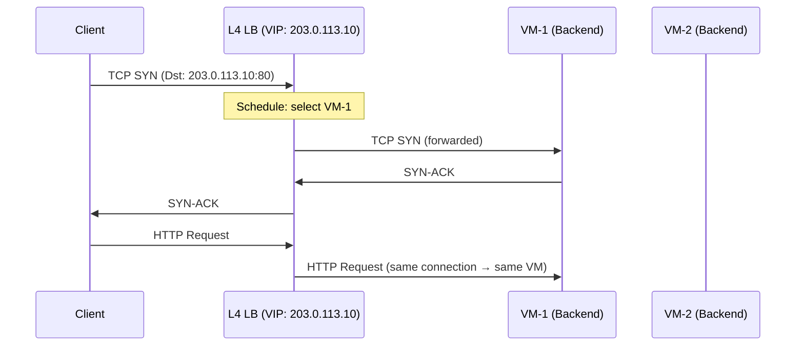
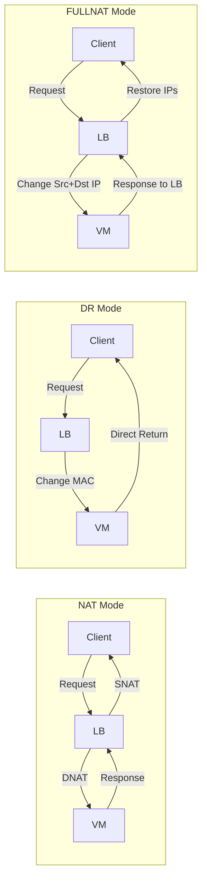
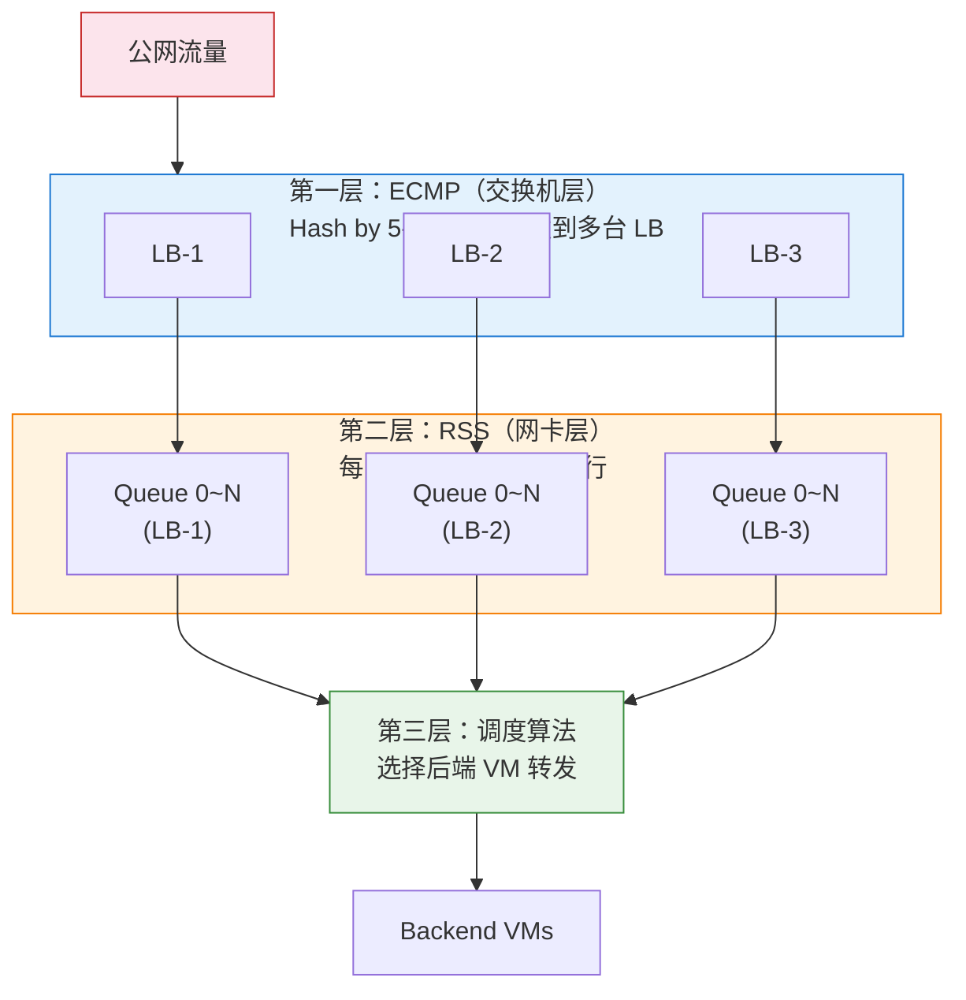
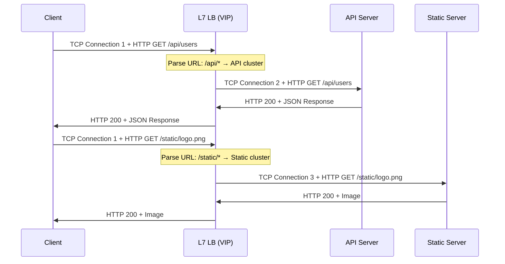
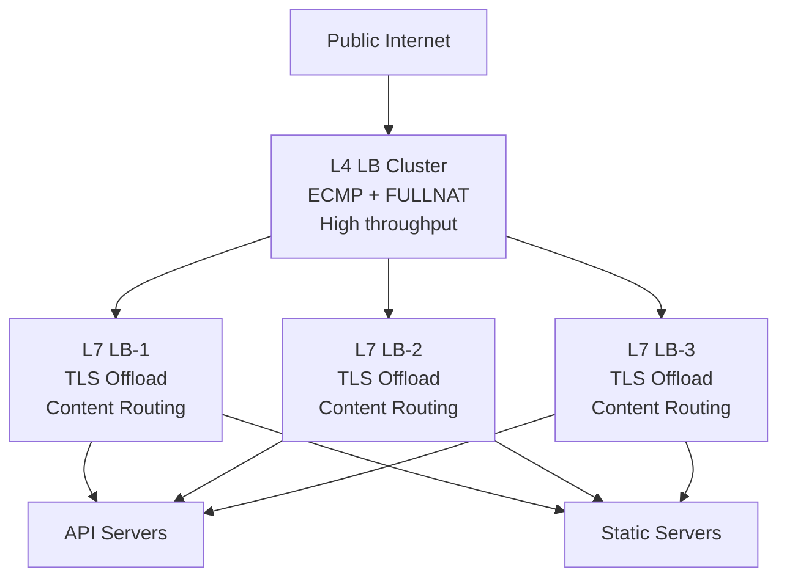

# 15. 流量涌入，一台撑不住：负载均衡

一台 VM 绑定了 EIP，部署了 Web 服务，用户从公网可以直接访问它。这是一个完整的链路，NAT 网关让 VM 能出去，EIP 让 VM 能被找到。初期一切顺利，一台 VM 轻松应对。

但业务增长不会等你准备好。三个月后，用户量翻了十倍，QPS 从 100 涨到 10000。VM 的 CPU 使用率飙到 90%，响应延迟从 50ms 涨到 500ms，开始有用户投诉"打不开页面"。你加了更多的 VM，但用户只知道一个 IP 地址，谁来决定每个请求发给哪台 VM？

这个问题看起来简单，但它的答案比大多数人预期的要复杂得多。从 DNS 轮询到四层转发再到七层代理，每一层方案都在解决上一层的不足，同时引入新的代价。而负载均衡器本身也有性能上限，"谁来给负载均衡器做负载均衡"，这个递归问题的答案，揭示了云上大规模流量入口的真实架构。

## 15.1 一台 VM 的天花板

垂直扩展是最直觉的反应，CPU 不够就加 CPU，内存不够就加内存，带宽不够就升规格。这在一定范围内有效，但有两个问题。

第一，垂直扩展有硬上限。最大规格的 VM 也有天花板，128 核 CPU、512GB 内存、50Gbps 带宽，这些数字在云厂商的产品列表里是写死的。你不可能无限升配。

第二，成本不是线性增长的。一台 64 核的 VM 通常比两台 32 核的 VM 贵得多，高规格实例的溢价是普遍现象。你花了更多的钱，得到的却不是等比例的性能提升。

水平扩展的思路更合理：部署多台相同配置的 VM，每台处理一部分请求。总承载能力 = 单台能力 × VM 数量。理论上，只要不断加 VM，就能应对不断增长的流量。

但水平扩展引入了一个新问题：用户只知道一个 IP 地址（你的 EIP），他的浏览器发出的 TCP SYN 包只会发往这一个 IP。你在后面部署了 10 台 VM，但用户的包只会到达绑定了 EIP 的那一台。其他 9 台 VM 闲着，第 1 台 VM 被压垮。

需要一个中间层，它对外暴露一个 IP 地址（VIP），接收所有用户的请求，然后把请求分发给后端的多台 VM。这个中间层就是负载均衡器。

> **VIP 是什么？**
>
> VIP（Virtual IP，虚拟 IP）是负载均衡器对外暴露的 IP 地址。它不属于任何一台后端服务器，而是由负载均衡器"持有"，所有客户端的请求都发往这个 VIP，负载均衡器收到后再分发给后端的真实服务器。从客户端的视角看，VIP 就是服务的地址；从后端服务器的视角看，VIP 是负载均衡器的前端入口。VIP 的存在让后端服务器可以自由增减，而客户端无需感知任何变化。

## 15.2 DNS 轮询：看似简单的分发

在引入专门的负载均衡设备之前，有一个看起来不需要任何额外设备的方案：DNS 轮询。

思路很简单，给域名配置多条 A 记录，每条指向一台 VM 的 EIP。DNS 服务器在响应查询时，轮流返回不同的 IP 地址。客户端 A 解析到 VM-1 的 IP，客户端 B 解析到 VM-2 的 IP，流量自然被分散到不同的 VM 上。

不需要额外的设备，不需要额外的网络节点，只需要在 DNS 里多加几条记录。听起来是个好主意。

但 DNS 轮询有三个致命的缺陷，每一个都足以让它在生产环境中不可靠。

**第一，TTL 导致分发严重不均。** DNS 的查询结果会被客户端和中间的 Local DNS 缓存。在 TTL 过期之前，同一个 Local DNS 背后的所有用户都会被解析到同一台 VM。一个大型企业的 Local DNS 可能代理了几万名员工的请求，这几万人的流量全部打到同一台 VM 上，其他 VM 几乎空闲。DNS 轮询的"均衡"只在 DNS 查询层面成立，在实际流量层面完全不均衡。

**第二，无法感知后端健康。** 如果某台 VM 宕机了，DNS 仍然会把它的 IP 返回给客户端。客户端尝试连接，TCP SYN 发出去，等待 SYN-ACK，超时，重试，再超时，用户看到的是几秒甚至十几秒的白屏。DNS 没有健康检查机制，它不知道后端 VM 是死是活。你可以手动删除故障 VM 的 A 记录，但 DNS 的更新生效时间取决于 TTL，如果 TTL 是 300 秒，那在这 5 分钟内，所有缓存了旧记录的客户端仍然会连接到已经宕机的 VM。

**第三，无法做细粒度的分发策略。** DNS 只能按 IP 轮询，无法根据后端 VM 的实时负载、当前连接数、响应时间来做智能分发。如果 VM-1 的 CPU 已经 90% 了，VM-2 才 30%，DNS 不知道，也不关心，它继续把流量均匀地分给两台。

DNS 轮询适合一种场景：粗粒度的全球流量调度，把不同地区的用户引导到不同 Region 的服务节点。这是 GSLB（全球服务器负载均衡）的领域，后面会专门讨论。但在单个服务入口的精细负载均衡上，DNS 轮询不够用。

需要一个专门的设备，它能实时感知后端的健康状态，能根据负载情况智能分发，能在毫秒级别做出转发决策，而不是等 DNS TTL 过期。

## 15.3 四层负载均衡：基于 IP + Port 的转发

四层负载均衡工作在传输层，它只看 IP 头和 TCP/UDP 头，根据源 IP、目的 IP、源端口、目的端口和协议号（五元组）做转发决策，不解析应用层的内容。

为什么是"四层"而不是"三层"？因为三层只有 IP 地址，没有端口号，无法区分同一个 VIP 上的不同服务；更关键的是，三层没有"连接"的概念，而 LB 必须把同一条 TCP 连接的所有包发给同一台后端 VM。"连接"由四层的五元组定义，所以负载均衡的最低有效层次是四层。

核心动作是这样的：客户端发来一个 TCP SYN 包，目的 IP 是 LB 的 VIP（Virtual IP），目的端口是 80。LB 收到这个 SYN 包后，根据调度算法选择一台后端 VM，把包转发过去。后续同一条 TCP 连接的所有包，SYN-ACK、ACK、数据包、FIN，都发给同一台 VM。这叫**会话保持**（Session Persistence）：一旦一条连接被分配给某台 VM，这条连接的所有包都走同一条路，不会中途换人。

**图 15.1：四层 LB 的基本转发流程**

调度算法决定了"选哪台 VM"，这个问题看似简单，但每一种算法都是在上一种的不足中被逼出来的。

最直觉的做法是**轮询（Round Robin）**，按顺序依次分配，VM-1、VM-2、VM-3、VM-1、VM-2、VM-3……简单、公平、无状态。但轮询有一个隐含的假设：所有后端 VM 的处理能力相同。现实中呢？你的后端可能混合了不同规格的实例，4 核的 VM 和 16 核的 VM 各自分到相同数量的请求，4 核的被压垮，16 核的还在摸鱼。

那怎么办？给不同的 VM 设置权重。**加权轮询（Weighted Round Robin）** 让 16 核的 VM 权重设为 4，4 核的设为 1，每 5 个请求里，16 核的分到 4 个，4 核的分到 1 个。这解决了"能力不同"的问题。但加权轮询仍然有一个盲区：它假设每个请求的处理成本相同。如果 VM-1 刚好接到了几个需要查询大表的慢请求，每个耗时 10 秒，而 VM-2 接到的都是毫秒级的轻量请求，按权重分配，VM-1 的活跃连接数已经堆积到 200，VM-2 才 5 个。权重是静态的，它看不见运行时的负载差异。

那如果我们不看权重，直接看实时负载呢？**最少连接（Least Connections）** 把新连接分给当前活跃连接数最少的 VM。这在长连接场景中尤其有效，比如 WebSocket 或数据库连接池，连接持续时间长且不均匀，最少连接能动态地把新连接导向最空闲的 VM。但最少连接也有它的局限：它需要 LB 维护每台后端 VM 的实时连接数状态，而且在短连接高并发场景下（比如 HTTP/1.0 的短连接），连接数变化太快，统计值可能不够准确。

还有一种完全不同的思路：**源 IP 哈希（Source IP Hash）**，对客户端 IP 做哈希，同一个客户端的请求总是发给同一台 VM。这不是为了"均衡"，而是为了"亲和性"，某些应用把会话状态存在本地内存里（而不是 Redis），如果同一个用户的请求被分到不同的 VM，会话就丢了。源 IP 哈希牺牲了均衡性，换来了会话的稳定性。

四种算法，四种取舍。没有"最优"的调度算法，只有最匹配你场景的那一个。如果后端同构且请求均匀，轮询就够了；如果后端异构，用加权轮询；如果连接持续时间差异大，用最少连接；如果需要会话亲和性，用源 IP 哈希。选择取决于你更不愿意接受哪个代价。

四层 LB 的优势很明显：**快**。它不需要等待完整的 HTTP 请求到达，不需要解析 URL 和 Header，看到 SYN 包就能做出转发决策。处理延迟在微秒级别，单实例吞吐量可以达到几十 Gbps、几千万 PPS。对于大流量、低延迟的场景，四层 LB 是首选。

但四层 LB 有一个根本性的局限：它**看不懂**应用层的内容。它不知道这个请求是 GET /api/users 还是 GET /static/logo.png，不知道 HTTP Header 里带了什么 Cookie，不知道请求体里有什么参数。这意味着它无法做基于内容的路由，比如把 /api 的请求发给 API 服务集群，把 /static 的请求发给静态资源服务器。它也无法做 TLS 卸载，因为 TLS 是应用层协议，四层 LB 看到的只是加密后的 TCP 字节流，解不开。

归根结底，四层 LB 就是一个高速的包转发器，它转发得很快，但它不理解自己在转发什么。就像一个分拣速度极快的快递员，他能在一秒内把包裹扔进对应的卡车，但你问他"这个包裹里装的是什么"，他会一脸茫然，他只看收件地址，从不拆包裹。

## 15.4 四层 LB 的转发本质与三种模式

LB 用五元组做转发决策，但它做的事情看起来就是改改 IP 和端口然后把包扔出去，这不是三层路由器干的活吗？它和 TCP 到底是什么关系？

关键区别在于**连接追踪**。路由器收到一个包，查路由表，找到下一跳，转发，每个包都是独立的决策，路由器不记得"上一个包发给了谁"。但四层 LB 不同：它收到一个 TCP SYN 包时，根据调度算法选择一台后端 VM，然后**记住这个五元组对应的后端 VM**（这就是 conntrack 表的作用）。后续同一条 TCP 连接的所有包，SYN-ACK、ACK、数据、FIN，都查 conntrack 表，发给同一台 VM。四层 LB 的"四层"体现在这里：它理解"连接"的概念，能把属于同一条 TCP 连接的所有包绑定到同一个后端。

但四层 LB **不维护完整的 TCP 状态机**。它不会像操作系统的 TCP 协议栈那样追踪序列号、管理滑动窗口、处理重传。它不终结 TCP 连接，客户端的 TCP 连接直接穿透 LB 到达后端 VM，三次握手是客户端和 VM 之间完成的（虽然 LB 在中间改了地址）。LB 只是在转发路径上"窥视"了 TCP 头部，用五元组做连接级的转发决策，仅此而已。

这就是四层 LB 快的根本原因：它借用了四层的信息（端口号和连接的概念）来做比三层更智能的转发，但不承担四层协议栈的完整开销。它是一个"有连接意识的包转发器"，比三层路由器多了连接追踪，比七层代理少了协议解析。

理解了这个本质之后，再来看四层 LB 把包"转发"给后端 VM 的具体方式。"转发"这个动作有三种截然不同的实现，它们的流量路径完全不同，性能特征也完全不同。理解这三种模式，是理解云上四层 LB 架构的基础。

**NAT 模式**

LB 收到客户端的包后，把目的 IP 从 VIP 改为后端 VM 的真实 IP，然后转发。VM 处理完请求后，响应包的源 IP 是 VM 自己的 IP，目的 IP 是客户端的 IP，但客户端期望收到的是来自 VIP 的响应，不是来自某台 VM 的响应。所以响应包必须回到 LB，由 LB 把源 IP 从 VM 的 IP 改回 VIP，再发给客户端。

**所有流量，请求和响应，都经过 LB。** 这是 NAT 模式的核心特征。优点是后端 VM 不需要任何特殊配置，它甚至不知道 LB 的存在。缺点是 LB 成为带宽瓶颈，响应包通常比请求包大得多（一个 HTTP 请求可能只有几百字节，响应可能有几十 KB），LB 要承受入向和出向的全部带宽。

**DR（Direct Return）模式**

DR 模式是三种模式中最精妙的，LB 几乎不碰包的内容，只做最轻量的改动，就让响应流量完全绕过自己。要理解它为什么能工作，需要拆解三个步骤。

**第一步：LB 只改 MAC，不改 IP。** 客户端发来的包，目的 IP 是 VIP（比如 203.0.113.10）。LB 收到后，**不修改 IP 头的任何字段**，只把以太网帧的目的 MAC 地址从 LB 自己的 MAC 改为后端 VM 的 MAC，然后把帧发出去。此时这个包的状态是：

| 层 | 源 | 目的 |
|---|---|---|
| MAC | LB 的 MAC | VM 的 MAC（LB 改的） |
| IP | 客户端 IP | VIP 203.0.113.10（没改） |

**第二步：VM 为什么会接受这个包？** VM 收到这个帧，拆掉以太网头，看到目的 IP 是 203.0.113.10（VIP）。VM 自己的真实 IP 是比如 10.0.0.5，正常情况下，VM 会认为"这个包不是给我的"然后丢弃。

关键配置来了：运维预先在 VM 的 **loopback 接口**（lo）上配置了 VIP 地址 203.0.113.10。loopback 是一个纯软件的本地接口，不连接任何物理网络。VM 的内核在判断"这个包是不是给我的"时，会遍历**所有接口**上的 IP 地址，包括 lo 上的。它发现 203.0.113.10 确实配在自己的 lo 接口上，于是认为"这个包是给我的"，正常交给应用层处理。

**第三步：VM 直接回包，源 IP 自然就是 VIP。** 应用处理完请求后，构造响应包。TCP/IP 协议栈的规则是：响应包的源 IP = 请求包的目的 IP。请求包的目的 IP 是 VIP 203.0.113.10，所以响应包的源 IP 自然就是 203.0.113.10。VM 查路由表，发现去往客户端 IP 的下一跳是默认网关，于是直接把响应包发出去，**完全不经过 LB**。客户端收到响应，看到源 IP 是 VIP，和自己发请求时的目的 IP 一致，TCP 连接正常继续。

但这里有一个必须处理的隐患：VM 的 lo 接口上配了 VIP，如果 VM 对 VIP 的 ARP 请求做了响应，网络中的其他设备就会认为"VIP 在 VM 那里"，直接把流量发给 VM，绕过了 LB，负载均衡就失效了。所以 DR 模式要求在 VM 上**抑制 ARP 响应**（Linux 上通过设置 `arp_ignore=1` 和 `arp_announce=2`），确保 VM 不会对外宣告"VIP 在我这里"。VIP 的 ARP 解析只会指向 LB，LB 是 VIP 的唯一入口；但 VM 在本地悄悄持有 VIP，用于接受包和构造回包。两个配置缺一不可，少了 lo 上的 VIP，VM 会丢弃包；少了 ARP 抑制，流量会绕过 LB。

这是 DR 模式的精妙之处：LB 只处理入向流量，出向流量由 VM 直接返回。LB 的带宽压力大幅降低，它只需要承受请求包的带宽，不需要承受响应包的带宽。但 DR 模式有一个硬约束：LB 修改的是 MAC 地址，这意味着 LB 和后端 VM 必须在同一个二层网络内。跨三层网络，MAC 地址就不可达了。

**FULLNAT 模式**

LB 同时修改源 IP 和目的 IP。请求包的源 IP 从客户端 IP 改为 LB 的内部 IP，目的 IP 从 VIP 改为后端 VM 的 IP。VM 收到的包，源 IP 是 LB 的内部 IP，所以 VM 的响应包自然会发回 LB（因为"源 IP"就是 LB），LB 再把源 IP 改回 VIP、目的 IP 改回客户端 IP，发给客户端。

FULLNAT 的优势是 LB 和后端 VM 可以跨三层网络，不需要在同一个二层网络内。这在云环境中至关重要，因为 VPC 是 Overlay 网络，LB 和后端 VM 通常不在同一个物理二层网络。但 FULLNAT 有一个代价：后端 VM 看到的源 IP 不是客户端的真实 IP，而是 LB 的内部 IP。如果应用需要知道客户端的真实 IP（比如做访问日志、地理位置判断），就需要通过额外的机制传递，比如 TOA（TCP Option Address）在 TCP 选项字段里携带真实 IP，或者 Proxy Protocol 在连接建立时传递。

**图 15.2：三种转发模式的流量路径对比**

三种模式的核心区别，可以从"改了什么"和"回程怎么走"两个维度来看：

- **NAT**：只改目的 IP（VIP → VM IP）。VM 看到的源 IP 是客户端的真实 IP，所以 VM 的响应包会直接发给客户端，但客户端期望收到来自 VIP 的响应，不是来自某台 VM 的。因此必须通过路由手段（比如把 VM 的默认网关指向 LB）强制响应包回到 LB，由 LB 把源 IP 改回 VIP。**去回都过 LB，但 LB 和 VM 必须在同一个网络内**（否则无法把 VM 的默认网关指向 LB）。
- **DR**：不改 IP，只改 MAC。响应包由 VM 直接返回客户端，不经过 LB。**去过回不过，但 LB 和 VM 必须在同一个二层网络内**。
- **FULLNAT**：同时改源 IP（客户端 IP → LB 内部 IP）和目的 IP（VIP → VM IP）。VM 看到的源 IP 是 LB 的内部 IP，响应包天然发回 LB，不需要任何路由技巧。**去回都过 LB，但 LB 和 VM 可以跨三层网络**。

NAT 和 FULLNAT 的关键差异在于：NAT 保留了客户端的真实源 IP，VM 能直接看到"谁在访问我"，但代价是 LB 和 VM 的网络拓扑必须紧耦合；FULLNAT 用 LB 的内部 IP 替换了客户端源 IP，VM 看不到真实客户端，但换来了拓扑上的自由，LB 和 VM 可以在任意网络位置。云上四层 LB 大多使用 FULLNAT 或类似模式，因为 VPC 是 Overlay 网络，LB 和后端 VM 通常不在同一个二层甚至三层网络内，DR 和 NAT 的拓扑约束都不适用，而 FULLNAT 的跨网络能力正好匹配这个架构。

## 15.5 四层 LB 的横向扩展

理解了转发模式之后，还有一个递归问题需要回答：**LB 本身也有性能上限，谁来给 LB 做负载均衡？**

即使四层 LB 性能很高，单个实例的 PPS 和带宽仍然有天花板。当流量超过单实例的处理能力时，需要多个 LB 实例并行工作。问题是：客户端只知道一个 VIP，怎么把流量分散到多个 LB 实例上？

### ECMP：交换机层面的分发

**ECMP（Equal-Cost Multi-Path）** 是最常见的解法。多个 LB 实例通过 BGP 对外宣告同一个 VIP，上游交换机发现到达这个 VIP 有多条等价路径（每条通向一个 LB 实例），于是通过五元组哈希把不同的连接分发到不同的路径。对客户端来说，VIP 只有一个；对交换机来说，这个 VIP 背后有一组 LB 实例在并行工作。

ECMP 不是单点。它是交换机的原生能力，只要上游交换机收到了多个 LB 实例对同一个 VIP 的路由宣告，它就自动启用多路径分发。交换机本身通常是成对部署的（比如两台 TOR 交换机做冗余），所以 ECMP 的分发层也是冗余的。即使一台交换机故障，另一台仍然能把流量分发给所有 LB 实例。

但 ECMP 有一个关键约束：同一条 TCP 连接的所有包必须被哈希到同一个 LB 实例。因为 conntrack 是本地状态，LB-1 记录了"这条连接分配给 VM-3"，如果这条连接的后续包被哈希到 LB-2，LB-2 的 conntrack 表里没有这条记录，包就会被丢弃或错误转发。

如果 LB 实例数量发生变化，比如扩容加了一台 LB-4，或者 LB-2 故障下线，哈希结果会变，大量已有连接可能被重新分配到错误的实例。**一致性哈希**可以缓解这个问题：它保证在实例数量变化时，只有少量连接需要重新映射，而不是全部打乱。

### 其他扩展方式

ECMP 是数据中心内最主流的方案，但不是唯一的选择。

**DNS 轮询 + Anycast。** 在全球范围内，同一个 VIP 以 Anycast 的方式在多个数据中心宣告。用户的流量被 BGP 路由到最近的数据中心，每个数据中心内部再用 ECMP 分发给本地的 LB 集群。这是 CDN 和大型云厂商的全球流量入口架构，不是一个数据中心扛全球流量，而是每个 PoP 点各自承担附近的流量。

**DPVS / MGW 等软件方案。** 一些云厂商在 ECMP 之上再加一层软件分发层。多个 LB worker 进程共享同一个 VIP，通过内核旁路（DPDK）和无锁设计实现单机几千万 PPS 的处理能力。这些 worker 之间可以通过共享的 conntrack 表（或者 conntrack 同步机制）来解决实例变化时的连接迁移问题，比 ECMP 的一致性哈希更精确，但实现复杂度也更高。

### 单机内部：RSS

**RSS（Receive Side Scaling）** 是网卡层面的解法。单个 LB 实例内部，网卡把不同连接的包分发到不同的 CPU 核心处理，同样是基于五元组哈希。这让单机的多个 CPU 核心可以并行处理不同的连接，而不是所有包都挤在一个核心上。

**图 15.3：分层分发的全景**

> 蓝色 = ECMP 层（交换机把流量分散到多台 LB），橙色 = RSS 层（网卡把流量分散到多个 CPU 核心），绿色 = 调度层（每个核心选择后端 VM）。三层嵌套，逐级分发。

整个分发链条是三层嵌套：ECMP 把流量分散到多个 LB 实例 → 每个 LB 实例内部 RSS 把流量分散到多个 CPU 核心 → 每个核心根据调度算法选择后端 VM 转发。这就是云上大规模四层 LB 的真实架构，不是一台设备在扛所有流量，而是一个分层分发的体系在协同工作。

这个"分层分发"的架构之所以能成立，有一个前提：每个 LB 实例是通用服务器 + DPDK/XDP 软件，而不是专用的硬件负载均衡设备（比如 F5 BIG-IP）。如果用专用硬件，你不会把流量分散到"多台 LB"——你会买一台更大的设备。专用硬件的扩展方式是纵向的（买更贵的型号，从 100Gbps 升级到 400Gbps），通用服务器的扩展方式是横向的（加更多的机器）。云厂商选择后者，原因是经济学：DPDK 方案单机吞吐几十 Gbps，单价几万元；专用硬件单台几百 Gbps，单价几十万到上百万元。当你需要 1Tbps 的总吞吐时，30 台通用服务器的总成本远低于 3 台专用硬件——而且通用服务器坏了换一台就行，专用硬件坏了可能需要等厂商上门维修。正是因为选择了"便宜的通用硬件 + 软件定义"，才需要 ECMP 来做第一层分发——这不是架构的缺陷，而是经济选择的必然结果。

但 ECMP 分发不是完美的。如果你管理过大规模的流量入口，你大概率见过 ECMP 哈希不均导致某台 LB 过载的情况，五元组哈希在理论上是均匀的，但在实际流量中，某些大流（elephant flow）可能恰好被哈希到同一台实例。这不是算法的 bug，而是哈希在面对非均匀分布时的固有特性。

## 15.6 七层负载均衡：看懂请求内容

四层 LB 虽快，但眼盲。它不知道自己在转发什么：一个登录请求和一个图片下载请求，在四层 LB 眼里都是 TCP 字节流，没有区别。当后端只有一种服务时，这不是问题。但现实中的业务不会这么简单，一个电商网站，/api/order 是订单服务，/api/payment 是支付服务，/static/images 是静态资源，它们部署在不同的 VM 集群上。四层 LB 看不到 URL，对此无能为力。

这就轮到七层负载均衡上场。它工作在应用层，能"看懂"HTTP 请求的 URL、Header、Cookie、Method，根据这些内容做路由决策。这不是简单的包转发，七层 LB 是一个真正的**反向代理**。

客户端与七层 LB 之间建立一条 TCP 连接，LB 接收完整的 HTTP 请求，解析 URL 和 Header，然后根据路由规则选择后端 VM，再与后端 VM 建立新的连接转发请求。这是**两段独立的 TCP 连接**，客户端到 LB 是一段，LB 到后端是另一段。LB 是一个真正的"中间人"。

> **反向代理是什么？**
>
> 反向代理（Reverse Proxy）是一种服务器端的代理模式。与正向代理（代替客户端访问外部服务）相反，反向代理代替后端服务器接收客户端的请求，然后转发给真正的后端服务器处理。客户端不知道（也不需要知道）真正处理请求的是哪台服务器，它只和反向代理通信。七层负载均衡器就是一种典型的反向代理：它终结客户端的 TCP 连接，解析 HTTP 请求，再与后端建立新的连接转发请求。Nginx、HAProxy、Envoy 都是常见的反向代理软件。

**图 15.4：七层 LB 的两段 TCP 连接**

正是这种"中间人"的位置，让七层 LB 能解决四层 LB 无能为力的三个问题：

**基于内容的路由。** 四层 LB 看不到 URL，只能把所有请求一视同仁地分发给同一组后端，你要么把所有服务混部在每台 VM 上（浪费资源、运维噩梦），要么用不同端口区分服务（客户端要记住 :8001 是订单、:8002 是支付，丑陋且脆弱）。七层 LB 能看到 URL，直接把 /api/* 的请求发给 API 服务集群，把 /static/* 的请求发给静态资源服务器，把带有特定 Header（比如 X-Gray: true）的请求发给灰度环境。不同的 URL 路径对应不同的后端服务，七层 LB 是流量的"分拣中心"。

**TLS 卸载。** HTTPS 已经是标配，但 TLS 加解密是 CPU 密集型操作。如果让每台后端 VM 各自处理 TLS，每台都要持有证书和私钥，每台都要消耗 CPU 做加解密，这些 CPU 本该用来处理业务逻辑。而四层 LB 看到的是加密后的字节流，它解不开 TLS。而七层 LB 可以终结 TLS 连接：客户端与 LB 之间走加密通道，LB 持有证书和私钥完成 TLS 握手和加解密，解密后的明文 HTTP 请求被转发给后端 VM。把 TLS 集中在 LB 上做，比让每台后端 VM 各自做一遍更高效。

**连接复用。** 每个用户一条 TCP 连接，十万用户就是十万条连接。四层 LB 把这十万条连接原样分发给后端 VM，每台 VM 要维护几万条连接的状态（内存、文件描述符、conntrack 表项），即使大部分连接在大部分时间里是空闲的。七层 LB 作为"中间人"，可以在前端维持几万条客户端连接，但与后端 VM 之间只复用少量长连接，几万条前端连接的请求，通过几十条后端连接转发出去。后端 VM 从"应对几万条连接"变成"应对几十条连接"，连接数压力大幅降低。

七层 LB 的代价也很明显：**慢**。它必须完整接收 HTTP 请求（可能要等几个 TCP 包才能拼出完整的 HTTP 头），解析内容，做路由决策，再建立到后端的连接，整个过程的延迟比四层 LB 高一个数量级。而且 TLS 解密消耗大量 CPU，单实例的吞吐量远低于四层 LB。

四层和七层的本质区别可以用一句话说清楚：**四层是包级转发，七层是请求级代理。** 四层 LB 看到一个包就转发一个包，快但不理解内容；七层 LB 要收完整个请求才能做决策，慢但能做智能路由。两者不是替代关系，四层处理不了的事情（内容路由、TLS 卸载、连接复用），七层能做；七层扛不住的流量规模，四层能扛。

## 15.7 健康检查与故障摘除

负载均衡器的另一个核心能力，是 DNS 轮询做不到的那件事：**自动发现后端故障并停止向故障 VM 分发流量。**

如果没有健康检查，LB 就是一个盲目的流量分发器，它不知道后端 VM 是死是活，继续把请求发给已经宕机的 VM，用户看到的是连接超时和错误页面。健康检查让 LB 从"盲目分发"变成"智能分发"。

**四层健康检查**，LB 定期向后端 VM 发 TCP SYN 包，如果能完成三次握手（收到 SYN-ACK），认为健康。这只能检测"端口是否可达"，VM 的操作系统还活着、TCP 协议栈还在工作、端口还在监听。但应用层可能已经出了问题：进程死锁了、数据库连接池耗尽了、返回的全是 500 错误，这些情况下 TCP 端口仍然可达，四层健康检查认为一切正常。

**七层健康检查**，LB 定期向后端 VM 发 HTTP 请求（比如 GET /health），检查返回的状态码和响应内容。如果返回 200 且响应体包含预期的内容，认为健康。这能检测到应用层的问题，进程虽然活着但功能异常时，/health 接口可以返回 503，LB 就知道这台 VM 不能接受流量了。

健康检查的判定策略需要平衡两个风险：**误摘**和**漏摘**。

如果一次检查失败就立刻摘除 VM，那网络偶发的丢包或超时就会导致健康的 VM 被错误摘除，这是误摘。如果要等很多次失败才摘除，那真正故障的 VM 会在很长时间内继续接收流量，这是漏摘。

典型的策略是：**连续 N 次失败才判定为不健康**（比如连续 3 次，每次间隔 5 秒，总共 15 秒）。恢复时也需要**连续 M 次成功才重新加入**（避免 VM 刚恢复就被打满流量，又被压垮）。

从 VM 故障到 LB 停止向它分发流量，这个窗口取决于检查频率和判定阈值。典型值是 10-30 秒。在这个窗口内，部分用户的请求会失败。这是一个工程上的现实，不存在零延迟的故障感知，健康检查的频率越高、判定越快，LB 自身的开销就越大。成熟的经验里，大多数生产环境把这个窗口控制在 15 秒左右，是一个可接受的平衡点。

还有一种更优雅的方式：**主动下线**。VM 不是被动等待健康检查发现自己故障，而是在需要下线时（比如发布新版本、维护升级）主动通知 LB"我要下线了"。LB 停止分发新请求给这台 VM，但等待已有连接处理完毕再彻底摘除。这比被动的健康检查摘除更平滑，已有连接不会被中断，用户无感知。

## 15.8 四层与七层的协同

四层快但笨，七层慢但聪明。在实际的生产环境中，两者不是二选一，而是分层协同。

典型的架构是两层：公网流量先到四层 LB，四层 LB 把流量转发给七层 LB 集群，七层 LB 做内容路由和 TLS 卸载，最终转发给后端 VM。

**图 15.5：四层与七层的分层协同架构**

为什么要分两层？因为两者的能力边界恰好互补。

四层 LB 擅长处理海量连接和高带宽，它是流量的第一道分散层，把涌入的流量均匀地分给多个七层 LB 实例。单个七层 LB 实例的吞吐量有限（TLS 解密消耗大量 CPU），但通过四层 LB 在前面做分散，可以部署多个七层 LB 实例并行工作。

七层 LB 擅长做智能路由，它理解请求内容，能把不同的 URL 路由到不同的后端服务，能做 TLS 卸载和连接复用。这些能力是四层 LB 做不到的。

两层架构的流量路径是：客户端 → 四层 LB（ECMP 分发 + FULLNAT 转发）→ 七层 LB（TLS 卸载 + 内容路由）→ 后端 VM。四层 LB 解决"流量怎么分散"的问题，七层 LB 解决"请求发给谁"的问题。

云厂商的 LB 产品通常对应这个分层：NLB（Network Load Balancer）侧重四层能力，ALB（Application Load Balancer）侧重七层能力。有些产品（如 CLB，Classic Load Balancer）同时提供四层和七层的功能，但底层仍然是分层架构。

到这里，VPC 与公网的连接体系完整了。NAT 网关让 VM 能访问公网：共享出口，匿名出去。EIP 让 VM 拥有公网身份：专属 IP，可以被找到。负载均衡让服务能承受大流量：一个 VIP 背后，是一群 VM 在协同工作。

但所有这些，都发生在单个 VPC 内部。一个 VPC 的服务可以对外提供了，用户可以从公网访问了。

然而企业的业务不会只住在一个 VPC 里，安全团队要求生产环境和开发环境隔离，合规要求金融数据和普通业务数据分开，不同部门各自管理自己的网络，还缺少一种VPC互通的能力。
