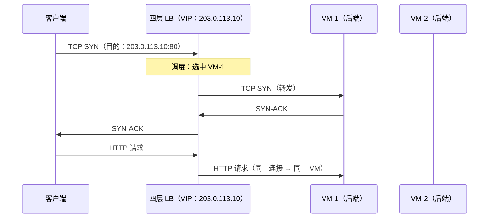
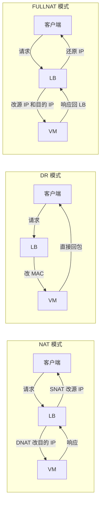
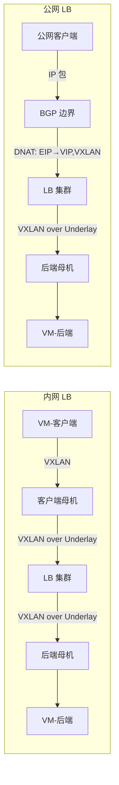
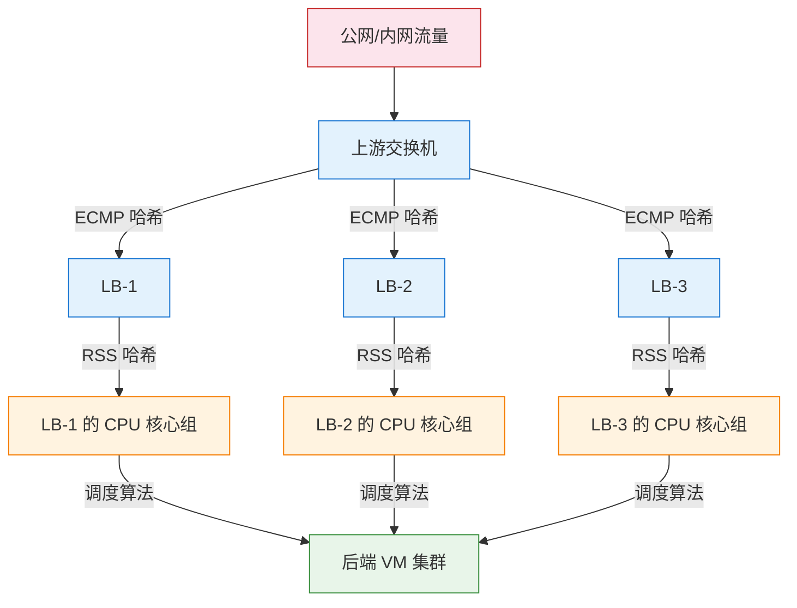

# 15. 流量涌入，一台撑不住：四层负载均衡

一台 VM 绑定了 EIP，部署了 Web 服务，用户从公网可以直接访问它。这是一个完整的链路，NAT 网关让 VM 能出去，EIP 让 VM 能被找到。初期一切顺利，一台 VM 轻松应对。

但业务增长不会等你准备好，三个月后，用户量翻了十倍，QPS 从 100 涨到 10000。VM 的 CPU 使用率飙到 90%，响应延迟从 50ms 涨到 500ms，开始有用户投诉打不开页面。你加了更多的 VM，但用户只知道一个 IP 地址，谁来决定每个请求发给哪台 VM？

这个问题看起来简单，但它的答案比大多数人预期的要复杂。从 DNS 轮询到四层转发，每一步都在解决上一步的不足，同时引入新的代价。而负载均衡器本身也有性能上限，谁来给负载均衡器做负载均衡？这个递归问题的答案，揭示了云上大规模流量入口的真实架构。

## 15.1 一台 VM 的天花板

垂直扩展是最直觉的反应，CPU 不够就加 CPU，内存不够就加内存，带宽不够就升规格。这在一定范围内有效，但有两个问题。

第一，垂直扩展有硬上限。最大规格的 VM 也有天花板，128 核 CPU、512GB 内存、50Gbps 带宽，这些数字在云厂商的产品列表里是写死的。你不可能无限升配。

第二，成本不是线性增长的。一台 64 核的 VM 通常比两台 32 核的 VM 贵得多，高规格实例的溢价是普遍现象。你花了更多的钱，得到的却不是等比例的性能提升。

水平扩展的思路更合理：部署多台相同配置的 VM，每台处理一部分请求。总承载能力 = 单台能力 × VM 数量。理论上，只要不断加 VM，就能应对不断增长的流量。

但水平扩展引入了一个新问题：用户只知道一个 IP 地址（你的 EIP），他的浏览器发出的 TCP SYN 包只会发往这一个 IP。你在后面部署了 10 台 VM，但用户的包只会到达绑定了 EIP 的那一台。其他 9 台 VM 闲着，第 1 台 VM 被压垮。

需要一个中间层，它对外暴露一个 IP 地址，接收所有用户的请求，然后把请求分发给后端的多台 VM。这个对外的地址就是 VIP，做这件事的中间层就是负载均衡器。

> **VIP 是什么？**
>
> VIP（Virtual IP，虚拟 IP）是负载均衡器对外暴露的 IP 地址。它不属于任何一台后端服务器，而是由负载均衡器持有，所有客户端的请求都发往这个 VIP，负载均衡器收到后再分发给后端的真实服务器。从客户端看，VIP 就是服务的地址；从后端看，VIP 是流量入口。VIP 的存在让后端服务器可以自由增减，客户端无需感知任何变化。

## 15.2 DNS 轮询：看似简单的分发

在引入专门的负载均衡设备之前，有一个看起来不需要任何额外设备的方案：DNS 轮询。

思路很简单，给域名配置多条 A 记录，每条指向一台 VM 的 EIP。DNS 服务器在响应查询时，轮流返回不同的 IP 地址。客户端 A 解析到 VM-1 的 IP，客户端 B 解析到 VM-2 的 IP，流量自然被分散到不同的 VM 上。

不需要额外的设备，不需要额外的网络节点，只需要在 DNS 里多加几条记录。听起来是个好主意。

但 DNS 轮询有三个致命的缺陷，每一个都足以让它在生产环境中不可靠。

第一，TTL 导致分发严重不均。DNS 的查询结果会被客户端和中间的 Local DNS 缓存。在 TTL 过期之前，同一个 Local DNS 背后的所有用户都会被解析到同一台 VM。一个大型企业的 Local DNS 可能代理了几万名员工的请求，这几万人的流量全部打到同一台 VM 上，其他 VM 几乎空闲。DNS 轮询的均衡只在 DNS 查询层面成立，在实际流量层面完全不均衡。

第二，无法感知后端健康。如果某台 VM 宕机了，DNS 仍然会把它的 IP 返回给客户端。客户端尝试连接，TCP SYN 发出去，等待 SYN-ACK，超时，重试，再超时，用户看到的是几秒甚至十几秒的白屏。DNS 没有健康检查机制，它不知道后端 VM 是死是活。你可以手动删除故障 VM 的 A 记录，但 DNS 的更新生效时间取决于 TTL，如果 TTL 是 300 秒，那在这 5 分钟内，所有缓存了旧记录的客户端仍然会连接到已经宕机的 VM。

第三，无法做细粒度的分发策略。DNS 只能按 IP 轮询，无法根据后端 VM 的实时负载、当前连接数、响应时间来做智能分发。如果 VM-1 的 CPU 已经 90% 了，VM-2 才 30%，DNS 不知道，也不关心。

DNS 轮询适合一种场景：粗粒度的全球流量调度，把不同地区的用户引导到不同 Region 的服务节点。这是 GSLB（全球服务器负载均衡）的领域，后面会专门讨论。但在单个服务入口的精细负载均衡上，DNS 轮询不够用。

需要一个专门的设备，它能实时感知后端的健康状态，能根据负载情况智能分发，能在毫秒级别做出转发决策，而不是等 DNS TTL 过期。

## 15.3 四层负载均衡：基于五元组的转发

四层负载均衡工作在传输层，它只看 IP 头和 TCP/UDP 头，根据源 IP、目的 IP、源端口、目的端口和协议号（五元组）做转发决策，不解析应用层的内容。

为什么是四层而不是三层？因为三层只有 IP 地址，没有端口号，无法区分同一个 VIP 上的不同服务；更关键的是，三层没有连接的概念，而 LB 必须把同一条 TCP 连接的所有包发给同一台后端 VM。连接由四层的五元组定义，所以负载均衡的最低有效层次是四层。

核心动作是这样的：客户端发来一个 TCP SYN 包，目的 IP 是 LB 的 VIP，目的端口是 80。LB 收到这个 SYN 包后，根据调度算法选择一台后端 VM，把包转发过去。后续同一条 TCP 连接的所有包，SYN-ACK、ACK、数据、FIN，都发给同一台 VM。这叫**会话保持**：一旦一条连接被分配给某台 VM，这条连接的所有包都走同一条路，不会中途换人。

**图 15.1：四层 LB 的基本转发流程**



调度算法决定了选哪台 VM，这个问题看似简单，但每一种算法都是在上一种的不足中被逼出来的。

最直觉的做法是**轮询（Round Robin）**，按顺序依次分配，VM-1、VM-2、VM-3、VM-1、VM-2、VM-3……简单、公平、无状态。但轮询有一个隐含的假设：所有后端 VM 的处理能力相同。现实中呢？你的后端可能混合了不同规格的实例，4 核的 VM 和 16 核的 VM 各自分到相同数量的请求，4 核的被压垮，16 核的还在摸鱼。

那怎么办？给不同的 VM 设置权重。**加权轮询（Weighted Round Robin）** 让 16 核的 VM 权重设为 4，4 核的设为 1，每 5 个请求里，16 核的分到 4 个，4 核的分到 1 个。这解决了能力不同的问题。但加权轮询仍然有一个盲区：它假设每个请求的处理成本相同。如果 VM-1 刚好接到了几个需要查询大表的慢请求，每个耗时 10 秒，而 VM-2 接到的都是毫秒级的轻量请求，按权重分配，VM-1 的活跃连接数已经堆积到 200，VM-2 才 5 个。权重是静态的，它看不见运行时的负载差异。

那如果我们不看权重，直接看实时负载呢？**最少连接（Least Connections）** 把新连接分给当前活跃连接数最少的 VM。这在长连接场景中尤其有效，比如 WebSocket 或数据库连接池，连接持续时间长且不均匀，最少连接能动态地把新连接导向最空闲的 VM。但最少连接也有它的局限：它需要 LB 维护每台后端 VM 的实时连接数状态，而且在短连接高并发场景下（比如 HTTP/1.0 的短连接），连接数变化太快，统计值可能不够准确。

还有一种完全不同的思路：**源 IP 哈希（Source IP Hash）**，对客户端 IP 做哈希，同一个客户端的请求总是发给同一台 VM。这不是为了均衡，而是为了亲和性，某些应用把会话状态存在本地内存里（而不是 Redis），如果同一个用户的请求被分到不同的 VM，会话就丢了。源 IP 哈希牺牲了均衡性，换来了会话的稳定性。

四种算法，四种取舍。没有最优的调度算法，只有最匹配你场景的那一个。如果后端同构且请求均匀，轮询就够了；如果后端异构，用加权轮询；如果连接持续时间差异大，用最少连接；如果需要会话亲和性，用源 IP 哈希。选择取决于你更不愿意接受哪个代价。

四层 LB 的优势很明显：**快**。它不需要等待完整的 HTTP 请求到达，不需要解析 URL 和 Header，看到 SYN 包就能做出转发决策。处理延迟在微秒级别，单实例吞吐可以做到几十 Gbps、几千万 PPS。对于大流量、低延迟的场景，四层 LB 是首选。

## 15.4 转发的本质：连接追踪与三种模式

LB 用五元组做转发决策，但它做的事情看起来就是改改 IP 和端口然后把包扔出去，这不是三层路由器干的活吗？它和 TCP 到底是什么关系？

关键区别在于**连接追踪**。路由器收到一个包，查路由表，找到下一跳，转发，每个包都是独立的决策，路由器不记得上一个包发给了谁。但四层 LB 不同：它收到一个 TCP SYN 包时，根据调度算法选择一台后端 VM，然后记住这个五元组对应的后端 VM（这就是 conntrack 表的作用）。后续同一条 TCP 连接的所有包，SYN-ACK、ACK、数据、FIN，都查 conntrack 表，发给同一台 VM。四层 LB 的四层体现在这里：它理解连接的概念，能把属于同一条 TCP 连接的所有包绑定到同一个后端。

但四层 LB 不维护完整的 TCP 状态机，它不会像操作系统的 TCP 协议栈那样追踪序列号、管理滑动窗口、处理重传。它不终结 TCP 连接，三次握手是客户端和 VM 之间完成的（虽然 LB 在中间改了地址）。LB 只是在转发路径上窥视了 TCP 头部，用五元组做连接级的转发决策，仅此而已。

这就是四层 LB 快的根本原因：它借用了四层的信息（端口号和连接的概念）来做比三层更智能的转发，但不承担四层协议栈的完整开销。它是一个有连接意识的包转发器，比三层路由器多了连接追踪，比七层代理少了协议解析。

理解了这个本质之后，再来看四层 LB 把包转发给后端 VM 的具体方式。转发这个动作有三种截然不同的实现，流量路径完全不同，性能特征也完全不同。

**NAT 模式**

LB 收到客户端的包后，把目的 IP 从 VIP 改为后端 VM 的真实 IP，然后转发。VM 处理完请求后，响应包的源 IP 是 VM 自己的 IP，目的 IP 是客户端的 IP，但客户端期望收到的是来自 VIP 的响应，不是来自某台 VM 的响应。所以响应包必须回到 LB，由 LB 把源 IP 从 VM 的 IP 改回 VIP，再发给客户端。

**所有流量，请求和响应，都经过 LB。** 这是 NAT 模式的核心特征。优点是后端 VM 不需要任何特殊配置，它甚至不知道 LB 的存在。缺点是 LB 成为带宽瓶颈，响应包通常比请求包大得多（一个 HTTP 请求可能只有几百字节，响应可能有几十 KB），LB 要承受入向和出向的全部带宽。

**DR（Direct Return）模式**

DR 模式是三种模式中最精妙的，LB 几乎不碰包的内容，只做最轻量的改动，就让响应流量完全绕过自己。要理解它为什么能工作，需要拆解三个步骤。

**第一步：LB 只改 MAC，不改 IP。** 客户端发来的包，目的 IP 是 VIP。LB 收到后，**不修改 IP 头的任何字段**，只把以太网帧的目的 MAC 地址从 LB 自己的 MAC 改为后端 VM 的 MAC，然后把帧发出去。此时这个包的状态是：

| 层 | 源 | 目的 |
|---|---|---|
| MAC | LB 的 MAC | VM 的 MAC（LB 改的） |
| IP | 客户端 IP | VIP 203.0.113.10（没改） |

**第二步：VM 为什么会接受这个包？** VM 收到这个帧，拆掉以太网头，看到目的 IP 是 VIP。VM 自己的真实 IP 是 10.0.0.5，正常情况下会认为这个包不是给我的然后丢弃。

关键配置来了：VM 的 **loopback 接口**（lo）上被额外挂上了 VIP 地址。loopback 是一个纯软件的本地接口，不连接任何物理网络。VM 的内核在判断"这个包是不是给我的"时，会遍历**所有接口**上的 IP 地址，包括 lo 上的。它发现 VIP 确实配在自己的 lo 接口上，于是认为"这个包是给我的"，正常交给应用层处理。

在传统 IDC 里，这一步由运维手动或用配置管理工具下发；在云上，如果真要用 DR，就得由 LB 控制面通过 VM 内的 agent 自动完成，用户无感。但后面会看到，DR 模式在公有云上其实很少用，讨论它主要是为了理解"改 MAC 不改 IP"这条思路。

**第三步：VM 直接回包，源 IP 自然就是 VIP。** 应用处理完请求后，构造响应包。TCP/IP 协议栈的规则是：响应包的源 IP = 请求包的目的 IP。请求包的目的 IP 是 VIP，所以响应包的源 IP 自然就是 VIP。VM 查路由表，发现去往客户端 IP 的下一跳是默认网关，于是直接把响应包发出去，**完全不经过 LB**。客户端收到响应，看到源 IP 是 VIP，和自己发请求时的目的 IP 一致，TCP 连接正常继续。

但这里有一个必须处理的隐患：VM 的 lo 接口上配了 VIP，如果 VM 对 VIP 的 ARP 请求做了响应，网络中的其他设备就会认为 VIP 在 VM 那里，直接把流量发给 VM，绕过了 LB，负载均衡就失效了。所以 DR 模式要求在 VM 上**抑制 ARP 响应**（Linux 上通过设置 `arp_ignore=1` 和 `arp_announce=2`），确保 VM 不会对外宣告 VIP 在我这里。VIP 的 ARP 解析只会指向 LB，LB 是 VIP 的唯一入口；但 VM 在本地悄悄持有 VIP，用于接受包和构造回包。两个配置缺一不可，少了 lo 上的 VIP，VM 会丢弃包；少了 ARP 抑制，流量会绕过 LB。

DR 模式的精妙在于：LB 只处理入向流量，出向流量由 VM 直接返回。LB 的带宽压力大幅降低，它只需要承受请求包的带宽，不需要承受响应包的带宽。但 DR 模式有一个硬约束：LB 修改的是 MAC 地址，这意味着 LB 和后端 VM 必须在同一个二层网络内。跨三层网络，MAC 地址就不可达了。

**FULLNAT 模式**

LB 同时修改源 IP 和目的 IP。请求包的源 IP 从客户端 IP 改为 LB 的内部 IP，目的 IP 从 VIP 改为后端 VM 的 IP。VM 收到的包，源 IP 是 LB 的内部 IP，所以 VM 的响应包自然会发回 LB（因为源 IP 就是 LB），LB 再把源 IP 改回 VIP、目的 IP 改回客户端 IP，发给客户端。

FULLNAT 的优势是 LB 和后端 VM 可以跨三层网络，不需要在同一个二层网络内。但 FULLNAT 有一个代价：后端 VM 看到的源 IP 不是客户端的真实 IP，而是 LB 的内部 IP。如果应用需要知道客户端的真实 IP（做访问日志、地理位置判断、风控），就需要通过额外的机制传递，比如 TOA（TCP Option Address）在 TCP 选项字段里携带真实 IP，或者 Proxy Protocol 在连接建立时传递。

**图 15.2：三种转发模式的流量路径对比**



三种模式的核心区别，可以从"改了什么"和"回程怎么走"两个维度来看：

- **NAT**：只改目的 IP（VIP → VM IP），源 IP 保持客户端真实 IP。VM 回包时看到的目的地址是客户端，按正常路由就直接发出去了，根本不会经过 LB。要让回包回到 LB 做反向 SNAT，必须把 VM 的默认网关指向 LB（或者把去往客户端方向的路由指向 LB），强行劫持 VM 的出向流量。去回都过 LB，LB 和 VM 可以跨二层，但三层拓扑被绑死，VM 的整个出向路由都归 LB 管。
- **DR**：不改 IP，只改 MAC。回包由 VM 直接返回客户端，不经过 LB。因为改 MAC 只能在二层完成（跨路由器 MAC 会被重写），所以 LB 和 VM 必须在同一个二层广播域。
- **FULLNAT**：同时改源 IP（客户端 IP → LB 内部 IP）和目的 IP（VIP → VM IP）。VM 看到的源 IP 是 LB 的内部 IP，回包目的地址就是 LB，按正常路由天然发回 LB，**不需要在 VM 上做任何路由配置**。这一改动看似只是多改了一个源 IP，实则解开了 NAT 的拓扑约束，**LB 和 VM 可以跨任意三层网络**。

NAT 和 FULLNAT 的关键差异不在于改了几个 IP，而在于**回包靠什么回来**。NAT 保留了客户端的真实源 IP，代价是必须劫持 VM 的路由才能把回包拉回 LB；FULLNAT 用 LB 的内部 IP 替换了客户端源 IP，回包靠 IP 语义自然回流，不再需要动 VM 的路由。VM 看不到真实客户端是代价，换来的是拓扑上的完全自由。云上四层 LB 大多使用 FULLNAT，因为 VPC 是 Overlay，LB 和后端 VM 常常不在同一个二层、甚至不在同一个 VPC 内，NAT 的路由劫持在 Overlay 上根本不成立，DR 的二层要求更谈不上，FULLNAT 的跨网络能力正好匹配这个架构。

## 15.5 四层 LB 在哪里：数据面视角

到目前为止，LB 收包、改地址、转发这套描述藏着一个前提：LB 这台设备本身，到底是 Overlay 里的网元，还是 Underlay 上的机器？包从客户端发出，怎么就到了 LB？

这个问题的答案，和第 13 章 NAT 网关几乎是同一个模子刻出来的。云上的四层 LB 集群，也是一组挂在 Underlay 上的通用服务器，机架里 DPDK 加速的 x86 机器，跑着 LVS、DPVS 或 MGW 这类软件。它对 VPC 而言是一个逻辑网元，但它本身不在任何 VPC 的 Overlay 内。这一点和 NAT 网关同构，只是改什么不同：NAT 网关做 SNAT，四层 LB 做 FULLNAT + 后端选择。

客户端有两种：同 VPC 内的 VM（内网 LB）和公网用户（公网 LB）。后者多了一段 EIP 边界处理，下一节专门展开。这里先拉最纯粹的一条：客户端是同 VPC 内的 VM，只看包在 Overlay 里如何送到 LB、再从 LB 送回后端。

**VM 母机怎么把包送到 LB？**

VIP 通常是 VPC 内的一个特殊地址（对外服务时会绑一个 EIP 到 VIP 上，后面 15.6 会讲）。控制面在 VPC 的路由表里，把去往 VIP 的下一跳配成 LB 集群的 Underlay 地址（LB 节点的 VTEP 地址）。母机 vSwitch 上装的 VPC 转发流表也是这么一份视图：目的是 VIP 的包，外层封装到 LB 节点的 Underlay 地址。

于是 VM 发一个包给 VIP，路径是：

**Step ① — VM 发包，目的 IP 是 VIP**

VM 只知道 VIP，它按普通的 VPC 内通信发包，包从虚拟网卡出来落到母机 vSwitch 上。这一步和 VM 访问 VPC 内其他 IP 没有区别，VM 侧完全无感。

**Step ② — 母机 vSwitch 查表，命中去往 VIP 的流表，封 VXLAN 送到 LB 集群 Underlay 地址**

母机 vSwitch 的流表告诉它：目的 IP 是 VIP 的包，外层封装到 LB 节点的 Underlay 地址，VXLAN 头里带上 VPC 的 VNI 用于租户隔离。此时包的样子是：

```
+---------------------------------------------------------------+
| Outer Ethernet: src = host MAC, dst = next-hop MAC            |
+---------------------------------------------------------------+
| Outer IP: src = host underlay IP, dst = LB node underlay IP   |
+---------------------------------------------------------------+
| Outer UDP: dst = 4789 (VXLAN)                                 |
+---------------------------------------------------------------+
| VXLAN header: VNI = <VPC-A VNI>                               |
+---------------------------------------------------------------+
| Inner IP:  src = 10.0.1.47 (VM), dst = VIP (10.0.99.1)        |
+---------------------------------------------------------------+
| Inner TCP: src = 45678,  dst = 80                             |
+---------------------------------------------------------------+
| Payload                                                       |
+---------------------------------------------------------------+
```

**Step ③ — LB 节点解 VXLAN，根据 VNI 定位 VPC，做 FULLNAT，选后端**

LB 收到 VXLAN 包后解封装。VNI 告诉它这是 VPC-A 的流量，因为同一台 LB 通常同时服务多个租户，VNI 是租户上下文的钥匙。然后按 VIP + Port 找到对应的监听器，按调度算法选一台后端 VM，在 conntrack 表里记下这条五元组以后都发给这台 VM。

FULLNAT 在**解封之后的内层包**上完成：源 IP 从客户端（或母机侧的 VM）真实 IP 改为 LB 的一个 local IP，目的 IP 从 VIP 改为后端 VM 的真实 IP。

**Step ④ — 重新 VXLAN 封装，送到后端 VM 所在的母机**

FULLNAT 改完之后，LB 需要把包再送回 Overlay。它查后端 VM 所在的母机 Underlay 地址（这份映射由控制面下发），把内层包按 VPC 的 VNI 再封一遍 VXLAN，外层目的 IP 换成后端母机的 Underlay 地址，投出去。后端母机收到后解 VXLAN，交给 vSwitch，最终送到 VM 网卡。

**回包路径完全对称**：后端 VM 发响应给 LB 的 local IP，母机 vSwitch 封 VXLAN 送到 LB，LB 反向 NAT 把源改回 VIP、目的改回客户端，再封 VXLAN 送回客户端母机。

这个流程里有几个和 NAT 网关的直接对照：

- **拓扑位置一致**：都是 Underlay 上的通用服务器集群，都靠 VNI 做租户隔离，都是 VPC 里的隐形网元。
- **封包结构一致**：VM 侧发出/接收都是 VXLAN，LB 侧数据面在解封之后的内层包上做地址翻译，翻译完再封回去。
- **差异只在改什么和记什么**：NAT 网关改 SNAT（源 IP+端口）、conntrack 记录原始五元组；四层 LB 做 FULLNAT（源和目的都改）、conntrack 除了原始五元组还额外记录这条连接绑定到哪台后端。

本质上，四层 LB 就是一台带后端选择能力的、跑在 Underlay 上的 FULLNAT 网关。这和 NAT 网关是同一个物种的两个变种。控制面知道 VIP 后面挂了哪些后端、每台后端在哪台母机上，数据面就照着这份地图做翻译和封包。

而这也解释了为什么 VIP 是虚的，它不是任何一台物理机的 IP，只是一份写在 LB 集群 conntrack 逻辑里、和 VPC 路由表里的映射。删掉 LB，VIP 就消失了；加一台 LB 节点用 BGP 宣告同一个 VIP，就多一条到 VIP 的路径。这是下一节要讲的横向扩展。

## 15.6 内网 LB 与公网 LB：入口的两种形态

15.5 只讲了最纯粹的内网场景。生产上还有另一种典型用法：公网用户访问 VPC 内的服务。两者的 LB 集群可以是同一批机器，差异全在 VIP 是什么、客户端在哪里、流量怎么进来。

**内网 LB**

VIP 是一个私网地址（比如 10.0.99.1），从属于 VPC。客户端是同 VPC 内的其他 VM。数据路径已经在前一节讲过：两次 Overlay 封装、中间一次 Underlay 中转，客户端和后端都在 Overlay 里，LB 是中间的 Underlay 加工点。

这种形态在微服务里几乎是刚需，订单服务的十几个 Pod 对外暴露一个 VIP，支付服务通过 VIP 调用它，双方都不需要知道对面有几个副本、每个副本在哪台机器上。Kubernetes 的 Service ClusterIP、云厂商的 SLB 内网型实例，本质都是这个模型。

**公网 LB**

客户端在公网上，它不知道 VPC，也不知道 VXLAN，它只知道一个公网 IP。所以公网 LB 的 VIP 是一个 **EIP**，或者更准确地说，一个 EIP 被绑到 LB 的 VIP 上，两者之间是 1:1 静态映射。

这里就要接回第 14 章的 EIP 网关，公网 LB 不需要重新发明一套公网接入路径，它直接复用 EIP 的进出通道：

- **入向**：公网客户端发包到 EIP，运营商网络按 BGP 路由送到云的边界；边界设备做 DNAT，把目的 IP 从 EIP 改回内部的 VIP，然后按 VPC 转发规则封 VXLAN 送到 LB 集群 Underlay 地址；LB 收到后再走前文讲到的 FULLNAT + 后端选择 + 二次 VXLAN 封装，送到后端 VM。
- **出向**：后端 VM 的响应先反向 VXLAN 回到 LB，LB 反向 FULLNAT 把源改回 VIP，再走 EIP 通道，边界做 SNAT 把源 IP 从 VIP 换成 EIP，出公网。

对 LB 自身来说，公网入向和内网入向的差别只有一个：入向包的来源是 EIP 边界，还是同 VPC 的母机 vSwitch。LB 自己的 FULLNAT 逻辑、conntrack、后端选择完全一样。

**图 15.3：内网 LB 与公网 LB 的路径对比**



对比一下就能看出 LB 和 EIP 的分工：EIP 解决公网怎么进云的问题，LB 解决进云之后分给谁的问题。EIP 是 1:1 静态映射的公网身份，LB 是 1:N 动态调度的服务入口。两者串在一起，就是完整的公网 → 单个后端 VM链路：EIP 让你能被找到，LB 决定这次请求由谁来接。

这也解释了一个常见的产品形态：一个公网型 LB 实例，本质上就是 LB 的 VIP + 一个自动绑定的 EIP。你在控制台上买一个公网 LB，云厂商在后台做了两件事：在 LB 集群上开出一个 VIP，然后从公网 IP 池里分一个 EIP 绑上去。删掉这个 LB，EIP 释放，VIP 消失。

## 15.7 四层 LB 的横向扩展

理解了数据面之后，还有一个递归问题没回答：LB 本身也有性能上限，谁来给 LB 做负载均衡？

即使单台 LB 节点跑 DPDK 能到几十 Gbps、上千万 PPS，天花板仍然存在。当业务流量超过单节点的处理能力时，需要多个 LB 节点并行工作。问题是：客户端只知道一个 VIP，怎么把流量分散到多个 LB 节点上？

### ECMP：交换机层面的分发

**ECMP（Equal-Cost Multi-Path）** 是最常见的解法。多个 LB 节点通过 BGP 对外宣告同一个 VIP（更准确地说，宣告到 VIP 所在网段的路由），上游交换机发现到达这个 VIP 有多条等价路径（每条通向一个 LB 节点），于是通过五元组哈希把不同的连接分发到不同的路径。对客户端来说，VIP 只有一个；对交换机来说，这个 VIP 背后有一组 LB 节点在并行工作。

ECMP 不是单点。它是交换机的原生能力，只要上游交换机收到了多个 LB 节点对同一个 VIP 的路由宣告，它就自动启用多路径分发。交换机本身通常是成对部署的（比如两台 TOR 交换机做冗余），所以 ECMP 的分发层也是冗余的。即使一台交换机故障，另一台仍然能把流量分发给所有 LB 节点。

但 ECMP 有一个关键约束：同一条 TCP 连接的所有包必须被哈希到同一个 LB 节点。因为 conntrack 是本地状态，LB-1 记录了"这条连接分配给 VM-3"，如果这条连接的后续包被哈希到 LB-2，LB-2 的 conntrack 表里没有这条记录，包就会被丢弃或错误转发。

如果 LB 节点数量发生变化，比如扩容加了一台 LB-4，或者 LB-2 故障下线，哈希结果会变，大量已有连接可能被重新分配到错误的节点。**一致性哈希**可以缓解这个问题：它保证在节点数量变化时，只有少量连接需要重新映射，而不是全部打乱。更彻底的方案是让 LB 节点之间同步 conntrack，每条新连接建立时把绑定关系广播给同集群的其他节点，这样即使哈希漂了，新落点也能查到记录。代价是节点间的同步开销和实现复杂度。

### 其他扩展方式

ECMP 是数据中心内最主流的方案，但不是唯一的选择。

**Anycast + 本地 ECMP。** 在全球范围内，同一个 VIP 以 Anycast 的方式在多个数据中心宣告。用户的流量被 BGP 路由到最近的数据中心，每个数据中心内部再用 ECMP 分发给本地的 LB 集群。这是 CDN 和大型云厂商的全球流量入口架构，不是一个数据中心扛全球流量，而是每个 PoP 点各自承担附近的流量。

**软件层的分片调度。** 一些云厂商在 ECMP 之上再加一层软件分发层，多个 LB worker 进程共享同一个 VIP，通过内核旁路（DPDK）和无锁设计实现单机几千万 PPS 的处理能力。worker 之间通过共享的 conntrack 表来解决实例变化时的连接迁移问题，比 ECMP 的一致性哈希更精确，但实现复杂度也更高。

### 单机内部：RSS

**RSS（Receive Side Scaling）** 是网卡层面的解法。单个 LB 节点内部，网卡把不同连接的包分发到不同的 CPU 核心处理，同样是基于五元组哈希。这让单机的多个 CPU 核心可以并行处理不同的连接，而不是所有包都挤在一个核心上。

**图 15.4：分层分发的全景**



整个分发链条是三层嵌套：ECMP 把流量分散到多个 LB 节点 → 每个 LB 节点内部 RSS 把流量分散到多个 CPU 核心 → 每个核心根据调度算法选择后端 VM 转发。这就是云上大规模四层 LB 的真实架构，不是一台设备在扛所有流量，而是一个分层分发的体系在协同工作。

这个分层分发的架构之所以能成立，有一个前提：每个 LB 节点是通用服务器 + DPDK/XDP 软件，而不是专用的硬件负载均衡设备（比如 F5 BIG-IP）。如果用专用硬件，你不会把流量分散到多台 LB，你会买一台更大的设备。专用硬件的扩展方式是纵向的（买更贵的型号，从 100Gbps 升级到 400Gbps），通用服务器的扩展方式是横向的（加更多的机器）。云厂商选择后者，原因是经济学：DPDK 方案单机吞吐几十 Gbps，成本远低于百 Gbps 级的专用硬件；坏了直接换一台，也不用等厂商上门。当总吞吐要做到 Tbps 量级时，几十台通用服务器的总成本远低于对应规格的专用硬件。正是因为选择了便宜的通用硬件加软件定义，才需要 ECMP 来做第一层分发，这不是架构的缺陷，而是经济选择的必然结果。

但 ECMP 分发不是完美的。如果你管理过大规模的流量入口，你大概率见过 ECMP 哈希不均导致某台 LB 过载的情况：五元组哈希在理论上是均匀的，但在实际流量中，某些大流（elephant flow）可能恰好被哈希到同一台节点。这不是算法的 bug，而是哈希在面对非均匀分布时的固有特性。

## 15.8 健康检查与故障摘除

负载均衡器的另一个核心能力，是 DNS 轮询做不到的：自动发现后端故障并停止向故障 VM 分发流量。

没有健康检查，LB 就是一个盲目的流量分发器，它不知道后端 VM 是死是活，继续把请求发给已经宕机的 VM，用户看到的是连接超时和错误页面。

四层 LB 的健康检查通常在 TCP 层：LB 定期向后端 VM 的服务端口发 TCP SYN，如果能完成三次握手（收到 SYN-ACK），认为健康。这只能检测端口是否可达，VM 的操作系统还活着、TCP 协议栈还在工作、进程还在监听端口。但应用层可能已经出了问题：进程死锁了、数据库连接池耗尽了、返回的全是 500 错误，这些情况下 TCP 端口仍然可达，四层健康检查认为一切正常。

这是四层健康检查的固有边界，它测的是能不能连上，不是能不能用。如果需要更精细的探活，就得让 LB 发一个 HTTP GET /health 之类的请求看应用是否真的活着，那就已经是七层的活儿了，下一章会讲。

健康检查的判定策略需要平衡两个风险：**误摘**和**漏摘**。

如果一次检查失败就立刻摘除 VM，那网络偶发的丢包或超时就会导致健康的 VM 被错误摘除，这是误摘。如果要等很多次失败才摘除，那真正故障的 VM 会在很长时间内继续接收流量，这是漏摘。

典型策略是连续 N 次失败才判定为不健康（比如连续 3 次、每次间隔 5 秒，总共 15 秒）。恢复时也需要连续 M 次成功才重新加入（避免 VM 刚恢复就被打满流量又被压垮）。从 VM 故障到 LB 停止向它分发流量，这个窗口取决于检查频率和判定阈值，典型值是 10-30 秒。在这个窗口内，部分用户的请求会失败。这是一个工程上的现实，不存在零延迟的故障感知，检查越激进，LB 自身的开销就越大。

还有一种更优雅的方式：**主动下线**。VM 不是被动等待健康检查发现自己故障，而是在需要下线时（发布新版本、维护升级）主动通知 LB 我要下线了。LB 停止分发新请求给这台 VM，但等待已有连接处理完毕再彻底摘除。这比被动的健康检查摘除更平滑，已有连接不会被中断，用户无感知。这一步依赖 VM 内部部署一个 agent 或者应用主动调 LB 的下线接口，成本高一点，但换来的是发布期间的零抖动。

到这里，四层 LB 的完整图景就清楚了：**VIP + FULLNAT + conntrack** 组成数据面，**ECMP + BGP + 一致性哈希**支持横向扩展，**健康检查 + 主动下线**兼容故障，全部执行在 Underlay 的一组通用服务器上。它快、扛得住量。代价是它只认五元组，不认请求。要按 URL 分发、要卸载 TLS、要做连接收敛，就是另一种设备的活儿了。
