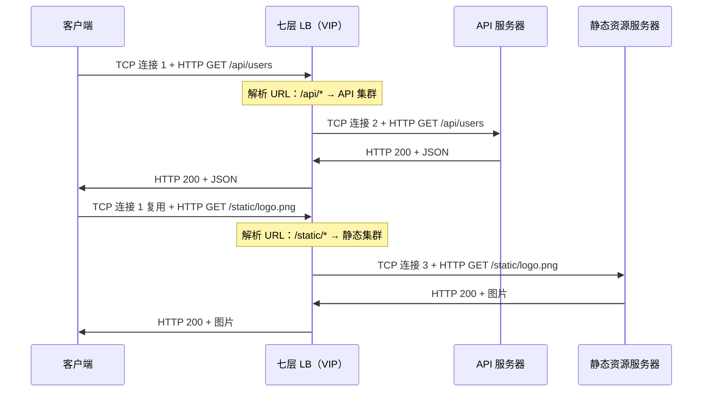
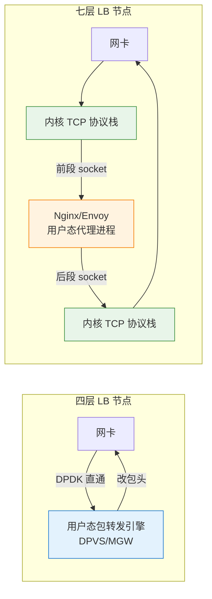
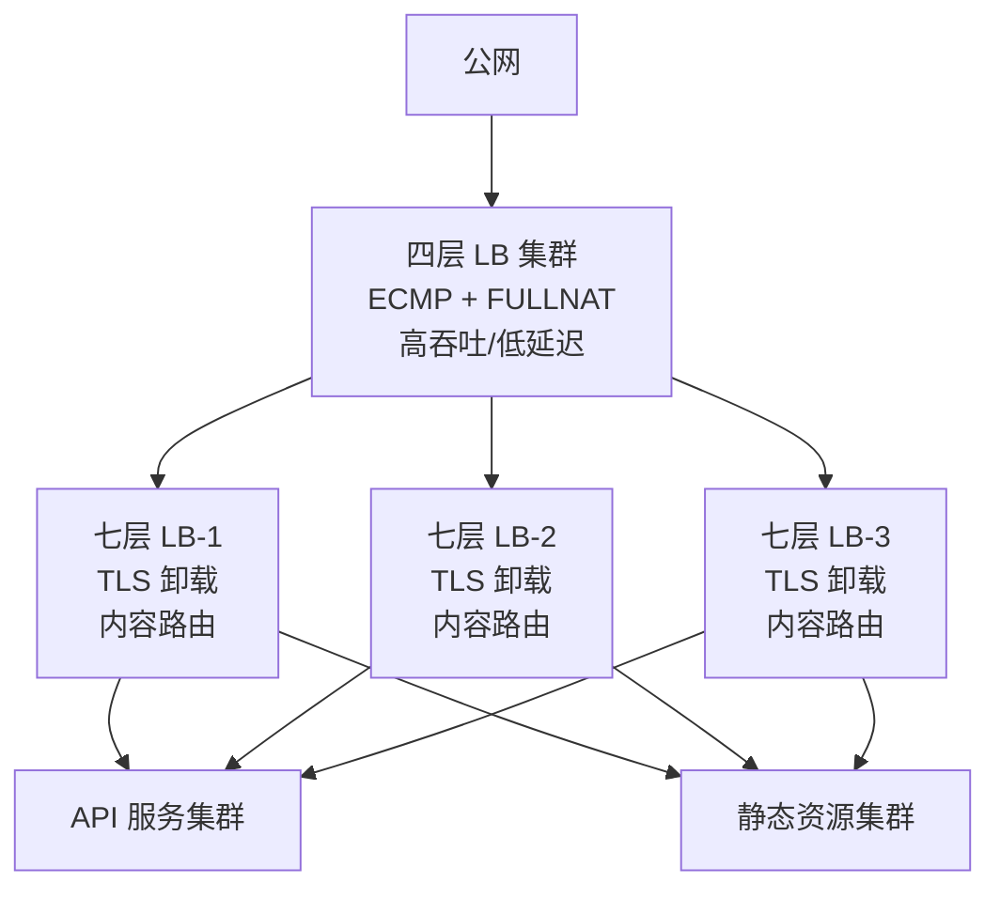

# 16. 不止转发，还要读懂请求：七层负载均衡

四层 LB 快得像分拣速度极高的快递员，他能在一秒内把包裹扔进正确的卡车，但你问他包裹里装的是什么，他一脸茫然，他从来不拆包裹，他只看运单上的收件地址。

问题是，云上入口的工作远不止按地址分拣这么简单。今天绝大多数业务都跑在 HTTP/HTTPS 上，四层 LB 看不到七层内容，自然解决不了七层的问题。

原因只有一个：它看不懂请求。要看懂请求，就得从包转发器变成读得懂 HTTP 的中间人。

## 16.1 四层的天花板：为什么必须看懂请求

四层 LB 看到的是一串带 IP 和 TCP 头的字节流，TCP 头之后的内容对它是黑盒，是 HTTP 明文？是 TLS 加密后的 record？是 gRPC 帧？它都不知道，也没有义务知道。它只需要把同一条 TCP 连接的所有包一致地送到同一台后端。

这种不拆包的态度成就了它的性能，也划死了它的能力边界。

看不到 URL，就没法按内容路由。 一个典型的 Web 服务，可能同时提供 API、静态资源、管理后台三类流量。API 需要跑在 CPU 强的机型上、静态资源该发给带磁盘缓存的机器、管理后台走单独的高安全环境。四层 LB 只认端口，它眼里所有 `:443` 的请求长得一模一样。你要么把三类服务混部到每台 VM 上（浪费、运维恶心），要么给每类服务开一个独立端口让客户端记 8001 是订单、8002 是支付（丑陋、脆弱、对外暴露架构细节）。

看不到 TLS 明文，就没法集中卸载 HTTPS。HTTPS 早就是标配，但 TLS 握手和加解密是 CPU 密集的任务。让每台后端 VM 各自处理 TLS 意味着每台都要持证书私钥、每台都要花 CPU 做加解密，这些 CPU 本该用来跑业务。四层 LB 看到的是加密后的 TCP payload，它连这个连接想访问哪个域名都得靠 SNI（TLS 握手明文里的一小段）勉强猜出来，根本无法解开 TLS 内容。

看不到请求边界，就没法做连接复用。每一条客户端 TCP 连接背后可能只发一两个请求，十万个用户就是十万条连接，四层 LB 把它们原样透传到后端，每台后端要维护几万条连接的内核状态，文件描述符、socket 缓冲区、内核 conntrack 表项，即使这些连接大部分时间空闲。四层没有请求这个概念，它只有连接，一条连接进来、一条连接出去，没有中间加工的机会。

要解决上面这些问题，只有一条路：让 LB 终结客户端的 TCP 连接、把 HTTP 请求完整读出来、看懂它、再自己去和后端起一段新连接把请求转过去。它不再是转发器，它变成了一个中间人。

## 16.2 反向代理：七层 LB 的本质是两段 TCP

七层 LB 工作在应用层，它能看懂 HTTP 请求的 URL、Header、Method、Cookie，根据这些内容做路由决策，前提是它先把 TCP 连接拆掉重来。

客户端和七层 LB 之间建立一条完整的 TCP 连接，三次握手在这两者之间完成，序列号、滑动窗口、拥塞控制全部都要承担起来。LB 从这条连接上完整读出 HTTP 请求（可能要等好几个 TCP 段拼齐），解析 URL 和 Header，根据路由规则挑一台后端 VM。然后 LB 另起一条 TCP 连接到后端 VM，把请求（可能改写过 Header）写进去；后端处理完响应，LB 从这第二条连接读出来，再从第一条连接把响应写回客户端。

两段独立的 TCP 连接，中间是一个应用层的调度器，这个转发的过程被称为**反向代理**。

> **反向代理是什么？**
>
> 反向代理（Reverse Proxy）是服务器端的代理模式。它代替后端服务器接收客户端请求，然后转发给真正处理请求的后端。客户端只和反向代理通信，不知道也不需要知道后端有几台、每台的 IP 是什么。Nginx、HAProxy、Envoy 都是常见的反向代理软件。七层 LB 本质上就是一台被产品化包装过、加了 VIP 和高可用能力的反向代理。

**图 16.1：七层 LB 的两段 TCP 连接**

两段 TCP 不是四层 FULLNAT 的加强版，它们有着本质不同。

四层 FULLNAT 只改包头，没建 socket、没跑 TCP 状态机、没有序列号重排、没有 accept 队列。整条 TCP 连接是客户端和后端 VM 之间的，LB 只是路径上偷改了地址。七层 LB 则是实打实建了两个 socket，前后两段 TCP 各有各的三次握手、各有各的滑动窗口，序列号互不相关，TCP 参数（窗口大小、拥塞算法、Keep-Alive）也可以不同。

真正建了两个 socket 是七层能力的根源，也是它慢的根源。能力上，七层可以在两段中间任意加工请求：改 Header、注入 Cookie、改路径、做认证、限流、缓存、压缩。代价上，每一条请求都要走一遍完整的用户态收发循环：网卡收包 → 内核 TCP 协议栈 → 唤醒进程 → 用户态解析 HTTP → 选后端 → 用户态发起新连接 → 再走一遍内核 TCP 协议栈 → 网卡发包。四层 LB 在内核（甚至绕开内核走 DPDK）里改改包头就完事，所以它们的性能差距不是一个量级。

两者的性能大致是：单台四层 LB 打满 DPDK 能做到几千万 PPS、几十 Gbps；单台七层 LB 走内核 TCP 加 Nginx，能到几十万到百万 QPS、几 Gbps 到十几 Gbps。差一个数量级，这是 TCP 协议栈和应用层解析的固有开销，不是软件优劣的问题。

## 16.3 Header 改写：把入口变成流量加工点

两段 TCP 建起来之后，就拥有了基于七层协议路由的能力。   

**内容路由**：LB 看得到请求行和 Header，路由表按 `Host`、`Path`、`User-Agent` 写，同一个 VIP 背后挂几十套后端，客户端只认一个入口
**TLS 卸载**：证书和私钥集中在 LB 上，加解密的 CPU 压在几十台 LB 而非几百台后端上，证书续期也集中在一处
**连接复用**：前段几万条客户端连接，后段收敛成几十条到后端的长连接反复复用，后端不必再维护几万个 socket。

上述能力在前两节已经讲清楚，不再展开。

值得单独拎出来的是第四类：**Header 改写**。它不是看懂请求的直接推论，而是七层 LB 作为中间人的独立价值。

最直接的场景是补回客户端真实 IP，FULLNAT 把源 IP 换成了 LB 的内部 IP，后端看不到客户端是谁。七层 LB 有个天然的补救办法：在 Header 里塞一个 `X-Forwarded-For`，把客户端真实 IP 写进去。后端应用读这个 Header 就能拿到真实 IP，用于访问日志、地域判断、风控。同一类还有 `X-Real-IP`、`X-Forwarded-Proto`、`X-Forwarded-Host`，这套约定俗成的 Header 是七层入口和后端应用之间的元数据通道。

Header 改写再往上一层就是通用的请求加工：路径重写（`/api/v1/users` → `/users`）、Host 改写（对内多个域名对外统一）、注入认证信息（把 API Key 换成用户 ID 再交给后端）、透传 trace ID。入口层不再只是分发器，而是流量加工点。

这一步看似不大，却构建起了下一节的全部能力：灰度、限流、WAF，本质都是读一段请求、改一段请求、决定要不要放行。

## 16.4 灰度、限流与 WAF：入口是流量治理的天然落点

上面四类能力是通用中间人都有的能力，再往前一步，七层 LB 就成了整个业务流量治理的入口。灰度发布、限流、Web 应用防火墙都天然落在这里。

**灰度发布**：金丝雀部署最典型的做法：新版本先放 5% 的流量试跑，观察一天没问题再放到 20%、50%、100%。这个 5% 怎么切？可以按用户 ID 的 hash（同一个用户永远命中同一个版本，避免同一个人一会看到新版一会看到旧版）、可以按 Header 打标（内部员工先看新版）、可以按地域切分（灰度先只放上海）。这些规则都在 HTTP 请求的 Header、Cookie、Path 里能找到依据。七层 LB 把这些依据读出来、匹配规则、决定路由到新版集群还是旧版集群。四层做不到这件事

**限流**：四层能做的限流只有一种：按客户端 IP 限连接数或包速率。这在移动网络和 NAT 后面的用户面前基本失效：同一个出口 IP 后面可能是几万个真实用户，按 IP 限流要么误杀正常用户要么放过恶意流量。七层能按 URL 限（`/api/expensive` 每秒只允许 100 次）、按 UserID 限（每个用户每分钟 60 次）、按 API Key 限（付费用户 1000 QPS、免费用户 10 QPS）。

**Web 应用防火墙（WAF）**。SQL 注入、XSS、路径遍历、恶意扫描这些攻击的特征全在请求内容里：URL 参数、POST body、Cookie 值，WAF 把 HTTP 请求解出来之后按规则库匹配。生产环境里，WAF 通常作为七层 LB 的一个内嵌模块或者独立的一层挂在七层 LB 前面。

这三类能力的共同点，用一句话概括：**流量治理的粒度是请求，不是包**。四层的处理单元是包，它天然做不到请求粒度的策略。这也解释了一个工程现实：现代云上的入口体系里，四层 LB 通常只做扛量 + 初步分发，真正的业务治理层永远压在七层 LB（或者更泛化的API 网关）上。

## 16.5 七层 LB 在哪里：数据面视角

七层 LB 集群和四层同样**长在 Underlay 上**，也是一组通用服务器，也通过 VPC 路由表把 VIP 指向它们。从集群拓扑位置这个角度看，四层和七层没差别。

差别全在**这台机器里到底跑什么**。

四层 LB 里跑的是 DPVS/MGW 这类**内核旁路的高性能包转发引擎**：网卡通过 DPDK 直接把包搬到用户态、绕开内核 TCP 协议栈、在用户态查 conntrack 表、修改包头、再把包 DMA 回网卡。整条路径没有 socket、没有系统调用、没有上下文切换，一个 CPU 核就能处理几百万 PPS。

七层 LB 里跑的是 Nginx、HAProxy、Envoy 这类**用户态的 HTTP 反向代理进程**：网卡收包 → 内核 TCP 协议栈组包 → epoll 唤醒 → 用户态读 socket → 解析 HTTP → 选后端 → 用户态发起新 socket connect → 又走一遍内核 TCP 协议栈 → 网卡发包。每一条请求都要走完这个循环。近几年也有把七层 LB 部分放到用户态 TCP 栈或者 XDP 上做加速的尝试，但主流仍然是内核 TCP + 用户态 HTTP这套架构。

**图 16.2：四层 LB 和七层 LB 的机器内部对比**

再来看**封包路径**。七层 LB 在 Overlay 上的进出方式和四层一致：

- **前段（客户端 → 七层 LB）**：客户端母机 vSwitch 或公网边界，把包封 VXLAN 送到七层 LB 节点的 Underlay 地址。到七层 LB 节点这一跳，包被解 VXLAN、按 VNI 归属到对应的 VPC，然后**进入内核 TCP 协议栈组包**，最终以完整的 HTTP 请求形式交给 Nginx。前段 TCP 的对端是客户端，源目 IP 是客户端 IP ↔ VIP。
- **后段（七层 LB → 后端 VM）**：Nginx 决定后端之后，向后端 VM 的 IP 发起一个**新的 TCP 连接**。这条连接从七层 LB 节点视角看，源 IP 是 LB 自己的 local IP、目的 IP 是后端 VM 的 IP。这个包走出七层 LB 节点时，先由本机的 VPC 网络逻辑封 VXLAN（外层目的是后端 VM 母机的 Underlay 地址），投出去。

**两段 TCP 独立、两次 VXLAN 封装独立**。七层 LB 节点自己既扮演VXLAN 隧道对端（收前段包），又扮演VXLAN 隧道起点（发后段包），它是完全独立的两端。

## 16.6 七层的健康检查与会话保持

四层健康检查的边界很清楚：TCP 三次握手能通，只能说明 VM 的操作系统还活着、端口还在监听，不代表应用能真正处理请求。七层 LB 把健康检查抬到应用层：**发一个 HTTP GET /health**，看返回状态码和响应体。返回 200 且响应体符合预期，认为健康；返回 503 或超时，认为不健康。

`/health` 接口通常是后端应用自己实现的，它能反映应用的真实状态：数据库连接是否可用、依赖服务是否可达、内存是否吃紧。这些应用活着但功能坏了的情况，只有应用自己知道，也只有应用自己能通过 `/health` 汇报出来。

一个常见的坑是把 `/health` 写得太重：顺便查一遍数据库、Redis、下游服务，结果健康检查本身把后端压垮了。健康检查该测的是这台实例的关键路径是否通，不是整个系统所有依赖是否全绿，后者是监控该做的事。

**会话保持**在七层也比四层做得更细。四层只能按源 IP 哈希，同一个客户端 IP 落到同一台后端。这在移动互联网和 NAT 后面的世界里越来越不靠谱：一个企业 NAT 出口后面几万个人共享同一个源 IP，按源 IP 哈希意味着这几万人的会话全压在一台后端上，均衡完全失效。

七层可以按更精确的维度做会话保持：**基于 Cookie 的会话保持**。第一次请求进来时 LB 选一台后端，然后在响应里注入一个 Cookie（比如 `SESSIONID=lb-node-3`）写回客户端；后续请求带着这个 Cookie 过来，LB 直接读 Cookie 就知道该发给哪台后端。哈希的对象从IP变成了会话，粒度是单个用户浏览器或客户端，不再受 NAT 出口聚合的影响。

Cookie 保持又分两种子做法：LB 生成一个新 Cookie（`insert` 模式），或者复用应用自己的 SessionID Cookie（`rewrite` 模式）。前者对应用完全透明，后者对应用有约定要求，但更贴合应用侧的会话概念。生产上大多用 insert 模式，简单可控。

会话保持不是没有代价的，它牺牲了负载均衡的简单性，因为需要记录Cookie缓存而持有状态。理想的架构是把会话状态外置到 Redis 之类的共享存储，让后端本身无状态、请求可以随便打到任一台。

## 16.7 四层与七层的协同

四层和七层的分工到这里已经很清楚了。**四层扛量，七层扛复杂度**。生产环境几乎总是将两者串在一起用。

典型的分层架构是这样的：公网流量先经过四层 LB 集群，四层 LB 只做 FULLNAT + ECMP 分发，把流量均匀撒到一组七层 LB 实例上；七层 LB 做 TLS 卸载、内容路由、Header 改写，再把请求发给真正的后端服务集群。

**图 16.3：四层与七层的分层协同**

单台七层 LB 打满也就百万 QPS 上下、十几 Gbps 带宽，公网入口动辄几十万 QPS 到几百万 QPS，单实例撑不下来。必须多实例横向铺开，而多实例又必须有一层前置的分发，四层 LB 用 ECMP + FULLNAT 天然适合这个角色。

四层是保安处的门禁，只看你有没有票、把你分到哪个入口；七层是入场后的接待员，看你要办什么业务、送你到哪个柜台。云厂商的产品名字也照着这个分工走：NLB（Network Load Balancer）大致对应四层，ALB（Application Load Balancer）大致对应七层；老一代的 CLB（Classic Load Balancer）两个都能干，但底层依然是分层实现的。

到这里，从用户只知道一个 IP 到一群 VM 协同扛住海量请求的完整链路就走通了。**四层给规模、七层给智能，两者串起来才是云上入口的真实形态**。

至此，卷四走出围墙的系列故事讲完了。NAT 网关让 VM 能出去，EIP 让 VM 能被找到，四层 LB 让服务能扛住量，七层 LB 让服务能读懂请求。VPC 里的机器不再是被围墙关住的孤岛，它有了对外的出口、对外的身份、对外的服务能力。

但这一切都发生在一个 VPC 内部，生产环境里企业的业务从来不会只住在一个 VPC 里：安全团队要求生产环境和开发环境隔离，合规要求金融数据和普通业务分开，不同 BU 各自管理自己的网络，收购来的公司带着自己整套 VPC 加入进来。你有几十个 VPC、几百个 VPC，各自都是围墙花园，各自都对外能通公网，但它们之间彼此看不见对方。

同一个云账号下的两个 VPC，逻辑上就在同一个数据中心、物理上可能就在同一台机架，但它们要通信却只能绕一大圈走公网。这显然不对，围墙之间需要一种直接的互通能力。
