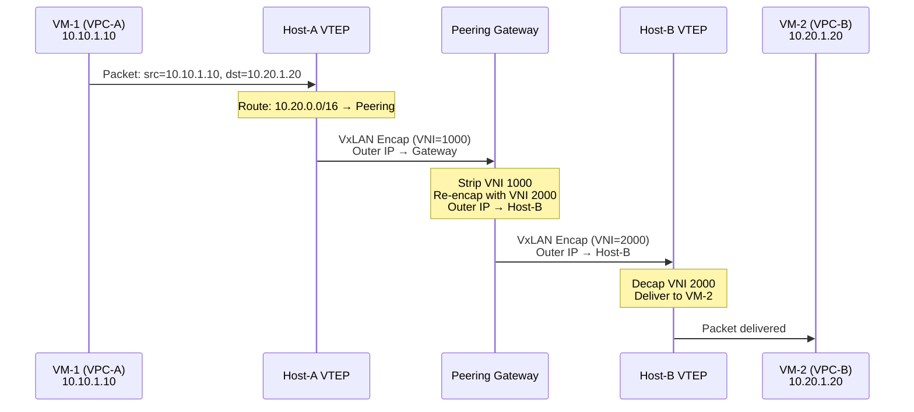
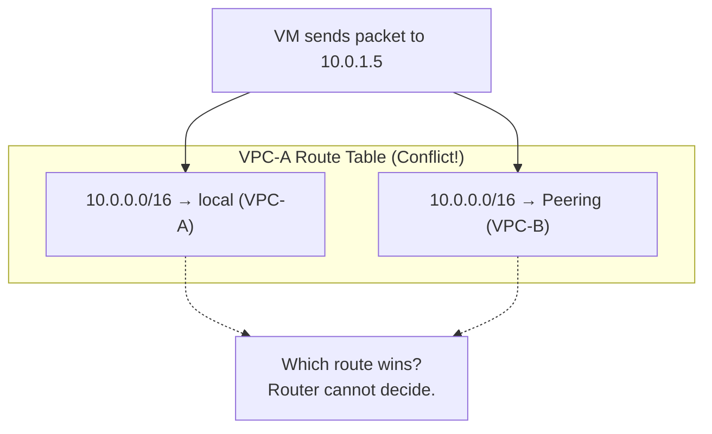
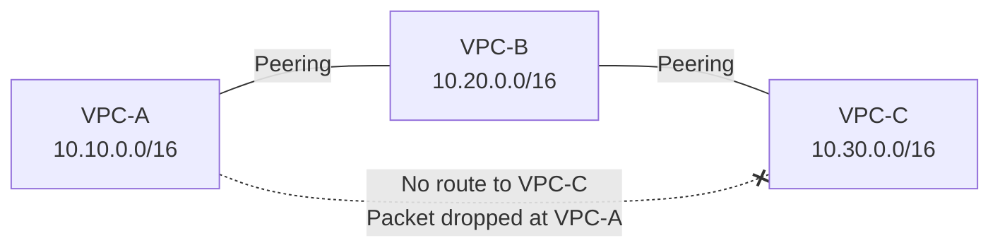

# 16. 两个 VPC 之间拉一条线：对等连接

当安全团队要求生产环境和开发环境隔离，当合规要求金融数据和普通业务数据分开，不同部门各自管理自己的网络。于是你有了五个 VPC。某天，生产 VPC 里的 Web 服务需要调用数据 VPC 里的分析接口，两个 VPC 的 VM 都用私有 IP，但彼此的路由表里根本没有对方的路由条目，包该怎么发出去？

隔离是你亲手建起来的。现在你需要在隔离的墙上开一扇门，还不能把墙拆了。

## 16.1 隔离的副作用：VPC 之间天然不通

一个具体的场景：公司有两个部门。业务部门的 VPC-A 运行着 Web 服务，数据部门的 VPC-B 运行着数据分析平台。Web 服务需要把日志推送到数据分析平台。VPC-A 里的 VM 发出一个包，目的 IP 是 VPC-B 的私有地址 10.20.1.5。

这个包在 VPC-A 内部就被丢弃了。

不是因为配置错误，不是因为安全组拦截，而是 VPC-A 的路由表里根本没有 10.20.0.0/16 这条路由。VPC-A 的路由表只知道自己的子网：10.10.0.0/16 走本地，0.0.0.0/0 走 NAT 网关。10.20.0.0/16 对 VPC-A 来说，是一个完全不存在的网络。

这正是第5到第7章构建的隔离体系在发挥作用。不同 VPC 使用不同的 VxLAN VNI，路由表互相独立，控制面不会把 VPC-B 的路由下发到 VPC-A 的宿主机上。VPC 之间不通不是 bug，是 feature，隔离机制的必然结果。

那绕道公网呢？VPC-A 的 VM 通过 NAT 网关出公网，VPC-B 的 VM 通过 EIP 暴露服务，两者通过公网通信。技术上可行，但有三个问题：流量绕了一大圈，延迟高；走公网要付流量费，成本高；数据在公网上传输，安全风险大。两个 VPC 可能就在同一个数据中心的同一排机架上，让它们的流量绕到公网再回来，这就像你和邻居住在同一层楼，但要通过快递公司互相寄信，怎么想都不对。

一个更合理的想法是：既然两个 VPC 的路由表互不可见，那能不能手动在 VPC-A 的路由表里加一条静态路由，指向 VPC-B 的地址段？方向是对的，走内网、通过路由打通。但问题在于：VPC-A 的路由表是 SDN 控制面管理的，用户能添加的路由条目的"下一跳"只能是 VPC-A 内部已知的网络实体，子网、NAT 网关、VPN 网关。VPC-B 对 VPC-A 来说是一个完全不存在的网络，路由表里没有任何指向 VPC-B 的出口。

手动加路由的想法缺少一个关键的东西：一个连接两个 VPC 的"通道"，以及让控制面自动把对方的路由注入进来的机制。

矛盾浮出来了。隔离是必要的，不同部门的网络不应该默认互通。但完全不通也不行，业务确实需要跨 VPC 访问。需要一种"可控的打通"：只在两个 VPC 之间建立特定的连接，而不是破坏隔离的整体性。而且这种打通需要自动化，VPC 内部的 VM 频繁创建和销毁，手动维护路由根本不可行。拥有这种能力的云产品叫做：对等连接。

## 16.2 对等连接：让两个 VPC 的路由表互相可见

用户在控制台上选择 VPC-A 和 VPC-B，创建一条对等连接。创建完成后，VPC-A 里的 VM 可以用 VPC-B 的私有 IP 直接访问 VPC-B 里的 VM，反之亦然。就像两个 VPC 在同一个网络里一样。

那底层发生了什么呢？

控制面把 VPC-B 的 CIDR（10.20.0.0/16）注入到 VPC-A 的路由表中，下一跳指向对等连接。反向同理，VPC-A 的 CIDR（10.10.0.0/16）也被注入到 VPC-B 的路由表中。宿主机上的转发表随之更新，当 VPC-A 的宿主机收到目的地为 10.20.0.0/16 的包时，知道应该通过隧道送到 VPC-B 的对应宿主机。

**图 16.1：对等连接建立前后的路由表变化**

```
Before Peering:

VPC-A Route Table:              VPC-B Route Table:
┌──────────────┬──────────┐     ┌──────────────┬──────────┐
│ Destination  │ Next Hop │     │ Destination  │ Next Hop │
├──────────────┼──────────┤     ├──────────────┼──────────┤
│ 10.10.0.0/16 │ local    │     │ 10.20.0.0/16 │ local    │
│ 0.0.0.0/0    │ NAT GW   │     │ 0.0.0.0/0    │ NAT GW   │
└──────────────┴──────────┘     └──────────────┴──────────┘

After Peering:

VPC-A Route Table:              VPC-B Route Table:
┌──────────────┬──────────┐     ┌──────────────┬──────────┐
│ Destination  │ Next Hop │     │ Destination  │ Next Hop │
├──────────────┼──────────┤     ├──────────────┼──────────┤
│ 10.10.0.0/16 │ local    │     │ 10.20.0.0/16 │ local    │
│ 10.20.0.0/16 │ Peering  │     │ 10.10.0.0/16 │ Peering  │
│ 0.0.0.0/0    │ NAT GW   │     │ 0.0.0.0/0    │ NAT GW   │
└──────────────┴──────────┘     └──────────────┴──────────┘
```

一句话概括：对等连接做的事情就是在两个 VPC 的路由表之间架一座桥，让彼此的地址段互相可达。

控制面讲清楚了，数据面呢？VPC-A 的 VM-1 发一个包给 VPC-B 的 VM-2，这个包具体怎么走？

回忆第8、9章的内容：VPC 内部通信时，源宿主机的 VTEP 封装 VxLAN 包，外层 IP 指向目的宿主机，物理网络按标准三层路由把包送过去，目的宿主机的 VTEP 解封装后交给 VM。整个过程中，源和目的 VTEP 属于同一个 VPC 的 VNI 域——封装时填的 VNI 是同一个值，两端都认识。

对等连接的情况不同。VPC-A 和 VPC-B 是两个独立的 VPC，使用不同的 VNI。VPC-A 的 VNI 是 1000，VPC-B 的 VNI 是 2000。包从 VPC-A 的 VNI 域发出，要到达 VPC-B 的 VNI 域——中间需要一次 VNI 的转换。这个转换在哪里做，决定了数据面的架构。

**模式一：通过对等连接网关转发。** 云厂商在数据中心内部署专门的对等连接网关（Peering Gateway），这是一组高性能的网络设备（可以是物理设备，也可以是运行在专用服务器上的软件）。VPC-A 的宿主机把包封装成 VxLAN，外层 IP 指向对等连接网关，VNI 填 VPC-A 的 VNI（1000）。网关收到包后，剥掉 VPC-A 的 VxLAN 头，查对等连接的映射表，重新用 VPC-B 的 VNI（2000）封装，外层 IP 指向 VPC-B 中目的 VM 所在的宿主机，然后发出去。VPC-B 的宿主机收到包后，正常解封装交给 VM-2。

**图 16.1a：通过对等连接网关的数据路径**



这种模式下，对等连接网关是中间设备，所有跨 VPC 的流量都要经过它。网关承担了 VNI 转换的职责——它是两个 VNI 域之间的"翻译官"。

**模式二：宿主机直接转发。** 控制面在建立对等连接时，直接把 VPC-B 的 VM 位置信息（哪台 VM 在哪台宿主机上）下发到 VPC-A 的宿主机。VPC-A 的宿主机封装 VxLAN 包时，外层 IP 直接指向 VPC-B 中目的 VM 所在的宿主机，VNI 填 VPC-B 的 VNI（2000）——源宿主机直接用对端 VPC 的 VNI 封装，不需要中间网关做转换。VPC-B 的宿主机收到包后，看到 VNI 2000，正常解封装交给 VM-2。

这种模式下没有中间设备，宿主机之间点对点直连，延迟最低。但它要求控制面把跨 VPC 的转发信息下发到每台宿主机——控制面的复杂度更高。

两种模式各有取舍。网关模式的控制面更简单（宿主机只需要知道"跨 VPC 的包发给网关"），但数据面多一跳；直连模式的数据面更高效（宿主机直接把包送到对端），但控制面需要维护跨 VPC 的完整映射。实际的云厂商可能采用其中一种，也可能根据场景混合使用——同可用区内走直连，跨可用区走网关。具体实现因厂商而异，但无论哪种模式，本质上都是在解决同一个问题：**把包从一个 VNI 域送到另一个 VNI 域。**

有两个细节值得注意：

第一，用户可见的路由传播粒度是 CIDR 级别。VPC-A 的路由表里显示的是"10.20.0.0/16 → Peering"，不是逐条 VM 的路由。但这只是用户视角的抽象——底层实现中，无论是网关模式还是直连模式，包都是直接送到 VPC-B 中目的 VM 所在的宿主机，不存在一个"VPC-B 的边界"做二次路由。网关模式下，网关查映射表知道 VM-2 在哪台宿主机；直连模式下，VPC-A 的宿主机本身就持有这个映射。CIDR 级别的路由是给用户看的简化视图，底层的转发精度是宿主机级别的。

第二，安全组仍然生效。对等连接打通了路由，但不绕过安全组。VPC-B 的 VM 仍然受自己的安全组规则保护，如果安全组没有放行来自 10.10.0.0/16 的流量，包到了 VM 门口也会被拦住。对等连接只是让包能到达 VPC-B 的边界，进入之后的访问控制不变。

这是一个重要的设计原则：**路由可达不等于访问允许。** 对等连接解决的是"包能不能送到"的问题，安全组解决的是"包到了之后让不让进"的问题。两者是不同层次的控制，互不干扰。

还有一个容易被忽视的工程细节：对等连接可以跨账号。VPC-A 属于账号 X，VPC-B 属于账号 Y，X 发起对等连接请求，Y 确认接受，连接建立。这意味着对等连接不仅是技术上的路由打通，还是组织上的信任建立。在大型企业中，不同部门使用不同的云账号管理各自的资源，跨账号对等连接是它们协作的基础设施。但这也引入了一个管理挑战：谁有权发起连接？谁有权接受？如果 A 部门的实习生不小心接受了一个来自未知账号的对等连接请求，整个 VPC 的私有网络就对外敞开了。*权限管理的疏忽，往往比技术漏洞更致命。*

对等连接的带宽特性也值得一提。同 Region 内的对等连接通常没有额外的带宽限制，流量走的是云厂商内部的骨干网络，带宽上限取决于 VM 本身的网络规格。但跨 Region 的对等连接（如果云厂商支持的话）则受限于 Region 之间的骨干带宽，而且通常需要额外付费。这个区别在架构设计时很重要：同 Region 内的 VPC 互联几乎是"免费"的，但跨 Region 的互联成本可能很高。

## 16.3 CIDR 不能重叠：对等连接的第一道硬墙

对等连接看起来很简单，两个 VPC 之间拉一条线，路由互相注入，就通了。但它有一个根本性的限制，不是产品的"缺点"，而是 IP 路由模型的硬约束。

假设 VPC-A 的 CIDR 是 10.0.0.0/16，VPC-B 的 CIDR 也是 10.0.0.0/16。如果建立对等连接，VPC-A 的路由表里就会出现两条 10.0.0.0/16 的路由，一条指向本地（VPC-A 自己的子网），一条指向对等连接（VPC-B）。当 VPC-A 的 VM 发出一个包，目的 IP 是 10.0.1.5，路由表无法判断这个地址是 VPC-A 内部的 VM 还是 VPC-B 的 VM，两条路由的前缀完全相同，匹配结果是矛盾的。

这不是实现层面的限制，而是 IP 路由的根本约束：路由表通过目的 IP 的前缀匹配来做转发决策，当两个前缀完全相同时，路由表在逻辑上就是自相矛盾的。

部分重叠也不行，而且更隐蔽。VPC-A 是 10.0.0.0/16，VPC-B 是 10.0.1.0/24。VPC-B 的地址段是 VPC-A 的子集。路由表虽然可以通过最长前缀匹配区分（/24 比 /16 更具体），但这会导致 VPC-A 内部 10.0.1.0/24 这个子网的流量被错误地导向对等连接，本来应该送到 VPC-A 内部的 VM，却被送到了 VPC-B。部分重叠的情况比完全重叠更危险，因为它不会在创建时报错，而是在运行时悄悄把流量导错方向。

**图 16.2：CIDR 重叠导致的路由歧义**



现实中的困境是：很多企业在创建 VPC 时没有做全局地址规划。不同部门各自选了 10.0.0.0/16 或 172.16.0.0/12 这样的常见地址段，RFC 1918 定义的私有地址空间就那么大，撞车的概率远比你想象的高。等到需要互通时才发现地址冲突，但重新规划地址意味着所有 VM 的 IP 都要变，在生产环境中，这几乎等于重建整个网络。

地址冲突的问题在路由层面无解——记住这个结论，它会贯穿后面几章。

## 16.4 不可传递性：对等连接的第二道硬墙

VPC-A 和 VPC-B 建立了对等连接，VPC-B 和 VPC-C 也建立了对等连接。VPC-A 的 VM 想访问 VPC-C 的 VM。直觉上，包可以从 A 到 B，再从 B 到 C，就像你从北京飞上海，再从上海飞广州一样。

但实际上，VPC-A 的路由表里只有 VPC-B 的路由，没有 VPC-C 的路由。包的目的 IP 是 VPC-C 的地址，VPC-A 的路由表里没有匹配项，包在 VPC-A 就被丢弃了，根本到不了 VPC-B。

**图 16.3：对等连接的不可传递性**



```
VPC-A Route Table:
┌──────────────┬──────────┐
│ Destination  │ Next Hop │
├──────────────┼──────────┤
│ 10.10.0.0/16 │ local    │
│ 10.20.0.0/16 │ Peering  │  ← Only VPC-B, no VPC-C
│ 0.0.0.0/0    │ NAT GW   │
└──────────────┴──────────┘

Packet to 10.30.1.5 → No matching route → Dropped
```

为什么不可传递？对等连接只在两个 VPC 之间传播路由，不会把第三方的路由"转发"出去。VPC-B 虽然知道 VPC-C 的路由（10.30.0.0/16），但它不会把这条路由传播给 VPC-A。

这是一个有意的设计决策，不是实现上的疏忽。

对等连接是双方显式授权的行为：A 和 B 都同意建立连接，才能互通。如果可传递性自动让 A-C 互通，那么 C 从未授权过 A 的访问，这违反了最小权限原则。在云环境中，不同 VPC 可能属于不同的账号、不同的组织。VPC-C 的管理员可能根本不知道 VPC-A 的存在，却发现自己的网络对 A 敞开了大门，这是严重的安全风险。

可传递性还会让网络拓扑变得不可预测。如果 B 和 D 也建了对等连接，那 A 是否也自动能访问 D？如果 D 和 E 也建了对等连接呢？一条对等连接的建立，可能导致整个 VPC 网络的可达性发生连锁变化，没有人能预测最终的拓扑是什么样的。*牵一发而动全身，在安全领域，这是不可接受的。*

如果强行要 A-C 互通，必须在 A 和 C 之间再建一条对等连接。三个 VPC 全互通需要 3 条对等连接（A-B、B-C、A-C）。

问题开始显现了。我们来算一笔账：

- 3 个 VPC 全互通：3 条对等连接
- 5 个 VPC 全互通：10 条
- 10 个 VPC 全互通：45 条
- 30 个 VPC 全互通：435 条
- 100 个 VPC 全互通：4950 条

对等连接的数量按 N×(N-1)/2 增长。这不是线性增长，它是平方级的。而且每条对等连接需要双方确认、配置路由、维护状态。新增一个 VPC 时，需要和已有的所有 VPC 各建一条对等连接。当 VPC 数量超过两位数，运维团队花在维护对等连接上的时间可能比写业务代码还多。

更要命的是运维的认知负担。当你有 30 个 VPC 和 435 条对等连接时，某天一条连接出了问题，你需要在 435 条连接中定位是哪一条，然后判断它影响了哪些 VPC 之间的通信。没有一个中心化的视图让你看到全局拓扑，每条连接都是独立的、双边的、分散的。这就像一个没有组织架构的公司，每个人都和每个人直接沟通，看起来很"扁平"，实际上混乱不堪。

不可传递性保护了安全，但也制造了管理上的噩梦。这两个目标之间的张力，是对等连接架构的根本矛盾。

## 16.5 对等连接的适用边界

对等连接不是一个"不好"的方案，它是一个有明确适用边界的方案。

它适合的场景是：少量 VPC 之间的固定互联关系。生产 VPC 和管理 VPC 之间、同一业务的前端 VPC 和后端 VPC 之间，VPC 数量少（个位数），互联关系稳定，不经常变化。在这个范围内，对等连接简单、直接、高效。

它有一个常被忽视的优势：**延迟低**。如 16.2 节所述，对等连接在直连模式下，VPC-A 的宿主机通过隧道直接把包送到 VPC-B 的宿主机，中间没有额外的转发跳数；即使在网关模式下，对等连接网关通常部署在同数据中心内，额外延迟也很小。这个特性在后面会变得重要，当我们看到"总线式"方案时，会发现它虽然管理简单，但流量要多走一跳。对于延迟极度敏感的场景（比如数据库主从同步、实时交易系统），对等连接的直连路径可能是更好的选择。

它不适合的场景也很清楚：大量 VPC 需要互通（几十个甚至上百个）、互联关系频繁变化、需要统一的路由策略管理。在这些场景下，N² 的管理复杂度和缺乏集中控制的问题会迅速放大。

对等连接是"点对点"的思维模型。当网络拓扑从"几个点"变成"几十个点"时，点对点的管理方式就崩溃了，就像一个十人团队可以靠口头沟通协作，但一个千人团队必须有组织架构和流程。

这里有一个更深层的工程洞察：对等连接的困境不是"这个产品不好"，而是"点对点拓扑在规模上的天然缺陷"。同样的模式在计算机科学中反复出现：早期的互联网是点对点的专线连接，后来演化成分组交换网络；早期的微服务是点对点的 API 调用，后来演化成消息总线。每当节点数超过某个阈值，点对点就会被"总线"或"中心节点"取代，这几乎是分布式系统的定律。
