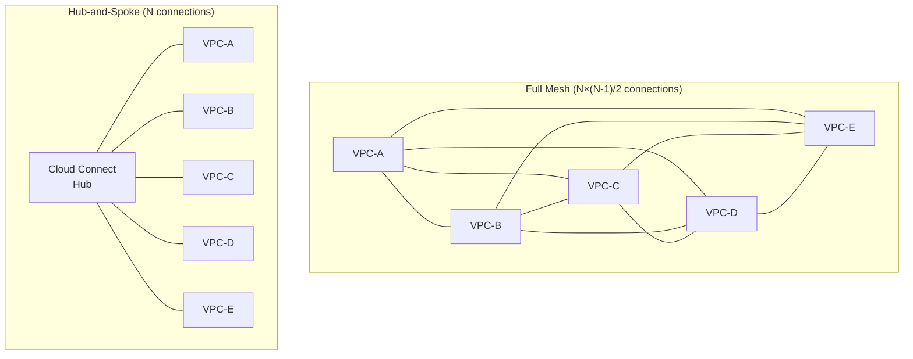
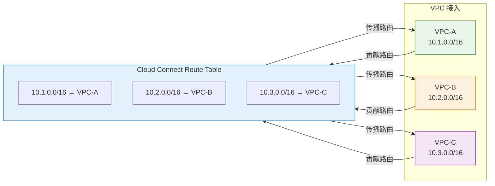
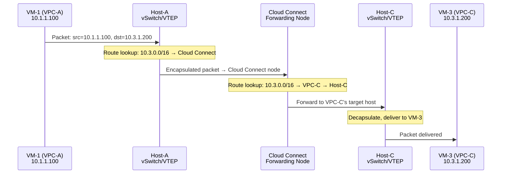
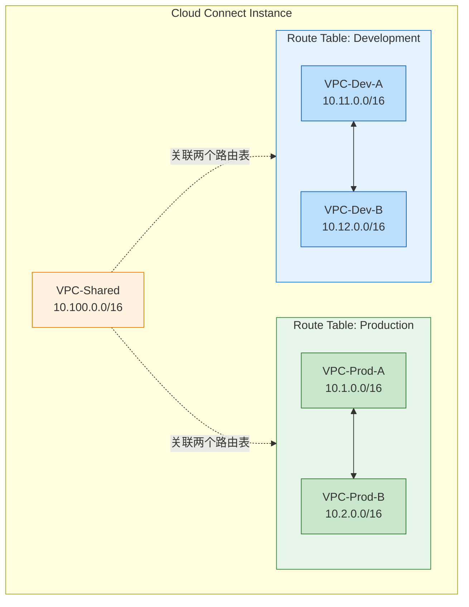
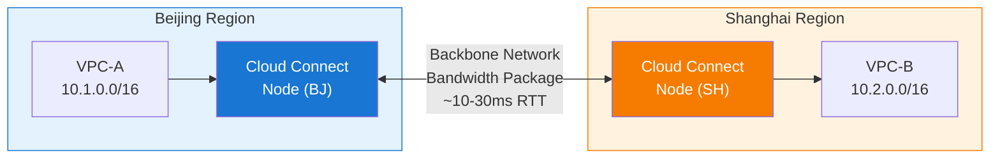

# 17. VPC 互联的总线：云联网

对等连接是点对点模型，VPC 数量超过个位数就会失控。规模变了，工具也该变了。

## 17.1 星型拓扑：用一个中心节点替代全网格

解法很自然：如果有一个"中心节点"，所有 VPC 都只和这个中心节点建立连接，VPC 之间的流量通过中心节点转发，30 个 VPC 只需要 30 条连接，新增一个 VPC 只需要 1 条新配置。管理复杂度从 N² 降到 N。

**图 17.1：全网格 vs 星型拓扑**

这个拓扑有一个名字：星型拓扑（Hub-and-Spoke）。中心节点是 Hub，每个 VPC 是 Spoke。这正是云联网（或者 AWS 叫 Transit Gateway）的架构本质，它不是一条更粗的管道，而是一个路由交换平台。如果把对等连接比作每两个人之间拉一根电话线，那云联网就是装了一台交换机，所有人都接到交换机上，任意两人都能通话，但不需要 N² 根线。

但在为这个方案叫好之前，先记住一个代价：星型拓扑意味着所有流量都要经过中心节点，比对等连接的点对点直连多了一跳。上一章提到的延迟优势，正是总线方案要付出的代价。管理简单性和数据路径效率之间，存在一个不可回避的权衡。

## 17.2 云联网的路由传播：所有 VPC 共享一张路由表

用户把 VPC-A、VPC-B、VPC-C 接入同一个云联网实例。接入的动作本质上是：把每个 VPC 的 CIDR 路由注入到云联网的路由表中。

VPC-A 接入后，云联网学到了 VPC-A 的 CIDR（比如 10.1.0.0/16）。这条路由会被自动传播给所有其他已接入的 VPC。VPC-B 和 VPC-C 的路由表中会出现一条新路由：10.1.0.0/16 → 云联网。反向同理，VPC-A 也会学到 VPC-B 和 VPC-C 的路由。

**图 17.2：云联网的路由自动传播**

> 每个 VPC 接入时贡献自己的路由，同时学到其他所有 VPC 的路由。VPC-A 的路由表中会自动出现：`10.2.0.0/16 → Cloud Connect`、`10.3.0.0/16 → Cloud Connect`。

和对等连接的对比很直观：对等连接需要在每对 VPC 之间手动建立路由关系；云联网只需要把 VPC 接入，路由自动传播。新增一个 VPC-D 时，只需要把它接入云联网，它的路由自动传播给 A/B/C，A/B/C 的路由也自动传播给 D。一次操作，全网生效。

云联网的控制面做的核心工作就是：维护一张全局路由表，每个 VPC 接入时把自己的路由贡献进来，同时学到其他所有 VPC 的路由。这和第5章讲的 VxLAN 控制面有异曲同工之处，控制面预先知道所有的路由信息，数据面不需要自己去"发现"。

但有一个约束不会因为换了架构就消失：CIDR 不能重叠。两个相同前缀的路由注入到同一张路由表中，云联网会在接入时直接拒绝。这个约束的原因和影响在 16.3 节已经详细分析过。

当云联网中存在多条到达同一目的地的路由时（比如通过不同的路径），需要路由优先级来决定走哪条。云联网通常支持设置路由优先级，让管理员控制流量的首选路径，这在后面讲到跨地域互联和专线接入时会变得重要。

## 17.3 数据面：包通过云联网怎么走

控制面解决了"路由怎么传播"的问题。数据面要解决的是"包怎么走"。

一个具体的包：VPC-A 的 VM-1（IP: 10.1.1.100）要访问 VPC-C 的 VM-3（IP: 10.3.1.200）。VM-1 发出的包，源 IP 是 10.1.1.100，目的 IP 是 10.3.1.200。

**图 17.3：包通过云联网的转发路径**

第一步，VPC-A 的宿主机查路由表，发现 10.3.0.0/16 的下一跳是云联网。包被封装后送到云联网的转发节点。

第二步，云联网的转发节点收到包后，查自己的路由表，发现 10.3.0.0/16 属于 VPC-C，把包转发到 VPC-C 的对应宿主机。

第三步，包进入 VPC-C 后，按照 VPC-C 内部的路由体系送到 VM-3。

和对等连接的路径对比：对等连接是 VPC-A 的宿主机直接通过隧道把包送到 VPC-C 的宿主机，中间不经过额外节点，两跳。云联网多了一个"云联网转发节点"，三跳。

这一跳的延迟有多大？同 Region 内，云联网转发节点通常部署在每个可用区，转发延迟在亚毫秒级，对绝大多数应用来说感知不到。但在跨地域场景下，这一跳可能意味着包要先到达本地的云联网节点，再通过骨干网送到远端的云联网节点，最后到达目的 VPC，延迟的增加会更明显。

云联网的转发节点可以是分布式的（每个可用区有转发节点），也可以是集中式的。分布式部署可以减少同 Region 内的延迟，但增加了控制面的复杂度，路由表需要在所有转发节点之间保持同步。管理简单性、数据路径效率、控制面复杂度，三者之间总要有所取舍，鱼与熊掌不可兼得。

## 17.4 路由隔离与互通策略

云联网默认让所有接入的 VPC 互相可达，VPC-A 接入后，自动能访问 VPC-B、VPC-C、VPC-D。这在很多场景下是期望的行为。

但不是所有场景。

开发环境的 VPC 不应该能访问生产环境的 VPC，一个测试脚本误连生产数据库的后果，任何经历过的人都不想再经历第二次。（如果你没经历过，恭喜你）合作伙伴的 VPC 接入了云联网，但只应该能访问特定的服务 VPC，不应该能访问其他业务 VPC。不同业务线之间需要网络隔离，但共享服务（比如日志平台、监控系统）需要被所有业务线访问。

云联网提供了路由表级别的隔离能力。

**图 17.4：云联网的路由表隔离**

> 绿色 = 生产路由表（Prod VPC 互通），蓝色 = 开发路由表（Dev VPC 互通），橙色 = 共享服务 VPC（同时关联两个路由表）。Prod 和 Dev 之间**不可达**。

云联网支持创建多个路由表，不同的 VPC 关联到不同的路由表。只有关联到同一个路由表的 VPC 之间才能互通。生产组内互通、开发组内互通，但生产组和开发组之间隔离。共享服务 VPC 同时关联到两个路由表，所以两个组都能访问它。

更细粒度的控制是路由传播方向。通过控制路由的传播和接收策略，可以实现单向可达，只把 VPC-B 的路由传播给 VPC-A 的路由表，但不把 VPC-A 的路由传播给 VPC-B 的路由表，就能实现"A 能访问 B，但 B 不能主动访问 A"。

这里有一个值得注意的设计哲学。VPC 本身是"默认隔离 + 按需打通"，创建一个 VPC，它和外界完全不通，你需要主动建立连接。云联网恰好相反，"默认互通 + 按需隔离"，VPC 接入云联网后，默认和所有其他 VPC 互通，你需要主动配置路由表来隔离。

这两种哲学适用于不同的场景。VPC 的"默认隔离"适合安全优先的场景，不确定的时候，宁可不通。云联网的"默认互通"适合连通优先的场景，大量 VPC 需要互访，隔离是例外而不是常态。选择哪种哲学，取决于你的业务更怕"不该通的通了"还是"该通的不通"。金融行业偏爱前者，互联网行业偏爱后者，这不是技术判断，而是业务文化的差异。这个问题其实没有标准答案，不同的企业、不同的合规要求会有不同的选择。

路由隔离控制的是"网络层面能不能到达"，安全组控制的是"到达之后允不允许进入"。两者是不同层次的控制，路由隔离是粗粒度的（整个 VPC 级别），安全组是细粒度的（实例级别）。在实际部署中，通常两者配合使用：路由表做大的分区隔离，安全组做精细的访问控制。

## 17.5 跨地域互联：带宽与延迟的代价

到目前为止，我们讨论的都是同一个 Region 内的 VPC 互联。但云联网的能力不止于此，它可以连接不同 Region 的 VPC。

同 Region 内的 VPC 互联，流量走数据中心内部网络，延迟低（亚毫秒级），通常不额外收费。跨 Region 的 VPC 互联，情况完全不同。

北京 Region 的 VPC-A 和上海 Region 的 VPC-B 接入同一个云联网。路由传播是全局的，VPC-A 知道 VPC-B 的 CIDR，VPC-B 也知道 VPC-A 的 CIDR。路由传播是控制面的事，不消耗数据面带宽。但当 VPC-A 的 VM 真的给 VPC-B 的 VM 发包时，这个包需要从北京传输到上海。

北京到上海约 1000 公里。光在光纤中的传播速度约 20 万公里/秒（光速的三分之二，因为光纤的折射率），单程延迟约 5 毫秒，往返约 10 毫秒。这还只是传播延迟，加上路由器的处理延迟和排队延迟，实际的 RTT 通常在 10-30 毫秒。

这是物理定律的约束，任何网络优化都无法突破。云联网能做的是保证走最优路径，通过云厂商的骨干网而非公网，避免绕路和拥塞。但它不能消除距离带来的延迟。光速是宇宙的限速令，工程师在这件事上没有谈判的余地。

跨地域流量还有一个现实的问题：带宽成本。延迟是物理定律的约束，花钱无法避免；但带宽是可以花钱买的——而且价格不便宜。

跨地域的带宽需要购买带宽包来保障传输质量。带宽包定义了两个 Region 之间的最大带宽，没有带宽包，跨地域流量可能走公网，质量不可控。跨地域带宽的成本远高于同 Region 内的流量，这不是云厂商在"收智商税"，而是物理距离带来的固有成本——长距离光纤的租赁、中继设备的维护、骨干网的容量规划，这些都是实打实的基础设施投入。

**图 17.5：跨地域云联网的流量路径**

这带来了一个架构层面的启示：跨地域延迟的不可消除性意味着，对延迟敏感的服务应该尽量部署在同一个 Region 内。数据库主从同步、实时交易系统、在线游戏的状态同步，这些场景对延迟极度敏感，跨地域部署会显著影响用户体验。云联网解决的是"跨地域能通"的问题，不是"跨地域和本地一样快"的问题。

## 17.6 云联网的适用边界与遗留问题

云联网解决了对等连接的核心痛点：N² 管理复杂度降到 N，路由自动传播，集中管理，支持跨地域互联。对于大量 VPC 需要互通的场景，它是目前最实用的方案。

但它没有解决所有问题。

CIDR 重叠的约束仍然存在，这一点不会因为从对等连接换成云联网就消失。

对等连接和云联网的选择也不是"谁更好"的问题，而是适用于不同的场景。少量 VPC、固定关系、对延迟极度敏感，对等连接更合适，点对点直连，延迟最低。大量 VPC、关系动态变化、需要集中管理，云联网更合适，管理简单，但多一跳延迟。在实际的企业网络中，两者经常共存，核心业务之间用对等连接保证最低延迟，其他 VPC 通过云联网统一管理。

现在回头看卷五走过的路。对等连接解决了"两个 VPC 怎么通"，云联网解决了"几十个 VPC 怎么通"。但有一个问题从第 16 章就悬在那里，到现在仍然没有解决：CIDR 重叠。无论对等连接还是云联网，都绕不开相同前缀路由不能共存的硬约束。当两个 VPC 的地址空间撞车时，路由层面的方案全部失效。当路由层的路走到尽头，答案往往在更高的层次。