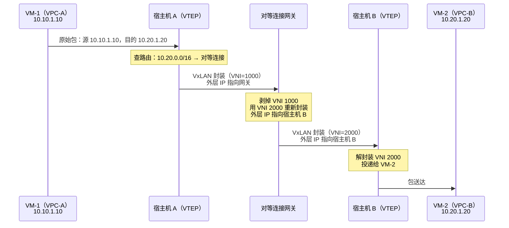
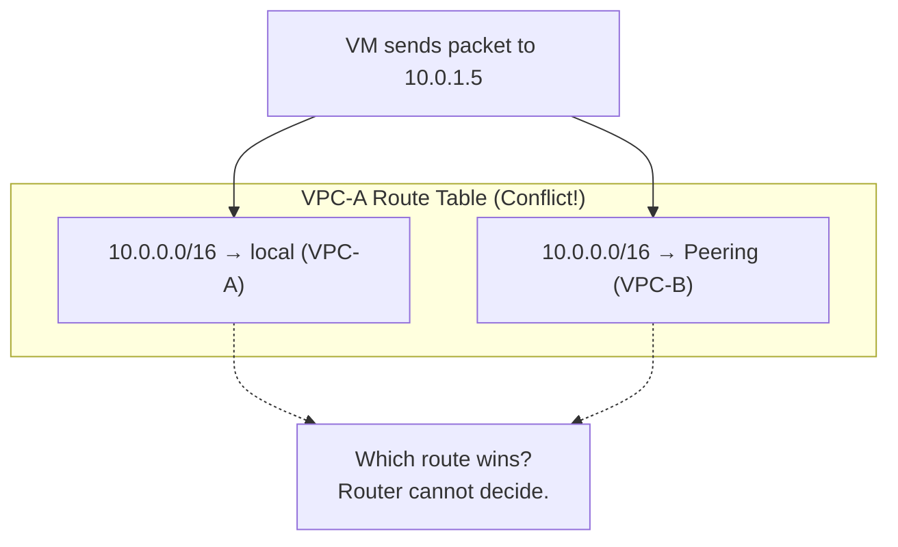
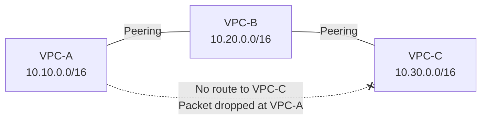

# 17. 两个 VPC 之间拉一条线：对等连接

当安全团队要求生产环境和开发环境隔离，当合规要求金融数据和普通业务数据分开，不同部门各自管理自己的网络，于是你有了五个 VPC。某天，生产 VPC 里的 Web 服务需要调用数据 VPC 里的分析接口，两个 VPC 的 VM 都用私有 IP，但彼此路由表里根本没有对方的路由条目，包该怎么发出去？

隔离是你亲手建起来的，现在你需要在隔离的墙上凿开一扇门，还不能把墙拆了。

## 17.1 隔离的副作用：VPC 之间天然不通

我们把开篇的场景具体一点：公司有两个部门，业务部门的 VPC-A 运行着 Web 服务，数据部门的 VPC-B 运行着数据分析平台，Web 服务需要把日志推送到数据分析平台。VPC-A 里的 VM 发出一个包，目的 IP 是 VPC-B 的私有地址 10.20.1.5。

VPC-A 的路由表只知道自己的子网：10.10.0.0/16 走本地，0.0.0.0/0 走 NAT 网关，所以这个包在 VPC-A 内部会被导向 NAT 网关。但 VPC-B 的私有地址 10.20.1.5 是公网不可达的，包会在 NAT 网关或公网边界被丢弃，最终导致连接超时。

这正是第五至第七章所构建隔离体系的直接体现：不同 VPC 使用不同的 VxLAN VNI，路由表互相独立，控制面不会把 VPC-B 的路由下发到 VPC-A 的宿主机上。VPC 之间不通并非 bug，而是隔离机制的必然结果。

隔离既然默认不通，要通就得寻找新的路径。摆在面前的其实只有两条路由方向：绕道公网中转，或是内网直连。

技术上虽然可行，但存在三个明显的约束瓶颈：首先是延迟，两个可能处于同一数据中心甚至同一排机架的虚拟机，其流量需要跨越公网绕行，网络延迟会成倍增加；其次是成本，公网流量通常按吞吐计费，在高带宽场景下会带来高额的带宽开销；最后是安全，为了实现互通，原本仅在内网暴露的 VPC-B 服务被迫挂载公网 IP，这客观上扩大了受攻击面。因此，绕道公网并不是一个优雅的内网互通方案，它实际上是以引入公网安全边界和高额成本为代价，来解决内网的局部连通问题。

再看内网直连，最直觉的尝试是在 VPC-A 的路由表里手动添加一条静态路由：目的地址为 10.20.0.0/16，下一跳指向 VPC-B。在控制台上，该路由配置甚至能成功保存。当报文发出后，依然无法抵达对端，其根源并不在路由表，而在底层的数据面。如第五至第七章所述，VPC 之间的物理隔离依赖 VxLAN VNI：VPC-A 属于 VNI 1000，VPC-B 属于 VNI 2000。VPC-A 的宿主机在封装 VxLAN 报文时只会填写 VNI 1000，而对端宿主机收到一个不属于自己隔离域的报文时会直接丢弃。退一步讲，即便 VNI 能够对齐，VPC-A 的宿主机也无从知晓目的虚拟机具体落在 VPC-B 的哪一台宿主机上，这份位置映射关系只存在于 VPC-B 的控制面中。静态路由仅仅改动了用户侧可见的路由表，却**无法影响数据面的封装行为**。

既然直觉路径均告失效，要在安全隔离的墙上凿开一扇门，就必须同时满足以下四条底层约束：

- 数据面互通：控制面必须将对端的隔离标识与宿主机位置同步过来，让源端宿主机知晓目的报文的封装 VNI 与物理去向；
- 控制面自动化：随着虚拟机的频繁新建、迁移与销毁，路由与主机映射的维护必须由控制面自动完成，不能依赖人工配置；
- 显式授权机制：网络默认保持不通，必须在双方 VPC 管理员皆同意的前提下通道方可建立，不能破坏原有的隔离边界；
- 安全粒度保留：安全组、网络 ACL 等多租户访问控制策略，在打通路由后仍需继续生效。

在上述约束下被逼出来的云产品，就是**对等连接（Peering Connection）**。接下来，我们先剖析它是如何在数据面和控制面发挥作用的，再看这套机制在多 VPC 以及复杂地址规划的现实里会带出怎样的连锁反应。

## 17.2 对等连接：一次下发，双轨协同

对等连接的核心设计，在于控制面的跨域协调与信息同步。当双方管理员确认互通申请后，控制面会统一进行配置下发，无需用户再手动介入。控制面在底层下发了两个维度的信息：一是用户侧可见的路由条目，二是数据面隐藏的转发映射。

首先看路由控制层。控制面将对端 VPC 的 CIDR 网段注入本地路由表，并将下一跳指向 Peering 接口。需要强调的是，这里下发的是 VPC 级别的网段前缀（如 10.20.0.0/16），而非细碎的子网路由。VPC-B 内部如何规划子网、切分段落，对 VPC-A 而言是黑盒；跨 VPC 的路由寻址只需在第一跳将报文导向对等连接接口即可。这种将路由粒度收敛在 VPC 级别的设计是刻意为之的，通过一条聚合路由代表整个对端网络，具体的子网寻址与端到端交付，则交由数据面的转发映射来完成。

**图 17.1：对等连接建立前后的路由表变化**

```
Before Peering:

VPC-A Route Table:              VPC-B Route Table:
┌──────────────┬──────────┐     ┌──────────────┬──────────┐
│ Destination  │ Next Hop │     │ Destination  │ Next Hop │
├──────────────┼──────────┤     ├──────────────┼──────────┤
│ 10.10.0.0/16 │ local    │     │ 10.20.0.0/16 │ local    │
│ 0.0.0.0/0    │ NAT GW   │     │ 0.0.0.0/0    │ NAT GW   │
└──────────────┴──────────┘     └──────────────┴──────────┘

After Peering:

VPC-A Route Table:              VPC-B Route Table:
┌──────────────┬──────────┐     ┌──────────────┬──────────┐
│ Destination  │ Next Hop │     │ Destination  │ Next Hop │
├──────────────┼──────────┤     ├──────────────┼──────────┤
│ 10.10.0.0/16 │ local    │     │ 10.20.0.0/16 │ local    │
│ 10.20.0.0/16 │ Peering  │     │ 10.10.0.0/16 │ Peering  │
│ 0.0.0.0/0    │ NAT GW   │     │ 0.0.0.0/0    │ NAT GW   │
└──────────────┴──────────┘     └──────────────┴──────────┘
```

相比于显式的路由控制，隐式的数据面转发映射更为关键：VPC-B 中每台虚拟机所在的物理宿主机位置，以及 VPC-B 的三层路由域标识（L3 VNI）（如第九章所述，这是 VPC 级的路由域标识，一个 VPC 对应一个，与子网的 L2 VNI 不同）。控制面将这些映射数据同步至 VPC-A 的数据面。有了这些元数据，数据面才第一次集齐了跨 VPC 转发所需的上下文：路由表指示了流量去往对端 VPC 的倾向，而转发映射则给出了具体的物理宿主机 IP 和封装所用的 L3 VNI。

控制面的分发机制建立完毕后，数据面仍需解决一个技术问题：VPC-A 使用 VNI 1000，VPC-B 使用 VNI 2000，数据包在跨越 VPC 边界时，必须从隔离域 1000 跨越至隔离域 2000。这一跨域封装的行为，在物理网络中有两种不同的落点方案。

第一种方案是**集中式网关转换**。云厂商在数据中心内部部署一组专用的对等连接网关，VPC-A 的宿主机将数据包按 VNI 1000 封装，外层目的 IP 指向网关；网关接收报文并剥离 VNI 1000，随后检索对等连接映射表，重新以 VNI 2000 进行 VxLAN 封装，外层目的 IP 替换为 VPC-B 中目标 VM 所在的宿主机 IP，最终发往对端。

**图 17.2：通过对等连接网关的数据路径**



第二种方案是**源端宿主机直接封装**（分布式直连）。控制面直接将对端的物理映射与 L3 VNI 下发至源端宿主机。源宿主机在对数据包进行封装时，直接填入目的隔离域的 VNI 2000，外层目的 IP 指向对端宿主机，报文在物理网络中一步到位，不经过任何中间转换节点。

这两种落点方案各有其架构取舍，本质在于控制面同步范围与数据面转发跳数的权衡。采用集中式网关，控制面只需将映射表同步至少数网关设备，源端宿主机无需感知对端 VPC 的拓扑变化，但代价是数据面多绕一跳，且网关容易成为流量瓶颈；采用分布式直连，数据面可实现一跳直达、延迟极低且吞吐随宿主机规模线性扩展，但代价是控制平面的同步扇出压力成倍增加。

这种集中与分布的取舍，在跨子网通信的分布式网关设计（第九章）中同样存在。在业界实践中，部分云厂商会结合地理位置进行折中：同可用区内走宿主机直连以追求极限性能，跨可用区则通过中间网关转发以缩减故障域。但无论选择哪种路径，其本质都是在逻辑隔离边界上架设的一座跨域通道。

回包的设计无需额外引入状态机。对等连接在传输过程中不会修改 IP 报文的源 IP 与目的 IP。VPC-B 侧的虚拟机收到的请求报文，其源地址依然是 VPC-A 的 10.10.1.10。当它构造响应报文并对调源/目的地址后，会查询 VPC-B 自身的路由表。由于控制面已经对称注入了 `10.10.0.0/16 → Peering` 路由，回程报文将以相同的封装机制原路返回。整个转发过程完全基于路由查表，不维护连接会话表。这种无状态的数据面特征，保证了对等连接的高吞吐与低延迟。

需要指出的是，对等连接打通的是路由通道，而非访问权限。VPC-B 的虚拟机安全组依然挡在系统最外侧，如果安全组策略中没有放行 VPC-A 的源网段，报文即使能通过路由送达也会被直接拦截。路由可达不等于访问允许，这是网络分层控制的一贯逻辑。

在控制面准入上，显式授权是守住安全边界的关键。对等连接支持跨账号建立，由发起方发起申请、接收方确认接受后，控制面才会启动底层映射的同步。此处的双向授权确认机制呼应的是组织管理的边界，确保即使身处同一物理云平台，租户之间的默认互信关系也不会被随意打破。

回顾前文，上述设计已经闭环解答了最初的四条底层约束。但当我们将这套点对点对等机制推向多 VPC 或复杂地址规划的现实环境时，路由本身的规则与单向授权的局限，又会顺着这套设计带出两个必然的架构特征。下文将对此逐一展开。

## 17.3 地址不能撞车

对等连接的路由宣告机制，建立在一个底层的网络公理之上：同一张路由表内，不能存在两条目标前缀完全重合的路由条目。

如果 VPC-A 与 VPC-B 的网段都规划为 10.0.0.0/16，在打通对等连接后，VPC-A 的路由表中就会并存两条一模一样的 10.0.0.0/16 路由：一条下一跳指向本地（local），另一条指向对等接口（Peering）。当本地虚拟机尝试向 10.0.1.5 发送数据包时，路由器将无法在两条优先级相同且前缀完全一样的路由之间做出唯一选择，路由决策就此陷入歧义。

**图 17.3：CIDR 重叠导致的路由歧义**



完全相等还只是最直白的一种。地址段部分重叠更麻烦，因为它不会在创建时报错。VPC-A 是 10.0.0.0/16，VPC-B 是 10.0.1.0/24，B 的地址段是 A 的子集。最长前缀匹配（LPM）会把 /24 挑出来，结果是 VPC-A 内部 10.0.1.0/24 这个子网的流量被静悄悄地导向对等连接，包本来该在 VPC-A 内部投递，却穿到了 VPC-B。这种冲突并不会在配置建立时被系统拦截，而是在业务运行时引发局部的网络不可达，其隐蔽性与排查成本远高于直接的配置冲突。

企业早期建 VPC 的时候各部门各选各的地址段， 10.0.0.0/16、172.16.0.0/12 这些常见段谁看着方便就用了，RFC 1918 划出的私有地址空间本来就那么大，撞车的概率远高于直觉。等到某天要互通，才发现两个业务的地址空间早就重叠了。重新规划地址空间意味着所有 VM 的 IP 都要动，生产环境里几乎等于把网络重建一遍。地址冲突在路由层面无解，这一定论在后续章节中还会反复上演。

## 17.4 两两之间的连接不可传递

对等连接的另一个特性，来自于其双边授权的粒度。每次打通连接，仅会在两个参与方各自的路由表中注入对方的网段信息。对于旁观的第三个 VPC 而言，它的网络边界不会发生任何变化。

当我们将对等连接扩展到多个节点时，这种局部授权的约束便会引发**拓扑传递性的失效**。例如，VPC-A 与 VPC-B 建立了对等连接，VPC-B 与 VPC-C 也建立了对等连接。此时，如果 VPC-A 的虚拟机试图访问 VPC-C 的 IP（10.30.1.5），直观上极易被类比为中转，以 VPC-B 为桥梁进行路由中继。然而，VPC-A 的路由表中并不存在去往 VPC-C 网段的下一跳，报文在源端便会由于路由缺失被直接丢弃，根本无法抵达 VPC-B。

**图 17.4：对等连接的不可传递性**



```
VPC-A Route Table:
┌──────────────┬──────────┐
│ Destination  │ Next Hop │
├──────────────┼──────────┤
│ 10.10.0.0/16 │ local    │
│ 10.20.0.0/16 │ Peering  │  ← Only VPC-B, no VPC-C
│ 0.0.0.0/0    │ NAT GW   │
└──────────────┴──────────┘

Packet to 10.30.1.5 → No matching route → Dropped
```

VPC-B 拥有去往 VPC-C 的路由，为什么不将其发布给 VPC-A？因为对等连接在设计上是非传递性的，中转 VPC 不允许将属于第三方的位置信息重新宣告出去。这种设计并非功能缺失，而是显式授权原则的必然延伸。由于 VPC-A 与 VPC-C 之间并未进行过显式的双向授权确认，如果允许 VPC-B 自动中转流量，就会绕过 VPC-C 管理员的控制权。在跨账号的多租户场景下，这会破坏原本清晰的隔离边界。

此外，从数据面的资源占用来看，VPC-B 作为终端网络（Stub Network），其底层宿主机或转换网关并未预留用于三方中转的转发表空间和物理带宽。如果强行允许传递，随着连接节点的增加，网络路径的确定性会大大降低，审计与排查的复杂度也会呈指数级上升。

因此，VPC-A 如果要访问 VPC-C，唯一的办法是建立专属的对等连接。这意味着，当 VPC 数量增长时，全互通所需的连接数量呈平方级增长（$N \times (N-1) / 2$）。三个 VPC 需要 3 条连接，五个需要 10 条，十个需要 45 条，而三十个则需要 435 条。每新增一个节点，都需要与存量节点分别建立连接并手动维护双向路由，管理开销将变得极其繁重。

伴随连接数量剧增的是全局网络拓扑复杂度的失控。数百条点对点的静态双边关系散落在系统各处，使得网络缺乏中心化的控制节点。一旦出现局部丢包或路由冲突，运维人员需要在大量分散的路由表中定位故障点，排查和恢复成本显著增加。

## 17.5 对等连接的适用场景与设计取舍

总的来说，对等连接的架构特征非常明确：它通过在两两之间建立连接，由控制面下发路由和转发映射来打通内网直连。代价是通信双方的地址空间不能冲突，并且路由关系无法传递。这种架构设计没有绝对的好坏，只取决于具体的业务场景。

它最适合的场景，是节点数量少（通常在个位数）、连接关系相对固定的内网互联。例如生产环境 VPC 与运维管理 VPC，或者是同一业务系统的前后端 VPC。在这个规模下，17.2 节描述的两种数据面架构都能够最大程度地发挥直连优势。尤其是分布式直连模式下，跨 VPC 的数据报文在物理宿主机之间一步直达，消除了中间网络设备的转发开销；而在集中式网关模式下，由于网关与 VPC 部署在同一个机房，它带来的微秒级延迟对绝大部分业务来说也微乎其微。因此，像数据库主从同步、跨隔离域的实时分布式交易这类对网络时延非常敏感的业务，对等连接依然是首选。

跨地域（Cross-Region）的互联则是另一种维度。同地域内的对等连接依赖云厂商的高速内网，带宽几乎不受物理层限流；而跨地域的对等连接则需要借由跨地域的物理骨干网来承载，此时网络不仅面临带宽上限的物理约束，计费标准也完全不同。在架构设计上，应当将地域（Region）视为网络设计的一道硬边界，避免将跨地域互联视作同地域网络的自然延伸。

当 VPC 节点数持续增加、拓扑频繁调整或需要集中化管控时，这种网状互联的弊端就会凸显。对于拥有数十个 VPC 的网络来说，数百条点对点链路的维护超出了传统静态配置的合理范围。

这种从点对点到中心化的演进，是系统规模化过程中的普遍规律。早期的物理电话网依靠两两专线直连，随后演进为具有中心交换节点的公共电话网；微服务架构中杂乱的点对点 API 调用，最终也让位于中心化的服务网关或事件总线。当连接数量突破某个阈值，网状拓扑本身就成了系统最脆弱的部分。云网络在这条路径上并没有例外。
