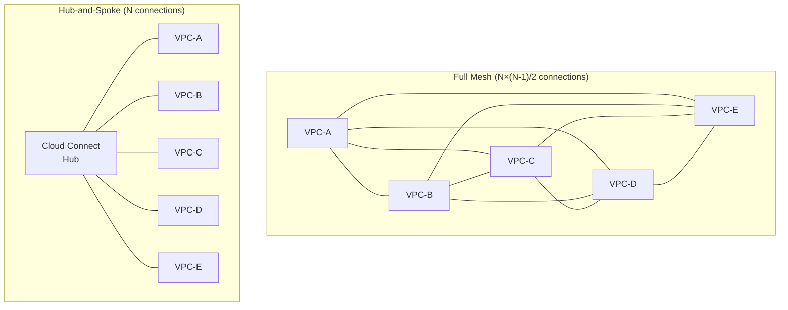
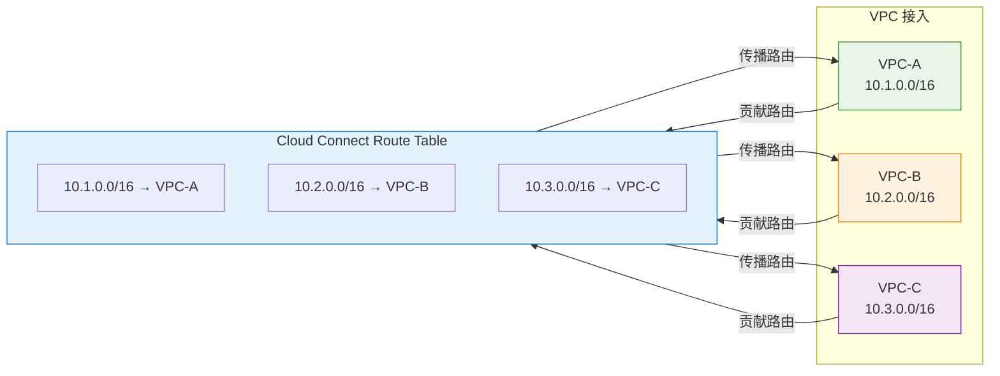
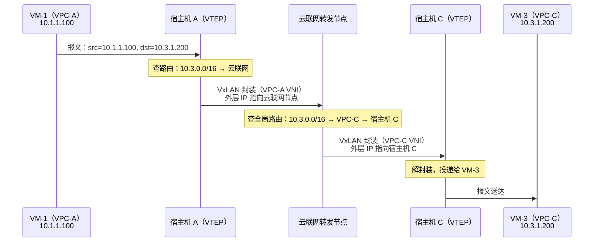
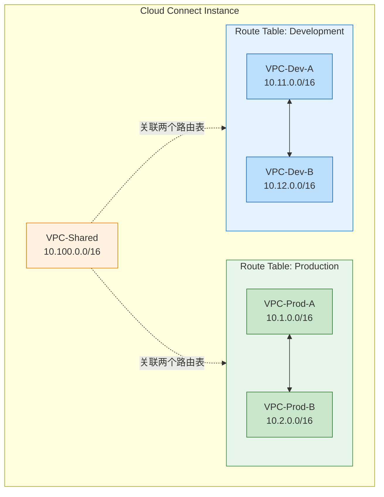
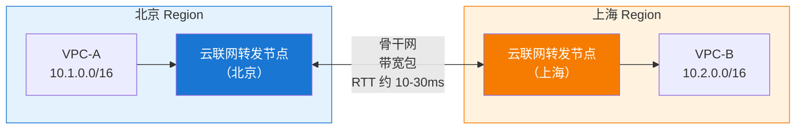

# 18. VPC 互联的总线：云联网

上一章的推导落在一个结论上：当 VPC 的数量突破某个阈值，点对点的对等连接就会因为拓扑复杂度的失控而失效，网络秩序需要走向中心化。这不是云网络的特例，而是所有大规模连接系统共有的演进规律。

但走向中心化只是一个方向，并非能直接落地的具体方案。一个能够替代两两连接的中心节点，内部到底要把哪些原本分散在每个 VPC 手里的职责接过来？仅仅把包中转一下是不够的，它还得知道包往哪儿送，得能驾驭不同隔离域之间的转发，得让不想互通的 VPC 也能被隔开。这个中心节点内部究竟是怎么运作的、边界又在哪里，是这一章要讨论的东西。

云厂商把这个中心节点产品化之后，各家名字不同：腾讯云叫云联网（Cloud Connect Network），AWS 叫 Transit Gateway，阿里云叫 CEN，但骨架是一致的：一个能替所有接入方做路由决策的中枢，一份自动同步的全局路由知识，一套可以在互通默认之上叠加隔离的策略机制。

## 18.1 中心节点承接的控制面、数据面与策略面

中心节点要从各个 VPC 手里接过来的职责，不是一团混沌的把包送到对面，而是可以沿着三个彼此正交的面向拆开看的。

**控制面：路由知识的汇聚。** 中心节点需要有一张覆盖所有接入 VPC 的全局路由表，知道每个 CIDR 属于哪个 VPC。每个 VPC 只要把自己的地址空间告诉中心节点、并从中心节点接收其他 VPC 的地址空间即可，不需要再关心其他 VPC 之间的关系。

**数据面：跨隔离域的转发。** 知道地址在哪只是决策依据，包还得真的送过去。VPC 之间的物理隔离是靠不同的 L3 VNI 实现的，任何一个跨 VPC 的包都必须完成 VNI 剥离与重封装。中心节点必须能承担这个动作，而且要为所有接入 VPC 承担，不再是对等连接那种两两之间架一座桥的形态。

**策略面：互通关系的仲裁。** 中心节点让接入方能通是最低要求，但现实业务从不满足于全通，生产不能被开发访问、合作伙伴 VPC 只允许触及特定业务、共享服务需要被多方看到。中心节点必须提供一套比接入即互通更细的表达能力，来描述哪些 VPC 之间该通、哪些不该通。

控制面、数据面、策略面一旦被从各个 VPC 手里抽出来、交给一个中心节点，网络拓扑图上呈现出的形态就是**星型拓扑（Hub-and-Spoke）**：中心节点是 Hub，每个 VPC 是 Spoke，VPC 之间不再有直接的线，所有互访都经过中心。

**图 18.1：全网格 vs 星型拓扑**

星型拓扑只是控制面、数据面、策略面被中心节点接过去之后在图上呈现的样子，不是这套架构的起点。这一点值得强调，因为如果只盯着拓扑图，很容易把云联网理解成一根更粗的管道或一台大交换机。它的本质是一个路由交换平台：管道属性是外表，路由决策的集中化才是内里。

集中化是有代价的，上一章讲过对等连接的两种数据面方案里，分布式直连模式下宿主机之间可以一步到位；一旦决策权收拢到中心节点，一跳直达这个选项就在架构上被排除了，所有跨 VPC 的流量都要经过中心节点转发。这是把 N² 降低到 N 必然付出的代价，后面 18.3 节讨论数据面时会具体量化这一跳的开销。

接下来的三节，就沿着控制面、数据面、策略面三个维度依次展开。

## 18.2 全局路由表：一张替所有人做决策的表

中心节点要替所有 VPC 做路由决策，前提是它手里得有一张谁在哪里的完整清单。这张清单在云联网里就是**全局路由表**。

用户把 VPC-A、VPC-B、VPC-C 接入同一个云联网实例。接入这个动作在控制面上分成对称的两半：VPC 把自己的 CIDR 贡献给中心节点，中心节点把其他 VPC 的 CIDR 回传给这个 VPC。VPC-A 接入后，云联网学到 10.1.0.0/16 属于 VPC-A，同时把 VPC-B、VPC-C 的 CIDR 下发到 VPC-A 的路由表里，VPC-A 于是多出两条路由，下一跳都指向云联网。反过来，VPC-B、VPC-C 的路由表里也会多出 `10.1.0.0/16 → Cloud Connect`。整个过程用户不用手动介入任何一条路由。

**图 18.2：云联网的路由自动传播**

把这套接入模型和上一章对等连接的路由注入放在一起看，差异不只是"手动 vs 自动"这么表层。对等连接是**关系型**的路由描述，每建立一次连接，就在两方各自的路由表里塞一条对方的 CIDR，路由状态依附在A 与 B 建立了连接这一特定关系上。云联网是**成员型**的路由描述，VPC 描述的是我是这张网络的成员，我的地址空间是 X，路由信息依附在成员身份上。关系型模型下，新增一个成员要和已有的每个成员分别建立关系；成员型模型下，新增一个成员只需要注册一次，其他成员自然会知道它的存在。这个视角的切换，才是云联网相对于对等连接真正的分水岭。

新增一个 VPC-D 就能直观感受到这种差异：只要把 VPC-D 接入云联网，它的路由自动传播给 A/B/C，A/B/C 的路由也自动传播给 D。全局一次操作，全网生效，无需触碰任何存量 VPC 的路由表。之所以能一次操作全网生效，是因为成员型模型把控制面的复杂度从 N² 降低到了 N，这正是上一章推导出的失控点在新架构下的正面解答。

**但一个约束不会因为架构升级而消失：CIDR 不能重叠。** 同一张路由表内两条完全相同的前缀无法产生唯一决策，这是路由表这种数据结构本身的公理，不是产品的选择。云联网只是把这条公理从每对 VPC 之间扩展到了一张全局表内：任何两个接入方的地址空间只要出现重叠，控制面就会在接入时直接拒绝。规模换成了几十个 VPC 之后，地址规划的历史包袱只会更沉重，云联网并没有变魔术的能力。这个悬案将在下一章的 PrivateLink 里以另一种思路被绕开。

除此之外，当同一个目的地存在多条路径时（比如既能通过云联网到达，又能通过专线到达），需要有路由优先级来决定走哪条。云联网通常支持给不同类型的路由设置优先级，这在后面讲跨地域互联和专线接入时会变得关键。

## 18.3 包在中心节点上多走的一跳

控制面搞清楚了谁在哪里，数据面要回答的是包怎么真的走过去。

设想 VPC-A 的 VM-1（10.1.1.100）要访问 VPC-C 的 VM-3（10.3.1.200），这个包的旅程分成三跳。

**图 18.3：包通过云联网的转发路径**

第一跳，源宿主机 Host-A 查 VPC-A 的路由表，发现 10.3.0.0/16 的下一跳是云联网，用 VPC-A 的 VNI 封装后送到云联网的转发节点。第二跳，转发节点收到包，剥掉 VPC-A 的 VNI，查全局路由表定位到 10.3.0.0/16 属于 VPC-C，用 VPC-C 的 VNI 重新封装后送到 Host-C。第三跳，Host-C 解封装，把包投递给 VM-3。

其中的 VNI 切换动作不是新东西，上一章讲对等连接的集中式网关方案时已经出现过。区别在于，那里的网关只服务两个 VPC（一对 Peering），这里的转发节点服务的是**整个全局路由表**上所有接入 VPC。同一个动作，服务范围从一对变成了一张网。

把这条路径和上一章的两种对等连接数据面并列，就能看清代价的来源。对等连接的分布式直连模式下，源宿主机拿着对端的物理映射直接封装，一跳到位；集中式网关模式下要多走一次中转。云联网的路径形态和后者相似，都是**中心节点转发**，这不是产品实现上的偷懒，而是控制权集中这个决策在数据面上的必然投影。

这里其实回答了上一章埋下的一个问题：既然分布式直连延迟更低，为什么云联网不采用？答案是**规模**。分布式直连需要把每个目的 VPC 的物理映射下发到源端的所有宿主机，控制面的同步扇出等于"源宿主机数 × 目的 VPC 数"。VPC 少的时候尚可，一旦 VPC 数量到了几十上百，这份映射表的规模和同步频率就会失控。集中式转发把同步压力收拢到少数转发节点上，用一跳中转的延迟代价，换回了控制面的可扩展性。这是上一章埋下的分布式/集中式取舍在规模压力下给出的选择答案。

至于云联网的转发节点本身要不要分布式部署（每个可用区放一组，还是集中在一处），是同一个取舍在更小尺度上的再一次上演，转发节点越分散，同 Region 内的绕行越少，但转发节点之间的路由同步压力也越大。管理便利性、数据转发效率、控制面复杂度，三者之间不可能同时最优。

## 18.4 默认互通够用吗

数据面虽然能把包送达，但能送达与该送达并不能等同视之。策略面回答的正是后一个问题。

云联网默认让所有接入的 VPC 互相可达，接入即互通。对小型场景这是省事的默认值，但真实业务里几乎从不完全适用：开发环境的 VPC 不应该能访问生产环境的 VPC（一个测试脚本误连生产数据库的后果，任何经历过的人都不想再经历第二次）；合作伙伴的 VPC 接入之后只应触及特定的服务 VPC，其他业务 VPC 对它必须不可见；不同业务线之间要隔离，但共享服务（日志平台、监控系统）要被所有业务线看到。默认全通的模型无法满足这些需求。

云联网在中心节点上引入**多路由表**机制来表达这些需求。

**图 18.4：云联网的路由表隔离**

中心节点内部并不只维护一张全局路由表，而是允许把接入方按用途分组，每一组挂一张自己的路由表。同一张路由表内的 VPC 互相可见、互相可达；不同路由表之间默认互不相知。生产组内互通、开发组内互通，但生产和开发之间隔离。共享服务 VPC 同时关联到两个路由表，因此对两组都可见，这本质上是让共享服务在中心节点内部拥有多重成员身份。

更细的粒度是**路由传播方向**的控制，通过分别控制接收谁的路由和把自己的路由传给谁，可以做出单向可达的效果：把 VPC-B 的路由传给 VPC-A、但不把 VPC-A 的路由传给 VPC-B，就实现了 A 能主动访问 B、B 不能主动访问 A 。这在合作伙伴接入、灾备回读之类的场景里都有用。

这里有一个值得注意的设计哲学，VPC 本身是**默认隔离、按需打通**，创建一个 VPC，它和外界完全不通，任何互通都得主动配置。云联网恰好相反，是**默认互通、按需隔离**，接入即通，隔离需要主动配置路由表。同一套云网络体系里，两个相邻的产品选择了截然相反的默认值，这不是设计上的不一致，而是应用场景的差异：VPC 面向的是云上所有 VPC 两两之间的关系，绝大多数本就不该通，默认隔离才安全；云联网面向的只是用户主动挂进同一个实例的一组 VPC，用户既然主动把它们放到一起，通常就是想让它们互通。

至于怕不该通的通了、还是怕该通的不通，这不是纯技术问题，金融行业偏爱前者，互联网行业偏爱后者，取决于业务文化和合规要求，没有标准答案。云联网提供的路由表隔离控制的是网络层面能不能到达，安全组控制的是到达之后允不允许进入，两者是不同层次的控制，通常配合使用：路由表做粗粒度的分区，安全组做细粒度的实例访问控制。

## 18.5 中心节点也要面对物理边界

到目前为止，讨论的都是同一个 Region 内的场景。中心节点在同 Region 的数据中心内部运作，控制面的同步、数据面的一跳中转，都发生在低延迟、高带宽的环境里。云联网的能力并不止于此，它允许跨 Region 的 VPC 接入同一个实例，但一旦跨过 Region 的边界，两个此前隐形的约束会立刻浮出水面。

第一个约束是**光速**，北京到上海约 1000 公里，光在光纤中的传播速度约 20 万公里/秒（光速的三分之二，因为光纤的折射率），单程传播延迟约 5 毫秒，往返约 10 毫秒。加上路由器处理延迟和排队延迟，实际 RTT 通常在 10-30 毫秒。这是物理定律的约束，任何网络优化都无法突破。云联网能做的是保证走最优路径，通过云厂商的骨干网而非公网，避免绕路和拥塞，但它不能消除距离带来的延迟。光速是宇宙的限速令，工程师在物理规律面前没有回旋余地。

第二个约束是**带宽成本**。跨 Region 传输需要购买带宽包来保障传输质量，带宽包定义了两个 Region 之间的最大带宽。没有带宽包，跨 Region 流量可能走公网、质量不可控。跨 Region 带宽的价格远高于同 Region，这个差价对应的是背后实打实的基础设施成本：长距离光纤的租赁、沿途中继设备的维护、骨干网的容量规划，任何一项都不便宜。

**图 18.5：跨地域云联网的流量路径**

这两条约束合起来给架构设计带来一个明确的启示：**Region 是网络设计的一道硬边界**。云联网让跨 Region 的 VPC 之间能通，但不等于跨 Region 和同 Region 一样。对延迟敏感的服务，数据库主从同步、实时交易、在线游戏的状态同步，都应当尽量收拢在同一个 Region 内。跨 Region 的用途更多是灾备、异地多活的粗粒度同步、以及全球化业务的骨干互联，而不是承担延迟敏感的日常调用。

## 18.6 中心节点解决了什么、没解决什么

回到章首拆出的那三个核心职责，云联网已经把控制面、数据面、策略面都补齐了：路由自动传播代替了手动维护，中心节点承担了跨 VPC 的封装转发，多路由表提供了比全通更细的隔离策略，跨 Region 也能纳入同一个连接网络。它把上一章那个 N² 复杂度失控的问题从架构层面解决了。

但它没有解决全部问题，有一些约束是它这套架构改不动的。

**CIDR 重叠仍然无解**。无论对等连接还是云联网，都建立在同一张路由表内前缀不能重复这条路由公理之上，把两两之间的路由表换成一张全局路由表，这条公理不但没消失，反而更醒目了。当两个 VPC 的地址空间撞车时，路由层面的方案全部失效。要在地址冲突的前提下实现互访，思路必须跳出路由本身，让服务而不是网络成为互通的最小单位。

**跨云和 IDC 也超出了云联网的边界**。云联网连接的是同一朵云内的 VPC（即便跨 Region，也还在同一家云厂商的骨干网上）。企业往往还要连接自建的 IDC、连接另一家云厂商的资源，那些场景需要 VPN、专线、跨云网关，会在后面几章依次展开。

**对等连接并没有过时**。这一章没有把云联网当作对等连接的替代品来推销，选择哪种其实是一个具体权衡。规模小、关系固定、对延迟极度敏感的场景，对等连接的分布式直连模式做得到宿主机到宿主机的一跳直达，云联网因为多了一层中心节点转发做不到这一点。规模大、关系动态、需要集中管控的场景，云联网的可维护性优势才会体现出来。企业实际部署里两者经常共存，核心业务之间用对等连接保障低延迟，其他 VPC 通过云联网统一管理，这是把两种架构的取舍点分别对齐到不同业务需求上的结果。

对等连接和云联网走的都是让地址空间互通的路径，一直留下一个问题悬而未决：CIDR 冲突的时候该怎么互通？这正是下一章要讨论的问题。