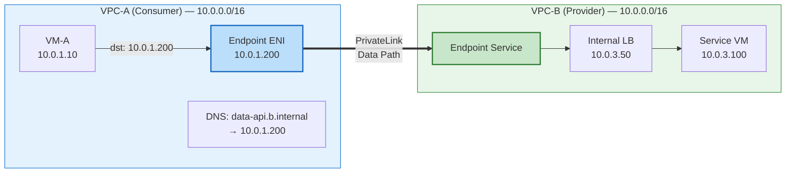
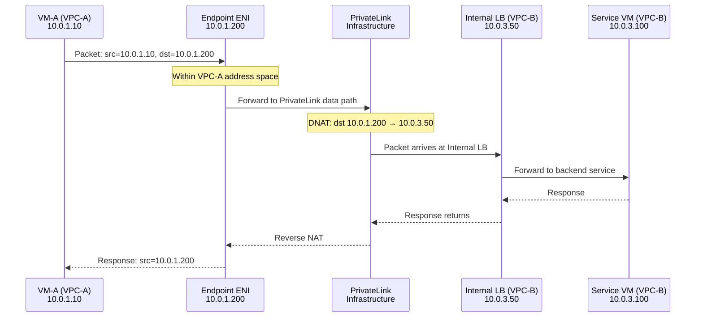
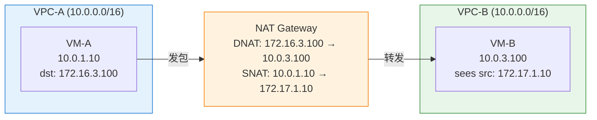
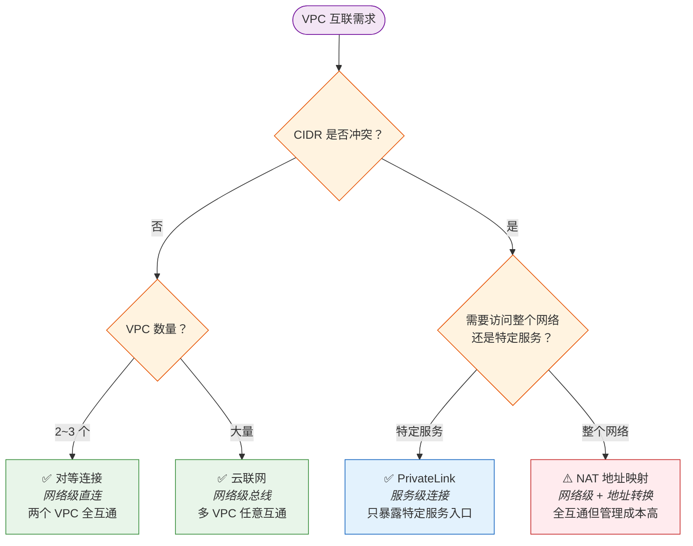

# 18. 地址冲突也要互访：PrivateLink

你的公司收购了一家竞争对手。技术团队开始整合系统，你的 VPC 用的是 10.0.0.0/16，对方的 VPC 也用的是 10.0.0.0/16。你的业务系统需要调用对方的数据接口。你试了对等连接，创建时报错：CIDR 重叠。你试了云联网，接入时报错：路由冲突。你想让对方改地址段，对方说生产环境有 200 台 VM，改地址等于重新部署整套系统。

你陷入了僵局。对等连接不行，云联网也不行，改地址不现实。三条路都堵死了。

这不是一个罕见的场景。企业收购、SaaS 服务商对接客户、甚至同一家公司不同团队在不同时期创建的 VPC，地址冲突的概率远比想象中高。10.0.0.0/8 这个私有地址段太好用了，几乎所有人都在用它。

## 18.1 跳出网络互通的思路

改地址为什么不现实？因为 VPC 内所有 VM 的 IP 都要变，所有依赖这些 IP 的配置——安全组规则、DNS 记录、应用配置文件、监控告警、数据库连接串——全部要更新。在生产环境中，这几乎等于一次完整的网络迁移。改了一个 IP，发现还有十七个地方引用了旧地址。每修好一个，又冒出来两个，就像打地鼠，永远打不完。

路由层面走不通，改地址又不现实。要解决这个问题，需要跳出"网络互通"的思路。

回到需求本身。

企业 A 真的需要和企业 B 的整个网络互通吗？A 的 200 台 VM 需要能 ping 通 B 的 200 台 VM 吗？

大多数情况下不需要。A 只需要访问 B 的一个特定服务，比如一个数据 API，监听在 10.0.3.100:8080。A 不需要知道 B 的网络里还有什么其他 VM，也不需要能 ping 通 B 的任何其他地址。A 需要的不是"和 B 的网络互通"，而是"能调用 B 的某个服务"。

这个区分很重要。对等连接和云联网做的事情是"把两个网络打通"，拆掉两栋楼之间的墙，让人自由走动。但如果两栋楼的房间号完全一样（地址冲突），拆墙之后就分不清 101 房间是哪栋楼的。

换一个思路：不拆墙。在墙上开一个窗口，只暴露特定的服务。这个思路的精妙之处在于：它把问题从"如何让两个冲突的网络互通"转换成了"如何让一个网络访问另一个网络里的某个服务"。问题的维度变了，约束就不一样了。

B 只把一个服务的入口暴露出来，A 通过这个入口访问服务。A 看不到 B 的网络拓扑，不知道 B 的 CIDR 是什么，不知道 B 有多少台 VM。A 只知道"有一个服务可以调用"。

地址冲突为什么不再是问题？因为 A 访问 B 的服务时，使用的是 A 自己网络中的一个地址，不是 B 的地址。A 的 VM 发出的包，目的 IP 是 A 自己 VPC 内的一个 IP，这个 IP 属于 A 的地址空间，不会和 B 的地址冲突。中间有一层机制把 A 的请求转发到 B 的服务上，但 A 完全不需要知道 B 的真实地址。

这个思路有一个名字：PrivateLink（或 VPC Endpoint Service）。它不是网络层面的互通，而是服务层面的互通。PrivateLink 的核心能力就是：让你在不打通网络的前提下，访问另一个网络里的服务。

## 18.2 PrivateLink 的底层实现：Endpoint、私网 LB 与 DNS

思路有了，看看它具体怎么工作。

PrivateLink 涉及三个核心组件：服务提供方的私网负载均衡器（Internal LB）、消费方的 VPC Endpoint、以及 DNS 映射。

**服务提供方（VPC-B）的准备。** B 把要暴露的服务挂在一个私网负载均衡器后面。这个 LB 有一个 VPC-B 内部的 IP 地址（比如 10.0.3.50），外部不可见。B 创建一个"Endpoint Service"，关联到这个 LB。Endpoint Service 是一个逻辑概念，它代表"B 愿意把这个 LB 背后的服务暴露给特定的消费方"。B 可以设置白名单，只允许特定账号的 VPC 来访问。

**消费方（VPC-A）的接入。** A 创建一个"VPC Endpoint"，指向 B 的 Endpoint Service。创建完成后，VPC-A 内部会出现一个或多个弹性网卡（ENI），这些 ENI 拥有 VPC-A 地址空间内的 IP 地址（比如 10.0.1.200）。注意，这个 IP 属于 VPC-A 的地址空间，不是 VPC-B 的。这些 ENI 就是 PrivateLink 在 VPC-A 内部的"入口"。

**图 18.1：PrivateLink 的三个组件**

> 蓝色 = Consumer VPC（只看到 Endpoint 的 IP），绿色 = Provider VPC（真实服务所在）。两个 VPC 的 CIDR 相同（10.0.0.0/16），但通过 PrivateLink 的地址映射实现互访。粗线 = PrivateLink 数据通道。

**流量路径。** VPC-A 的 VM-A 发包到 10.0.1.200（Endpoint 的 IP），这个包在 VPC-A 内部路由到 Endpoint 的 ENI。PrivateLink 的基础设施收到这个包后，把它转发到 VPC-B 的 Internal LB（10.0.3.50），LB 再转发到后端的服务 VM（10.0.3.100）。整个过程中，VM-A 只看到 10.0.1.200 这个地址，完全不知道 VPC-B 的存在。

**图 18.2：PrivateLink 的流量路径**

**数据面的实现细节。** 地址转换发生在哪里？这个问题值得展开，因为它是 PrivateLink 能绕过地址冲突的关键。

Endpoint ENI 不是一块普通的网卡。它是云平台在消费方 VPC 内部创建的一个"代理入口"，背后连接着云平台的内部转发基础设施。当 VM-A 的包到达 Endpoint ENI 时，宿主机上的虚拟交换机识别出这个目的 IP 属于一个 PrivateLink Endpoint，不会把它当作普通的 VPC 内部流量处理，而是将包交给 PrivateLink 的数据面组件。

这个数据面组件做了两件事。第一，DNAT：把目的 IP 从 10.0.1.200（消费方地址空间）翻译成 10.0.3.50（提供方 Internal LB 的地址）。第二，通过云平台内部的隧道（通常是 VxLAN 或类似的 Overlay 封装）把包送到提供方 VPC 所在的宿主机。这条隧道不经过任何一方的路由表，它是云平台底层网络中的一条专用通道，两端的 VPC 都看不到它的存在。

关键在于：这次 DNAT 和隧道封装发生在云平台的基础设施层，不是在消费方的路由表里，也不是在提供方的路由表里。消费方的路由表只知道"10.0.1.200 是本 VPC 内的一个 ENI"，提供方的路由表只知道"有流量从 Internal LB 进来"。两个 VPC 的路由体系完全独立运作，互不感知。这就是地址冲突不再是问题的根本原因——两个地址空间从来没有在同一张路由表里出现过，冲突的前提条件不存在。

回程也是对称的。服务 VM 的响应包发给 Internal LB，LB 把包交给 PrivateLink 数据面，数据面做反向 NAT（源 IP 从 10.0.3.50 翻译回 10.0.1.200），通过内部隧道送回消费方的 Endpoint ENI，最终到达 VM-A。VM-A 看到的响应源 IP 始终是 10.0.1.200，它完全不知道这个包实际上来自另一个 VPC 的 10.0.3.50。

**DNS 映射。** 为了让 VPC-A 的 VM 不需要硬编码 Endpoint 的 IP，PrivateLink 通常配合 Private DNS。B 的服务域名（比如 data-api.b.internal）在 VPC-A 内部被解析为 Endpoint 的 IP（10.0.1.200），而不是 B 的真实 IP。VM-A 只需要访问 data-api.b.internal，DNS 自动把它指向本地的 Endpoint。应用代码不需要任何修改，它以为自己在访问一个本地服务。

PrivateLink 不是万能的，它有几个设计上的硬约束，理解这些约束才能正确使用它。

第一，单向性。只有消费方能主动发起连接，提供方不能反向访问消费方。VPC-A 可以通过 Endpoint 调用 VPC-B 的服务，但 VPC-B 无法通过同一条 PrivateLink 反向访问 VPC-A 的任何资源。这不是缺陷，而是刻意的设计——最小暴露面原则。如果双方都需要访问对方的服务，需要分别建立两条 PrivateLink，各自暴露各自的服务。

第二，协议限制。PrivateLink 通常只支持 TCP（部分云厂商扩展支持了 UDP），不支持 ICMP。这意味着你无法 ping 通 Endpoint 的 IP。运维人员习惯用 ping 来测试连通性，但在 PrivateLink 场景下，ping 不通不代表服务不通，需要用 telnet 或 curl 来验证 TCP 层面的可达性。

第三，性能边界。Endpoint 的带宽和并发连接数有上限，具体取决于云厂商的规格定义。对于高吞吐的场景（比如大规模数据同步），需要确认 Endpoint 的规格是否能承载预期的流量。如果单个 Endpoint 不够，可以在消费方的多个可用区各创建一个 Endpoint，分散流量。

第四，Region 限制。PrivateLink 通常只在同一个 Region 内工作。消费方和提供方的 VPC 必须在同一个 Region。如果需要跨 Region 访问服务，需要配合云联网或其他跨域方案，先把流量送到提供方所在的 Region，再通过 PrivateLink 接入服务。

## 18.3 NAT 地址映射：更暴力的解法

PrivateLink 解决了"访问特定服务"的场景。但如果需求不是访问一个服务，而是两个地址冲突的网络之间需要大范围互访呢？

还有一种更暴力的方案：双向 NAT 地址映射。

思路是这样的。在 VPC-A 和 VPC-B 之间放一个 NAT 网关。VPC-B 的地址段（10.0.0.0/16）被映射到一个不冲突的地址段（比如 172.16.0.0/16）。VPC-A 的 VM 想访问 VPC-B 的 10.0.3.100 时，实际访问的是 172.16.3.100。NAT 网关收到这个包后，做 DNAT，把目的 IP 从 172.16.3.100 翻译成 10.0.3.100，转发到 VPC-B。同时做 SNAT，把源 IP 从 VPC-A 的 10.0.1.10 翻译成 VPC-B 地址空间中不冲突的地址（比如 172.17.1.10），这样回程包才能正确返回。

**图 18.3：双向 NAT 地址映射**

> VPC-A 看到 VPC-B 的地址是 172.16.0.0/16（映射后），VPC-B 看到 VPC-A 的地址是 172.17.0.0/16（映射后）。双方都不使用对方的真实地址，NAT 网关在中间做双向翻译。

和 PrivateLink 的对比很直观。NAT 地址映射是网络层面的解决方案，它确实打通了两个网络（通过地址转换），VPC-A 可以访问 VPC-B 中的任意地址，不限于特定服务。PrivateLink 是服务层面的解决方案，它不打通网络，只暴露服务。

NAT 地址映射的优势在于灵活性，可以访问对方网络中的任意地址，适合需要大范围互访的场景。但实际操作中的代价比原理图看起来要大得多。

首先是映射地址段的规划。你需要找到一个两边都没有使用的地址段作为映射空间。如果 VPC-A 用了 10.0.0.0/16，VPC-B 也用了 10.0.0.0/16，你需要额外准备两个不冲突的地址段：一个让 VPC-A 用来"看到" VPC-B（比如 172.16.0.0/16），一个让 VPC-B 用来"看到" VPC-A（比如 172.17.0.0/16）。如果企业还有其他 VPC 也需要互访，映射地址段的数量会继续膨胀。地址规划本身就变成了一个需要专门管理的工程问题。

其次是应用层的适配。VPC-A 的 VM 看到的不是 VPC-B 的真实地址，而是映射后的地址。如果应用代码里硬编码了 IP（比如数据库连接串写的是 10.0.3.100），就需要改成映射后的地址（172.16.3.100）。如果用域名访问，DNS 也需要配合修改，把域名解析到映射地址而不是真实地址。更麻烦的是，有些协议会在应用层 payload 中携带 IP 地址（比如 SIP、FTP 的 PORT 命令），NAT 网关只改了 IP 头，不会改 payload 里的地址，这类协议在双向 NAT 场景下可能会出问题。

第三是运维负担。每新增一个需要互访的服务，就要在 NAT 网关上添加对应的映射规则。如果 VPC-B 新上线了一台 VM（10.0.4.50），VPC-A 想访问它，就需要确认 172.16.4.50 这个映射地址没有被占用，然后添加映射规则。conntrack 表的压力也不可忽视，第 13 章分析过的端口耗尽和连接追踪问题，在双向 NAT 场景下同样存在，而且因为每个包都需要做双向地址转换，conntrack 的负担更重。

综合而言，NAT 地址映射能用，但不优雅。它更像是一个"实在没办法了"的兜底方案，而不是一个应该主动选择的架构。

选择的判断其实不复杂：如果只需要访问对方的特定服务，PrivateLink 更简洁，不需要地址映射，不需要维护 NAT 规则，消费方甚至不知道提供方的地址段是什么。如果需要大范围的网络互访，NAT 地址映射更灵活，但管理成本更高，而且每新增一个需要互访的地址，映射关系就要更新一次。

## 18.4 从连接网络到连接服务

PrivateLink 解决了地址冲突的问题。但它的意义不止于此。

云厂商的很多托管服务，对象存储、数据库、消息队列，通过 PrivateLink 暴露给用户的 VPC。用户的 VM 访问这些服务时，流量走私网（不经过公网），延迟低、安全性高。用户不需要知道这些服务部署在哪里、用了什么地址段，它们可能运行在一个用户永远看不到的 VPC 里，地址段可能和用户的 VPC 完全一样。PrivateLink 让这一切变得无关紧要。

跨账号的服务共享也是同样的逻辑。企业 A 可以通过 PrivateLink 把自己的内部服务暴露给合作伙伴 B，而不需要把整个网络打通。B 只能访问 A 暴露的特定服务，看不到 A 的其他资源。这比对等连接的"全网互通"更安全、更可控，暴露面从"整个网络"缩小到了"一个服务入口"。

这里有一个值得注意的趋势。传统网络的抽象单位是"IP 地址"和"网段"，连接的粒度是"网络到网络"。PrivateLink 把抽象单位提升到了"服务"，连接的粒度是"消费方到服务"。这种抽象层次的提升，让网络连接变得更安全（最小暴露面）、更灵活（不受地址规划约束）、更易管理（以服务为单位而不是以网段为单位）。

回头看卷五走过的路。对等连接解决了"两个 VPC 直连"，云联网解决了"大量 VPC 互联"，PrivateLink 解决了"地址冲突下的服务访问"。三者代表了三种不同的互联粒度：网络级直连、网络级总线、服务级连接。面对一个具体的 VPC 互联需求，决策路径是清晰的：

**图 18.4：VPC 互联方案的决策路径**

> 决策逻辑：先判断 CIDR 是否冲突——不冲突走左路（按规模选对等连接或云联网），冲突走右路（按访问粒度选 PrivateLink 或 NAT 映射）。PrivateLink（蓝色）是地址冲突场景下的首选方案，NAT 映射（红色）是"实在没办法"的兜底。

VPC 之间的互通体系到此完整。但企业不只有云上的 VPC，还有自己的数据中心。当云上的应用需要访问 IDC 里的服务时，面对的不再是同一个云平台内的隔离问题，而是两个完全不同的网络体系之间的鸿沟。