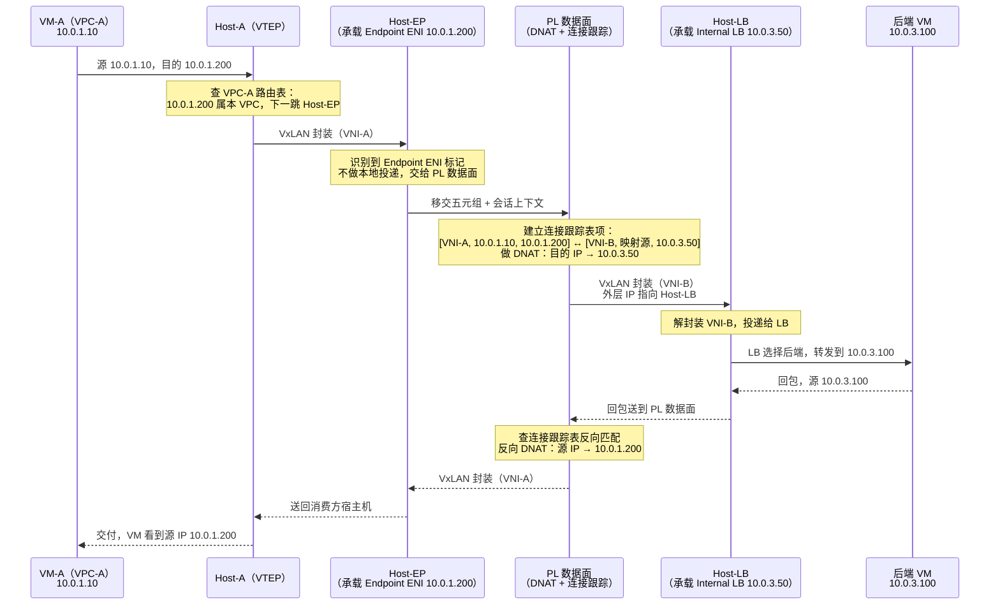
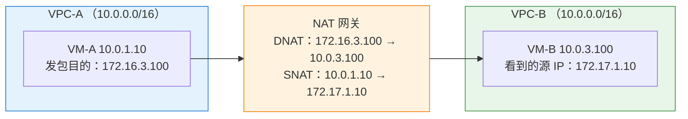
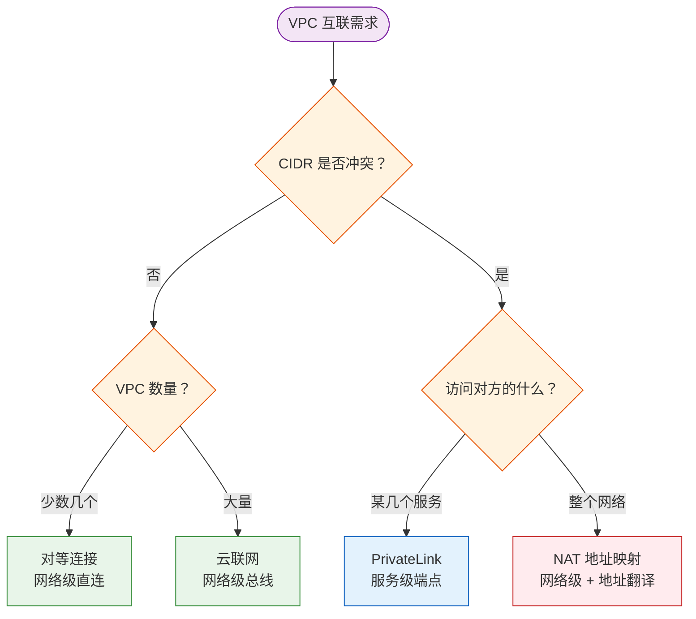

# 19. 地址冲突也要互访：PrivateLink

企业收购竞争对手时，两边的 VPC 均使用 10.0.0.0/16；SaaS 服务商接入新客户时，客户的 VPC 网段与服务商自己的地址空间完全冲突；同一家公司的两个团队各自创建 VPC，数年后发现两者的地址空间早已重合。这类场景比想象中更为普遍，RFC 1918 划分的私有地址空间本就有限， 10.0.0.0/8 往往被各方随手使用。等到某天两端网络需要互通时，历史遗留的地址冲突问题就随之暴露了出来。

如果想走前两章的老路：对等连接会报错提示 CIDR 重叠，云联网也会报错提示路由冲突。那么让其中一方修改地址呢？在生产环境中，这往往意味着要影响几百台虚拟机，改动一个 IP 就需要修改安全组规则、DNS 记录、连接字符串以及监控告警，而且改完一个地方又会冒出十几处引用旧地址的关联项，成本高昂，几乎等同于重建网络。这三条路都被堵死了。

第九章介绍过，云平台底层会使用不同的 L3 VNI 将不同 VPC 的路由域隔开。因此，两个 VPC 即便 CIDR 完全相同，数据包在 Underlay 网络中传输时也不会发生冲突。既然 VNI 已经能在数据面上实现“同 IP 不冲突”，为什么对等连接和云联网在路由决策上还是无法逾越地址冲突这道关卡？这个问题是本章的切入点，答案将引出一条截然不同的互通思路。

## 19.1 VNI 都能隔离同 IP 了，为什么对等连接过不了 CIDR 关

我们先回顾一下第九章介绍的隔离机制。L3 VNI 唯一标识一个 VPC 的三层路由域，10.0.1.20 这个 IP 在 VPC-1 里代表 VM-A，在 VPC-2 里则可能是完全无关的 VM-C。两者由不同的 L3 VNI 承载，宿主机上多个 VPC 的路由域并存且互不干扰。这套机制在 VxLAN 封装层面已被证实是行之有效的：**数据面完全有能力区分两个 CIDR 相同的 VPC**。

那对等连接卡在哪里？

回到第十七章的图 17.3。VPC-A 和 VPC-B 均使用 10.0.0.0/16，打通对等连接后，VPC-A 的路由表中会出现两条前缀完全相同的条目：一条是 10.0.0.0/16 → local，另一条是 10.0.0.0/16 → Peering。当 VM 发送数据包给 10.0.1.5 时，源宿主机上的转发决策器需要在这两条路由之间进行选择，但它无从选择。由于两条路由的前缀与优先级完全一致，路由决策会直接产生冲突与歧义。

关键在于：**这种歧义发生在路由查表阶段，还没轮到 VNI 出场**。宿主机处理报文有明确的先后顺序：首先检索源 VPC 的路由表以决定“将数据包送往何处”，获取下一跳之后再确定“使用哪个 VNI 进行封装”。VNI 是决策结果的执行工具，而非决策依据。当决策器面对两条相同前缀的路由时，它连“该报文需要跨 VPC 传输”的判定都无法做出，根本无法进入“该使用哪个 VNI”的决策阶段。

云联网的处境类似，只是转移了冲突发生的位置。它将原本分散在各个 VPC 本地的路由汇总到了中心节点上的全局路由表中。VM 发送的报文先被送至中心节点，再由中心节点做下一步转发决策。然而，当两个成员 VPC 的 10.0.0.0/16 路由均汇总到同一张全局表中时，仍然会产生同前缀冲突，全局路由查询也依然会面临歧义。VNI 隔离的是数据转发平面，但两个 VPC 的路由信息必须并列在同一张决策表中，这一冲突无论采用何种架构都无法回避。

分层的错位至此便清晰了：VNI 解决的是“报文送达宿主机后，如何区分其归属的 VPC”，这属于数据面的隔离能力；而地址冲突真正的症结在于路由决策阶段：**两个 VPC 的地址前缀必须在同一个决策上下文中进行比对**。前缀相同，路由决策必然产生歧义，无论底层的封装机制有多么精巧，都无济于事。

## 19.2 换个抽象层：让服务而不是网络成为互通的最小单位

既然路由决策这一层解不开，就得换个问法：VPC-A 真的需要和 VPC-B 的整个网络互通吗？

大概率不需要。A 需要的只是调用 B 提供的某个数据接口，或者拉取 B 上的某份对象存储清单。A 并不关心 B 网络内还运行着哪些 VM，也无需关注这些 VM 的地址段设置。前两章的思路是“打通两个网段”，这就像拆掉两栋楼之间的隔墙让人员自由走动。但如果两栋楼的房间号完全相同，拆墙之后甚至连“101 房间到底在哪栋楼”都无法分辨——这恰好形象地解释了 CIDR 冲突时路由决策所面临的困境。

如果换个抽象层，不拆墙，而是在墙上开一个窗口，仅允许 B 的某个服务通过该窗口对外暴露。A 不需要进入 B 的楼内，只需与该窗口进行交互。**互通的最小单位从“网段前缀”降到了“服务端点”**。粒度一降，冲突的前提随之消失：即使两个网段完全重合，服务端点依然是拥有独立 IP 的具体对象。

再进一步：当这个“服务端点”具体化为一个 IP 地址时，该 IP 应该归属于谁的地址空间？

如果将其置于 B 的地址空间，A 访问它时仍需在源 VPC 的路由表中添加一条“指向对端 VPC”的路由，这又回到了 19.1 节中提到的路由歧义问题。真正能绕开这一困境的做法是：**让这个 IP 自始至终属于 A 自己的地址空间**。当源 VPC 路由表匹配到该 IP 时，会将其判定为本 VPC 内的普通网卡，从而在本地完成转发，根本不会触发跨 VPC 的路由决策。两个 VPC 的路由表自始至终互不相干，冲突的前提也就无从谈起。

这两者结合，方案的核心思路就清晰了：**将 B 的服务在 A 的地址空间中虚拟出一个入口，使 A 误以为自己在访问本 VPC 内的本地服务**。至于这个入口底层如何将请求转发至 B，又如何将响应回包还原为 A 可以识别的状态，则完全由该入口背后的专用通道负责，源 VPC 的路由体系无须进行任何感知与处理。

这一思路在云上有个成熟的产品化形态，称为 PrivateLink（不同厂商命名有所差异，也称 VPC Endpoint Service）。它与对等连接、云联网属于截然不同的演进方向——后两者都在解决“如何打通两个 VPC 的路由域”这一命题，而 PrivateLink 则直接放弃了网络的打通，转而采用“由消费方 VPC 内的弹性网卡（ENI）来代表提供方的服务入口”。

该设计若要落地，需要四个组件的紧密配合：消费方 VPC 内的入口网卡、负责传输与转换的专用通道、提供方一侧稳定的服务地址，以及对业务层完全透明的域名解析层。下面逐一探讨它们各自解决的具体问题。

## 19.3 参与角色：入口、通道、服务地址与域名

**Endpoint ENI：消费方 VPC 内的一块代理网卡。** 这是整套机制的入口。它有 MAC 地址，有一个从消费方 VPC 子网里分配出来的 IP，注册在消费方 VPC 的路由域里，消费方的路由表把它当作本 VPC 内的一个普通终端。这一切都是刻意的，它必须让源宿主机在查路由表时觉得这是本地流量，从而绕开跨 VPC 决策。

但 Endpoint ENI 背后没有 VM。普通 ENI 后面挂的是虚拟机的虚拟网卡，包送到宿主机上之后有明确的投递目标；Endpoint ENI 背后连着的是云平台内部的一段转发通道，通道另一端才是提供方 VPC 里的服务。宿主机怎么知道这是一块 Endpoint ENI 而不是普通网卡？靠控制面预先下发的标记。云平台创建 Endpoint 时会在承载它的宿主机上打一个标签，记下这个 MAC/IP 对应的是一个 PrivateLink Endpoint，不要按本地投递处理，交给 PL 数据面。同时下发的还有这个 Endpoint 指向的服务标识，它对应的是哪一个 Endpoint Service，服务侧的入口在哪里。

**PL 数据面：跨 VPC 通道的核心组件。** 这是承接 Endpoint ENI 移交请求的转发平面，处在消费方 VPC 和提供方 VPC 之间那道翻译层的位置。既然 Endpoint ENI 只是入口，真正把包从消费方 VPC 送到提供方 VPC 的事情就落在它身上。要理解它必须做什么，先想一个更简单的问题：如果它只把目的 IP 从 10.0.1.200 改成 10.0.3.50（也就是只做 DNAT），够不够？

第十五章讲四层 LB 时讨论过这个问题：只改目的 IP、不改源 IP，后端处理完请求发回包时，看到的源 IP 是客户端原来的地址，回包会顺着路由表直接送回客户端，不再经过做翻译的那台设备。放到 PrivateLink 这里，后果更严重，后端看到的源 IP 是 10.0.1.10，可 10.0.1.10 在提供方 VPC 里是本地地址（VPC-B 的 CIDR 也是 10.0.0.0/16），回包直接被送去 VPC-B 内部一台真实的 VM 或者被判定为无路由丢弃，PL 数据面这边永远等不到回包。所以源 IP 也得改，改成一个提供方 VPC 里预留出来的、不会与真实 VM 撞车的地址，让 VPC-B 的路由把回包再引回 PL 数据面。**这就是 SNAT 存在的理由：让回包必须经过翻译层，才能被翻译回去**。

回包被引回来之后，PL 数据面还得靠一张连接跟踪表反查“这条回包对应哪一条去程”，才能把 IP 和 VNI 都还原回消费方能识别的样子。这就是**为什么 PL 数据面必须是有状态的**：不像对等连接那种基于路由表的无状态转发，PrivateLink 改了 IP，回包只能靠会话表反向翻译，会话状态一旦丢失，这条连接就断了。这一整套 FULLNAT + VNI 切换的机制，与第十五章四层 LB 的 FULLNAT 是同一类做法，只是 PrivateLink 多做了一层 VNI 切换——因为它跨的是两个独立的路由域，而 LB 处理的是同一个 VPC 内的转发。至于这批转发节点是集中部署成独立集群，还是把逻辑下沉到承载 Endpoint ENI 的宿主机上就地完成，各家云厂商选择不同，是集中式与分布式的老权衡（第十四章讲 EIP 网关时提过同一个话题）。对本节而言无关紧要，位置和封包路径同构，机制上没有差别。

**Internal LB：提供方 VPC 里的服务入口。** 服务方不会把后端 VM 直接暴露给 PL 数据面，中间隔一层内部负载均衡器。这样做的原因有两个：后端 VM 可能有多台，需要一层做健康检查和请求分发；PL 数据面翻译出来的目标 IP 需要是一个稳定的地址，不能随后端 VM 的扩缩容而变化，LB 的 VIP 正好满足这个要求。LB 本身在提供方 VPC 的地址空间里，用的是提供方的地址段，PL 数据面把请求送到 LB 的 VIP，剩下的分发工作由 LB 完成。

**私有 DNS：让应用层完全无感。** 有了前三个角色，跨 VPC 调用在网络层已经打通，但业务代码不应该去感知自己在调用一个 PrivateLink 服务。私有 DNS 把服务的域名 `data-api.b.internal` 在消费方 VPC 内解析为 Endpoint ENI 的 IP，业务代码只需要访问域名，看到的就是一个本 VPC 内的普通服务。整套 PrivateLink 机制对应用层是透明的。

四个角色摆在一起，PrivateLink 与前两章的分水岭也就清楚了。对等连接和云联网在**路由决策**这一层做文章，路由表被改写，包在源侧就被引向另一个 VPC 的方向；PrivateLink 的动作发生得更靠后，源侧的路由表根本没有跨 VPC 的语义，一直到 Host-EP 解封装的那一刻才由 vSwitch 拦下来交给 PL 数据面。同一件事被放到两个抽象层去解，一个改路由，一个改包头。改包头具体是怎么一步步发生的，下一节跟着包走一遍就能看清。

## 19.4 一个包在 PrivateLink 里的完整旅程

有了 Endpoint ENI 作为入口，一个真实的数据包将跨越两个 CIDR 相同的 VPC 完成一次调用。接下来我们逐步拆解去程和回程的详细流程。这里的处理逻辑比前两章介绍的方案更为复杂，因为 PrivateLink 需要同时完成三项任务：地址转换、VNI 切换以及连接状态维护。

我们先明确各组件的配置与网络拓扑。消费方 VPC-A 的 CIDR 为 10.0.0.0/16，L3 VNI 记为 VNI-A；提供方 VPC-B 的 CIDR 同样为 10.0.0.0/16，L3 VNI 记为 VNI-B。消费方虚拟机 VM-A 的 IP 地址是 10.0.1.10；Endpoint ENI 部署在 Host-EP 宿主机上，属于消费方的子网，IP 地址为 10.0.1.200。提供方 Internal LB 部署在 Host-LB 上，IP 地址为 10.0.3.50（虽然与消费方 VPC 中的 10.0.3.50 冲突，但两者互不干扰）。后端服务虚拟机 VM-B 部署在 Host-SVC 上，IP 地址为 10.0.3.100。

**图 19.1：PrivateLink 的一次完整调用**

去程分三段，每一段解决一个具体问题。

**第一段：消费方 VPC 内的普通投递。** VM-A 发送报文给 10.0.1.200，源宿主机 Host-A 上的 VTEP 检索 VPC-A 的路由表，发现目的 IP 属于本 VPC 的本地子网段，下一跳指向 Host-EP 上的弹性网卡。在此阶段，其转发行为与普通的 VPC 内跨宿主机通信完全一致，Host-A 使用 VNI-A 对 VxLAN 进行封装，外层 IP 指向 Host-EP。**在整个过程中，Host-A 并不感知这是一次跨 VPC 调用**，在它的视角里，这仅仅是本 VPC 内的一次普通报文投递。这正是 19.2 节所期望达到的效果：在源端路由决策阶段完全屏蔽跨 VPC 的属性。

**第二段：从消费方 VPC 移交到 PL 数据面。** Host-EP 接收到经过 VNI-A 封装的数据包并解封装。通常情况下，vSwitch 会根据 MAC/IP 地址将其投递给本地的虚拟接口，但由于识别到目的 ENI 打上了 PrivateLink Endpoint 标记，投递逻辑随即发生改变——报文不会进入网络协议栈，而是被直接移交给宿主机上的 PL 数据面组件。移交时会附带完整的会话上下文，包括源 VNI（VNI-A）、源 IP（10.0.1.10）、目的 IP（10.0.1.200）以及 TCP 五元组的其他字段。该移交点标志着数据包在消费方 VPC 路由域内的旅程正式结束。

**第三段：DNAT/SNAT + 重新封装，进入提供方 VPC。** PL 数据面在接收到数据包后，会按顺序执行以下两项关键操作（顺序不可颠倒）。首先，建立连接跟踪表项：它从云平台预留的内部地址池中分配一个在提供方 VPC 内不冲突的“映射源 IP”（该 IP 位于 VPC-B 的地址空间内但不会与真实的虚拟机冲突），并将 `[VNI-A, 10.0.1.10, 10.0.1.200]` 与 `[VNI-B, 映射源 IP, 10.0.3.50]` 的双向映射关系记录下来。随后执行网络地址转换（NAT）：将目的 IP 从 10.0.1.200 转换为 10.0.3.50，同时将源 IP 从 10.0.1.10 转换为映射源 IP。转换完成后，使用 VNI-B 重新对 VxLAN 进行封装，外层 IP 指向 Host-LB，并发送到物理底层网络。从这一刻起，该数据包便正式归属于 VPC-B 的流量范畴了。

在到达 Host-LB 之后，后续的处理即为提供方 VPC 内部的普通报文投递：解封装 VNI-B 并根据 MAC/IP 投递给 Internal LB，LB 执行后端健康状态与权重计算后选择一台后端 VM，并将报文转发至 10.0.3.100。**提供方（包含 LB 与后端服务）同样不感知该请求来自外部 VPC**，在其视角下，这只是一次源 IP 为本 VPC 地址空间内某个预留 IP（即映射源 IP）的本地访问请求，符合本 VPC 内安全组、路由表和日志系统的所有安全假设。

回程的关键在于连接跟踪表如何进行反向检索。

服务 VM 处理完请求后，将响应报文发送给它识别到的“客户端 IP”（即映射源 IP）。Internal LB 收到回包后，会根据自身连接表把这条回包与去程建立的会话对上，找出对应的处理链路，随后把包封装转出。在 VPC-B 的转发平面上，映射源 IP 作为预留内部地址，其路由会被指向 PL 数据面。

PL 数据面收到回包时，仅凭两个信息来进行匹配：VNI-B，以及报文的目的 IP（即映射源 IP）。它利用这两个字段去反查先前建立的连接跟踪表，进行如下的反向地址转换：将回程报文的源 IP（10.0.3.50）反向映射为 10.0.1.200（消费方看到的服务 IP），将目的 IP（映射源 IP）反向映射为 10.0.1.10，同时将源 VNI 切换为 VNI-A。在完成反向地址转换后，利用 VNI-A 对报文进行重新封装，外层 IP 指向 Host-A。包一路送回 VM-A。**VM-A 看到的响应源 IP 自始至终都是 10.0.1.200**，它以为自己刚刚是在与本 VPC 内的一个普通本地服务进行通信。

对比前两章的互联机制，PrivateLink 的三个独特之处便显现了出来。首先，对等连接的集中式网关方案中虽然也有 VNI 的切换（VNI-A 换为 VNI-B），但该过程仅改变报文封装，并不改动 IP 报头，因为其前提是两个 VPC 必须保证地址空间不冲突。而 PrivateLink 在处理地址重叠时，同一个 IP 在两侧代表不同的实体，必须通过 DNAT 和 SNAT 对 IP 报头进行彻底的“翻译”。第二处不同在于状态维护，对等连接和云联网都是无状态的，回程报文顺着路由表自然返回即可；而 PrivateLink 必须在数据面维护连接跟踪表，因为反向的地址转换高度依赖“属于同一个会话”的上下文。第三处不同是 IP 报头转换的粒度，它不仅要改变目的 IP，还要同时改变源 IP（将其映射为 VPC-B 内的预留 IP），这种双向 NAT 转换的设计，能确保回程报文在 VPC-B 内部可以被正确路由回 PL 数据面。这三项特征交织在一起，使得 PrivateLink 的实现复杂度明显高于对等连接和云联网。

## 19.5 从机制反推出来的四条约束

理解了 19.4 的封包过程，PrivateLink 使用手册上那几条限制就不再是散乱的清单，而是从机制里自然长出来的东西。

**单向性——只有消费方能主动发起。** Endpoint ENI 只在消费方 VPC 里被创建，提供方 VPC 里没有一个对称的“反向 Endpoint”能代表消费方的服务。连接跟踪表的每一条表项都是在消费方发包时建立的，反向 DNAT 依赖这条表项存在。如果提供方想主动访问消费方的某个服务，它手里没有对应的 Endpoint，包无法进入 PL 数据面，也就不会有连接跟踪表可查。想让两边都能主动调用对方的服务，只能各建一条 PrivateLink，各自暴露自己那侧的入口。这不是产品偷工减料，而是最小暴露面在机制上的直接体现。

**不支持 ICMP——ping 不通不代表服务不通。** 连接跟踪表的建立、反向 DNAT 的匹配，都以 TCP/UDP 的五元组为键。ICMP 没有端口，没有连接概念，PL 数据面拿到一个 ICMP echo request 之后既建不起表项，回包时也无从反向匹配。厂商在实现上直接选择丢弃 ICMP，避免维护一套单独的 ICMP 转换逻辑。运维习惯用 ping 测试连通性，在 PrivateLink 场景下这个习惯要改，得改用 telnet 或 curl 探 TCP 端口——ping 不通只说明网络层探测不响应，不说明服务不可达。

**性能上限被 Internal LB 卡住。** 数据面链路里必然经过 Internal LB，LB 本身是有状态的四层反向代理，它自己就要维护连接表，还要做后端健康检查、会话保持、请求分发。这些动作决定了 PrivateLink 的吞吐上限不是“云平台底层网络能跑多快”，而是“LB 这一层能承受多少并发连接和多少 Gbps”。对等连接的分布式直连模式下没有这种瓶颈，包在源宿主机和目的宿主机之间一步直达，性能随宿主机数量线性扩展。PrivateLink 结构性地做不到这种扩展，因为 LB 是一个绕不开的收敛点。高吞吐场景下需要按 LB 规格算容量，不够就在消费方多可用区各建一个 Endpoint，把连接分散到多个 LB 上。

**Region 是硬边界。** PL 数据面组件、Endpoint ENI、Internal LB 都是 Region 内部的实例，连接跟踪表也存在 Region 内的数据面里。跨 Region 意味着两个 Region 各有一套 PL 数据面，包要从一个 Region 走到另一个 Region 只能经过骨干网——而 Endpoint ENI 的定义前提是“落在消费方 VPC 的某个子网里”，子网不能跨 Region，Endpoint ENI 自然也不能。跨 Region 访问服务的做法是分两段：先用云联网或专线把跨 Region 的网络拉到一起，让消费方 VPC 和提供方 VPC 在同一个 Region 里能“看到”对方的位置，然后在这个 Region 内套一层 PrivateLink 提供服务级抽象。这不是叠加冗余，而是两层解决两件事——传输层的距离问题由骨干网负责，抽象层的地址冲突问题由 PrivateLink 负责。

四条约束没有一条是“产品没做完”，每一条都能顺着 19.4 的机制推出来。理解到这一层，PrivateLink 什么场景能用、什么场景要绕开就成了自然判断，不需要死记。

## 19.6 NAT 地址映射与卷五的收束

PrivateLink 解的是“只想调对方一个服务”，但总有业务场景真的需要“能访问对方网络里的任意地址”。典型的例子是两家公司合并，旧系统一时半会弄不清到底要开那几个服务入口，往往就是整张网的互相可见。

这时常见的工程解法是双向 NAT 地址映射。在两个 CIDR 冲突的 VPC 之间放一个 NAT 网关，VPC-B 的 10.0.0.0/16 在 VPC-A 看来是 172.16.0.0/16，VPC-A 在 VPC-B 那侧则变成 172.17.0.0/16。VPC-A 的 VM 要访问 VPC-B 的 10.0.3.100，手里发出去的目的地址是 172.16.3.100；NAT 网关拆包后把目的 IP 换回真实的 10.0.3.100，同时把源 IP 从 10.0.1.10 换成 172.17.1.10，为的是让回包在 VPC-B 的路由表里能再回到这台 NAT 网关。

**图 19.2：双向 NAT 地址映射**

机制上与 PrivateLink 同根，都是用地址翻译绕开路由决策阶段的歧义。不同的是暴露粒度：NAT 映射把对端整个网段搬到本侧，PrivateLink 只搬一个服务入口。粒度一变粗，代价就在三个地方浮上来。

一是映射地址段本身也得规划。企业得额外拿出两个双方都没占用的私有网段专门当映射空间用。一两对 VPC 还好，一旦企业内需要互连的 VPC 变多，映射网段之间也不能相互冲突，地址分配就从“拉一条映射”变成了一盘需要专人盯的账。二是应用层得一块块跟着改。业务代码里写死的对端 IP、内部 DNS 里指向对端真实地址的记录，都得换成映射后的地址。更麻烦的是 SIP、FTP 主动模式这类把 IP 写在报文载荷里的协议，NAT 网关只改报头改不到载荷，翻译完了载荷里那个 IP 仍然是对端看不懂的真实地址，要么直接失效，要么得写一套 ALG（应用层网关）模块去翻译载荷。三是网关设备又多背一层压力。双向 NAT 意味着每一条包都要双向翻译，第十三章提过的 conntrack 端口耗尽和连接跟踪压力会直接翻倍。

所以实际中双向 NAT 更多时候是退无可退时的兜底手段，只有当需求确实是“大范围网络级互访”、且拆不到服务级调用的粒度时，才会被拿上台面。大多数场景下，能用 PrivateLink 就不会选它，无需额外占地址段、不用养映射规则表、暴露面小一个数量级，都是实实在在的好处。

**图 19.3：地址冲突场景下的选择路径**

卷五介绍的三种 VPC 互联方案取舍不同，但面对的是同一个问题：两个路由域怎么交互。互通的粒度从整网段直连（对等连接）降到多网段共用总线（云联网），再降到单个服务端点（PrivateLink）。粒度每降一级，地址规划上的约束就弱一点，代价则是底层机制要多做一层事，从路由叠加到中心节点路由，再到 SNAT + DNAT + 连接跟踪。可选方案之所以呈现这样一条递进的线，本质上是地址空间这一层只能往后退让。退的距离越大，要靠底层机制去补的也越多。

到这里，云上 VPC 之间的互联算是讲完了。但一家企业的网络很少只在云上：旧机房里的服务器还在跑核心业务，分布在各地的办公点需要接进来，手里往往还挂着另外一两家云厂商的资源。云上应用要读机房里的数据库，机房里的系统反过来要拉云端的对象存储，面对的已经不是同一张云平台内部的虚拟隔离，而是两套完全独立的物理网络。下一卷就从这里接上。