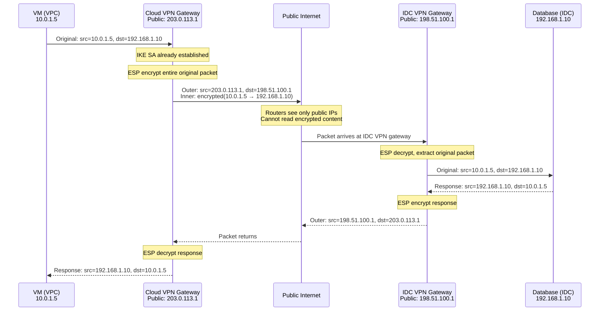
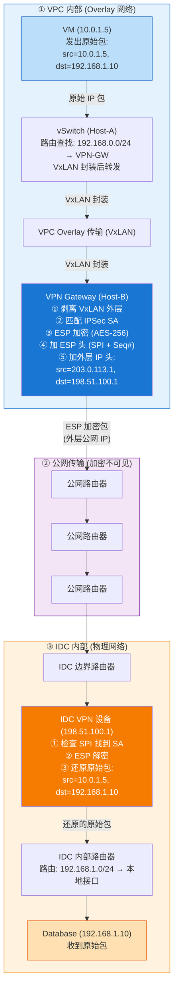
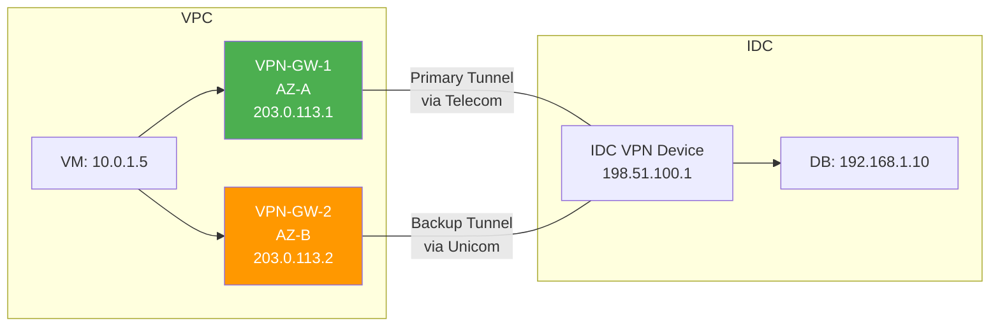

# 20. 用互联网打通云和 IDC：VPN 连接

CTO 在周会上提了一个问题："我们的核心数据库还在 IDC 机房里，云上的 Web 应用怎么访问它？"

合规要求数据库不能离开自建机房，DBA 团队也不愿意把几十 TB 的 Oracle 迁到云上。但云上的 Web 应用每秒要查询数据库几千次。VPC 和 IDC 之间没有任何路由可达性——这不是防火墙或安全组的问题，而是两个完全不同的网络体系之间根本没有路由交换机制。要打通这道墙，最快、最低成本的方式，是利用一个两边都已经能访问的东西：互联网。

## 20.1 两个不同的网络世界

先看清楚这道墙到底是什么。

VPC 是 Overlay 虚拟网络，运行在云厂商的物理基础设施之上，路由由 SDN 控制面管理。VM 的私有 IP（比如 10.0.1.0/16）只在 VPC 内部有意义，VPC 的控制面知道每个 IP 在哪台宿主机上，知道怎么通过 VxLAN 隧道把包送过去。

IDC 是传统的物理网络，路由由企业自己的路由器和交换机管理。服务器的私有 IP（比如 192.168.0.0/24）只在 IDC 内部有意义，IDC 的路由器知道每个网段在哪个接口后面。

两者之间没有任何路由交换机制。VPC 的控制面不知道 IDC 的存在，它的路由表里没有 192.168.0.0/24 这条路由。IDC 的路由器也不知道 VPC 的存在，它的路由表里没有 10.0.1.0/16 这条路由。VPC 的 VM 发一个目的地为 192.168.1.10 的包，路由表查不到匹配项，包被丢弃。就这么简单。

最直觉的想法是什么？让 IDC 的数据库服务器通过公网 IP 暴露出来，VPC 的 VM 通过 NAT 网关访问这个公网 IP。技术上可行，第13章和第14章已经讲过 NAT 和 EIP 的机制。但问题很明显：数据库连接串在公网上明文传输，任何中间路由器都能看到 SQL 查询和返回的数据。对于金融数据、用户隐私、交易记录这些内容，这个风险不可接受。而且流量走公网还有延迟和成本的问题，每一个查询都要绕一圈公网，延迟从毫秒级变成了十几毫秒，带宽按公网流量计费。

需求的本质其实不复杂：在 VPC 和 IDC 之间建立一条"私有通道"，让两边的私有 IP 互相可达，同时保证数据传输的安全性。最快的方式是利用已有的公网基础设施，VPC 有公网出口，IDC 也有公网出口，但在公网传输的数据上加一层加密保护。

这个思路有一个名字：VPN（Virtual Private Network）。"Virtual"是因为它不是一条真实的物理线路，而是在公网上虚拟出来的；"Private"是因为数据经过加密，即使在公网上传输也不会被窃听。

## 20.2 IPSec：在公网上建一条加密隧道

VPN 的核心思路是两个动作的叠加：加密和隧道。

加密解决安全问题，数据在公网上传输时，即使被中间路由器截获，也无法读取内容。隧道解决路由问题，原始的私有 IP 包（源 10.0.1.5，目的 192.168.1.10）在公网上无法路由，但把它塞进一个新的 IP 包里，新包的源和目的都是公网 IP，公网路由器就能正常转发了。

实现这两个动作的协议族叫 IPSec。它分两个阶段工作。

**第一阶段：IKE 握手，先建立信任。** 在传输任何业务数据之前，VPC 端的 VPN 网关和 IDC 端的 VPN 设备需要先互相确认身份、协商加密参数。这个过程由 IKE（Internet Key Exchange）协议完成。两端通过 UDP 500 端口通信，用预共享密钥（Pre-Shared Key）或数字证书验证对方的身份，"你真的是我要连接的那个 IDC 吗？"身份确认后，双方通过 Diffie-Hellman 算法协商出一个共享密钥，这个密钥不会在网络上传输，但双方都能独立计算出相同的值。IKE 的第一阶段建立了一条安全的管理通道（IKE SA），第二阶段在这条管理通道上协商数据传输的加密参数，用什么加密算法（AES-256）、用什么认证算法（SHA-256）、密钥多久轮换一次。协商完成后，双方各自持有一组 IPSec SA（Security Association），这就是数据传输的"通行证"。

**第二阶段：ESP 封装，给每个包穿上铠甲。** 协商完成后，真正的业务数据开始传输。原始的 IP 包被 ESP（Encapsulating Security Payload）协议封装。

**图 20.1：ESP 隧道模式的封装结构**

```
┌──────────────────────────────────────────────────────────────────┐
│                     New IP Header (Outer)                        │
│  Src: VPN-GW-Cloud Public IP    Dst: VPN-GW-IDC Public IP       │
│  Protocol: 50 (ESP)                                              │
├──────────────────────────────────────────────────────────────────┤
│                     ESP Header                                   │
│  SPI (32-bit): identifies which SA    Seq# (32-bit): anti-replay │
├──────────────────────────────────────────────────────────────────┤
│                     ┌─────────────────────────────────┐          │
│                     │  Original IP Header (Inner)     │          │
│    Encrypted        │  Src: 10.0.1.5  Dst: 192.168.1.10│        │
│    Payload          │  Original IP Payload            │          │
│                     │  ESP Padding                    │          │
│                     └─────────────────────────────────┘          │
├──────────────────────────────────────────────────────────────────┤
│                     ESP ICV (Integrity Check Value)              │
│                     Anti-tampering authentication data            │
└──────────────────────────────────────────────────────────────────┘
```

ESP 头里有两个关键字段。SPI（Security Parameter Index）是一个 32 位的标识符，告诉接收端"这个包属于哪个 SA"，因为两端之间可能同时存在多条隧道，SPI 用来区分。Sequence Number 是一个递增的序列号，防止重放攻击，如果攻击者截获了一个加密包并重复发送，接收端通过序列号就能发现这是一个重复的包。

加密的范围取决于模式。隧道模式（Tunnel Mode）加密整个原始 IP 包，包括原始的 IP 头。这意味着中间路由器完全看不到原始的源 IP 和目的 IP，只能看到外层的公网 IP。传输模式（Transport Mode）只加密 payload，保留原始 IP 头。云上 VPN 几乎都用隧道模式，因为原始包的源和目的都是私有 IP，如果不加外层公网 IP 头，公网路由器根本不知道往哪里转发。

**图 20.2：一个包的完整旅程**



说到底，IPSec VPN 做的事情就是：把一个私有 IP 包加密后塞进一个公网 IP 包里，让它能在公网上安全地旅行。到达目的地后，剥掉外壳，还原出原始的私有 IP 包。整个过程对两端的 VM 和服务器完全透明，它们以为自己在直接通信。

## 20.3 云端 VPN 网关：托管的隧道端点

IPSec 隧道需要两个端点，一端在云上，一端在 IDC。

云端的端点是 VPN 网关。云厂商把它做成了托管服务，你创建一个 VPN 网关实例，绑定到 VPC，云厂商自动分配一个公网 IP 作为隧道端点。底层的 IKE 协商、ESP 封装解封装、密钥轮换，都由云厂商的基础设施完成。你不需要自己部署和维护 VPN 软件，不需要担心操作系统补丁和安全更新。

IDC 端的端点通常是企业已有的网络设备，一台支持 IPSec 的路由器或防火墙。Cisco、Juniper、Fortinet、华为的企业级设备几乎都支持 IPSec VPN。IDC 的网络管理员在设备上配置对端的公网 IP（云端 VPN 网关的 IP）、预共享密钥、加密算法等参数。

两端配置匹配后，IKE 协商自动完成，隧道建立。这个过程通常在几秒到几十秒内完成，比起专线动辄几周到几个月的部署周期，VPN 的"即开即用"是它最大的优势之一。

VPN 网关的带宽规格也值得注意。云厂商的 VPN 网关通常有带宽上限，比如 100Mbps、200Mbps、1Gbps。但这个上限是 VPN 网关实例本身的限速，不是隧道的理论上限。实际可用带宽还受公网链路质量影响，如果公网链路在高峰期只剩 200Mbps 的可用带宽，你买了 1Gbps 的 VPN 网关也没用。花钱买了一辆跑车，但路上堵车，跑不起来。

**图 20.3：VPN 连接的整体架构**


> 蓝色 = 云端（VPN 网关由云厂商托管），橙色 = IDC 端（VPN 设备由客户管理）。粗线 = IPSec 加密隧道，经过公网但内容不可见。

架构介绍完了，现在把一个数据包从 VM 发出到最终到达 IDC 数据库的完整路径走一遍。19.2 节的时序图展示了 IPSec 协议层面的加密和解密，但省略了云内部和 IDC 内部的转发细节。实际上一个包要经过的环节比那张图多得多。

以 VM（10.0.1.5）访问 IDC 数据库（192.168.1.10）为例，完整的转发流程如下。

VM 的应用发出一个 TCP 包，源 IP 10.0.1.5，目的 IP 192.168.1.10。这个包先到达 VM 所在宿主机的虚拟交换机（vSwitch）。vSwitch 查询 VPC 的路由表，发现 192.168.0.0/24 的下一跳指向 VPN 网关。VPN 网关是 VPC 内部的一个托管实例，它运行在云厂商的某台宿主机上，有自己的 VPC 内部 IP。vSwitch 用 VxLAN 封装把这个包送到 VPN 网关所在的宿主机——这一步和 VPC 内部 VM 之间的通信机制完全一样，走的是云内部的 Overlay 网络。

包到达 VPN 网关后，网关识别出这个包匹配 IPSec SA（通过路由型 VPN 的 VTI 路由或策略型 VPN 的 ACL 规则）。网关执行 ESP 封装：先剥掉 VxLAN 的外层封装，拿到原始的 IP 包（src: 10.0.1.5, dst: 192.168.1.10），用 AES-256 加密整个原始包，加上 ESP 头（SPI + 序列号），再套上新的外层 IP 头（src: 203.0.113.1, dst: 198.51.100.1）。加密后的包通过云厂商的公网出口发到互联网上。

在公网上，这个包和普通的 IP 包没有任何区别。沿途的每一台路由器只看到外层 IP 头，按照正常的 BGP 路由逐跳转发。它们不知道也不关心里面装的是什么——可能是一个网页请求，可能是一段视频流，也可能是一个加密的数据库查询。包经过若干跳公网路由器后，到达 IDC 的公网出口。

IDC 的边界路由器收到这个包，目的 IP 198.51.100.1 是 IDC VPN 设备的公网地址，路由器把包转发给 VPN 设备。VPN 设备检查 ESP 头中的 SPI，找到对应的 IPSec SA，用协商好的密钥解密 payload，还原出原始的 IP 包（src: 10.0.1.5, dst: 192.168.1.10）。解密后的包进入 IDC 的内部路由体系，IDC 的路由器查路由表，发现 192.168.1.0/24 在某个接口后面，把包转发到数据库服务器。

回程是对称的。数据库的响应包（src: 192.168.1.10, dst: 10.0.1.5）到达 IDC VPN 设备，设备查路由表发现 10.0.0.0/16 应该走 VPN 隧道，执行 ESP 加密封装，外层 IP 变成 src: 198.51.100.1, dst: 203.0.113.1，通过公网送回云端。云端 VPN 网关解密后，把原始响应包通过 VPC 的 Overlay 网络送回 VM。VM 收到响应，src 是 192.168.1.10，就好像数据库就在隔壁一样。

**图 20.4：数据包的端到端转发流程**



> 三个网络域、三次封装变化：**① VPC 内部**（蓝色）— 原始包经 VxLAN 封装送达 VPN 网关；**② 公网**（紫色）— VPN 网关剥掉 VxLAN、加上 ESP 加密层和公网 IP 头，沿途路由器只能看到外层公网地址；**③ IDC 内部**（橙色）— VPN 设备剥掉 ESP 层，还原出最初的原始包，交给内部路由转发。每个域只看到属于自己那一层的头部信息。

整个路径上，包经历了三次封装变化。第一次是 VPC 内部的 VxLAN 封装，让包能从 VM 所在的宿主机到达 VPN 网关所在的宿主机。第二次是 VPN 网关的 ESP 封装，剥掉 VxLAN 外壳，加上 ESP 加密层和公网 IP 头，让包能在公网上安全传输。第三次是 IDC VPN 设备的 ESP 解封装，剥掉公网 IP 头和 ESP 层，还原出最初的原始包。三次变化，三个不同的网络域，每个域只看到属于自己那一层的头部信息。

隧道建立后，还有一个关键问题：VPC 的路由表怎么知道"目的地为 192.168.0.0/24 的流量应该走 VPN 隧道"？隧道只是一条加密的管道，它不会自动告诉路由表"IDC 的网段应该从这里走"。路由怎么注入，决定了 VPN 在实际运维中的管理成本，这也是路由型 VPN 和策略型 VPN 的核心分野。

## 20.4 路由型 VPN 与策略型 VPN

两种思路，两种完全不同的管理模型。

**策略型 VPN：显式列举。** 用 ACL（访问控制列表）定义"什么流量走隧道"。比如：源 IP 在 10.0.0.0/16 且目的 IP 在 192.168.0.0/24 的流量走隧道，其他流量走正常路由。每条 ACL 规则对应一个独立的 IPSec SA，也就是说，每对源网段和目的网段之间都有一条独立的加密通道。

这个思路在简单场景下很直观，两个网段互通，写一条规则就行。但当需要互通的子网变多时，问题就来了。IDC 有 3 个子网（192.168.1.0/24、192.168.2.0/24、192.168.3.0/24），VPC 有 2 个子网（10.0.1.0/24、10.0.2.0/24），全互通需要 6 条 ACL 规则、6 个 IPSec SA。IDC 新增一个子网？两端都要手动添加规则。十几个子网的策略型 VPN，最常见的故障就是"改了一端忘了改另一端，隧道死活不通"，排查半天，最后发现是一条 ACL 没同步。

**路由型 VPN：让路由表决定。** 在隧道上建立一个虚拟接口，VTI（Virtual Tunnel Interface）。VTI 就像一个普通的网络接口，有 IP 地址，可以被路由表引用。路由表里添加一条路由：目的地为 192.168.0.0/24 的流量，下一跳指向 VTI。流量匹配完全由路由表决定，不需要 ACL。所有走 VTI 的流量共享同一个 IPSec SA，不需要为每对网段单独建立 SA。

路由型 VPN 的真正优势在于它能和动态路由协议配合。在 VTI 上运行 BGP，IDC 端通过 BGP 向云端宣告自己的路由前缀，云端自动学习。IDC 新增了一个子网？BGP 自动传播，两端都不需要手动更新配置。这在子网频繁变化的环境中是决定性的优势。

**图 20.5：策略型 vs 路由型 VPN 的流量匹配**


> 红色 = 策略型（静态、手动、O(N×M) 复杂度），绿色 = 路由型（动态、自动、O(1) 复杂度）。路由型 VPN 通过 VTI + BGP 实现了"加子网不改配置"。

两种方式不是"谁更好"的关系。策略型 VPN 在只有一两对网段互通的简单场景下更直观，不需要配置 VTI，不需要运行 BGP，规则一目了然。路由型 VPN 在子网多、变化频繁的场景下更灵活，动态路由让管理成本从 O(N×M) 降到了 O(1)。大多数云厂商推荐路由型 VPN，因为它更容易和云联网集成，云联网本身就是基于路由传播的架构。

## 20.5 双隧道高可用与故障切换

VPN 隧道依赖公网链路。公网链路可能因为运营商故障、路由变更、DDoS 攻击等原因中断。如果只有一条隧道，中断就意味着云和 IDC 之间完全断开。

对于生产环境，这个风险不可接受。

标准的做法是建立两条 VPN 隧道，走不同的公网路径。比如：主隧道通过电信线路连接到云厂商可用区 A 的 VPN 网关，备隧道通过联通线路连接到可用区 B 的 VPN 网关。两条隧道使用不同的运营商、不同的物理路径、不同的 VPN 网关实例，尽可能消除单点故障。

**图 20.6：双隧道高可用架构**



故障检测靠什么？IPSec 本身有 DPD（Dead Peer Detection）机制，两端定期互相发送探测包（"你还活着吗？"），如果连续多次没有收到回应，判定隧道失效。DPD 的检测间隔通常是 10-30 秒，连续 3-5 次未响应后判定故障，这意味着故障发现的时间窗口在 30 秒到 2 分钟之间。

发现故障后如何切换？这取决于 VPN 的类型。路由型 VPN 配合 BGP 时，主隧道断开后 BGP 会话超时，主隧道的路由撤销，备隧道的路由自动生效，流量无缝切换到备隧道。策略型 VPN 的切换通常依赖 DPD 触发的隧道重建，主隧道的 DPD 判定失败后，VPN 网关尝试通过备隧道重新建立 IPSec SA。

双隧道可以配置为两种模式。主备模式（Active-Standby）：正常情况下流量只走主隧道，备隧道处于待命状态，主隧道断了才切换。负载分担模式（Active-Active）：两条隧道同时活跃，流量按路由权重分摊。负载分担模式在一条隧道断开时，另一条自动承担全部流量，切换更平滑，但前提是每条隧道的带宽都能支撑全量流量。

这里有一个工程上的现实：DPD 的检测间隔不能设得太短。每次 DPD 探测都是一个 IKE 消息，间隔太短会增加 VPN 网关的处理负担，而且公网本身就有偶发的丢包，如果 DPD 间隔设为 1 秒，一次偶发丢包就可能触发误判，导致不必要的隧道切换。在"快速发现故障"和"避免误判"之间，需要找到平衡。这个问题其实没有标准答案，不同的业务对中断时间的容忍度不同，DPD 间隔的设置需要根据实际场景调整。

## 20.6 VPN 的根本局限

VPN 解决了"云和 IDC 能通"的问题。但它有一个无法绕过的根本局限：它走的是公网。

带宽受限于公网。VPN 隧道的实际带宽取决于公网链路的可用带宽。公网是共享资源，你的 VPN 流量和几百万其他用户的流量挤在同一条链路上。高峰期带宽可能大幅下降。即使云端 VPN 网关的规格是 1Gbps，实际可用带宽可能只有几百 Mbps 甚至更低。你无法控制这一点，因为公网链路不是你的。

延迟不可控。公网的路由路径由运营商的 BGP 策略决定，你无法干预。同城的 VPC 和 IDC 之间，公网延迟可能是 5-20ms；跨地域时可能是 50-200ms。更麻烦的是延迟的抖动（jitter），同一条链路上，延迟可能在 10ms 和 80ms 之间波动。对数据库连接这种延迟敏感的场景，一次 80ms 的抖动就可能触发查询超时和重试，进而引发连锁反应。

加密本身也有开销。ESP 的加密和解密消耗 CPU。AES-256 加密一个 1500 字节的包大约需要几百纳秒，听起来不多，但当每秒有几十万个包需要加解密时，CPU 的消耗就变得可观了。现代处理器的 AES-NI 指令集大幅降低了这个开销，但在高吞吐场景下，加密仍然是 VPN 网关的性能瓶颈之一。

VPN 适合什么场景？开发测试环境与 IDC 的互通，延迟高一点、带宽小一点，开发同学不在意。管理通道，运维人员从云上访问 IDC 的管理网络，流量小、对延迟不敏感。专线的备份链路，正常走专线，专线断了自动切换到 VPN，至少能保证基本的连通性。临时的云 IDC 连接，项目紧急，专线来不及部署，先用 VPN 顶上。

VPN 撑不住什么场景？数据库主从同步，延迟抖动可能导致同步延迟飙升。大规模数据迁移，几十 TB 的数据通过几百 Mbps 的 VPN 传输，需要几天甚至几周。金融交易系统，延迟和抖动都不可接受，每一毫秒的延迟都可能影响交易结果。

VPN 能解决"通不通"的问题，但解决不了"不够好"的问题。