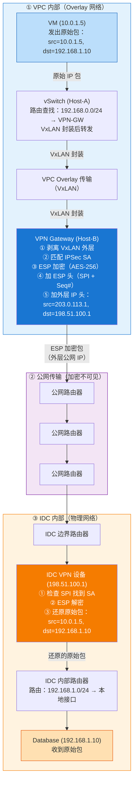
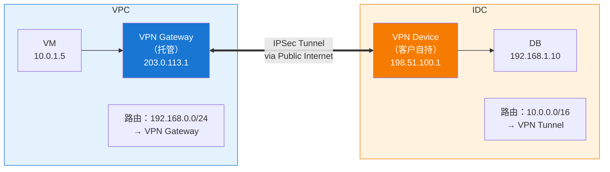
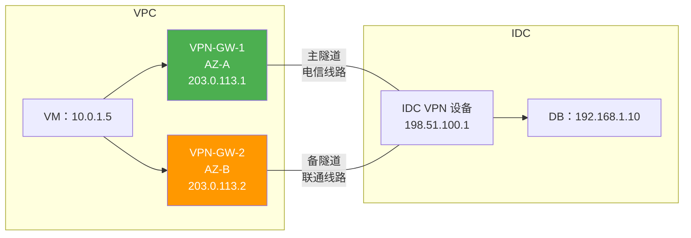

# 20. 用互联网打通云和 IDC：VPN 连接

CTO 在周会上提了一个问题："我们的核心数据库还在 IDC 机房里，云上的 Web 应用怎么访问它？"

合规要求数据库不能离开自建机房，DBA 团队也不愿意把几十 TB 的 Oracle 迁到云上。但云上的 Web 应用每秒要查询数据库几千次。VPC 和 IDC 之间没有任何路由可达性，这不是防火墙或安全组的问题，而是两个完全不同的网络体系之间根本没有路由交换机制。要打通这道墙，最快、最低成本的方式，是利用一个两边都已经能访问的东西：互联网。

## 20.1 两个不同的网络世界

先看清楚这道墙到底是什么。

VPC 是 Overlay 虚拟网络，运行在云厂商的物理基础设施之上，路由由 SDN 控制面管理。VM 的私有 IP（比如 10.0.1.0/16）只在 VPC 内部有意义，VPC 的控制面知道每个 IP 在哪台宿主机上，知道怎么通过 VxLAN 隧道把包送过去。IDC 则是传统的物理网络，路由由企业自己的路由器和交换机管理，服务器的私有 IP（比如 192.168.0.0/24）也只在 IDC 内部有意义。

两者之间没有任何路由交换机制，VPC 的控制面不知道 IDC 的存在，它的路由表里没有 192.168.0.0/24 这条路由；IDC 的路由器也不知道 VPC 的存在，它的路由表里没有 10.0.1.0/16 这条路由。VPC 里的 VM 发一个目的地为 192.168.1.10 的包，路由表查不到匹配项，包被丢弃，就这么简单。

最直觉的想法是走公网 EIP，让 IDC 的数据库服务器通过公网 IP 暴露出来，VPC 的 VM 通过 NAT 网关访问这个公网 IP。技术上可行，第13章和第14章已经讲过 NAT 和 EIP 的机制。但问题很明显：数据库连接串在公网上明文传输，任何中间路由器都能看到 SQL 查询和返回的数据。对金融数据、用户隐私、交易记录这些内容，这个风险不可接受。而且流量走公网还有延迟和成本的问题，每一个查询都要绕一圈公网，延迟从毫秒级变成了十几毫秒，带宽按公网流量计费。

需求的本质其实并不复杂：在 VPC 和 IDC 之间建立一条私有通道，让两边的私有 IP 互相可达，同时保证数据传输的安全性。最快的方式是利用已有的公网基础设施，VPC 有公网出口，IDC 也有公网出口，然后在公网传输的数据上加一层加密保护。

这个思路有一个名字：VPN（Virtual Private Network）。Virtual 是因为它不是一条真实的物理线路，而是在公网上虚拟出来的；Private 是因为数据经过加密，即使在公网上传输也不会被窃听。

## 20.2 加密与隧道：VPN 到底要解决什么

先把 VPN 要做的动作拆开来看。

公网 EIP 方案暴露了两个问题：一是内容能被沿途路由器看到，二是私有 IP 包压根走不了公网。第一个问题需要**加密**：数据在公网上传输时，即使被截获也无法读取内容。第二个问题需要**隧道**：原始的私有 IP 包（源 10.0.1.5，目的 192.168.1.10）在公网上无法路由，但把它塞进一个新的 IP 包里，新包的源和目的都是公网 IP，公网路由器就能正常转发了。两个动作缺一不可，任何一个 VPN 方案都是这两个机制的组合。

能同时完成这两个动作的协议其实不止一种。SSL VPN（OpenVPN、Cisco AnyConnect 一类）走 TLS，主要给远程个人用户接入企业内网用；WireGuard 是近几年兴起的新方案，协议简洁、Linux 内核原生支持，但企业级路由器和防火墙的支持还不够普及；再往前还有 L2TP、GRE+IPSec 这些历史组合。但具体到云 VPC 与 IDC 之间的站点到站点（Site-to-Site）互联这个特定场景，IPSec 是事实上的工业标准。四家主流云厂商的托管站点到站点 VPN 服务（AWS Site-to-Site VPN、阿里云 VPN 网关、Azure VPN Gateway、GCP Cloud VPN）全部基于 IPSec；Cisco、Juniper、华为、Fortinet 的企业级设备几十年来把 IPSec 做成了带硬件加速的原生能力；跨厂商互通靠的也是这一套 RFC 标准。SSL VPN 解决的是员工远程接入（Client-to-Site）而非网络互联（Site-to-Site），协议模型上就不适合网关之间的长连接；WireGuard 生态还在路上。所以本章聚焦 IPSec，其他方案在合适的场景下自有位置，但这一章不展开。

> **IPSec 是什么？**
>
> IPSec（IP Security）是一套在网络层（L3）提供数据加密、完整性校验与身份认证的开放协议族（RFC 4301）。它不依赖具体的应用层协议，能够对所有透传的 IP 数据包进行透明保护。IPSec 由三大核心组件构成：控制面密钥协商协议 **IKE**、数据面加密与认证协议 **ESP**，以及安全关联 **SA**（Security Association）。IPSec 普遍内置于企业级路由器和云网关中，是跨公网打通站点到站点（Site-to-Site）私网连接的工业标准。

而 IPSec 顺着"加密 + 隧道"这两个动作展开，又暴露出一个更根本的问题：加密的密钥怎么来？

如果两端预先配置好一把静态密钥，问题看起来就解决了。但生产环境不能这么用。第一，静态密钥一旦泄露，历史流量全部可以被回放解密，没有前向安全性；第二，密钥要在两端手动分发和轮换，公网上没有可信信道；第三，两端之间可能同时存在多条并行的隧道（多个业务、多个子网段），静态密钥没法区分。所以 IPSec 没有把密钥当成配置项，而是把如何在不可信的公网上安全地协商出密钥本身当成一个协议问题来解，这就是 IKE。协商完密钥再谈加密，加密完再谈封装。IPSec 分成两个阶段工作，正是顺着这个思路设计的。

## 20.3 IKE 与 ESP：为什么要这样设计

**IKE：在不可信的信道上协商出可信的密钥。** 两端要在公网上凭空协商出一把只有它们俩知道的密钥，这件事听起来像悖论。IKE 的答案是 Diffie-Hellman 密钥交换：两端各自生成一对公私钥，把公钥发给对方，然后用"自己的私钥 + 对方的公钥"独立计算出同一个共享秘密。这个共享秘密从未在网络上传输过，中间人截获再多的握手包也推不出来。DH 解决了密钥怎么来的问题，但它自己又留下一个新问题：交换公钥的时候，对面这个人到底是不是我要连的那个 IDC？中间人可以冒充 IDC 和你各自完成一次 DH。所以 IKE 在 DH 之外还要叠一层身份认证，用预共享密钥或数字证书让双方确认你就是那个 IDC。UDP 500 是 IKE 协商的默认端口。

如果你熟悉 HTTPS/TLS 握手，这个逻辑会非常亲切：两者做的事情本质完全一样，先用非对称机制（DH 算法 + 证书/PSK 身份认证）在不可信的公网上确认身份并安全协商出对称密钥，后续真正的数据传输再用这个对称密钥（如 AES-256）做高效加密。不同的是，TLS 跑在 TCP 之上，保护的是应用层数据（如 HTTP）；而 IKE/IPSec 跑在 IP 层，保护的是整套私有网络数据包。

既然核心逻辑与 TLS 类似，为什么 IKE 要特意拆成两个阶段？

原因在于站点到站点 VPN 面对的运维与性能压力：DH 模幂运算本身的开销极高，一次协商需要几十毫秒到几百毫秒。如果每次轮换数据加密密钥都要重跑一遍 DH 握手，开销无法承受；而且两端网关之间可能同时传输多个子网对的流量，如果管理通道和数据通道混在一起，任何一个子网的密钥轮换都会打断整个网关的流量。

IPSec 的解法是将管理面与数据面彻底解耦：

**第一阶段（IKE Phase 1）**：跑一次昂贵的 DH 协商与身份认证，建立一条长期存活的安全管理通道（IKE SA）。

**第二阶段（IKE Phase 2）**：在这条已经加密的管理通道内，以极低的开销快速协商用于业务数据的加密密钥（IPSec SA）。

这样一来，用于业务加密的 IPSec SA 可以频繁轮换（比如每小时刷新一次），所有轮换都在已有的 IKE SA 保护下静默完成，既不需要重跑昂贵的 DH 运算，也不会打断数据传输；同一个 IKE SA 下还能同时挂载多条不同子网的 IPSec SA。控制面与数据面的解耦，才是分两阶段的真正动机。

IKE 协商完成后，业务数据开始真正传输。承担加密封装职责的是 ESP（Encapsulating Security Payload）协议。为什么是 ESP 而不是同属 IPSec 家族的 AH？AH 只做完整性认证不做加密，在需要防窃听的公网场景里天然不够用；ESP 既加密又认证，是站点到站点 VPN 的默认选择。ESP 在隧道模式下的完整封装是这样的：

**图 20.1：ESP 隧道模式的封装结构**

```
┌──────────────────────────────────────────────────────────────────┐
│                     New IP Header (Outer)                        │
│  Src: VPN-GW-Cloud Public IP    Dst: VPN-GW-IDC Public IP        │
│  Protocol: 50 (ESP)                                              │
├──────────────────────────────────────────────────────────────────┤
│                     ESP Header                                   │
│  SPI (32-bit): identifies which SA    Seq# (32-bit): anti-replay │
├──────────────────────────────────────────────────────────────────┤
│                     ┌─────────────────────────────────┐          │
│                     │  Original IP Header (Inner)     │          │
│    Encrypted        │  Src: 10.0.1.5  Dst: 192.168.1.10│         │
│    Payload          │  Original IP Payload            │          │
│                     │  ESP Padding                    │          │
│                     └─────────────────────────────────┘          │
├──────────────────────────────────────────────────────────────────┤
│                     ESP ICV (Integrity Check Value)              │
│                     Anti-tampering authentication data           │
└──────────────────────────────────────────────────────────────────┘
```

ESP 头里两个关键字段的存在都不是随手加的，SPI 是 32 位标识符，用来告诉接收端这个包属于哪一条 SA。为什么需要它？因为两端网关之间可能同时存在多条 IPSec SA，不同子网对、不同加密算法、正在轮换新旧密钥的过渡期。接收端拿到一个 ESP 包，得先知道用哪把密钥解密，SPI 就是那把密钥索引。序列号则是防重放攻击的机制：攻击者即使解不开加密内容，也可以把截获的加密包原封不动地重发，如果没有序列号，接收端无法区分新包和重放包。序列号强制递增，接收端维护一个滑动窗口，收到窗口外或已见过的序号直接丢弃。

至于加密的范围为什么是整个原始 IP 包而不是只加密 payload，答案在源目地址上。原始包的源和目的都是私有 IP（10.0.1.5 → 192.168.1.10），如果不套一层外层公网 IP 头，公网路由器根本不知道往哪里转发。传输模式（Transport Mode）保留原始 IP 头、只加密 payload，适合主机到主机（Host-to-Host）直接通信；隧道模式（Tunnel Mode）把整个原始 IP 包（含头）都加密，再套上外层公网 IP 头，才适合两端网关之间打通两个私有网段这个场景。站点到站点 VPN 几乎都用隧道模式。

到这里 IPSec 的协议机制就讲完了：IKE 解决密钥怎么来，ESP 解决包怎么在公网上安全走，分两阶段是为了让昂贵的 DH 只做一次、让密钥轮换不打断数据传输。下一步的问题是：这套机制放到真实的云网络里，一个从 VM 发出的包会经过哪些环节才能到达 IDC 的数据库？

## 20.4 一个数据包的完整旅程

IPSec 协议本身讲清楚两个网关之间怎么加密封装，但 VM 和数据库并不是直接对着 VPN 网关说话。在云上，VM 到 VPN 网关这段路要走 VPC 的 Overlay；在 IDC，VPN 设备到数据库这段路要走机房的物理路由。整条路径跨越三个网络域，同一个包会经历三次封装变化。

**图 20.2：数据包的完整转发流程**



以 VM（10.0.1.5）访问 IDC 数据库（192.168.1.10）为例，沿着上图的拓扑，完整的转发流程如下。

VM 的应用发出一个 TCP 包，源 IP 10.0.1.5，目的 IP 192.168.1.10。这个包先到达 VM 所在宿主机的虚拟交换机（vSwitch）。vSwitch 查询 VPC 的路由表，发现 192.168.0.0/24 的下一跳指向 VPN 网关。VPN 网关是 VPC 内部的一个托管实例，运行在云厂商的某台宿主机上，有自己的 VPC 内部 IP。vSwitch 用 VxLAN 封装把这个包送到 VPN 网关所在的宿主机，这一步和 VPC 内部 VM 之间的通信机制完全一样，走的是云内部的 Overlay 网络。这是**第一次封装**：VxLAN。

包到达 VPN 网关后，网关识别出这个包匹配某条 IPSec SA。网关执行 ESP 封装：先剥掉 VxLAN 的外层，拿到原始的 IP 包（src: 10.0.1.5, dst: 192.168.1.10），用协商好的密钥加密整个原始包，加上 ESP 头（SPI + 序列号），再套上新的外层 IP 头（src: 203.0.113.1, dst: 198.51.100.1）。加密后的包通过云厂商的公网出口发到互联网上。这是**第二次封装**：ESP。

在公网上，这个包和普通 IP 包没有任何区别。沿途每一台路由器只看到外层 IP 头，按照正常的 BGP 路由逐跳转发。它们不知道也不关心里面装的是什么，可能是一个网页请求，可能是一段视频流，也可能是一个加密的数据库查询。包经过若干跳公网路由器后，到达 IDC 的公网出口。IDC 的边界路由器把包转发给 VPN 设备，VPN 设备检查 ESP 头中的 SPI，找到对应的 SA，用协商好的密钥解密 payload，还原出原始的 IP 包。这是**第三次封装变化**：ESP 解封装。解密后的包进入 IDC 的内部路由体系，被送到数据库服务器。

回程是对称的。数据库的响应包到达 IDC VPN 设备，设备查路由表发现 10.0.0.0/16 应该走 VPN 隧道，执行 ESP 加密封装，通过公网送回云端。云端 VPN 网关解密后，把原始响应包通过 VPC 的 Overlay 网络送回 VM。VM 收到响应，src 是 192.168.1.10，就好像数据库就在隔壁一样。

三次封装、三个网络域，其中最外层的 ESP 封装解决跨公网，最内层的 VxLAN 封装解决跨宿主机，机制上是同类动作的两个变种：一个是信任问题（私有流量不能被公网看到），一个是编址问题（Overlay 编址不能被 Underlay 路由）。同一条隧道思路，撑起了两段完全不同的路径。

这条完整路径看起来干净利落，但真实网络里它会立刻遇到两个副作用：包变大了怎么办，以及 IDC 侧的 VPN 设备如果本身还藏在 NAT 后面怎么办。这两个问题不是配置错误，也不是设备缺陷，而是套一层外壳这个动作在机制上必然带出来的连锁反应。

## 20.5 落地的两个副作用：MTU 与 NAT 穿透

### MTU 与分片：多一层封装就多一层麻烦

以太网的默认 MTU 是 1500 字节，绝大多数网络设备都按这个上限工作。ESP 隧道模式给每个包套上的外壳，开销并不算小：新的外层 IP 头 20 字节、ESP 头 8 字节、初始化向量 16 字节、认证数据 12 字节，再加上尾部填充，一般会给原始包多出 50 到 70 字节。如果 VM 发出一个 1500 字节的包，VPN 网关封装后就变成了 1550 到 1570 字节，超过公网链路的 MTU，中间路由器要么把它分片，要么直接丢弃并返回 ICMP Fragmentation Needed。

分片的代价非常明显：一个包变两个，两端都要多做一次组装，任何一个分片丢了整个包就得全部重传。更糟的是公网上很多防火墙会默认丢弃 ICMP，这个分片需要的信号根本传不回源端。结果就是经典的 PMTUD 黑洞：小包能通、大包全丢、TCP 三次握手正常但一传数据就卡死。DBA 打电话过来说能 ping 通、能建连接，但查一次数据就超时的时候，多半就是这个坑。

工程上的做法有两种，一种是把 VM 侧的 MTU 主动调小到 1400 左右，给 IPSec 外壳预留空间。另一种更常见，在 VPN 网关上启用 TCP MSS Clamping：SYN 报文经过网关时把 MSS 字段改小（比如从 1460 改到 1360），强制 TCP 两端一开始就协商出一个不会触发分片的段大小。云厂商的托管 VPN 网关默认都会开 MSS Clamping，配置里基本感知不到。但 MSS Clamping 只对 TCP 生效，UDP 流量不走三次握手，就只能靠调整应用层 MTU 或者显式做 PMTUD。这个坑是从多一层封装这个机制里必然长出来的，只要用 IPSec 就绕不开。

### NAT 穿透：ESP 协议号 50 过不了 NAT

再看第二个副作用。ESP 封装完成后，外层 IP 头的 Protocol 字段是 50，标识这是一个 ESP 包。在 IDC 出口没有 NAT 时这个数字不成问题，但现实中很多企业的 VPN 设备并不直接持有公网 IP，它挂在一台防火墙或运营商 CPE 后面，出口地址靠 NAT 转换。

NAT 设备维护的是IP+端口的映射表，靠端口号区分同一个公网 IP 后面的多台内网设备。ESP 是 IP 层协议，本身没有端口号这个字段。NAT 设备拿到一个 Protocol=50 的包，找不到端口就无法建立映射，也就无法在回程时把包送回正确的内网设备。IKE 协商本身走 UDP 500，NAT 尚可勉强处理，但真正承载数据的 ESP 包一旦经过 NAT，几乎必挂。

NAT-T（NAT Traversal）就是为这件事设计的。IKE 协商阶段两端会探测中间是否存在 NAT（原理是比较看到的对端 IP 和对端自己声明的 IP），一旦探测到 NAT，两端自动切换：后续的 ESP 包外面再套一层 UDP 头，源和目的都改成 UDP 4500 端口。加了 UDP 外壳的 ESP 包对 NAT 设备来说就是一个普通的 UDP 会话，端口映射照常建立、回程照常回来。代价是每个包又多出 8 字节的 UDP 报头，给 MTU 预留的开销空间就更吃紧了。

> **NAT-T 是什么？**
>
> NAT-T（NAT Traversal，NAT 穿透）是解决 IPSec 流量穿越 NAT 设备的技术（RFC 3948）。IPSec 的 ESP 协议直接封装在 IP 头后（Protocol 50），缺乏 TCP/UDP 端口号，导致 NAT 设备无法为其建立 PAT 端口映射表。开启 NAT-T 后，网关会在 IKE 协商阶段自动探测中途是否存在 NAT；一旦发现 NAT，后续所有的 ESP 密文数据包都会被额外套上一层 **UDP 4500 端口** 的外壳，使其伪装成普通 UDP 流量顺利穿越 NAT 设备。

云厂商的托管 VPN 网关几乎都默认启用 NAT-T，配置时基本感知不到。但当 IDC 侧的老 VPN 设备不支持或未开启 NAT-T 时，症状会非常隐蔽：IKE 协商成功、隧道显示 UP，但数据一个包都过不去。看到控制面通、数据面死这种现象，第一反应就该是查 NAT-T。

这两个副作用都是多一层封装的连锁反应：封装让包变大，就有了 MTU 问题；封装让协议号变成 ESP，就有了 NAT 穿透问题。理解了这点，配置手册上那些看似杂乱的选项，MSS Clamping、NAT-T、DF-Bit 处理，就都有迹可循了。

## 20.6 云端 VPN 网关：托管的隧道端点

IPSec 隧道的两个端点，一端在云上，一端在 IDC。

云端的端点是 VPN 网关，云厂商把它做成了托管服务。你创建一个 VPN 网关实例，绑定到 VPC，云厂商自动分配一个公网 IP 作为隧道端点。底层的 IKE 协商、ESP 封装解封装、密钥轮换、NAT-T 探测、MSS Clamping，都由云厂商的基础设施完成。你不需要自己部署和维护 VPN 软件，不需要担心操作系统补丁和安全更新。

IDC 端的端点通常是企业已有的网络设备，一台支持 IPSec 的路由器或防火墙。Cisco、Juniper、Fortinet、华为的企业级设备几乎都支持 IPSec VPN。IDC 的网络管理员在设备上配置对端的公网 IP（云端 VPN 网关的 IP）、预共享密钥、加密算法等参数。两端配置匹配后，IKE 协商自动完成，隧道建立。这个过程通常在几秒到几十秒内完成，比起专线动辄几周到几个月的部署周期，VPN 的即开即用是它最大的优势。

VPN 网关的带宽规格也值得注意。云厂商的 VPN 网关通常有带宽上限，比如 100Mbps、200Mbps、1Gbps。但这个上限是 VPN 网关实例本身的限速，不是隧道的理论上限。实际可用带宽还受公网链路质量影响，如果公网链路在高峰期只剩 200Mbps 的可用带宽，你买了 1Gbps 的 VPN 网关也没用。花钱买了一辆跑车，路上堵车，跑不起来。

**图 20.3：VPN 连接的整体架构**



网关和设备都就位、隧道也建起来了，还剩一个绕不开的问题：VPC 的路由表怎么知道目的地为 192.168.0.0/24 的流量应该走 VPN 隧道？隧道只是一条加密的管道，它不会自动告诉路由表IDC 的网段应该从这里走。路由怎么注入，决定了 VPN 在实际运维中的管理成本，也是路由型 VPN 和策略型 VPN 的核心分野。

## 20.7 路由型 VPN 与策略型 VPN

两种思路，两种完全不同的管理模型。

**策略型 VPN：显式列举。** 用 ACL（访问控制列表）定义什么流量走隧道。比如：源 IP 在 10.0.0.0/16 且目的 IP 在 192.168.0.0/24 的流量走隧道，其他流量走正常路由。每条 ACL 规则对应一个独立的 IPSec SA，也就是说，每对源网段和目的网段之间都有一条独立的加密通道。

这个思路在简单场景下很直观，两个网段互通，写一条规则就行。但当需要互通的子网变多时，问题就来了。IDC 有 3 个子网（192.168.1.0/24、192.168.2.0/24、192.168.3.0/24），VPC 有 2 个子网（10.0.1.0/24、10.0.2.0/24），全互通需要 6 条 ACL 规则、6 个 IPSec SA。IDC 新增一个子网？两端都要手动添加规则。十几个子网的策略型 VPN，最常见的故障就是改了一端忘了改另一端，隧道死活不通，排查半天，最后发现是一条 ACL 没同步。

**路由型 VPN：让路由表决定。** 在隧道上建立一个虚拟接口，VTI（Virtual Tunnel Interface）。VTI 就像一个普通的网络接口，有 IP 地址，可以被路由表引用。路由表里添加一条路由：目的地为 192.168.0.0/24 的流量，下一跳指向 VTI。流量匹配完全由路由表决定，不需要 ACL。所有走 VTI 的流量共享同一个 IPSec SA，不需要为每对网段单独建立 SA。

> **VTI 是什么？**
>
> VTI（Virtual Tunnel Interface，虚拟隧道接口）是路由器或网关上用于实现“路由型 VPN”的虚拟三层接口。传统的“策略型 VPN”依赖复杂的 ACL 规则强行拦截匹配的流量送入隧道；而 VTI 将整条 IPSec 加密隧道直接抽象为一张逻辑网卡，拥有独立的 IP 地址。路由表可以像对待物理网口一样，直接将下一跳指向 VTI 接口。这使得 BGP 等动态路由协议可以在 VTI 上运行，实现路由前缀的自动宣告与学习。

路由型 VPN 的真正优势在于它能和动态路由协议配合。在 VTI 上运行 BGP，IDC 端通过 BGP 向云端宣告自己的路由前缀，云端自动学习。IDC 新增了一个子网？BGP 自动传播，两端都不需要手动更新配置。这在子网频繁变化的环境中是决定性的优势。

**图 20.4：策略型 vs 路由型 VPN 的流量匹配**


两种方式不是谁更好的关系。策略型 VPN 在只有一两对网段互通的简单场景下更直观，不需要配置 VTI，不需要运行 BGP，规则一目了然。路由型 VPN 在子网多、变化频繁的场景下更灵活，动态路由让管理成本从 O(N×M) 降到了 O(1)。大多数云厂商推荐路由型 VPN，因为它更容易和云联网集成，云联网本身就是基于路由传播的架构。

## 20.8 双隧道高可用与故障切换

VPN 隧道依赖公网链路。公网链路可能因为运营商故障、路由变更、DDoS 攻击等原因中断。如果只有一条隧道，中断就意味着云和 IDC 之间完全断开。对生产环境来说，这个风险不可接受。

标准的做法是建立两条 VPN 隧道，走不同的公网路径。比如主隧道通过电信线路连接到云厂商可用区 A 的 VPN 网关，备隧道通过联通线路连接到可用区 B 的 VPN 网关。两条隧道使用不同的运营商、不同的物理路径、不同的 VPN 网关实例，尽可能消除单点故障。

**图 20.5：双隧道高可用架构**



有了双隧道，剩下的问题是：怎么知道主隧道断了，以及断了之后多久能切过去。

故障检测最基础的一层是 IPSec 自带的 DPD（Dead Peer Detection）。两端定期互相发送探测包，如果连续多次没有收到回应，判定隧道失效。DPD 的检测间隔通常是 10 到 30 秒，连续 3 到 5 次未响应后判定故障。单纯依赖 DPD 时，故障发现的时间窗口在 30 秒到 2 分钟之间。这个数量级对开发测试环境勉强能接受，但对数据库连接池（默认超时 30 秒）、金融交易系统（要求秒级切换）来说，是一个明显偏长的窗口。

发现故障后如何切换？这取决于 VPN 的类型。路由型 VPN 配合 BGP 时，主隧道断开后 BGP 会话超时，主隧道的路由撤销，备隧道的路由自动生效，流量无缝切换到备隧道。策略型 VPN 的切换通常依赖 DPD 触发的隧道重建，主隧道的 DPD 判定失败后，VPN 网关尝试通过备隧道重新建立 IPSec SA。

想把切换时长压到秒级，只调 DPD 参数是不够的，得让 DPD 和 BGP 各司其职，再叠一层 BFD。三种机制的检测能力放在一起对比：

| 检测机制 | 典型间隔 | 故障判定时长 | 依赖 |
|---|---|---|---|
| DPD（IPSec 层） | 10-30 秒 | 30 秒 ~ 2 分钟 | 无 |
| BGP Keepalive（默认） | 30 秒 | 90 秒 | 路由型 VPN + BGP |
| BGP + 短 Keepalive | 3 秒 | 9 秒 | 路由型 VPN + BGP |
| BFD（配合 BGP） | 50~500 毫秒 | 亚秒级 ~ 秒级 | 路由型 VPN + BGP + BFD |

BFD（Bidirectional Forwarding Detection）在第21章讲专线切换时会再出场一次，它的价值就是把链路存活探测，从 BGP 的秒级降到毫秒级。BFD 检测到隧道中断后立即通知 BGP 撤销路由，切换时间从 90 秒的量级压到 1 秒以内。这也是生产环境几乎都选路由型 VPN 的另一个原因：只有路由型 VPN 才能跑 BGP，才能配 BFD。策略型 VPN 只能靠 DPD 硬扛，切换时长天花板就卡在半分钟以上。

双隧道可以配置为两种模式。主备模式（Active-Standby）：正常情况下流量只走主隧道，备隧道处于待命状态，主隧道断了才切换。负载分担模式（Active-Active）：两条隧道同时活跃，两端 BGP 把同一目的前缀通过两条隧道以相同的 Local Preference 和 AS Path 宣告过来，路由表里同时保留两条等价路径，转发时按 ECMP（Equal-Cost Multi-Path）对每条流做哈希分摊。同一条 TCP 流始终走同一条隧道，保证顺序；不同流散到两条隧道上，分担带宽。一条隧道断开时，BGP 撤销那条路径，ECMP 自动收敛到剩下一条，切换过程对已有连接近乎无感。代价是两条隧道都要具备承接全量流量的容量。Active-Active 只是把日常负载分摊了，不能拿它当"两倍带宽"来规划——真正到了故障时刻，活下来那条隧道要单独扛住全部流量。

DPD 的检测间隔为什么不能设得太短？每次 DPD 探测都是一个 IKE 消息，间隔太短会增加 VPN 网关的处理负担；更麻烦的是公网本身就有偶发丢包，如果 DPD 间隔设为 1 秒，一次偶发丢包就可能触发误判，导致不必要的隧道切换。BFD 之所以在这里更合适，是因为它的协议模型本身就是为"高频探测 + 抗抖动"设计的，专门的软状态机能区分真的断了和偶发丢包，做到既灵敏又不误判。在快速发现故障和避免误判之间，选对机制比调参更重要。

## 20.9 VPN 的定位与局限

VPN 的最大优势在于低成本与即开即用，它不需要铺设任何物理线路，只需几分钟的配置，就能利用现有的互联网在 VPC 与 IDC 之间搭建一条安全的私有通道。对于开发测试环境、运维管理通道、紧急临时打通以及作为物理专线的灾备链路，VPN 都是极其理想的选择。

然而，VPN 的便捷性也决定了它的边界：它始终建立在尽力而为（Best-effort）的公网之上。

公网作为公共共享资源，决定了 VPN 无法从根本上提供独占的带宽保障与确定性的延迟承诺；同时，大流量下的加密解密也是网关节点无法忽视的计算开销。

VPN 完美解决了如何低成本连通的问题。但当业务规模不断扩大，对网络的吞吐量、延迟抖动与服务质量提出确定性要求时，公网的天然局限便显现出来，此时就需要一种完全脱离公网的专属物理通道。