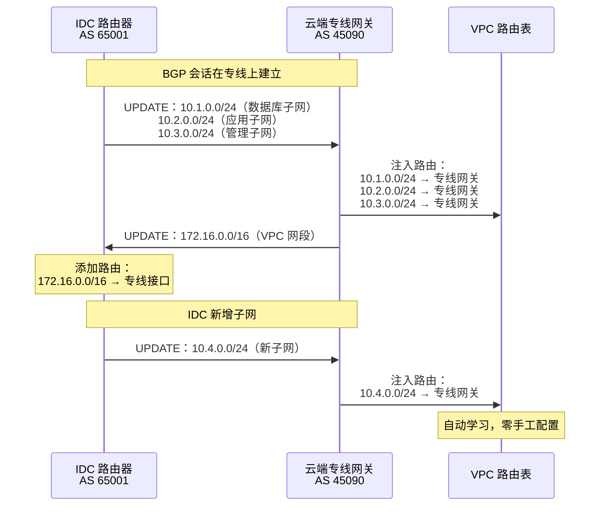
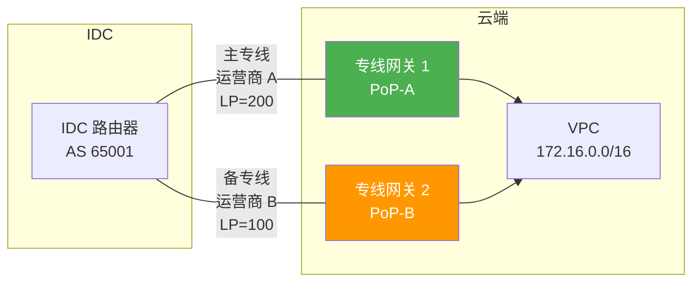
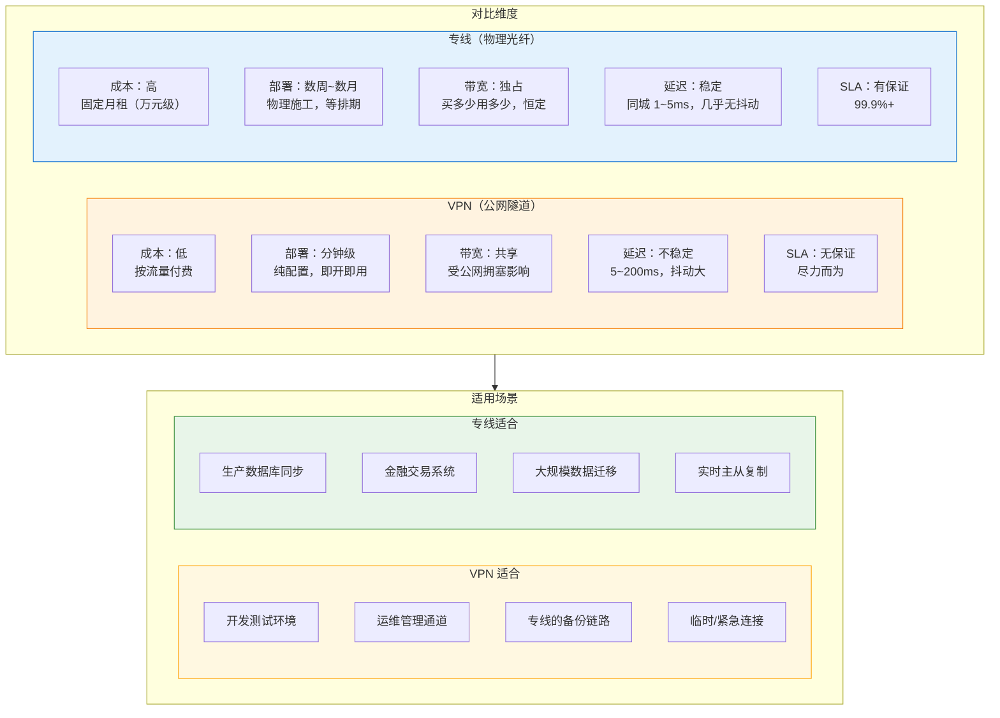

# 21. 拉一根光纤：专线接入

上一章讲完 VPN 的时候，结论已经很清楚：公网是尽力而为的公共资源，隧道再稳，底下那条路本身就不稳。DBA 会告诉你，数据库主从同步的延迟从 5ms 飙到 80ms，每天下午准时出现，不是应用的问题，也不是 VPN 网关的问题，是公网在那个时段被几百万用户挤满了。他要的是延迟可预测的链路，这个要求 VPN 满足不了，不是配置的问题，是公网的底子就不提供这个保证。

要拿到确定性，只有一条路：不走公网，拉一条独占的物理光纤。这就是这一章要讲的专线。

## 21.1 专线是什么：一条不走公网的物理通道

专线的名字直白，就是一条从 IDC 拉到云厂商机房的物理光纤。它不是更好的 VPN，VPN 是在公网上建加密隧道，专线是一条独立的物理链路，两者根本不在一个网络层次上。

物理独占带来了三样公网给不了的东西。带宽是恒定的，你买 1Gbps 就始终有 1Gbps，不被任何人抢占。延迟由物理距离决定，光在光纤中的传播速度大约 5μs/km，同城专线的端到端延迟通常在 1-2ms，几乎不抖。最后则是明确的 SLA 承诺，运营商会把可用性、丢包率、抖动写进合同，做不到就赔钱。

与 VPN 不同的是，专线默认是不加密的。物理链路是专属的，窃听风险远低于公网传输，绝大多数场景下裸跑没有问题。如果合规要求强制加密（比如金融行业的某些等保条款），可以在专线上再叠一层 IPSec，但那是可选项，不是必须的。这和上一章 VPN 强制加密的定位完全不一样，VPN 的加密是为了对抗公网的不可信，专线的物理隔离本身就提供了这份信任。

接下来几节，我们将顺着一条专线从物理施工到路由就绪的完整建立过程展开：看光纤如何接入机房、单条线缆如何隔离多个逻辑通道、动态路由如何自动交换，以及链路故障时如何实现高可用切换。

## 21.2 物理层：从 IDC 到云厂商机房

专线的确定性源于其物理属性，理解这一点必须从光纤实际走的路径看起。

云厂商不会让你的光纤直接拉进核心机房，那里通常不对外开放。云厂商在各个城市部署了一批 PoP（Point of Presence，网络接入点），你的专线拉到 PoP 就算落地，PoP 和云厂商核心网络之间由内部骨干高速互联，流量从 PoP 转发进 VPC。

> **PoP 是什么？**
>
> PoP（Point of Presence，网络接入点）是云厂商在各地部署的网络节点，不是完整的数据中心，没有大规模的计算和存储资源，只是一堆路由器和交换机组成的接入设施。核心功能是接入：把外部流量（用户流量、专线流量）收进来，通过骨干网转发到目标 Region。大型云厂商在全球部署了几十到几百个 PoP。在专线场景里，PoP 是专线的物理终结点；在全球加速场景里，PoP 是 Anycast 流量的就近入口。

**图 21.1：专线的物理路径**


企业几乎不会自己去铺光纤，从 IDC 到 PoP 的光纤铺设不但成本极高，还要拿市政施工许可。实际做法是向运营商买专线服务：运营商在自己的光纤传输网上，通过波分复用（WDM）把一段带宽切给你，物理光纤可能和其他客户共享，但每个客户的带宽是电路级隔离的。

> **WDM 是什么？**
>
> WDM（Wavelength Division Multiplexing，波分复用）是一种在单根光纤中同时传输多路不同波长光信号的光纤通信技术。在物理专线建设中，运营商无需为每个客户单独铺设物理光缆，而是利用 WDM 技术将一根光纤切分为数十个独立的“波长信道”。每个客户独占一个或多个指定波长（如 CWDM/DWDM），在光物理层实现了绝对的物理隔离与带宽保障。

这里面最容易被低估的是最后一公里，也就是从运营商传输网到 IDC 楼宇的那段光纤。如果 IDC 所在楼宇已经有运营商光纤接入，几天就能开通。如果没有，得从最近的运营商机房把光纤拉过来，涉及穿管、架空、地下管道等物理工程，周期从几周到几个月不等。这大概是云计算时代最不"云"的一环，你在控制台上点几下就能创建一个 VPC，但拉一根光纤可能需要等施工队排期。

光纤到达 PoP 之后，接入方式分为两种。独占接入（Dedicated Connection）：云厂商在 PoP 分配一个专用物理端口（通常是 1GE 或 10GE）专门给你，端口本身的转发能力完全独占。共享接入（Hosted Connection）：多个客户共享一个物理端口，云厂商通过 VLAN 标签来隔离不同客户的流量，带宽按购买量分配。独占贵，性能有保证；共享便宜，适合带宽需求不大的场景。带宽规格从 50Mbps 到 100Gbps 都有，无论选哪档，在传输层面上都是电路级隔离，不因其他用户流量波动。

有了物理端口与 VLAN 隔离，云厂商侧负责接管流量的核心组件，DC Gateway（专线网关）就顺理成章地登场了。它的定位与上一章的 VPN 网关正好形成镜像呼应：VPN 网关处理"公网 IP + IPSec 封装"，DC Gateway 处理"物理端口 + VLAN 剥离"。用户的以太网帧从物理端口进来，DC Gateway 剥掉 VLAN 标签，识别出目的 VPC，再套上云内 VxLAN 封装，交给云厂商的 Overlay 网络送到目标 VM 所在的宿主机。反向同理。这个封装/解封装的动作和 VPN 网关剥 VxLAN + 加 ESP是同一个思路，只是外层协议不同：VPN 网关面对的是不可信公网，外层封装必须是加密的 ESP；DC Gateway 面对的是可信物理链路，外层封装是明文的 VLAN 就够。

## 21.3 一条光纤上的多个逻辑连接：VLAN 与 QinQ

物理光纤通了，下一个问题冒出来：企业有生产 VPC 和开发 VPC，都要走这条专线，但两边的流量必须隔离，生产 VPC 不能被开发环境的调试流量污染。再拉一条物理专线？成本翻倍，也没必要。

答案是信封里套信封。企业的以太网帧发出来时已经有一个 VLAN 标签（内层信封，写着 VLAN 100 = 数据库、VLAN 200 = 应用），到了专线接入点，运营商在外面再套一层 VLAN 标签（外层信封，写着 VLAN 1000 = 客户 A、VLAN 2000 = 客户 B）。传输时只看外层信封决定送到哪个客户；到达云端后，云厂商拆掉外层信封，看内层信封决定送到哪个 VPC。企业内部的 VLAN 规划完全不用改动。

这套机制的正式名字叫 QinQ（IEEE 802.1ad）。外层标签叫 S-Tag（Service Tag），归运营商和云厂商管；内层标签叫 C-Tag（Customer Tag），归企业自己管。之所以能透明穿越，关键在 EtherType 字段，普通交换机看到的是 0x8100（单层 VLAN），一路正常处理；而 QinQ 的外层标签用 0x88A8 这个专门的 EtherType 来标识，只有支持 QinQ 的边缘设备才会去解析双层，中间的传输网络看到 0x88A8 直接当整体透传。这个字段就是双层机制能和现有以太网基础设施共存的钥匙。

**图 21.2：QinQ 的双层 VLAN 标签结构**

```
┌─────────────────────────────────────────────────────────────────┐
│                    Ethernet Frame with QinQ                     │
├──────────┬──────────┬──────────┬──────────┬────────────┬────────┤
│ Dst MAC  │ Src MAC  │ S-Tag    │ C-Tag    │ IP Packet  │ FCS    │
│  (6B)    │  (6B)    │  (4B)    │  (4B)    │ (Payload)  │ (4B)   │
├──────────┴──────────┼──────────┼──────────┼────────────┴────────┤
│                     │          │          │                     │
│   Ethernet Header   │ Outer    │ Inner    │   Original Payload  │
│                     │ VLAN Tag │ VLAN Tag │                     │
│                     │          │          │                     │
│                     │EtherType │EtherType │                     │
│                     │ 0x88A8   │ 0x8100   │                     │
│                     │          │          │                     │
│                     │ Service  │ Customer │                     │
│                     │ Tag      │ Tag      │                     │
│                     │ (Carrier)│(Customer)│                     │
└─────────────────────┴──────────┴──────────┴─────────────────────┘
```

流量的完整处理链路是这样：IDC 交换机发出一个带 C-Tag（VLAN 100）的帧，到达专线接入设备时，设备在外层套一个 S-Tag（比如 VLAN 1000），送上专线；云端 PoP 收到帧后，靠 S-Tag 区分出这是哪个客户的哪条逻辑连接，剥掉 S-Tag，再看 C-Tag 决定转发到哪个 VPC。企业侧的 VLAN 空间和运营商侧的 VLAN 空间完全解耦，各管各的。

VLAN ID 只有 12 位，理论上限仅有 4094 个可用。这在企业内部够用，但对运营商来说却是一道硬约束——一个 PoP 上服务几千个客户是常态，单靠外层 VLAN ID 编址很快就会达到上限。因此，QinQ 仅作为运营商城域网层面的过渡方案，真正到了跨地域骨干网，VLAN 会被换成 MPLS 标签或 VxLAN 这类空间更大的封装。正是受限于这一容量天花板，VLAN 只能局限在最后一公里做边缘接入，而云网络内部的多租户隔离早就全面升级为了拥有 24 位标识空间的 VxLAN VNI。

选择哪种方案取决于逻辑连接数量。只有一条逻辑连接（一个 IDC 对一个 VPC），单层 802.1Q 就够，简单省事。多条逻辑连接复用同一条物理专线，或者企业内部已有 VLAN 规划不想改动，就得上 QinQ，让两个 VLAN 空间彻底隔离。

## 21.4 路由怎么互通：BGP 与地址冲突

物理光纤和 VLAN 都配好了，包在链路层能通了。但 VPC 的路由表里还是没有 IDC 的网段，IDC 的路由器也不知道 VPC 的地址在哪。

专线通了，路由还没通。

要让两端互相学习对方的路由，有三种选择：静态路由、内部网关协议（OSPF 之类）、外部网关协议（BGP）。静态路由最简单，两边路由表手工写死，但只要 IDC 那边新增一个子网，云端就得手工加一条，几十上百个网段维护起来会崩溃，更别说切换主备链路时手工改路由的响应速度根本救不了火。OSPF 这类 IGP 依赖全网泛洪链路状态、跑 SPF 算最短路径，它假设参与方都在同一个管理域里，云厂商和企业分属两个自治域，管理边界不清、路由策略不共享，OSPF 硬跑起来两边都不放心。BGP 是为跨自治域这个场景专门设计的：它不假设对方是可信的、也不需要共享内部拓扑，只交换我这边有哪些前缀这种最小信息，同时支持丰富的路由策略（过滤、优先级、AS Path 调优）来控制注入和传播。这三个特征叠加起来，让 BGP 成了跨自治域路由交换的事实标准，专线场景没有例外。

云端和 IDC 端在专线两端建立 BGP 邻居关系，各自分配一个 AS 号，云端用云厂商的 ASN，IDC 端通常用私有 ASN（64512-65534 这段是保留给企业内部用的）。两端跑的是 eBGP（External BGP），底层协议走 TCP 179 端口。为什么用 TCP 不用 UDP？路由信息不能丢也不能乱序，BGP 需要可靠传输和有序交付，直接把这些活儿甩给 TCP 是最省事的做法。而且 BGP 交换的路由表可能几十万条，长连接、增量更新的模式天然适合 TCP。

**图 21.3：BGP 路由交换过程**



BGP 建好之后，IDC 端通过 UPDATE 消息宣告自己的路由前缀：我这边有 10.1.0.0/24、10.2.0.0/24、10.3.0.0/24。云端收到后把这些路由注入 VPC 路由表，VPC 里的 VM 发出目的为 10.1.0.0/24 的包时，路由表指向专线网关。反向同理，云端向 IDC 宣告 VPC 的网段（比如 172.16.0.0/16），IDC 路由器学到后就知道发往 172.16 的流量要走专线口。

BGP 的价值不在初始配置，而在动态性。IDC 新增一个子网 10.4.0.0/24？IDC 路由器自动宣告，云端自动学习，VPC 路由表自动更新，全程零手工介入。上一章路由型 VPN 也是靠同样的思路做动态路由，只是那里 BGP 跑在 IPSec 隧道内，这里 BGP 直接跑在专线上。

上面举的例子里，IDC 用 10.0.0.0/8，VPC 用 172.16.0.0/16，两边井水不犯河水。现实中这种运气不常有。企业 IDC 通常建设得比云早，早年拿的地址是 10.0.0.0/8 里的一大段，迁上云的时候 VPC 也想用 10.x。老应用配置里写死了 10.x 的 IP，改的成本比拉一条专线还高。于是常常出现这样的局面：IDC 宣告 10.1.0.0/24，而 VPC 自己也有一个本地的 10.1.0.0/24 子网。

这个问题不是 BGP 能解的，它是 IP 路由模型的硬约束：相同前缀不能在同一张路由表里共存。VPC 路由表出现两条 10.1.0.0/24，一条指向本地子网、一条指向专线，匹配结果本身就是矛盾的。云厂商的 VPC 一般会直接拒绝接受和本地子网冲突的路由，BGP 会话能建起来，但冲突的前缀不会生效，流量还是走不通。

跨 VPC 打通时遇到过同样的困境，那里的破解方式是用抽象层跃迁（Endpoint ENI + FULLNAT），把地址映射掩盖掉。专线场景下工程做法更朴素，无非两条路。一是规划阶段就做隔离，新建 VPC 时特意避开 IDC 已用的网段，比如 IDC 用 10.0.0.0/8，VPC 就用 172.16.0.0/12。二是在专线网关处做 NAT，把 IDC 侧的 10.1.0.0/24 在进入 VPC 前映射成另一段不冲突的地址，VPC 看到的是映射后的地址。代价是老问题：应用层如果硬编码了 IP、或者协议里带了 IP（FTP、SIP 这类），NAT 会把事情弄复杂。

所以专线开通前的第一件事不是拉光纤，是把两边的地址规划表放在一起对一遍。这个检查做得晚，整条专线可能建好了也用不上。

路由过滤是同样必要的一环。不是所有 IDC 宣告过来的路由都该注入 VPC，云端必须配置前缀过滤，只接受约定范围内的路由。最典型的隐患是默认路由 0.0.0.0/0，如果 IDC 端配错了、误宣告了默认路由，VPC 里所有流量（包括本该走公网的）会被吸引到专线上，专线瞬间被打满、公网访问同时中断。运维过大规模 BGP 网络的人大多见过因为路由泄漏引发的事故。路由过滤和地址规划一样，是专线开通前就必须配好的东西，不能留到出事再补。

## 21.5 专线的高可用：从主备到双活

专线是物理链路，物理链路有物理风险。城市建设中挖断光纤并不罕见，运营商传输网中的某台设备可能宕机，PoP 机房断电（有 UPS 和柴发，但极端情况仍然可能），任何一样出问题，单条专线就完全断开。生产环境如果只靠单条专线支撑，等于将核心业务的可用性完全赌在物理线路永不中断的侥幸上。

标准做法是拉两条专线，且要走不同的物理路径。主专线走运营商 A 的光纤到 PoP 1，备专线走运营商 B 的光纤到 PoP 2。这里有一个容易被工程实践忽略的细节：两条专线不同运营商只是最基本的要求，真正的对手叫共因故障，如果两条光缆虽然属于不同运营商，但物理上共用了同一条市政管道，一次挖机作业就能同时挖断两根。所以专线的物理路径审查得看到管道级、看到光缆真实的物理走向，不能只看运营商 logo。同城双活最好跨 PoP，跨可用区最理想的是走不同的市政管道走廊。

**图 21.4：双专线高可用架构**



两条专线各自建立 BGP 邻居，IDC 的路由通过两条路径同时宣告到云端。云端会收到同一目的前缀的两条路由，靠 BGP 的路径属性决出优先级。这里最常用的是 Local Preference（本地优先级）：主专线的路由设成 LP=200，备专线设成 LP=100，云端选择时优先走 LP 高的。为什么用 Local Preference 而不是 MED 或 AS Path？因为 LP 是本地策略，只在本自治域内生效、不跨域传递，云厂商想怎么设就怎么设，不会污染企业侧的路由决策；而 MED 会带到对端、AS Path Prepending 影响的又是对方选路。各司其职是设计出来的，不是巧合。

反向也是同样的问题。云端往 IDC 方向的流量怎么保证走主专线？光在云端设 LP 是不够的，那只管云端选路，IDC 端选路得靠自己看到的属性。这时候常用的是 AS Path Prepending，云端在备专线宣告出去时故意把自己的 AS 号在 AS_PATH 里重复几次，让备专线看起来路径更长，IDC 端天然偏好路径短的主专线。LP 管出方向，Prepending 管入方向，两个手段搭配起来才是完整的双向策略。

主专线断开会发生什么？BGP 会话超时，默认 Hold Timer 是 90 秒（每 30 秒发一次 Keepalive，连续 3 次未收到判定超时）。超时后主专线的路由撤销，备专线的路由自动生效，流量切到备专线。90 秒对生产环境往往太长了，数据库连接池的默认超时通常是 30 秒，90 秒中断意味着大量连接超时、重试、业务报错。

怎么把切换时长压下来？有两条路径。一条是调小 BGP Keepalive 间隔，比如从 30 秒调到 3 秒，Hold Timer 相应变成 9 秒，切换时长从 90 秒压到 9 秒。但 Keepalive 越短，BGP 进程的开销越大，也越容易被公网偶发抖动误判，虽然专线不像公网那么抖，但控制平面的震荡还是要防。另一条是引入 BFD（Bidirectional Forwarding Detection，双向转发检测）。BFD 是专门做链路存活检测的轻量协议，检测间隔可以做到 50-500 毫秒，一旦发现链路中断立即通知 BGP 撤销路由。上一章 20.8 节最后提到过它，专线切换才是它真正的主场——把检测能力从秒级压到亚秒级。

三种机制的能力放在一起对比就很清楚了：

| 检测机制 | 典型间隔 | 故障判定时长 | 说明 |
|---|---|---|---|
| BGP Keepalive（默认） | 30 秒 | 90 秒 | 无需额外配置 |
| BGP + 短 Keepalive | 3 秒 | 9 秒 | 简单调参就能拿到，但控制面开销更大 |
| BFD（配合 BGP） | 50-500 毫秒 | 亚秒级 | 需要两端设备都支持 BFD |

选哪种取决于业务对切换时长的要求。开发测试环境用默认 BGP 就够；生产环境切数据库主从，通常要开短 Keepalive；金融交易、实时风控这种真正要求秒级切换的场景，BFD 是唯一的答案。

除了双专线，还有一种更经济的做法：一条专线加一条 VPN 作为兜底。正常走专线，带宽独占、延迟稳定、有 SLA；专线断了自动切到 VPN，带宽小、延迟差、但至少能通。BGP 路由优先级配好后（专线路由的 LP 高于 VPN），切换全程自动完成。这套方案比双专线省下一整条专线的费用，代价是备用链路的质量差一个量级，够用还是不够用，看业务对降级容忍度的判断。

双专线本身也可以配成两种模式。主备模式（Active-Standby）流量只走主专线，备专线待命，主断了才切过去。双活模式（Active-Active）两端 BGP 把同一前缀通过两条专线以相同的 LP 和 AS Path 宣告过去，路由表里同时保留两条等价路径，转发时按 ECMP（Equal-Cost Multi-Path）对每条流做哈希分摊，同一条 TCP 流始终走同一条专线保证顺序，不同流散到两条上分担带宽。一条专线断开时 BGP 撤销那条路径，ECMP 自动收敛到剩下一条，对已有连接近乎无感。代价是两条专线都得能扛全量流量：日常你看到的是两条各跑 500Mbps，故障时刻活下来那条要单独扛 1Gbps，容量规划不能按"两倍带宽"算，得按"任一单条能扛全部"算。

## 21.6 副作用：帧太大与路由太广

到这里专线在协议层已经能用了。但真正把专线跑起来的时候，还有两个坑几乎每个企业都会踩一次。它们不是设计缺陷，而是"物理独占 + 明文承载"这套技术选型必然带出的副作用。

**Jumbo Frame：用 9000 字节巨帧解锁吞吐瓶颈**

上一章讲 VPN 时，MTU 是一件让人头疼的防御性扣减作业，ESP 外壳逼着你把 1500 字节的 MTU 往小了扣，还要靠 TCP MSS Clamping 预防分片。但在物理专线上，MTU 摇身一变成了主动提速的性能武器。

由于专线彻底脱离了公网 1500 字节上限的束缚，且物理链路完全独占，两端可以将 MTU 直接调大到 9000 字节，即 Jumbo Frame（巨帧）。

> **Jumbo Frame（巨帧）是什么？**
>
> Jumbo Frame（巨帧）是指 MTU 达到 **9000 字节**（远超以太网标准 1500 字节）的超长以太网帧。在物理专线这种高质量独占链路中，开启巨帧可以将传输相同体积数据（如数据库镜像或大数据迁移）所需的报文数量锐减约 80%，极大地降低了网卡中断频次与 CPU 协议栈上下文切换开销。巨帧生效的前提是端到端全路径上（从 VM、网关到物理交换机及目标服务器）所有节点均显式支持并开启 9000 MTU。

巨帧的核心收益在于大幅降低 CPU 协议栈开销：同样传输 1GB 数据库镜像，按标准的 1500 字节封装需要打包 70 万个数据包，而改用 9000 字节巨帧只需约 11 万个。网络中断触发次数、包头开销与协议栈上下文切换直接锐减 80% 以上。在数据库主从同步、日志批量回传和大数据迁移场景中，开启巨帧后整体吞吐量能带来 10%~30% 的直接提升。这是公网 VPN 受限于中间路由器而永远无法享有的隐性红利。

然而，巨帧的生效遵循木桶效应：从 VM 网卡、VPC 虚拟交换机、DC Gateway，到专线链路、IDC 交换机及目标服务器，端到端全路径上的每一个节点都必须统一支持并开启 9000 MTU。一旦中间某个节点未配置巨帧，大包就会被丢弃或分片。因此，开启巨帧必须在网络规划之初全链条对齐，切忌在生产运行中临时盲目改动。

**路由泄漏**

前面 BGP 那节讲过默认路由 0.0.0.0/0 被误宣告的例子，那只是路由泄漏最典型的一种。真实的泄漏形态多得多。比如 IDC 侧路由器和企业内部的另一个 BGP 邻居打通了，某天邻居那边的路由通过重分发传到了 IDC 路由器，又被顺手宣告到了云端，云端的 VPC 里突然出现了几万条本不该出现的路由，路由表爆炸、内存打满、控制面失能。

防路由泄漏主要靠三层机制。第一层是前缀过滤（prefix-list），云端只接受约定网段的路由，其他一律丢弃，这是基础中的基础。第二层是最大前缀数限制（maximum-prefix），BGP 邻居收到超过某个数量的前缀（比如 500 条）就自动断开会话，防止路由表被瞬间灌爆。第三层是 AS Path 过滤，检查路由的 AS_PATH 里有没有意料之外的 AS 号，正常从 IDC 学来的路由，AS Path 应该只有 IDC 的 ASN，如果多出别的 AS 号，说明这条路由是从别处泄漏过来的，直接拒绝。

这三层过滤没有一个是锦上添花，都是保命。运维过大规模 BGP 网络的人都会告诉你同一句话：路由泄漏是那种平时不出事、一出事就是全网瘫的故障类型，防御必须默认开启，不能等出事再补。

## 21.7 专线与 VPN：不是替代，是互补

讲到这里，专线和 VPN 各自的样子已经很清楚了。它们解决的是同一个问题——打通云和 IDC——但走的是完全不同的路。

**图 21.5：专线 vs VPN 的选型维度**



这个选择可以用一个简单的成本模型量化。VPN 的成本结构是低固定+高变动，网关实例费用低，公网带宽按量计费，流量越大越贵。专线的成本结构是高固定+零变动，端口费加运营商线路费是固定月租，无论跑多少流量都不额外收费。两条成本曲线必然有一个交叉点，月均流量低于阈值时 VPN 更便宜，超过阈值后专线更经济。对大多数企业这个交叉点大约在持续带宽 200-500Mbps 左右，每天只有几十 GB 数据交换的场景，VPN 成本可能只有专线的十分之一；如果有持续的大带宽需求（数据库同步、日志回传、数据迁移），专线的固定月租模式反而更划算。而且专线额外附送延迟确定性和 SLA 保证，那是 VPN 花多少钱都买不到的东西。

实际选型通常不是二选一，而是分层匹配。开发测试环境用 VPN，成本低、部署快，延迟高一点开发同学也不在意。生产数据库同步用专线，延迟必须稳定、带宽必须独占。运维管理通道用 VPN，流量小、对延迟不敏感。大规模数据迁移用专线，几十 TB 通过 1Gbps 专线一天能搬完，通过 100Mbps VPN 得两周。同一个 IDC 完全可以同时接一条专线和一条 VPN，通过 BGP 路由优先级控制，正常走专线，专线断了自动切 VPN。这是混合云网络里最常见的高可用架构，专线提供质量，VPN 提供兜底。

专线给你确定性，但要你等、要你付钱；VPN 给你即时性，但不给你承诺。工程的世界里，没有免费的确定性。

## 21.8 从一条链路到一张网

无论是专线还是 VPN，到目前为止解决的都是一条链路的问题：一个 IDC 连一个 VPC。现实中的企业网络远比这复杂。3 个 IDC 分布在北京、上海、深圳，云上有 5 个 VPC 分布在不同地域。每个 IDC 需要和多个 VPC 互通，每个 VPC 也可能需要和多个 IDC 互通。如果用点对点的方式管理这些连接，8 个网络节点全互通需要 28 条连接，每条连接有独立的路由配置、独立的监控告警、独立的带宽管理。新增一个节点要再加 8 条。

这个拓扑和跨 VPC 互联时遇到的 N² 问题是同一副面孔，只是节点从纯 VPC 换成了 VPC + IDC 的混合体，复杂度还要再翻一倍，点对点这条路走不下去了。