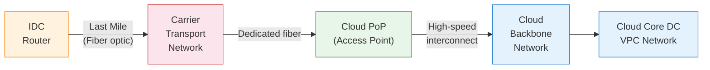
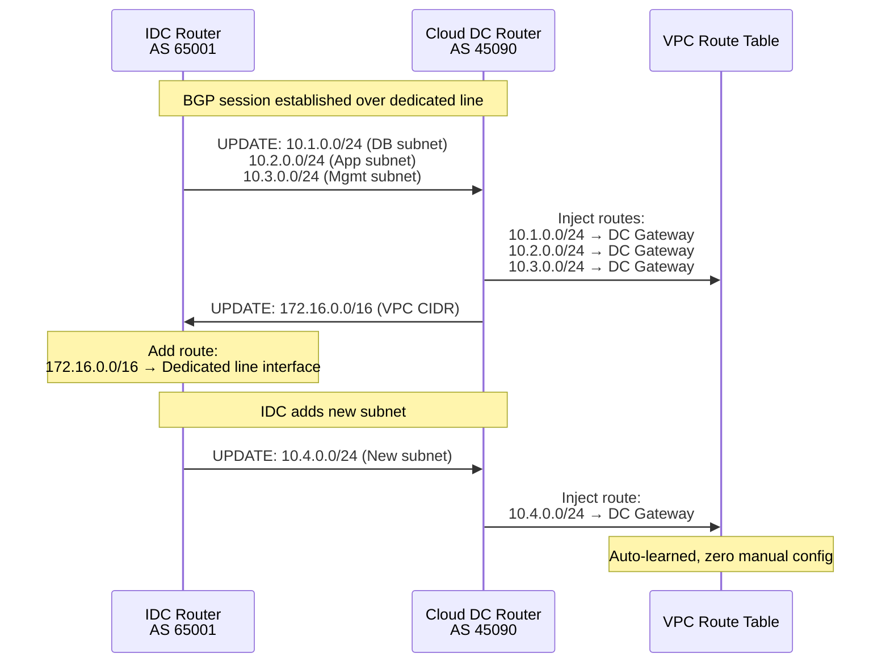
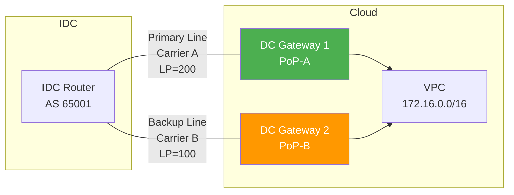
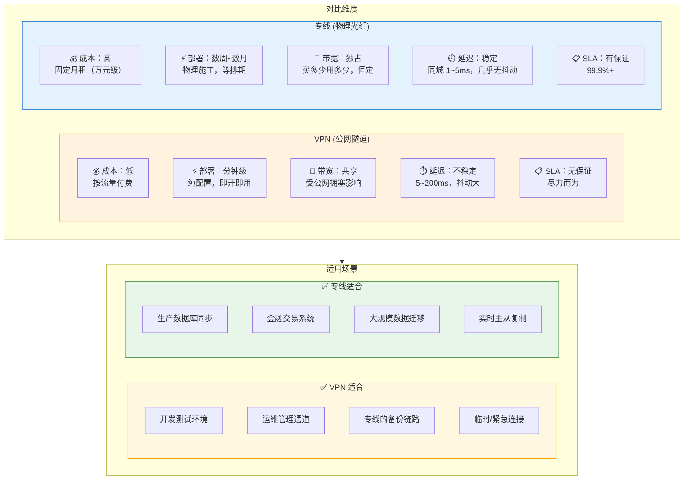

# 21. 拉一根光纤：专线接入

你用 VPN 打通了云和 IDC。开发测试环境用得很顺畅，偶尔延迟高一点，开发同学也不在意。但生产环境上线后，DBA 开始投诉：数据库主从同步的延迟从 5ms 飙到 80ms，而且每天下午高峰期都会出现。你查了一圈，发现是公网链路在高峰期拥塞，你的 VPN 流量和几百万其他用户的流量挤在同一条公网链路上。

DBA 说："我需要一条稳定的、延迟可预测的链路。"

这个需求 VPN 满足不了。不是 VPN 的实现有问题，而是它依赖的基础设施，公网，本身就不提供质量保证。公网是共享的、尽力而为的。要获得确定性的网络质量，需要一条完全不同的东西：一条不走公网的专属物理通道。

## 21.1 公网的不可控：为什么需要一条专属通道

先把"公网不够用"这件事说清楚。

VPN 的问题不在于加密隧道本身，IPSec 的加密和封装是可靠的。问题在于隧道跑在公网上，而公网有三个无法改变的特征。

第一，带宽是共享的。你的 VPN 流量和几百万其他用户的流量挤在同一条运营商链路上。高峰期（通常是工作日下午 2 点到晚上 10 点），链路利用率飙升，你的可用带宽可能从 500Mbps 降到 100Mbps。你买了 1Gbps 的 VPN 网关规格，但公网链路只剩 100Mbps 的空间，网关的规格再高也没用。

第二，延迟不可预测。公网的路由路径由运营商的 BGP 策略决定，你无法干预。今天你的流量走的是最短路径，同城延迟 5ms；明天运营商调整了路由策略，流量绕道了，延迟变成 30ms。更麻烦的是抖动，同一条链路上，延迟可能在 5ms 和 80ms 之间波动。对数据库主从同步来说，一次 80ms 的延迟抖动可能导致同步队列堆积，进而触发主库写入限流。

第三，没有 SLA 保证。公网是"尽力而为"（best-effort）的，运营商不承诺带宽、延迟、丢包率的具体数值。你的 VPN 隧道在公网上传输，就意味着你接受了这种不确定性。

现在看一个具体的业务场景。一家金融企业的交易系统部署在 IDC，风控系统部署在云上。每笔交易需要实时调用风控接口，要求端到端延迟低于 5ms、抖动低于 1ms。VPN 的公网路径无法保证这个 SLA，不是偶尔不行，而是在高峰期几乎必然不行。

需要的是什么？一条从 IDC 直接到云厂商机房的物理通道。这条通道有三个特征：独占带宽，你买了 1Gbps 就始终有 1Gbps 可用，不会被其他用户抢占；可预测延迟，延迟由物理距离决定（光在光纤中的传播速度约 5μs/km），同城专线的延迟通常在 1-2ms，且几乎没有抖动；不经过公网，流量在你的专属通道上传输，不经过任何公网路由器。

这条通道有一个直白的名字：专线。它不是"更好的 VPN"，VPN 是在公网上建加密隧道，专线是一条独立的物理光纤。两者的网络层次完全不同。专线的数据默认不加密，因为不经过公网，物理链路是专属的，窃听的风险远低于公网传输。如果合规要求加密，可以在专线上叠加 IPSec，但这是可选的，不是必须的。

## 21.2 专线的物理层：光纤、接入点与最后一公里

专线的"确定性"来自它的物理性，它不是虚拟的隧道，而是一条真实的光纤通道。理解这一点，需要看清楚专线的物理路径是怎么建立的。

云厂商在各个城市的数据中心或合作机房设有接入点，PoP（Point of Presence）。接入点是"云网络的物理入口"。你的专线不是直接拉到云厂商的核心机房，那通常不对外开放，而是拉到云厂商指定的接入点。接入点和云厂商的核心网络之间有高速互联，你的流量到达接入点后，通过云厂商的内部网络送到目标 VPC。

> **PoP 是什么？**
>
> PoP（Point of Presence，网络接入点）是云厂商或运营商在各地部署的网络节点。它不是一个完整的数据中心，没有大规模的计算和存储资源，而是一个网络接入设施，包含路由器、交换机和少量设备。PoP 的核心功能是"接入"：把外部流量（用户流量、专线流量）接收进来，然后通过骨干网转发到目标 Region。大型云厂商在全球部署了几十到几百个 PoP，它们是公网与云厂商私有网络之间的交界点。在专线场景中，PoP 是专线的物理终结点；在全球加速场景中，PoP 是 Anycast 流量的就近入口。

**图 21.1：专线的物理路径**



> 橙色 = 企业 IDC，红色 = 运营商传输网络（最后一公里），绿色 = 云厂商接入点（PoP），蓝色 = 云内网络。最后一公里（IDC → 运营商）通常是部署周期最长的环节。

企业通常不会自己拉光纤，从 IDC 到云厂商接入点的光纤铺设成本极高，而且需要市政施工许可。实际的做法是向运营商购买专线服务。运营商利用已有的光纤传输网络，在企业 IDC 和云厂商接入点之间建立一条专属的传输通道。这条通道在运营商的传输网络中有独占的带宽保证，虽然物理光纤可能和其他客户共享，但通过波分复用（WDM）等技术，每个客户的带宽是隔离的。

这里有一个经常被低估的环节：最后一公里。从运营商的传输网络到企业 IDC 机房的这段光纤，通常是专线部署中最耗时的部分。如果 IDC 所在的楼宇已经有运营商的光纤接入，可能几天就能完成。如果没有，需要物理施工：从最近的运营商机房拉光纤到 IDC 所在的楼宇，可能涉及穿管、架空、地下管道等工程。周期从几周到几个月不等。*这大概是云计算时代最不"云"的环节，你在控制台上点几下就能创建一个 VPC，但拉一根光纤可能需要等施工队排期。*

专线的接入方式分两种。独占接入（Dedicated Connection）：云厂商在接入点为你分配一个独占的物理端口（通常是 1GE 或 10GE），这个端口只属于你，带宽完全独占。共享接入（Hosted Connection）：多个客户共享一个物理端口，通过 VLAN 隔离，带宽按购买量分配。独占接入成本更高但性能更有保证，你不需要和其他客户竞争端口的转发能力。共享接入成本更低，适合带宽需求不大的场景。

专线的带宽规格从 50Mbps 到 100Gbps 不等。这个带宽是固定的、独占的，你买了 1Gbps，就始终有 1Gbps 可用。不会因为其他用户的流量而下降，不会因为高峰期而波动。这种确定性，正是公网无法提供的。

## 21.3 专线的数据链路层：802.1Q 与 QinQ

光纤通了，物理层连通了。下一个问题是：一条物理专线上，如何承载多个逻辑连接？

为什么需要多个逻辑连接？场景很常见：企业有两个 VPC，一个跑生产环境，一个跑开发测试，都需要通过同一条专线接入。或者企业的不同部门需要通过同一条专线访问不同的云上网络，但流量需要隔离。如果每个逻辑连接都拉一条独立的物理专线，成本会翻倍。

答案是 VLAN，第4章已经讲过的老朋友。在专线的以太网帧上打一个 802.1Q VLAN Tag，每个 VLAN ID 对应一个逻辑连接。VLAN 100 的流量送到生产 VPC，VLAN 200 的流量送到开发 VPC。企业端和云端约定好 VLAN ID 的分配，不同 VLAN 的流量在同一条物理光纤上传输，但互相隔离。

802.1Q 在简单场景下够用。但当企业内部已经在使用 VLAN 时，问题就来了。

假设企业的 IDC 内部已经用 VLAN 100 隔离了数据库网络，VLAN 200 隔离了应用网络。现在要通过专线把这些流量送到云上，专线上也需要用 VLAN 区分不同的逻辑连接。如果专线的 VLAN ID 和 IDC 内部的 VLAN ID 冲突了怎么办？企业不想改动已有的 VLAN 规划，那是几百台交换机的配置，改动的风险和工作量都不小。

QinQ（802.1ad）解决的就是这个问题。它在原有的 VLAN Tag 外面再套一层 VLAN Tag，双层信封。

**图 21.2：QinQ 的双层 VLAN Tag 结构**

```
┌─────────────────────────────────────────────────────────────────┐
│                     Ethernet Frame with QinQ                    │
├──────────┬──────────┬──────────┬──────────┬────────────┬────────┤
│ Dst MAC  │ Src MAC  │ S-Tag    │ C-Tag    │ IP Packet  │  FCS   │
│ (6B)     │ (6B)     │ (4B)     │ (4B)     │ (Payload)  │  (4B)  │
├──────────┴──────────┼──────────┼──────────┼────────────┴────────┤
│                     │          │          │                     │
│   Ethernet Header   │ Outer    │ Inner    │   Original Payload  │
│                     │ VLAN Tag │ VLAN Tag │                     │
│                     │          │          │                     │
│                     │ EtherType│ EtherType│                     │
│                     │ 0x88A8   │ 0x8100   │                     │
│                     │          │          │                     │
│                     │ S-Tag    │ C-Tag    │                     │
│                     │ (Service)│(Customer)│                     │
│                     │ Managed  │ Managed  │                     │
│                     │ by Cloud/│ by       │                     │
│                     │ Carrier  │ Customer │                     │
└─────────────────────┴──────────┴──────────┴─────────────────────┘
```

外层 Tag 叫 S-Tag（Service Tag），由运营商或云厂商管理，用来区分不同的客户或不同的逻辑连接。内层 Tag 叫 C-Tag（Customer Tag），由企业自己管理，保留企业内部已有的 VLAN 规划。两层 Tag 各管各的，互不干扰。

流量的处理过程是这样的：企业 IDC 的交换机发出一个带 C-Tag（VLAN 100）的帧，到达专线接入设备时，设备在外面套上一个 S-Tag（比如 VLAN 1000），然后发送到专线上。云端接入点收到帧后，根据 S-Tag 区分这是哪个客户的哪条逻辑连接，剥掉 S-Tag，根据 C-Tag 转发到对应的 VPC。

选择的判断很直接：如果只需要一条逻辑连接（一个 IDC 对一个 VPC），802.1Q 单层 Tag 就够了，简单明了。如果需要多条逻辑连接复用同一条物理专线，或者企业内部已有 VLAN 规划不想改动，QinQ 更合适，双层 Tag 让企业的 VLAN 空间和专线的 VLAN 空间完全解耦。

QinQ 就是"信封里套信封"，外面的信封是运营商的，里面的信封是企业的。邮局（运营商）只看外面的信封决定投递路线，收件人（云端）拆开外面的信封后，根据里面的信封决定最终送到哪里。

## 21.4 专线的路由层：BGP 路由交换

物理光纤连上了，数据链路层的 VLAN 配好了。但 VPC 的路由表里仍然没有 IDC 的路由，IDC 的路由器也不知道 VPC 的地址段。

专线通了，路由还没通。

需要一个路由交换机制，让两端互相告诉对方"我这边有哪些网段"。在专线场景中，这个机制是 BGP。

云端和 IDC 端在专线的两端建立 BGP 邻居关系。两端各有一个 AS 号（Autonomous System Number），云端使用云厂商分配的 ASN，IDC 端使用企业自己的 ASN（通常是私有 ASN，范围 64512-65534）。两端建立的是 eBGP（External BGP）邻居关系，通过 TCP 179 端口通信。

**图 21.3：BGP 路由交换过程**



BGP 会话建立后，IDC 端通过 BGP 向云端宣告自己的路由前缀，"我这边有 10.1.0.0/24（数据库子网）、10.2.0.0/24（应用子网）、10.3.0.0/24（管理子网）"。云端收到这些路由后，把它们注入到 VPC 的路由表中，VPC 内的 VM 发出目的地为 10.1.0.0/24 的包时，路由表指向专线网关，包通过专线送到 IDC。反向同理，云端通过 BGP 向 IDC 宣告 VPC 的路由前缀（比如 172.16.0.0/16），IDC 的路由器学习到这条路由后，就知道发往 172.16.0.0/16 的流量应该走专线接口。

BGP 的价值在于动态性。IDC 新增了一个子网 10.4.0.0/24？IDC 端的路由器通过 BGP 自动宣告，云端自动学习，VPC 路由表自动更新，零手动配置。这和第 20 章讲的路由型 VPN 配合 BGP 是同一个思路，让路由协议自动传播变更，而不是靠人工维护。

上面举的例子里，IDC 用的是 10.0.0.0/8，VPC 用的是 172.16.0.0/16，两边地址段井水不犯河水。但现实中经常不是这样。企业 IDC 建设得比云早，早年分配的地址段通常是 10.0.0.0/8 里某一块，迁上云的时候 VPC 也想用 10.0.0.0/8——老应用的配置里写着 10.x 的 IP，改起来成本太高。于是出现了一个尴尬的局面：IDC 宣告 10.1.0.0/24，而 VPC 自己也有一个 10.1.0.0/24 的子网。

这就是第 17 章讲过的老问题，IP 路由模型的硬约束：相同前缀不能在同一张路由表里共存。VPC 的路由表现在有两条 10.1.0.0/24，一条指向本地子网，一条指向专线，匹配结果是矛盾的。云厂商的 VPC 一般会直接拒绝接受和本地子网冲突的路由，BGP 会话能建起来，但冲突的前缀不会生效，流量还是走不通。

解决办法和第 19 章跨 VPC 打通时的思路是一样的：地址层面本来就解不了，只能绕开。常见的做法有两种。一种是规划阶段就做隔离，新建 VPC 时特意避开 IDC 已用的网段，比如 IDC 用 10.0.0.0/8，VPC 就用 172.16.0.0/12 或 192.168.0.0/16。另一种是在专线网关处做 NAT，把 IDC 侧的 10.1.0.0/24 在进入 VPC 前映射成一段互不冲突的地址，VPC 看到的是映射后的地址，感觉不到冲突的存在。代价是应用层如果硬编码了 IP，或者协议里带了 IP（比如 FTP、SIP），NAT 会把事情搞复杂，这一点第 19 章已经讨论过。

所以实际工程中，专线开通前的第一件事不是去拉光纤，而是把两边的地址规划表放在一起对一遍。这个检查做得晚，整条专线可能建好了也不能用。

路由过滤也是不能省的一环。不是所有 IDC 宣告过来的路由都应该注入 VPC，云端需要配置前缀过滤，只接受约定范围内的路由，拒绝不期望的前缀。最典型的是默认路由 0.0.0.0/0：如果 IDC 端误宣告了默认路由，VPC 的所有流量，包括本该走公网的流量，都会被吸引到专线上，专线带宽瞬间被打满，同时公网访问中断。这不是理论上的风险，如果你运维过大规模 BGP 网络，你大概率见过因为路由泄漏导致的故障。路由过滤是防止这类事故的安全网，和地址规划一样，都属于专线开通前就得配好的东西。

## 21.5 专线高可用：主备专线与故障切换

专线是物理链路。物理链路有物理风险。

施工挖断光纤，这在中国的城市建设中并不罕见。运营商设备故障，传输网络中的某台设备宕机。接入点机房停电，虽然有 UPS 和柴油发电机，但极端情况下仍可能发生。单条专线断了，云和 IDC 之间就完全断开。

对于生产环境，单条专线是不可接受的单点故障。

标准的做法是拉两条专线，走不同的物理路径。主专线走运营商 A 的光纤，从 IDC 到接入点 1；备专线走运营商 B 的光纤，从 IDC 到接入点 2。两条专线使用不同的运营商、不同的光缆路由、不同的接入点，尽可能消除共因故障。

**图 21.4：双专线高可用架构**



两条专线都建立 BGP 邻居关系，IDC 的路由通过两条路径都宣告到云端。云端收到同一个目的前缀的两条路由，一条来自主专线，一条来自备专线。通过 BGP 路径属性控制优先级：主专线的路由设置更高的 Local Preference（比如 200），备专线的路由设置较低的 Local Preference（比如 100）。正常情况下，流量走主专线（优先级高的路由）。

主专线断开后会发生什么？BGP 会话超时，BGP 默认的 Hold Timer 是 90 秒（每 30 秒发一次 Keepalive，连续 3 次未收到则判定会话超时）。会话超时后，主专线的路由撤销，备专线的路由自动生效，流量切换到备专线。

90 秒的切换时间对很多业务来说太长了。数据库连接池的超时通常设为 30 秒，90 秒的中断意味着大量连接超时、重试、甚至业务报错。怎么缩短？两个手段。第一，调小 BGP 的 Keepalive 间隔，比如从 30 秒改为 3 秒，Hold Timer 相应变为 9 秒。第二，配合 BFD（Bidirectional Forwarding Detection，双向转发检测），BFD 是一种轻量级的链路检测协议，检测间隔可以低至毫秒级。BFD 检测到链路中断后，立即通知 BGP 撤销路由，切换时间可以缩短到秒级甚至亚秒级。

还有一种更经济的高可用方案：一条专线 + 一条 VPN 作为备份。正常走专线，带宽大、延迟低、质量有保证。专线断了自动切换到 VPN，带宽小、延迟高、质量不保证，但至少能通。这种方案比双专线成本低得多（省了一条专线的费用），适合对备份链路质量要求不高的场景。

路由优先级的设置也很直接：专线的路由优先级高于 VPN。专线断了，专线路由撤销，VPN 路由生效；专线恢复了，专线路由重新注入，优先级更高，流量自动切回专线。整个过程由 BGP 自动完成，不需要人工干预。

## 21.6 专线 vs VPN：不是替代，而是互补

专线和 VPN 解决的是同一个问题，打通云和 IDC，但用的是完全不同的方式，适用于完全不同的场景。

**图 21.5：专线 vs VPN 的选择维度**



> 橙色 = VPN（低成本、快部署、不确定性高），蓝色 = 专线（高成本、慢部署、确定性强）。选择不是"哪个更好"，而是"什么场景用什么"。两者可以共存：专线提供质量，VPN 提供兜底。成本交叉点大约在持续带宽 200~500Mbps——低于此用 VPN 更经济，高于此专线的固定月租反而更划算。

选择不是"哪个更好"，而是"什么场景用什么"。

这个选择可以用一个简单的成本模型量化。VPN 的成本结构是"低固定 + 高变动"——网关实例费用低（几百元/月），但公网带宽按量计费，流量越大越贵。专线的成本结构是"高固定 + 零变动"——端口费 + 运营商线路费是固定月租（1Gbps 专线通常几万到十几万元/月），但无论跑多少流量都不额外收费。两条成本曲线必然有一个交叉点：当月均流量低于某个阈值时，VPN 更便宜；超过这个阈值后，专线更经济。

对于大多数企业，这个交叉点大约在持续带宽 200-500Mbps 左右。如果你的云和 IDC 之间每天只有几十 GB 的数据交换，VPN 的成本可能只有专线的十分之一。但如果你有持续的大带宽需求（数据库同步、日志回传、大规模数据迁移），专线的"固定月租"模式反而更经济——而且你还额外获得了延迟确定性和 SLA 保证，这些在 VPN 上花多少钱都买不到。

开发测试环境用 VPN，成本低、部署快，延迟高一点开发同学不在意。生产环境的数据库同步用专线，延迟必须稳定在 5ms 以内，带宽必须独占。管理通道用 VPN，运维人员从云上访问 IDC 的管理网络，流量小、对延迟不敏感。大规模数据迁移用专线，几十 TB 的数据通过 1Gbps 的专线传输，大约需要一天；通过 100Mbps 的 VPN，需要两周。

两者可以共存。同一个 IDC 可以同时接入专线和 VPN。通过 BGP 路由优先级控制，正常走专线，专线断了自动切换到 VPN。这是混合云网络中最常见的高可用架构，专线提供质量，VPN 提供兜底。

专线给你确定性，但要你等、要你付钱；VPN 给你即时性，但不给你承诺。工程的世界里，没有免费的确定性。

但无论是专线还是 VPN，到目前为止解决的都是"一条链路"的问题，一个 IDC 连一个 VPC。现实中，企业的网络拓扑远比这复杂。3 个 IDC 分布在北京、上海、深圳，云上有 5 个 VPC 分布在不同地域。每个 IDC 都需要和多个 VPC 互通，每个 VPC 也可能需要和多个 IDC 互通。如果用点对点的方式管理这些连接，8 个网络节点全互通需要 28 条连接，每条连接有独立的路由配置、独立的监控告警、独立的带宽管理。新增一个节点？再加 8 条连接。这个拓扑和第 17 章对等连接面临的 N² 问题一模一样，只是节点从纯 VPC 变成了 VPC + IDC 的混合体，管理起来更加复杂。
