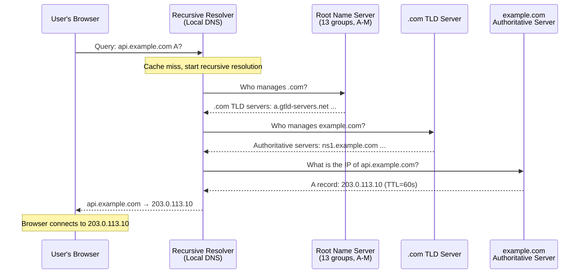
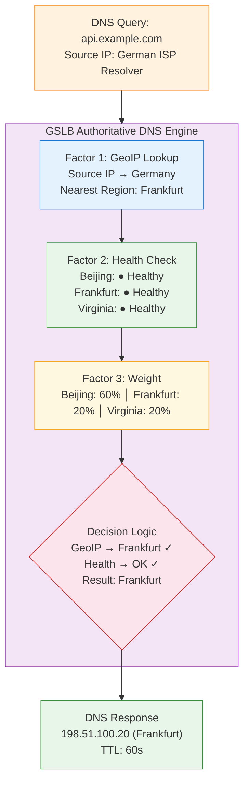
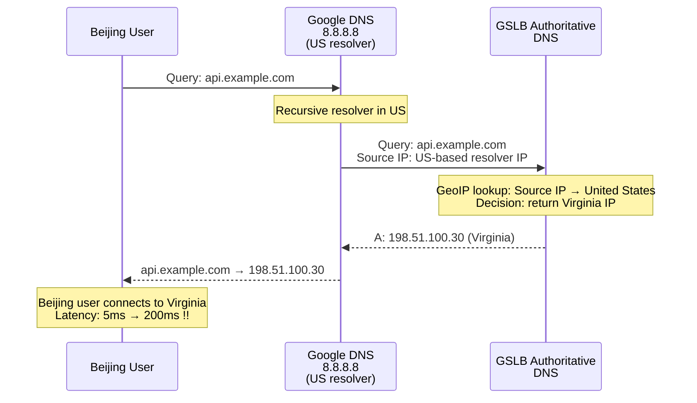
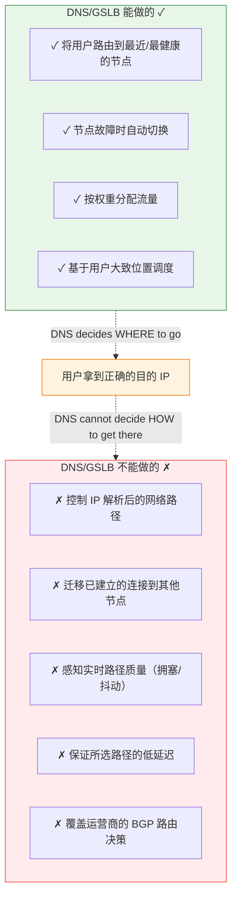

# 22. 全球用户如何找到最近的服务：DNS 与 GSLB

你的电商平台完成了全球化部署，北京、法兰克福、弗吉尼亚三个 Region 各跑了一套完整的服务。运维团队信心满满：无论用户在哪里，总有一个节点离他不远。但上线第一天，监控数据就给了所有人一个意外：巴西的用户全部打到了北京节点，延迟 300ms；德国的用户有一半打到了弗吉尼亚节点，而不是近在咫尺的法兰克福。三个 Region 的流量分布完全不符合预期。

服务部署对了，网络也通了，问题出在一个更基础的环节：用户输入 `api.example.com` 的那一刻，谁来决定这个域名解析到哪个 IP？

## 22.1 全球用户，一个域名

某电商平台只在北京 Region 部署了服务。北京用户访问延迟 5ms，上海用户 30ms，新加坡用户 80ms，法兰克福用户 200ms，圣保罗用户 300ms。延迟不只是"慢一点"的体验问题，300ms 的 RTT 意味着一次 HTTPS 连接建立就要消耗 3 个 RTT（TCP 三次握手 1 个 RTT + TLS 1.2 握手 2 个 RTT），也就是 900ms。还没开始传输任何业务数据，光握手就花了将近 1 秒。页面加载时间可能超过 5 秒，而研究表明，页面加载超过 3 秒，超过一半的用户会直接离开。用户不会打开浏览器的开发者工具去分析"哦，原来是服务器在地球另一边"，他只会说"这个网站太慢了"，然后关掉页面。

解决方案很直接：多 Region 部署。企业在北京、法兰克福、弗吉尼亚三个 Region 各部署一套服务。巴西用户访问弗吉尼亚（延迟约 120ms），德国用户访问法兰克福（延迟约 10ms），中国用户访问北京（延迟约 5ms）。

但问题随之而来：用户访问的是同一个域名 `api.example.com`，这个域名应该解析到哪个 IP？如果所有用户都解析到北京的 IP，法兰克福和弗吉尼亚的部署就白费了。

最朴素的想法是给不同地区的用户分配不同的域名，`api-bj.example.com`、`api-eu.example.com`、`api-us.example.com`。但这要求用户知道自己该用哪个域名，或者前端代码里硬编码地区判断逻辑。用户不会关心你的服务部署在哪里，他只知道一个域名。

更进一步的想法是用 HTTP 302 重定向。用户先访问一个统一入口 `api.example.com`，入口服务器根据用户的源 IP 判断地区，返回 302 跳转到最近的节点。这比硬编码域名好，但问题也很明显：每次重定向多一次 RTT（几十到几百毫秒）；只适用于 HTTP 协议，TCP/UDP 层面的服务无法使用；入口服务器本身成为单点，全球用户都要先访问它，它挂了所有人都受影响。

如果能在更底层，域名解析的层面，就做出调度决策呢？用户拿到的第一个 IP 就是最优的，不需要额外的跳转，不限于 HTTP 协议，也不依赖任何单点入口。

做这个决策的地方，就是 DNS。

## 22.2 DNS 解析的完整路径

要理解 DNS 如何做调度，先要理解一次 DNS 解析经历了什么。

用户在浏览器输入 `api.example.com`。浏览器先查自己的 DNS 缓存，最近解析过这个域名吗？没有。再查操作系统的 DNS 缓存，还是没有。于是操作系统把查询请求发给配置好的 DNS 服务器，通常是运营商提供的 Local DNS，或者用户手动配置的公共 DNS（比如 Google 的 8.8.8.8 或 Cloudflare 的 1.1.1.1）。

这个 DNS 服务器叫做**递归解析器**（Recursive Resolver）。"递归"的意思是：它替用户完成整个查询链，用户只需要问它一次，它负责把答案找回来。

递归解析器的工作过程是这样的：

**图 22.1：DNS 递归解析的完整路径**



第一步，递归解析器问根域名服务器："谁管 `.com`？"根域名服务器全球有 13 组（编号 A 到 M），它们不知道 `api.example.com` 的 IP 是什么，但知道 `.com` 这个顶级域由哪些 TLD 服务器管理。根返回 `.com` TLD 服务器的地址。

第二步，递归解析器问 `.com` TLD 服务器："谁管 `example.com`？"TLD 服务器也不知道最终的 IP，但知道 `example.com` 这个域名的权威服务器是谁。TLD 返回权威服务器的地址。

第三步，递归解析器问 `example.com` 的权威服务器："`api.example.com` 的 IP 是什么？"权威服务器返回最终的 IP 地址，比如 203.0.113.10，以及一个 TTL 值（比如 60 秒）。

递归解析器把这个结果缓存 60 秒，然后返回给用户。在这 60 秒内，同一个递归解析器上的其他用户查询 `api.example.com`，直接从缓存返回，不再走完整的查询链。

整个过程中，有一个容易被忽略但极其重要的事实：**递归解析器向权威服务器发送查询时，DNS 查询报文的源 IP 地址是递归解析器自己的 IP，不是用户的 IP。**

权威服务器收到查询后，只能看到"是哪个递归解析器在问我"，看不到"是哪个用户在问"。这个事实，直接决定了后面 GSLB 调度的精度上限，记住它，22.5 节会回来。

## 22.3 GSLB：在 DNS 层面做全局调度

理解了 DNS 的查询链路，关键环节就浮出来了：权威服务器。

在传统的 DNS 配置中，权威服务器是一个静态的映射表，`api.example.com` 永远返回 203.0.113.10。无论查询来自北京还是圣保罗，返回的都是同一个 IP。

GSLB（Global Server Load Balancing）做的事情是：把权威服务器从一个静态的映射表，变成一个动态的调度引擎。每次收到查询，它根据多个因子计算出最优的 IP 返回。

> **GSLB 是什么？**
>
> GSLB（Global Server Load Balancing，全局服务器负载均衡）是一种基于 DNS 的全球流量调度机制。传统的负载均衡器（如 CLB、ALB）工作在单个 Region 内部，把流量分发给同一 Region 的后端服务器。GSLB 工作在全球尺度，它通过控制 DNS 解析结果，把不同地区的用户引导到不同 Region 的服务节点。GSLB 的调度因子包括用户的地理位置、节点的健康状态、权重配置和实时延迟。云厂商通常以"智能 DNS 解析"或"全局流量管理"的产品形态提供 GSLB 能力。

**调度因子一：地理位置。**

权威服务器收到查询请求后，根据查询来源的 IP 地址（递归解析器的 IP），通过 IP 地理位置数据库判断这个递归解析器大致在哪个地区。如果递归解析器在德国，返回法兰克福 Region 的服务 IP；如果在中国，返回北京 Region 的 IP。

*简单来说，就是看你从哪里来，就把你往最近的地方引。*

**调度因子二：健康状态。**

GSLB 持续对所有服务节点做健康检查，HTTP 探测、TCP 探测、ICMP 探测。每隔几秒或几十秒探测一次，连续几次失败就判定节点不健康。如果法兰克福节点宕机了，GSLB 自动把原本解析到法兰克福的用户切换到弗吉尼亚或北京，返回一个健康节点的 IP。

**调度因子三：权重。**

运维可以为不同节点设置权重。北京节点容量大，权重 60%；法兰克福节点容量小，权重 20%；弗吉尼亚 20%。GSLB 按权重比例分配流量，每 100 次查询，大约 60 次返回北京的 IP，20 次返回法兰克福，20 次返回弗吉尼亚。

**调度因子四：延迟。**

某些 GSLB 实现会主动探测用户到各节点的网络延迟，返回延迟最低的节点 IP。这比纯地理位置更准确，地理上最近不一定网络延迟最低。深圳到香港地理距离很近，但如果跨运营商，延迟可能比深圳到上海（同运营商）还高。

**图 22.2：GSLB 的多因子调度决策**



> 调度流程自上而下：先按地理位置缩小候选范围（蓝色），再按健康状态排除故障节点（绿色），最后按权重在剩余候选中分配（黄色）。最终决策（红色）综合所有因子得出结论。整个过程发生在 DNS 解析的瞬间——用户还没发出任何业务请求，目的地就已经确定了。

实际的调度策略通常是多因子组合：先按地理位置缩小候选范围，再按健康状态排除故障节点，最后按权重在剩余候选中分配流量。不同的 GSLB 产品提供不同的策略组合方式，有的以地理位置为主、健康检查为辅，有的以延迟为主、地理位置为辅。

这里有一个值得停下来想一想的问题：GSLB 的调度决策发生在 DNS 解析的那一刻，用户还没有发出任何业务请求，甚至还没有建立 TCP 连接。DNS 返回的 IP 决定了用户接下来的所有流量去往哪个节点。*这是一个"一锤定音"的决策，选对了，后续所有请求都受益；选错了，后续所有请求都受损。*

## 22.4 TTL 的困境：快与慢的矛盾

GSLB 的调度能力依赖一个前提：用户的 DNS 查询能到达权威服务器。但 DNS 有缓存，递归解析器会把查询结果缓存起来，在 TTL 过期之前不再查询权威服务器。

这意味着 TTL 决定了 GSLB 调度的"时间分辨率"。

TTL 设为 60 秒。法兰克福节点在第 0 秒宕机，GSLB 在第 10 秒通过健康检查发现了故障，把法兰克福从调度中摘除。但此时全球的递归解析器上还缓存着法兰克福的 IP，这些缓存最长还有 50 秒才过期。在这 50 秒内，所有命中缓存的用户仍然被引导到已经宕机的法兰克福节点，请求全部失败。

50 秒的故障窗口。对于一个支付系统来说，50 秒意味着几千笔交易失败。

那把 TTL 设短一点？设为 10 秒？故障窗口缩短到 10 秒，好多了。但代价随之而来。

TTL 10 秒意味着每个递归解析器每 10 秒就要向权威服务器发一次查询。全球有几十万个活跃的递归解析器，每 10 秒几十万次查询，权威服务器的压力和成本都显著上升。而且每次 DNS 查询本身也有延迟（通常 10-50ms），TTL 过期后用户的第一次访问会多出这个延迟。如果用户每 10 秒就要经历一次 DNS 查询的额外延迟，体验会有可感知的下降。

反过来，TTL 设为 3600 秒（1 小时）。DNS 查询量极低，权威服务器几乎没有压力，用户几乎不感知 DNS 解析延迟，因为绝大部分时间都命中缓存。但如果节点宕机，已经缓存了旧 IP 的用户最长要等 1 小时才能切换到新节点。1 小时的故障窗口，对任何在线业务来说都是灾难。

**图 22.3：TTL 长短的矛盾**

```
TTL = 10s                          TTL = 3600s
┌─────────────────────┐            ┌─────────────────────┐
│ Failover window:    │            │ Failover window:    │
│ ~10 seconds         │            │ ~3600 seconds       │
│ ✓ Fast recovery     │            │ ✗ Slow recovery     │
│                     │            │                     │
│ DNS query load:     │            │ DNS query load:     │
│ ~6 queries/min      │            │ ~1 query/hour       │
│ per resolver        │            │ per resolver        │
│ ✗ High pressure     │            │ ✓ Low pressure      │
│                     │            │                     │
│ User latency:       │            │ User latency:       │
│ Frequent DNS lookup │            │ Rare DNS lookup     │
│ ✗ Extra 10-50ms     │            │ ✓ Almost zero       │
│   every 10s         │            │   DNS overhead      │
└─────────────────────┘            └─────────────────────┘

         ◄──────── No perfect balance ────────►
```

这个矛盾是结构性的，不存在"最佳 TTL 值"。

不同业务对"故障切换窗口"的容忍度不同。支付系统可能要求 30 秒内切换，设置 TTL=30；内容站点可以容忍 5 分钟，设置 TTL=300；内部管理系统可以容忍更长时间，设置 TTL=3600。每一个 TTL 值都是在"切换速度"和"系统开销"之间做出的妥协，而且这个妥协不是一次性的，业务特性变了，TTL 可能也要跟着调。

还有一个更隐蔽的问题：即使你设置了 TTL=60，也不意味着所有递归解析器都会严格遵守。某些运营商的 Local DNS 会无视权威服务器返回的 TTL，自行设置更长的缓存时间，可能是为了减少自身的查询压力，也可能是配置错误。*你以为故障窗口是 60 秒，实际上某些地区的用户可能要等 10 分钟甚至更久。这种事情在实际运维中并不罕见，而且你几乎无法控制，因为那是别人的 DNS 服务器。*

## 22.5 运营商 Local DNS 的干扰与 EDNS Client Subnet

TTL 的矛盾已经够头疼了。但 GSLB 还有一个更根本的盲区。

回到 22.2 节提到的那个事实：权威服务器收到的查询请求来自递归解析器，不是来自用户。权威服务器只能看到递归解析器的 IP 地址，用这个 IP 来判断"用户在哪里"。

如果用户使用的是本地运营商的 Local DNS，比如北京联通的用户用北京联通的 Local DNS，这个判断通常是准确的。Local DNS 和用户在同一个城市、同一个运营商，IP 地理位置数据库把 Local DNS 的 IP 定位到北京，GSLB 返回北京节点的 IP。没问题。

但如果北京的用户配置了 Google 的 8.8.8.8 作为 DNS 服务器呢？

用户的 DNS 查询发到 8.8.8.8，Google 的递归解析器可能从美国的某个节点向权威服务器发起查询。权威服务器看到的来源 IP 在美国，于是 GSLB 判断"这个用户在美国"，返回弗吉尼亚节点的 IP。北京的用户被调度到了弗吉尼亚，延迟从 5ms 变成 200ms。

**图 22.4：公共 DNS 导致的调度偏差**



这不是一个边缘场景。Google DNS（8.8.8.8）和 Cloudflare DNS（1.1.1.1）在全球有大量用户，尤其是技术人员，很多人习惯把 DNS 改成这些公共服务。而且问题不只出在公共 DNS 上：某些小运营商的 Local DNS 部署在其他城市，或者通过 NAT 出口的 IP 归属地和用户实际位置不一致。GSLB 基于这些 IP 做出的调度决策，都可能是错误的。

开篇提到的那个问题，"德国的用户有一半打到了弗吉尼亚节点"，很可能就是这个原因。那些德国用户使用了某个递归解析器，而这个解析器的出口 IP 被 GeoIP 数据库定位到了美国。

EDNS Client Subnet（ECS）是对这个问题的修补。

RFC 7871 定义了一个 DNS 扩展：递归解析器在向权威服务器发送查询时，可以在 DNS 请求中附带一个额外的字段，用户的真实 IP 的前缀。

> **EDNS Client Subnet 是什么？**
>
> EDNS（Extension Mechanisms for DNS）是 DNS 协议的扩展框架，允许在 DNS 报文中携带额外的信息。Client Subnet 是其中一个扩展选项（Option Code 8），由 RFC 7871 定义。它让递归解析器在查询时告诉权威服务器："发起这次查询的用户来自这个 IP 网段。"具体来说，ECS 选项包含两个关键字段：SOURCE PREFIX-LENGTH（前缀长度，通常是 /24）和 ADDRESS（用户 IP 的网络部分）。出于隐私考虑，不传完整的用户 IP，只传网段前缀。

有了 ECS，权威服务器收到查询时，不再只看递归解析器的 IP，而是看 ECS 字段中携带的用户 IP 前缀。北京用户通过 Google DNS 查询，Google DNS 在请求中附带用户的 /24 网段，权威服务器用这个网段做 GeoIP 查询，定位到北京，返回北京节点的 IP。调度准确了。

但 ECS 不是万能的。

第一，不是所有递归解析器都支持 ECS。Google DNS 和 Cloudflare DNS 支持，但大量运营商的 Local DNS 不支持。不支持 ECS 的递归解析器发出的查询里没有用户 IP 信息，权威服务器只能退回到用递归解析器自己的 IP 做判断，和没有 ECS 一样。

第二，ECS 改变了 DNS 缓存的粒度。没有 ECS 时，递归解析器上所有用户共享一条缓存，`api.example.com → 203.0.113.10`。有了 ECS 后，不同 IP 前缀的用户可能得到不同的解析结果，递归解析器需要按用户 IP 前缀分别缓存。原来一条缓存能服务所有用户，现在可能需要几百条缓存才能覆盖不同网段的用户。缓存命中率下降，DNS 查询量上升，又回到了 TTL 困境的变种。

第三，ECS 只传 IP 前缀（通常是 /24），地理定位的精度取决于 GeoIP 数据库对这个 /24 网段的定位准确度。GeoIP 数据库本身就不是 100% 准确的，尤其是对于移动网络和小运营商的 IP 段，定位误差可能达到省级甚至国家级。

*ECS 是修补，不是根治。只要 DNS 调度依赖"猜测用户位置"，就永远存在猜错的可能。这是 DNS 作为调度机制的结构性局限，它在域名解析这个环节能做的事情，已经接近天花板了。*

## 22.6 DNS 调度的边界

DNS 通过 GSLB 实现了全球流量调度的"第一跳"，全球用户通过一个域名，被自动引导到最优的服务节点。节点故障时自动切换。流量按权重分配。这是全球流量调度的基础能力，没有它，多 Region 部署就失去了意义。

但 DNS 调度的能力有一条清晰的边界线。

**边界一：时间粒度。**

调度决策只在 DNS 解析时发生。一旦用户拿到 IP 并建立了 TCP 连接，后续所有请求都走这个 IP，直到连接断开或 DNS 缓存过期。如果在连接期间节点性能下降，比如法兰克福节点的 CPU 使用率从 30% 飙升到 95%，DNS 无法把已建立的连接迁移走。那些已经连上法兰克福的用户，只能等到连接断开后重新解析，才有机会被调度到其他节点。

**边界二：路径盲区。**

DNS 只决定"目的地 IP"，不控制"到达目的地的路径"。用户拿到了法兰克福节点的 IP，但从用户到法兰克福的路径走的是公网。公网的路由由运营商之间的 BGP 决定，BGP 选的是 AS 路径最短的路由，不是延迟最低或质量最好的路由。用户的流量可能绕了半个地球才到达法兰克福。

一个具体的例子：深圳的用户被 GSLB 调度到了香港节点，地理上最近，直线距离不到 50 公里。但深圳到香港的公网路径经过了广州的一个拥塞节点，实际延迟 80ms。而深圳到上海的公网路径反而畅通，延迟只有 40ms。GSLB 选了地理上最近的节点，但网络上并不是最快的。DNS 无法感知这种实时的路径质量差异，它没有任何手段去探测或控制用户到节点之间的网络路径。

**图 22.5：DNS 调度的能力边界**



> 绿色 = DNS 的能力范围（选择目的地），红色 = DNS 的能力边界之外（控制路径）。DNS 解决了"去哪里"，但无法控制"怎么去"。

DNS 解决了"去哪里"，但无法控制"怎么去"。用户拿到了正确的目的地 IP，但到达目的地的路径完全由公网决定，拥塞、绕路、丢包，都不在 DNS 的控制范围内。*谋事在人，成事在天，DNS 尽了最大努力选对了目的地，但路上的风雨，它管不了。*

真正需要的下一步能力是：不只是选对目的地，还要让流量走更好的路。让用户的流量尽快离开不可控的公网，进入云厂商自己可控的骨干网络。这需要一种不同于 DNS 的调度机制，不是在域名解析层面做选择，而是在网络路由层面做选择。
