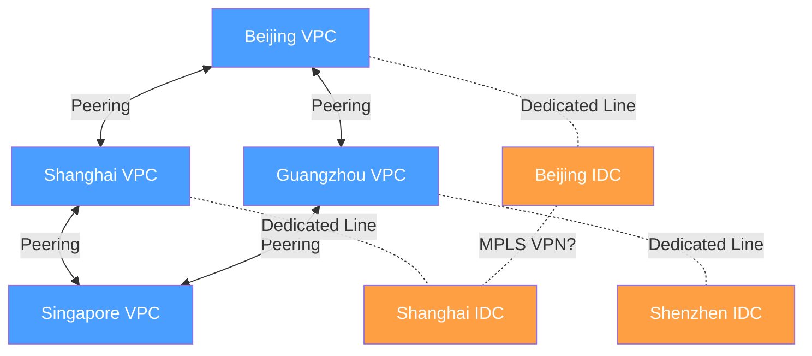
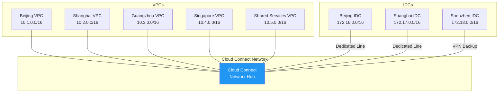
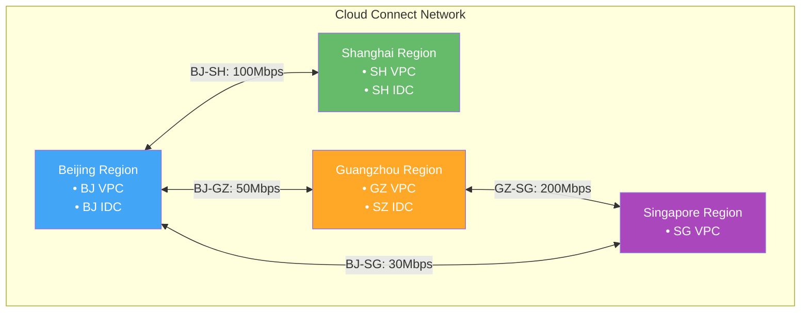
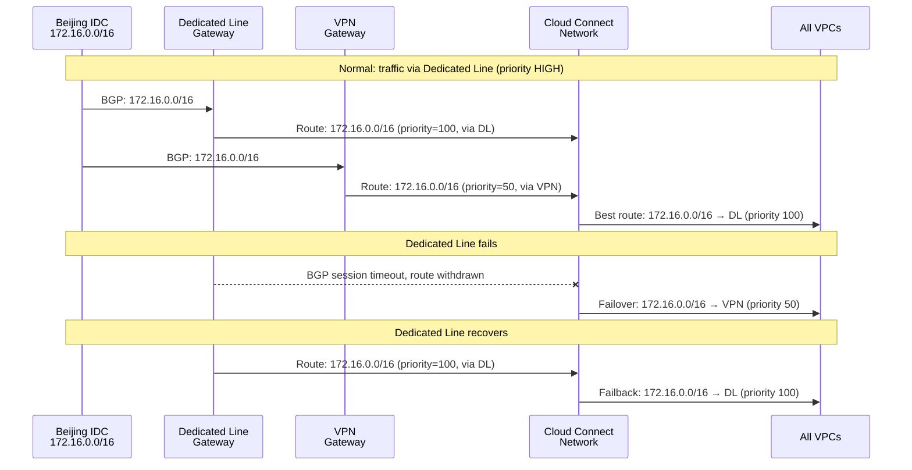
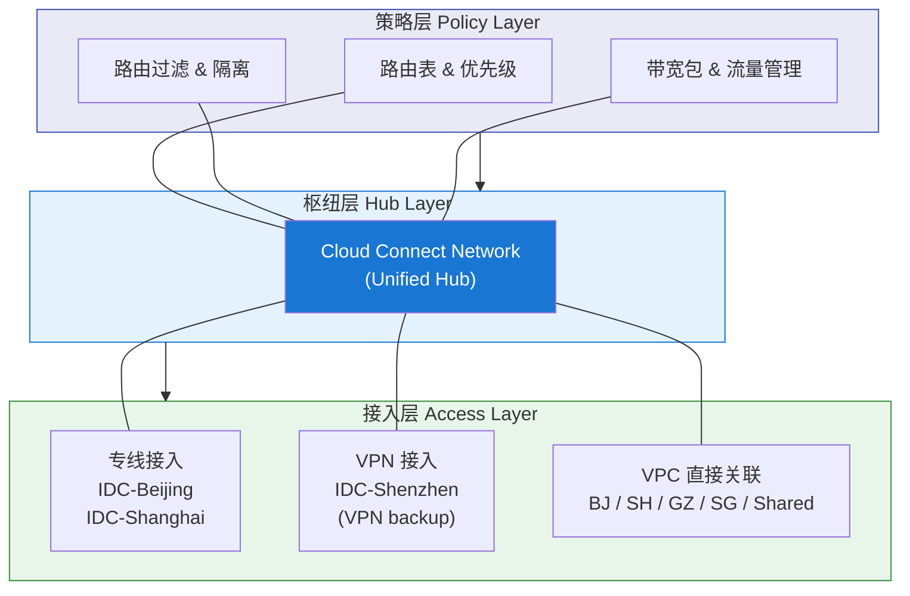

# 22. 统一管理云和 IDC 的连接：云联网的纵向扩展

你的公司在过去两年里完成了混合云部署。3 个 IDC 分布在北京、上海、深圳，云上有 5 个 VPC 分布在不同地域。每个 IDC 都通过专线连接到最近的 VPC，VPC 之间用对等连接互通。一切看起来井井有条，直到网络团队开始统计：目前有 12 条专线、8 条对等连接、3 条 VPN 备份链路。每条连接有独立的路由配置、独立的监控告警、独立的带宽管理。上个月新加坡 VPC 上线，需要和所有已有节点建立连接，又是 7 条新配置。

网络团队的 leader 说："我们需要一个统一的管理平面，不然这个拓扑迟早会失控。"

这个判断是对的。问题不只是连接数量多，而是连接的类型不同、管理方式不同、路由策略分散在每条连接上。这不是靠加人能解决的问题，而是架构层面需要一个根本性的变化。

## 22.1 网状拓扑的管理困境

先把"失控"这件事量化一下。

8 个网络节点（3 个 IDC + 5 个 VPC）全互通，需要 N×(N-1)/2 = 28 条连接。这个数字本身已经不小，但真正的痛苦不在数量，在于异构性。

VPC 之间用对等连接或云联网互通。VPC 和 IDC 之间用专线或 VPN 互通。IDC 和 IDC 之间呢？如果两个 IDC 需要通过云来中转，流量要先从 IDC-A 走专线到 VPC-A，再从 VPC-A 走对等连接到 VPC-B，再从 VPC-B 走专线到 IDC-B，三跳，三种不同类型的连接，三套不同的路由配置。如果 IDC 之间直接互通，可能需要运营商的 MPLS VPN，又多了一种连接类型。

**图 22.1：网状拓扑下的异构连接**

> 蓝色 = VPC（云上），橙色 = IDC（线下）。实线 = Peering，虚线 = 专线/VPN。每种连接类型有独立的路由、监控和带宽管理。

三种不同类型的连接，意味着三套不同的管理方式。对等连接在云控制台上管理，路由通过云联网或手动配置传播。专线通过运营商和云厂商的接入点管理，路由通过 BGP 交换。VPN 在云控制台上配置隧道参数，路由通过 BGP 或静态路由传播。运维团队需要同时掌握所有这些技术，而且每种技术的故障排查方式都不一样。

更麻烦的是路由策略的碎片化。

假设你需要实现这样一条策略："北京 IDC 只能访问北京 VPC 和共享服务 VPC，不能访问新加坡 VPC。"在网状拓扑下，你需要在北京 IDC 的专线 BGP 会话上配置路由过滤，只宣告北京 VPC 和共享服务 VPC 的路由，不宣告新加坡 VPC 的路由。同时，在北京 VPC 和新加坡 VPC 的对等连接上，也要确保北京 IDC 的路由不会传播到新加坡 VPC。如果有人在某条对等连接上漏配了路由过滤，北京 IDC 的路由泄漏到了新加坡 VPC，安全策略就被绕过了。

28 条连接，每条连接上都可能需要独立的路由过滤策略。策略分散在 28 个地方，任何一个地方的遗漏都可能导致安全问题。*如果你管理过这种规模的网状拓扑，你大概率经历过凌晨被告警叫醒，然后花两个小时排查到底是哪条连接的路由策略配错了。*

新增一个节点的代价也在加速增长。第 9 个节点加入时，需要和已有的 8 个节点各建一条连接，8 条新配置。第 10 个节点加入时，9 条。第 20 个节点加入时，19 条。这不是线性增长，是二次方增长。

这个困境和第 17 章对等连接面临的 N² 问题本质相同，但更严重。第 17 章的节点全是 VPC，连接类型单一；这里的节点是 VPC + IDC 的混合体，连接类型异构。管理复杂度不只是 N² 的连接数量，还有异构连接 × 碎片化策略的乘数效应。

需要的是什么？和第 18 章云联网解决 VPC 互联的思路一样，一个统一的枢纽。所有网络节点（无论是 VPC 还是 IDC）都挂到同一个中心枢纽上，路由自动传播，策略集中管理。

## 22.2 云联网接入 IDC：专线和 VPN 作为接入方式

第 18 章的云联网已经解决了 VPC 之间的互联，所有 VPC 挂到云联网上，路由自动传播，任意两个 VPC 之间自动互通。现在要做的是把这个能力向下延伸，让 IDC 也能接入云联网，成为和 VPC 平等的网络节点。

怎么接入？IDC 不是云上的资源，不能像 VPC 那样直接"关联"到云联网。IDC 需要通过一条物理或逻辑的链路连接到云，而这条链路，就是前两章讲的专线或 VPN。

关键的变化在于：专线和 VPN 不再直接连接到某个 VPC，而是连接到云联网。

**图 22.2：IDC 通过专线/VPN 接入云联网**

北京 IDC 通过一条专线接入云联网。专线的 BGP 会话不再和某个 VPC 的网关建立，而是和云联网的接入网关建立。IDC 端通过 BGP 宣告自己的路由前缀（172.16.0.0/16），这些路由注入到云联网的路由表中。云联网自动把 IDC 的路由传播给所有接入的 VPC，北京 VPC、上海 VPC、广州 VPC、新加坡 VPC、共享服务 VPC 都自动学习到了 172.16.0.0/16 的路由。反向同理，所有 VPC 的路由也通过云联网传播给北京 IDC。

一条专线接入，自动和所有 VPC 互通。不需要为每个 VPC 单独建立连接。

VPN 接入的方式完全一样，VPN 隧道的终点不再是某个 VPC 的 VPN 网关，而是云联网的 VPN 接入点。隧道建立后，IDC 的路由注入云联网，效果和专线接入完全相同。

新增一个 VPC 到云联网时会发生什么？北京 IDC 自动获得到新 VPC 的路由，零配置。新增一个 IDC 接入云联网时呢？所有已有的 VPC 自动获得到新 IDC 的路由，同样零配置。N 个节点全互通，只需要 N 条接入链路（每个节点一条到云联网的连接），而不是 N×(N-1)/2 条点对点连接。8 个节点从 28 条连接变成 8 条接入链路。

还有一个容易被忽略的好处：3 个 IDC 都接入云联网后，IDC 之间也可以通过云联网互通。北京 IDC 到上海 IDC 的流量走云联网的骨干网络，不需要单独拉一条 IDC 间的专线，也不需要通过 VPC 中转。当然，这取决于路由策略是否允许，如果你不希望 IDC 之间互通，可以在云联网的路由表中配置隔离策略。

这里有一个认知上的关键转变：接入云联网后，专线和 VPN 的角色发生了根本性的变化。

在点对点模式下，专线是"连接方式"，它负责端到端的路由管理，一条专线连接一个 IDC 和一个 VPC。在云联网模式下，专线降级为"接入方式"，它只负责把 IDC 连接到云联网这个枢纽上，不再负责端到端的路由管理。路由管理和策略控制都集中在云联网层面。

*换个角度看，专线和 VPN 从"公路"变成了"匝道"，它们不再是从 A 到 B 的完整路径，而只是从 IDC 上到云联网这条"高速公路"的入口。上了高速之后，去哪里、怎么走，都由高速公路（云联网）来管。*

## 22.3 带宽包与跨地域流量管理

云联网内同地域的流量，比如北京 VPC 到北京 IDC，通常免费或低成本。但跨地域的流量是另一回事。

北京 VPC 到上海 IDC 的流量，需要经过云厂商的骨干网络从北京传输到上海。骨干网络的带宽是有限的、昂贵的。如果不加限制，某个业务的大规模数据迁移可能把北京到上海的骨干网带宽打满，影响同一条链路上其他业务的正常通信。

带宽包就是云联网跨地域流量的"预算"。

你购买一个带宽包，比如"北京-上海 100Mbps"。这意味着云联网上北京和上海之间的所有流量（所有 VPC + 所有 IDC）共享这 100Mbps 的带宽。北京 VPC 到上海 VPC 的流量、北京 IDC 到上海 VPC 的流量、北京 VPC 到上海 IDC 的流量，全部走这个带宽包。

**图 22.3：带宽包的跨地域流量管理**

> 每条双向箭头代表一个带宽包。同一地域对之间的所有流量（VPC↔VPC、VPC↔IDC、IDC↔IDC）共享同一个带宽包的带宽额度。

带宽包的管理优势在于集中化。在点对点模式下，每条专线有独立的带宽，北京 IDC 到上海 VPC 的专线 1Gbps，北京 VPC 到上海 VPC 的对等连接另有带宽限制。带宽分散在每条连接上，无法共享。某条连接的带宽空闲，另一条连接却在限速，资源浪费。

在云联网模式下，同一个地域对之间的所有流量共享一个带宽包。北京到上海的 100Mbps 带宽包，白天主要被数据库同步流量占用（北京 IDC 到上海 VPC），晚上主要被日志传输流量占用（北京 VPC 到上海 IDC）。两种流量错峰使用同一个带宽包，利用率更高。

但共享也意味着竞争。当跨地域流量超过带宽包的限额时，云联网会对流量进行限速。限速的粒度通常是整个带宽包，所有共享这个带宽包的流量一起被限。这意味着某个 VPC 的突发流量（比如一次大规模数据迁移）可能把带宽包打满，导致同地域对之间其他业务的流量也被限速。

这不是一个理论上的风险。如果你的北京-上海带宽包是 100Mbps，而某个开发团队在白天启动了一次 50GB 的数据迁移任务，这个任务会持续占用大量带宽，可能导致同一时段北京 IDC 到上海 VPC 的数据库同步流量被限速，进而影响生产环境。

带宽规划因此变得重要。企业需要根据业务流量模型来规划带宽包：北京-上海之间数据库同步流量大，需要大带宽包；北京-新加坡之间只有少量管理流量，小带宽包即可。规划不当，要么关键业务被限速，要么花了大价钱买了用不完的带宽。*这和家里的宽带选择其实是同一个问题，买少了不够用，买多了浪费钱。只不过企业级的"宽带"按月收费，单价比家用贵几个数量级。*

## 22.4 路由优先级与混合接入策略

北京 IDC 通过一条专线和一条 VPN 同时接入云联网。专线带宽大、延迟低，VPN 作为备份。正常情况下流量走专线，专线断了自动切换到 VPN。

这个需求在第 21 章已经讲过，通过 BGP 路由优先级控制主备切换。但在云联网的场景下，路由优先级的管理方式发生了变化。

在点对点模式下，路由优先级在每条连接的 BGP 会话上独立配置，主专线设置 Local Preference 200，备 VPN 设置 Local Preference 100。运维团队需要在每条连接上分别配置。

在云联网模式下，路由优先级在云联网层面统一管理。云联网收到同一个目的前缀的多条路由时，一条来自专线接入、一条来自 VPN 接入，根据路由的来源类型自动设置优先级。通常的默认优先级顺序是：专线 > VPN。运维团队也可以在云联网的控制台上手动调整优先级，不需要登录到每条连接的 BGP 配置中去改。

**图 22.4：混合接入的路由优先级与故障切换**

专线断开后，专线的 BGP 会话超时，专线路由从云联网中撤销。云联网自动使用 VPN 的路由（优先级较低但仍然有效），流量切换到 VPN。专线恢复后，专线路由重新注入云联网，优先级更高，流量自动切回专线。整个过程由云联网自动完成。

更复杂的场景也能处理。北京 IDC 有两条专线（走不同运营商）+ 一条 VPN。优先级：专线1（优先级 100）> 专线2（优先级 80）> VPN（优先级 50）。专线1 断了走专线2，两条专线都断了走 VPN。三层备份，全部在云联网层面统一配置。

路由策略的集中管理是云联网相比点对点模式的另一个核心优势。

在网状拓扑下，"北京 IDC 只能访问北京 VPC 和共享服务 VPC"这条策略需要在多条连接上分别配置路由过滤。在云联网模式下，这条策略在云联网的路由表中集中配置，创建一个路由表，只包含北京 VPC 和共享服务 VPC 的路由，把北京 IDC 的接入关联到这个路由表。一处配置，全局生效。

这和第 18 章讲的路由传播控制是同一个机制，只是节点类型从纯 VPC 扩展到了 VPC + IDC。云联网不区分节点是 VPC 还是 IDC，在它的路由表里，它们都只是"一个网络前缀"。这种统一的抽象，正是云联网作为混合云枢纽的核心价值。

## 22.5 混合云网络的完整图景

退一步，看看卷六走过的路。

第 20 章用 VPN 打通了云和 IDC，快速、低成本，但带宽和延迟不可控。第 21 章用专线提供了高质量的物理通道，确定性强，但成本高、部署慢。第 22 章用云联网把所有连接统一纳管，路由自动传播，策略集中管理，带宽集中规划。

三者不是替代关系，而是分层协作。

**图 22.5：混合云网络的三层架构**

> 紫色策略层 = 集中管理路由和带宽。蓝色枢纽层 = 云联网统一路由传播。绿色接入层 = 物理/逻辑连通。三层分工：接入层解决"连得上"，枢纽层解决"路由通"，策略层解决"管得住"。

接入层（Access Layer），专线和 VPN 负责把 IDC 连接到云联网，VPC 直接关联到云联网。这一层解决的是"物理连通性"，让数据包能从 IDC 到达云联网。

枢纽层（Hub Layer），云联网是所有网络节点的中心枢纽。路由在这里自动传播，任意两个节点之间的可达性在这里建立。这一层解决的是"逻辑连通性"，让路由表知道怎么把包送到目的地。

策略层（Policy Layer），路由表、路由过滤、带宽包在这里集中管理。哪些节点可以互通、哪些节点需要隔离、跨地域流量的带宽预算，所有策略在一个地方配置。这一层解决的是"管理可控性"，让运维团队能用统一的方式管理整个混合云网络。

运维团队的日常工作从"登录每条连接分别配置"变成了"在云联网控制台上统一管理"。新增一个 IDC？拉一条专线接入云联网，配置路由策略，完成。新增一个 VPC？关联到云联网，自动和所有节点互通。某条专线断了？云联网自动切换到备份链路，运维团队收到告警后处理物理故障即可。

这里值得提一下另一种管理混合云网络的思路：SD-WAN（Software-Defined WAN）。SD-WAN 通过软件定义的方式，在多条链路（专线、VPN、公网）之间做智能选路，根据实时的链路质量（延迟、丢包、带宽利用率）动态选择最优路径。如果专线延迟突然升高（可能是运营商的传输网络出了问题），SD-WAN 可以把流量实时切换到 VPN 或公网链路，不需要等 BGP 会话超时。

云联网和 SD-WAN 的定位不同。云联网是云厂商提供的托管方案，和 VPC 深度集成，路由传播自动化，但只能管理接入到这个云厂商的网络节点。SD-WAN 是企业自建或第三方提供的方案，可以跨云、跨运营商，灵活性更高，但需要自己部署和运维 SD-WAN 设备。如果企业只用一家云厂商，云联网通常是更简单的选择。如果企业同时使用多家云厂商（AWS + 腾讯云 + 阿里云），或者需要更精细的链路质量感知和实时选路，SD-WAN 可能更合适。*这个选择没有标准答案，取决于企业的多云策略和运维能力。*

至此，企业内部的网络，无论是云上的 VPC 还是云下的 IDC，都可以互相通信，且有统一的管理平面。VPN 提供快速低成本的互通，专线提供高质量的物理通道，云联网把所有连接统一纳管。混合云网络的体系是完整的。

但"完整"只是对企业内部而言。企业的用户不在企业内部，他们在北京、在纽约、在圣保罗。一个部署在北京 Region 的服务，巴西用户访问它需要 300ms 的延迟。即使企业在多个 Region 部署了服务副本，用户怎么知道该访问哪一个？网络的问题从"通不通"变成了"够不够快"，而"快"的第一步，是让用户找到离自己最近的那个服务节点。
