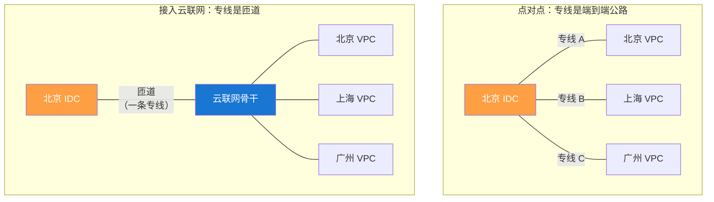
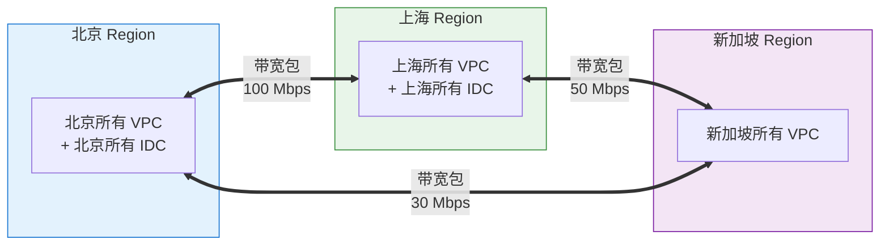
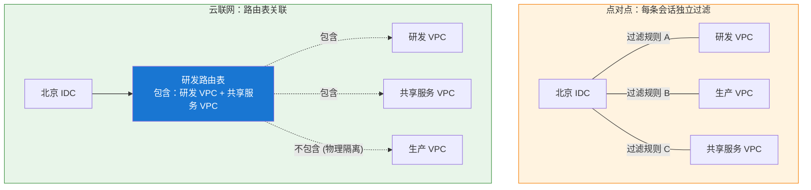
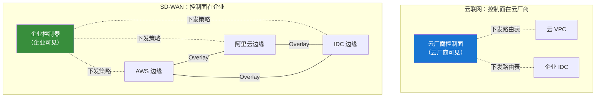

# 22. 统一管理云和 IDC 的连接：云联网的纵向扩展

上一章末尾算了一笔账：3 个 IDC 加 5 个 VPC，全互通要 28 条连接，每新增一个节点还要再加 8 条。这笔账看似只是数量问题，靠堆人和堆预算或许还能硬撑。但一线运维面临的最大挑战并非连接数本身，而是这 28 条连接背后参差不齐的技术栈。

VPC 和 VPC 之间是对等连接，走的是云内部的骨干。VPC 和 IDC 之间是专线，走的是运营商的物理光纤，端到端 BGP。IDC 和 IDC 之间如果要通过云中转，一个包要三跳三种链路；如果不走云，可能又要拉一条 MPLS VPN，那是第四种连接方式。每一种连接背后都是一套独立的告警系统、独立的路由配置、独立的 SLA 归属方，甚至独立的运维团队。

拓扑的失控往往不在于连接数管不过来，而在于四种技术栈硬凑在一起时，每条接口缝隙都隐藏着故障风险。

## 22.1 异构链路带来的架构撕裂

一个熟练的运维工程师，加班加点或许能撑住 28 条连接。但真正让他崩溃的，往往是某个异常的凌晨：告警平台弹出一条“北京 IDC 到上海 VPC 数据库同步中断”，他需要同时跨越三个完全割裂的管理世界去定位原因。

在云厂商的 VPC 控制台上查看对等连接状态，在运营商门户面板上核对专线物理层是否处于 UP 状态，再登录 IDC 网关检查 SNMP 监控中的 BGP 邻居。这三个系统时间戳难以对齐，告警语义也毫无交集——云端提示“路由撤销”，运营商报“链路抖动”，IDC 设备记录“BGP Hold-Down Timeout”，它们只是同一场灾难的不同侧面，却没有一个系统能将它们自动串联。

告警语义的割裂紧接着带来责任归属的撕裂。专线物理层归运营商，云端网关归云厂商，客户网关归企业内部网络组。故障发生时，三方都持有各自系统的无辜证明：运营商声称物理光纤完好，云厂商确认会话被主动撤销，IDC 团队强调配置从未动过。结果是业务真实中断，谁来兜底却成了悬案，最终只能靠三方在拉起的应急电话会议里，逐行核对时间戳来倒推根因。

更隐蔽的风险蕴含在变更窗口的错位中。云厂商的 VPC 割接安排在每周二凌晨，运营商专线维护定在每月首个周日，而企业内部路由变更受制于 CAB（变更审批委员会）流程。三个窗口几乎无法交叠，稍有不慎就会演变成云端刚做完例行维护，运营商紧接着进行物理割接，两端叠加抖动导致路由收敛彻底失能的灾难。

告警不统一、责任不清、变更不同步，异构链路带来的不是单纯的数量负担，而是**架构层面的边界撕裂**。当每一种连接类型都自成一个独立王国时，中间便缺乏统一的语言。

要解决这个问题，需要的不是更多连接，而是一个能把所有连接都收拢到同一层抽象下的枢纽。这个枢纽必须让 VPC、IDC、专线、VPN 在它眼里都只是一个网络前缀，让路由、策略、带宽都在同一个平面上管理，让运维团队从要同时懂四种技术变成只需要看懂一张全局路由表。

云联网就是这个枢纽的答案。第 18 章讲过它解决 VPC 之间的互联，思路是把所有 VPC 挂到同一个中心枢纽上，路由自动传播。现在要做的是把这个能力向下延伸，让 IDC 也能作为平等的节点接入进来。

## 22.2 从公路变成匝道

当 IDC 接入云联网后，连接数从 28 条降至 8 条的数量精简固然直观，但这只是第 18 章讨论过的基础收益。更深层次的架构质变，在于专线与 VPN 在整个网络体系中定位的根本性重构。

在点对点模式下，一条专线是一条端到端的公路：起点在 IDC，终点在特定的 VPC，中间的路由走向由专线两端的 BGP 会话直接绑死。改动起终点意味着链路重新搭建。

接入云联网之后，专线与 VPN 降级为了**一段匝道**。它不再绑定某个具体的 VPC，而是把 IDC 挂载到云联网这张全局骨干高速网上。上了高速之后流量去往何处，完全由骨干路网调度，与这段匝道无关。北京 IDC 想要访问上海 VPC，专线只需将数据包送上本地入口；即便后续新增新加坡 VPC，也无需修改匝道的物理连接，新节点在骨干网上一旦就位，网络自然贯通。

这种拓扑角色的重构带来了两个直接的工程红利：

**第一，BGP 邻居关系大幅收拢。** 点对点模式下，IDC 必须与每个目标 VPC 的网关分别建立 BGP 邻居。而在云联网下，IDC 只需与本地 Region 的云联网接入网关建立唯一一条 BGP 会话，一次性宣告自身网段前缀，即可被全网所有关联节点自动感知。

**第二，IDC 间获得骨干网直通能力。** 北京 IDC 与上海 IDC 挂载至云联网后，两者之间的流量可以直接在云厂商的长途骨干网上传输，下高速即达对端，无需再经由 VPC 中转，也不必额外拉设物理 MPLS VPN。

**图 22.1：接入云联网前后的角色变化**

专线与 VPN 的角色从负责端到端连通收拢为负责本地接入，路由走向、策略定义与带宽分配全部归集至云联网这一层。这也正是后续章节聚焦于带宽包与路由决策的原因，它们不再是每条链路各自为政的局部问题，而是上升为整张骨干网统一规划的全局决策。

## 22.3 带宽包：跨地域流量的成本骨架

在云联网内部，同 Region 的流量走的是本地内网交换，成本几乎可以忽略不计；而跨 Region 流量则需要占用真实的长途骨干网络，无论是国内城际光缆，还是跨洋海底光缆，其建设成本与带宽容量都是极为明确的稀缺资源。

带宽包就是这段稀缺资源在计费上的抽象。用户购买一个北京-上海 100Mbps 的带宽包，意思是云联网上北京 Region 和上海 Region 之间的所有流量，共享这 100Mbps 的额度。北京 VPC 到上海 VPC、北京 IDC 到上海 VPC、北京 VPC 到上海 IDC，甚至北京 IDC 到上海 IDC，只要跨越这一对 Region，都记在同一个池子里。

为什么这样聚合？答案在骨干网的物理形态里。云厂商建骨干网的时候，采购和铺设的单位就是 Region Pair：北京到上海铺一批光缆，广州到新加坡租一段海缆，成本按段计算。同一对 Region 之间的容量对云厂商而言就是一个池子，无法区分是哪个 VPC 的流量、哪个 IDC 的流量。计费单位跟着成本单位走，Region Pair 就成了带宽包最自然的聚合边界。

> **Region Pair 是什么？**
>
> Region Pair（地域对）是指云厂商长途骨干网中连接两个特定地理 Region 的链路组合（例如“北京-上海”或“广州-新加坡”）。由于云厂商铺设或租赁城际光缆与跨海海缆时，物理资源和边际成本均是按地域对（Pair）逐段投入和采购的，因此云联网的带宽包也以 Region Pair 为基础颗粒度进行统一配额与计费管理。

**图 22.2：带宽包按 Region Pair 聚合**

理解带宽包运作机制的核心，在于搞清楚**限速执行的具体位置**。跨 Region 的数据包在从源端 Region 的出向网关注入骨干网时，云联网就会按 Region Pair 实施流量统计与令牌桶限速。一旦某秒的累计流量超出带宽包额度，多余的数据包会在源端直接被丢弃或延迟发送。**将限速关卡前置在源端出向**，意味着过载流量根本无法挤入长途骨干网络，从而保障了公共骨干带宽不被单个租户过度侵占。

限速的颗粒度是整个带宽包统一限速，池子里所有流量按到达顺序共享令牌。这个设计的公平性是有代价的：如果某个 VPC 突然发起大流量（比如数据迁移），它会消耗掉大部分令牌，其他 VPC 的小流量被挤压。这就是所谓的**大象流挤小流问题**。云厂商的应对通常是给带宽包加一层加权公平队列（WFQ），让不同来源的流量按权重分享带宽，但默认配置往往还是简单聚合，需要用户显式开启 QoS 才有区分。

有些云联网还提供了更细的能力：给关键业务的流量打上高优先级标记，在带宽包被打满时优先转发。这不是免费的，高优先级流量本身也有配额，超过配额同样丢包。它更像是给你一个"保底带宽"的承诺，而不是"无限带宽"。生产数据库同步这种业务，用高优先级配额兜底；日志传输、数据迁移这种业务，走普通队列，允许被限速。

跨境带宽包的单价通常是同大陆带宽的十倍甚至几十倍。这种巨大的价格差距并非云厂商的溢价策略，而是由底层物理基础设施的成本结构决定的：国内城际骨干多为自铺光缆，边际扩展成本较低；而跨境链路依赖国际海底光缆，海缆建设动辄数亿美元，且带宽容量需按 STM-1、STM-64 等固定颗粒度租赁，折算到每 Mbps 的开销天然存在数量级差异。云厂商只能将这一物理成本如实传导至终端定价。因此在规划全球化业务时，跨境带宽预算永远是架构设计中需要精细核算的一环。

带宽包的本质，是将云厂商长途骨干网的稀缺资源转化为可显式定义的商品。通过为指定的 Region Pair 购买确定性的容量额度，企业获得了按配额稳定供给的带宽保障。这与公网 VPN 能通就行、抖动看运气的尽力而为模式，代表着截然不同的两种网络资源观。

## 22.4 集中式路由决策：全局视图带来的能力

将接入链路收拢至云联网后，更核心的架构变革发生在控制层：云联网接管了整张网络的路由决策大脑。

在传统的网状拓扑中，每条链路都是独立的路由决策孤岛。IDC 每新增一个子网，路由信息必须沿着数十条链路逐跳广播，依赖各个网关独立的过滤规则维持平衡。而在云联网机制下，路由宣告只需进行一次——节点的网段前缀统一注入控制面，由集中式大脑完成全局算路后，再并行下发至各个转发节点。

这种将路由控制权集中收拢的设计，解锁了三个传统网状网络无法企及的核心能力：

**全局视图**是第一个能力。云联网控制面实时掌握全网链路的宣告源头、关联路由表以及最终的分发受众。当运维需要评估“变更某条路由会波及哪些业务”时，系统能直接给出精准的分析结果，彻底告别了靠人工画图推演的时代。此外，全局视图让路由泄漏等事故变得可提前预防，控制面在下发路由前会做全局策略校验，拦截任何违规的非预期路径。

**集中式收敛**是第二个能力。传统 BGP 依赖逐跳收敛，每跳受限于 Hold-down 或 MRAI 定时器，网络震荡时收敛缓慢。而云联网的路由变更由控制面重新计算全局转发表后直接并行下发。当一条 IDC 路由撤销时，云联网能在秒级内使所有 VPC 的转发表失效，无须等待 BGP 逐跳广播。这正是云联网故障切换感受上大幅快于裸 BGP 的根源。

**声明式路由表关联**则是第三个能力，也是最体现抽象升级的地方。在网状拓扑中，隔离策略只能通过在每条 BGP 会话上配置前缀过滤（黑白名单）实现，策略分散且容易漏配。

云联网提供的是**路由表关联**模型。运维定义几张路由表，每张路由表包含一组允许的路由前缀，然后把接入（VPC 或 IDC）关联到相应的路由表上。北京 IDC 关联到"研发路由表"，这张表只包含研发 VPC 和共享服务 VPC 的路由，其他 VPC 的路由根本不出现在北京 IDC 的转发表里。策略从"每条会话上的前缀过滤"变成了"一张表的成员资格"，配置的原子性完全不同：一处定义，全局一致。

**图 22.3：路由表关联 vs 前缀过滤**

路由表关联和前缀过滤在功能上等价，都能实现“北京 IDC 不能访问生产 VPC”这条策略。但两者的运维心智完全不同。前缀过滤是命令式的：“每一条不允许的路由，都要在每一条会话上显式过滤”。路由表关联是声明式的：“这个接入属于这一类，这一类能访问的路由集合是这个”。声明式的表达让策略更接近业务语义，“研发不能访问生产”这句业务语言，可以直接翻译成“研发接入关联到研发路由表”这一句配置，而不需要拆解成十几条前缀过滤规则。

除了路由隔离，链路的优先级与主备切换机制同样迎来了简化。当 IDC 侧同时接一条专线和一条 VPN 做主备时，裸 BGP 方案需要逐条会话手工配置 Local Preference（如主专线 200、备 VPN 100）；而云联网则将路径优先级抽象为统一的策略参数，系统默认将“专线接入”赋予高于“VPN 接入”的优先级，运维无需繁琐调参即可一处生效。更关键的是，故障切换不再依赖缓慢的 BGP Hold-Down 定时器超时，而是由云联网的毫秒级健康探测与并行路由下发机制驱动，收敛速度从分钟级提升至秒级。

集中式路由决策的代价同样显而易见：控制面成为了全网的核心依赖。若控制面遭遇故障，新路由将无法下发、变更难以生效；即便已有转发表能维持短期转发，时间一长全网策略便趋于冻结。因此，云厂商对云联网控制面的可用性要求极高，普遍采用跨 AZ 甚至跨 Region 的容灾部署。这也是集中式架构必然伴随的权衡：将原本散落全网的控制复杂度收拢至中央控制面，前提就是保障这个大脑具备绝对的可靠性。

## 22.5 混合云的全景与另一条路

退一步看，卷六从 VPN 讲到专线，再讲到云联网，走的其实是一条连接从散到聚的演进路径：
- **VPN** 解决了能不能通的问题，成本低、部署快，但质量依赖公网；
- **专线** 解决了通得好不好的问题，带宽独占、延迟确定，但成本高、开通周期长；
- **云联网** 则解决了能不能统一管的问题，把专线、VPN、VPC 与 IDC 统一下沉为接入网段，由云厂商的中心枢纽统一编排路由、策略与带宽。

然而，云联网架构有一个隐含的前置假设：**所有网络节点都归属于同一家云厂商**。云联网是云厂商网络的纵向延伸，它能高效管控单云生态内的链路，但无法跨越不同云厂商的壁垒。如果企业采用了多云架构（同时使用 AWS、阿里云、腾讯云），各家的云联网便会退化为相互隔离的自动化孤岛，跨云连接依然需要依赖公网或第三方专线。

面向多云与多分支场景，**SD-WAN（软件定义广域网）** 提供了另一种解决思路。它的核心差异在于**控制面归属的反转**：企业自行（或通过 SaaS）部署统一的 SD-WAN 控制器，并在各 IDC、分支机构及不同云 VPC 侧部署 SD-WAN 边缘节点，通过 Overlay 隧道（叠加网）将全网连接。控制器实时监测底层各类物理链路（专线、Internet、4G/5G）的延迟与丢包，按应用策略进行动态智能选路。

> **SD-WAN 是什么？**
>
> SD-WAN（Software-Defined Wide Area Network，软件定义广域网）是一种将 SDN 技术应用于广域网互联的架构。与云厂商主导的云联网不同，SD-WAN 的控制面完全归属于企业自身。通过在各个分支机构、自建 IDC 以及不同云 VPC 中部署边缘节点，SD-WAN 利用软件 Overlay 隧道（叠加网）跨越公网、专线和 5G 链路，实现基于应用 SLA 和链路质量（延迟、丢包）的跨多云、多运营商智能选路。

云联网是**以云为中心、IDC 为分支**的自顶向下视角；SD-WAN 则是**以企业为中心、云为接入节点**的自底向上视角。

**图 22.4：云联网 vs SD-WAN 的控制面归属**

控制面归属的差异决定了各自的适用场景：
- **单云主导 + 少数备份 IDC**：首选云联网。其与云原生服务深度集成，免去运维额外控制器的负担。
- **多云架构 + 全球多分支**：SD-WAN 是必然选择。它是唯一能将跨云、跨运营商、跨异构接入拉入同一控制平面的技术手段。

在实际工程落地中，两者亦可融合叠加：大型企业常使用 SD-WAN 负责跨云及全球分支的顶层 Overlay 选路，而在各家云内部，则继续通过 SD-WAN 边缘节点接入该云的云联网，两层控制面权责分明、各司其职。

到这里为止，企业内部的网络，无论是云上的 VPC、云下的 IDC，还是跨云的边缘，都有办法互通，也有办法在同一个平面上管理。混合云网络的骨架已经完整了。

