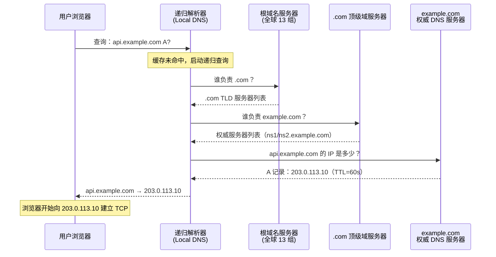
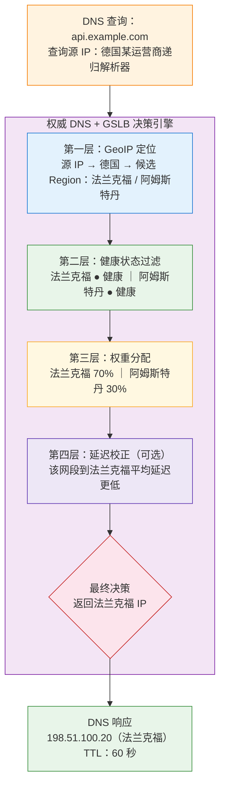
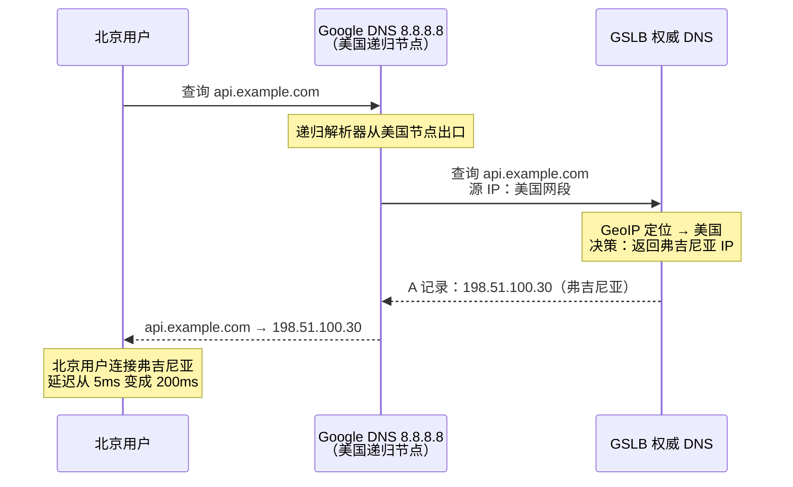

# 23. 全球用户如何找到最近的服务：DNS 与 GSLB

卷六把混合云网络的骨架搭完了，云、IDC、跨云边缘都能互通，也都能在同一个平面上管理。这套骨架有一个隐含的前提：通信发起方已经明确知道目的地址。企业内部通信正是如此，服务与服务之间要么通过 VPC 私网 IP 彼此寻址，要么沿着云联网下发的路由前缀跨端互访，目的地从一开始就是明确的。

但当服务要面向全球用户开放时，这个前提便不再成立。用户手里只有一个域名，不知道服务部署在哪里，也没有能力选择接入哪个 Region。运维团队在北京、法兰克福、弗吉尼亚三个 Region 各部署了一套完整的服务，控制台上看每个 Region 都健康、每条链路都畅通。上线第一天监控数据却给了所有人一个意外：巴西的用户全部打到了北京，延迟 300ms；德国的用户一半打到了弗吉尼亚，而近在咫尺的法兰克福反倒空着一半算力。三个 Region 的流量分布完全不符合预期。

服务部署对了，网络也通了，问题出在更靠前的一个环节：用户在浏览器里敲下 `api.example.com` 的那一刻，谁替他决定这个域名落在哪一个 IP 上。这个决定发生在 TCP 连接建立之前，一旦决定错了，后面所有网络优化都追不回来。

## 23.1 TCP 建立之前，谁在替用户选

先把这个替用户选的能力放到网络的时间轴上看。一次完整的访问，用户的操作系统实际上要经历三个阶段：先把域名换成 IP，再和这个 IP 建立 TCP 连接，最后在 TCP 之上跑业务协议。三个阶段依次发生，而且几乎不可逆，TCP 一旦握手完成，四元组就被锁死在客户端和某台具体服务器之间，中途换服务器意味着重连，业务层至少感知到一次连接中断。

这意味着**全球调度的机会窗口只有一个，就是域名解析那一瞬间**。在这之后，一切都晚了。用户拿到的第一个 IP 决定了他的流量去往哪个 Region，决定了后续所有 RTT 花在哪一段物理距离上，也决定了故障发生时他能不能自动漂移到别的节点。

如果不做全球调度，只在一个 Region 部署，延迟代价一目了然。北京到本地用户 5ms，到上海 30ms，到新加坡 80ms，到法兰克福 200ms，到圣保罗 300ms。300ms 的 RTT 意味着一次 HTTPS 建连要 3 个 RTT（TCP 三次握手 1 个 + TLS 1.2 握手 2 个），光是握手就要耗去近 1 秒，若再算上首屏资源的多轮往返传输，用户将面临数秒的白屏等待。多 Region 部署是唯一的物理解法，让用户的 RTT 从跨洲级别降到同大陆甚至同城级别。

但多 Region 部署引入一个新问题：同一个域名 `api.example.com`，应该解析到哪一个 Region 的 IP？

朴素的想法是给不同地区分配不同域名，`api-bj`、`api-eu`、`api-us` 各一个。但这把选择权推给了客户端，要么用户自己选，要么前端硬编码地区判断。用户不会关心服务部署在哪里，前端硬编码本质上是把地理数据库塞进了每一个客户端，一旦调整 Region 布局就要发全量客户端更新，工程上无法长期维护。

进一步的想法是用 HTTP 302 重定向。用户先访问一个统一入口 `api.example.com`，入口服务器根据源 IP 判断地区，回一个 302 让浏览器跳到最近的节点。这比硬编码域名好，但代价明显：每次跳转多一个 RTT；只适用于 HTTP，TCP/UDP 服务用不了；入口服务器成了全球用户的单点，本身还是需要一个全球调度机制才能可用。

理想的调度位置必须同时满足三个条件：**发生在 TCP 连接建立之前**、**不依赖任何单点入口**、且**跨协议通用**。符合这全部条件的位置只有一个，就是域名解析。用户拿到的第一个 IP 直接就是最优的，不需要重定向，不限于 HTTP，不依赖任何具体服务器。

提供这一能力的基础设施叫 DNS，实现这一调度的核心机制叫 GSLB。

## 23.2 权威 DNS：整条链路上唯一的调度控制点

要理解 GSLB 为什么能在 TCP 建立前做调度，先要搞清楚一次 DNS 查询到底经过了哪些角色，以及究竟是哪一个角色掌控着可编程的决策权。

用户在浏览器输入 `api.example.com`。浏览器先查自己进程内的 DNS 缓存，操作系统再查系统级 DNS 缓存，都没有的话，操作系统把查询发给配置好的 DNS 服务器，通常是运营商分配的 Local DNS，也可能是用户手动配的公共 DNS，比如 Google 的 8.8.8.8 或 Cloudflare 的 1.1.1.1。这个 DNS 服务器叫**递归解析器**，负责替用户跑完整个查询链条。

**图 23.1：DNS 递归解析的完整路径**

递归解析器先问根域名服务器：谁管 `.com`？根服务器不知道每个域名的 IP，但知道 `.com` 由哪些 TLD 服务器管理，把 TLD 地址返回。递归解析器再问 `.com` TLD 服务器：谁管 `example.com`？TLD 服务器同样不知道 IP，只知道谁是 `example.com` 的权威。最后递归解析器问 `example.com` 的权威 DNS：`api.example.com` 的 IP 是多少？权威 DNS 返回一个具体 IP 加上一个 TTL 值，递归解析器缓存起来，同时返回给用户。

四个角色，逐个看它们在调度决策上的位置。根服务器和 TLD 服务器只做路径指向，返回内容由 IANA 和 TLD 运营方统一维护，不受任何一家企业控制，也不应该被塞进业务逻辑；递归解析器面对的是海量互不相干的域名，主要职责是转发和缓存，同样没有理由为某个具体域名定制策略。只有链路最后一环，权威 DNS，是由域名的所有者自己搭建或委托运营的，它是这条查询链上唯一可以按业务意图返回不同结果的角色。

用户完全不需要知道后端有几个 Region，客户端不需要发版，全球所有请求都会经过它，且经过它的时候还没有形成任何有状态的连接，决策成本几乎为零，决策收益覆盖后续所有流量。整个全球互联网上，具备这三条属性的位置只此一个。

这里还有一个容易被忽略、后文会反复回看并深入探讨的关键事实：递归解析器向权威 DNS 发查询的时候，报文的源 IP 是递归解析器自己的 IP，不是用户的 IP。权威 DNS 在做调度决策时，只能看到是哪个递归解析器在问我，看不到是哪个用户在问。这决定了权威 DNS 本质上是根据递归解析器的位置去猜用户在哪里。这个猜的动作，是理解本章后半段所有问题的钥匙。

## 23.3 GSLB：把权威 DNS 从静态映射改造成调度引擎

传统的权威 DNS 是一张静态映射表，`api.example.com` 永远返回 203.0.113.10。查询来自北京还是圣保罗，返回都一样。GSLB（Global Server Load Balancing）把这张静态表升级为一个每次查询实时计算的调度引擎。

> **GSLB 是什么？**
>
> GSLB（Global Server Load Balancing，全局负载均衡）是一种基于 DNS 的全球流量调度机制。传统的 CLB、ALB 工作在单个 Region 内，把流量分发给同一 Region 的后端服务器；GSLB 工作在全球尺度，通过控制权威 DNS 的解析结果，把不同地区的用户引导到不同 Region 的服务节点。它的调度依据通常包括递归解析器的地理位置、后端节点的健康状态、运维配置的权重、以及探测得到的延迟。云厂商一般以智能 DNS 解析或全局流量管理的产品形态提供这项能力。

调度引擎内部可以拆成两条线：第一条是**离线维护**：运维配置什么规则、健康探测采集到什么状态、GeoIP 数据库和权重表长什么样，都持续写入一份决策上下文；第二条是**在线查询**：每次收到 DNS 请求时，从查询源 IP 触发一次决策计算，用最新的上下文生成这次要返回的 IP。两条线彻底解耦，权威 DNS 才越能在极短时间里响应海量查询。

稍稍思考就能看出，如果每次查询都从零开始算所有因子，权威 DNS 的 QPS 会非常低。大型电商域名的权威 DNS 峰值 QPS 常常在几十万到百万级，还要顶住高频扫描和 DNS 放大攻击，在线查询无法承受实时的全量决策计算。工程上的做法是把决策结果按 GeoIP 网段和健康状态组合预先计算好，缓存在权威 DNS 的进程内存里：一个北美 /24 网段对应哪几个候选 Region、每个 Region 的健康位是什么，全部提前算完。查询到达时只做两件事：查一次 GeoIP 拿到网段、查一次内存表拿到候选，命中率极高，单条查询消耗降到微秒级。健康状态或权重发生变化时，控制面异步刷新这份内存表，而不是让每次查询都重新算路。

理解了引擎的骨架，再看驱动它的四个因子，它们不是四个孤立的概念，而是四个方向上的工程取舍。

**地理位置** 是最基础的因子，权威 DNS 根据查询源 IP 通过 GeoIP 数据库判断递归解析器大致位于哪个国家或地区，然后返回对应 Region 的 IP。它在所有因子里覆盖面最广，但定位精度也最粗：GeoIP 对固定运营商的骨干出口 IP 通常能定位到城市甚至更细，对移动网络、卫星链路、企业 NAT 出口的 IP，定位精度普遍下降一个数量级，误差有时会跨省、跨国。开源的 MaxMind GeoLite2 和商用的 GeoIP2 差距主要就在这里：越靠近网络接入末端（如移动网段、动态 NAT 出口），就越依赖数据库厂商的持续更新。

**健康状态** 负责剔除其中已经宕机的节点。GSLB 会持续对每个 Region 的服务节点做健康探测，HTTP 探活、TCP 探活、ICMP 探活轮着来，几秒一次，连续几次失败判定不健康，从候选池里剔除。健康检查看似直观，实则暗藏诸多工程盲区，最典型的是探测点和真实用户不在同一个网络位置。GSLB 的健康探测通常从云厂商自己的骨干或几个固定 PoP 发起，能到达 Region 的时候不代表所有运营商的用户都能到达。深圳的联通用户可能因为跨境链路或跨网互联点拥塞完全打不进香港节点，而香港节点从探测点看一切健康，GSLB 依然给这批用户返回香港的 IP。这类故障的表现是监控全绿，用户全炸，也是生产环境里最不容易查清楚根因的一类问题。稳健的做法是把探测源分散到多运营商、多地域，任一路径长时间不通就要下调这个 Region 对该地区的权重，而不是等到所有路径都失败才切换。

**权重** 负责按承载能力在候选 Region 之间按比例分配流量。北京节点算力大配 60%、法兰克福 20%、弗吉尼亚 20%，GSLB 在每次查询到达时按权重决定返回哪一个。这里有一个容易被忽略、实际生产中又屡屡引发意外的细节：权重是长期分布，短期实际分布未必和它一致。递归解析器上一条缓存 60 秒，命中期间该解析器所有下游用户都拿到同一个 IP，权重在这 60 秒里对这个解析器完全失效。全球递归解析器数量按几十万计，但每个解析器背后用户规模差距悬殊，一个 8.8.8.8 的节点后面可能挂着上千万用户，如果它这一分钟恰好缓存了北京的 IP，那这一分钟内所有这批用户都会流向北京，配置里写的 20% 弗吉尼亚在这一分钟内根本看不见。要做流量灰度或版本切分，最好不在 GSLB 权重上做，而是在应用层用一致性哈希或流量镜像去做，DNS 层的权重更适合处理某个 Region 突然扩容想快速接一批流量过来这种颗粒度较粗的场景。

**延迟** 是最理想、也最难在权威 DNS 侧做准的因子。地理上最近未必网络上最快，深圳到香港直线 50 公里，跨运营商时延迟能超过深圳到上海。有的 GSLB 提供延迟感知的调度，靠的是从各 Region 主动向已知递归解析器网段 ping 或建 TCP 探测，把延迟矩阵持续维护起来。这条路能提高精度，但成本很高：探测频率不能太密、覆盖不能太广，否则会被 ISP 当成扫描封掉；离线维护的延迟矩阵和真实用户此刻的路径质量之间又有时间差。工程上更常见的做法是把延迟当作 GeoIP 的一层辅助校正，GeoIP 先缩小候选，延迟数据在候选之间挑一个更好的，而不是让延迟单独主导决策。

**图 23.2：GSLB 的调度决策链条**

四层因子不是平级并列，而是漏斗式串联。GeoIP 先把范围缩到几个候选 Region，健康检查把已经不可用的剔除，权重在剩下的候选中做长期分配，延迟做最后的微调。任何一层被跳过或参数配错，都会直接暴露在最终返回的那一条 IP 上，用户没有任何机会补救。

回到本章的核心命题上，GSLB 之所以能站在全球流量的最上游，是因为它抓住了 TCP 建立之前那唯一一次决策机会。而正因为这次决策发生在业务包尚未出现的时刻，它能依赖的输入只有两样：一个查询源 IP，一份离线维护的数据库。四个因子看似丰富，本质上都是围绕这两样输入做出的最大化推断。推断终究只是推断，其精准度与有效性能否经受住真实网络的考验，取决于接下来要剖析的三大变量。

## 23.4 TTL：给这次"猜"设一个有效期

上一节的逻辑有一个隐含前提：递归解析器每次都真的走到权威 DNS。事实并非如此。为了保护上游、也为了减少用户可感知的延迟，DNS 协议在每条应答里都带一个 TTL，递归解析器会把结果缓存起来，TTL 过期之前不再去问权威 DNS。

这就把 GSLB 的调度精度和 TTL 绑死了。TTL 决定的不仅仅是数据能存多久，更是这次猜从做出到被复核的最长间隔，**TTL 就是猜的有效期**。

TTL 设 60 秒。法兰克福节点在第 0 秒宕机，GSLB 通过健康检查在第 10 秒左右识别故障，把它从候选池摘除。但从这一刻起，全球递归解析器上仍然缓存着法兰克福的 IP，缓存最长要再过 50 秒才过期，命中缓存的用户在这 50 秒里会继续被引导到已经挂掉的节点，请求全部失败。**故障窗口 = 健康检查发现时间 + TTL 剩余时间**，这是硬约束，任何 GSLB 都逃不掉。50 秒对一个支付系统可能意味着几千笔交易失败，对一个内容站点意味着首页在半分钟里对一大片用户直接不可达。

一个自然的应对是把 TTL 调短。设成 10 秒，故障窗口收缩到 20 秒以内，看起来不错，但由此带来的代价却是多方面的。第一个代价体现在权威 DNS 自己身上：TTL 从 3600 秒缩到 10 秒，每个递归解析器对这个域名的查询频率放大 360 倍。一个中等规模电商域名的权威 DNS 峰值 QPS 会从几万跳到百万级，机器要加、带宽要加、Anti-DDoS 防护要加，DNS 是历史上最经典的 DDoS 目标，权威服务器几乎必然长期泡在扫描和攻击流量里，QPS 抬高意味着防护成本也跟着抬高。第二个代价体现在用户体验上：每次 TTL 过期后的第一次访问都要多出一次真实 DNS 查询的延迟，通常在几十毫秒；如果用户每 10 秒经历一次这种延迟，对延迟敏感的应用会有可感知的抖动。第三个代价体现在递归解析器上，尤其是运营商 Local DNS，缓存命中率下降对它们是纯亏损，它们没有动力配合企业把 TTL 压得太短。

反过来把 TTL 拉长呢？设 3600 秒（1 小时），权威 DNS 压力几乎归零，用户几乎感知不到 DNS 延迟，但故障窗口也拉长到 1 小时。任何一次节点宕机都意味着已经缓存了旧 IP 的用户要等一小时才可能切走，对任何在线业务这都是灾难量级。

这是结构性的两难，不存在最佳 TTL，只有基于业务容忍度做出的具体选择：支付交易类要求故障 30 秒内切换，TTL 设 30；内容站点容忍 5 分钟，设 300；内部管理系统容忍更长，设 3600。每个 TTL 都是切换速度和系统开销之间刻意画出的一条边。

**图 23.3：TTL 长短的取舍对比**

| 比较维度 | 短 TTL（如 10 秒） | 长 TTL（如 3600 秒） |
| :--- | :--- | :--- |
| **故障切换窗口** | 约 10–20 秒（✓ 切换迅速） | 最长可达 1 小时（✗ 切换缓慢） |
| **权威 DNS 压力** | 查询频率放大 ~360×（✗ 资源与防护成本飙升） | 查询极少（✓ 服务器压力极低） |
| **用户可感知延迟** | 频繁重新解析（✗ 增加 10–50ms 抖动） | 极高概率命中缓存（✓ 毫无 DNS 延迟抖动） |
| **典型适用场景** | 核心支付、高可用交易类服务 | 静态内容站点、企业内部管理系统 |

TTL 还有一个更隐蔽、也更让运维头疼的现实：**权威 DNS 返回的 TTL，是建议值，不是强制值**。RFC 上写得清楚，实际执行由递归解析器决定。相当数量的运营商 Local DNS 会无视权威 DNS 给的 TTL，自行设置一个更长的最小缓存时间，比如把小于 300 秒的 TTL 一律拉到 300 秒，甚至更长，理由无非是减轻自身查询压力或者防止某类攻击。GSLB 把 TTL 设成 60 秒以为故障窗口是 1 分钟，实际上某个地区的一大片用户被卡在这个 Local DNS 的 5 分钟缓存里，一切换 Region 时那一片会在 5 分钟内持续报错。这种情况在生产环境里并不罕见，而且从 GSLB 视角几乎无法察觉，权威 DNS 只看得到查询次数变少，看不到解析器背后到底缓存了多久。发现这类问题的常见方式是切换过后从后端访问日志里挖：正常情况下故障 Region 的访问量应该在 1 分钟内清零，如果某个 ISP 段的访问量拖到 5 分钟才清零，多半就是这个原因。

TTL 是权威 DNS 用来控制猜有效期的唯一手段，但这个手段并不完全握在自己手里。猜本身可能是准的，但它多久之后被复核，还要看链路上其他角色是否合作。

## 23.5 递归解析器：猜的样本被污染，ECS 是给它加一点线索

TTL 决定的是这次猜多久之后被复核，还有一个更根本的问题：这次猜的样本，本身是不是可信的。回到 23.2 节结尾那个事实，权威 DNS 看到的查询源 IP 是递归解析器的 IP，不是用户的 IP。整个 GSLB 的地理判断，都建立在递归解析器的位置足以代表用户位置这个假设之上。

大部分时候这个假设是成立的。北京联通的用户用北京联通分配的 Local DNS，Local DNS 出口 IP 在北京联通网段里，GeoIP 把它定位到北京，权威 DNS 返回北京 Region 的 IP，链路里的每一环都在同一个地区，猜的结果和事实是对齐的。

假设崩塌发生在用户主动改了 DNS 服务器的那刻。北京的用户把 DNS 改成 Google 的 8.8.8.8，查询直接发到 Google 的递归解析器集群。8.8.8.8 虽然全球有 Anycast 节点，但它向权威 DNS 发起递归查询时用的出口 IP 未必是离用户近的那个节点，Google 内部的递归系统可能因为负载、缓存策略、跨区域一致性等原因，从美国某个节点集中出去。权威 DNS 收到的查询源 IP 在美国，GeoIP 说这个查询来自美国，GSLB 老老实实返回弗吉尼亚 Region 的 IP。北京的用户，5ms 就能到北京机房的用户，被送去了 200ms 之外的弗吉尼亚。

**图 23.4：公共 DNS 让权威 DNS 猜错用户位置**

Google DNS 和 Cloudflare DNS 在全球有数以亿计的用户，尤其在技术圈里，把 DNS 改成 8.8.8.8 或 1.1.1.1 是很多人的默认习惯。问题也不止出现在公共 DNS 上：某些小运营商的 Local DNS 部署在集团机房集中的城市，用户在昆明但 Local DNS 在深圳；某些企业 NAT 出口 IP 的归属地和用户实际位置不一致；某些 IPv6 DNS 网关和 IPv4 用户网段不匹配。所有这些情况都会让权威 DNS 看到的位置和用户真实位置错位。开篇提到德国用户一半打到弗吉尼亚，多半就是这个原因——那半批用户走的是一个出口 IP 被 GeoIP 定位到美国的递归解析器。

问题的根源是权威 DNS 拿到的信息太少：只有一个递归解析器的 IP，其他什么都没有。EDNS Client Subnet（ECS）是 IETF 在 RFC 7871 里给出的一个修补方案，思路很直白，让递归解析器在向权威 DNS 发查询时，多带一个字段，把发起这次查询的用户 IP 前缀告诉权威 DNS。

> **EDNS Client Subnet 是什么？**
>
> EDNS（Extension Mechanisms for DNS）是 DNS 协议的扩展框架，允许在查询报文里塞入额外信息。Client Subnet 是其中一个扩展选项（Option Code 8），由 RFC 7871 定义。它让递归解析器在向权威 DNS 发查询时告诉对方发起这次查询的用户来自这个网段。为了照顾用户隐私，不传完整用户 IP，只传前缀（IPv4 通常是 /24，IPv6 通常是 /56 或 /48）。字段包含 SOURCE PREFIX-LENGTH（前缀长度）和 ADDRESS（用户 IP 的网络部分）两部分。

有了 ECS，权威 DNS 不再只看递归解析器的 IP，而是优先看 ECS 里带过来的用户 IP 前缀。北京用户通过 Google DNS 查，Google DNS 在请求里带上用户所在的 /24 前缀，权威 DNS 用这个前缀查 GeoIP，定位到北京，返回北京 IP。猜的结果终于成了离用户更近的那个。

ECS 带来的提升显而易见，但其背后的三个代价，注定它只是一种局部修补方案，而非治本之策。

第一个代价在**普及率**。ECS 是可选扩展，不是所有递归解析器都支持。Google DNS、OpenDNS 以及国内的阿里 DNS (223.5.5.5) 是较早支持并开启 ECS 的代表性公共递归服务（注：Cloudflare 1.1.1.1 出于隐私保护默认不透传 ECS），但大量运营商的 Local DNS，出于开发成本、隐私顾虑、或者只是产品排期，长期不支持 ECS。不支持 ECS 的递归解析器发出的查询里没有用户 IP 前缀，权威 DNS 只能退回旧路径，用递归解析器的 IP 判断，和没有 ECS 一样。ECS 覆盖率并不像常见文章里描述得那么高，实际生产里能达到 40-60% 已经算不错，剩下那部分依旧被公共 DNS 或者 NAT 出口的地理错位问题困扰。

第二个代价在**缓存粒度爆炸**。没有 ECS 之前，递归解析器对一个域名只需要缓存一条记录：`api.example.com → 203.0.113.10`，所有下游用户共享。开启 ECS 之后，权威 DNS 会针对不同 /24 前缀返回不同结果，递归解析器必须按 /24 前缀分别缓存。同一个域名，缓存条目从 1 条膨胀到几百上千条，每一个访问过这个域名的用户 /24 网段，都要独立占一条。这个膨胀是全链路的：递归解析器的缓存内存需要放大一到两个数量级；命中率下降之后，权威 DNS 收到的真实查询次数也会放大，同一个域名，之前一个递归解析器一小时问一次就能覆盖它下游所有用户，现在每一个新的 /24 前缀都要重新问一次。权威 DNS 侧的 QPS 会因为 ECS 明显上升，之前 TTL 设 300 秒能扛住的压力，开了 ECS 之后可能要重新评估容量。而且每一次查询到达权威 DNS 时，还要按 ECS 里的用户前缀独立跑一次 GeoIP 和策略计算，虽然可以像 23.3 节那样按网段预计算，但内存表的大小也从几百个 Region 候选膨胀到数十万个网段候选。ECS 换来了精度，代价是所有相关组件都要为这份精度重新做容量规划。

第三个代价在**精度天花板**。ECS 默认只传 /24 前缀，一个 /24 网段包含 256 个 IP，可能横跨一整栋楼或者一整个小区，GeoIP 数据库对这个 /24 的定位准确度直接决定了 ECS 的收益上限。移动运营商和小 ISP 的 IP 段普遍存在跨省、跨市的归属混乱，一个 /24 可能有的用户在北京有的用户在天津；企业 NAT 出口的 /24 可能背后是分散在全国的多个分支。这种情况下 ECS 传过来的用户前缀本身就不代表真实用户位置，权威 DNS 依然会猜错。ECS 只是让推断的样本粒度更细了一层，但并没有让它变得绝对可信。

DNS 层面的调度，无论怎么修补，本质上都是在用有限信息推断用户实际情况。从递归解析器的 IP 到用户的 /24 前缀，从整个域名一条缓存到按前缀分条缓存，但只要决策发生在 TCP 建立之前、用户还没发出任何真实业务包，能拿到的证据就永远是间接的、滞后的、需要靠数据库辅助解读的。DNS 在这条路上能走的最大距离，也就到 ECS 这里为止。

## 23.6 DNS 调度的天花板：只能决定去哪里，不能决定怎么去

到这里可以把 DNS 与 GSLB 能做和不能做的边界，一次讲清楚。

它的能力非常关键：给全球用户提供**同一个域名**，让不同地区的用户在 TCP 建立之前就被引导到最合适的 Region；节点故障时通过健康检查把流量摘除到剩余节点；按权重和策略在多个候选 Region 之间做长期分配。这三个机制合起来就是全球化服务的接入前提，没有它，多 Region 部署形同虚设。

它的短板来源于同一个根因：**决策发生在 TCP 建立之前**。因为前置，它没有真实用户包可看，只能靠 GeoIP 和 ECS 推断位置；因为前置，它没有真实网络路径可看，只能靠 DNS TTL 粗颗粒度地把决策周期性刷新；也因为前置，一旦用户拿到 IP 建立起 TCP，它就退场了，后面发生什么它管不着。

**边界一：时间粒度**。GSLB 的决策只在 DNS 解析那一刻生效。用户拿到 IP 建立 TCP 之后，接下来的所有请求都走这个 IP，直到连接断开或者下一次 DNS 缓存过期重新解析。连接期间节点性能下降，比如法兰克福节点 CPU 从 30% 飙到 95%、内存告警、GC 抖动，GSLB 无法把已经建立的连接迁走，只能等这些连接断开后重新解析时才有机会调度到其他节点。长连接场景下这个窗口可能是几十分钟。要在连接层做实时切换，需要负载均衡器、TCP 中继、连接迁移这些下游能力配合，不是 DNS 自己能解决的。

**边界二：路径盲区**。GSLB 只决定目的地 IP，不控制从用户到目的地要走什么路。用户拿到法兰克福 IP 之后，从用户到法兰克福的路径完全交给公网，由沿途运营商之间的 BGP 决定。BGP 选路的默认逻辑是 AS 路径最短，不是延迟最低，也不是丢包最低。用户流量可能绕过大半个欧洲甚至跨洋兜个圈子才到法兰克福。GSLB 手里没有任何工具去感知或影响这条路径的质量，它看不到 IX 拥塞、看不到运营商互联点抖动、看不到跨洋光缆负载。深圳的用户被 GSLB 调度到香港节点，地理距离不到 50 公里，但跨运营商互联的公网路径可能塞在广州某个 IX 上，实际延迟 80ms；而深圳到上海的公网路径同运营商畅通，反倒只有 40ms。GSLB 从数据库判断香港更近，却对沿路的真实网络状况一无所知。

> **IX 是什么？**
>
> IX（Internet Exchange，互联网交换中心）是不同网络运营商之间交换流量的物理场所。互联网由几万个自治系统（AS）组成，每个运营商、云厂商、大型企业都是一个 AS。IX 提供了一个中立的"交汇点"，让多个 AS 在同一个物理位置互相连接、交换流量，而不需要每对 AS 之间都拉一条专线。全球主要城市都有 IX，法兰克福的 DE-CIX、伦敦的 LINX、圣保罗的 IX.br。IX 的流量交换效率直接影响跨运营商的网络延迟和路径选择。

下一步需要的能力已经清楚：不只是替用户选对目的地，还要接管中间那段路径。让用户的流量尽可能早地离开不可控的公网，进入云厂商自己可控的骨干网络；让沿路的每一跳都在同一家云厂商的运维视野里，而不是分散在几十家运营商的 BGP 决策中。这需要一种不同于 DNS 的调度机制，它不再是在域名解析中选目的地，而是在 IP 路由中选入口。
