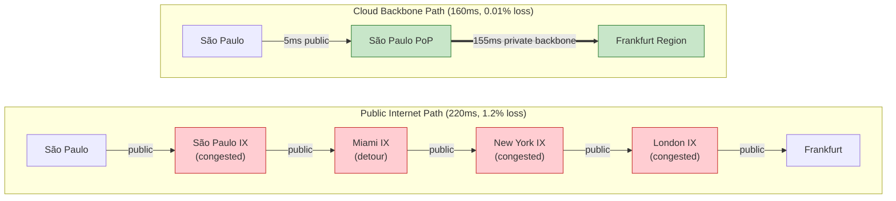
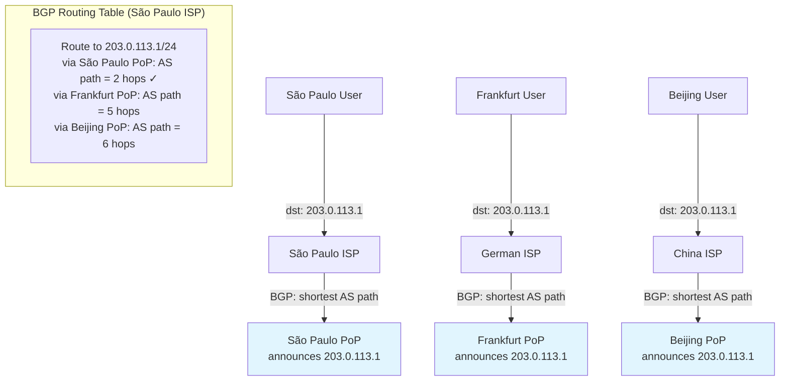
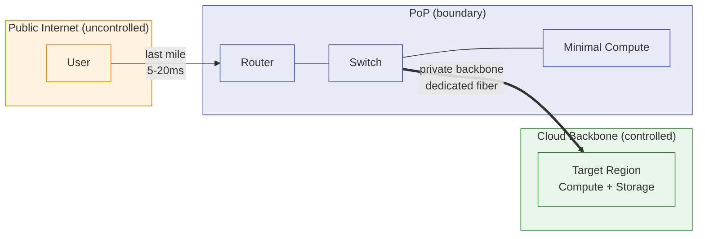
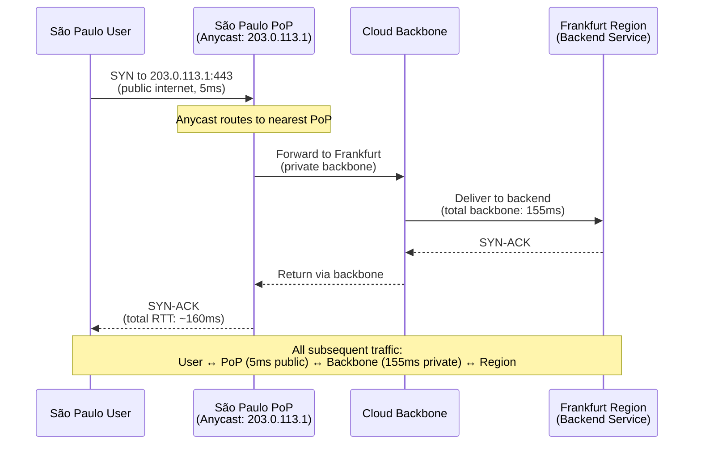

# 23. 让流量走更好的路：Anycast 与云骨干网

GSLB 把圣保罗的用户调度到了法兰克福节点，地理上最近的 Region。DNS 解析返回了法兰克福的 IP，用户的浏览器开始建立 TCP 连接。第一个 SYN 包从圣保罗出发，经过当地运营商的路由器，到达圣保罗的 IX，然后，去了迈阿密。

> **IX 是什么？**
>
> IX（Internet Exchange，互联网交换中心）是不同网络运营商之间交换流量的物理场所。互联网由几万个自治系统（AS）组成，每个运营商、云厂商、大型企业都是一个 AS。IX 提供了一个中立的"交汇点"，让多个 AS 在同一个物理位置互相连接、交换流量，而不需要每对 AS 之间都拉一条专线。全球主要城市都有 IX，法兰克福的 DE-CIX、伦敦的 LINX、圣保罗的 IX.br。IX 的流量交换效率直接影响跨运营商的网络延迟和路径选择。

不是因为迈阿密离法兰克福更近，而是因为 BGP 认为经过迈阿密的 AS 路径比直飞大西洋的路径短一跳。从迈阿密到纽约，从纽约到伦敦，从伦敦到法兰克福。四个 IX，三次跨洋，总延迟 220ms。

而如果这个包能在圣保罗就进入云厂商的骨干网，走一条直连法兰克福的光纤，延迟只有 160ms。

60ms 的差距，来自路径的选择权，谁在选路，以及按什么标准选。

## 23.1 公网路由的不可控

DNS 解决了"去哪里"，用户拿到了正确的目的地 IP。但从用户到目的地之间的每一跳，走的都是公网。公网的路由由谁决定？BGP。

互联网由几万个自治系统（AS）组成，每个运营商、每个大型企业、每个云厂商都是一个或多个 AS。AS 之间通过 BGP 交换路由信息："我能到达这些 IP 前缀，经过我需要走这条路。"当一个 AS 收到多条到达同一目的地的路由时，BGP 的默认选路逻辑优先选择 AS 路径最短的那条，经过的 AS 数量最少。

AS 路径最短，听起来很合理。但 AS 路径最短不等于延迟最低。

深圳到香港，AS 路径可能只有 2 跳，深圳运营商 AS 直接连接香港运营商 AS。但物理路径可能经过广州的一个拥塞交换节点，排队延迟加上绕路，实际 RTT 80ms。而深圳到上海的 AS 路径有 3 跳，但物理链路畅通，RTT 只有 40ms。BGP 会选前者，2 跳比 3 跳短。用户感受到的是：明明香港更近，为什么比上海还慢？

*BGP 不关心你的用户体验。它关心的是 AS 路径长度，这是一个拓扑指标，不是一个性能指标。*

更麻烦的是，公网路径的质量随时在变。早上畅通的路径，晚高峰可能拥塞，某个 IX 的带宽被打满，排队延迟从 2ms 飙升到 50ms。某个运营商的设备故障，BGP 路由收敛，流量绕行到另一条更长的路径，延迟突然翻倍。用户感知到的是"有时候快有时候慢"，但应用层对此无能为力，你无法告诉 BGP "请走那条延迟更低的路"。

一组真实的对比数据能说明问题。从圣保罗到法兰克福，公网路径平均延迟 220ms，丢包率 1.2%；同一时段，通过云厂商骨干网的路径延迟 160ms，丢包率 0.01%。差距来自哪里？公网路径经过了 5 个 IX 和 3 个拥塞节点，每个节点都可能引入排队延迟和丢包；而骨干网路径只经过 2 个云厂商自己的 PoP，链路容量充足，没有拥塞。

**图 23.1：公网路径 vs 骨干网路径**



> 上半部分是公网路径：流量经过 5 个节点、4 次跨网络跳转，多个 IX 存在拥塞风险，总延迟 220ms。下半部分是骨干网路径：流量在最近的 PoP 进入私有骨干网，一跳直达目标 Region，总延迟 160ms。红色节点表示不可控的公网拥塞点，绿色节点表示云厂商可控的私有网络。

如果能让用户的流量尽快离开公网，进入一个可控的网络，在这个网络内部走一条带宽充足、路径固定、延迟可预测的路，到达目的地的体验会好得多。

问题是：怎么让用户的流量"尽快进入"这个可控网络？用户的第一个包发出去的时候，走的就是公网。你不能在用户的路由器上配置路由，那是运营商的设备。你不能修改 BGP 的选路，那是运营商之间的协议。

你能做的，是在离用户最近的地方放一个"入口"，让 BGP 自己把流量送到这个入口。

## 23.2 Anycast：同一个 IP，多个入口

先看传统的做法。

一个 IP 地址，比如 203.0.113.1，只在一个位置通过 BGP 宣告。法兰克福的 Region 宣告"203.0.113.1 在我这里"。全球所有用户访问 203.0.113.1，流量都汇聚到法兰克福。这是 Unicast，一个 IP，一个位置。

Anycast 的思路完全不同：同一个 IP 地址从全球多个位置同时通过 BGP 宣告。

> **Anycast 是什么？**
>
> Anycast（任播）是一种网络寻址和路由方式：同一个 IP 地址被分配给多个地理位置不同的网络节点，每个节点都通过 BGP 向互联网宣告"这个 IP 在我这里"。当用户访问这个 IP 时，BGP 路由协议会自动把流量送到拓扑上最近的那个节点，不需要 DNS 调度，不需要客户端做任何选择。Anycast 最初被广泛用于 DNS 根服务器（全球 13 组根服务器都使用 Anycast），后来被云厂商用于全球加速和 DDoS 防护。它的核心优势是利用 BGP 的原生选路能力实现就近接入，天然具备流量分散和故障自动切换的特性。

北京的 PoP 宣告"203.0.113.1 在我这里"。法兰克福的 PoP 也宣告"203.0.113.1 在我这里"。圣保罗的 PoP 也宣告"203.0.113.1 在我这里"。三个不同的物理位置，宣告的是同一个 IP 前缀。

BGP 看到了三条到达 203.0.113.1 的路由。它不知道这三条路由指向的是同一个服务的不同入口，BGP 不关心这些，它只按正常的选路逻辑工作。对于圣保罗的运营商来说，圣保罗 PoP 宣告的路由 AS 路径最短（可能只有 1-2 跳），法兰克福的路由 AS 路径最长（可能 4-5 跳）。BGP 选择 AS 路径最短的那条，流量自然到达圣保罗 PoP。

**图 23.2：Anycast 的工作机制**



这里有一个值得停下来体会的巧妙之处：Anycast 没有修改 BGP 的任何行为。它没有给 BGP 加新功能，没有改变选路算法，没有引入新的协议扩展。它只是利用了一个合法的操作，"同一个 IP 前缀可以从多个位置宣告"，然后让 BGP 的正常选路逻辑自动完成就近接入。Anycast 是在 BGP 的规则之内，用 BGP 自己的逻辑来达到目的。

Anycast 和 GSLB 做的事情看起来类似，都是把用户引导到最近的节点，但工作层次完全不同。

GSLB 在 DNS 层面调度：用户查询域名，GSLB 返回不同的 IP 地址。不同地区的用户拿到不同的 IP，连接到不同的节点。调度的粒度是 DNS TTL，秒级。调度的精度受限于递归解析器的位置和 GeoIP 数据库的准确度。

Anycast 在网络层面调度：所有用户访问同一个 IP 地址，但 BGP 路由把流量送到不同的入口。调度由网络路由自动完成，不依赖 DNS，不受 TTL 影响，不需要 GeoIP 数据库。调度的粒度是 BGP 路由收敛，通常秒到分钟级。

两者可以协同。GSLB 做 Region 级调度，根据用户位置返回最近 Region 的 Anycast IP。Anycast 做 PoP 级接入，用户访问这个 Anycast IP 时，流量被路由到最近的 PoP。GSLB 选大方向，Anycast 选入口。

但 Anycast 有一个固有的风险，尤其是用于 TCP 这样的有状态协议时。

TCP 连接是有状态的，客户端和服务端通过四元组（源 IP、源端口、目的 IP、目的端口）标识一条连接。如果用户的 TCP 连接建立在圣保罗 PoP 上，连接状态（序列号、窗口大小、拥塞控制状态）保存在圣保罗 PoP 的服务器上。这时候如果 BGP 路由发生变化，比如圣保罗 PoP 的某条链路故障，BGP 路由收敛后，用户的流量可能被路由到法兰克福 PoP。法兰克福 PoP 上没有这条连接的状态，收到的包会被当作无效包丢弃。连接中断。

这不是设想才会有的情况，BGP 路由抖动在公网上并不罕见。对于 UDP 协议（如 DNS 查询），Anycast 几乎没有这个问题，每个 UDP 包都是独立的，路由到哪个 PoP 都能处理。这也是为什么全球 13 组根域名服务器全部使用 Anycast，DNS 查询是 UDP，天然适合。但对于 TCP 长连接，Anycast 需要额外的机制来保证连接的稳定性，比如 PoP 之间同步连接状态，或者在 PoP 内部使用 ECMP 哈希保持连接亲和性。

## 23.3 PoP 与骨干网：从公网到私网的切换

Anycast 把用户的流量引导到了最近的 PoP。PoP 是什么？

PoP（Point of Presence）是云厂商在全球各地部署的网络接入点。一个 PoP 通常部署在 IX 或运营商机房内，包含路由器、交换机和少量计算节点。PoP 不是一个完整的 Region，它没有大规模的计算和存储资源，不能运行用户的业务服务。PoP 的核心功能只有一个：**接入**。把用户的流量从公网接收进来，然后通过骨干网转发到目标 Region。

有了 Anycast + PoP，用户的流量路径从：

```
User → Public Internet (多跳, 不可控) → Target Region
```

变成了：

```
User → Public Internet (最后一公里, 到最近的 PoP) → Backbone (可控) → Target Region
```

公网的部分被压缩到了"用户到最近 PoP"这一段。如果 PoP 部署得足够密集（大型云厂商在全球部署了几十到上百个 PoP），用户到最近 PoP 的延迟通常只有几毫秒。剩下的路程全部走骨干网。

**图 23.3：PoP 作为公网与骨干网的交界点**



> PoP 是公网与骨干网的分界线（蓝色）。左侧橙色区域是不可控的公网，用户流量经过"最后一公里"到达最近的 PoP；右侧绿色区域是云厂商可控的私有骨干网，带宽充足、路径固定。PoP 内部只有路由器、交换机和少量计算节点，核心功能是接入和转发，不承载业务逻辑。

骨干网和公网的区别在哪里？

公网是所有人共享的，你的流量和其他几十亿用户的流量走同样的链路，争抢同样的带宽。某个热门视频网站的流量高峰可能把你经过的某个 IX 打满，你的业务流量跟着遭殃。公网的路由由各个运营商独立决策，你无法控制。

骨干网是云厂商自建或租用的专用网络。它连接全球各个 Region 和 PoP，带宽充足，云厂商会根据流量预测提前扩容，不会出现公网那样的突发拥塞。路径固定，骨干网的路由由云厂商自己控制，可以根据实时的链路质量选择最优路径，不受其他运营商的 BGP 决策影响。延迟可预测，因为带宽充足且路径固定，骨干网的延迟波动极小。

骨干网的物理基础是什么？海底光缆、陆地光纤、与运营商的专线互联。大型云厂商，Google、AWS、微软、阿里云，在全球铺设了大量的自有光纤网络。Google 的骨干网连接了全球 30 多个 Region 和 180 多个 PoP；AWS 的骨干网覆盖了 30 多个 Region 和 400 多个 PoP。这些网络的容量和质量远超公网的平均水平。

建骨干网的成本是巨大的，海底光缆的铺设成本以亿美元计。但对于全球化的云厂商来说，这是必须的基础设施投入。如果你的骨干网不够好，用户的体验就不够好，用户就会选择骨干网更好的竞争对手。这是一场基础设施的军备竞赛，而且没有终点。

回到开头的例子。圣保罗用户访问法兰克福服务，走骨干网只需 160ms（5ms 公网到 PoP + 155ms 骨干网），而公网全程需要 220ms。对于一个实时交互的应用来说，这 60ms 的差距加上丢包率从 1.2% 降到 0.01%，不是"快一点"的问题，是"能用"和"不能用"的区别。

## 23.4 全球加速产品：完整的加速路径

把 Anycast、PoP、骨干网串联起来，就是一个完整的产品——全球加速（Global Accelerator）。

产品形态很简单。用户购买一个全球加速实例，获得一个 Anycast IP（如 203.0.113.1），这个 IP 从全球所有 PoP 通过 BGP 宣告。全球用户访问这个 IP 时，流量自动就近进入最近的 PoP，通过骨干网到达目标 Region 的服务。用户不需要知道 PoP 在哪里，不需要知道骨干网怎么走，一切透明。

**图 23.4：全球加速的端到端路径**



配置模型也不复杂。用户需要指定：加速的目标 Region 和端口、后端服务的 IP 和端口、健康检查策略。全球加速产品负责：Anycast IP 的全球宣告、PoP 的流量接收和转发、骨干网的路径选择、后端服务的健康检查和故障切换。

全球加速和 GSLB 可以配合使用。如果服务部署在多个 Region（比如法兰克福和弗吉尼亚），GSLB 根据用户位置返回不同 Region 的 Anycast IP，Anycast 再把流量引导到最近的 PoP。GSLB 做 Region 级调度，Anycast 做 PoP 级接入，两层调度，各司其职。

全球加速的核心价值不只是"快一点"。更准确地说，它的价值是"稳定地快"。

公网路径的延迟波动大，P50 延迟可能是 180ms，但 P99 可能飙到 500ms 甚至更高。某个 IX 突然拥塞，某条链路突然抖动，延迟就会出现毛刺。骨干网路径的延迟波动小，P50 和 P99 接近，因为链路容量充足，不会出现突发拥塞。

对于实时性要求高的应用，在线游戏、视频会议、金融交易，延迟的稳定性比平均延迟更重要。玩家不怕延迟稳定在 100ms，怕的是延迟在 50ms 和 300ms 之间跳来跳去。交易系统不怕延迟稳定在 80ms，怕的是某一笔交易突然卡了 500ms 导致超时失败。全球加速提供的不只是更低的平均延迟，更是更窄的延迟分布。

但全球加速不是免费的。骨干网的带宽是有限的资源，全球加速按流量或带宽计费，成本显著高于公网传输。不是所有流量都值得走全球加速，低延迟要求的 API 调用值得，大文件下载可能不值得。这是一个成本和体验之间的权衡，每个业务需要根据自己的场景做判断。

## 23.5 加速的边界与代价

全球加速解决了动态请求的路径优化问题——每次响应内容不同，无法缓存，唯一能做的就是让请求在网络上走得更快。但它不是万能的。

骨干网带宽是昂贵的有限资源。一个电商首页包含 65 个静态文件（图片、JS、CSS），全球每秒 10 万用户访问，如果每个请求都走骨干网回源，源站每秒要处理 650 万次请求，骨干网传输大量重复内容。同一张图片被传输 10 万次，每次都消耗骨干网带宽——这显然不合理。

一个自然的想法：PoP 已经在那里了，如果把不变的静态内容缓存到 PoP 上，用户直接从 PoP 获取，根本不需要回源站。全球加速的思路是"让流量走更好的路"，而这个新思路是"让内容离用户更近，根本不需要走那么远的路"。

*从"加速路径"到"缩短距离"，一个需要骨干网，一个需要缓存。一个适合动态流量，一个适合静态内容。下一章，我们来看这个"把内容推到用户身边"的架构——CDN 与边缘节点。*
