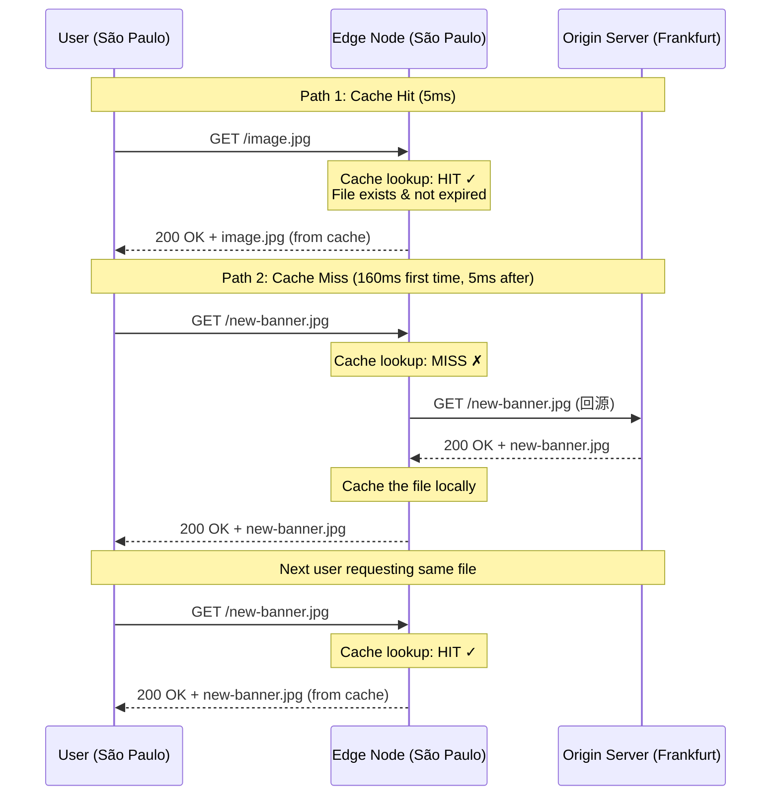
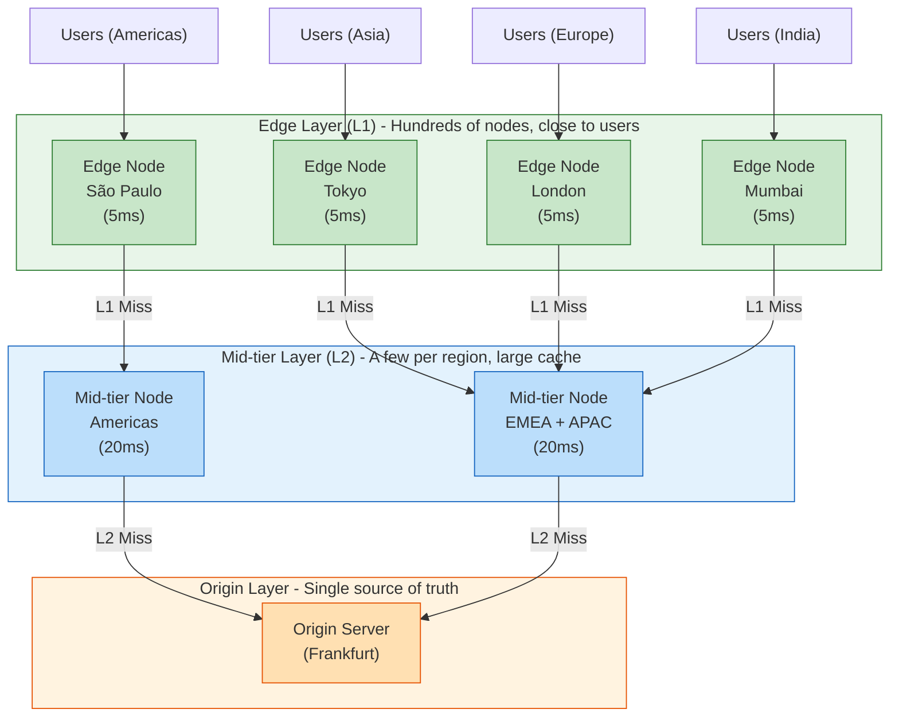
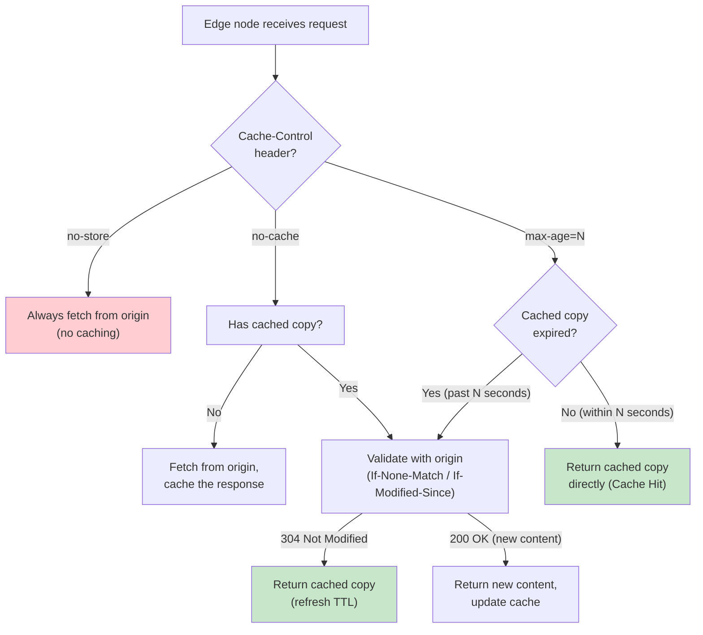
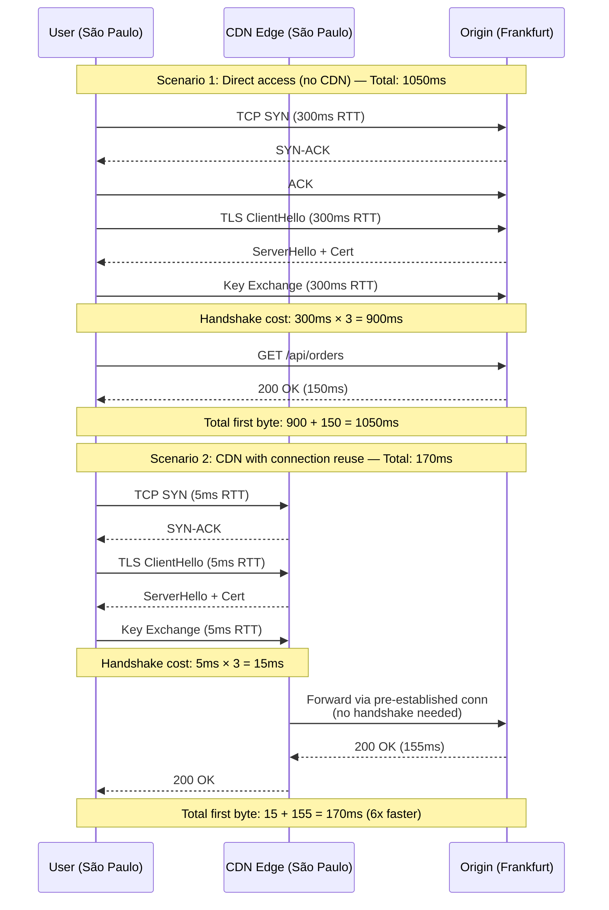
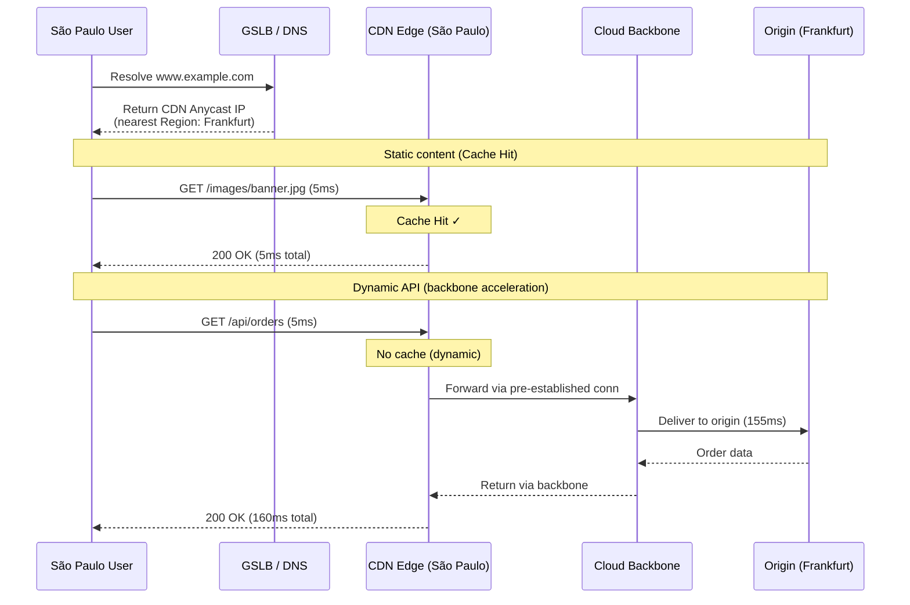

# 24. 把内容推到用户身边：CDN 与边缘节点

全球加速部署完成了。Anycast 把流量引导到最近的 PoP，骨干网保证了传输质量。圣保罗的用户访问法兰克福的服务，延迟从 220ms 降到了 160ms。

然后你查看了骨干网的流量报表。

排名第一的流量来源是首页的一张 Banner 图片，2MB，每天被传输了 80 万次。排名第二是一个 jQuery 库，500KB，每天 120 万次。排名前十的全是静态文件，占了骨干网总流量的 70%。这些文件的内容一个月都没变过，但每天有几百万次请求穿越骨干网去源站取同一份文件。

骨干网的带宽是按 Gbps 计费的。你在为重复传输付费。

## 24.1 全球加速解决不了的问题

全球加速优化的是路径——让流量走更好的路。但它有一个隐含的假设：流量必须走完全程。请求从用户出发，经过 PoP，穿越骨干网，到达源站；响应从源站出发，穿越骨干网，经过 PoP，回到用户。无论路径多优，这个来回都省不掉。

对于动态 API 请求，这没有问题。用户查询订单，响应内容取决于用户是谁、订单是什么，每次都不同，必须由源站实时计算。流量走完全程是必要的。

但一张 Banner 图片呢？它对所有用户都是一样的。第一个用户和第一百万个用户拿到的是同一份 2MB 的文件。每次都让这 2MB 穿越大西洋，是在用昂贵的骨干网带宽传输重复的内容。

问题不只是带宽成本。源站的 Web 服务器需要处理每一个请求——读取文件、建立连接、传输数据。100 万次请求意味着 100 万次文件读取。最直觉的应对是在源站前面加更多服务器，用负载均衡分摊压力。但这只解决了源站的计算瓶颈，没有解决根本问题：流量仍然要从圣保罗穿越大西洋到法兰克福，160ms 的延迟不会因为源站有 10 台服务器而变短。

换一个角度想。PoP 已经在圣保罗了，离用户只有 5ms。如果在 PoP 上放一份这张图片的副本，圣保罗的用户直接从 PoP 获取——延迟从 160ms 降到 5ms，源站的压力从 100 万次降到 1 次（只有第一次需要从源站取），骨干网的流量从 2TB 降到 2MB。

这个思路的本质不是"让流量走更好的路"，而是"让内容离用户更近，根本不需要走那么远的路"。不是优化传输，是消灭传输。

## 24.2 CDN：从一个副本到一个分布式缓存网络

在一个 PoP 上放一份副本，这个想法很自然。但全球有几十个 PoP，热门内容有几百万个文件。问题立刻变得复杂：

哪些文件应该放到边缘？不可能把源站的全部内容复制到每个 PoP——存储空间有限，大部分文件可能根本没人访问。需要一种机制，让边缘节点只保留"有人要"的内容，自动淘汰"没人要"的内容。

副本什么时候放上去？不可能提前把所有内容推送到全球所有节点——你不知道哪个地区的用户会访问哪个文件。需要一种"按需"的机制：有人要的时候再去取，取回来之后留一份。

副本什么时候过期？源站更新了图片，边缘的旧副本必须失效。需要一种过期和验证机制。

把这三个问题的答案系统化，就是 CDN（Content Delivery Network，内容分发网络）。CDN 的本质是一个全球分布的缓存层——在离用户近的地方放副本，有就直接给，没有就去源站取一份回来存着。

CDN 的工作只有两条路径：

**缓存命中（Cache Hit）。** 用户请求 `cdn.example.com/image.jpg`，边缘节点检查本地：有这个文件，而且没过期。直接返回。整个过程不联系源站，延迟只有用户到边缘节点的距离，通常 1-10ms。

**缓存未命中（Cache Miss）。** 边缘节点本地没有这个文件，或者已经过期。向源站发起请求（"回源"），拿到文件，返回给用户，同时在本地存一份。下一个请求同一文件的用户就能命中缓存。

**图 24.1：CDN 的两条核心路径**

CDN 的核心指标是缓存命中率——命中的请求数占总请求数的比例。热门内容的命中率通常超过 95%，100 次请求中只有不到 5 次需要回源。命中率从 90% 提升到 99%，意味着回源量减少了 90%——对源站来说，压力降低了一个数量级。

但这里有一个问题。全球有几百个边缘节点，如果一个热门文件的缓存同时在 100 个节点过期，100 个回源请求同时打到源站——这和没有 CDN 差别不大。

解决方案是加一层中间层节点（L2）。边缘节点未命中时，不直接回源站，而是先查中间层。中间层数量少（每个区域几个），但缓存容量大。100 个边缘节点的未命中请求汇聚到 5 个中间层节点，中间层只需要向源站回源一次。

**图 24.2：CDN 的多层缓存架构**

> 缓存查找顺序：L1 → L2 → Origin。绿色的 L1 边缘层节点数量多（几百个）、离用户近（5ms）、缓存容量小；蓝色的 L2 中间层节点数量少（每区域几个）、缓存容量大（20ms）；橙色的源站只在 L2 也未命中时才被访问。这种分层结构将源站的回源压力从"边缘节点数 × 未命中率"压缩到"中间层节点数 × 未命中率"。

这个两层结构把源站的回源压力从"边缘节点数 × 未命中率"压缩到了"中间层节点数 × 未命中率"，通常是几十倍的差距。

## 24.3 缓存控制：三个必须回答的问题

CDN 在边缘放副本，听起来很美好。但如果不加控制地缓存所有东西，灾难很快就会发生。

**灾难一：数据泄露。** 用户 A 查看自己的订单详情，响应被边缘节点缓存了。用户 B 请求同一个 URL，边缘节点命中缓存，把用户 A 的订单返回给了用户 B。

**灾难二：内容过时。** 源站更新了商品价格，但边缘节点还在返回缓存的旧页面。用户看到的价格是昨天的，下单后发现实际价格不同。

**灾难三：缓存污染。** `page.html?lang=zh` 和 `page.html?lang=en` 返回完全不同的内容，但边缘节点把它们当作同一个文件缓存，中文用户拿到了英文页面。

这三个灾难对应三个必须回答的问题：**什么能缓存？缓存多久？怎么标识"同一个内容"？**

### 什么能缓存：源站的声明

控制缓存行为的核心机制是 HTTP 响应头中的 `Cache-Control`。它是源站告诉 CDN "这个响应能不能缓存、怎么缓存"的协议。

`Cache-Control: max-age=86400` —— 可以缓存 1 天。适合不经常变化的静态资源：图片、字体、第三方库。

`Cache-Control: no-cache` —— 可以缓存，但每次使用前必须向源站验证是否过期。适合更新频率不确定的内容。

`Cache-Control: no-store` —— 绝对不要缓存。适合包含用户个人信息的响应：订单详情、账户余额。这就是防止"灾难一"的手段。

`Cache-Control: s-maxage=3600` —— 专门给 CDN 用的过期时间，覆盖 `max-age`。允许浏览器和 CDN 有不同的缓存策略。

**图 24.3：Cache-Control 指令的决策流程**

### 过期不等于变了：条件请求

一张商品图片设置了 `max-age=86400`，1 天后过期。但这张图片可能一年都没换过。如果过期后直接重新下载完整的 2MB 文件，浪费了带宽——内容根本没变。

条件请求解决了这个问题。边缘节点回源时带上验证信息：`If-None-Match: "abc123"`（上次缓存时源站给的 ETag）。源站检查内容是否变化：没变，返回 `304 Not Modified`，不传输内容体，只传几十字节的响应头；变了，返回新内容。一个 2MB 的图片，验证一次只需要几十字节——带宽节省了 99.99%。

### 缓存键：什么算"同一个内容"

CDN 用什么来标识"同一个内容"？默认是完整的 URL。但 `image.jpg?v=1` 和 `image.jpg?v=2` 是不同的 URL，即使指向同一张图片（只是版本号变了），CDN 会分别缓存，命中率下降。反过来，`page.html?lang=zh` 和 `page.html?lang=en` 只差一个参数，但内容完全不同——如果缓存键忽略了查询参数，就会出现"灾难三"。

缓存键的配置需要根据业务逻辑决定：哪些参数影响内容、哪些不影响。这看起来是个小问题，但在生产中，缓存键配置错误是导致命中率低的最常见原因之一。

### 主动失效：不能等自然过期

源站发布了新版本的 JS 文件，不能等 24 小时让缓存自然过期。CDN 提供主动刷新接口（Purge）：源站通知 CDN "这个 URL 的缓存已失效，请清除"。全球所有边缘节点收到通知后清除对应缓存，下一次请求回源获取新内容。

但主动刷新有代价。几百个边缘节点同时清除缓存后，下一波请求全部变成未命中，回源洪峰可能打垮源站。所以大型 CDN 的刷新通常不是"立即清除"，而是"标记为过期，下次请求时用条件请求验证"——用 304 而不是完整回源，把冲击降到最低。

## 24.4 动态请求：CDN 还能做什么

静态内容通过缓存解决了。但用户点击"查看订单"，这是动态请求，响应内容每次不同，无法缓存。CDN 的边缘节点和网络基础设施仍然在那里，能帮上忙吗？

能。不是通过缓存，而是通过连接优化。

问题出在哪里？用户到源站的完整路径需要两段握手：用户到边缘节点的 TCP + TLS 握手，以及边缘节点到源站的 TCP + TLS 握手。如果每个请求都要走完两段握手，延迟叠加很严重。

CDN 的做法是：**边缘节点和源站之间维持一个长连接池**——几十到几百条预先建立好的 TCP + TLS 连接。用户的请求到达边缘节点后，直接复用已有连接转发到源站，省去了边缘到源站的握手延迟。用户只需要和最近的边缘节点握手（5ms），后面的路程复用已有连接。

**图 24.4：连接复用的效果**

> 关键差异：直连场景下，用户必须与远端源站完成完整的 TCP + TLS 握手（3 个 RTT × 300ms = 900ms）；CDN 场景下，用户只需与 5ms 之外的边缘节点握手（3 × 5ms = 15ms），边缘到源站复用预建连接，省去握手开销。最终首字节时间从 1050ms 降至 170ms，提速约 6 倍。

另一个优化是**请求合并**。一个热门页面的缓存刚过期，100 个用户几乎同时请求，100 次缓存未命中。如果向源站发 100 次回源请求，压力很大。请求合并的做法是：第一个请求触发回源，后续 99 个排队等待。源站返回后，同一份响应分发给所有等待的用户。100 次回源变成 1 次。

CDN 的动态加速和全球加速（Global Accelerator）在动态请求场景下有重叠——都是边缘接入 + 骨干网传输。区别在于：CDN 工作在 HTTP 层，能做连接复用、请求合并、HTTP/2 多路复用；全球加速工作在网络层，不关心上层协议，TCP、UDP、自定义协议都能加速。

*选择标准很简单：HTTP 流量用 CDN（静态缓存 + 动态加速一站式解决），非 HTTP 流量（游戏、视频会议）用全球加速。两者不冲突，同一个服务可以静态资源走 CDN，游戏流量走全球加速。*

## 24.5 完整的加速体系

三章走下来，全球网络加速的体系完整了。不同类型的流量走不同的最优路径：

**图 24.5：全球网络加速的三层协同**

- **静态内容**（图片、视频、JS、CSS）：用户 → 边缘节点 → 缓存命中直接返回。延迟 1-10ms，源站零压力。
- **动态 HTTP 请求**（查询订单、提交表单）：用户 → 边缘节点 → 骨干网 → 源站。连接复用省去握手开销，延迟 50-200ms。
- **实时交互**（游戏、视频会议）：用户 → Anycast PoP → 骨干网 → 服务节点。全球加速，不经过 CDN。

GSLB 选大方向，Anycast 选入口，CDN 在入口处把能解决的问题解决掉，解决不了的再通过骨干网送回源站。

但这个体系有一个前提：它假设网络是友好的。

全球加速让服务触达了全球用户，CDN 的边缘节点暴露在公网上，Anycast IP 全球可达。服务能被全球用户访问，也意味着能被全球攻击者访问。攻击者可以从全球各地动员僵尸机，对你的 Anycast IP 发起 Tbps 级的流量洪泛；CDN 边缘节点每秒处理几百万次正常请求，攻击者可以让这个数字变成几千万次。

*你越想让服务触达更多用户，就越需要面对更多的攻击者。开放与安全，从来都是一对矛盾。*
