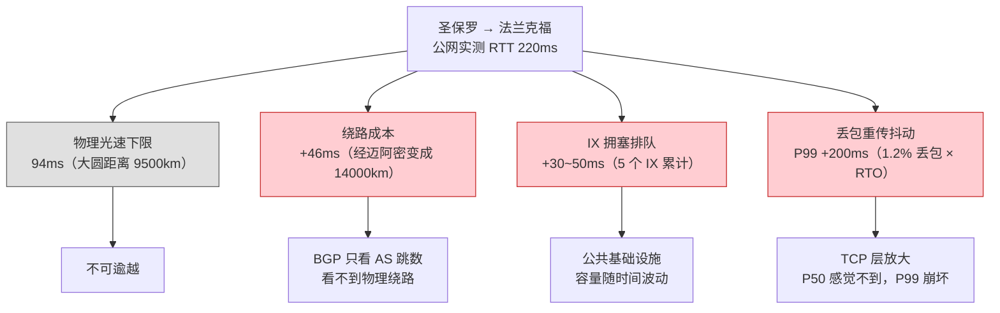
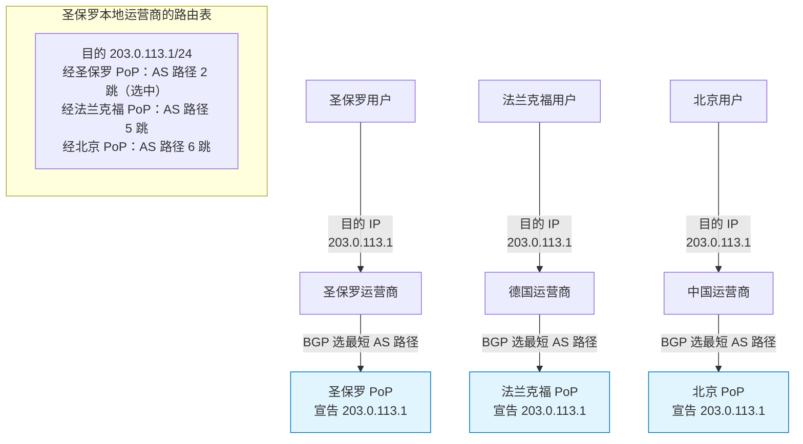
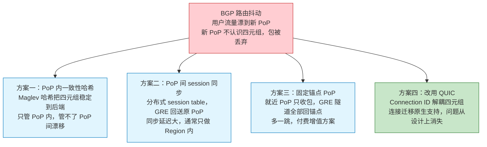
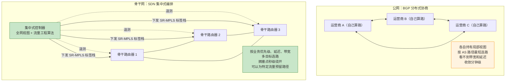

# 24. 让流量走更好的路：Anycast 与云骨干网

DNS 已经把圣保罗的用户引导到了正确的解析结果上：法兰克福 Region 的 IP 地址就摆在浏览器面前。用户按下回车，第一个 SYN 包从圣保罗出发，经过当地运营商的路由器，到达圣保罗的 IX，然后没有直飞大西洋，而是去了迈阿密。这种选择无关物理距离，纯粹源于圣保罗运营商的 BGP 选路逻辑：绕道迈阿密的那条 AS 路径在拓扑上最短。从迈阿密到纽约，从纽约到伦敦，从伦敦到法兰克福，四个 IX，三次跨洋，往返 220 毫秒，还带着 1.2% 的丢包。

DNS 只能替用户选目的地，选不了怎么去。目的地选得再准，中间那段路径依然交在几十家运营商的 BGP 手里。要让全球用户获得稳定的体验，控制点必须从域名解析层下沉到 IP 路由层，在网络最前端挑选接入入口。

## 24.1 60 毫秒差在哪里：公网路径的延迟损耗

先把公网传输的延迟拆解一次，否则后续的所有优化都只是纸面上的数字游戏。

圣保罗到法兰克福，两地之间光纤大圆距离大约 9500 公里。光在光纤里的速度约 20 万公里每秒，物理下限单程 47 毫秒，往返 94 毫秒。这是不可逾越的物理底线，谁也省不掉。剩下 220 - 94 = 126 毫秒，全部是工程代价，也就是路径绕行、节点拥塞、丢包重传累加出来的额外开销。

线路绕行是其中最大的损耗来源。圣保罗到法兰克福理论上可以沿南大西洋海缆直飞，但南美到欧洲的直达海缆容量有限，主流运营商更愿意把流量通过北美中转，因为迈阿密到欧洲的跨大西洋海缆容量最丰富、成本最低。BGP 看到的是 AS 路径最短，看不到这条最短路径物理上兜了个北美的圈子。9500 公里的直线被绕成了 14000 公里，光速极限就从 94 毫秒放大到 140 毫秒，仅这一项就吃掉了 46 毫秒。

节点拥塞与排队则是第二项额外开销。公网上流量必经的每一个 IX 都是共享设施，晚高峰时排队延迟从平时的 2 毫秒抖到 30-50 毫秒并不罕见。圣保罗、迈阿密、纽约、伦敦、法兰克福五个 IX 串起来，只要其中两个赶上高峰，累计就多出几十毫秒的排队。

最隐蔽的则是丢包引发的重传惩罚。1.2% 的丢包率看起来并不高，但 TCP 一遇到丢包就会触发重传，Linux 内核默认 200 毫秒的最小重传超时（RTO）会直接叠加在延迟上。P50 的用户可能感觉不到什么，可只要连接期间碰上一次重传，P99 尾延迟就会被拉到 400 毫秒以上。对于交易系统、实时视频、在线游戏这种对尾延迟敏感的场景，1.2% 的丢包会导致 P99 体验急剧恶化。

**图 24.1：圣保罗到法兰克福 220 毫秒的成本拆解**

将这四项损耗汇总来看，220 毫秒的公网延迟里，物理下限 94 毫秒，剩下 126 毫秒都是可以被工程优化的部分。如果能把用户流量尽早从公网里拯救出来，让它进入一条带宽充足、路径可控、拥塞可预测的私有网络，走 160 毫秒完全是可以做到的，剩下的 66 毫秒也接近了物理极限。

要把用户流量尽早拯救出来，先要在离用户最近的地方部署一个接入入口。用户机器上的路由表是运营商配的，改不了；沿途运营商的 BGP 决策是运营商内部的策略，也影响不了。云厂商唯一的抓手，是让 BGP 自己愿意把流量送过来，不去改协议，而是让协议顺理成章地做出符合预期的选择。

## 24.2 Anycast：让 BGP 自己选入口

BGP 的选路逻辑其实是一个非常好用的工具，只是过去没人从这个角度用它。互联网上任何一个 IP 前缀，只要被多个 AS 同时宣告出来，各个运营商的 BGP 就会独立地为自己选一条 AS 路径最短的。云厂商要做的事情很朴素：把同一个 IP 地址从全球几十个物理位置同时对外宣告，让 BGP 各自为战地做出正确决定。

> **Anycast 是什么？**
>
> Anycast（任播）是一种网络寻址方式：将同一个 IP 地址部署在多个地理位置不同的节点上，每个节点都通过 BGP 独立宣告这个 IP 在我这里。用户访问这个 IP 时，各地 BGP 会按各自的选路策略把流量送到拓扑上最近的那个节点，不需要 DNS 调度、不需要客户端配合。Anycast 最早被广泛用于 DNS 根服务器，全球 13 组根服务器都以此构建，后来才被云厂商拿来做 TCP 层的全球接入和 DDoS 分散。

同一个 IP 从多点宣告，这个操作在 BGP 协议里完全合法。北京 PoP 说 203.0.113.1 在我这里，法兰克福 PoP 也说 203.0.113.1 在我这里，圣保罗 PoP 同样宣告一份。三条路由通告分别进入各自邻居的 BGP 表，各地运营商收到后再传给自己的下游。对圣保罗本地运营商来说，它到圣保罗 PoP 只有两三跳，到法兰克福 PoP 要经过跨洋链路上的四五个 AS，两条路都通向 203.0.113.1，选路逻辑毫不犹豫地选中前者。同样的判断在中国运营商那里指向北京 PoP，在德国运营商那里则指向法兰克福 PoP。

**图 24.2：Anycast 的多点宣告与本地选路**

Anycast 的精妙之处在于：它没有给 BGP 添加任何新功能，没有改选路算法，没有引入新的扩展。它只是利用了一条原本就存在的规则，同一个前缀允许从多个位置宣告，让 BGP 按其自身的选路逻辑把每个用户送到最近的入口。它完全在 BGP 的框架内运作，顺应协议规则完成就近接入。

和 GSLB 相比，两者做的事情表面相似，都是让全球用户就近接入，工作层次却完全不同。GSLB 在 DNS 层调度，用户查询域名，不同地区拿到不同的 IP 地址。它的调度粒度是 DNS TTL，通常几十秒到几分钟；调度精度受 GeoIP 数据库和递归解析器位置的双重限制，上一章讲过的种种偏差都会在这里表现出来。Anycast 在网络路由层调度，全球用户看到的是同一个 IP，但 BGP 把不同用户的流量送到不同入口。调度不依赖 DNS，不受 TTL 制约，也不需要 GeoIP，一切由 BGP 的自然收敛完成。

Anycast 的故障切换比 GSLB 快，上一章讨论过 TTL 缓存两难，权威把 TTL 设短，故障切换才能快，但 Local DNS 缓存会把这个短 TTL 拉长到几分钟；设长了，可用性又要牺牲。Anycast 里根本没有这层烦恼，某个 PoP 挂了，它撤销 BGP 宣告，各地运营商在 30-60 秒内完成路由收敛，全球流量自动切换到下一个最近的 PoP，用户手上的 DNS 缓存不需要动一下。DNS 层解决不了的故障切换速度问题，路由层用协议原生机制就解决了。

两者也可以配合，GSLB 决定 Region 级别的大方向，根据用户位置返回不同 Region 的 Anycast IP；Anycast 决定 PoP 级别的入口：把用户流量送到该 Region 覆盖范围内最近的 PoP。上层选 Region，下层选入口，各司其职。

## 24.3 Anycast 遇上 TCP：一个不能绕开的裂缝

Anycast 在 UDP 上工作得几乎完美，DNS 查询是一次性的、无状态的，一个包发出去、一个包收回来，路由到哪个 PoP 都不影响结果，这也是它成为 DNS 根服务器基础设施底层标配的原因。可一旦将 Anycast 应用于 TCP，一个隐蔽而致命的结构性问题便显现出来。

TCP 是有状态的，一条连接由四元组标识（源 IP、源端口、目的 IP、目的端口），连接状态：序列号、拥塞窗口、接收窗口、SACK 记录。这些状态保存在处理这条连接的那台服务器上。如果用户的 TCP 连接建立在圣保罗 PoP，序列号只有圣保罗那台机器知道。BGP 路由一旦发生变化（术语叫 Route Flapping），比如圣保罗到用户方向的某条链路故障、某个 AS 邻居闪断、某段海缆抖动，用户的后续报文可能就被路由到了法兰克福 PoP。法兰克福不认识这个四元组，收到的包既没有对应的 socket 也没有序列号上下文，一律当作无效包丢弃。用户看到的现象是连接卡死，重连之后才恢复。

互联网上 BGP 抖动是家常便饭，据 RIPE NCC 的公开测量数据，全球互联网每天发生的 BGP 更新事件在千万级，其中每小时都有大量前缀经历路由变更。对无状态 UDP 来说这些抖动几乎无感，对长连接 TCP 来说每一次都可能是一次断连。生产环境里跑 Anycast+TCP，如果不加保护，长连接场景下的连接稳定性会掉到不可接受的水平。

云厂商为解决这个问题，摸索出了四种方案，各有权衡。

第一种方案是在 PoP 内部做一致性哈希。PoP 内部通常有一组四层负载均衡器（LVS、Katran、DPVS 一类），它们看到用户包的四元组，用一致性哈希算法（Maglev 是 Google 那篇经典论文里给出的方案，业界普遍采用）挑出一台后端。哈希函数的输入是四元组本身，输出是后端 ID。同一个四元组在同一台负载均衡器上永远算出同一个后端，即使中间某台后端下线，一致性哈希也保证只有映射到那台后端的连接被打断，其他连接不受影响。这个方案解决的是 PoP 内部的连接亲和性，让流量在 PoP 内不乱漂。它管不了 PoP 之间的漂移，只在 PoP 内部有效。

第二种方案是让 PoP 之间共享连接状态。既然连接可能漂到别的 PoP，那就把连接状态同步过去。工程实现上，PoP 之间会通过骨干网维护一张分布式的 session table，key 是四元组，value 是这条连接对应的原始 PoP。用户流量漂到新 PoP 之后，新 PoP 查表发现这条连接归圣保罗 PoP 管，就把包通过骨干网 GRE 隧道回送到圣保罗 PoP 处理。这个方案的代价是同步延迟和一致性问题，session table 的更新不可能瞬时同步到全球所有 PoP，两个 PoP 之间总有一小段时间窗口对同一条连接的归属看法不一致。大厂通常只在关键连接上开启，或者只做 PoP 组内的同步（比如同一个 Region 里的几个 PoP），全球同步的代价太高。

第三种方案是利用 GRE 隧道将流量锚定到指定 PoP。有一类连接对稳定性要求极高（比如金融交易的长连接），云厂商会为这类客户把他们的流量固定回送到一个指定的锚点 PoP，就近 PoP 只负责收包，然后一律通过 GRE 隧道把包转到锚点 PoP 上处理。这样 BGP 怎么抖，连接都只在锚点 PoP 上维护。代价是多了一跳、增加了骨干网带宽消耗，也牺牲了一部分 Anycast 就近接入的收益。这个方案一般作为付费增值服务提供，而不是默认行为。

第四种方案则是绕开 TCP 本身，改用 QUIC。QUIC 在传输层引入了 Connection ID，一个跟四元组解耦的连接标识符。连接建立时客户端和服务端交换 Connection ID，之后每个包都带着 Connection ID。IP 层怎么漂都没关系，服务端根据 Connection ID 找连接状态，不再依赖四元组。这就是 QUIC 的连接迁移能力，本来是给移动网络切换 WiFi/4G 场景设计的，在 Anycast 场景下同样完美适用。用了 QUIC 之后，Anycast 的路由抖动问题从断连降级为包乱序，TCP 里那道裂缝在 QUIC 里根本不存在。这也是为什么最近几年主流云厂商的全球加速产品都在积极推 HTTP/3，不只是为了 QUIC 的握手优化，顺带解决 Anycast 的连接亲和性难题同样是关键动因。

**图 24.3：Anycast+TCP 断连问题与四条工程破法**

四种方案的选型取决于具体的业务场景。UDP 业务什么都不用做；一般 HTTP 短连接用方案一足够；长连接和交易类业务上方案二或方案三；能推 HTTP/3 的场景直接方案四，把问题从根上关掉。生产环境里通常是几条组合使用，PoP 内先靠一致性哈希兜底，长连接客户开启 session 同步，交易客户走锚点 PoP，新业务默认 HTTP/3。

## 24.4 骨干网：从 BGP 分布式协商到 SDN 集中式编排

当流量通过 Anycast 接入就近的 PoP 节点后，跨区域的长途传输便交由云骨干网接管。PoP 是公网与骨干网的交界点，物理上通常部署在 IX 或运营商机房内，配备了边界路由器、四层负载均衡器和少量计算节点。它没有大规模计算存储，也不承载复杂业务逻辑，核心只有两个动作：把公网上来的流量卸下来，扔到骨干网上转发到目标 Region。

真正决定骨干网为何可控的，并非铺设了自建光纤这一物理事实，而是其内部运行着一套完全不同的路由控制机制。

公网的路由靠 BGP 分布式协商,互联网上几万个 AS 各自为政，每家的 BGP 只知道自己的策略和邻居告诉它的路由，没有任何一方看得到全局。选路默认按 AS 路径最短，这是一个纯拓扑指标，无法反映真实的链路性能。BGP 也没有实时感知带宽和延迟的能力,某条链路拥塞、某段海缆抖动，BGP 要等到明确的失效信号才收敛，收敛速度通常在分钟级。上一节讲的圣保罗绕迈阿密就是 BGP 这种工作方式的必然结果。

与公网不同，云厂商骨干网采用了完全不同的控制范式：集中式编排。控制面和数据面被彻底解耦。集中式控制器通过遥测（Telemetry）协议实时掌握全网视图，精准采集所有骨干链路的带宽容量、实时流量、延迟、丢包率与误码率。控制器基于全局视图运行流量工程算法（Traffic Engineering），按业务优先级、延迟目标、带宽预留等多个维度求解最优路径，然后把结果作为标签栈或流表下发给数据面的转发设备。数据面的路由器不再自己算路，它只按控制器下发的策略执行转发。

数据面的实现在业界普遍是 SR-MPLS（Segment Routing over MPLS）或者近几年正在推进的 SRv6。它们的共同点是把路径以标签栈的形式编码在包头里，想让这个包走"先到伦敦 → 再到阿姆斯特丹 → 再到法兰克福"，就在包头压上这三段的标签，沿途每个路由器按标签转发，不用自己再查路由表做选路决策。控制器可以给任何一条特定的流量指定任何一条路径，包括绕过某个正在抖动的节点、优先走延迟最低的路、给交易流量预留带宽，这些在 BGP 世界里几乎做不到的操作，在 SR-MPLS 世界里只是控制器下发一条不同的标签栈。

**图 24.4：公网 BGP 分布式协商 vs 骨干网 SDN 集中式编排**

除了控制面的集中调度，骨干网在物理资源层面同样拥有天然优势。头部云厂商在全球范围内持续投资自建海缆与专有光纤，并按峰值预测提前扩容，使得骨干网流量无需与公网争抢带宽。Google 的骨干网连接了 30 多个 Region 和 180 多个 PoP，AWS 更是覆盖了 30 多个 Region 和 400 多个 PoP。但专有光纤仅仅是物理基础，如果没有 SDN 控制面将这些资源全局统筹，再庞大的光纤网络也无法自动避开低效与拥塞。正是 SDN 集中调度与专有物理链路的结合，才让骨干网具备了可控、可预测的传输能力。

## 24.5 全球加速：三块拼图的产品形态

Anycast 提供了入口的分散选择，四种破法解决了 TCP 亲和性，SDN 骨干网提供了从入口到目的地的可控路径。三块拼图合起来才成为一款用户可以购买的产品：全球加速（Global Accelerator，各家云厂商叫法不同，思路一致）。

产品形态很简朴：用户购买一个全球加速实例，云厂商分配一个 Anycast IP，同时在几十上百个 PoP 上宣告出去。用户把这个 IP 配置到 DNS 里或者直接告诉客户端，全球所有请求都指向这个 IP，剩下的一切透明：BGP 把流量送到最近的 PoP，PoP 的四层负载均衡器按一致性哈希选后端并封装成 GRE 隧道扔上骨干网，骨干网的 SDN 控制器按当前的链路质量选一条最优路径把包送到目标 Region，Region 里的服务处理请求，回程原路返回。用户不需要知道 PoP 在哪里、骨干网怎么走，甚至不需要感受到我在用一个加速产品。

全球加速的核心价值并非单纯的缩短延迟，而是提供确定性。表面上看，它将传输延时从 220 毫秒压缩到 160 毫秒；但从工程本质来看，它真正解决的是稳定地快。

公网延迟的分布是长尾的，P50 也许 180 毫秒，看起来还可以；P99 可能是 500 毫秒甚至更高，因为公网上任何一个 IX 突然拥塞、任何一条链路突然抖动、任何一次 BGP 收敛都会打出一个尾巴。骨干网延迟的分布是收敛的，P50 和 P99 靠得很近，因为带宽充足、路径由 SDN 显式指定，不会有突发的拥塞点。同一个 P50，公网和骨干网差 30-50 毫秒；同一个 P99，能差到 200 毫秒以上。

对某些业务而言，P50 差多少不重要，P99 差多少才致命。在线交易系统不怕稳定的 80 毫秒，怕的是某笔交易突然卡在 500 毫秒之外触发超时。视频会议不怕稳定的 150 毫秒，怕的是延迟在 50 和 300 之间跳来跳去让语音无法对齐。对这类业务，全球加速核心提供的是大幅收窄且可控的尾延迟，而非单纯的平均延迟缩短，这是公网无论怎么优化都无法企及的。

在 HTTPS 加密传输场景下，延迟优化的红利还会通过握手阶段得到乘数级别的放大。一次 HTTPS 请求要经历 TCP 三次握手（1 RTT）加 TLS 握手（TLS 1.3 是 1 RTT，TLS 1.2 是 2 RTT），在收到首字节之前客户端必须等待 2 到 3 个 RTT。60 毫秒的单次 RTT 差距，在建连阶段会被直接放大为 120 至 180 毫秒的时延差。API 调用是单次的，60 毫秒感受不深；网页首屏是多次的，60 毫秒的 RTT 优化在用户端等于秒级的体感提升。这也是为什么电商、金融、SaaS 类应用愿意为全球加速承担更高成本，而以文件下载为主的场景反倒不那么急，下载是带宽敏感，不是 RTT 敏感。

这种极致的性能与确定性并非没有代价，骨干网的带宽属于稀缺资源，跨洋海缆的比特传输成本远高于公网。全球加速通常按流量或者峰值带宽计费，价格显著高于普通公网出口。对于低 RTT 敏感度的场景（如大文件下载、异步任务），走全球加速的性价比极低。这是一个需要按业务精细化调度的选型问题：把 RTT 敏感的流量放上去，把带宽敏感的流量留在公网，各得其所。

至此，动态请求在传输路径上的优化已接近物理极限。全球加速解决了让路更好的问题，将长途传输的延时与抖动压到了最低。然而，互联网上绝大多数流量是图片、视频等不随请求变化的静态内容。对这类流量而言，即便骨干网再快，跨洋传输也是一种浪费。要彻底解决静态内容的传输效率，思路必须发生转变：不再是让路更好，而是让路更短，这便是下一章 CDN 与边缘节点的核心使命。

