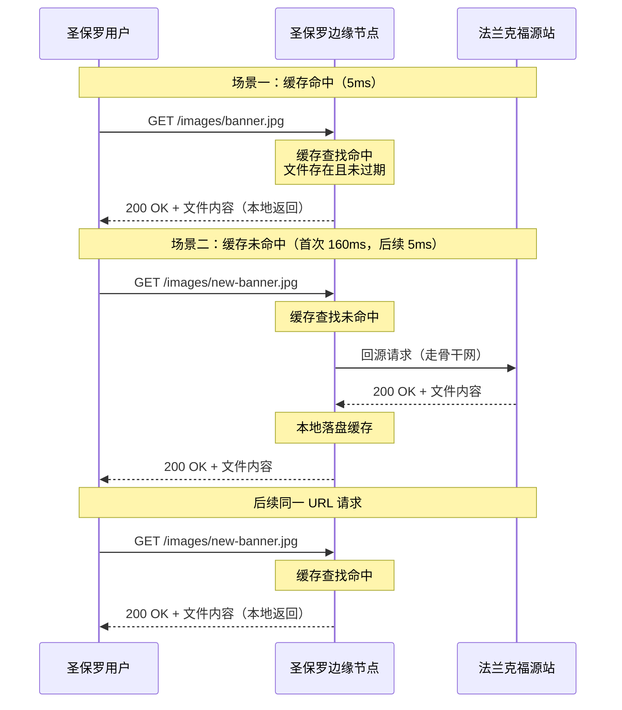
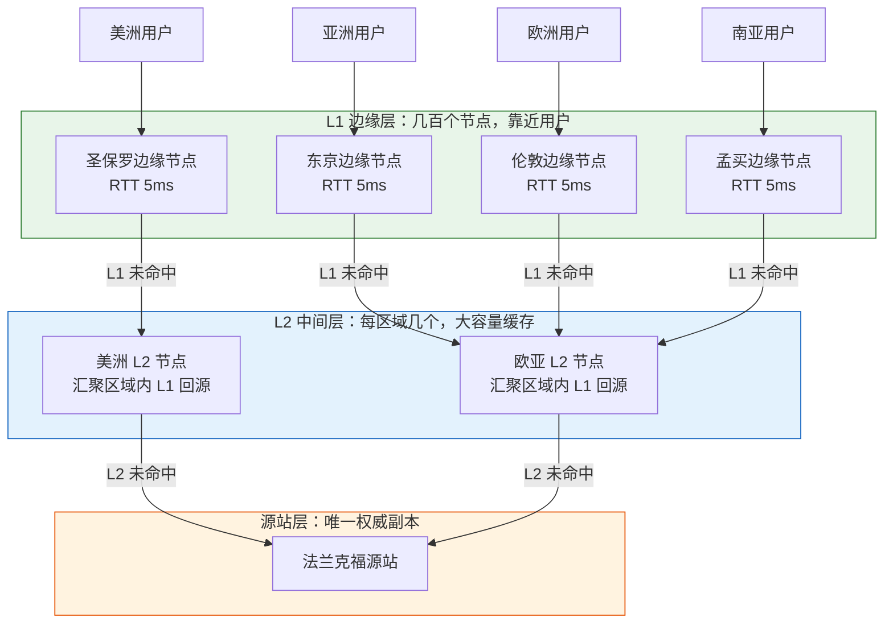
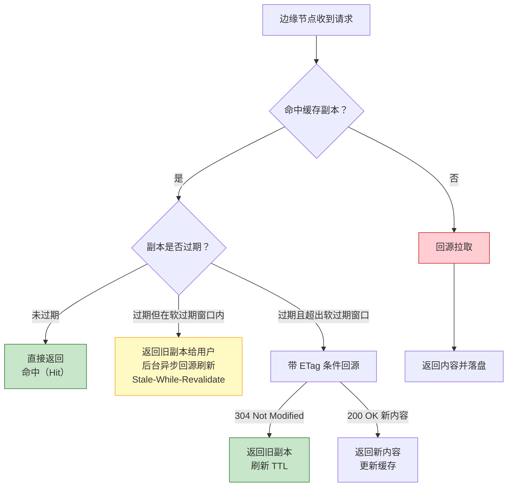
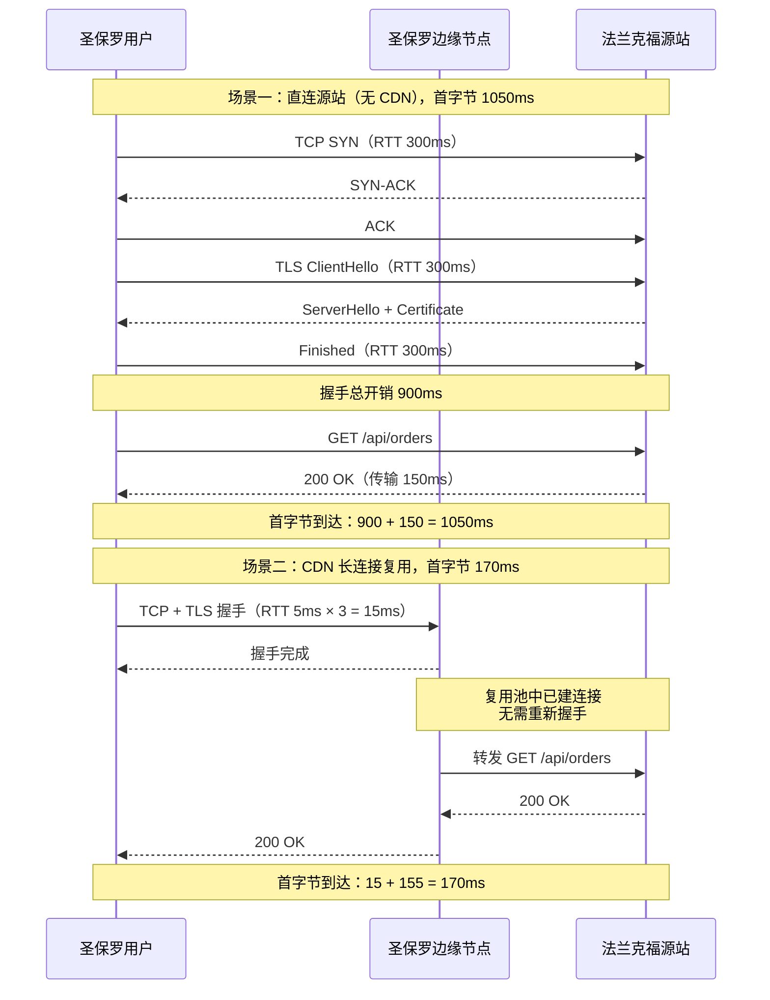

# 25. 把内容推到用户身边：CDN 与边缘节点

全球加速把路径压到了物理极限，圣保罗到法兰克福的动态请求，RTT 从公网的 220 毫秒收窄到骨干网的 160 毫秒，P99 尾延迟也从 500 毫秒以上拉回到可接受的范围。但当运维团队分析骨干网的流量构成报表时，一个更深层次的结构性问题浮出水面：占据骨干网带宽榜首的，并不是那些需要动态计算的 API 请求，而是首页 Banner、JS 库、字体文件、商品列表页的封面图。前十名清一色是静态资源，占了跨洋骨干网总流量的七成以上。这些文件一个月没变过内容，但每天都有几百万次请求，把同一份 2 MB 的图片一次次搬运。

骨干网按 Gbps 计费，为完全相同的内容重复付费，是所有工程优化都无法容忍的浪费。

## 25.1 路径优化的天花板：动态与静态的分野

全球加速的思路是让路更好走，前提是这条路必须走。请求从圣保罗出发到达法兰克福源站，响应再从法兰克福折回到圣保罗，无论中间用了 Anycast 还是 SDN 骨干网，这个往返都省不掉。对于查询订单、提交支付、拉取个性化推荐这类动态请求，往返是必要的：响应内容取决于用户是谁、上下文是什么，源站必须实时计算，骨干网只是把计算结果送回来。

但静态内容的性质完全不同，同一张 Banner 图片对所有用户都是同一份字节，第一个用户和第一百万个用户拿到的完全一样。让这 2 MB 每次都穿越大西洋，从工程角度看毫无意义。

问题的隐蔽代价还不止在带宽，源站承担的每一次请求都要经过完整的服务链：TCP 握手、TLS 握手、HTTP 解析、文件系统读取、内容传输、连接关闭。100 万次请求意味着 100 万次全链路的资源占用。为源站扩容更多实例只能缓解计算侧的瓶颈，缓解不了物理链路上重复传输本身的浪费。跨洋 RTT 该是 160 毫秒还是 160 毫秒，源站有 10 台机器和 1 台机器对单次请求的延迟没有本质区别。

真正能解决这个问题的思路不是继续优化传输，而是彻底改变发货位置。既然 Anycast 已经在圣保罗部署了 PoP，用户离这个 PoP 只有 5 毫秒的物理距离，那么把静态内容的一份副本直接放在 PoP 上，圣保罗的用户请求这张 Banner，PoP 就地返回，延迟从 160 毫秒压到 5 毫秒，源站从每天 100 万次请求降到只在第一次副本失效时被访问一次，骨干网上跨洋流量从 2 TB 降到几乎为零。这不是把路径优化到极致，是把路径消除掉。

把这条思路系统化，就是 CDN（Content Delivery Network，内容分发网络）。它的定位是解决全球加速无法涵盖的另一类问题：彻底消除静态资源在长距离链路上的冗余传输。

## 25.2 缓存网络的分层：从一份副本到几十亿次命中

在离用户最近的 PoP 上放一份静态内容的副本，看似简单直观，但落到工程实现上却面临着三个关键约束。

第一个约束是存储容量，源站的对象存储可能有几十 PB，但一个 PoP 的边缘节点只有几十到几百 TB 的磁盘空间，全量复制不可能，选择性复制也不现实：预测哪张图片会被哪个地区的用户访问，成本比缓存本身还高。第二个约束是新鲜度。图片可能几年不变，但商品价格页可能几分钟就要更新，缓存不能变成一个只存不删的黑洞，必须有明确的过期与更新机制。第三个约束是回源冲击。几百个边缘节点独立缓存独立过期，一个热门文件如果同时在所有节点失效，几百个回源请求同时打到源站，源站可能直接被压垮，这就是缓存领域老生常谈的 cache stampede（缓存踩踏）问题。

CDN 用同一套架构同时回应这三个约束，核心是基础的缓存处理流程加上一层分层结构。

最基础的缓存策略非常清晰：用户请求经 Anycast 送到就近边缘节点，节点在本地存储中按缓存键查找。若文件存在且未过期（缓存命中），边缘节点直接就地响应，整个过程完全绕过源站，延迟仅为用户到边缘节点的 5 到 20 毫秒；若文件不存在或已过期（缓存未命中），节点则发起回源请求，从上游拉取内容返回给用户，并在本地写入副本，以便后续相同请求能直接命中。

**图 25.1：CDN 缓存处理流程（命中与回源）**

当热门内容的缓存命中率达到 95% 以上时，100 次请求里有 95 次都可以直接在边缘就地响应。命中率每从 90% 提升到 99%，打到源站的回源流量与系统负载就会直接下降一个数量级。因此，CDN 选型与架构设计的核心指标，始终在于能否将命中率稳定推高。

单个边缘节点内部的存储也不是一层，而是内存热点区和 SSD 冷区两级。内存里存放访问频率最高的几千到几万个文件，命中延迟在微秒级；SSD 里存放长尾文件，命中延迟在毫秒级。淘汰策略普遍使用 LRU 或 LRU 的变种（例如 ARC、TinyLFU），根据访问频率把冷内容逐层下沉，把新的热内容逐层拉上。这种分层让边缘节点能在有限的物理存储中撑起百万到千万级的活跃文件规模。

即便节点内部做了分层，当遭遇热点剧集首播等极端突发流量时，单个边缘节点的磁盘 I/O 与 CPU 仍可能迅速饱和。工程上的应对是引入零拷贝技术：通过 Linux 内核的 sendfile 与 splice 系统调用，使文件内容直接从磁盘送入网卡缓冲区，无需经过用户态内存开销；配合 DPDK 或 XDP 等用户态网络栈，单台商用服务器即可稳定输出几十至上百 Gbps 带宽，从单节点层面扛住百万级的并发下载请求。

单节点性能提升终归有物理上限，跨节点的分层拓展才是 CDN 获得全球承载能力的关键。如果网络仅包含单层边缘节点，几百个节点各自独立缓存与过期，回源总量便为“节点数 × 未命中率”，源站压力依旧可观。为此，CDN 普遍在边缘节点（L1）之上构建中间层节点（通常称为 L2 或 Parent Layer）。L2 节点按区域收拢，数量较少但具备更大容量与高稳定性，专注于吸收上游 L1 节点的未命中流量。

**图 25.2：CDN 的多层缓存架构与回源压力压缩**

分层的效果是把回源压力从"节点数 × 未命中率"压缩为"L2 节点数 × 未命中率"，通常是几十倍的差距。L1 节点未命中率如果是 5%，L2 命中率再做到 90%，实际打到源站的回源量就是 L1 未命中量的 10%，源站看到的请求量比总请求量低了两三个数量级。

为了将回源收窄到极限，L1 与 L2 节点之间的选路与请求转发经过了精心设计。当同一个 L1 节点上的热门文件刚过期时，面对几十个并发用户的请求，仅有第一个请求会触发向上回源，其余请求则在节点内部挂起排队，等待同一个回源结果返回，这在工程上被称为请求合并（Request Coalescing）。同样的合并逻辑在 L2 节点也会再次执行：即便区域内几十个 L1 节点同时未命中，L2 向源站也仅会发起一次回源。两层合并叠加后，源站承受的并发回源峰值被彻底削平。

## 25.3 缓存该保留多久：源站声明与 CDN 覆盖之间的博弈

分层架构解决了副本放在哪里、回源怎么压缩的问题，还剩下最关键的一个问题：缓存副本保留多久、何时更新、怎么保证不同用户看到的内容是他该看到的那份。这三个问题在 HTTP 协议里都有明确的答案，但生产环境里 CDN 的实际行为，往往比协议规定的要复杂得多。

缓存行为的第一层由源站通过 HTTP 响应头声明，核心指令是 Cache-Control。例如：
- `Cache-Control: max-age=86400` 告诉 CDN 这份响应可以缓存一天
- `Cache-Control: no-store` 明确禁止任何形式的缓存
- `Cache-Control: no-cache` 允许缓存但每次使用前必须回源验证
- `Cache-Control: s-maxage=3600` 则专门覆盖 CDN 的过期时间而不影响浏览器缓存

用户订单详情、账户余额这类包含个人信息的响应必须带 no-store，静态资源则用 max-age 声明较长的过期时间。

协议层面很清晰，工程实现里却有一个源站永远意识不到的现实：CDN 并不严格听源站的话。很多源站的响应根本没有 Cache-Control 头，或者头设得过于保守（比如所有响应都是 no-cache），如果 CDN 严格照办，命中率会降低到 50% 以下，加速产品便失去了工程与商业价值。所以主流 CDN 都会给每一个租户配置一套默认缓存策略：当源站没有明确声明时，按后缀名（.jpg / .css / .js）或路径规则强制赋予一个默认 TTL；某些配置下甚至会无视源站的 no-cache，把它当成 max-age 处理。CDN 控制台里的缓存规则、覆盖源站配置、URL 匹配缓存 TTL，实际上是 CDN 保留了对源站声明的最终解释权。这是一个源站方与 CDN 方的默契：源站换来了高命中率，CDN 换来了可控成本，代价是需要业务方在配置控制台里明确知道自己被覆盖成什么样。

除了确定有效时间，更关键的环节在于过期校验机制。当一张 max-age 设为一天的图片过期时，并不意味着内容已发生改变；若直接重新传输 2 MB 完整文件，会带来巨大的无谓带宽消耗。HTTP 条件请求机制优雅地解开了这一难题：边缘节点在回源时附带 `If-None-Match: "abc123"`（即此前缓存的 ETag 值），源站对比校验无变化后仅返回 304 Not Modified 响应头（无响应体）。这样一次 2 MB 的文件验证，实际传输量不到 100 字节，带宽节省高达 99.99%。

条件请求虽然实现了轻量化校验，但仍属于同步阻塞式的被动更新模式。面对高并发热门内容，一旦文件过期，同步回源仍会引发瞬间流量洪峰。现代 CDN 为此引入了 `stale-while-revalidate`（软过期）机制：允许边缘节点在文件过期的缓冲区内，优先将旧副本快速返回给用户，同时在后台异步发起回源更新。用户无需等待回源过程，回源压力也被拉长平滑分布。以 `Cache-Control: max-age=60, stale-while-revalidate=300` 为例，这意味着正常缓存 60 秒，过期后的 5 分钟内仍可使用旧副本并异步刷新，这是高频动态资源加速的核心工具。

**图 25.3：一次缓存查询的完整决策路径**

缓存键（Cache Key）用于定义和判定请求是否属于同一份可复用资源。虽然默认策略通常采用完整请求 URL 作为 Cache Key，但在复杂生产环境下，这一规则极易引发命中率衰减或数据错乱。例如，`page.html?utm_source=weibo` 与 `page.html?utm_source=wechat` 返回完全相同的页面，仅带有的营销追踪参数不同；若按完整 URL 分别缓存，命中率会被无意义的 Query 参数大幅稀释。反之，`page.html?lang=zh` 与 `page.html?lang=en` 的内容截然不同，若不慎忽略了 `lang` 参数，则会导致不同语种用户拿到错误的缓存副本。因此，精确配置哪些参数参与哈希构建、哪些参数予以过滤忽略，是保障生产环境命中率与一致性的关键。

除了请求 URL，HTTP 的 Vary 响应头也是构建缓存键的重要维度。`Vary: Accept-Encoding` 会告知 CDN 针对不同压缩格式（如 gzip、br）分别保留缓存副本，因为压缩字节流并不相同。而 `Vary: User-Agent` 则是引发“缓存键爆炸”的经典陷阱：客户端 User-Agent 存在成千上万种变体，一旦参与 Vary 匹配，同一资源将被拆分为上万份孤立的缓存副本，直接导致命中率归零。因此在生产实践中，Vary 规则仅允许作用于少数已知且基数极其有限的请求头（如 Accept-Encoding），严禁对高基数 Header 开启 Vary 逻辑。

除被动校验与软过期外，生产环境还面临主动失效（Purge / Invalidation）的需求。当源站紧急发布新版本静态资源（如修补紧急 Bug 的 JS 文件）时，无法等待 24 小时自然过期。为此，CDN 提供了 Purge 接口供源站主动下发作废通知：特定 URL 已失效，请全球边缘节点即刻清除本地副本。然而这一机制代价极高：全球几百个节点同步清理副本后，后续请求会同时触发回源，源站极易被瞬间的流量洪峰打垮。

工程上有两条主流应对，一是尽量不用 Purge，改用版本化 URL：新版本 JS 上线时不覆盖旧文件，而是发布成 `main.abc123.js`，HTML 里换一个引用，旧文件让它自然过期。这条路线把更新缓存变成更新引用，源站永远只往前发布新版本，从不主动作废旧副本，回源洪峰的问题从根上不存在。二是 Purge 时不做立即清除，而是把副本标记为过期，下一次请求走条件请求验证，源站返回 304 就能刷新 TTL，只有真正变化的内容才需要传输完整字节。这两种做法在大厂 CDN 里往往同时提供，业务方按更新频率和一致性要求选择。

## 25.4 动态请求也能被 CDN 吃掉：连接复用的红利

静态内容通过缓存被消灭在边缘，动态请求呢？用户点击"查看订单"，响应每次不同，无法缓存。此时 CDN 的边缘节点看起来只能透传，好像帮不上忙。

破解动态请求延迟瓶颈的关键，从不在于缓存内容，而在于优化连接建立的过程。在用户直连源站的完整链路中，除了数据传输本身的延迟，TCP 三次握手与 TLS 握手占据了绝大部分时间开销。以 TLS 1.3 为例，建连握手需要 2 个 RTT（TLS 1.2 则需要 3 个 RTT），加上首字节数据传输，一次冷启动请求往往需要等待 2 至 3 个 RTT 才能收到响应。若圣保罗到法兰克福的单次往返延迟为 300 毫秒，光纯握手开销就高达 900 毫秒，远超后面 150 毫秒的实际数据传输开销。

CDN 边缘节点破解这个问题的做法是长连接复用，边缘节点与源站之间维护一个长连接池，池里预先建好几十到几百条 TCP + TLS 连接，空闲时通过 keepalive 保持存活。用户请求到达边缘节点，边缘节点从池里挑一条已经握好手的连接直接转发给源站，用户只需要和 5 毫秒之外的边缘节点完成握手，远端握手的成本被永久地摊薄到几十万次请求上。

**图 25.4：连接复用对首字节时间的压缩**

在 HTTP/1.1 时代，由于一条 TCP 连接同一时间只能处理一个 HTTP 请求，边缘与源站之间为支撑高并发必须维持数以万计的连接。而 HTTP/2 引入的多路复用（Multiplexing）机制彻底改变了这一局势：它允许在单条 TCP 连接上并发传输几百个独立数据流，将边缘到源站的连接池规模从几千条骤降至几十条。这种连接密度的数量级压缩不仅大幅降低了维护开销，也让源站端的连接负载从潜在的雪崩状态回归可控。对源站业务层而言，这一过程完全透明，每个 HTTP 请求依然独立处理，但底层操作系统维护的 socket 表、conntrack 连接跟踪表及内存占用均获得了两三个数量级的释放。

除了长连接，动态加速还常做请求合并的变种：当同一个 URL 在极短时间窗内被大量用户同时请求，边缘节点即使不缓存响应，也可以让第一个请求发起回源，其余请求在边缘节点内等待同一个响应返回后一起分发。这在瞬时热点场景下（明星发微博、直播评论刷屏）非常有效，源站看到的动态请求量被削峰到 1/N。

动态加速与全球加速在能力上存在明显重合，本质都是基于边缘接入与骨干网传输。两者的技术差异体现在所作用的协议层级上：动态加速工作在 HTTP 应用层，能够充分利用长连接复用、请求合并、HTTP/2 多路复用、Header 压缩及 TLS 会话复用等一切依赖 HTTP 语义的优化机制；而全球加速则作用于 TCP/UDP 传输层，不感知上层应用协议，因而无法获取 HTTP 层的协议红利。架构选型的实际逻辑并非简单的二分处理，而是基于三条清晰的流量特征线：可缓存内容走 CDN 静态加速；短连接、强 HTTP 语义的动态 API 走 CDN 动态加速；而长连接、流式、非 HTTP 或 HTTP 语义较弱（如 WebSocket、gRPC 双向流、游戏私有协议）的流量则交由全球加速。在实际业务中，不同类型的流量可灵活对接不同产品，静态资源接 CDN，实时通信接全球加速，动态 API 挂在 CDN 动态加速上，达成传输效率与成本的最佳平衡。

## 25.5 边缘越靠前，暴露面越大

Anycast 把全球用户拉到最近的 PoP，CDN 又把静态副本和动态连接前推到 PoP 上，甚至把一部分计算能力（边缘函数、边缘规则引擎）也搬到了边缘。三章下来，服务离用户越来越近，用户看到的表面延迟越来越低，产品体感越来越好。

这条演进路径带来了一个不可回避的工程事实：服务对外的暴露面在同步膨胀。当整个交付链的最前端从法兰克福单点源站延伸到全球几十个 Region、几百个 PoP、几千个边缘节点时，任何一个能被正常用户访问的入口，同样完全对攻击者开放。Anycast IP 在全球 BGP 表里都是可达的，边缘节点为了处理正常请求必须开放 TCP 80、443 端口，CDN 为了让缓存生效必须把一份份副本推到公网可以触达的位置——这些加速业务的优秀属性，天然也是攻击者最青睐的入侵通道。

流量格局从点对点升级为点对面，意味着防护边界不再是守住那个远端的单点源站，而是必须在整张全球边缘网络上直面海量并发与各类复杂威胁。
