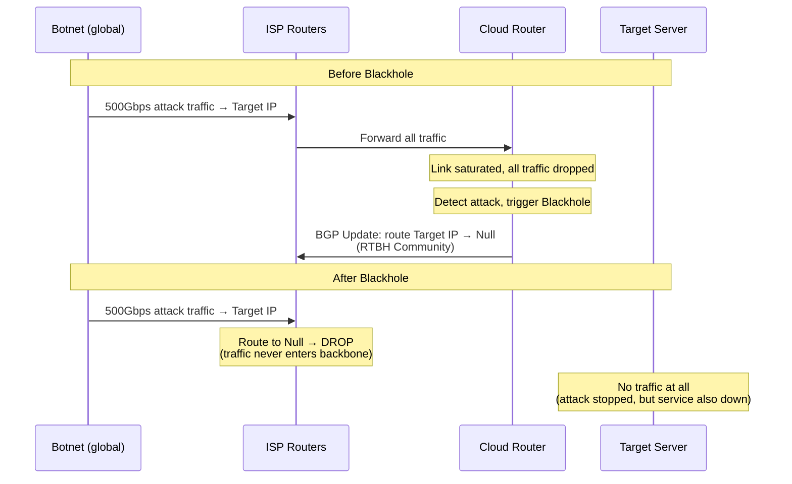
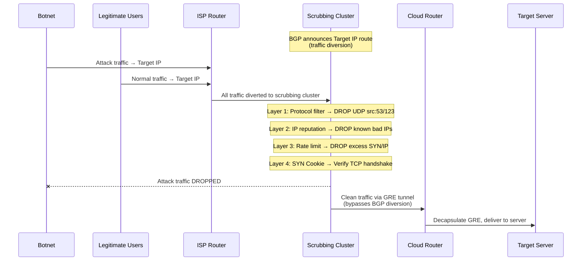
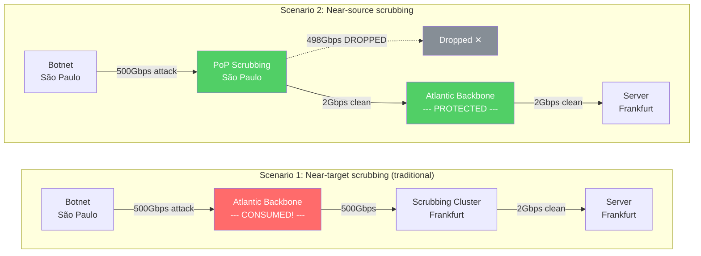

# 25. 洪水来袭：DDoS 防护

促销活动开始后的第 3 分钟，监控大屏上的入向流量曲线突然从 50Gbps 跳到了 500Gbps。

不是用户涌入，正常用户的流量增长是渐进的，不会在 30 秒内翻 10 倍。运维团队还没来得及反应，服务已经不可用了。不是服务器宕机，CPU 和内存都正常。是带宽被打满了：100Gbps 的链路被 500Gbps 的流量淹没，所有的包（攻击的和正常的）都在运营商的路由器上被丢弃。服务器甚至不知道自己正在被攻击，因为攻击流量根本没有到达它。

这就是 DDoS（Distributed Denial of Service，分布式拒绝服务攻击）。它不需要入侵系统，不需要破解密码，只需要向目标 IP 发送大量垃圾流量，把目标的带宽或处理能力耗尽。正常用户的请求被淹没在垃圾流量中，无法到达服务。粗暴，但有效。就像用洪水淹没一座城市，不需要攻破城墙，只需要水够多。

## 25.1 为什么你自己扛不住

面对 DDoS，最直觉的应对是什么？买更大的带宽，在服务器前面放一台硬件防火墙。

带宽从 10Gbps 升级到 100Gbps，防火墙的 PPS（Packets Per Second）处理能力从 500 万提升到 5000 万。这能扛住 50Gbps 的攻击。但扛不住 500Gbps 的，攻击者只需要多动员一些僵尸机，就能超过你升级后的上限。你升级到 200Gbps，攻击者动员更多设备打出 1Tbps。这是一场你永远赢不了的军备竞赛。

为什么赢不了？因为双方的资源结构根本不对称。

你这边：云服务器的带宽通常是 1-10Gbps，即使是专线接入也很少超过 100Gbps。一台服务器的 PPS 处理能力大约在 100 万-500 万 pps。Linux 内核默认的半连接队列只有几百到几千条。所有这些资源都是你花钱买的，每一 Gbps 都有成本。

攻击者那边：数十万台被感染的设备（IoT 摄像头、家用路由器、被入侵的服务器）组成僵尸网络（Botnet），总带宽可达 Tbps 级，总 PPS 可达数十亿。这些设备的带宽是别人的，攻击者不付费。在地下市场，发起一次 DDoS 攻击的价格可能只有几十美元。2023 年记录到的最大 DDoS 攻击峰值超过了 3.47 Tbps，这个数字是大多数企业总带宽的几百倍。

但更根本的问题不是带宽不够大。即使你买了 500Gbps 的带宽，攻击流量在到达你的防火墙之前，已经占满了运营商到你机房的链路。防火墙再强也没用，因为流量根本到不了它。这就像你在家门口放了一个保安，但洪水已经淹没了整条街，保安站在水里什么也做不了。

*DDoS 防护不是一个应用层问题，而是一个基础设施问题。只有拥有 Tbps 级带宽和全球分布式节点的基础设施，才有能力吸收这个量级的攻击流量。客户扛不住不是因为"不够努力"，而是物理上的不对称：你在用自己的钱对抗别人的钱。*

那么，拥有这种基础设施的云厂商，具体怎么防？要回答这个问题，先要理解攻击者的手法。不同类型的攻击，需要不同的防御策略。

## 25.2 攻击者的三种手法

DDoS 攻击的目标都是"让服务不可用"，但攻击网络栈的不同层次。理解这一点很重要，因为防御手段必须对症下药：挡住了带宽洪泛，挡不住连接耗尽；挡住了连接耗尽，挡不住应用层的慢攻击。

**第一种：流量型攻击（Volumetric），用垃圾流量填满链路。**

攻击者的目标是耗尽带宽。最直接的方式是动员僵尸机直接发送大量 UDP 包，但这需要僵尸网络本身有很大的总带宽。更聪明的方式是利用"放大效应"，用小流量触发大响应。

以 DNS 反射放大为例。攻击者向全球的开放 DNS 解析器发送查询请求，但把请求的源 IP 伪造成目标的 IP（UDP 协议不验证源 IP，伪造很容易）。DNS 解析器收到请求后，把响应发给"源 IP"，也就是目标。关键在于放大比：一个 60 字节的 DNS 查询（请求 ANY 类型记录）可以触发 3000 字节的响应，50 倍的放大。攻击者只需要发送 10Gbps 的查询流量，就能让 500Gbps 的响应流量涌向目标。

**图 25.1：DNS 反射放大攻击的原理**

```mermaid
sequenceDiagram
    participant Attacker as Attacker
    participant DNS1 as Open DNS Resolver 1
    participant DNS2 as Open DNS Resolver 2
    participant DNSn as Open DNS Resolver N...
    participant Target as Target Server

    Note over Attacker: Spoofed source IP = Target's IP
    Attacker->>DNS1: DNS Query (ANY) 60 bytes<br/>src: Target's IP
    Attacker->>DNS2: DNS Query (ANY) 60 bytes<br/>src: Target's IP
    Attacker->>DNSn: DNS Query (ANY) 60 bytes<br/>src: Target's IP

    DNS1-->>Target: DNS Response ~3000 bytes (50x amplification)
    DNS2-->>Target: DNS Response ~3000 bytes (50x amplification)
    DNSn-->>Target: DNS Response ~3000 bytes (50x amplification)

    Note over Target: Bandwidth saturated<br/>All traffic (including legitimate) dropped
```

DNS 不是唯一能被利用的协议。NTP 的 monlist 命令放大倍数可达 556 倍，Memcached 的 UDP 反射放大倍数甚至超过 50000 倍，攻击者总是在寻找放大倍数更高的协议。反射放大攻击的特征很明显：大量 UDP 响应包，源端口是特定的服务端口（53/DNS、123/NTP、11211/Memcached），目标从未请求过这些服务。这个特征为后面的防御提供了抓手。

**第二种：协议型攻击（Protocol），耗尽连接表而非带宽。**

流量型攻击需要巨大的带宽，协议型攻击不需要。最经典的是 SYN Flood。

回忆 TCP 三次握手：客户端发 SYN，服务器回 SYN-ACK 并在半连接队列（SYN Queue）中分配一条记录，等待客户端的 ACK。这个"先分配资源再验证"的设计，就是 SYN Flood 的攻击点。攻击者发送大量 SYN 包，但伪造源 IP，服务器的 SYN-ACK 发给了一个不存在的地址，ACK 永远不会来。每个伪造的 SYN 都让服务器白白分配一条半连接记录，直到超时（通常 60 秒）才释放。

攻击者每秒发送几百万个 SYN 包，服务器的半连接队列在几秒内被填满。队列满了之后，新的 SYN 包（包括正常用户的）被直接丢弃。正常用户看到的是"连接超时"。

SYN Flood 的"巧妙"之处在于它的经济性：每个 SYN 包只有 40-60 字节，几百万个 SYN 包的总带宽不过几百 Mbps。带宽上看起来毫无异常，但服务器的连接资源已经耗尽。流量型防御（基于带宽阈值的检测）对它视而不见。

**第三种：应用型攻击（Application），穿着正装走进来。**

攻击者发送完全正常的 HTTP 请求，完成了 TCP 握手，源 IP 是真实的，HTTP 格式合法。但请求的是计算密集型的接口，搜索、报表生成、复杂查询。每个请求和正常用户的请求没有区别，但 10 万个并发请求耗尽了服务器的 CPU 和数据库连接。这种攻击在四层（网络层/传输层）完全看不出异常，必须在七层（应用层）才能识别。本章聚焦前两种的防御，第三种留给下一章。

实际的 DDoS 攻击往往是三种类型的混合。攻击者先用流量型攻击消耗带宽，同时用 SYN Flood 耗尽连接表，再用应用型攻击消耗计算资源。防御必须是多层次的。

## 25.3 第一道防线：Blackhole，丢车保帅

知道了攻击的手法，来看防御。

最极端的情况先处理：500Gbps 的攻击流量已经把链路打满了，同一条链路上的其他客户也受到影响。这时候需要的不是"精细过滤"，而是"立刻止血"。

云厂商（或运营商）的做法是：在路由器上为被攻击的 IP 配置一条指向 Null 接口的路由。所有发往这个 IP 的流量，包括攻击流量和正常流量，都被路由器直接丢弃，不再转发。这就是 Blackhole 路由（黑洞路由）。

具体实现依赖 BGP。云厂商的路由器向上游运营商发送一条带有特殊 BGP Community 标记的路由更新（RTBH，Remote Triggered Black Hole）。上游运营商的路由器收到后，把目标 IP 的流量路由到 Null 接口。这条更新可以在几秒内传播到运营商网络的所有边缘路由器，攻击流量在进入骨干网之前就被丢弃了。

**图 25.2：Blackhole 路由的工作机制**

Blackhole 有效吗？有效，攻击流量不再占用链路带宽，同一链路上的其他服务恢复正常。但这里有一个让人不舒服的矛盾：攻击者的目标是让服务不可用，而 Blackhole 让被攻击的 IP 完全不可用。从结果上看，攻击者达到了目的。你"成功"地保护了基础设施，但被攻击的服务确实挂了。

*Blackhole 是"丢车保帅"，牺牲一个 IP 的可用性，换取其他服务的正常运行。它不是一个好的解决方案，而是没有更好方案时的最后手段。*

Blackhole 通常是自动触发的：攻击流量超过阈值，自动配置；攻击结束后，自动撤销。整个过程不需要人工干预，因为 DDoS 攻击的爆发速度远快于人类的反应速度。

但"全有或全无"显然不够。我们需要的是：只丢弃攻击流量，保留正常流量。这就需要一种能"分拣"的机制。

## 25.4 第二道防线：流量清洗，从洪水中捞出正常的包

流量清洗的思路是：不丢弃所有流量，而是把流量引到一个有足够处理能力的清洗集群，让它逐包分析，攻击包丢弃，正常包放行，然后把正常流量送回目标服务器。

这个过程分三步：牵引、清洗、回注。

**第一步：流量牵引（Traffic Diversion）。** 清洗集群通过 BGP 宣告被攻击 IP 的路由，把原本直接发往目标服务器的流量"牵引"到清洗集群。这和 Anycast 的原理类似，通过 BGP 宣告改变流量的路径。区别是 Anycast 是常态化的就近接入，流量牵引是攻击发生时的临时操作。

**第二步：清洗。** 清洗集群对牵引过来的流量进行多层过滤，每一层针对不同类型的攻击：

- **协议特征过滤**：丢弃所有源端口为 53 的 UDP 包（DNS 反射攻击的特征），丢弃源端口为 123 的 UDP 包（NTP 反射）。这一层直接对应 25.2 中流量型攻击的特征，反射放大的响应包有明确的端口指纹。
- **源 IP 信誉过滤**：已知的恶意 IP（来自威胁情报）直接丢弃，已知的合法 IP 直接放行。
- **速率限制**：限制单个源 IP 的 SYN 包速率。正常用户每秒发 1-2 个 SYN，攻击者每秒发几千个。超过阈值的 SYN 包被丢弃。
- **SYN Cookie 验证**：这是防御 SYN Flood 的核心机制，值得展开讲。

回忆 SYN Flood 的攻击原理：服务器收到 SYN 后分配半连接资源，伪造的 SYN 让服务器白白分配资源直到队列满。问题的根源是"先分配资源再验证"这个顺序。SYN Cookie 把顺序反过来：**先验证再分配资源**。

具体做法：清洗集群收到 SYN 时不分配任何资源。它把连接信息（对端 IP、端口、MSS、时间戳）编码进 SYN-ACK 的初始序列号（ISN）中，这个序列号就是"Cookie"。如果对端是真实的客户端，它会回复 ACK，ACK 中的确认号等于 ISN+1。清洗集群从确认号反推出连接信息，验证合法后才放行。如果对端是伪造的 IP，ACK 永远不会来，清洗集群没有分配任何资源，没有任何损失。

*SYN Cookie 用计算换内存，用 CPU 时间换连接表空间。无论攻击者发多少伪造的 SYN，清洗集群的资源消耗都是恒定的。*

**第三步：流量回注（Traffic Re-injection）。** 清洗后的正常流量需要送回目标服务器。但这里有一个陷阱：如果直接把流量发回目标 IP，这些流量会被 BGP 再次牵引到清洗集群，形成环路。

解决方案是 GRE 隧道。清洗集群把正常流量封装在 GRE 隧道中，直接送到目标服务器所在的路由器。路由器解封装后把流量交给服务器。GRE 隧道的目的 IP 是路由器的隧道接口 IP（不是被攻击的 IP），不会触发 BGP 牵引。

**图 25.3：流量清洗的完整链路**

流量清洗有延迟代价：流量被牵引到清洗集群再回注，多了一段路径，通常增加 1-5ms。这是可用性和安全性的权衡，多几毫秒延迟，换取服务不中断。

和 Blackhole 相比，本质区别是什么？Blackhole 是"全部丢弃"，简单但粗暴，服务不可用。流量清洗是"分拣后丢弃"，复杂但精细，服务保持可用。代价是需要一个有足够带宽和处理能力的清洗集群：它必须能吞下全部攻击流量（几百 Gbps），然后从中挑出正常流量（可能只有几 Gbps）。

这就引出了下一个问题：清洗集群部署在哪里？

## 25.5 清洗集群的位置：近源 vs 近目标

如果清洗集群部署在目标 Region 附近（比如法兰克福），攻击流量从全球汇聚到法兰克福的过程中，已经占用了骨干网的带宽。500Gbps 的攻击流量穿越大西洋到达法兰克福，即使在法兰克福被清洗掉了，大西洋的海底光缆已经承受了 500Gbps 的额外负载。骨干网的带宽是有限且昂贵的，攻击流量虽然被清洗了，但传输成本已经产生，而且如果攻击流量超过骨干网容量，清洗集群根本收不到完整的流量。

问题的根源是：清洗发生得太晚，攻击流量已经走完了大部分路径。

换一个思路。攻击者的僵尸机分布在全球各地，圣保罗有一批，东京有一批，伦敦有一批。如果在每个主要地区的 PoP 节点上部署清洗能力，攻击流量在进入骨干网之前就被过滤呢？圣保罗的僵尸机发出的攻击流量在圣保罗的 PoP 就被清洗，根本不会占用圣保罗到法兰克福的骨干网带宽。

这就是近源清洗，在攻击流量的来源附近就把它消灭。

**图 25.4：近源清洗 vs 近目标清洗**

> 对比：近目标清洗方案中，500Gbps 攻击流量穿越大西洋骨干网才被清洗，骨干网带宽已被消耗殆尽；近源清洗方案中，攻击流量在圣保罗 PoP 就被过滤，骨干网只承载 2Gbps 的正常流量，带宽得到保护。

近源清洗的优势很明显：骨干网带宽不被攻击流量消耗；清洗延迟更低；攻击流量被分散到多个 PoP，单个清洗节点的压力更小。

但近源清洗的前提是：你在全球有足够多的 PoP，每个 PoP 都有清洗能力。这正是大型云厂商的基础设施优势。它们本来就为全球加速部署了几十到上百个 PoP，在这些 PoP 上叠加清洗能力，边际成本远低于从零建设。

实际的部署是分层的。PoP 节点做第一层过滤（反射放大、已知恶意 IP，这些特征明确、判断简单的攻击），区域清洗中心做第二层（SYN Flood、混合攻击，需要更复杂的状态跟踪），目标 Region 做最后一层精细过滤（速率限制、SYN Cookie）。三层逐级递进，每一层过滤掉一部分攻击流量，到达源站的几乎全是正常流量。

这里有一个有趣的协同效应。Anycast 本来是为全球加速设计的，同一个 IP 从多个 PoP 宣告，BGP 自动把流量送到最近的 PoP。在 DDoS 防护场景中，这个特性天然地把攻击流量分散到全球多个 PoP：圣保罗的僵尸机打到圣保罗的 PoP，东京的僵尸机打到东京的 PoP，没有任何单个 PoP 需要承受全部攻击流量。一个为加速设计的机制，在安全场景中找到了第二个用途。工程中这种"意外的协同"并不少见。

## 25.6 四层防护的边界

Blackhole + 流量清洗 + 近源清洗，这套体系能有效抵御流量型和协议型攻击。流量型攻击（反射放大）通过协议特征过滤解决，源端口 53/123/11211 的 UDP 包直接丢弃。协议型攻击（SYN Flood）通过 SYN Cookie 和速率限制解决，伪造的 SYN 无法通过验证。

这两种攻击有一个共同特征：在网络层/传输层就有明显的异常指纹。异常的包速率、特定的端口模式、伪造的源 IP，清洗集群通过分析四层包头就能识别它们。

但如果攻击者不伪造源 IP，不发畸形包，而是用海量僵尸机各自发送完全合法的 HTTP 请求呢？TCP 握手完整，HTTP 格式合法，每个 IP 的速率远低于阈值。清洗集群在四层看不出任何异常，但后端服务已经被压垮了。

*四层防护看包头，看速率，看协议行为。它能识别"洪水"，但识别不了"穿着正装走进来的攻击者"。从带宽耗尽到连接耗尽再到计算资源耗尽，防护的粒度必须越来越细。*
