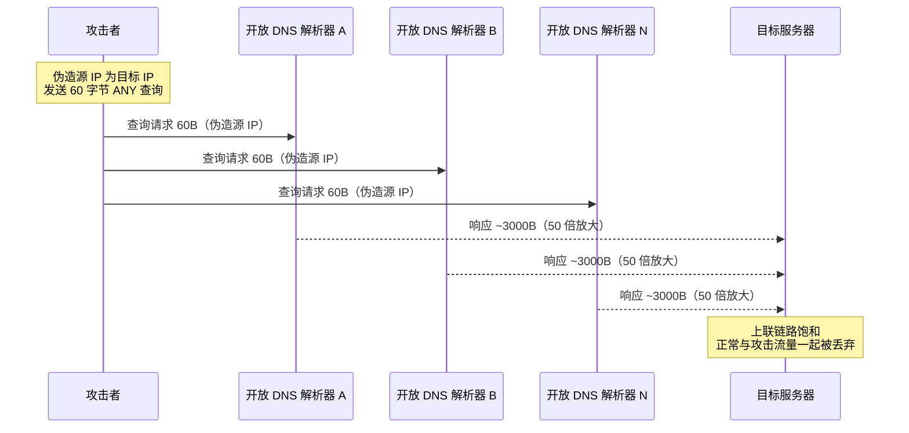
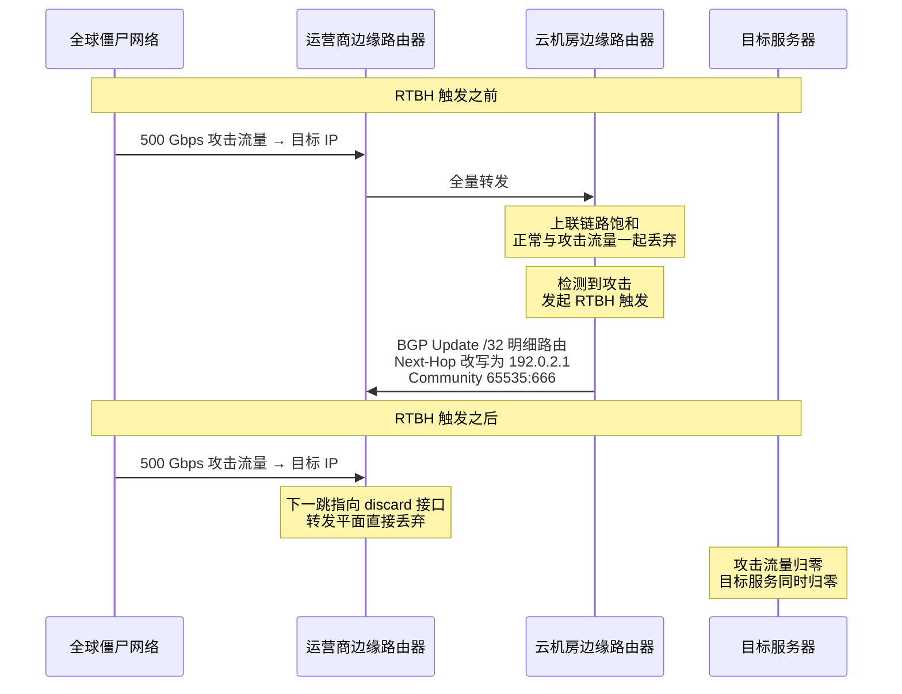
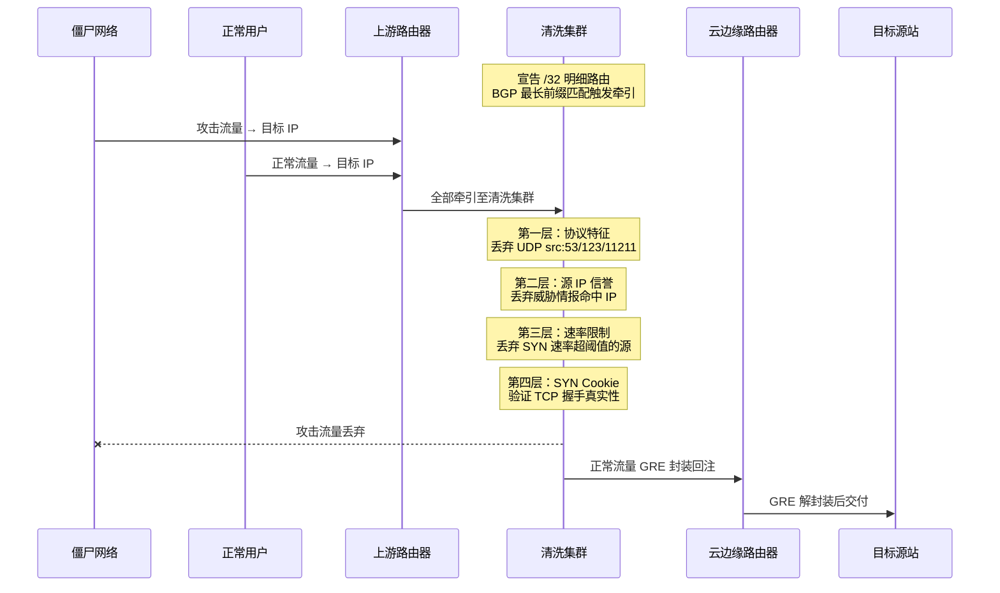
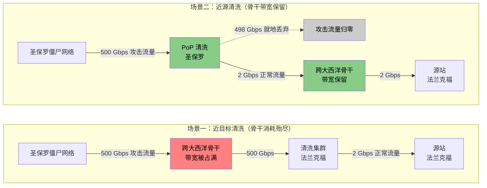

# 26. 洪水来袭：DDoS 防护

Anycast IP 在全球 BGP 表里都是可达的，边缘节点的 80、443 端口对所有请求敞开，CDN 为了保证命中率把副本推到几百个公网可触达的位置。这些让正常用户享受到 5 毫秒接入延迟的机制，也无可避免地将敞开的网络攻击面交到了攻击者面前。

真正将这一风险放大到极致的，是分布式拒绝服务攻击（Distributed Denial of Service，DDoS）。它不需要突破身份验证，也不需要挖掘任何一个软件漏洞，只需要向目标 IP 发送足够多的垃圾流量，把带宽或连接资源耗尽，正常用户就会被淹没在洪水中。在云网络演进到全球边缘的今天，这种最古老的攻击手法反而变得更棘手：几百个边缘节点意味着几百个可能被打的入口，任意一个入口被打垮，最近接入的那部分用户就直接失去服务。

## 26.1 单点扛不住 DDoS 的根本原因

面对一次流量陡增到 500 Gbps 的攻击，最直觉的应对是给服务器前置一台更大的防火墙、把上联带宽从 10 Gbps 升级到 100 Gbps。这种单点堆硬件的思路行不通，不是因为工程实施难度，而是因为双方的资源结构从根本上不对称。

一台常规云服务器的上联带宽通常在 1 到 10 Gbps 之间，即使专线接入也很少超过 100 Gbps，单机 PPS（Packets Per Second）处理能力大约在几十万到几百万。这些资源每一 Gbps、每一百万 PPS 都对应真实的机架、光模块与硬件预算。而攻击者调动的是由被入侵的 IoT 摄像头、家用路由器、云主机构成的僵尸网络（Botnet），单个僵尸网络的规模可以达到几十万到上百万台设备，聚合带宽轻松突破 Tbps，聚合 PPS 达到数十亿。这些设备的带宽费用由设备所有者承担，攻击者本人的成本可能低到地下市场几十美元一次的租用价。2018 年针对 GitHub 的 Memcached 反射攻击峰值达到 1.35 Tbps，2023 年 Cloudflare 与 Google 公开的 HTTP/2 Rapid Reset 攻击峰值超过 3.47 Tbps 与 3.98 亿 RPS。企业侧的投入以亿计，攻击者的成本却低至百元，攻防两侧的投入产出曲线注定加速分化。

哪怕真的把带宽升级到 500 Gbps，问题也没有解决。攻击流量在到达机房出口之前，已经把上游运营商到机房的接入链路填满。防火墙位于机房内部，此时无论其处理能力多强都无从发挥，因为需要它过滤的包压根没有进入机房。这就是 DDoS 防护绕不开的物理事实：单点上任何加固都无法解决链路层被填满的问题，防护必须发生在流量还在骨干网、还在多个地域分散的时候。

DDoS 防护从一开始就不是一个终端问题，而是一个基础设施问题。只有拥有 Tbps 级骨干带宽和全球分布式清洗节点的运营方，才具备把这个量级的洪水在骨干层面吸收掉的物理条件。理解了这一点，才能理解为什么 DDoS 防护天然是云厂商与骨干运营商的能力，而不是任何一个客户可以靠采购防火墙自建起来的。

不同的攻击手法对应不同的防御机制，接下来先把攻击方式讲清楚，再看云厂商在骨干层与边缘层如何逐级处理。

## 26.2 三类攻击的手法与指纹

DDoS 攻击的共同目标是让服务不可用，但作用的协议层次不同，可识别的指纹也不同。业界通常把它划分为流量型、协议型、应用型三类。

流量型攻击（Volumetric）针对的是带宽本身。最直接的做法是让僵尸机直接发送 UDP 包塞满链路，但这种做法要求僵尸网络本身有足够的聚合带宽。更经济的做法是利用协议的放大特性，用小流量触发大响应，让第三方基础设施帮攻击者放大流量。

DNS 反射放大是最典型的例子。UDP 协议本身不对源 IP 做任何验证，攻击者把请求源 IP 伪造成目标地址，向全球开放的 DNS 递归解析器发送查询请求。DNS 解析器把响应发送给伪造的源 IP，也就是被攻击的目标。放大比例来自于请求和响应的字节数差异：一个 60 字节的 DNS ANY 查询能触发几千字节的响应，放大倍数约为 50 倍。攻击者只需要 10 Gbps 的对外发包能力，就能让 500 Gbps 的响应洪水汇聚到目标。

**图 26.1：DNS 反射放大攻击的原理**

DNS 之外，NTP 的 monlist 命令放大倍数可达 556 倍，Memcached 的 UDP 反射由于 stats 命令返回的数据可达几十 KB，放大倍数一度超过 50000 倍。2018 年针对 GitHub 的 1.35 Tbps 攻击，正是攻击者扫描到大量默认开放 UDP 11211 端口且无认证的公网 Memcached 实例后利用的。反射放大能大规模泛滥，根本原因是 BCP38 与 uRPF（源地址过滤策略）并没有被全球运营商普遍部署，任何一台服务器都可以从自己的接入网络发出源 IP 不属于本网段的包，源伪造在互联网上仍然是一件低成本的事。

反射放大的流量特征非常明确：大量 UDP 响应包，源端口固定为 53、123、11211 等公共服务端口，目标从未主动请求过这些服务。这个指纹为后面的清洗规则提供了直接抓手。

协议型攻击（Protocol）针对的是连接资源。它不需要巨大的带宽，转而利用协议本身的握手设计缺陷把服务器的连接表填满。最典型的是 SYN Flood。

TCP 三次握手的第一步，服务器收到 SYN 后会在半连接队列（SYN Queue）里预先分配一条记录，保存对端 IP、端口、初始序列号、协商的 MSS 与 TCP 选项，然后回 SYN-ACK 等待客户端的 ACK。这条记录会占用内核的一小段内存，并在半连接队列里保留几十秒直到超时释放。攻击者利用这个"先分配再验证"的顺序，用伪造源 IP 发送海量 SYN 包。服务器把 SYN-ACK 发往不存在的地址，ACK 永远不会回来，半连接记录白白占用直到超时。攻击者每秒送几百万个 SYN，服务器的半连接队列在几秒内被填满，新到达的 SYN 包（包括正常用户的）被直接丢弃。

SYN Flood 的极高威胁在于其低成本、高毁伤的攻击性价比。每个 SYN 包只有 40 到 60 字节，几百万 SYN 每秒的总带宽不过几百 Mbps，任何基于带宽阈值的告警都察觉不到异常，但服务器的连接资源已经耗尽。这是流量型防御无法覆盖的盲区。

应用型攻击（Application）作用在 HTTP 应用层。攻击者完成完整的 TCP 三次握手，完成 TLS 握手，源 IP 是真实的家宽或云主机，HTTP 请求格式完全合法，但请求的是搜索、报表、复杂查询这种计算密集或数据库密集的接口。四层看这些包和正常用户的包毫无区别，包速率、连接数、包大小都在阈值内，但后端服务的 CPU 与数据库连接池会被压垮。这类攻击必须在应用层才能识别，是本章之后 WAF 与应用防护要处理的问题，本章聚焦前两类。

真实的 DDoS 攻击通常是三类的混合。攻击者先用流量型攻击填满带宽制造混乱，同时用协议型攻击耗尽连接表，再让一部分僵尸机发起应用型攻击消耗计算资源。这种混合结构决定了防御必须是多层的，任何单一手段都会有对应的盲区。

## 26.3 骨干层的止损手段：Blackhole 路由

先看最极端的情况：500 Gbps 攻击流量已经把接入链路填满，同一条骨干链路上还有其他客户的流量在共享这个通道，所有租户都在受影响。这时候的首要任务不是精细过滤，而是立刻把这条链路上的洪水止住。

云厂商与运营商的应急手段是把被攻击的 IP 从整个骨干路由表里抹掉。具体做法是在上游运营商的边缘路由器上，把这个 IP 的下一跳（Next-Hop）改写成一个不可达地址，业界惯例是使用 RFC 5737 定义的 TEST-NET 段中的 `192.0.2.1`，或者运营商内部约定的 discard/blackhole 地址。路由器在做转发查表时，发现下一跳无法解析或指向 `Null0`/`discard` 接口，会在转发平面直接丢弃匹配的包。攻击流量在进入运营商骨干之前就被吸收掉了，不再消耗下游链路带宽，同链路上其他租户的服务恢复正常。

这套机制的触发通过 BGP 协议完成。云厂商向上游运营商发送一条 /32 的明细路由更新，携带 RFC 7999 规定的 Blackhole Community（`65535:666`）作为触发信号。上游路由器收到后，识别出这个 Community，把匹配路由的下一跳改写为本地约定的 discard 地址。这条更新在几秒内通过 BGP 传播到运营商网络的所有边缘路由器，全球范围内发往这个 IP 的攻击流量在离攻击者最近的路由器上就被丢弃，根本没有机会进入骨干核心。这就是 RTBH（Remote Triggered Black Hole，远程触发黑洞路由）。

**图 26.2：RTBH 触发前后的转发路径变化**

RTBH 是有效的止血手段，但代价明显：被攻击的 IP 完全不可达。攻击者最初的目的就是让这个服务不可用，RTBH 从结果上完成了攻击者的目标，只是把决定权从攻击者手里收回到了防护方手里，用一个 IP 的可用性交换了同链路其他服务的可用性和骨干带宽资源。这是一种典型的丢车保帅，是在没有更精细的机制或更精细机制来不及生效时的最后手段，不是一个可以长期存在的方案。

RTBH 的触发和撤销通常都是自动化的：流量超过预设阈值时几秒内触发，攻击平息后按窗口自动撤销。DDoS 的爆发和收敛速度都远超人工响应，任何依赖人工审批的方案在这里都跟不上节奏。

有了骨干层的应急止血机制，下一步的问题是如何做到只丢攻击流量、保留正常流量。这需要一个能对每个包做逐包判断的机制。

## 26.4 流量清洗：从洪水里捞出正常包

流量清洗的思路是把匹配被攻击 IP 的流量牵引到一个具备 Tbps 级处理能力的清洗集群，让清洗集群逐包分析：攻击包按规则丢弃，正常包按原路径回注给目标服务器。整个过程分成牵引、清洗、回注三个阶段。

牵引阶段的核心是 BGP 明细路由。正常状态下，源站的 IP 段以较粗的 /24 或更大网段在全网广播，正常流量按最短路径直达源站。攻击发生时，清洗集群向上游宣告一条 /32 的明细路由，根据 BGP 的最长前缀匹配规则，所有发往被攻击 IP 的流量都会被优先送到清洗集群，粗网段路由被明细路由局部覆盖。这一过程在工程上被称为流量牵引（Traffic Diversion）。传统的粗粒度牵引以 /32 或 /24 为单位，现代做法还可以走 BGP FlowSpec（RFC 5575/8955），把匹配条件细化到端口、协议、包长、TCP 标志位，只把匹配特征的攻击流量牵引走，正常流量继续走原路径，避免了牵引窗口内所有流量都要绕行清洗集群带来的额外延迟。BGP FlowSpec 的部署门槛在于上游运营商是否接受这类精细化路由策略，目前主要在一线云厂商与大型运营商之间落地。

牵引发生的瞬间会有 BGP 收敛延迟，路由更新在全球范围内完全生效通常需要几十秒到几分钟，这个窗口内会出现短暂的路径抖动与丢包。工程上会通过预置牵引路由、部分节点常态化牵引（always-on scrubbing）等方式减小这段抖动窗口的影响。

清洗阶段是分层过滤，每一层针对不同类型的攻击特征。

第一层是协议特征过滤。源端口为 53、123、11211 的 UDP 响应包，如果目标从未主动发起过对应的查询，直接判定为反射放大攻击流量丢弃。这一层规则简单、状态开销极低，可以在硬件转发平面或 XDP 里直接完成，达到线速级别的处理性能。

第二层是源 IP 信誉。已知的恶意 IP（来自威胁情报库、历史攻击样本、蜜罐捕获）直接丢弃，已知的合法大流量来源（搜索引擎爬虫、监控探针）直接放行。信誉库通常按分钟级更新，同时接收全球各清洗节点上报的可疑 IP 做协同。

第三层是速率限制。正常用户每秒发起 1 到 2 个新连接，攻击者的僵尸机每秒发几千个 SYN，两者行为差异极大。清洗集群按源 IP 维度做 SYN 包速率限制，超过阈值直接丢弃。这一层能过滤掉不伪造源 IP 的 SYN Flood，但对源 IP 完全伪造的攻击帮助有限，因为每个包看起来都来自不同的 IP。

第四层是 SYN Cookie，这是 SYN Flood 防御的核心机制，也是清洗集群面对协议型攻击最重要的武器。它的思路是把先分配资源再验证这个顺序反过来，改成先验证再分配资源。清洗集群收到 SYN 时不分配任何连接表项，也不占用半连接队列，而是把连接的关键信息通过哈希函数编码进 SYN-ACK 的初始序列号（ISN，Initial Sequence Number）里，这个 ISN 就是 cookie。

Linux 内核 `syncookies.c` 里 ISN 的 32 位切分是这样的：高 5 位是时间戳计数器，每 64 秒递增一次，用来给 cookie 定一个几分钟的有效窗口；中间 3 位是 MSS 索引，指向一张预定义的 8 条目 MSS 表，让服务器在没有连接表项的情况下也能还原出协商的 MSS；低 24 位是 MAC，等于 `SHA1(saddr, sport, daddr, dport, timestamp_counter, server_secret)` 的截断。当伪造 SYN 的攻击者收到 SYN-ACK 却不回 ACK 时，服务器没有分配任何资源，也没有任何损失；只有当真实客户端回来的 ACK 里带着 `cookie + 1` 的确认号时，服务器才能反推出连接信息并重新分配连接表项，把这条连接推进到 ESTABLISHED 状态。

这套机制有一个代价：ISN 只有 32 位，除了 5 + 3 + 24 位承载的必要信息，剩下没有空间去编码 TCP 选项。Window Scale（窗口缩放）、SACK（选择性确认）、Timestamp（时间戳）等 SYN 阶段协商的扩展选项在 SYN Cookie 触发时会被丢失。Window Scale 丢失意味着 TCP 窗口大小被限制在 64 KB 以内，高时延高带宽的长胖网络场景（LFN，Long Fat Network）其吞吐会受到显著限制。正因为这个副作用，SYN Cookie 在生产环境并不是常态开启，而是只在半连接队列快满时才启用。Linux 提供了三种模式：`net.ipv4.tcp_syncookies=0` 完全关闭；`=1` 是默认值，队列快满时自动启用作为兜底；`=2` 无条件开启，用于清洗集群这类明确处于攻击场景下的节点。

**图 26.3：流量清洗的完整链路与四层过滤**

清洗完成后的正常流量不能直接按原目标 IP 转发，否则这批流量会在 BGP 牵引路由下再次被吸回清洗集群，陷入无穷的路由环路。工程上的解法是采用 GRE 隧道封装（IP 协议号 47）：清洗集群把清洗后的正常流量装入 GRE 报文，将外层目的 IP 指定为目标机房路由器的隧道接口地址。由于外层目的地址不再是被攻击的业务 IP，该报文能顺利穿透牵引路由；目标路由器接收后剥掉 GRE 头，把内层原始数据包交付给最终的目标服务器。

这种隧道封装虽然破解了环路危机，但也引入了两个需要工程侧配合处理的衍生问题。其一是报文头开销带来的 **MTU 缩水**：外层 IP 头 20 字节叠加 GRE 头 24 字节后，可用载荷从 1500 字节被挤压至 1476 字节，大包回源时极易触发 IP 分片，需要源站配合调小 MSS 或开启 PMTUD。其二是**客户端真实 IP 的保留**：虽然 GRE 封装本身保留了原始 IP 头的源地址，但若清洗集群同时承担 L4 代理功能，源 IP 就会被代理替换；此时需要借助 TOA（TCP Option Address）在内核层恢复原始 IP，或通过 Proxy Protocol v1/v2 在应用层解析。云厂商的高防产品通常会同时支持这两种透传机制，由业务侧按自身的接入形态选择。

流量清洗有代价，路径多了牵引和回注两跳，通常增加 1 到 5 毫秒的延迟，同时清洗集群本身要具备吞下全部攻击流量、再从中挑出正常流量的处理能力，这本身就是几百 Gbps 到 Tbps 级的算力投入。清洗侧的转发面通常构建在 DPDK 或 XDP 之上，绕开内核协议栈，让单机稳定跑到几十 Gbps 甚至上百 Gbps，规则匹配部分则借助 P4 可编程交换机或 FPGA 在硬件层完成。

相较于 RTBH 的一刀切，流量清洗保住了服务的可用性，代价是几毫秒延迟与骨干上一次绕行。剩下的问题是：这个清洗集群应该放在哪里。

## 26.5 清洗节点的位置：近源与分层清洗

自然的想法是把清洗集群部署在目标 Region 附近，比如源站在法兰克福，清洗集群也放在法兰克福。这样的部署简单直接，攻击流量最终汇聚到法兰克福，清洗集群一次性把它吃掉。但这个方案有个致命的问题：500 Gbps 攻击流量从全球僵尸机汇聚到法兰克福的过程中，已经跨越了大西洋、地中海、印度洋的骨干光缆。骨干带宽本身是稀缺且昂贵的资源，攻击流量虽然在法兰克福被清洗掉了，但骨干链路已经承受了 500 Gbps 的额外负载，正常的跨地域业务流量在这段窗口里会挤在被攻击流量填满的通道里。更糟糕的是，如果攻击规模超过跨洋骨干的可用带宽，清洗集群根本收不到完整的攻击流量，因为大部分包在骨干上就已经被丢弃了，无法真正做出清洗决策。

问题的根源是清洗发生得太晚。攻击流量的路径分成"僵尸机 → 各地骨干 → 目标 Region"，清洗越靠后，占用的骨干越多。反过来，如果每个主要地理位置的 PoP 节点上都具备清洗能力，圣保罗僵尸机发出的攻击流量在圣保罗 PoP 就被过滤，东京僵尸机发出的攻击流量在东京 PoP 就被过滤，攻击流量根本不进入跨地域骨干。这就是近源清洗（scrubbing at the source）。

**图 26.4：近源清洗与近目标清洗的骨干带宽消耗对比**

近源清洗的三个直接收益是：骨干带宽不被攻击流量消耗；清洗过程离攻击源更近，延迟更低；攻击流量按来源天然分散到全球几十个 PoP，单个清洗节点承受的压力是全量攻击的几十分之一。

近源清洗的前提条件是全球有足够密集的 PoP，并且每个 PoP 都具备清洗能力。这正是第 24 章讨论的全球加速基础设施的天然叠加价值。云厂商为 Anycast 与全球加速已经在全球部署了几十到上百个 PoP，在这些节点上叠加清洗能力，边际成本远低于从零建设专门的清洗网络。Anycast 本身还带来一个副产品：同一个 IP 从多个 PoP 宣告，BGP 天然把攻击流量按拓扑就近分散到多个 PoP，攻击者无法主动选择要打哪一个节点。这让整个 Anycast + 分布式清洗的架构，具备了一种攻击者无法定向、防御方总承载能力等于所有 PoP 清洗容量之和的结构优势。反过来，同一个僵尸网络的攻击特征被打散到多个 PoP 上，单个 PoP 看到的样本可能不足以判定攻击类型，因此现代 DDoS 平台都需要一套跨 PoP 的特征汇总与协同决策机制，把各节点上报的可疑源 IP、异常包速率、协议指纹在秒级汇合，形成全局视图。

生产环境的清洗部署通常是分层的。PoP 节点做第一层过滤，处理反射放大、威胁情报命中、明显异常速率等判断简单、可以在硬件转发平面完成的动作。区域清洗中心做第二层，负责需要状态跟踪的攻击类型，比如 SYN Cookie、TCP 握手校验、复杂协议特征，这一层的算力比 PoP 更集中。目标 Region 做第三层，处理速率限制、连接数限制等靠近源站的精细过滤。三层逐级递进，每一层过滤掉当前能识别的部分，到达源站的流量已经几乎全部是正常请求。

对流量与检测的可视化则依赖 sFlow 与 NetFlow。这两种协议按 1/1000 或 1/4096 的采样率把路由器转发平面上的包头信息上报给检测系统，检测系统在采样数据上运行异常检测算法（EWMA 滑动均值、时间窗内的源 IP 集中度、包大小分布突变等），一旦触发阈值就通知牵引与清洗系统。采样带来的代价是低速率攻击可能在采样窗内被漏掉，因此对高价值资产会叠加逐包检测（inline detection），代价是每台探测节点的处理能力必须匹配业务流量。

## 26.6 骨干与传输层防护的边界

RTBH 处理紧急止损，流量清洗做逐包过滤，近源分层清洗把攻击拦在离攻击者最近的节点。这套体系覆盖了流量型与协议型攻击的绝大多数场景：反射放大有明确的源端口指纹，SYN Flood 有 SYN Cookie 兜底，畸形包和源 IP 伪造有信誉库和速率限制。

云厂商把这些能力打包成不同形态的产品对外提供。Cloudflare Magic Transit 通过 GRE 隧道把客户源站的整段公网 IP 段接入 Cloudflare 的 Anycast 清洗网络，本质上是把用户的 /24 或更大网段托管给 Cloudflare，享受全球分布式清洗。AWS Shield Advanced 是绑定在 Route 53、CloudFront、Global Accelerator、ELB 等 AWS 原生服务上的增强防护，深度整合 AWS 骨干网。阿里云、腾讯云的高防 IP 则采用代理式接入，客户把域名或业务 IP 指向高防 IP，攻击流量在高防节点被清洗后回源到真实源站。三种形态背后的核心机制都是 Anycast + 分布式清洗 + BGP 牵引 + GRE 回注，差异主要在接入方式、计费模型（按峰值 vs 按弹性）、以及与自家其他服务的整合深度。

这套骨干与传输层的防护有一个明确的能力边界。它能识别的攻击都有一个共同特征：在网络层或传输层就存在明显的异常指纹，包速率异常、端口特征异常、协议行为异常、源 IP 伪造。清洗集群靠分析四层包头就能做出判断。

但当攻击者不再伪造源 IP，不再发畸形包，而是让海量真实的僵尸机各自发出完全合法的 HTTP 请求，四层看到的每一个包都是正常包，包速率在阈值内，源 IP 是真实的家宽或云主机，TCP 握手完整，TLS 证书校验通过，HTTP Header 与 Method 都符合规范。这类攻击在传输层看不出任何异常，但后端服务的搜索、报表、复杂查询接口已经被压垮。

从流量耗尽到连接耗尽再到计算耗尽，防护粒度必须从骨干一路细到业务语义。这就是 Web 应用防火墙要处理的问题。
