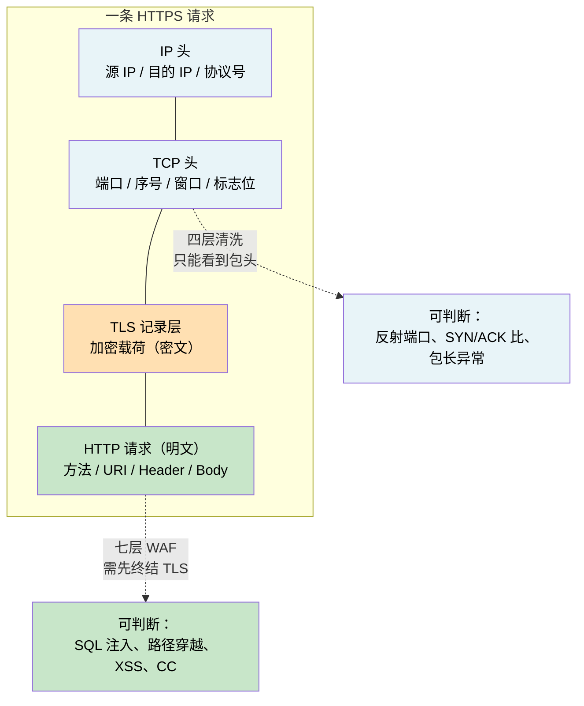
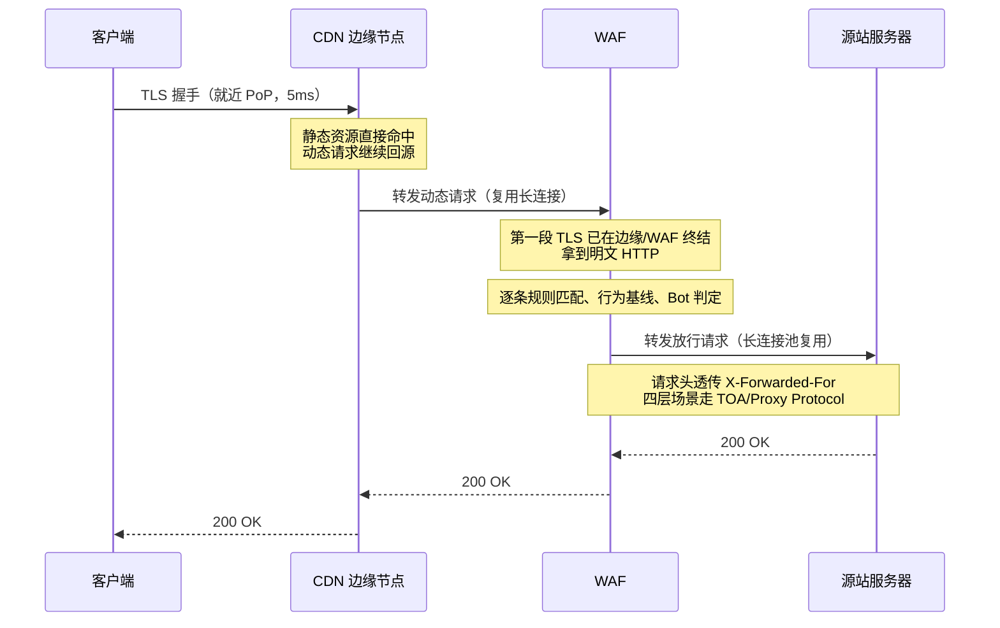
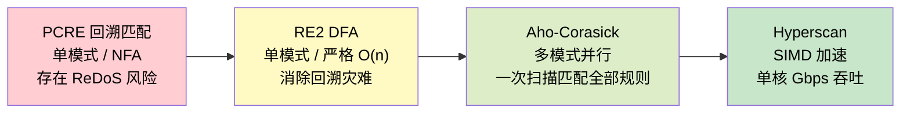
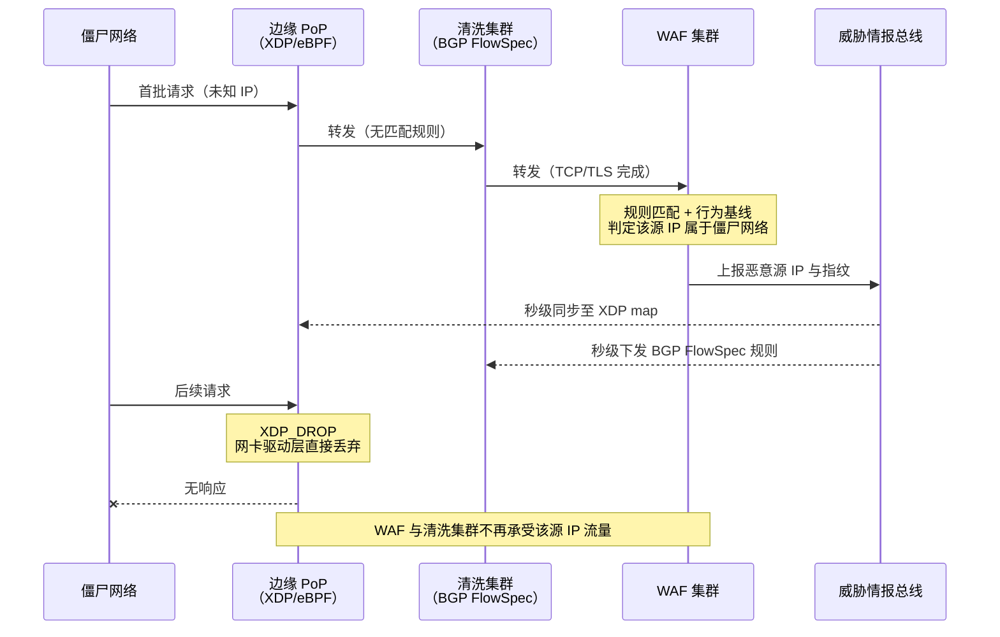

# 27. 伪装成正常请求的攻击：WAF 与应用层防护

第 26 章的防线从骨干网一路收紧到四层协议栈，三四层的攻击面已被压到极窄。当流量型与协议型攻击相继失效，攻击者面前只剩一条路径：让每一个包在四层都长得和正常用户毫无区别。

TCP 握手完整，TLS 证书校验通过，源 IP 是真实的家宽或云主机，HTTP Header 与 Method 合规，请求 URI 也是网站真实存在的接口。清洗集群看到的是几百万条完全合法的连接，包速率在阈值内，端口和协议行为正常。但每一条连接背后，请求的都是搜索、报表、复杂查询这种打到数据库的接口，或者携带着能触发 SQL 注入、路径穿越、跨站脚本的载荷。恶意不在包头，也不在流量特征，而在请求内容本身。

要在这一层挡住攻击，必须让防护设备真的读懂 HTTP。这条路径带来了一整套新的工程约束：TLS 必须被终结，请求体必须被解析，每一个字节都要过一遍规则匹配。这些处理必须在几十万甚至几百万 QPS 的高并发吞吐下完成，同时不能带来用户可感知的额外延迟。围绕这一层约束展开的机制，就是本章要讨论的应用层防护（Application Layer Protection）。

## 27.1 四层看不见的攻击面

四层清洗集群看到的是 IP 头与 TCP 头。源目 IP、端口、协议、序号、窗口、标志位，就这几十个字节的固定结构。它能识别的一切异常都必须落在这些字段里：源端口 53 却送来 UDP 大响应（反射放大）、SYN 与 ACK 数量严重失衡（SYN Flood）、包长和协议标准不符（畸形包）。这些特征稳定、结构化、可以在 XDP 或 P4 硬件转发平面里线速匹配。

一旦攻击者不再触碰这些字段，四层就彻底失明。攻击者可以在正常家宽和被入侵的云主机上发起完整的 TCP 三次握手，让 SYN 与 ACK 计数完全平衡；可以按 RFC 7230 的字节序拼装 HTTP 请求，让协议解析器无话可说；可以携带一个合法的 TLS Client Hello，让证书校验一路走完。此时清洗集群的每一层检测都会给出正常的判断，因为它压根不懂应用层信息。

真正的攻击意图被完整封印在 TLS 加密载荷之中。`GET /search?q=shoes` 与 `GET /user?id=1' OR 1=1--` 在四层完全一样，同样的目的 IP、同样的目的端口 443、同样的 TCP 载荷长度分布。前者是一次商品搜索，后者是一次 SQL 注入尝试；载荷里 `../../etc/passwd` 是路径穿越，`` 是 XSS，海量并发的 `/search?q=xxx` 是把数据库连接池耗尽的 CC 攻击。这些攻击有一个共同点：只有把 TLS 解开、把 HTTP 请求解析出来，才有机会看到它们的形状。

**图 27.1：四层与七层的可见范围差距**

四层的盲区不是能不能补的问题，而是根本没有原料。要看到应用层，必须走到能把 TLS 终结、能按 HTTP 语义解析请求的位置。这个位置就是 Web 应用防火墙（Web Application Firewall，WAF）。它不是清洗集群的替代品，而是清洗完成之后的下一层过滤，专门处理四层留下的语义盲区。

## 27.2 WAF 的位置：反向代理与 TLS 终结的算力代价

WAF 要看到请求内容，必须让 TLS 在 WAF 上终结。这是一个绕不开的事实：现代 Web 流量几乎全部走 HTTPS，如果 WAF 只是旁路镜像流量，看到的将是一堆无法解析的密文。TLS 的设计初衷就是让中间设备无法窥探数据，唯一能拿到明文的方式，是持有服务器证书、在 WAF 上完成完整的 TLS 握手、把加密流转成明文流。这决定了 WAF 只能以反向代理的形态存在。

流量路径因此被切成两段：客户端到 WAF 建立一条 TLS 连接，WAF 到源站再建立一条独立连接。客户端以为自己在与源站握手，实际上握手对端是 WAF；源站看到的连接来自 WAF 的出口 IP，而不是终端用户。WAF 必须持有源站的证书才能让第一段握手成功，这意味着证书管理成为架构的一部分，客户上传证书并托管在 WAF 侧，或者由云厂商代签发（AWS Certificate Manager、阿里云 SSL 证书服务、Cloudflare Universal SSL 都是这条路径），证书的私钥被云厂商的 KMS 或 HSM 保护，WAF 进程通过受控接口使用私钥进行签名与解密，但拿不到私钥本身的字节。

至于 WAF 到源站的第二段连接，系统不会为每个请求重新建连，而是直接复用第 25 章讲过的长连接池：几十条 TCP + TLS 连接常驻并维持 keepalive 存活，用户请求通过 WAF 检测后，直接从池里挑一条空闲连接转发。由于代理机制会导致源站看到的连接都来自 WAF 出口 IP，客户端真实 IP 会通过 X-Forwarded-For、X-Real-IP 这类 HTTP 头透传给源站；对于四层协议或需要在内核层拿到真实 IP 的场景，则复用第 26 章讲清洗集群 GRE 回注时提到过的 TOA（TCP Option Address）与 Proxy Protocol v1/v2，让源站在 accept socket 时就能读到原始客户端 IP。

**图 27.2：WAF 作为反向代理的双段连接**

将 TLS 终结引入反向代理后，最突出的性能瓶颈源于加密解密带来的巨大算力开销。TLS 握手的核心开销源于非对称密码运算：RSA 2048 的一次完整握手，服务端需完成一次 RSA 私钥解密，单核耗时约 2 ms；即使采用更快一个数量级的 ECDHE 椭圆曲线密钥协商，其 CPU 消耗依然远高于三四层的数据包转发。对比而言，四层线速转发单个包仅需几微秒，而 TLS 握手开销高达其百倍至千倍。当单个 WAF 节点面对几十万 QPS 的高并发 HTTPS 请求时，纯 CPU 软件解密会瞬时将 CPU 核心全部跑满。

在节点单体层面，缓解这一算力约束的常规解法是硬件卸载与异步握手。硬件卸载方面，Intel QuickAssist Technology（QAT）通过 PCIe 加速卡将 RSA 私钥运算、AES 加解密与 SHA 哈希下沉至专用 ASIC，NGINX 借由 `ngx_ssl_engine_qat_module` 对接 OpenSSL engine 接口，单张 QAT 卡即可提供等效于几十核 CPU 的 RSA 2048 吞吐能力；AWS Nitro、阿里神龙 MOC 及 Cloudflare 自研 SmartNIC/DPU 也采用了类似架构，将 TLS 握手卸载至网卡侧，释放主机 CPU 专心处理规则匹配。在软件调度方面，BoringSSL 提供的 async private key 接口允许 WAF 在等待 KMS 或 QAT 完成私钥签名与解密时挂起当前握手状态，避免阻塞事件循环，使同一个 worker 线程能够继续响应其他连接的 Socket 读写；Envoy、Nginx 都基于这套接口重构了 TLS 握手路径。

在系统架构层面，比单节点卸载更具决定性的手段是将 TLS 终结的关口前移。如第 25 章所述，CDN 边缘节点已将 TLS 终结放置在离用户 5 毫秒的时延范围内，使海量终端用户的第一次握手开销被物理摊薄到全球几百个 PoP 节点上。WAF 作为回源链路上的下一跳，可直接复用边缘 PoP 已经解开的明文 HTTP 流量；而 WAF 与源站之间的连接则走内网明文或基于长连接池的短路径 TLS，将握手开销摊薄至几十万次请求共用一次。这种由边缘 PoP 消化大部分握手算力、WAF 专注动态流量语义过滤、源站被完全护住的分层解耦设计，构成了云上 WAF 承载 Tbps 级别 HTTPS 流量的物理基础。

TLS 终结后，明文 HTTP 摆在 WAF 面前，接着迎来下一个挑战：怎么在几十万 QPS 上完成每条规则对每个字段的匹配。

## 27.3 规则匹配的 CPU 天花板：从 PCRE 到 Hyperscan

WAF 的规则本质上是一组模式，每条规则用正则表达式描述一种攻击特征。SQL 注入规则匹配参数值里的 `' OR 1=1`、`UNION SELECT`、`DROP TABLE`；路径穿越规则匹配 `../`、`%2e%2e%2f`、`..;/`；XSS 规则匹配 `<script`、`javascript:`、`onerror=`。请求进入 WAF 后，规则引擎要把每条规则应用到请求的 URL、Query、Header、Cookie、Body 各个字段上，任何一条命中就判定为攻击。

传统方案用 PCRE（Perl Compatible Regular Expressions）做单模式匹配。ModSecurity 是这条路线最典型的实现，它是全球 WAF 的事实标准之一，配合 OWASP Core Rule Set（CRS）覆盖了 SQL 注入、XSS、命令注入、文件包含、协议异常等主要攻击类型。CRS 3.x 引入了打分制（Anomaly Scoring）：每条规则命中不直接拦截，而是给请求累加一个分数，超过阈值才判定为攻击。这套设计的目的是缓解误杀，单条规则宽松命中不足以判定，多条规则累加命中才形成证据。工程上让规则调优从改单条规则简化为调整阈值和权重，运维复杂度显著降低。

打分制解决的是判定策略问题，没解决执行效率问题。PCRE 是回溯匹配（backtracking）引擎，每条正则单独编译成 NFA，匹配时按字符逐一尝试并在失败点回退。当规则库膨胀到几百上千条，一个请求要对每个字段做几百次独立扫描，CPU 消耗线性叠加。更严重的是 PCRE 的回溯本身有病理场景：形如 `(a+)+b` 的正则遇到 `aaaaaaaaaaX` 会陷入指数级回溯，几十个字符的输入能让单核 CPU 跑几秒钟无法返回。这个特性可以被主动利用，攻击者精心构造能触发规则库中某条正则回溯灾难的输入，就能用一次请求把 WAF 单核打满，这就是 ReDoS（Regular Expression Denial of Service）。规则匹配本身成为攻击面，是 PCRE 路线绕不过去的固有缺陷。

工程上的破解思路是把回溯拿掉，改用 DFA（Deterministic Finite Automaton，确定性有限自动机）。DFA 在编译阶段把正则展开成一张状态转移表，匹配时每个输入字符只做一次查表跳转，时间复杂度严格 O(n)，与规则复杂度无关。代价是编译时间和状态表体积会随规则复杂度膨胀，某些包含大量分支和回溯语义的正则展开后状态数会爆炸。RE2 是 Google 开源的 DFA 引擎，Cloudflare Workers 与 Rust WAF 生态大量采用 RE2 替换 PCRE，从工程上根除 ReDoS。

然而，即使借助 RE2 解决了单条正则的回溯灾难，DFA 单模式引擎依然面临 $O(M \times N)$ 的线性乘法瓶颈——当规则库膨胀到上千条时，请求体仍需被扫描上千遍。要真正把规则匹配推向线速，核心突破在于从单模式多次扫描跨越到多模式单次扫描。

Aho-Corasick 算法率先破解了这一难题，它通过构建带有失败指针的状态机，让数据流只需穿过自动机一次即可同步输出所有匹配项。而在复杂正则领域，Intel 的 Hyperscan 将这一多模式思想发挥到了极致：它在编译期把数千条正则统一熔炼为 NFA/DFA 混合状态机，运行期结合 AVX2/AVX-512 SIMD 向量指令并行比对多个字节，将单核匹配吞吐直接推高至 Gbps 级。Cloudflare 内部用 Hyperscan 替换 ModSecurity 的 PCRE 引擎后，规则扫描的 CPU 耗时直接降至原先的十分之一以下；AWS WAF 与阿里云 WAF 也在类似位置全面采用多模式引擎。规则匹配延迟从百微秒级被彻底压缩到十微秒级，这正是 WAF 能够扛住云上主流量的核心工程基石。

**图 27.3：从 PCRE 到 Hyperscan 的匹配吞吐演进**

匹配引擎的算力天花板被推高了两三个数量级，但规则本身的攻防仍在继续。攻击者绕过特征匹配的手段一直在演化：URL 编码 `%27` 代替单引号、双重编码 `%2527` 骗过一次解码后的匹配、HTTP 参数污染（HPP）把同一个参数拆到多个 key 上让规则只看到一段、分块传输编码把攻击载荷拆到多个 chunk 里让每一片单独看都不像攻击、HTTP 请求走私（Request Smuggling）利用前后端对 Content-Length 与 Transfer-Encoding 的解析歧义让 WAF 与源站看到不同的请求边界。规则库要跟上这些变形，云厂商的托管规则集（Cloudflare Managed Rules、AWS Managed Rules、阿里云默认规则集）由安全团队按天甚至按小时的粒度更新。

即便如此，规则匹配的适用范围也有明确边界。它擅长识别有明确特征串的攻击，SQL 注入的关键字、路径穿越的 `../`、XSS 的标签结构，这些形式化的模式可以被规则准确描述。但面对 CC 攻击（Challenge Collapsar，即应用层 HTTP 资源耗尽攻击），规则引擎会失效。CC 攻击的本质是攻击者利用大量代理或肉鸡，向目标的数据库查询、复杂渲染等高算力接口持续发送结构合法的 HTTP 请求，以极低的成本耗尽服务端的 CPU、数据库连接池或 Worker 线程。在单次请求视角下，每个请求都是标准的 `GET /search?q=shoes`，任何合法的搜索关键字都可能落在参数里，没有任何恶意特征串。CC 的恶意不在单个请求的内容里，而在请求之间的聚合频率与行为模式里。要识别这类攻击，必须走出规则匹配的框架。

## 27.4 限速与行为基线：应对 CC 的正面拦截

既然 CC 攻击的恶性隐藏在聚合频率中，防范的第一道防线自然是对频率进行压制。当某个源 IP 在一秒内爆发出 500 次搜索请求时，无需判定其载荷是否合法，直接按频率进行拦截或降级。工程上常借由令牌桶（Token Bucket，允许短时突发）或漏桶算法（Leaky Bucket，恒定速率平滑）实现流量整形，如 Nginx `limit_req` 采用漏桶，而 Envoy local rate limit 和 Redis Cell 则基于令牌桶。但在真实的生产环境中，单纯按单 IP 限速极易在 NAT 局域网（成千上万真实用户共用同一出口 IP）下产生误杀，因此防护引擎通常需要组合用户 ID、Cookie、API Key 等多个维度进行复合判定。

比维度组合更具工程挑战的是全球分布式网络中的状态一致性。云上 WAF 集群的边缘 PoP 分布在全球，若各个 PoP 独立计数，攻击者只需将流量分散打向 10 个 PoP，就能在各个节点均低于阈值的情况下让源站承受 10 倍的总量打击。为了拿到全局视图，PoP 节点需要将计数同步至分布式共享存储（如分片 Redis）。然而，跨国网络对 Redis 的同步延迟直接决定了拦截时延，工业界普遍采用异步批量回写 + 本地短窗口近似计数的方案，允许全局状态存在微小的滞后，换取低时延与高吞吐的性能平衡，这也是 Cloudflare Rate Limiting 与 AWS WAF Rate-based Rules 的通用解法。

然而，当攻击者将策略升级为分布式低频打法（例如用一万个代理 IP，每个 IP 仅发起 0.5 次/秒请求）时，任何基于固定阈值的限速都会彻底失控。打破这种局面的手段是引入行为基线（Behavior Baseline），让 WAF 学习流量在正常状态下的统计分布形状，包括每个 URL 的 QPS 曲线、请求时间分布、地理位置、User-Agent 以及 Referer。当整个站点的访问模式偏离基线（例如搜索接口 QPS 突然翻倍，且 90% 的请求来自无历史记录的新 IP 和异常 UA），哪怕每个独立请求都完全合法，系统也能实时识别出这种群体异常。由于业务流量自身存在强烈的周期性（如工作日峰值、双十一促销），基线计算必须具备自适应能力，通常基于滑动窗口、EWMA（指数加权移动平均）或机器学习模型（如 Cloudflare Bot Fight Mode、AWS Shield Advanced）动态更新判定边界。

在行为基线的基础上，防线还会进一步收窄到客户端身份的真实性校验，即 Bot 管理。判断发起请求的是真实人类还是自动化脚本，最底层的隐蔽抓手是 TLS 握手指纹。客户端在发送 TLS Client Hello 时，其支持的密码套件顺序、扩展列表、椭圆曲线偏好等字段由底层 SSL 库版本决定，能够拼凑出独一无二的结构特征。JA3（拼接关键字段计算 MD5）与 JA4（结构化编码 TLS 1.3 属性）便是这一技术的代表：当请求头中的 User-Agent 声称自己是 Chrome 浏览器，但其底层 JA4 指纹却指向 Python `requests` 库时，伪装脚本便会撕下面具。

除了被动接收握手指纹，WAF 还能通过注入 JavaScript 挑战与工作量证明（Proof of Work, PoW）进行主动探查。WAF 在响应中注入一段要求客户端寻找 SHA-256 哈希碰撞的 JS 代码（即 Cloudflare 早期的 5 秒盾机制），真实浏览器凭借高效率的 JS 引擎能在几毫秒内完成计算，而缺乏 JS 编译器的自动化脚本则会直接卡死；即便是 Headless Chrome 等自动化框架，也会因为被迫承担庞大的 CPU 计算成本而丧失经济性。hCaptcha、Cloudflare Turnstile 与 reCAPTCHA v3 都在这条路径上完成了静默或半静默的验证封装。对于合法爬虫（如 Googlebot、Bingbot），WAF 则通过 rDNS（反向 DNS 查询）配合 FQDN 正向校验确认其身份，避免防范 CC 时误伤搜索引擎抓取流量。

到此为止，WAF 手里已经攒下了一整套七层信号：规则命中记录、限速触发日志、行为基线偏离度、TLS 指纹、JS 挑战结果、Bot 判定。这些信号能识别攻击，但识别之后要怎么处置呢？

## 27.5 四七层联防：让 L7 识别的信号回喂到 L4

WAF 识别出一个源 IP 属于僵尸网络后，最自然的动作是拦截它的后续请求。工程上有两条截然不同的做法。

七层就地拦截是最直接的路径：WAF 在本地维护一张黑名单，命中的源 IP 后续请求直接返回 403 或触发人机验证。这条路径的问题在于成本。攻击者的每一次请求依然要走完 TCP 握手、TLS 握手、HTTP 解析、规则匹配，才被 WAF 判定拒绝。一个 500 万 QPS 的 CC 攻击，即使 WAF 每次都正确识别并拒绝，前面的握手与解析成本已经完整地摊在 WAF 集群上。攻击者以极低的成本让 WAF 集群持续跑满，本身就是一种资源消耗攻击。

真正解决问题的做法是把七层的识别结果反向下发到四层，让后续包在四层甚至更前的位置就被丢弃。识别在七层完成，因为只有七层能读懂请求内容；执行在四层完成，因为只有四层能以线速处理海量包。这就是四七层联防的核心思路。

**图 27.4：七层识别与四层执行的反馈闭环**

反向下发的路径有三条主流实现，各自处于不同的网络位置。

第一条是 BGP FlowSpec 反向下发到清洗集群。WAF 识别出恶意源 IP 后，通过内部控制面把这个 IP 的丢弃规则以 FlowSpec 路由的形式（RFC 5575/8955，第 26 章讲过的机制）注入到清洗集群前置的边界路由器。清洗集群的 BGP peer 收到 FlowSpec 更新，立刻把匹配这个源 IP 的流量在硬件转发平面丢弃，包压根不进入清洗集群的软件栈。这条路径的优势是执行位置最靠前，直接借用了 DDoS 清洗基础设施；代价是 FlowSpec 规则的下发有 BGP 收敛延迟，通常在几秒到十几秒的量级，以及每个上游路由器能接受的 FlowSpec 规则数量有上限（一般在几万到几十万条），黑名单容量不是无穷大。

第二条是 eBPF map 加 XDP 在边缘节点的驱动层丢包。XDP（eXpress Data Path）是 Linux 内核提供的一套让程序在网卡驱动收到包的第一时间就执行判断的机制，位置比任何协议栈处理都靠前。WAF 把恶意源 IP 写入内核的 eBPF map（本质是一张哈希表），XDP 程序在驱动层查这张表，命中就返回 `XDP_DROP`，包连内核协议栈都不进，直接被丢在网卡驱动的 ring buffer 里，CPU 消耗仅为一次哈希查询。单核 XDP_DROP 能扛住百万 PPS 量级的丢包，对 CC 场景绰绰有余。相较 FlowSpec，eBPF 路径的下发时延更短（毫秒级即可生效），黑名单容量更大（eBPF map 可以支持百万级条目），但作用域限于装了 eBPF 程序的边缘节点，不像 FlowSpec 能在上游路由器层面完成。Cloudflare 的 Magic Firewall、AWS Shield Advanced 的 Automatic Application Layer DDoS Mitigation、阿里云的智能防护，底层都有 eBPF/XDP 的身影。

第三条是全局威胁情报总线。单个 WAF 节点的判定是局部的，只覆盖自己看到的那部分流量。云厂商把所有 WAF 节点、清洗节点、边缘节点上产生的可疑源 IP、TLS 指纹、行为特征汇总到一个全局情报库，秒级向所有节点广播。一个源 IP 在圣保罗被判定为僵尸网络，几秒内东京、法兰克福、新加坡的 XDP map 和 FlowSpec 规则同步更新，攻击者用同一批僵尸机换目标继续打时，第一次接触就被拦。这条路径的价值是让全局防护能力大于单节点能力之和，对分布式僵尸网络攻击尤其有效。

尽管威胁情报广播能将响应压缩至秒级，但在 WAF 识别、情报汇聚与规则下发的过程当中，依然存在无法避免的时延窗口，使部分攻击请求在此期间穿透防线。为了尽可能收敛这一暴露窗口，工程上通常采取双重收紧策略：一方面在 WAF 本地构建短时优先黑名单，完成判定的瞬间即在本节点直接拦截，无须等待全局同步；另一方面实施分级置信度判定，低置信度可疑信号优先进入观察名单并加速采样，使得系统在攻击行为完全定性前即可提前触发预防性规则下发。

除了向四层与边缘节点反向推流，联合防护的闭环还会进一步向源站与网关方向延伸。当 WAF 捕获到高危源 IP 后，可以通过控制面 API 同步更新 CDN 边缘的 ACL（访问控制列表），直接在边缘拒绝对该 IP 的 TCP 握手；同时将情报推送至源站前置的 API 网关，即使偶发流量穿透前置防线，也能在业务入口处被强制拦截。这种将 CDN 边缘、DDoS 清洗、应用 WAF 与源站网关紧密串联的端到端反馈链，才真正构成了云上七层防护的完整实体。

到这里，一个僵尸网络攻击的完整拦截路径已经形成：边缘 XDP 处理已知恶意源 IP 的绝大多数流量，清洗集群处理流量型与协议型攻击，WAF 处理应用层规则匹配与行为判定，识别结果反向同步到所有前置节点。每一层各司其职，识别在最能读懂的位置完成，执行在最能承载的位置完成。

## 27.6 攻防的不对称

WAF、清洗、CDN、边缘的四七层联防叠在一起，是目前云上最完整的攻击面守护。它挡住了流量洪泛、协议异常、注入攻击、CC 洪水、伪装的僵尸网络。绝大部分公开的 DDoS 与 Web 攻击都止步在这套体系之前，能穿透到源站的流量已经被削减到平日的正常量级。

但这套体系有一个结构性的不对称，无法通过任何工程升级消除。防御方需要覆盖所有攻击向量，规则、行为、指纹、限速、联防、情报，任何一层出问题就意味着漏放；攻击方只需要找到一条没被覆盖的路径。规则库里没有的编码变形、行为基线学不到的低频慢速攻击、指纹库里未收录的新客户端、限速阈值恰好卡在攻击方的窗口下方——攻击者总能构造出这样一个组合。每一次工程升级都在缩小这个组合空间，但空间永远不会归零。

与攻防不对称并行存在的，是误杀（False Positive）与漏放（False Negative）之间难以调和的权衡博弈。规则收紧，误杀率便随之上升，正常用户在特殊编码下的合法请求被阻断、开发者在论坛提交的 SQL 语法示例被误判拦截、甚至是整个运营商 NAT 出口下的正常用户被连带封禁；规则放松，漏放风险又会陡增，攻击者得以在安全阈值下方伺机渗透。因此，云上 WAF 的安全治理绝非一劳永逸的静态配置，而是一场在精准拦截与业务保活之间反复权衡与精细调优的长期过程。托管规则集的日级迭代、误杀日志的实时分析、绕过样本的追溯回放，这些运营维度的精细化磨砺，才是这套防护体系能够兼顾安全与业务可用性的最终保障。

到这里，从公网访问、跨地域互联、专线接入、DNS 与 GSLB、Anycast 与骨干、CDN 与边缘、DDoS 清洗、WAF 与应用层防护，云网络的连接与安全脉络已经收敛完整。用户能到达服务，服务能保住自己。剩下的问题变成了另一维度：当一切都能被建起来时，如何知道它真的在按预期工作。攻击有没有偷偷穿透，误杀有没有悄悄发生，某条链路有没有在缓慢劣化，某个 PoP 有没有比其他 PoP 慢一个数量级。答案不在网络本身，而在网络之上的观测与治理体系。
