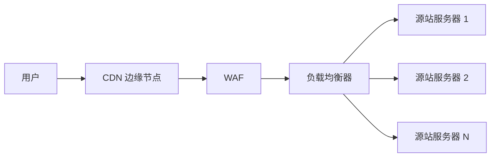
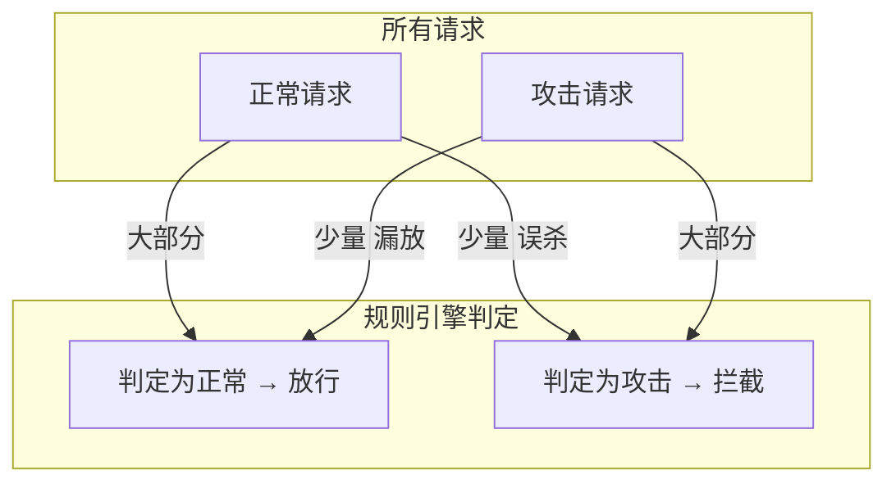
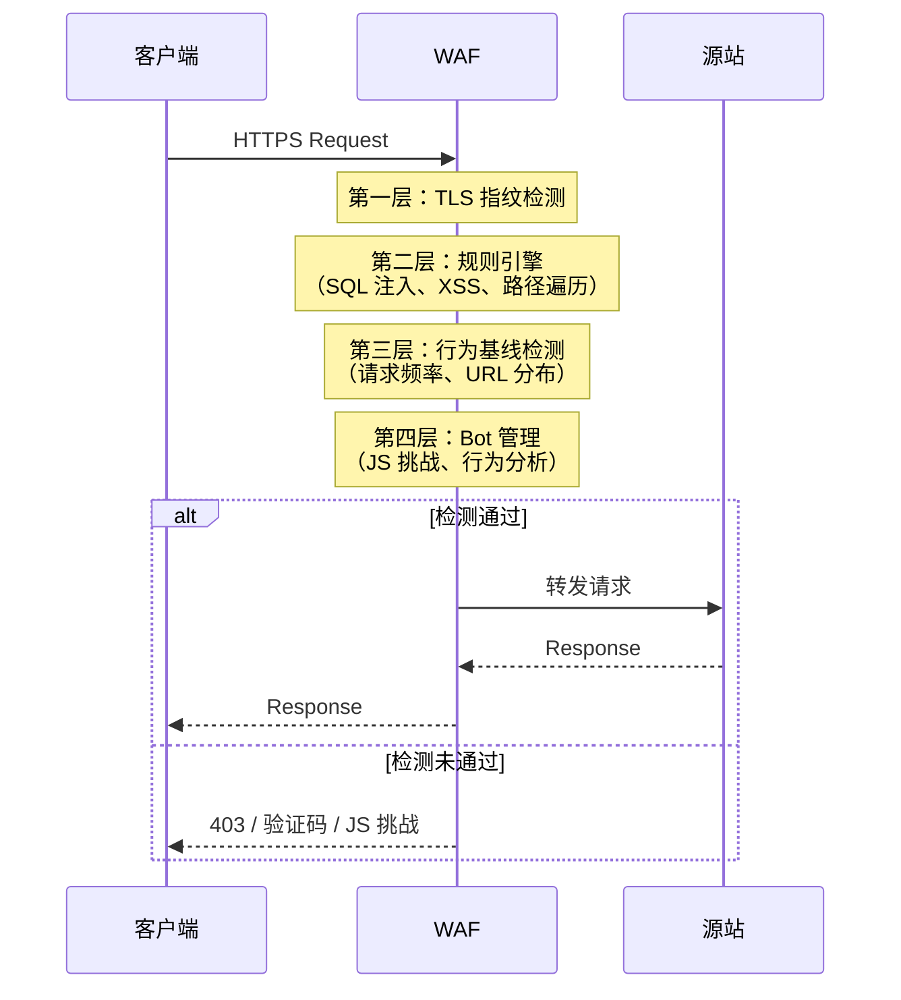
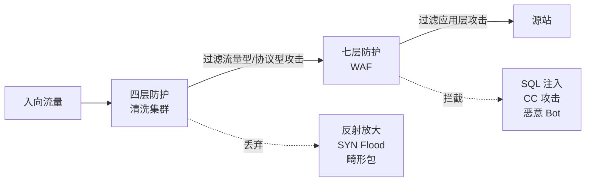

# 27. 伪装成正常请求的攻击：WAF 与应用层防护

DDoS 防护体系上线后，500Gbps 的流量洪泛被清洗集群轻松化解。运维团队松了一口气，直到第二天早上，监控显示搜索服务的响应时间从 100ms 飙到了 10 秒。CPU 使用率 100%，数据库连接池耗尽。但 DDoS 防护的面板上一切正常——入向流量只有 2Gbps，远低于清洗阈值。打开访问日志才看到真相：搜索接口每秒收到 10 万次请求，来自 10 万个不同的 IP，每个请求都是合法的 HTTP GET。清洗集群对此无能为力，因为它只看四层，而这些请求在四层完全正常。

## 27.1 应用层攻击的两种面孔

应用层攻击和四层攻击的根本区别在于：恶意不在包头里，而在请求内容里。它有两种截然不同的面孔。

**第一种：CC 攻击（Challenge Collapsar），追求计算耗尽。**

本章开头的场景就是典型的 CC 攻击。攻击者不追求带宽耗尽，而是精心挑选计算最密集的接口，搜索、报表生成、复杂查询，用最小的带宽消耗造成最大的计算破坏。每个请求都是合法的 HTTP GET，但 10 万个并发请求把后端数据库连接池耗尽，CPU 飙满。

你可能会想，把每个 IP 的请求速率限制得更低不就行了？问题是，攻击者的每个 IP 本来就只发每秒 1 个请求，已经在阈值之下了。你把阈值降到每秒 0.5 个？正常用户快速浏览商品时也会被拦截。攻击者算准了你的阈值边界，用海量真实 IP 分散请求，让每个 IP 的行为都"正常"得无可挑剔。四层的速率限制对它无效，因为"异常"不在单个连接上，而在请求的聚合模式里。

**第二种：注入攻击，追求数据窃取或篡改。**

SQL 注入是最经典的例子。攻击者在 HTTP 请求的参数中嵌入 SQL 语句：`/user?id=1' OR 1=1--`。如果后端代码没有做参数化查询，这个请求会被数据库执行，返回所有用户的数据。这个请求在四层看来完全正常，一个普通的 HTTP GET，参数是一个字符串，没有任何异常的包头特征。它不需要高并发，一个请求就能造成数据泄露。

两种攻击的共同点是：恶意藏在 HTTP 请求的内容里，而不是包头里。四层防护看的是"信封"（寄件人地址、收件人地址、邮戳），要识别这些攻击，必须拆开信封读内容。这需要一种工作在应用层的防护机制。

**图 27.1：四层防护 vs 七层防护的可见范围**

```
四层防护能看到的：
┌──────────────────────────────────────────────────┐
│ IP Header: Src IP, Dst IP, Protocol              │ ← 可见
│ TCP Header: Src Port, Dst Port, Flags, Seq/Ack   │ ← 可见
│ ─ ─ ─ ─ ─ ─ ─ ─ ─ ─ ─ ─ ─ ─ ─ ─ ─ ─ ─ ─ ─ ─ │
│ HTTP: GET /search?q=shoes HTTP/1.1               │ ← 不可见
│ Host: shop.example.com                           │ ← 不可见
│ Cookie: session=abc123                           │ ← 不可见
│ User-Agent: Mozilla/5.0 ...                      │ ← 不可见
└──────────────────────────────────────────────────┘

七层防护能看到的：
┌──────────────────────────────────────────────────┐
│ IP Header: Src IP, Dst IP, Protocol              │ ← 可见
│ TCP Header: Src Port, Dst Port, Flags, Seq/Ack   │ ← 可见
│ ─ ─ ─ ─ ─ ─ ─ ─ ─ ─ ─ ─ ─ ─ ─ ─ ─ ─ ─ ─ ─ ─ │
│ HTTP: GET /search?q=shoes HTTP/1.1               │ ← 可见
│ Host: shop.example.com                           │ ← 可见
│ Cookie: session=abc123                           │ ← 可见
│ User-Agent: Mozilla/5.0 ...                      │ ← 可见
└──────────────────────────────────────────────────┘
```

## 27.2 WAF 的工作位置：反向代理

要看到 HTTP 请求的内容，防护设备必须做一件事：终结用户的 TCP 连接，解密 TLS 流量，解析 HTTP 协议。能做到这件事的网络角色，是反向代理。

WAF（Web Application Firewall）正是以反向代理的身份部署在客户端和源站之间。

> **WAF 是什么？**
>
> WAF（Web Application Firewall，Web 应用防火墙）是一种工作在七层（应用层）的安全防护设备。与四层防火墙（安全组、DDoS 清洗）只看 IP 和端口不同，WAF 能解析 HTTP/HTTPS 请求的完整内容，URL、参数、Header、Cookie、请求体，然后用规则引擎和行为分析判断请求是否恶意。WAF 能防御的攻击类型包括 SQL 注入、XSS（跨站脚本）、路径遍历、CC 攻击（应用层 DDoS）等。WAF 通常以反向代理的形式部署，终结用户的 TLS 连接后才能读取加密的请求内容。

用户的 HTTP 请求先到达 WAF，WAF 完整地接收请求、解析内容、执行检测规则，然后决定放行还是拦截。放行的请求被转发到源站，拦截的请求直接返回一个错误页面，用户看到的是"403 Forbidden"或一个自定义的拦截提示。

为什么必须是反向代理？因为现代 Web 流量几乎全部使用 HTTPS。TLS 加密意味着，如果你只是在网络路径上旁路监听，看到的是一堆密文，URL、参数、Cookie、请求体全部不可读。WAF 必须持有服务器的 TLS 证书（或由云厂商代为管理），终结用户的 TLS 连接，把密文解密成明文 HTTP，才能分析请求内容。解析完成后，WAF 再用一条新的连接（通常也是 TLS，或者内网明文连接）把请求转发给源站。

这里有一个信任问题值得注意。用户以为自己在和源站建立 TLS 连接，实际上 TLS 在 WAF 处就终结了。WAF 能看到所有的明文 HTTP 内容，URL、Cookie、请求体、甚至用户提交的密码。这要求用户信任 WAF 的运营者。在云环境中，WAF 通常由云厂商提供，用户把 TLS 证书托管给云厂商，这和把 CDN 证书托管给 CDN 厂商是同样的信任模型。

在实际部署中，WAF 通常和 CDN、负载均衡器协同工作。典型的流量路径是：

**图 27.2：WAF 在流量路径中的位置**



CDN 处理静态内容的缓存和加速，WAF 过滤动态请求中的恶意流量，负载均衡器把正常请求分发到后端服务器。三者串联，各司其职。CDN 边缘节点通常也会做一层基础的 WAF 检测，在边缘就拦截明显的攻击，减少回源流量。

WAF 的性能代价是什么？它需要解析每一个 HTTP 请求，对请求的 URL、参数、Header、Body 逐一做规则匹配。这比四层防护（只看包头的几十个字节）的计算量大得多。WAF 的处理延迟通常在 1-5ms，对于大多数 Web 应用来说可以接受。但对于延迟极度敏感的场景，高频交易、实时游戏，这几毫秒可能不可忽视。
 
WAF 就是一个能读懂 HTTP 的反向代理，加上一套判断"这个请求是不是坏人"的规则引擎。原理并不复杂，但它必须站在流量的必经之路上，才能看到每一个请求的内容。

## 27.3 规则引擎：基于特征的检测

WAF 拿到了 HTTP 请求的明文内容，接下来要回答一个问题：这个请求是正常的，还是恶意的？

最直接的方法是特征匹配，维护一个规则库，每条规则描述一种已知的攻击特征。当请求到达时，WAF 用规则库中的每条规则去匹配请求的各个部分。匹配到了，判定为攻击，执行拦截。

以 SQL 注入为例。规则可能是一组正则表达式，匹配参数值中包含 `' OR 1=1`、`UNION SELECT`、`DROP TABLE` 等 SQL 关键字的请求。当请求 `/user?id=1' OR 1=1--` 到达时，WAF 扫描参数 `id` 的值，匹配到 `OR 1=1` 模式，判定为 SQL 注入，返回 403。

再看路径遍历攻击。攻击者试图通过 `/download?file=../../../etc/passwd` 读取服务器的系统文件。WAF 的规则匹配到 URL 参数中的 `../` 模式，正常用户不会在文件路径里写 `../`，拦截请求。

规则库需要持续更新。新的攻击手法不断出现，旧的规则可能被绕过。云厂商的 WAF 通常提供托管规则库，由专门的安全团队持续维护和更新。客户也可以添加自定义规则，比如某个业务接口只接受特定格式的参数，任何不符合格式的请求都直接拦截。

但规则引擎有一个结构性的矛盾，无论怎么调优都无法消除：**误杀与漏放**。

规则太严格，正常请求可能被误判为攻击。一个英语老师在搜索框输入 `SELECT` 这个单词，被 SQL 注入规则拦截了。一个开发者在论坛发帖讨论 SQL 语法，帖子内容包含 `DROP TABLE`，被 WAF 挡在门外。这些都是误杀，正常用户的正常行为，恰好触发了攻击特征。

规则太宽松，攻击请求可能绕过检测。攻击者发现 WAF 的规则直接匹配 `' OR 1=1`，于是用 URL 编码 `%27%20OR%201%3D1` 绕过。WAF 更新规则，先做 URL 解码再匹配。攻击者又用双重编码 `%2527%2520OR`。WAF 再更新。攻击者用 Unicode 编码、大小写混合、注释插入……这是一场永无止境的猫鼠游戏。

**图 27.3：规则引擎的误杀与漏放**



误杀率和漏放率是一对跷跷板，降低一个必然升高另一个。把规则收紧，漏放减少，但误杀增加；把规则放松，误杀减少，但漏放增加。安全团队的日常工作很大一部分就是在分析误杀案例、调整规则阈值、在两者之间寻找一个业务能接受的平衡点。

这个矛盾不是"写更好的规则"就能解决的，它是特征匹配方法论的固有局限。只要攻击者能构造出"看起来像正常请求但实际上是攻击"的输入，基于特征的检测就永远在追赶。

攻防永远是不对称的。规则引擎能抓住已知的攻击模式，但面对未知的变形，它总是慢半拍。

## 27.4 行为分析与 Bot 管理

规则引擎擅长检测"已知的攻击特征"，SQL 注入、XSS、路径遍历，这些攻击在请求内容中有明确的恶意模式可以匹配。但回到本章开头的 CC 攻击场景：每个请求都是合法的 `/search?q=shoes`，没有任何恶意特征。规则引擎看到的是一个正常的搜索请求，它怎么知道这是用户在搜索还是僵尸机在攻击？

单个请求无法判断，但一群请求的模式可以。

WAF 持续学习正常流量的行为基线：每个 IP 的请求频率分布、每个 URL 的访问量曲线、请求的时间分布、请求的地理来源分布。当行为偏离基线时，触发告警或拦截。比如，搜索接口的正常访问量是每秒 500 次，突然跳到每秒 10 万次，而且 90% 的请求来自从未访问过该网站的新 IP，这个模式高度可疑。

行为检测比规则匹配更"聪明"，但也更容易犯错。促销活动开始的那一刻，正常用户的请求量也会暴增，秒杀开始时，搜索接口的访问量从每秒 500 次跳到每秒 5 万次，这是真实用户的行为。如果 WAF 把所有突增的流量都判定为攻击，正常用户也会被拦截。行为检测需要区分"正常的流量突增"和"攻击导致的流量突增"，这比规则匹配难得多。

在我的经验里，行为检测最棘手的不是算法，而是基线的建立和维护。业务流量本身就在变化，工作日和周末不同，白天和凌晨不同，促销期和平日不同。基线必须是动态的，能跟随业务节奏自适应调整。一个刚上线的 WAF，行为模型还没有积累足够的样本，误判率会比较高，你得像带新人门卫一样，先让它见习一段时间，逐步校准。

除了行为分析，WAF 还有另一个武器：Bot 管理。

很多应用层攻击来自自动化脚本（Bot），而不是真人操作浏览器。Bot 管理的目标是区分真人流量和 Bot 流量。常见的检测手段包括：

**JavaScript 挑战**，WAF 向客户端发送一段 JavaScript 代码，要求浏览器执行并返回计算结果。真实浏览器有完整的 JavaScript 引擎，能正常执行；简单的 HTTP 脚本（如 Python 的 requests 库）没有 JS 引擎，无法返回正确结果。这一招能过滤掉大量低级 Bot。

**TLS 指纹**，不同的客户端在 TLS 握手时会发送不同的参数组合（支持的密码套件、扩展列表、椭圆曲线等）。真实的 Chrome 浏览器和 Python requests 库的 TLS 指纹截然不同。WAF 通过分析 TLS Client Hello 消息的指纹，判断客户端是真实浏览器还是脚本工具。

> **TLS 指纹是什么？**
>
> TLS 握手的第一步是客户端发送 Client Hello 消息，其中包含支持的 TLS 版本、密码套件列表、扩展列表等参数。不同的客户端软件（Chrome、Firefox、curl、Python requests）发送的参数组合各不相同，形成独特的"指纹"。WAF 通过比对这个指纹，可以判断请求是否来自它声称的那个客户端，如果 User-Agent 写着 Chrome，但 TLS 指纹是 Python requests 的，这个请求大概率来自脚本。

**行为分析**，真人操作浏览器时，鼠标会移动、页面会滚动、点击位置有随机性、页面停留时间不均匀。Bot 的行为模式则高度规律，精确的时间间隔、固定的请求路径、没有鼠标轨迹。WAF 可以在页面中注入行为采集脚本，收集用户的交互模式，辅助判断。

但 Bot 管理有一个灰色地带：不是所有 Bot 都是恶意的。搜索引擎的爬虫（Googlebot、Bingbot）需要抓取网页内容才能建立索引，拦截它们意味着你的网站从搜索结果中消失。监控服务的探针需要定期检查网站可用性。API 的自动化调用是很多业务的正常组成部分。Bot 管理需要区分"好 Bot"和"坏 Bot"，而不是一刀切地拦截所有非人类流量。

如果人人都会伪装成正常用户，那区分好人和坏人就不能只看证件，还得看行为、看习惯、看他走路的姿势。Bot 管理做的就是这件事。

**图 27.4：WAF 的多层检测机制**



四层检测逐级递进：TLS 指纹先过滤明显的脚本工具，规则引擎拦截已知攻击特征，行为分析识别异常的请求模式，Bot 管理区分真人和自动化脚本。每一层都在缩小可疑流量的范围，最终到达源站的几乎全是正常请求。

## 27.5 攻防博弈没有终点

四层 DDoS 防护挡住流量洪泛和协议攻击，七层 WAF 识别和拦截应用层攻击。两者协同：四层先过滤掉明显的垃圾流量，反射放大、SYN Flood、畸形包，减轻七层的处理压力；七层再精细分析剩余流量中的伪装攻击，CC、SQL 注入、恶意 Bot。

**图 27.5：四层与七层防护的协同**



但安全防护有一个根本性的不对称：防御者需要防住所有攻击向量，攻击者只需要找到一个漏洞。

规则引擎的规则再多，攻击者总能找到绕过的编码方式。行为检测的模型再精准，攻击者可以让僵尸机模拟正常用户的浏览模式，先访问首页，再点分类，再搜索，间隔随机化。Bot 管理的 JavaScript 挑战再严格，攻击者就用 Headless Chrome（无界面的真实浏览器）执行攻击脚本，TLS 指纹和 JS 执行结果都和真实用户一模一样。

每一种防御手段的出现，都会催生对应的绕过技术。WAF 引入了 URL 解码后匹配，攻击者就用双重编码。WAF 引入了行为基线，攻击者就在攻击前先用低频请求"养"基线。WAF 引入了 JS 挑战，攻击者就用 Headless 浏览器。安全防护不是"部署了就安全了"，而是需要持续的监控、分析和调优。

误杀的代价也不能忽视。安全防护的每一层都可能误伤正常流量。四层清洗可能丢弃正常的 UDP 包，WAF 规则可能拦截正常的请求，Bot 管理可能阻止合法的 API 调用。如果你管理过面向大量用户的 Web 服务，大概率遇到过这种情况：某天客服突然收到一批投诉"打不开页面"，排查半天发现是 WAF 的某条新规则误杀了特定地区的用户。安全团队的日常工作，很大一部分是在分析这些误杀案例，在"拦得住"和"不误伤"之间反复调整。

从四层 DDoS 防护到七层 WAF，南北流量，从用户到服务，的安全防护体系已经建立。流量洪泛有清洗集群吸收，伪装攻击有 WAF 识别，协议攻击有 SYN Cookie 验证。攻击者从外部发起的威胁，都有了对应的防御手段。

安全的问题暂时告一段落。
