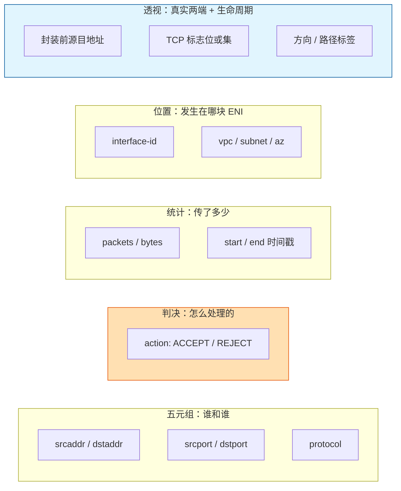
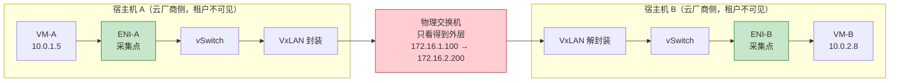

# 28. 出了问题，从哪查起：网络流日志

卷八搭完了从 Anycast 骨干到 CDN 边缘、从 DDoS 清洗到 WAF 应用层规则的完整防护链条，云网络到这一步同时具备了能通、能快、能挡三种能力。但真正棘手的问题要到跑起来之后才会浮现：一台华东的 VM 突然访问慢或连接超时，服务器健康检查全绿、应用日志无异常、负载均衡后端全部健康，报文却在中间某一跳消失了。链路跨十几跳，每一跳都可能出问题，但云厂商把转发平面全部收敛在了租户看不见的宿主机集群里，排障工程师既摸不到物理设备，也拿不到跨租户的抓包权限。

## 28.1 Overlay 之后，物理可观测性整体失灵

物理机时代网络是物理可见的：网卡接到交换机的某个端口，端口接到汇聚层，汇聚层接到核心层，整条路径人眼可数。SPAN/TAP 把任意一个端口的流量线速镜像一份出来，Wireshark 在旁路机器上就能完整回放这一跳的所有报文。这套可观测性靠三个前提支撑：拓扑是公开的、物理端口是可触达的、每一跳的流量就是表面上看到的那些比特。

Overlay 虚拟化把这三个前提同时打破了，VM 之间的报文一出 vSwitch 就被封上 VxLAN 外层包头，内层五元组塞进了 UDP 负载里。外层地址是宿主机之间的物理地址，内层地址才是租户视角下真正的两端。租户看到的是一条逻辑上点对点的以太网链路，底层却横跨多台宿主机、多条物理交换机和多个控制平面组件，整张拓扑对租户不开放。租户想在宿主机的 `vxlan0` 上抓一次包，第一关就卡在权限：宿主机在云厂商基础设施边界的那一侧，租户能触达的最深处只到 VM 的内网卡。而内网卡看到的是解封装之后的内层帧，封装过程、物理交换机 ECMP 哈希、宿主机转发策略这几跳里出任何异常，VM 内部的 tcpdump 都一无所知。

就算拿到了全路径的抓包权限，pcap 这种逐包全量的格式也撑不住云规模。一台中等规格 VM 每秒十万级报文是正常负载，百台 VM 的 VPC 连续抓几分钟就是几十 GB，从这个量级的原始字节流里精确定位单条超时连接，人工操作已经不是现实选项。更棘手的是安全组的静默丢弃，匹配到拒绝规则的报文被直接丢掉，不回 RST、不回 ICMP Unreachable，客户端只看到 TCP SYN 没有回应、超时重传直至放弃。应用层日志里什么都没留，因为请求根本没进应用进程；pcap 即便抓到了那些孤独的 SYN，也无从在几十 GB 里把它们捞出来。

Web 服务器用 access log 回答"谁请求了什么 URL、返回了什么状态码"，数据库用 slow query log 回答"哪些查询慢在了什么地方"。网络层缺的正是这样一份结构化记录：谁和谁通信、用什么协议、传了多少数据、最终被允许还是被拒绝。物理网络的 SPAN/TAP 已经给不出这份记录，可观测性只能下沉到虚拟化数据面：数据面每转发一次就写一条结构化记录，谁、和谁、什么协议、多少字节、是否放行，一次一行。这份网络层的 access log，业界通称 Flow Log。

## 28.2 从包到流：一次有代价的降维

Flow Log 的记录单位不是"包"（Packet）而是"流"（Flow）。一条流由五元组定义：源 IP、目的 IP、源端口、目的端口、协议号。同一条 TCP 连接从 SYN、三次握手完成到 FIN 的所有报文归属同一条流。采集器不逐包落盘，而是把一条流在一个时间窗口内的所有报文聚合为单条记录，附上窗口内的包数、字节数、起止时间戳和最终动作。

这次降维有收益也有代价。收益很直接：数据量从每秒数十亿级报文压到了每秒百万级流条目，三到四个数量级的落差直接把问题从不可处理拉回可处理；字段结构化之后可索引、可聚合、可按子网/ENI/动作三维度切片，日志存储和查询成本也降到可接受的水平。代价是逐包时序完全丢了，过程的细节全被压进几个统计标量里。这是流日志数据建模的根本取舍，后面所有能力边界都从这里延伸出来。

把一个个报文归到同一条流下，靠的是 conntrack。TCP 以 SYN 为起点、FIN/RST 为终点，中间的 ACK 和数据包全部挂到同一个 conntrack 条目下，正反方向的报文按五元组对称匹配到同一条流。UDP 和 ICMP 没有连接概念，conntrack 用空闲超时界定一条流的结束，Linux 默认 UDP 和 ICMP 都是 30 秒无流量即关闭。采集器消费 conntrack 的归并结果，一条 TCP 连接即便跨越多个采集窗口，也以一致的五元组被累加，而不是拆成一堆孤立记录。

字段层面，各家云厂商的实现大同小异，核心可以归成五类，支撑了绝大部分排障场景。

**图 28.1：Flow Log 的核心字段分组**

前四类字段回答排障起手的三个基本问题：谁被谁拒绝了、传了多少数据、发生在哪块 ENI 上。第五类字段才是流日志区别于传统 Netflow/sFlow 的地方，它要穿透多层封装对上真实两端，还要按 TCP 标志位把一条流的生命周期还原出来。

VM 通过 NAT Gateway 访问公网，到了远端服务器那一跳，流日志里的源地址已经换成 NAT 的出口 IP，发起连接的 VM 身份被覆盖。CLB/ALB 转发用户请求时同样在改写：后端 ENI 的流日志里，源地址是负载均衡器的内网 IP，客户端 IP 丢了。隧道和代理一路多层改写源目地址，穿透封装的难点就在这里，必须在原始五元组之外单独保留一组封装前的源目地址，无论中间隔着 NAT、LB 还是 Transit Gateway，连接两端的身份都不丢。各家云厂商都给出了自己的字段命名，AWS 叫 `pkt-srcaddr/pkt-dstaddr`，阿里云和腾讯云的流日志里也有对应字段。字段名叫什么不是关键，关键是数据模型里要显式区分"外层封装后的五元组"和"内层封装前的五元组"两套，这是流日志超越传统 Netflow/sFlow 的关键一步，后者原本只服务物理交换机，取不到也不关心封装前的内层信息。

采集窗口里观察到的 SYN、FIN、RST、ACK、PSH、URG 会被按位或成一个整数记下来，这一位或集就是这条流在这个窗口里的生命周期剪影。SYN 单独出现在首条记录里、后续窗口只剩 ACK 和数据位，是一条正常建连并进入数据传输的 TCP 连接；连续多个窗口反复出现 SYN 但始终没有 ACK，是对端拒绝建连或半开连接堆积；RST 单独出现而没有 FIN，是连接被某一端强行终止。排障时这几个标志位比包数和字节数更能说明问题是卡在建连阶段还是数据阶段。

一条记录能告诉你某条流在某分钟里发送了 1500 个包、2 MB 数据、被允许，却告诉不了你这些包里的 SQL 查询、HTTP Header、TLS 握手过程。流日志是流级统计、不是包级内容；观测的是网络层，不是应用层。另一条边界藏在 REJECT 里：这个动作标注的是"丢弃"的最终结论，不含"谁丢的"。安全组白名单未命中、网络 ACL 显式拒绝、VPC 路由黑洞三类拒绝源在流日志里都呈现为同一个 REJECT，归因要结合 ENI 所属子网的策略配置做二次推理。流日志记下了"这条流最终发生了什么"，但没记"链路上哪一环做了这个决定"，按流聚合这个数据模型天然容纳不下这一层信息。

## 28.3 采集点落在哪里：从宿主机内核到网卡硬件

数据模型定下来之后，下一个问题是采集点放在哪条链路上。看起来最经济的选项是物理交换机，反正所有 VPC 流量终究要穿过物理网络，一次全局采集似乎就能覆盖所有流量。VxLAN 直接否掉了这条路。

VM-A 到 VM-B 的报文在离开宿主机 A 之前被 VxLAN 封装，外层 IP 换成了宿主机之间的物理 IP，VNI 字段标注租户。物理交换机只看得到外层包头，它能产出的流日志只能告诉下游一件事：某台宿主机在和另一台宿主机通信。这个粒度对云厂商自己的物理网络运维有用，对想回答"VM-A 和 VM-B 之间发生了什么"的租户没有价值。要看到内层五元组，采集点必须放在 VxLAN 封装之前（出向）或解封装之后（入向），也就是宿主机内部的 vSwitch 或 ENI 上。安全组本身作用在 ENI，采集点落在这里还有一层附带收益：ACCEPT/REJECT 判决和采集发生在同一位置，流日志不用再和控制平面对账。

**图 28.2：Flow Log 的采集位置选择**

位置定在 ENI 之后，接下来是技术路线。早期云厂商沿用了传统 Netflow/sFlow 的思路，由 vSwitch 导出流表，但这套机制是为物理交换机设计的，采样率写死、字段集封闭、取不到内层封装的信息。过去几年主流路线换到了 eBPF：在宿主机 Linux 内核的 TC ingress/egress 或 XDP 钩子上挂一段字节码，报文经过 ENI 时同步抽取五元组、更新内核流表、按 conntrack 归并，到期的流条目异步导出到用户态守护进程再落盘。对比把整帧拷进用户态的传统捕获方式，eBPF 单包开销只有几十到几百纳秒，低了两到三个数量级。灵活性也更高，字段集、采样策略、过滤条件都无需重启内核就能换掉。

但宿主机内核跑 eBPF 不是终点，它只在中等规模的 VPC 里成本可控。采集路径的 CPU 占用随新流速率线性增长，一台物理机上 VM 密度越高、小包越密集，每秒新建流越多，流表更新、聚合、异步上报每一步都在蚕食宿主机 CPU。单包开销可能还好，可乘上百万 PPS 的规模、再乘上物理机集群的台数，流日志吃掉的宿主机 CPU 就是采购清单上真金白银的花销。

现代大规模云厂商把这件事下沉到了专用网卡。AWS 从 2017 年起让 Nitro 卡接管整个 Overlay 数据面，VxLAN 封装/解封装、安全组、流表统计都挪到 Nitro 的硬件流表上；阿里云的神龙架构把这类工作交给宿主机侧的 MOC 卡；Azure 用智能网卡（SmartNIC）加 Azure Boost 做相同的事情。这些专用网卡的本质是把流日志需要维护的那张"按五元组聚合的流表"做进网卡 ASIC 或 FPGA，报文穿过网卡时按线速更新表项，到期后 DMA 一次性把流条目送到宿主机内存。宿主机 CPU 不再出现在数据路径上，流日志的采集成本从"每百万 PPS 分走几核"降到"几乎为零"。流日志在最大规模的生产 VPC 里仍然能保持全量而不是退成采样，很大程度上靠的就是这一层硬件卸载。

有一个工程事实需要正视：宿主机内核 eBPF 和网卡硬件流表不是互相替代的两条路线，而是云基础设施随规模演进的两个阶段。中小规模 VPC 和自建 Kubernetes 集群里，eBPF 仍是主力：灵活、可编程、改字段集不需要换硬件。超大规模公有云里，DPU/SmartNIC 才是线速流日志的落点，不卸载就要用 CPU 做封装、做安全组、做流表统计，一台宿主机没法同时扛住虚拟化开销、业务 VM 和百万 PPS 的流日志采集。采集位置选 ENI 是物理约束决定的，采集技术选内核还是硬件，则是规模和成本博弈的结果。

## 28.4 全量与采样：高维基数的工程账

一个中等规模的 VPC，1000 台 VM、每台 VM 每秒约 1000 条新流，每秒产出 100 万条流日志记录。单条记录按五元组加统计字段加透视字段约 200 字节，每秒 200 MB，一天约 17 TB，一个月约 500 TB。再叠加跨 AZ 汇聚传输、冷热分层存储、交互式查询索引，账目在真实采购清单上还会放大 2–3 倍。流日志的存储和查询并不便宜。

把这笔开销压下来，最直接的手段是采样。1:100 意味着每 100 条流只记 1 条，存储和传输成本线性下降 100 倍。但采样面对的是一个数据模型层面的硬约束，高维基数（Cardinality）：流日志里不同条目的价值差别极大。整条 VPC 里绝大多数记录是"业务正常运行"的 ACCEPT 条目，统计上冗余；真正重要的是少数 REJECT 条目、少数异常目的 IP 条目、少数流量尖峰条目，这些条目构成整个日志的长尾，而排障、安全审计、合规恰恰只关心这些长尾记录。

采样对所有流一视同仁地随机抽取，按同一个比例保留，长尾条目也就按同样的比例被稀释掉。1:100 的采样下，整条 VPC 里那条触发 REJECT 的流有 99% 的概率不进日志。排障时查到的是一堆正常 ACCEPT 记录，很容易得出网络侧没问题的错误结论。安全事件调查更致命：被入侵的 VM 对外发了 100 个 C&C（Command and Control，命令与控制）连接，采样后日志里只剩 1 个，另外 99 个目的 IP 根本进不到事件响应的视野里。

采样回答的是统计分布层面的问题：过去一周哪些子网的流量在上涨、高峰期跨 AZ 带宽利用率是多少、TCP/UDP 流量比例的日内变化。这类趋势分析对单条流不敏感，1:100 甚至 1:1000 都能很好地反映整体结构。反过来，凡是要精确到某一条的问题，采样必定无法解决。

真实生产 VPC 的做法通常不是在全量和采样之间二选一，而是按子网价值分层：数据库子网、管理面子网、互联网出入口 ENI 一律全量，开发测试子网和内部 RPC 子网按 1:100 到 1:1000 采样；平时采样、检测到异常时自动切回全量。这个分层没有标准答案，取决于业务对单条流可追溯性的要求和对日志成本的容忍度，但纯全量或纯采样的部署在真实环境里几乎看不到。

## 28.5 三种典型用法

流日志的价值要落到具体问题上才看得清楚。下面三类用法基本覆盖了生产 VPC 的大部分使用场景。

第一类是安全组误拦截的回溯定位。应用子网迁移是常见触发点，应用服务从旧子网搬到新子网，但数据库 ENI 的安全组白名单只放行了旧子网的 CIDR。应用重启后所有连向数据库的 SYN 在到达数据库 ENI 之前被静默丢弃，应用层只看到超时重试。没有流日志时，这类排查会沿着应用配置、连接池、DNS、路由一路试错；有了流日志，一行查询条件（srcaddr=应用 ENI、dstaddr=数据库 ENI、dstport=数据库端口）就能把一批 action=REJECT 的记录查出来，问题直接收口到安全组白名单与新子网 CIDR 不匹配。排障耗时从小时级降到分钟级，这是流日志对日常运维最直接的回报。

第二类是异常外联的安全审计。安全团队按"srcaddr 属本 VPC、dstaddr 属公网、每日字节数前 N"排序定期扫描流日志，异常外联会浮出水面：一台内部服务 VM 本只和 VPC 内其他服务通信，日志里却持续出现向境外 IP 走 TCP 443 的大流量；拉威胁情报比对，目标 IP 命中已知 C&C 指纹。流日志本身阻止不了攻击，但能把"事后发现"的时间窗从几个月压到几小时，攻击者在环境里横向移动留下的每一条五元组证据都在日志里，溯源可以逐跳还原。

第三类是容量规划的流量透视。按 subnet-id 的笛卡尔积聚合流日志的字节数，能得到每一对子网之间的工作日带宽曲线：应用子网到数据库子网的白天峰值走多高、数据库到备份存储的流量集中在哪个时段、哪一对子网的流量在一个月内持续上涨。有了这些数据，"数据库子网需要扩带宽""备份窗口需要错峰"就不再是主观印象，而是季度规划会议上拿得出手的可量化依据。

三类用法共用同一份流日志原始数据，差异只在查询视角：第一类按时间 + 五元组 + action 索引，第二类按 srcaddr/dstaddr/bytes 排序，第三类按 subnet-id 聚合求和。同一份数据被多个视角反复复用，这也从反面说明了全量采集的工程价值。

## 28.6 按流聚合的盲区：被动日志的终点

流日志把每一条流的最终去向结构化地记下来，排障从此有据可查，这是整条可观测体系的基座。但有些东西，流日志天生看不见，这不是采集点优化或存储扩容能逐步修补的实现瑕疵，按流聚合这个数据模型，能力上限就在于此。

一条流在一个窗口里无论传了多少包，落到日志里都只剩"包数、字节数、起止时间戳"三个标量，逐包时序在聚合那一刻就丢了。这些包是均匀分布还是中间卡顿了几秒、整体平均延迟是 1 毫秒还是 100 毫秒、单包延迟分布的 P99 在哪里，日志里都没有。只要流最终传完、没有被 REJECT，哪怕中间抖动得非常剧烈，流日志呈现的也是一条正常的 ACCEPT 记录。微突发（Micro-burst）在流日志里天然不可见，它存在的时间尺度就在聚合窗口以下。

任何短于一个聚合窗口的事件，流日志都还原不出来。AWS 允许在 1 分钟和 10 分钟之间选，阿里云和腾讯云的流日志通常固定在 1 分钟量级。分钟级足以回答"是哪一分钟出了问题"，但一次持续 3 秒的瞬时丢包，摊进 1 分钟窗口里就只剩一个几乎看不见的毛刺。许多真实的网络劣化恰恰发生在秒级甚至亚秒级，这个分辨率下流日志盲区很大。

从采集点到能查询，一条日志中间隔着批量压缩、跨区上传、对象存储落地、查询引擎建索引这一系列步骤，端到端的典型时延是 10 到 15 分钟。AWS VPC Flow Logs 的官方文档给到 CloudWatch Logs 或 S3 的时延也在这个量级。这个数字并非实现瑕疵，按窗口聚合、按批上传、按时间分区索引，每一步都在摊薄单位成本，换来的就是时延。流日志本质上是一份延迟了十几分钟的历史账单。

这三类盲区：逐包时序、亚分钟分辨率、十几分钟写入延迟，根因是同一个：按流聚合把高维信息压成了低维统计，被压掉的那些维度没法靠事后查询再长出来。流日志擅长回答的是刚才发生了什么，但回答不了此刻正在发生什么，更回答不了最有价值的那一类问题：接下来可能会出什么问题"。链路延迟从 1 毫秒悄悄爬升到 5 毫秒、丢包率从 0 跨进 0.1% 但还没触发 TCP 重传、某条跨 Region 专线的抖动开始周期性放大，这些真正关键的早期信号完全躲在流日志的盲区里。

要看到这些被按流聚合抹掉的信号，观测得从记录业务流量留下的痕迹换成主动发包测量路径：系统自己按固定频率发出探测报文，持续测量端到端 RTT、过去一分钟的丢包计数、抖动相对基线的偏移。业务流量还没感知到的劣化，由探测流量先替用户遇到。
