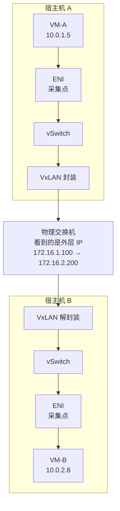
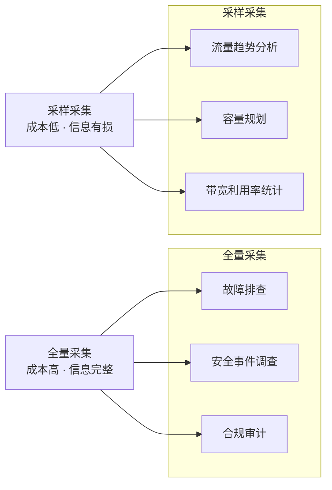

# 28. 出了问题，从哪查起：网络流日志

周一早上 9 点，工单系统弹出一条告警，"华东区域用户反馈访问超时"。

运维团队开始排查。服务器健康检查全绿：CPU 20%，内存 40%，磁盘 IO 正常。应用日志没有报错，不是"报了错但不严重"，而是真的一条错误日志都没有。负载均衡器的监控显示后端服务器全部健康，健康检查每 5 秒通过一次。

那问题出在哪里？

流量从用户的浏览器到后端服务器，经过了 DNS 解析、CDN 边缘节点、WAF、负载均衡器、安全组、VPC 路由、VxLAN 隧道、宿主机 vSwitch，十几个环节，每一个都可能是问题点。但没有一个环节主动告诉你"问题在我这里"。网络是沉默的，它只负责转发，不负责解释。运维团队面对的不是一个有明确报错的故障，而是一个弥漫在十几个环节中的"不知道哪里不对"。

要排查网络问题，第一步是让网络不再沉默，让每一条经过 VPC 的流量都留下记录。

## 28.1 流量是无形的

在物理机时代，网络排障有一个标准工具：tcpdump。在服务器的网卡上抓包，把所有经过的数据包存成 pcap 文件，然后用 Wireshark 打开分析，TCP 重传了多少次、延迟在哪个环节增加了、哪个包被丢弃了。这套方法论在物理机时代行之有效，因为流量路径是清晰的：服务器的网卡 → 接入交换机 → 汇聚交换机 → 核心交换机。你知道该在哪里抓包，也有权限在那里抓包。

但在云环境中，tcpdump 有三个致命的问题。

第一，你不知道该在哪台宿主机上抓包。VM 的流量从 vSwitch 出发，经过 VxLAN 封装，穿越物理交换机，到达目标宿主机的 vSwitch，再解封装交给目标 VM。这条路径上有多个可能的问题点，vSwitch 的转发规则、VxLAN 隧道的封装解封装、物理交换机的路由，但你不知道问题出在哪一跳。

第二，你没有权限在宿主机上抓包。云环境中，宿主机是云厂商管理的基础设施，客户只能访问自己的 VM。你可以在 VM 内部抓包，但 VM 内部看到的是已经解封装后的流量，如果问题出在 VxLAN 隧道或宿主机 vSwitch 上，VM 内部的 tcpdump 什么都看不到。

第三，即使能抓包，面对每秒数百万个包的流量，人工分析 pcap 文件是不现实的。一个中等规模的 VM，每秒可能有几万个包进出。抓 10 分钟的包，pcap 文件可能有几个 GB。在这几个 GB 的数据里找到那个导致超时的包，如同大海捞针。

还有一种更隐蔽的问题：安全组的静默丢弃。安全组是有状态的包过滤器，如果规则配置错误，某些正常流量会被直接丢弃，没有任何错误返回。客户端发出 TCP SYN 包，安全组把它丢了，客户端等待 SYN-ACK 超时，重试，再被丢，再超时。客户端看到的是"连接超时"，但应用日志里什么都没有，因为请求根本没有到达应用。运维团队检查应用、检查数据库、检查中间件，一切正常。如果没有网络层的日志，这种"请求在半路被静默丢弃"的问题几乎无法定位。

你可能觉得"安全组配错"是个低级错误，不应该经常发生。但如果你管理过几十个安全组、每个安全组几十条规则、规则还在不断变更的环境，你就知道这种事情比想象中常见得多。

Web 服务器有 access log，记录每一个 HTTP 请求，谁在什么时间请求了什么 URL，返回了什么状态码。数据库有 slow query log，记录每一条慢查询。网络层也需要类似的东西，记录每一条经过 VPC 的网络流：谁访问了谁、用什么协议、传了多少数据、被允许还是被拒绝。

这就是 **Flow Log**，VPC 的网络层访问日志。

## 28.2 Flow Log 记录了什么

Flow Log 的基本记录单位不是"包"（Packet），而是"流"（Flow）。

一条流由五元组定义：源 IP、目的 IP、源端口、目的端口、协议号。比如，一个从 10.0.1.5:52341 到 10.0.2.8:3306 的 TCP 连接，就是一条流。这条连接上传输的所有包，SYN、SYN-ACK、ACK、数据包、FIN，都属于同一条流。Flow Log 不逐包记录，而是把同一条流在一个时间窗口内的所有包聚合为一条记录。

每条 Flow Log 记录通常包含以下核心字段：

**图 28.1：Flow Log 记录的核心字段**

```
┌─────────────────────────────────────────────────────────────────┐
│                     Flow Log Record                              │
├──────────────┬──────────────────────────────────────────────────┤
│ 五元组        │ Src IP: 10.0.1.5                                │
│              │ Dst IP: 10.0.2.8                                 │
│              │ Src Port: 52341                                   │
│              │ Dst Port: 3306                                    │
│              │ Protocol: 6 (TCP)                                 │
├──────────────┼──────────────────────────────────────────────────┤
│ 方向          │ Ingress / Egress                                │
├──────────────┼──────────────────────────────────────────────────┤
│ 动作          │ ACCEPT / REJECT                                 │
├──────────────┼──────────────────────────────────────────────────┤
│ 统计          │ Packets: 1500                                   │
│              │ Bytes: 2,048,000                                  │
├──────────────┼──────────────────────────────────────────────────┤
│ 时间窗口      │ Start: 2024-03-15 14:30:00                      │
│              │ End:   2024-03-15 14:31:00                        │
├──────────────┼──────────────────────────────────────────────────┤
│ 网络接口      │ ENI ID: eni-0a1b2c3d                            │
└──────────────┴──────────────────────────────────────────────────┘
```

这些字段能回答什么问题？

**"谁在访问谁"**，五元组告诉你源 IP 和目的 IP、源端口和目的端口、使用的协议。10.0.1.5 的 52341 端口在访问 10.0.2.8 的 3306 端口，协议是 TCP，这是一个应用服务器在连接 MySQL 数据库。

**"访问被允许还是被拒绝"**，动作字段是排障时最有价值的信息。如果看到大量 REJECT 记录，说明安全组或网络 ACL 在拦截流量。回到开头的排障场景，如果 Flow Log 显示从应用服务器到数据库的流量动作是 REJECT，问题立刻定位：安全组规则没有放行这条路径。

**"传了多少数据"**，包数和字节数告诉你这条流的流量大小。如果某台 VM 在凌晨 3 点向一个外部 IP 发送了 50GB 数据，这可能是数据泄露的信号。

**"什么时候发生的"**，时间窗口告诉你这条流的起止时间。排障时可以精确到"14:30 到 14:31 之间发生了什么"。

**"发生在哪个网络接口上"**，ENI ID 标识了这条流经过的弹性网卡，可以定位到具体的 VM 或容器。

有一个关键的边界需要明确：Flow Log 记录的是"流"级别的统计，不是"包"级别的内容。你能知道"10.0.1.5 在 14:30-14:31 之间向 10.0.2.8:3306 发送了 1500 个包、2MB 数据，被允许"，但你看不到这些包的具体内容，SQL 查询语句、返回的数据、HTTP 请求体，这些都不在 Flow Log 的记录范围内。Flow Log 是网络层的可观测性，不是应用层的。

时间窗口的聚合粒度也值得注意。Flow Log 不是实时逐包记录，而是按时间窗口聚合，通常是 1 分钟或 5 分钟。一条持续 10 分钟的 TCP 长连接，在 1 分钟窗口下会被拆分为 10 条 Flow Log 记录，每条记录包含那 1 分钟内的包数和字节数。这个粒度决定了排障的精度，1 分钟窗口能定位到"哪一分钟出了问题"，但无法精确到"哪一秒"。对于大多数排障场景来说，分钟级的粒度已经足够。但如果你需要分析一次持续 3 秒的网络抖动，Flow Log 的粒度就不够了。

Flow Log 就是网络层的 access log。Web 服务器的 access log 记录"谁请求了什么 URL、返回了什么状态码"，Flow Log 记录"谁访问了谁、用什么协议、被允许还是被拒绝"。

## 28.3 在哪里采集，如何采集

Flow Log 要记录每一条经过 VPC 的网络流，那采集点应该放在哪里？

你可能会想，放在物理交换机上，所有流量最终都要经过物理交换机，在那里采集不就能看到所有流量了吗？

问题是，物理交换机看到的是 VxLAN 封装后的流量。一个从 VM-A（10.0.1.5）到 VM-B（10.0.2.8）的包，经过 VxLAN 封装后，外层 IP 变成了宿主机 A（172.16.1.100）到宿主机 B（172.16.2.200）。物理交换机看到的五元组是宿主机的 IP，不是 VM 的 IP。你在交换机上采集到的 Flow Log 会告诉你"宿主机 A 在和宿主机 B 通信"，但不会告诉你"VM-A 在和 VM-B 通信"，而后者才是客户关心的信息。

要看到 VM 级别的流量，采集点必须在 VxLAN 封装之前（出向）或解封装之后（入向），也就是在宿主机的 vSwitch 或弹性网卡（ENI）上。

**图 28.2：Flow Log 的采集位置**



在 ENI 上采集有三个优势：第一，能看到安全组的过滤结果，安全组作用在 ENI 上，采集点在 ENI 就能记录每条流是被 ACCEPT 还是 REJECT；第二，能看到每个 VM 的独立流量，每个 ENI 对应一个 VM 或容器，采集粒度天然是 VM 级别的；第三，采集点离 VM 最近，不会遗漏任何进出 VM 的流量。

确定了采集位置，下一个问题是：用什么技术采集？

传统的网络流量采集方案是 Netflow 和 sFlow，在交换机上配置采样规则，交换机按比例抽取流量样本，发送给采集器。但这些方案是为物理交换机设计的，在云环境中有两个问题：采集点在交换机上（看不到 VM 级别的流量），而且采样率固定、不够灵活。

现代云厂商越来越多地使用 **eBPF**（extended Berkeley Packet Filter）来采集 Flow Log。eBPF 允许在 Linux 内核的网络栈中插入自定义的采集程序。当数据包经过内核网络栈时，eBPF 程序在包的转发路径上执行，提取五元组、记录包大小、判断安全组动作，然后把信息写入内核中的数据结构，由用户态程序定期读取并生成 Flow Log 记录。

> **eBPF 是什么？**
>
> eBPF 是 Linux 内核提供的一种可编程机制，允许用户在内核的特定"挂载点"（hook point）上运行自定义的小程序。在网络场景中，常用的挂载点包括 TC（Traffic Control，流量控制层）和 XDP（eXpress Data Path，网卡驱动层）。eBPF 程序在内核中运行，不需要把数据包复制到用户态，因此开销极小。你可以把它理解为"在内核的流水线上加了一个轻量级的检查站"，包经过时快速提取信息，不影响流水线的速度。

eBPF 采集相比传统方案的优势在于：采集点灵活（可以挂在 vSwitch、TC、XDP 等多个位置），对转发性能影响极小（每个包经过时执行几十条指令，开销在纳秒级），而且可编程，可以根据需要采集不同的字段，甚至做实时的流量统计。

但"对转发性能影响极小"不等于"没有成本"。eBPF 程序在每个包经过时都会执行，如果是全量采集（每条流都记录），在高流量场景下，每秒数百万条流，Flow Log 的生成和写入本身会消耗 CPU 和内存。采集程序本身很轻，但把采集到的数据从内核传到用户态、序列化、写入存储，这些环节的开销不可忽视。

这引出了一个核心的工程权衡：全量采集还是采样？

## 28.4 全量采集与采样的权衡

我们来算一笔账。

一个中等规模的 VPC，1000 台 VM，每台 VM 每秒产生 1000 条新的网络流。整个 VPC 每秒产生 100 万条 Flow Log 记录。每条记录约 200 字节（五元组 + 统计 + 时间戳 + ENI ID），每秒 200MB 的原始数据。一天下来，17TB。一个月，500TB。

存储成本、传输成本（从宿主机传到日志存储系统）、查询成本（在 500TB 的数据中搜索某条流的记录），全量采集的代价是实实在在的。

你可能会想，那就采样吧，不记录每条流，按比例抽取。1:100 的采样率意味着每 100 条流只记录 1 条，成本降低 100 倍。每天从 17TB 降到 170GB，这就可控了。

但采样有一个根本性的问题：你不知道哪条流是重要的。

回到安全组误拦截的场景，某条从应用服务器到数据库的流量被 REJECT 了。如果采样率是 1:100，这条被 REJECT 的流有 99% 的概率不会被记录。排障时你查 Flow Log，什么都没找到，得出结论"网络没有问题"，但问题确实存在，只是被采样漏掉了。

再看安全事件调查，某台 VM 疑似被入侵，安全团队需要查看这台 VM 过去 24 小时的所有出向流量。如果是采样采集，你看到的只是 1% 的流量样本，攻击者可能向 100 个不同的 IP 外传了数据，但你的日志里只记录了其中 1 个。

采样适合什么场景？流量趋势分析，"过去一周哪些子网的流量在增长"、"高峰期的带宽利用率是多少"。这些问题不需要每条流的精确记录，统计趋势就够了。1:100 的采样率足以反映整体的流量模式。

全量采集适合什么场景？故障排查，"这条连接为什么超时"。安全事件调查，"攻击者访问了哪些资源"。合规审计，"所有被拒绝的访问记录"。这些场景需要精确到每条流的完整记录，漏掉任何一条都可能导致错误的结论。

**图 28.3：全量采集 vs 采样的适用场景**



实际部署中，很多云厂商支持分层策略：对关键子网（数据库子网、管理子网）全量采集，对普通子网采样采集。或者平时采样，发现异常时临时切换为全量，相当于平时用低倍率的监控摄像头，发现可疑情况时切换到高清模式。

这个权衡没有标准答案。全量采集的拥护者说"你永远不知道哪条流会成为排障的关键线索"，采样采集的拥护者说"为了那 0.01% 的排障场景付出 100 倍的存储成本不值得"。两边都有道理，选择取决于你的业务对排障速度和安全审计的要求有多高。

## 28.5 从日志到答案：排障实战

Flow Log 的价值不在于它记录了多少条数据，而在于它能多快地把"不知道哪里出了问题"变成"问题就在这里"。

**案例一：安全组误拦截。**

用户报告"应用无法连接数据库"。运维团队查 Flow Log，过滤条件：源 IP = 应用服务器（10.0.1.5），目的 IP = 数据库（10.0.2.8），目的端口 = 3306。

结果：14:25 开始，所有从 10.0.1.5 到 10.0.2.8:3306 的流量，动作都是 REJECT。

原因浮出水面：数据库的安全组白名单里只有旧的应用子网 10.0.1.0/24，但应用服务器上周迁移到了新子网 10.0.3.0/24，新子网没有被加入白名单。安全组静默丢弃了所有来自 10.0.3.0/24 的请求。

没有 Flow Log，这个问题可能需要几个小时，检查路由表、检查网络 ACL、检查应用配置、检查数据库连接池、怀疑是不是 DNS 解析出了问题……一条 REJECT 记录，几秒钟定位。

**案例二：异常流量检测。**

安全团队在例行审计中发现，某台内部服务 VM（10.0.5.20）在凌晨 3 点到 5 点之间，向一个外部 IP（203.0.113.50）发送了大量出向流量。Flow Log 显示：协议 TCP，目的端口 443，总字节数 50GB。

这台 VM 是一个内部微服务，正常情况下只和 VPC 内部的其他服务通信，不应该有大量出向公网流量。进一步查询 Flow Log，发现 203.0.113.50 这个 IP 出现在威胁情报数据库中，它是一个已知的 C&C（Command and Control）服务器。

结论：这台 VM 大概率被入侵了，攻击者在凌晨低峰期通过 HTTPS 外传数据。安全团队立即隔离了这台 VM，启动了事件响应流程。

**案例三：网络路径分析。**

运维团队需要为容量规划提供数据，哪些子网之间的流量最大，是否需要调整网络拓扑。通过聚合一周的 Flow Log 数据，他们发现：

- 子网 A（应用层）到子网 B（数据库层）的流量在工作日白天峰值达到 8Gbps
- 子网 A 到子网 C（缓存层）的流量峰值只有 500Mbps
- 子网 B 到子网 D（备份存储）的流量在每天凌晨 2 点有一个 10Gbps 的尖峰，这是数据库备份任务

这些数据帮助团队做出了决策：子网 B 的带宽需要扩容，备份任务的时间窗口需要错开以避免和业务流量争抢带宽。

三个案例，三种用法：排障、安全、规划。Flow Log 的数据是同一份，但不同的查询视角能回答不同的问题。

## 28.6 被动记录的边界

Flow Log 让网络流量从"无形"变成了"有形"。每一条流都有记录，排障有据可查，安全审计有迹可循。对于云网络运维来说，这是从"盲人摸象"到"有据可查"的质变。

但 Flow Log 有一个根本性的局限：它是被动的，而且只记录"流"级别的统计。

对于"连接被拒绝"这类问题，Flow Log 的 REJECT 记录一针见血。但对于"连接正常但延迟高"这类问题，Flow Log 提供不了有效的线索。它不记录延迟，不记录抖动，不记录丢包率。一条流的 1500 个包，平均延迟是 1ms 还是 100ms？Flow Log 不知道。流量在传输，没有被拒绝，只是慢，这种劣化在 Flow Log 里完全隐形。

Flow Log 是病历，记录你生过什么病。但你还需要定期体检，在还没感觉不舒服的时候，就发现血压在升高。需要的不是等问题发生后去查日志，而是在问题发生之前就感知到网络质量的变化。
