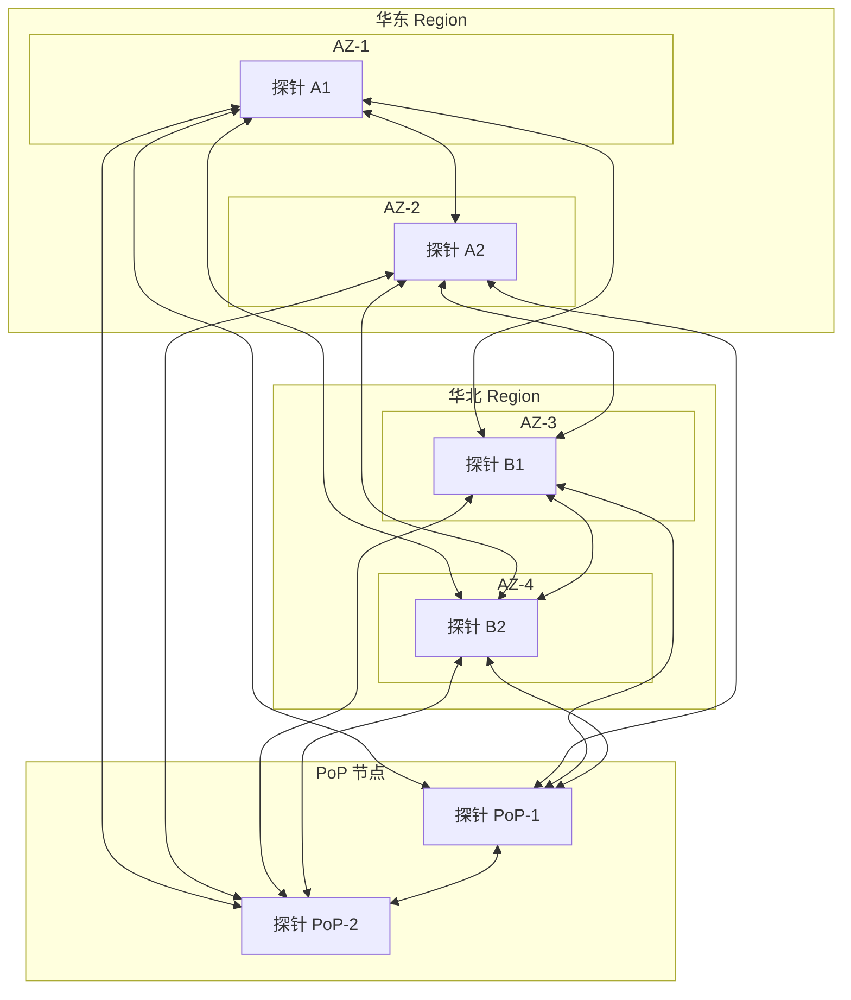
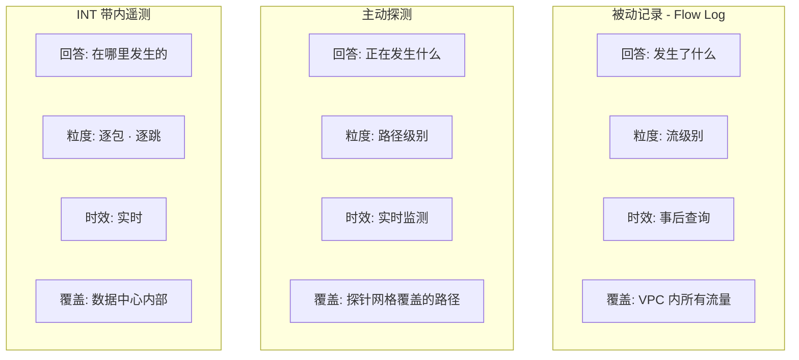

# 28. 在用户感知之前发现故障：主动探测

某家在线交易平台的核心系统部署在华东 Region，通过一条专线连接华北 Region 的灾备中心。专线正常延迟 5ms，稳定运行了两年。

三月的第二周，高频交易团队开始抱怨"最近系统变慢了"。运维团队排查：服务器 CPU 正常，内存正常，数据库查询时间正常，应用日志没有报错。Flow Log 也没有异常——所有流量动作都是 ACCEPT，包数和字节数看起来正常。监控大屏一片绿色。

直到有人手动 Ping 了一下专线对端，才发现延迟已经从 5ms 升到了 15ms。

这条专线经过的某段光纤在老化，信号衰减导致中间路由器频繁重传，延迟在一周内缓慢爬升。问题已经存在了一周，但没有任何机制主动发现它。这正是上一章末尾指出的 Flow Log 的边界：它记录"发生了什么"，但不测量"质量如何"。延迟从 5ms 升到 15ms，流量没有被拒绝，Flow Log 里一切正常。

## 28.1 Ping 能发现问题，但 Ping 不够

运维团队最常用的主动探测工具是 Ping 和 Traceroute。Ping 发送 ICMP Echo Request，测量往返时间（RTT）和丢包率。Traceroute 逐跳发送 TTL 递增的包，记录每一跳的地址和延迟。这两个工具在物理机时代是排障的标配——"网络不通？先 Ping 一下。"

开头的故事里，有人手动 Ping 了一下就发现了问题。那为什么问题存在了一周才被发现？

因为 Ping 需要有人去执行。问题发生在凌晨，没有人在 Ping，问题就这样静悄悄地存在着，直到白天有人注意到"系统变慢了"。这是第一个问题：**手动触发**。

你可能会想，那写个脚本吧，每分钟自动 Ping 一遍所有关键 IP，延迟超过阈值就发告警。这比手动 Ping 好多了，但很快遇到第二个问题：**单点探测**。

从一台机器 Ping 另一台机器，只能反映这一条路径的状态。你的 VPC 里有几十个子网、几百台 VM，子网之间的排列组合可能有上百条路径。你 Ping 了 A 到 B 正常，不代表 C 到 D 也正常。Ping 脚本需要维护一份不断变化的 IP 列表——VM 扩缩容、子网调整、新服务上线，列表永远跟不上变化。

即使你解决了覆盖问题，还有第三个问题：**ICMP 不代表真实流量**。很多网络设备对 ICMP 包做限速或直接丢弃，安全组默认可能不放行 ICMP。更隐蔽的是，ECMP 的哈希基于五元组，ICMP 没有端口号，哈希结果和 TCP 不同——ICMP 和 TCP 走的可能是不同的路径。ICMP 正常不代表 TCP 正常，反之亦然。

最后还有告警逻辑的问题。"延迟超过 10ms 就告警"——但白天高峰期 8ms 是正常的，凌晨 8ms 就是异常的。固定阈值要么误报太多（运维团队每天收到几百条告警，大部分是正常波动），要么漏报（阈值设太高，真正的劣化被忽略）。

这个 Ping 脚本很快变成一个需要专人维护的"小系统"，覆盖不全、误报率高、没人愿意碰。问题的答案不是一个 Ping 脚本，而是一个系统性的主动探测体系。

## 28.2 探针网格：覆盖所有关键路径

Ping 脚本的第一个问题是单点探测，覆盖不了所有路径。解决方案是在网络的关键位置部署探针，让探针之间形成网格（Mesh），覆盖所有可能的路径组合。

一个典型的部署方案：每个 Region 的每个 AZ 部署至少一个探针，每个 PoP 节点部署一个探针，VPC 内部的关键子网（数据库子网、应用子网）各部署一个探针。探针之间两两互探，每个探针向其他所有探针发送探测包。

**图 28.1：探针网格的部署拓扑**



6 个探针形成 15 条探测路径（C(6,2) = 15）。每条路径双向探测，就是 30 条单向探测链路。如果部署 20 个探针，就是 190 条路径、380 条单向链路。探针数量的增长是线性的，但路径数量的增长是平方级的——这是 Mesh 拓扑的固有特征。

覆盖问题解决了。但光有探针还不够，还要决定用什么协议探测、多久探测一次。

## 28.3 探测协议与频率：用什么探、多久探一次

覆盖问题解决了，接下来要回答两个紧密相关的问题：用什么协议探测，以及多久探测一次。协议决定了探测结果能否反映真实流量的体验，频率决定了发现问题的速度。

Ping 的第二个问题是 ICMP 不代表真实流量。那就需要用业务流量实际使用的协议来探测。

**TCP SYN 探测**，向目标发送 TCP SYN 包，等待 SYN-ACK 响应，测量往返时间。TCP SYN 和真实的业务流量走相同的 ECMP 路径（因为有端口号参与哈希），比 ICMP Ping 更能反映业务流量的真实体验。

**HTTP 探测**，向目标发送完整的 HTTP 请求，等待 HTTP 响应。这测试的是七层的可达性和延迟——不仅测试网络是否通，还测试 Web 服务器是否正常响应。如果 WAF 误拦截了某类请求，TCP SYN 探测不会发现（三次握手能完成），但 HTTP 探测会发现（请求被 WAF 拦截，返回 403）。

**UDP 探测**，向目标发送 UDP 包，测试 UDP 路径的质量。对于 DNS、视频流等 UDP 业务，TCP 探测的结果不一定适用。

更通用的做法是混合使用多种协议。关键路径同时用 TCP SYN 和 HTTP 探测，DNS 路径用 UDP 探测。不同的协议测试不同层次的网络质量——TCP SYN 测四层连通性，HTTP 测七层可达性，UDP 测无连接路径。

协议解决了"用什么探"的问题，接下来是"多久探一次"。每秒探测一次，最快 1 秒发现问题；每分钟探测一次，最快 1 分钟发现问题。但频率越高，探测流量本身消耗的带宽和处理资源越多。关键路径（跨 Region 专线、核心业务链路）通常每秒探测一次，非关键路径（内部管理网络、低优先级服务）每分钟探测一次。这是发现速度和资源消耗的权衡。

每次探测记录三个核心指标：

- **时延**（RTT），探测包从发出到收到响应的往返时间。反映路径的传输延迟。
- **丢包率**，发送 N 个探测包，收到 M 个响应，丢包率 = (N-M)/N。反映路径的可靠性。
- **抖动**（Jitter），连续多次探测的时延变化幅度。时延稳定在 5ms 和时延在 2ms-15ms 之间跳动，平均值可能相同，但后者的抖动大得多。对于实时音视频业务，抖动比平均延迟更重要。

时延反映"快不快"，丢包率反映"稳不稳"，抖动反映"匀不匀"。三个指标共同描述一条网络路径的健康状态。

现在有了持续的探测数据，但原始数据本身不能告诉你"有没有问题"——5ms 的延迟是正常还是异常？这取决于这条路径平时是多少。

## 28.4 从原始数据到异常判断：基线与分级告警

Ping 脚本的最后一个问题是固定阈值——"延迟超过 10ms 就告警"不区分路径、不区分时段。解决方案是为每条路径建立动态基线。

主动探测系统持续收集指标，建立每条路径的"正常基线"。华东 AZ-1 到华北 AZ-3 的专线，正常时延 5ms，正常丢包率 0%，正常抖动 0.2ms——这就是这条路径的基线。

基线不是固定值。白天流量高峰期，时延可能比凌晨高 1-2ms，这是正常的。周末和工作日的流量模式不同，基线也不同。探测系统需要学习每条路径在不同时间段的正常范围，区分"正常波动"和"异常劣化"。

有了基线，下一步是把偏离基线的程度转化为可操作的告警。但从指标到告警，中间有一个工程上的难题：告警噪声。

如果告警阈值设得太敏感——"延迟超过基线 1.2 倍就告警"——运维团队每天收到几百条告警，大部分是正常波动触发的误报。一周之后，运维人员开始忽略告警通知。然后某天一条真正的故障告警混在几百条误报里，而被忽略了。告警太多等于没有告警。

如果告警阈值设得太宽松——"延迟超过基线 5 倍才告警"——故障发生时告警来得太晚，用户已经开始感知到延迟了，但运维团队还不知道。

这个矛盾和第 26 章讲的 WAF 误杀/漏放是同一个结构——灵敏度和准确度的永恒权衡。实践中常见的策略是分级告警：

- **P3（观察级）**：指标偏离基线但未超 SLA。延迟从 5ms 升到 8ms，记录但不通知。如果持续超过 30 分钟，升级为 P2。
- **P2（预警级）**：指标接近 SLA 阈值。延迟从 5ms 升到 15ms，通知值班运维，但不触发自动操作。运维人员评估是否需要干预。
- **P1（故障级）**：指标已超 SLA。延迟超过 50ms 或丢包率超过 1%，自动触发预案——自动切换到备用路径、自动扩容、自动通知管理层。

分级的好处是把"正常波动"和"真正的故障"分开处理。P3 级别的波动不打扰任何人，只是记录在案。P2 级别的劣化通知运维但不自动操作，给人一个判断的机会。P1 级别的故障直接触发自动化，因为等人来判断已经来不及了。

但自动化操作本身有风险。如果 P1 告警是误报——比如探针本身出了问题，而不是网络出了问题——自动切换可能导致不必要的流量抖动。这就是为什么自动化预案需要反复验证：探针故障时不误触发、单条路径故障时不影响其他路径、切换后备路径能承载全部流量。

告警系统的终极目标不是"发更多告警"，而是"每一条告警都值得看"。如果运维团队对告警的第一反应是"大概又是误报"，这个告警系统就已经失败了——不是技术上的失败，而是信任上的失败。

## 28.5 探测包的局限：它不是真实流量

探针网格 + 多协议 + 动态基线 + 分级告警，这套体系解决了"持续监测所有关键路径"的问题。但它有一个内在的局限：探测包不是真实的业务流量。

探测包通常很小，一个 TCP SYN 包只有几十字节。真实的业务流量可能是 1500 字节的大包。小包和大包在网络设备上的排队行为不同，大包更容易触发拥塞、更容易被限速。探测包体验到的延迟，不一定是业务流量体验到的延迟。

更关键的是，ECMP 的哈希基于五元组。探测包的五元组和业务流量的五元组不同，它们可能走的是不同的路径。探测包走的路径一切正常，但业务流量走的那条路径正好有问题——探测系统看不到。

有没有一种方式，不发送额外的探测包，而是让真实的业务数据包自己汇报路径信息？

这就是 **INT**（In-band Network Telemetry，带内遥测）的核心思想。

INT 的工作方式是这样的：当一个数据包进入网络时，在包头中预留一段空间。数据包每经过一个网络设备（交换机、路由器），设备在这段空间中写入自己的信息——设备 ID、入端口、出端口、排队延迟、时间戳。数据包到达目的地时，包头中已经记录了完整的路径信息。

**图 28.2：INT 数据包的逐跳信息记录**

```
┌──────────────────────────────────────────────────────────────┐
│                       Source Data                            │
├──────────────────────────────────────────────────────────────┤
│                    INT Header                                │
├──────────────┬───────────────────────────────────────────────┤
│ Hop 1        │ Device: Switch-A                              │
│              │ Ingress Port: 1  │  Egress Port: 3            │
│              │ Queue Delay: 0.2ms                            │
│              │ Timestamp: 14:30:00.001                       │
├──────────────┼───────────────────────────────────────────────┤
│ Hop 2        │ Device: Spine-1                               │
│              │ Ingress Port: 5  │  Egress Port: 12           │
│              │ Queue Delay: 1.5ms                            │
│              │ Timestamp: 14:30:00.003                       │
├──────────────┼───────────────────────────────────────────────┤
│ Hop 3        │ Device: Switch-B                              │
│              │ Ingress Port: 8  │  Egress Port: 2            │
│              │ Queue Delay: 0.1ms                            │
│              │ Timestamp: 14:30:00.005                       │
├──────────────┼───────────────────────────────────────────────┤
│ Hop 4        │ Device: Leaf-C                                │
│              │ Ingress Port: 3  │  Egress Port: 1            │
│              │ Queue Delay: 0.3ms                            │
│              │ Timestamp: 14:30:00.006                       │
└──────────────┴───────────────────────────────────────────────┘
```

这是一个添加了INT数据追加数据的的包结构。一共经过了 4 跳，总延迟约 5ms。INT 信息告诉你：Hop 2（Spine-1）的排队延迟是 1.5ms，占了总延迟的 30%。如果这条路径的延迟突然从 5ms 升到了 10ms，INT 能精确告诉你"多出来的 5ms 花在了 Spine-1 的排队上"——可能是这个端口拥塞了，需要调整流量分配或扩容。

没有 INT，你只知道"这条路径延迟 10ms"，但不知道延迟发生在哪一跳。主动探测能告诉你"路径 A 到 B 延迟升高了"，INT 能告诉你"延迟升高是因为第二跳的交换机排队"。这是从"知道有问题"到"知道问题在哪里"的精度跃升。

但 INT 有明确的适用边界。

第一，INT 需要网络设备的硬件支持。在数据包经过时写入遥测信息，这个操作必须在转发芯片的流水线中完成，传统的交换机芯片没有这个能力。这意味着 INT 不能通过软件升级部署到现有设备上。

第二，INT 信息占用包头空间。每一跳写入 8-16 字节的遥测信息，经过 5 跳就增加了 40-80 字节。对于 1500 字节的标准 MTU 来说，这不是小数目，可能导致分片。

第三，跨云、跨运营商的路径上，中间设备不支持 INT，遥测信息会中断。目前 INT 主要用于数据中心内部网络——在这个范围内，所有设备都在你的控制之下，可以统一部署支持 INT 的硬件。

INT 的理想很美好——每个包都是探针，每条路径都有逐跳的延迟画像。但现实是，它需要整个网络的硬件都支持。在可预见的未来，INT 和主动探测会长期共存：INT 覆盖数据中心内部，主动探测覆盖跨数据中心和跨云的路径。

## 28.6 感知之后：从发现到恢复

让我们回到开头的场景，看看主动探测能改变什么。

专线延迟从 5ms 开始缓慢爬升。第一天升到 6ms，主动探测系统记录到基线偏离，P3 级别，不告警，但数据已经在趋势图上了。第三天升到 8ms，持续偏离超过 48 小时，自动升级为 P2，通知值班运维。运维团队查看趋势图，发现延迟在持续上升，判断可能是链路劣化，提交工单给网络团队排查。第五天，网络团队确认是光纤老化，安排更换。第七天，光纤更换完成，延迟恢复到 5ms。

整个过程中，延迟从未超过 15ms，用户从未感知到异常，SLA 从未被突破。问题在"劣化信号"阶段就被发现和处理了，没有演变成"故障现场"。

这就是主动探测的价值——不是在故障发生后帮你找原因（那是 Flow Log 的工作），而是在故障发生前帮你发现趋势。

**图 28.3：被动记录 vs 主动探测 vs INT 的能力对比**



三者互补：Flow Log 回答"发生了什么"，事后排障、安全审计。主动探测回答"正在发生什么"，实时监测、趋势预警。INT 回答"在哪里发生的"，逐跳定位延迟瓶颈。

但感知到问题只是第一步。主动探测能在几秒内发现专线故障，但从发现到恢复，如果依赖人工操作恢复，整个过程可能持续数十分钟不止。检测已经足够快了，现在瓶颈在恢复阶段。