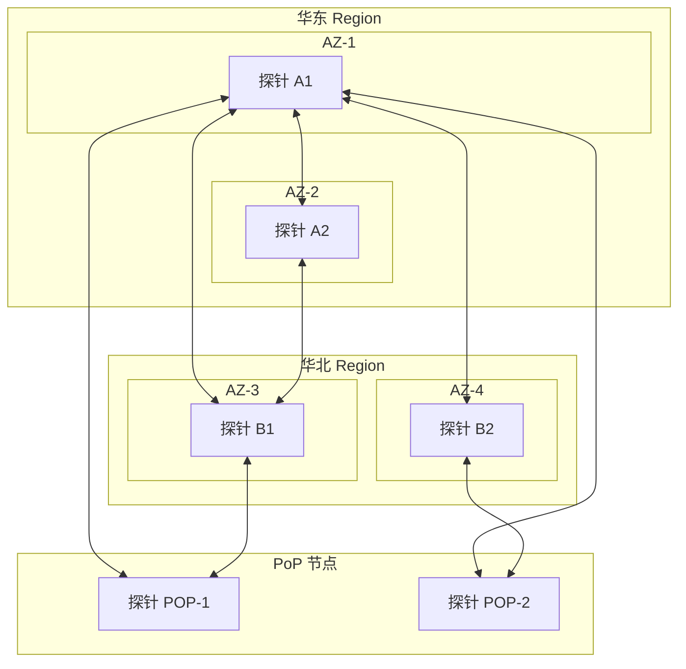
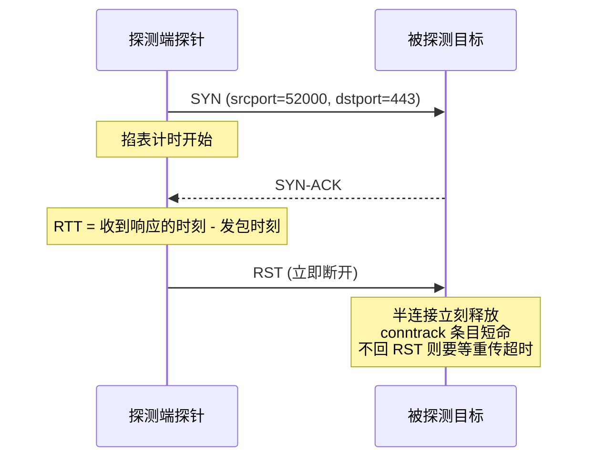
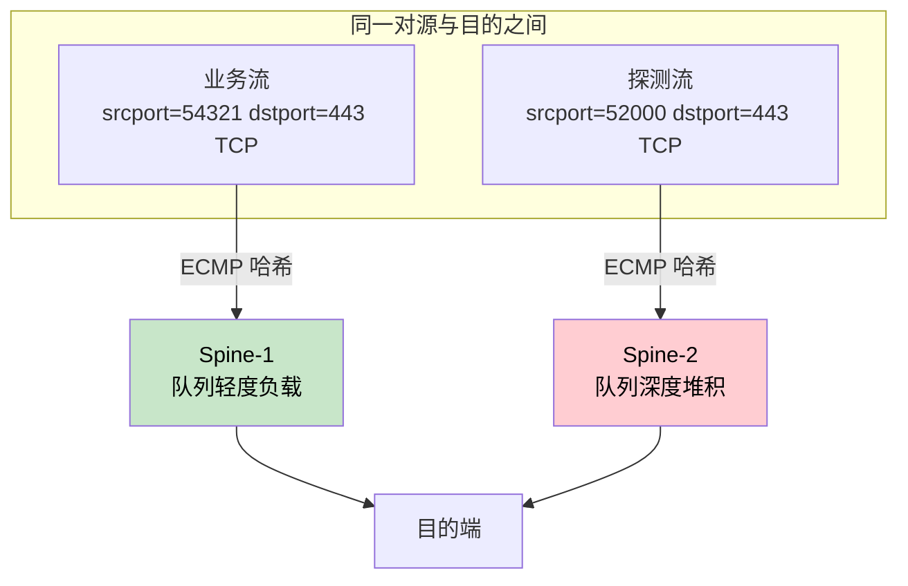
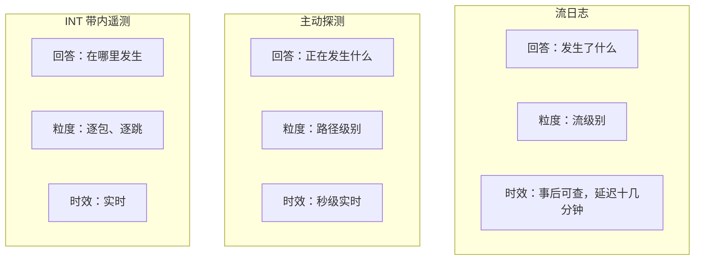

# 29. 在用户感知之前发现故障：主动探测

某在线交易平台的核心系统部署在华东 Region，灾备中心放在华北，两个 Region 之间拉了一条专线，正常延迟 5 毫秒，稳定运行了两年。

三月的某天，高频交易团队开始抱怨系统变慢。运维团队把能查的都查了一遍：服务器 CPU 正常，内存正常，数据库查询耗时正常，应用日志没有一条报错；流日志里也没有任何异常，所有流量的动作都是 ACCEPT，包数和字节数看不出任何问题。监控大屏一切正常。直到有人手动 Ping 了一下专线对端，才发现延迟已经从 5 毫秒爬到了 15 毫秒。专线中途有一段光纤在老化，信号衰减导致链路层反复重传，延迟就在一周里悄悄翻了三倍。这七天里，交易系统的 P99 延迟从 10 毫秒涨到 20 毫秒，高频交易每下一单都要多等 10 毫秒；而应用的超时阈值是 500 毫秒，离触发告警还远得很。

而最危险的故障，往往不把大屏打红，而是藏在那片绿色假象里。

## 29.1 被动记录的天花板

上一章的结尾，我们讲过：流日志记的是流量留下的痕迹，路径本身慢了，它不会告诉你。等到用户开始抱怨，问题早已从恶化信号变成了故障现场。

要发现这种渐进恶化，得有人主动去测量。运维团队手里最顺手的工具是 Ping 和 Traceroute：前者发 ICMP Echo Request，测往返延迟和丢包率；后者让 TTL 逐跳递增，把路径上每一跳的地址和延迟暴露出来。物理机时代，"网络不通？先 Ping 一下"这句话几乎总是管用的。

但回到开头那个故事，问题恰恰出在 Ping 是要有人去执行的。恶化发生在凌晨三点，没有人去 Ping，它就静悄悄地存在着，直到白天有人注意到系统变慢了。

下一步很自然，让脚本替人守夜：每分钟自动 Ping 一遍所有关键 IP，延迟超过阈值就发告警。这一步走对了方向，却很快遇到新的问题：单点探测。从一台机器 Ping 另一台机器，反映的只是这一条路径的状态。一个 VPC 几十个子网、几百台 VM，关键路径是子网之间的排列组合，动辄上百条；VM 扩缩容、子网调整、新服务上线，脚本要维护的那份 IP 清单永远追不上变化。Ping 通了 A 到 B，不能证明 C 到 D 的网络健康。

比测不全更隐蔽的是协议本身的失真。不少网络设备对 ICMP 限速甚至直接丢弃，安全组也常常默认不放行 ICMP，Ping 能不能测到都成问题，测到的数也未必可信。更要紧的是，ECMP 的哈希以五元组为输入，ICMP 报文里没有端口号，哈希落点和 TCP 流量可能压根不同，ICMP 走的那条路畅通，TCP 走的这条路正在丢包，Ping 对此一无所知。

告警逻辑也有类似的问题。延迟超过 10 毫秒就告警，可是白天高峰期 8 毫秒是正常水位，凌晨 8 毫秒就已经不对劲。固定阈值不认识时间，也不认识路径，结果要么误报成灾，要么该报的没报。

这个脚本通常的结局是被越写越大：加 IP 清单自动同步，加时段判断，加多协议探测，最后发展为一个需要专人维护的小系统，误报不断、覆盖不全，最初写它的人离职之后就成了谁也不敢动的祖传代码。问题不在脚本写得好不好，手动工具加胶水，本来就粘不出一套体系。需要的是一套体系：探针分布在关键位置，探测用业务真正在用的协议，判断依据学出来的基线，而不是拍脑袋定的阈值。

## 29.2 探针怎么布：互探网格与服务拨测

要打破单点探测这个困境，需要让探测不再依赖某一台机器：把探针撒到网络的关键位置。撒法有两种，回答的是两个不同的问题。互探网格问的是网络本身健康吗，拨测问的是业务入口从外面看还通不通。先讲互探网格。

互探网格的典型部署是这样：每个 Region 的每个 AZ 至少一个探针，每个 PoP 节点一个，VPC 内的数据库子网、应用子网这些关键位置各一个。探针本质上是一段常驻的轻量程序，有时就是一台最小规格的 VM，住在全国乃至全球的各个角落，干着最单调的活：按固定频率向其他所有探针发包、掐表、记数，同时开着一个端口，应答别的探针发来的探测。探针既是发起方，也是被探测方，彼此互探，织成一张网格。

**图 29.1：互探网格的部署拓扑（图中仅画出部分探测路径，实际为任意两探针间的全连接双向探测）**



6 个探针两两互探，路径数是 C(6,2) = 15 条，双向探测就是 30 条单向链路；部署 20 个探针，路径数变成 190 条、单向链路 380 条。探针数量的增长是线性的，路径数量的增长是平方级的。好消息是探测包本身极小，380 条链路、每秒一次探测，带宽消耗可以忽略不计；但真正要管理的是平方级的路径数带来的数据规模和告警规模。

平方级的增长势头，得靠分层来解决。全连接的网格只保留在 Region 内部这种探针数量可控的范围；跨 Region、跨 PoP 的探测，由每个 Region 选出的边界探针作为代表参与互探。这样路径数从平方级回到线性级，代价是跨 Region 只测边界探针之间的路径：某台普通探针到对面的路径出了问题，要等边界探针的数据露出异常，再回头做二次定位。

这套打法在工业界的标杆，是微软 2015 年公开的 Pingmesh 系统：数据中心内部，每台服务器上跑一个轻量探针，两两互测，把每一条路径的延迟持续记录下来。之所以敢用全连接，是因为范围收在数据中心内部，路径数还管得过来；出了这个范围，跨域的探测就得靠边界探针代表各 Region 去跑。后来各家厂商的互探网格，多半还是这个思路的变体。

拨测是另一种做法，回答的是另一个问题。租户关心的是自己的业务入口，从各处看过去怎么样。对端是租户自己的服务，用不着也装不了探针，探针只管向服务端口发探测：TCP 连一下端口，或者发一个 HTTP 请求，被探测的一方什么都不用装。探针可以放在 VPC 里，探应用子网到数据库子网的内部链路，也可以放在各个地域、各家运营商的网络里，探公网入口。账也好算，探针数乘以目标数，随目标线性增长，没有互探那种平方级的膨胀。国内云厂商把这层能力做成了产品，习惯叫拨测；开源界也有类似形态，Prometheus 生态的 Blackbox Exporter、Google 开源的 Cloudprober，配置里写上目标地址和端口，装在哪个节点上，哪个节点就是一个探针。

把两种做法摆在一起看：

| | 互探网格 | 拨测 |
|---|---|---|
| 探什么 | 网络本身：探针到探针的路径 | 业务入口：探针到服务端口 |
| 对端要不要装探针 | 要，每个节点既发又收 | 不要，服务在监听就行 |
| 规模怎么增长 | 随探针数平方增长，要分层 | 探针数乘目标数，线性 |
| 谁在用 | 云厂商，测底座、兑现 SLA | 租户，测自己业务的可用性 |

两种做法看见的是不同的网络：互探网格看得清底座，却看不见租户业务的行为；拨测看得见业务入口，却摸不到宿主机以下的转发细节。说到底，两种做法都是自动化的 Ping，只是不再等人手动触发。

## 29.3 用什么探、多久探一次

TCP SYN 探测是四层的主力。向目标端口发一个 SYN，掐表等 SYN-ACK 回来，往返延迟就有了着落。这个端口在互探里是对端探针开的，在拨测里是业务服务开的，做法一样。它的五元组是完整的，参与 ECMP 哈希时被当作真实流量对待，按端口放行的安全组策略也不会阻拦。只是单次探测的五元组终究由探针自己发起，哈希落进的是候选路径中的某一条，至于是不是业务流正在走的路径，探测本身说不准。

而容易被忽略的细节在收尾上：探测端收到 SYN-ACK 之后，必须立刻回一个 RST。不回的话，被探测一侧的半连接队列里，这条连接要等 SYN-ACK 重传超时才能释放。如果探测频率一秒一次、目标几百个，一分钟就是几万条等着超时的半连接，探测系统自己发起了一场小型 SYN Flood。这是第 26 章讲过的攻击机制，换了个身份出现在监控体系里。

**图 29.2：TCP SYN 探测的完整交互**



但四层通不代表七层通，所以还需要 HTTP 这类七层探测，确认应用层是否健康：发一个完整的 HTTP 请求，等响应。它能发现四层探测抓不到的问题，比如 WAF 把某类请求误拦了，三次握手一切正常，TCP SYN 探测判定健康，HTTP 探测却会拿到一个 403。UDP 探测负责无连接的路径，比如 DNS、视频流这类 UDP 业务。只是 UDP 探测的结果要模糊得多，发出去的包石沉大海时，分不清是路径丢了、还是对面收到了但按规则没有回应。生产环境的做法通常是混合：关键路径同时跑 TCP SYN 和 HTTP，DNS 链路专门跑 UDP。

探测协议有了，还得定探测频率。每秒探测一次，是不是最快 1 秒就能发现问题？不是，单次探测失败不足以判定故障，正常网络也有偶发丢包，探测包自己也可能恰好被哈希进一条瞬时拥塞的路径。判定要等连续 N 次失败：N 取 3、间隔 1 秒，从故障发生到确认，最快 2 秒、最慢 3 秒。所谓秒级发现，真实含义是 N 乘以探测间隔，这个 N 是检测速度和误判率之间的权衡，这和后面告警分级要面对的是同一类问题。实践中关键路径每秒探测，普通路径每分钟探测，再高的频率就没有必要了，毕竟探测流量本身也在消耗带宽。

一次探测，到手的只是一个样本：这一趟往返花了多久，或者干脆没有回音。延迟、丢包、抖动这三个指标，得把一段时间里的样本放在一起算。往返延迟（RTT，Round-Trip Time）看快不快，取的是这批样本的平均水平；丢包率看稳不稳，算的是发出去的探测包里有多少没回来；抖动看匀不匀，量的是延迟忽高忽低的幅度。同样是平均 5 毫秒，一条路一直稳在 5 毫秒，另一条在 2 到 15 毫秒之间来回跳，用起来完全是两回事。对实时音视频来说，抖动比平均延迟更要命。

这三个指标还有一个共同的局限：量的都是往返。跨 Region 专线和公网路由里，非对称路由极其普遍，去程走一条光缆、回程走另一条是常态。RTT 从 5 毫秒涨到 15 毫秒，只知道去回程加起来慢了 10 毫秒，分不清是去程的病还是回程的病。要把两边拆开，得靠两端高精度对时之后的单向测量，OWAMP（One-Way Active Measurement Protocol，单向主动测量协议）就是干这个的标准协议，TWAMP（Two-Way Active Measurement Protocol，双向主动测量协议）则是它的双向会话版本。代价不低，两端时钟要同步到亚毫秒级，普通场景很少铺到这一步，只有骨干链路这类高价值路径才值得。

但刚测出来的数字本身还不构成判断。5 毫秒是好是坏，取决于这条路径平时是多少，这就要轮到基线出场了。

## 29.4 从测量到判断：基线、SLA 与分级告警

固定阈值的症结，是它把一条路径当成了一条恒定不变的线，把一天当成了均质的 24 个小时。真实的路径延迟有周期：白天流量高峰时高几毫秒属正常，周末和工作日的曲线形状不同，跨 Region 专线在两地业务高峰叠加的时段还有自己独特的节律。基线要做的，就是分路径、分时段地识别正常的边界。算法上，滑动窗口、指数加权移动平均（EWMA，Exponentially Weighted Moving Average）这些第 26 章在异常检测里出场过的老朋友，在这里干的是同一件事：给一条随时间抖动的曲线，画出正常的包络。

比基线再往上一层，是拿测量数据去核对对外的承诺，这份承诺就是 SLA（Service Level Agreement，服务等级协议）。云厂商为网络服务承诺的典型条款：可用性 99.95%、Region 内延迟小于 2 毫秒、跨 Region 延迟小于 50 毫秒、丢包率低于 0.01%。99.95% 是什么概念？一个月按 30 天算，0.05% 的不可用时间是 21.6 分钟；99.99% 是 4.3 分钟，99.9% 是 43.2 分钟。小数点后每多一个 9，每月允许的故障预算就缩短一个数量级。这些数字不是写进合同就完了，每一分钟、每一毫秒的承诺，背后都得有持续的测量数据兜底。SLA 是写在合同里的承诺，探测体系是履约的证据，没有测量，承诺就只是承诺。

有了基线和 SLA，从指标到动作的路，还要穿过告警噪声这片沼泽。

阈值设得灵敏，延迟超过基线 1.2 倍就告警，运维团队一天收几百条告警，绝大多数是正常波动；一周之后没人再看告警通知，某天真正的故障就混在里面被放过去了。阈值设得宽松，超过基线 5 倍才告警，等告警响起时用户早已感知。灵敏度和准确度的这对矛盾，第 27 章 WAF 的误杀与漏放已经完整演示过一遍，换成告警系统，结构一模一样。告警太多，等于没有告警。

实践中的解法是分级，不同级别的信号交给不同的人，用不同的速度处理：

- 观察级（P3）：指标偏离基线但未触 SLA。延迟从 5 毫秒升到 8 毫秒，记录、画趋势，不打扰任何人；持续超过 48 小时才升级。
- 预警级（P2）：接近或触碰 SLA 阈值。延迟升到 15 毫秒，通知值班运维，但不自动动作，留给人判断。
- 故障级（P1）：明确超限。延迟超过 50 毫秒或丢包率过 1%，直接触发预案，切换备用路径、扩容，同时通知相关负责人。

故障级的自动动作要格外小心，因为告警会冤枉人。探针自己所在的宿主机出了问题，指标一样会恶化，网络却没有病；单条路径抖了一下，不等于整片网络都该切；就算真该切，备用路径接不接得住全部流量，也得事先验证。预案上线之前，这些情况都得在演练里反复跑过。

至于各级阈值取多少、第几级才允许触发自动动作，没有标准答案。交易系统宁可误报一百次也不漏一次，内部管理网络正相反，灵敏度可以放宽一些，换来告警的可信度。这份偏好，只能业务自己给。

如果运维团队对告警的第一反应是"大概又是误报"，这套告警系统就已经失败了，不是技术上的失败，是信任上的失败。信任一旦没了，后面做得再准，也没人看了。

## 29.5 让业务包自己汇报：INT 与逐跳遥测

一个 TCP SYN 探测包只有几十字节，而真实业务流量里挤满了 1500 字节的大包。小包在队列里排得快、走得急，大包更容易触发拥塞和限速，探测包体验到的延迟，天生偏乐观。更根本的差别在于走过的路径：业务流量有成千上万条连接，各自的五元组不同，ECMP 把它们天然铺满所有候选路径；探测流就固定的那几条，既铺不满，也追不上。探测流一路绿灯地回来交差，业务流堵在哪条路上，探测系统看不见。

**图 29.3：探测流与业务流在 ECMP 哈希下的路径分叉**



探测体系也有应对的办法。既然单次探测只落在一条路径上，那就多探几次，每次换一个源端口，把 ECMP 的候选路径轮流探一遍。Paris Traceroute 的多路径探测模式就是这个思路：固定五元组，能把一条路径从头到尾看清楚；轮换源端口，能数出总共有几条路径，再分别测各自的延迟和丢包。但这样探出来的仍然是抽样：轮到某条路径时测一次，下一轮来之前，这条路径上发生的事，探测看不到。

要让测量和业务同路，最彻底的办法是干脆不另发探测包，让真实的业务包自己汇报一路的见闻。

这就是带内遥测（INT，In-band Network Telemetry）的思路。数据包出发时，包头里预留一段空间；每经过一个转发设备，芯片就往这段空间里写一行：我是谁、从哪个进、往哪个出、排队排了多久、几时几分离开。包到达终点时，一路的行程单已经写满。

**图 29.4：携带 INT 追加数据的报文（4 跳，总延迟约 5 毫秒）**

```
┌──────────────────────────────────────────────────────────────┐
│                       Source Data                            │
├──────────────────────────────────────────────────────────────┤
│                    INT Header                                │
├──────────────┬───────────────────────────────────────────────┤
│ Hop 1        │ Device: Switch-A                              │
│              │ Ingress Port: 1  │  Egress Port: 3            │
│              │ Queue Delay: 0.2ms                            │
│              │ Timestamp: 14:30:00.001                       │
├──────────────┼───────────────────────────────────────────────┤
│ Hop 2        │ Device: Spine-1                               │
│              │ Ingress Port: 5  │  Egress Port: 12           │
│              │ Queue Delay: 1.5ms                            │
│              │ Timestamp: 14:30:00.003                       │
├──────────────┼───────────────────────────────────────────────┤
│ Hop 3        │ Device: Switch-B                              │
│              │ Ingress Port: 8  │  Egress Port: 2            │
│              │ Queue Delay: 0.1ms                            │
│              │ Timestamp: 14:30:00.005                       │
├──────────────┼───────────────────────────────────────────────┤
│ Hop 4        │ Device: Leaf-C                                │
│              │ Ingress Port: 3  │  Egress Port: 1            │
│              │ Queue Delay: 0.3ms                            │
│              │ Timestamp: 14:30:00.006                       │
└──────────────┴───────────────────────────────────────────────┘
```

一张写满的行程单能读出什么？这条 4 跳的路径总延迟约 5 毫秒，INT 数据显示第二跳 Spine-1 的排队延迟是 1.5 毫秒，占了三成。当这条路径的延迟涨上去时，多出来的几毫秒花在了谁的队列里，数据直接指认。主动探测只能说"这条路变慢了"，INT 能说"慢在第二跳的排队上"——从知道有问题，到知道问题在哪一跳。

INT 不是逐跳遥测唯一的形态，它还有个孪生兄弟叫明信片模式：数据包保持原样一个字节不动，每个设备把自己观测到的信息装进一份独立的小报文，直接寄给收集器。包头不膨胀、不用操心 MTU，代价是每一跳都要额外发出一份上报流量，全网设备数乘以包速率的数据量，收集器得接得住。带内省的是上报流量，花的是包头空间；明信片正相反。这一族机制在标准里统称 IOAM（In-band OAM，带内操作管理维护），目前最主要的落地载体是 P4 可编程交换机，就是第 26 章清洗集群的规则匹配里提过的那类设备，可编程转发芯片恰好能在流水线里顺手完成逐跳写入。

INT 的边界也清楚。写入遥测信息要在转发芯片的流水线里完成，传统交换机的 ASIC 没有这个能力，软件升级补不出来，这决定了它只能跟着新硬件一代一代铺开。包头里每过一跳要写入 8 到 16 字节，五跳就是 40 到 80 字节，1500 字节的 MTU 经不起这样反复加装，得整网协商更大的 MTU 或者做分片管理。最要命的是范围：跨云、跨运营商的路径上，中间设备不归你管，遥测信息走到边界就断了。所以今天 INT 的主场是数据中心内部，所有设备都在同一个管理者手里，可以统一规划硬件和 MTU；出了数据中心，跨 Region、跨云的路径，还是主动探测的天下。两者的关系不是竞争，而是分工。

理想中，每个业务包都是一枚自带的探针，每条路径都有逐跳的延迟画像。现实是它依赖整网硬件换代，这个前提在跨域场景里短期难以成立。在可预见的未来，INT 守边界内的精度，主动探测守边界外的覆盖，各安其位。

## 29.6 感知之后

回到开头那条专线，看看这套体系在场的话，那七天会怎么走。

第一天，延迟从 5 毫秒爬到 6 毫秒，探针记录到基线偏离，观察级，不告警，但趋势图上多了一个点。第三天，8 毫秒，持续偏离超过 48 小时，升级成预警级，值班运维收到通知，看趋势判断出这是持续恶化而不是抖动，给网络团队提了工单。第五天，排查确认是光纤老化，备件和割接窗口排上。第七天，光纤换掉，延迟回到 5 毫秒。

整个过程延迟没有超过 15 毫秒，用户没有感知，SLA 没有被击穿。问题在恶化信号阶段就被接住，没有机会长成故障现场。

**图 29.5：三层可观测能力对比**



换个维度横向摆一摆，三种手段的账各不相同：

| | 流日志 | 主动探测 | INT |
|---|---|---|---|
| 数据从哪来 | 业务流量留下的记录 | 额外发出的探测包 | 业务包自己携带 |
| 额外开销 | 存储与查询 | 探测流量与探针资源 | 包头空间与硬件换代 |
| 拓扑感知 | 无 | 路径级 | 逐跳级 |
| 主要盲区 | 时序与延迟被聚合抹掉 | 采样追不上业务的散布 | 出了数据中心就断 |

但感知到问题，离恢复业务还有一段路。探测体系 5 秒就能确认一条专线断了，接下来的剧本却是：告警通知值班、值班确认故障、登录路由器改 BGP 路由权重、等路由收敛生效，十几分钟过去，这期间跨 Region 的数据同步和 API 调用还在那条坏专线上继续跑。检测已经快到秒级，慢的是人。

能不能把这十几分钟里人的工作，也交给网络自己？等价路径之间的自动重哈希、毫秒级的 BFD（Bidirectional Forwarding Detection，双向转发检测）链路检测、控制主备优先级的路由属性，这些机制在路由协议里已经躺了很多年，缺的是把检测和切换组织成闭环的架构。

那片绿色的监控大屏并没有骗人，它只是忠实汇报了自己被允许看见的东西。要让一切正常这四个字说得和用户的体感一样有底气，网络得先学会自己给自己做体检。
