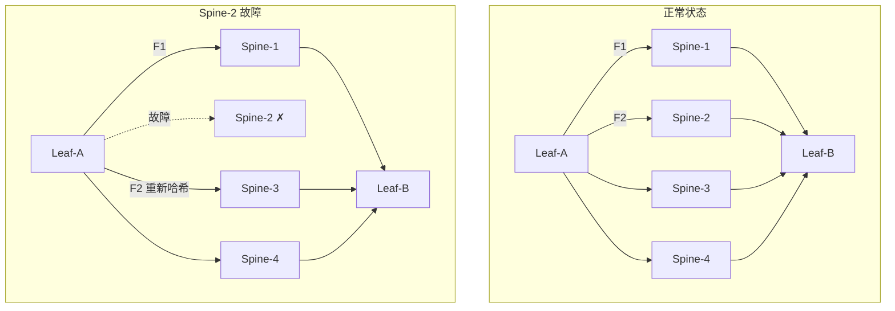
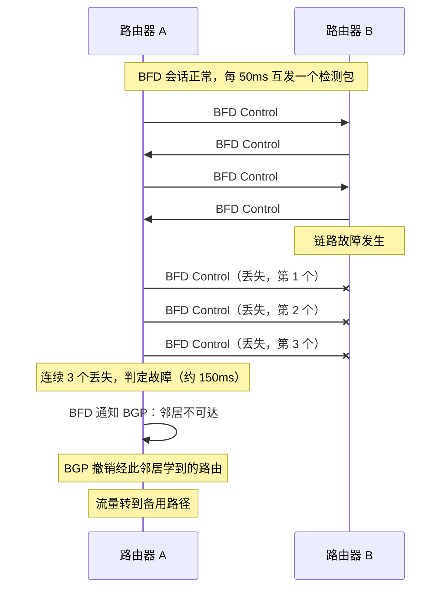
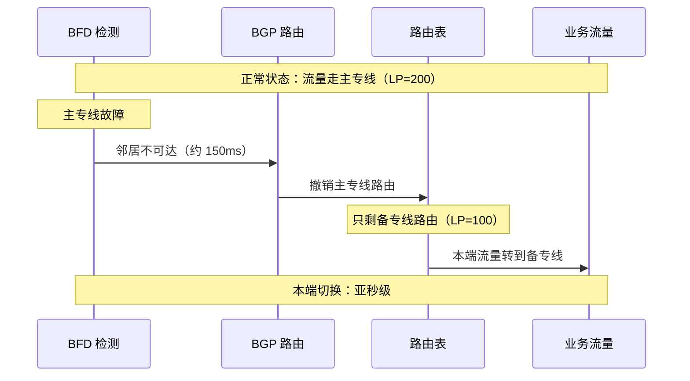
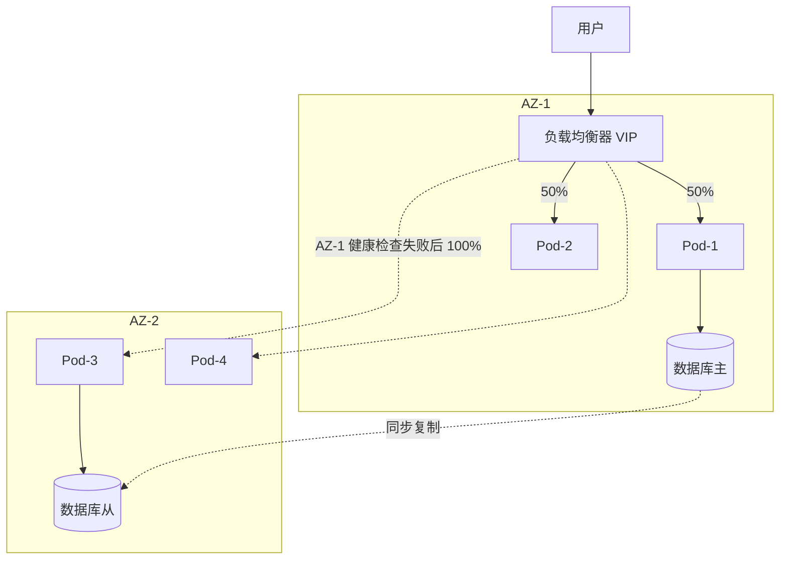
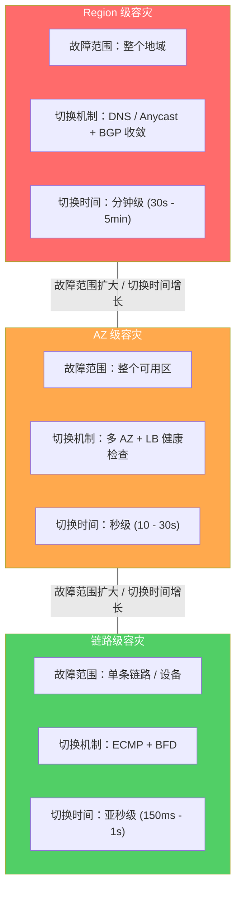

# 30. 故障时如何自救：多路径与网络层容灾

华东到华北的专线断了。探测系统 5 秒内就发现了，P1 告警随即触发。值班运维确认告警，登录路由器，修改 BGP 路由权重，等流量切过去，业务恢复时，已经过去了 15 分钟。

这 15 分钟里，跨 Region 的数据同步全部超时，API 调用成批失败，数据库复制中断。发现只花了 5 秒，恢复却花了 15 分钟。我们花了很大力气把检测做到秒级，最终拖慢修复进度的是人工执行。

## 30.1 人在回路里的代价

把那 15 分钟拆开看：5 秒检测，2 分钟通知，3 分钟确认，5 分钟操作，3 分钟生效。加起来大约 13 分钟，剩下的是排队和等待，每一段交接都有空隙。检测只占 5 秒，余下全是人的环节。

这些环节很难再压缩。就算团队 7×24 值班、响应极快，从看到告警、判断是不是误报、登录路由器，到找对配置命令、执行、等生效，人工操作的下限也在 5 到 10 分钟。对一个每秒处理上万笔订单的交易系统，10 分钟就是几百万笔订单受影响，所以问题不在运维团队不够快。只要流程里有人，就有人的速度限制。

解决方案简单直接：把人从流程里拿掉。网络本身若有备用路径，检测到故障就自动切过去，不用人登录，不用人改配置，切换时间能压到多短？

这得有备用路径可切，有办法在秒级甚至毫秒级发现主路径坏了，还得有机制在发现之后自动完成切换。少一样都不行：没有备用路径，发现了也无路可走；检测慢，业务早已受损；切换靠人，又回到 15 分钟的老路。

好在这几样，网络里都有成熟的机制，分散在不同的协议里，各管一段。

## 30.2 ECMP：多路径冗余

冗余从哪里来？最现成的答案就在拓扑里。Fat Tree 里从一台 Leaf 到另一台 Leaf，有多条经过不同 Spine 的等价路径，路由器对每条流的五元组做哈希，把它们分摊到各条路径上，这就是 ECMP（Equal-Cost Multi-Path，等价多路径）。它设计出来是为了分担负载，冗余是顺带的：4 条路径平时各承载约 25% 的流量，Spine-2 宕机之后，路由器把路径数从 4 改成 3，原来走 Spine-2 的流重新哈希，各路径的负载升到约 33%，所有流量依然能走通。

**图 30.1：ECMP 路径失败时的流量重新分配**

这个过程看起来很简单，但有一个细节值得一说。常见的做法是把五元组哈希之后，对路径数取模，决定走第几条路径。路径数从 4 变成 3，取模的除数变了，几乎所有流的落点都会跟着变，不只是原来走 Spine-2 的那四分之一。所以，一台 Spine 宕机，受到扰动的是整个 Leaf 上的大部分流。工业界对此的改良是一致性哈希，或者交换机里常说的弹性哈希，让路径数变化时只有出问题的那部分流需要挪位置，其余的保持原样。

即便只挪一部分，已有的连接换了路径也不是没有代价。TCP 靠序列号处理乱序，路径变化引起的短暂乱序，接收端会重新排好，应用感觉不到。真正的风险在路径上的有状态设备。负载均衡节点的 conntrack 是本地状态，同一条 TCP 连接的包必须落到同一个节点，换了节点就没有这条连接的记录，包会被丢掉或者重置。防火墙、NAT 网关也是同样的道理。ECMP 重新哈希之后，如果新路径上的设备里没有这条连接的状态，这条连接就断了。新建立的连接没有这个问题，所以 ECMP 的切换对新连接无感，对已有连接则是部分有损。

ECMP 的冗余还取决于另外两个条件。第一，得知道哪条路径坏了。如果是物理链路 Down，比如光纤断了、设备断电，硬件在毫秒级就能感知，网卡的链路状态直接从 Up 变成 Down。可如果是链路物理层完好、中间某台设备的转发引擎出了问题，丢掉一半的包却不断链，物理层检测看不到，路由器还当这条路径是通的，继续往里送流量。这种半死不活的状态比彻底断链更危险，因为它不触发任何自动切换。第二，得有等价路径可选。数据中心内部的 Fat Tree 天然满足，但华东到华北可能只有一条专线，没有等价路径，ECMP 无从谈起。

所以，ECMP 解决了冗余的一部分：有路径可迁。但它需要有人告诉它哪条路径出了问题，这个问题在物理层看不见的故障上尤其突出。

## 30.3 BFD：把检测压到毫秒

谁来告诉路由器路径坏了？最现成的是路由协议自己。BGP 靠 Keepalive 消息确认邻居还活着，RFC 4271 建议的 Hold Time 是 90 秒，Keepalive 的发送间隔取其三分之一，也就是 30 秒一次。连续 90 秒没有收到对端任何 Keepalive 或更新消息，判定邻居失败，撤销从它那里学到的路由。不同厂商的默认值并不相同，有的设备默认 180 秒。

在一个跨 Region 交易系统里，等 90 秒才发现专线断了，这 90 秒里每笔跨 Region 的交易都在失败。

那把 Hold Time 调小呢？可以，标准允许最小设到 3 秒。3 秒比 90 秒强多了，但仍然是秒级，而且代价不小。网络偶尔抖动，一个 Keepalive 因拥塞晚到 2 秒，Hold Time 设成 3 秒的会话就会误判邻居失败，触发路由收敛。路由收敛本身会造成短暂的流量中断，误判带来的中断可能比故障本身还糟。BGP 的 Hold Time 不是为快速检测设计的，它要在合理时间内发现邻居失败，又不能被抖动轻易干扰，90 秒是一个保守的折中。

所以需要另一个机制，独立于路由协议，专门做快速检测。这就是 BFD（Bidirectional Forwarding Detection，双向转发检测）。它的做法简单到近乎朴素：两台相邻的路由器之间建立一个 BFD 会话，以很高的频率互相发检测包，你发一个我发一个。双方协商两个参数，一个是检测间隔，常见的是 50 毫秒或 100 毫秒，一个是检测倍数，常见的是 3。连续 3 个检测包没有收到对端的回应，就判定链路故障。以 50 毫秒的间隔计，150 毫秒就能下结论，对比 BGP 的 90 秒，快了 600 倍。

**图 30.2：BFD 检测与 BGP 联动的时序**

BFD 本身不做路由切换，它只负责检测。检测到故障之后，它通知关联的 BGP 或 OSPF，由路由协议撤销通过这条链路学到的路由，路由表里的下一跳随之换掉。分工很清楚：BFD 回答什么时候坏了，路由协议回答坏了之后怎么办。

BFD 最有价值的地方，是它能发现 30.2 里说的那种半死不活的故障。物理层检测只看链路亮不亮，BGP 的 Keepalive 走的是控制面，转发引擎坏了它也可能照常收发。BFD 的检测包走的是数据面，从对端那里收不回来，就说明这段转发路径上一定有问题。检测包很小，只有 24 字节的控制报文，加上 UDP 和 IP 头不到 60 字节，不携带路由信息，不做协议协商，唯一的功能是我还活着。极简的设计让它可以在转发芯片里直接处理，不用送到 CPU，所以哪怕路由器 CPU 满载，BFD 的检测也不受影响。

不过，BFD 的检测范围要说清楚。标准的 BFD 检测的是两台直连相邻设备之间的转发路径。对端运营商网络深处某个节点出了问题，BFD 看不到，那得靠主动探测这类端到端的测量去发现。

BFD 也有自己的代价，而且正好是它优势的另一面。50 毫秒的间隔，比 BGP 的 3 秒还激进得多，抖动一下就可能误判，所以检测倍数设成 3，就是要容忍偶发丢包。可就算这样，链路质量处在临界状态时，BFD 会话反复 Down、Up，每一次 Down 都会触发一轮路由撤销和重新宣告，BGP 跟着抖，把网络搅得更不稳。如果一台路由器维护 1000 个 BFD 会话，每个 50 毫秒发一个包，每秒要处理 2 万个包，高端设备有硬件支撑，不成问题，软件路由器和低端设备就会明显感觉到压力。检测越快越灵敏，也越吃资源，越容易误判，这是又一个灵敏度和稳定性的权衡。

没有 BFD，ECMP 和 BGP 都有切换的能力，却不知道该在什么时候切。BFD 把这个时间，从分钟级压到了毫秒级。

## 30.4 专线主备与 BGP 路由控制

ECMP 解决的是数据中心内部的冗余，那里的路径天然等价。跨 Region 就不一样了。华东到华北通常不会只靠一条专线，企业会拉两条，主专线走运营商 A 的光缆，备专线走运营商 B 的光缆，物理路径完全分开。两条专线的带宽、延迟、成本都可能不同，它们不等价，也就不能用 ECMP 平摊。需要的是另一种控制：平时走主，坏了才走备。

BGP 的路由选择天然支持这种控制。两条专线都通过 BGP 宣告华北 Region 的同一个目的网段，路由器收到两条路由，按属性挑一条优先级高的。最直接的属性是 Local Preference，本地优先级，数值越大越优先。主专线的路由设成 200，备专线设成 100，路由器会一直选主专线，除非主专线的路由消失。主专线故障时，BFD 在约 150 毫秒内检测到，通知 BGP 撤销这条路由，路由表里只剩备专线的那条，路由器自然选它，流量就切过去了。

**图 30.3：专线主备切换的完整链路**

这条链路里有两个时间尺度要分开看。BFD 检测加上本地撤销路由、改下一跳，是本端的切换，毫秒到亚秒级，因为备用路由本来就在路由表里，只是平时优先级低。另一个是全网收敛：BGP 把撤销的消息通告给对端和上游，对方要重新计算最优路径，中间还受路由通告间隔这类计时器的影响，RFC 4271 对这个间隔的建议值，EBGP 是 30 秒，IBGP 是 5 秒，实际设备的默认配置多有调整。本端不再往坏链路上发包，是亚秒级的事；对方也不再往坏链路上发包，可能要几秒到几十秒。同一条链路上，说切换是亚秒级还是几十秒，要看说的是哪一端。

还有一个更容易被忽略的方向性问题。Local Preference 只在一个自治系统内部传播，不会通过 eBGP 带给对端，所以它只能决定我这一端发出去的流量走哪条专线。对端发回来的流量走哪条，要靠别的办法去影响，比如在备专线的路由里人为拉长 AS Path，让对端觉得这条路更远（AS Path Prepend），或者用 MED 向对端表达从哪个入口进来更好。只设了 Local Preference，去程走主专线，回程却可能走了备专线，去回程不对称，RTT 解释不了的那类问题就是这么来的。

主专线恢复之后还有一个问题：要不要回切。光纤修好了，BFD 检测到链路恢复，BGP 重新学到 Local Preference 200 的路由，路由器发现它优先级更高，自动把流量切回主专线。听起来很合理。但如果这条光纤修得并不彻底，信号时好时坏呢？恢复，切回，30 秒后又断，切到备专线，1 分钟后又恢复，又切回。每次切换都会带来短暂的中断，TCP 连接可能因为路径变化超时，UDP 可能丢包。这就是路由震荡，频繁切换比一直走备专线还糟。

常见的应对有两种。一种是抑制：主专线恢复后不立即回切，要稳定一段时间，比如 5 分钟，这期间再出现故障就重新计时。另一种更保守：不自动回切，等运维确认主专线确实稳定，再手动切回，牺牲一点自动化，换来确定性。两种做法背后是一个非对称的取舍：故障时每一毫秒都是损失，切要快；恢复时没有损失在流血，多等一会儿的代价，远小于刚切回去又断一次。切过去要快，切回来要慢。

主备的冗余方案不只有两条专线，IPSec VPN 也可以做备份：专线做主路径，专线断了自动切到 VPN。业务不中断，只是延迟和带宽不如专线，换来的是成本低得多。两条专线切换后体验无感，成本翻倍；专线加 VPN 成本低，切换后性能下降。选哪个，取决于业务对降级的容忍度。

自动化的容灾有它的反面。Facebook 2021 年 10 月 4 日的全球性中断，起因也是 BGP。那天一次例行的骨干网维护中，一条用来评估骨干网容量的命令，意外断开了骨干网的全部连接，本该拦住这类错误的审计工具有个 bug，没有拦住。Facebook 的 DNS 服务器有一条自保规则：如果自己连不上数据中心，说明网络有问题，就撤销自己的 BGP 宣告，不再对外服务。骨干网一断，所有数据中心的 DNS 服务器同时检测到连不上，同时撤销了宣告。DNS 服务器仍在运行，但互联网上找不到它们，也就找不到 Facebook 的任何服务。更糟的是，主网络和带外管理网络同时不可用，工程师只能赶到现场，而机房的物理安全设计又让进入和操作都很慢。

这件事放在回切之后讲，是因为它说明了自动化的另一面。连不上就自我下线，单独看是合理的规则，目的是不对外提供坏服务。可当所有节点同时满足这个条件，合理的规则加起来，就成了一场同步的集体退场。网络层的自动容灾给了速度，也让一个错误的操作传播得和正确的操作一样快。

## 30.5 多 AZ 与跨地域容灾

ECMP、BFD、专线主备，对付的都是链路和设备级的故障：某条链路断了、某台设备宕了。可要是故障的范围更大呢？

我们再回顾下云厂商基础设施是怎么分层的。Region 是一个地理区域，对应一个城市或城市群；一个 Region 里有多个 AZ（Availability Zone，可用区），每个 AZ 是物理上独立的数据中心，有独立的电力、冷却和网络接入；同一 Region 的 AZ 之间用低延迟的专用光纤相连，延迟通常 1 到 2 毫秒，但不共享单点故障源。这样分层，是为了把故障限制在尽可能小的范围里：一台服务器宕机只影响一个机架，一个机架断电只影响一个 AZ，一个 AZ 出问题不应该波及同一 Region 的其他 AZ。

AZ 之间互不影响，这个前提什么时候会被打破？阿里云 2022 年 12 月 18 日的香港可用区 C，给了一个具体的答案。那天上午 8 点 56 分，机房通道温控告警，排查发现冷却系统缺水进气，形成气阻，4 台主冷机同时异常。按应急预案做主备切换，4 台备冷机同样起不来，因为主备冷机共用同一套冷冻水循环系统，气阻挡住的是同一条水路。冷却失效，包间温度持续升高，服务器陆续停机，其中一个包间达到临界温度触发了消防喷淋，电源柜和多列机柜进水，部分硬件损坏。补水之后，冷机又因为群控逻辑不能单台启动，只能手工改配置逐台拉起。官方复盘称，这是阿里云运营十多年来持续时间最长的一次大规模故障。

这次故障把这个问题拆成了两半。数据面上，隔离守住了：官方说明明确讲，客户在香港其他可用区运行的业务没有受到直接影响。问题出在管控面上：香港 Region 的 ECS 管控服务随可用区 C 一起中断，而管控服务是整个 Region 共用的，创建、变更实例的操作都走它。一个可用区的故障，就这样越过了 AZ 的边界，落到整个 Region 头上。要保证 AZ 互不影响，只对真正按 AZ 分开部署的东西成立；两个 AZ 共享的每一个组件，都是潜在的风险。

链路级的冗余在这种故障面前，完全失效。ECMP 的等价路径如果都经过这个 AZ，AZ 整体不可用，所有路径一起消失；BFD 能在毫秒内发现所有链路都断了，可没有一条健康的路径可以切。链路级冗余有一个隐含的假设：故障是局部的，一条断了，其他还在。AZ 级故障把这个假设打破了，要应对它，冗余的边界必须跨过 AZ。

多 AZ 部署就是这个思路的直接实现：业务副本分散到不同 AZ，一个 AZ 故障，另一个 AZ 继续服务。VPC 可以跨 AZ，子网 A 在 AZ-1，子网 B 在 AZ-2，路由表和安全组跨 AZ 生效，应用的多个副本分在不同 AZ，负载均衡器跨 AZ 分发流量。

**图 30.4：多 AZ 部署与故障切换**

正常情况下，LB 把流量均分给两个 AZ 的 Pod，同时每隔几秒向所有后端发一次健康检查。AZ-1 整体不可用时，那边所有 Pod 的健康检查都失败，LB 把全部流量转到 AZ-2。用户访问的是 VIP，不知道后端在哪个 AZ。如果每 5 秒检查一次，连续 3 次失败才判定不健康，切换大约要 15 秒。

图里有一处细节：数据库主库在 AZ-1，AZ-1 整体故障之后，AZ-2 的 Pod 连的只是从库。从库升主，涉及复制延迟和数据一致性，是数据层的事。网络层的切换，只负责让请求流到 AZ-2，请求能不能写成功，是另一套机制要回答的。

多 AZ 有两个隐含条件，网络层切换得再快，也绕不开。

第一个是容量。两个 AZ 各承担一半流量，一个挂了，剩下那个要吃下 100%。想要故障后扛得住，平时每个 AZ 的负载就不能超过一半，总得留着余量。所谓多 AZ 的成本大约翻倍，原因就在这里：翻倍的是余量，不是副本。

第二个更隐蔽：共享依赖。切换本身要靠健康检查、控制面、DNS，如果这些依赖也放在出故障的那个 AZ 里，多 AZ 就只是名义上的。阿里云那次事件里，同 Region 其他 AZ 的客户业务没有直接受影响，但 ECS 的管控系统是 B、C 两个机房互为容灾，C 区故障后，B 区既要接管服务，又要承受大量用户在其他 AZ 新购实例的流量，资源不足；而新扩容的管控实例启动时依赖的中间件，恰好部署在 C 区，扩不出来。管控服务的可用性一度跌到 20%。看起来跨 AZ 的架构，一条隐藏的单 AZ 依赖就让它在故障那天失效了。官方的建议也很明确，对绝对高可用的业务，要做全链路的多 AZ，不能只做前端的多 AZ。

多 AZ 解决的是一个 AZ 挂了的问题。如果整个 Region 不可用呢？同一 Region 的 AZ 虽然物理独立，地理上相距不远，通常几十公里以内，区域性的自然灾害、大规模电网故障、城市级网络中断，可能让整个 Region 一起失效。思路是同样的：把冗余的边界再放大一层，在不同 Region 部署业务副本，Region 级故障时把流量切到健康的 Region。切换有两种机制。一种是 DNS 健康检查切换，GSLB 持续检查各 Region 的健康状态，某个 Region 不健康时，解析自动指向其他 Region，切换时间受 DNS TTL 限制，TTL 短了切换快、查询压力大，长了反过来，这个老矛盾在这里再次出现。另一种是 Anycast 路由切换，多个 Region 宣告同一个 IP，BGP 把用户流量引到最近的健康 Region，某个 Region 不可用时，BGP 路由收敛，流量切到下一个最近的 Region，时间取决于 BGP 收敛速度。

**图 30.5：容灾的三个层次**

层次越高，故障范围越大，切换越慢，成本也越高。链路级容灾几乎免费，ECMP 和 BFD 是网络设备的标配；AZ 级需要在多个 AZ 留出余量，成本大约翻倍；Region 级要部署完整的业务栈，还得解决跨 Region 的数据同步，成本可能是单 Region 的三到五倍。不是所有业务都需要跨 Region，内部管理系统做到 AZ 级就够了，全球性的交易平台才需要往上走。这个取舍没有标准答案，取决于业务能容忍多长时间的不可用，和愿意为之付出多少钱。容灾的本质，是用冗余换可用性，没有免费的容灾。

## 30.6 全绿大屏之后

有了这套体系，链路中断、设备故障、AZ 不可用，都能在秒级甚至毫秒级被发现，并自动切到备用路径。但它们工作的层次，都是四层：连通不连通，延迟高不高，路径健不健康。

流日志只记五元组和动作，能告诉你 10.0.1.15 向 10.0.2.23 发了 TCP 包，却不知道这个包里装的是什么请求，返回了什么结果。探测测的是路径，BFD 测的是链路，它们更不知道对端那个 Pod 此刻在做什么。在微服务架构里，一个用户请求会触发一串内部调用，数百个 Pod 之间每秒都有大量的七层往来，这些调用慢了、错了、重试了，基础设施层的所有指标，可以始终是绿色的。

大屏一片全绿，用户却在报告下单失败。四层的工具到这里就停了，要看见这张隐形的调用网，需要工作层次不同的手段。
