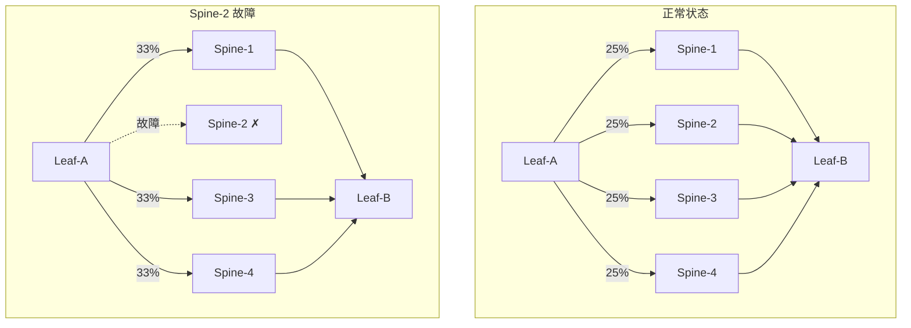
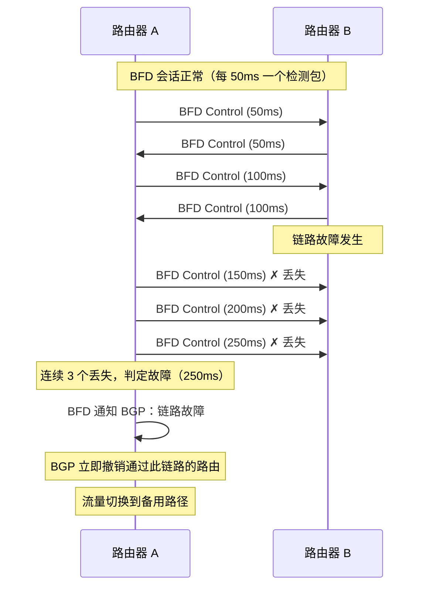
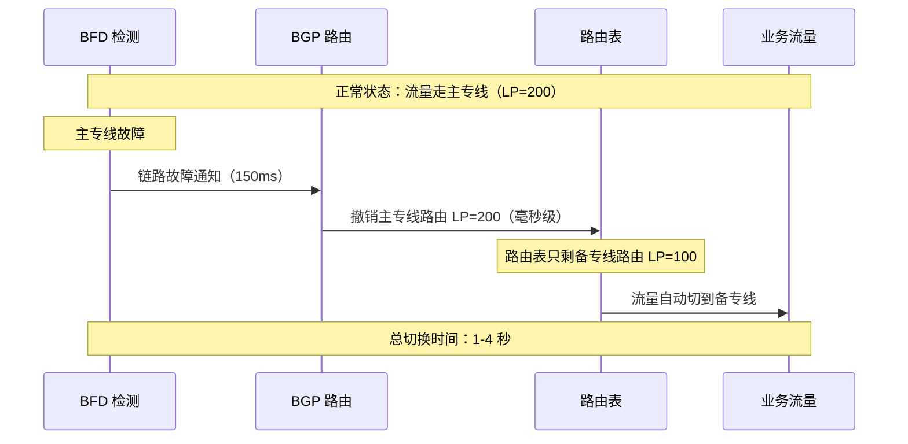
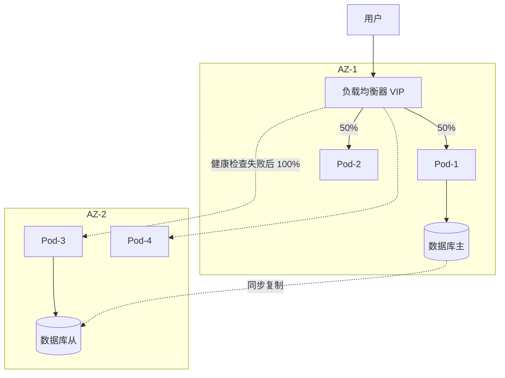
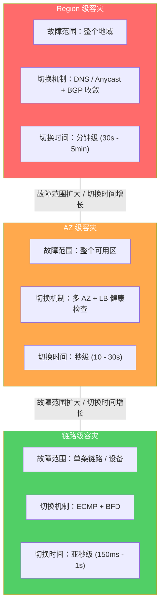

# 30. 故障时如何自救：多路径与网络层容灾

华东到华北专线断了。主动探测系统在 5 秒内检测到故障，P1 告警触发。值班运维确认告警、登录路由器、修改 BGP 路由权重、等待流量切换。业务恢复时，已经过去了 15 分钟。

15 分钟里，所有跨 Region 的数据同步超时，API 调用全部失败，数据库复制中断。探测系统做到了秒级发现，但恢复仍然是分钟级。

## 30.1 瓶颈在恢复，不在检测

把这 15 分钟拆开看：5 秒检测 + 2 分钟通知 + 3 分钟确认 + 5 分钟操作 + 3 分钟生效。检测只占了 5 秒，剩下的全是人工环节。

检测已经很快了，这是主动探测的功劳。但后面的四个环节全是人工的：运维人员要看到告警通知、要判断是不是误报、要登录路由器、要找到正确的配置命令、要执行、要等待生效。即使运维团队 7×24 值班、响应极快，人工操作的下限也在 5-10 分钟。

5-10 分钟对于很多业务来说太长了。一个在线交易系统每秒处理 1 万笔订单，10 分钟就是 600 万笔订单受影响。一个视频会议平台，10 分钟的中断意味着几千个会议被打断。一个自动驾驶的远程控制系统，10 分钟不可接受，10 秒都不可接受。

问题不在运维团队的响应速度，而在于这个流程本身需要人参与。

能不能去掉人工环节？如果网络本身就有备用路径，而且能在检测到故障时自动切换，不需要人登录路由器、不需要人修改配置，切换时间能从分钟级压缩到什么程度？

这需要三个能力同时具备。第一，冗余，必须有备用路径存在，没有备用路径，什么自动化都是空谈。第二，检测，必须能快速检测到故障，秒级甚至毫秒级。第三，切换，检测到故障后自动把流量切到备用路径，不需要人工干预。

三个能力缺一不可。有冗余但检测慢，故障发生了几十秒才发现，业务已经受损。有检测但没有冗余，发现了故障也无路可切。有冗余有检测但切换需要人工操作，又回到了 15 分钟的老路。

这三个能力的组合，就是网络层自动容灾。听起来像是一个很高级的概念，但拆开来看，每一个能力都有对应的成熟机制。

## 30.2 ECMP：天然的多路径冗余

冗余从哪里来？

最自然的冗余来自网络拓扑本身。第 2 章讲过 Fat Tree 拓扑，从一个 Leaf 交换机到另一个 Leaf 交换机，有多条等价路径，经过不同的 Spine 交换机。路由器用哈希算法把不同的流分配到不同的路径上，实现负载均衡。这就是 ECMP（Equal-Cost Multi-Path，等价多路径）。

ECMP 的"正常工作模式"是负载均衡，4 条等价路径，每条承载约 25% 的流量。但负载均衡天然带来了冗余：如果其中一条路径失败（比如某台 Spine 交换机宕机），路由器检测到这条路径不可用，自动把原本走这条路径的流量重新哈希到剩余的 3 条健康路径上。每条路径的负载从 25% 升到约 33%，但所有流量都能正常转发。

**图 30.1：ECMP 路径失败时的流量重新分配**

对于新建立的 TCP 连接，重新哈希完全无感知，新连接被分配到健康路径上，和正常情况没有区别。对于已有的 TCP 连接，重新哈希意味着换了一条路径，包可能走不同的物理链路，到达顺序可能变化。但 TCP 协议本身就有序列号机制来处理乱序，接收端会根据序列号重新排列，应用层不会感知到路径切换。

ECMP 的容灾能力是"副产品"，它的设计初衷是负载均衡，但多路径天然提供了冗余。这是一种优雅的设计：不需要额外的备用路径，正常工作时所有路径都在承载流量，故障时自动重新分配。

但 ECMP 的切换速度取决于一个关键问题：多快能检测到路径失败？

如果是物理链路 Down（光纤断了、交换机断电），硬件能在毫秒级检测到，网卡的链路状态从 Up 变成 Down，路由器立即知道这条路径不可用。切换速度：毫秒级。

如果是"软故障"，链路的物理层正常，但中间某个设备的转发引擎出了问题，丢包率 50% 但不断链，物理链路检测发现不了。路由器认为这条路径还是 Up 的，继续往上面发流量，50% 的包被丢掉。这种"半死不活"的状态比完全断链更危险，因为它不触发任何自动切换。

而且 ECMP 只能在等价路径之间切换。数据中心内部的 Fat Tree 天然有多条等价路径，ECMP 工作得很好。但在跨 Region、跨运营商的场景下，华东到华北可能只有一条专线，没有等价路径，ECMP 无法提供冗余。

ECMP 虽然是最自然的多路径冗余，但它有两个前提：等价路径必须存在，故障必须能被检测到。第一个前提取决于网络拓扑，第二个前提需要一个专门的检测机制。

## 30.3 BFD：毫秒级的故障检测

ECMP 需要知道"哪条路径坏了"。谁来告诉它？

最直接的方式是依赖路由协议本身。BGP 通过 Keepalive 消息检测邻居是否存活，每 30 秒发一个 Keepalive，如果连续 90 秒（Hold Timer 的默认值）没有收到邻居的 Keepalive，判定邻居失败，撤销通过这个邻居学到的路由。

90 秒对于关键业务来说是灾难性的。一个在线交易系统等 90 秒才发现专线断了，这 90 秒里所有跨 Region 的交易都在失败。

你可能会想，那把 Hold Timer 调小。可以，BGP 允许调整 Hold Timer，最小可以设到 3 秒（对应 Keepalive 间隔 1 秒）。3 秒比 90 秒好多了，但仍然是秒级。而且 Hold Timer 调得太小有副作用，如果网络偶尔抖动（某个 Keepalive 包因为拥塞延迟了 2 秒），Hold Timer 设成 3 秒就会误判邻居失败，触发不必要的路由收敛。路由收敛本身会导致短暂的流量中断，误判引发的中断比故障本身还糟糕。

BGP 的 Hold Timer 不是为快速故障检测设计的。它的设计目标是在合理的时间内发现邻居失败，同时避免因为网络抖动导致的误判。90 秒是一个保守但安全的默认值。

需要的是一个独立于路由协议的、专门做快速故障检测的机制。这就是 BFD（Bidirectional Forwarding Detection，双向转发检测）。BFD 的核心思想极其简单：两端的路由器之间建立一个 BFD 会话，以极高的频率互相发送检测包。你发一个，我发一个，你发一个，我发一个。如果连续几个检测包没有收到响应，链路故障。具体来说：BFD 会话的两端协商一个检测间隔（通常 50ms 或 100ms）和一个检测倍数（通常 3）。每隔 50ms 发一个检测包，如果连续 3 个检测包没有收到响应（150ms），判定链路故障。从 BGP 的 90 秒到 BFD 的 150 毫秒，快了 600 倍。

**图 30.2：BFD 检测与 BGP 联动的时序**

BFD 本身不做路由切换，它只负责检测。当 BFD 检测到链路故障时，它通知关联的路由协议（BGP、OSPF 等）。路由协议收到通知后，立即撤销通过这条链路学到的路由，触发路由收敛。

整个链路：BFD 检测故障（150-300ms）→ 通知 BGP（毫秒级）→ BGP 撤销路由（毫秒级）→ 流量切换到备用路径，需要的总时间在亚秒级。

BFD 最大的价值在于检测"软故障"。物理链路 Down 可以通过硬件检测发现，光纤断了，网卡立刻知道。但如果链路的物理层正常，中间某个设备的转发引擎出了问题，包进去了但出不来，或者出来的包是错的，物理链路检测发现不了，BGP 的 Keepalive 也可能正常（因为 Keepalive 走的是控制面，不经过故障的转发引擎）。只有 BFD 这样的端到端数据面检测才能发现：我发的检测包，对端没有回应，转发路径上一定有问题。

> **BFD 的轻量级设计**
>
> BFD 的检测包非常小，只有 24 字节的 BFD 控制报文，加上 UDP 和 IP 头，总共不到 60 字节。它不携带路由信息，不做复杂的协议协商，唯一的功能就是"我还活着"的心跳。这种极简设计让 BFD 可以在硬件层面实现，高端路由器的转发芯片可以直接处理 BFD 包，不需要送到 CPU，因此即使 CPU 过载也不影响 BFD 的检测。

但 BFD 的高频检测也有代价。如果一台路由器维护了 1000 个 BFD 会话，每个会话每 50ms 发一个包，每秒需要处理 2 万个 BFD 包。对于高端路由器来说这不是问题（硬件处理），但对于低端设备或软件路由器，这个负担不可忽视。检测间隔越短，发现故障越快，但消耗的资源越多，这又是一个灵敏度和资源消耗的权衡。

BFD 是网络层自动容灾的"眼睛"。没有 BFD，ECMP 和 BGP 都是"瞎的"，它们有切换的能力，但不知道什么时候该切换。BFD 把"什么时候"这个问题的答案从分钟级压缩到了毫秒级。

## 30.4 专线主备与 BGP 路由控制

ECMP 解决了数据中心内部的多路径冗余，Fat Tree 天然有等价路径。但跨 Region 的场景不一样。

华东到华北的专线，通常不是等价路径。企业会配置两条专线，主专线走运营商 A 的光缆，备专线走运营商 B 的光缆，物理路径完全不同。正常情况下流量走主专线（延迟更低、带宽更大），主专线故障时切到备专线。

这不是 ECMP，两条专线的成本、带宽、延迟可能不同，它们不是"等价"的。需要的是一种机制来控制"正常时走主、故障时走备"。

BGP 的路由选择算法天然支持这种控制。两条专线都通过 BGP 宣告相同的目的网段（比如华北 Region 的 10.0.0.0/8）。路由器收到两条路由，一条来自主专线，一条来自备专线。BGP 根据路由属性选择优先级更高的那条。

控制优先级最直接的方式是 **Local Preference**（本地优先级）。Local Preference 是 BGP 路由的一个属性，数值越大优先级越高。把主专线的路由 Local Preference 设为 200，备专线的设为 100。路由器永远选择 Local Preference 更高的路由，正常情况下，流量走主专线。

当主专线故障时，BFD 在 150ms 内检测到故障，通知 BGP。BGP 立即撤销主专线的路由（Local Preference 200 的那条）。路由表里只剩下备专线的路由（Local Preference 100），路由器自动选择它。流量切换完成。

**图 30.3：专线主备切换的完整链路**

BFD 检测（150-300ms）+ BGP 路由收敛（1-3 秒）= 总切换时间 1-4 秒。相比人工切换的 10-30 分钟，快了两个数量级。

除了 Local Preference，还有其他控制路由优先级的方式。AS Path Prepend，在备专线的路由中人为增加 AS 路径长度，BGP 倾向于选择 AS 路径更短的路由，所以主专线优先。MED（Multi-Exit Discriminator），用于向对端 AS 表达"从哪个出口进来更好"的偏好。这些机制的目的相同：让路由器在正常时选择主路径，在主路径失败时自动选择备路径。

但故障恢复后，有一个容易被忽略的问题：回切。

主专线恢复了，光纤修好了，BFD 检测到链路恢复，BGP 重新学到主专线的路由（Local Preference 200）。路由器发现主专线的路由优先级更高，自动把流量切回主专线。

听起来很合理。但如果主专线不稳定呢？

光纤修好后，信号时好时坏，BFD 检测到链路恢复，流量切回主专线。30 秒后，信号又断了，BFD 检测到故障，流量切到备专线。1 分钟后，信号又恢复了，流量切回主专线。又断了。又切。

这就是路由震荡（Route Flapping）。每次切换都会导致短暂的流量中断，TCP 连接可能因为路径变化而超时，UDP 流量可能丢包。频繁的切换比一直走备专线更糟糕。

常见的应对策略是 **BFD Dampening**（抑制）：主专线恢复后，不立即回切，而是等待一段时间（比如 5 分钟）。如果在这 5 分钟内链路一直稳定，才允许回切。如果 5 分钟内又出现故障，重置等待时间。这样就避免了"刚切回去又断了"的震荡。

另一种策略更保守：不自动回切。主专线恢复后，流量继续走备专线，等运维人员确认主专线确实稳定后，手动切回。这牺牲了自动化，但换来了稳定性。

还有一种前文提到的冗余方案：专线 + VPN。主路径是专线（低延迟、高带宽、高成本），备路径是 IPSec VPN（走公网，延迟更高、带宽更小、成本更低）。专线故障时自动切到 VPN，业务不中断，但性能下降。这是成本和可用性的权衡：两条专线的冗余方案切换无感知但成本翻倍，专线 + VPN 的方案成本低但切换后性能下降。选择取决于业务对延迟的敏感度和预算。

## 30.5 多 AZ 与跨地域容灾

前面讲的 ECMP、BFD、专线主备，解决的都是链路级故障——某条链路断了、某台设备宕机了。但如果故障的范围更大呢？

要理解更大范围的故障，先要理解云厂商的基础设施是怎么组织的。云厂商的机房不是一个扁平的结构，而是分层部署的：Region（地域）→ AZ（可用区）→ 机房/机架。Region 是一个地理区域，比如"华东"、"华北"、"华南"，通常对应一个城市或城市群。每个 Region 内部包含多个 AZ（Availability Zone，可用区），每个 AZ 是一个物理上独立的数据中心——独立的建筑、独立的电力供应、独立的冷却系统、独立的网络接入。同一个 Region 内的 AZ 之间通过低延迟的专用光纤连接（延迟通常 1-2ms），但它们不共享任何单点故障源。

这种分层设计的目的是隔离故障的影响范围。一台服务器宕机只影响一个机架，一个机架断电只影响一个 AZ，一个 AZ 的冷却系统故障不会波及同 Region 的其他 AZ。层级越高，故障的影响范围越大，但发生的概率也越低。

理解了这个层级结构，再来看一个真实的 AZ 级故障。

2021 年某云厂商的一次事故：某个 AZ 的冷却系统故障，机房温度持续升高，触发了服务器的热保护机制，整个 AZ 的几千台服务器在 10 分钟内陆续关机。这不是一条链路的问题，而是一个 AZ 内所有设备同时失效。

链路级的冗余机制在这种场景下完全失效。ECMP 的所有等价路径都经过同一个 AZ，AZ 整体不可用时所有路径都断了。BFD 检测到所有链路都故障了，但没有健康的路径可以切换——所有的"备用路径"和"主路径"都在同一个物理位置，同时消失了。

问题的根源是：链路级冗余假设"故障是局部的"——一条链路断了，其他链路还在。但 AZ 级故障打破了这个假设，它让一个物理区域内的所有冗余同时失效。要应对这种故障，冗余必须跨越 AZ 的边界。

多 AZ 部署就是这个思路的直接实现：把业务副本分散到不同的 AZ，任何一个 AZ 故障时，其他 AZ 的副本继续服务。

VPC 可以跨 AZ 部署。子网 A 在 AZ-1，子网 B 在 AZ-2。应用的多个副本分布在不同的 AZ，AZ-1 里有 3 个 Pod，AZ-2 里有 3 个 Pod。负载均衡器跨 AZ 分发流量。

**图 30.4：多 AZ 部署与故障切换**

正常情况下，LB 把流量均匀分发到两个 AZ 的 Pod 上。LB 持续对所有后端 Pod 做健康检查，每隔几秒发一个 HTTP 请求，检查 Pod 是否正常响应。

当 AZ-1 整体不可用时，AZ-1 里所有 Pod 的健康检查都失败。LB 自动把 100% 的流量切到 AZ-2 的 Pod 上。这个切换对用户透明——用户访问的是 LB 的 VIP（虚拟 IP），不知道后端在哪个 AZ。切换时间取决于健康检查的间隔和失败阈值：如果每 5 秒检查一次、连续 3 次失败判定不健康，切换时间约 15 秒。

多 AZ 的网络层实现有几个关键点。VPC 的路由表跨 AZ 生效，AZ-1 的子网和 AZ-2 的子网在同一个 VPC 内，路由自动打通。安全组规则跨 AZ 生效，不需要为不同 AZ 配置不同的安全组。弹性 IP 可以在 AZ 之间漂移——如果 AZ-1 的 VM 绑定了弹性 IP，AZ-1 故障后可以把弹性 IP 重新绑定到 AZ-2 的 VM 上。

但多 AZ 解决的是"一个 AZ 挂了"的问题。如果整个 Region 不可用呢？前面说过，Region 对应一个城市或城市群，同一个 Region 内的所有 AZ 虽然物理独立，但地理上相距不远（通常几十公里以内）。区域性自然灾害、大规模电网故障、城市级网络中断——这些极端事件可能让一个 Region 内的所有 AZ 同时不可用。

跨地域容灾的逻辑和多 AZ 相同：把冗余的边界再扩大一层。在不同的 Region 部署业务副本，Region 级故障时把流量切到健康的 Region。切换机制有两种：

第一种是 DNS 健康检查切换。GSLB 持续检查各 Region 的健康状态，某个 Region 不健康时，DNS 解析自动指向其他 Region。切换时间受 DNS TTL 影响——第 23 章讲过的 TTL 矛盾在这里再次出现：TTL 短切换快但查询压力大，TTL 长查询压力小但切换慢。

第二种是 Anycast 自动路由切换。第 24 章讲过 Anycast，多个 Region 宣告同一个 IP 地址，BGP 自动把用户流量路由到最近的健康 Region。某个 Region 不可用时，BGP 路由收敛，流量自动切到下一个最近的 Region，切换时间取决于 BGP 收敛速度。

**图 30.5：容灾的三个层次**

层次越高，故障范围越大，切换时间越长，架构复杂度和成本也越高。链路级容灾几乎是"免费"的——ECMP 和 BFD 是网络设备的标准功能。AZ 级容灾需要在多个 AZ 部署业务副本，成本大约翻倍。Region 级容灾需要在多个 Region 部署完整的业务栈，还要解决跨 Region 的数据同步问题，成本可能是单 Region 的 3-5 倍。

不是所有业务都需要跨 Region 容灾。一个内部管理系统，AZ 级容灾就够了。一个全球性的在线交易平台，则需要跨 Region 容灾。选择哪个层次，取决于业务对可用性的要求和愿意承担的成本。

容灾的本质是用冗余换可用性，用成本换恢复速度。没有免费的容灾，每一层冗余都有对应的成本。工程师的工作不是追求"最高级别的容灾"，而是找到业务需求和成本之间的平衡点。

## 30.6 四层可观测的天花板

把卷九前三章的能力叠加起来看：Flow Log 让流量可查（事后排障），主动探测让故障可感知（实时监测），多路径和容灾让故障可自愈（自动切换）。基础设施层面的网络问题——链路中断、设备故障、AZ 不可用——有了完整的应对体系。

但这些能力有一个共同的工作层次：四层。

链路通不通、延迟高不高、路径健不健康——这些问题网络层能回答。然而在微服务架构下，一个用户请求到达后端后会触发一连串的内部调用：订单服务调用库存服务、库存服务调用缓存服务、支付服务调用风控服务。数百个 Pod 之间每秒数十万次的七层调用，"订单服务调用库存服务超时了"、"库存服务的错误率在上升"——这些问题，四层的工具看不到。

Flow Log 记录的是五元组和动作，它能告诉你"10.0.1.15 向 10.0.2.23 发了 TCP 包"，但不能告诉你"订单服务向库存服务发了一个 GET /stock/12345 请求，返回了 500 错误"。主动探测测的是网络路径延迟，测不到"HTTP 请求的响应时间"。BFD 检测的是链路是否存活，检测不到"某个 Pod 在做 Full GC 导致响应变慢"。

从四层的可观测性到七层的可观测性，从基础设施的容灾到应用调用链的治理，需要一种工作在不同层次的手段。
