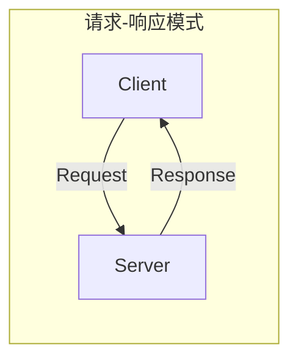
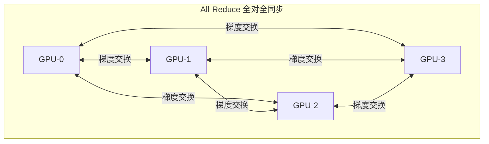
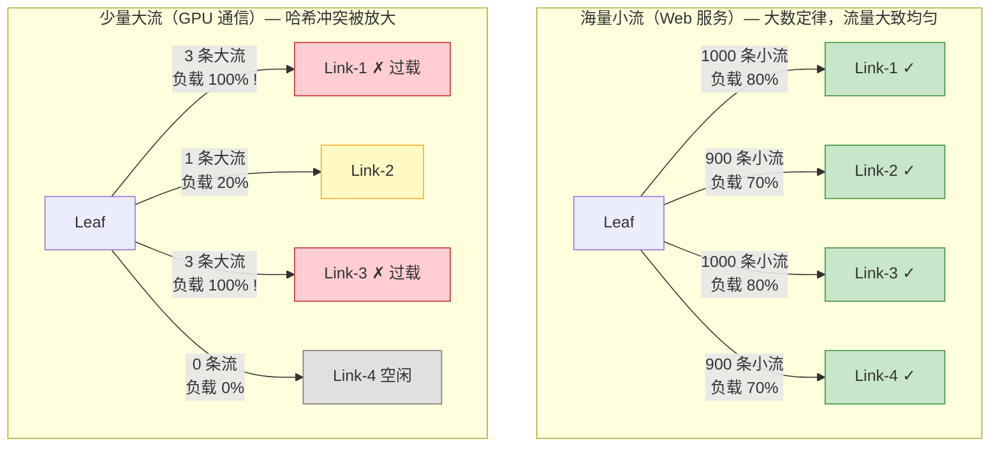
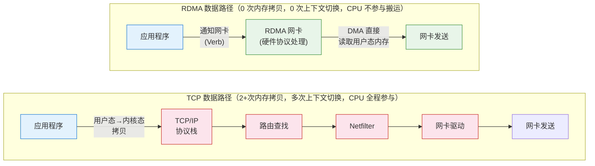
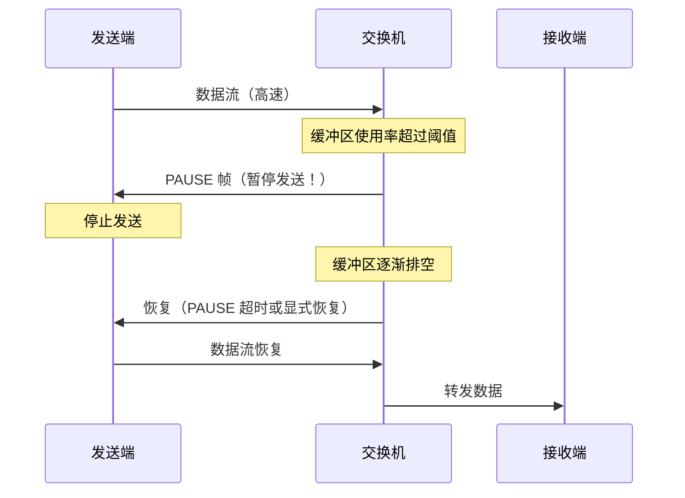
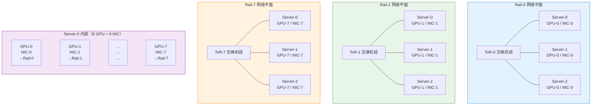

# 31. GPU 集群的网络：当流量不再是请求-响应

前面三十章建立的整套云网络体系，有一个从未被质疑过的基本假设：流量是请求-响应模型。一个包出去，一个包回来。负载均衡按连接数分发，ECMP 按五元组哈希选路径，安全组按源目的 IP 放行，服务网格按 HTTP Header 路由。所有机制都围绕"一来一回"设计，所有优化都假设流量是"海量小包"。

但有一种工作负载正在打破这个假设。一个千亿参数的大模型，分布在 1024 张 GPU 上训练。每 300 毫秒，所有 GPU 完成一轮前向和反向计算，然后需要交换梯度。每张 GPU 有 2GB 的梯度数据要发出去，同时要接收其他所有 GPU 的梯度。1024 张 GPU，每轮 2TB 的数据在网络上流动，必须在 50 毫秒内完成。否则 GPU 就在等网络，每秒数十万元的算力在空转。

这不是请求-响应。这是全对全同步。而且它对网络的要求，和前面三十章讲的一切都不一样。

## 31.1 一个训练任务的网络需求

训练一个千亿参数的大模型，单张 GPU 的显存放不下完整的模型。一张 A100 有 80GB 显存，千亿参数的模型（以 FP16 存储）需要约 200GB，还没算优化器状态和中间激活值。所以模型必须被切分到多张 GPU 上——一部分参数放在 GPU-0，另一部分放在 GPU-1，以此类推。这是模型并行。

同时，训练数据也要分发到多张 GPU 上并行处理。每张 GPU 拿到不同的数据批次，独立计算自己那份数据的梯度。这是数据并行。

两种并行叠加在一起，一个训练任务可能需要数千张 GPU 协同工作。每一轮训练迭代的流程是：每张 GPU 独立计算自己那份数据的梯度，然后所有 GPU 必须交换梯度、求平均，才能更新模型参数。这个"交换梯度、求平均"的操作叫 All-Reduce。

All-Reduce 的通信模式和 HTTP 请求有本质区别。HTTP 是"一个客户端问一个服务器"，All-Reduce 是"所有人把自己的数据发给所有人，最终每个人都拿到全局的聚合结果"。如果有 1000 张 GPU，每张 GPU 有 2GB 的梯度数据，All-Reduce 需要在所有 GPU 之间交换这些数据。

**图 31.1：All-Reduce 的通信模式 vs 请求-响应模式**

实际实现中，All-Reduce 通常用 Ring 算法优化——GPU 组成一个环，每张 GPU 只需要和相邻的两张 GPU 通信，经过 N-1 轮传递后所有 GPU 都拿到了全局聚合结果。即使用了 Ring 优化，每张 GPU 每轮迭代仍然需要发送和接收各一份完整梯度的数据量。1000 张 GPU 的集群，每轮迭代在网络上传输的总数据量仍然是 TB 级。

还有更关键的关键约束：时间。一轮训练迭代的计算部分（前向传播 + 反向传播）可能只需要 200-300 毫秒。如果 All-Reduce 的通信也需要 200-300 毫秒，那 GPU 有一半时间在等网络。每张 A100 GPU 的租用成本大约每小时 2-3 美元，1000 张 GPU 每小时 2000-3000 美元。GPU 等网络的每一毫秒，都是真金白银在燃烧。

更致命的是木桶效应。All-Reduce 是同步操作——所有 GPU 必须等最慢的那个完成数据交换，才能开始下一轮计算。如果 1000 张 GPU 中有 1 张的网络延迟比其他的高 10ms，所有 999 张 GPU 都要多等 10ms。网络的尾延迟（P99 甚至 P999）直接决定了整个集群的训练效率。在传统的 Web 服务中，一个请求慢了只影响一个用户；在 GPU 训练中，一张卡的网络慢了，拖慢所有卡。

## 31.2 TCP 在这里为什么失效

你可能会想：用 TCP 不行吗？TCP 是可靠传输协议，保证数据不丢不乱，数据中心内部的带宽也够大——100Gbps 甚至 400Gbps 的网卡已经普及。把 1000 张 GPU 用 TCP 连起来，跑 All-Reduce，行不行？

我们来看看 TCP 在这个场景下会遇到什么。

第一个问题是内核协议栈的开销。TCP 运行在操作系统内核中。GPU 上的训练程序要发送梯度数据时，数据从 GPU 显存拷贝到主机内存（用户态），然后从用户态拷贝到内核态，内核构建 TCP 头、IP 头，经过路由查找、Netfilter 规则检查，最终交给网卡驱动发送。接收方向相反。每次数据传输至少两次内存拷贝，多次上下文切换。

当数据量是几个 KB 的 HTTP 请求时，这些开销可以忽略。但当数据量是 2GB 的梯度、频率是每秒 3-4 次时，协议栈的 CPU 开销变得不可忽视。CPU 忙着搬运数据和处理协议栈，反而成了瓶颈——网卡有 400Gbps 的带宽，但 CPU 来不及把数据喂给网卡。

第二个问题是拥塞控制的矛盾。TCP 的拥塞控制通过探测丢包来调整发送速率——发现丢包就降速，没有丢包就加速。这在公网上是合理的，因为公网的带宽是共享的，需要各个连接"礼让"。但在 GPU 通信场景下，All-Reduce 的同步特性意味着所有 GPU 在同一时刻开始发送大量数据。1000 张 GPU 同时向网络注入 TB 级流量，交换机的缓冲区瞬间被填满，开始丢包。TCP 看到丢包，判断"网络拥塞了"，主动降低发送速率。

但 GPU 通信需要的恰恰是"尽快把数据发完"。TCP 降速意味着 All-Reduce 的完成时间变长，所有 GPU 等待的时间变长。更糟糕的是，TCP 的拥塞控制是逐步恢复的——降速之后要慢慢探测、慢慢加速回来。在 GPU 通信的突发模式下，TCP 可能永远达不到线速，因为每一轮 All-Reduce 都会触发一次拥塞降速。

第三个问题是 ECMP 的哈希冲突。数据中心的 Fat Tree 拓扑通过 ECMP 提供多条等价路径。ECMP 按五元组（源 IP、目的 IP、源端口、目的端口、协议）哈希，把不同的流分配到不同的路径上。在传统的 Web 服务场景下，有成千上万条小流，大数定律保证了流量在各条路径上大致均匀。

但 GPU 通信的特点是"少量超大流"。1000 张 GPU 之间可能只有几千条 TCP 连接，但每条连接传输 GB 级数据。ECMP 的哈希可能把多条大流分配到同一条物理链路上——一条链路跑满 400Gbps，旁边的链路空闲。在"海量小流"场景下，哈希冲突的影响被平均掉了；在"少量大流"场景下，一次冲突就意味着一条链路过载、多张 GPU 的通信被拖慢。

**图 31.2：ECMP 哈希冲突在两种流量模式下的影响**

三个问题的根源是同一个：TCP/IP + ECMP 的设计假设是"海量小包的请求-响应"，而 GPU 训练的流量是"少量超大流的全对全同步"。不是 TCP 太慢，是 TCP 的设计假设和 GPU 通信的需求根本不匹配。

## 31.3 绕过内核：RDMA 的思路

TCP 的三个问题中，内核协议栈的开销是最根本的。拥塞控制可以调参优化，ECMP 冲突可以用更好的哈希算法缓解，但"每个包都要经过内核协议栈"这件事，在 TCP 的架构下无法绕过。

那如果不经过内核呢？

这个思路叫 RDMA——Remote Direct Memory Access，远程直接内存访问。"直接"的含义是：应用程序发起数据传输时，数据从本机的用户态内存直接传输到远端机器的用户态内存，不经过任何一方的操作系统内核。

**图 31.3：TCP vs RDMA 的数据路径**

> 蓝色 = 应用程序（用户态），红色 = 内核协议栈（CPU 密集），绿色 = 网卡硬件（零 CPU 开销）。RDMA 绕过了整个内核协议栈，由网卡硬件直接完成协议处理和数据搬运。

没有内存拷贝（零拷贝），没有上下文切换，没有协议栈处理。网卡硬件直接完成所有工作。应用程序只需要告诉网卡"从这个内存地址开始，发送这么多字节到远端那个内存地址"，剩下的事情全部由网卡硬件完成。

你可能会问：传统网络中，内核负责两件重要的事——可靠性保证（重传、排序）和安全隔离（不同进程不能访问彼此的内存）。绕过内核之后，这两件事谁来做？

RDMA 把可靠性保证下沉到了网卡硬件。网卡自己维护连接状态、处理重传和排序。说白了，就是把 TCP 协议栈的功能用硬件实现了一遍——但因为是硬件实现，没有软件协议栈的上下文切换和内存拷贝开销。

安全隔离通过内存注册（Memory Registration）机制实现。应用程序必须先向网卡注册一块内存区域，告诉网卡"这块内存允许被远端访问"。网卡只允许远端读写已注册的区域，未注册的内存对远端不可见。这相当于把内核的内存保护职责也下沉到了网卡硬件。

性能差异是量级上的。传统 TCP 在数据中心内的端到端延迟通常是几十微秒到几百微秒（大部分时间花在协议栈处理上）。RDMA 的端到端延迟可以低到 1-2 微秒。吞吐方面，单条 RDMA 连接可以打满网卡带宽——400Gbps 的网卡，RDMA 能跑到接近 400Gbps；TCP 单连接在同样的网卡上，受限于拥塞控制和协议栈处理能力，往往只能跑到一半甚至更低。

RDMA 有两种实现路径。InfiniBand 是专用网络——专用的网卡（HCA）、专用的交换机、专用的协议栈，从物理层到传输层全部重新设计。性能最好，但成本高，而且和现有的以太网基础设施完全不兼容。你不能把 InfiniBand 网卡插到以太网交换机上。

另一条路径是 RoCE（RDMA over Converged Ethernet）——在标准以太网上跑 RDMA。用支持 RDMA 的以太网网卡，把 RDMA 协议封装在以太网帧中，通过普通的以太网交换机传输。RoCE 的优势是可以复用现有的以太网基础设施——不需要把整个数据中心的交换机全部换掉。

但 RoCE 面临一个根本性的矛盾：RDMA 的设计假设是"网络不丢包"，而以太网会丢包。

## 31.4 以太网上的 RDMA：RoCE 与无损网络

InfiniBand 的无损传输由专用硬件保证——InfiniBand 交换机有精确的流量控制机制，从协议层面就不允许丢包发生。但 RoCE 跑在以太网上，以太网交换机在拥塞时的默认行为是"尾丢弃"——缓冲区满了，新来的包直接丢掉。

为什么 RDMA 不能容忍丢包？TCP 也会遇到丢包，TCP 通过选择性重传（SACK）高效地恢复丢失的包，性能下降有限。但 RDMA 的重传机制远没有 TCP 成熟——RDMA 使用的是 go-back-N 重传，一旦发现丢包，需要重传丢失点之后的所有数据，效率远低于 TCP 的选择性重传。在高带宽场景下，一次丢包可能导致 GB 级数据的重传，性能断崖式下降。

所以 RoCE 需要一个前提条件：网络必须"无损"——交换机不能丢包。

在"会丢包"的以太网上实现"不能丢包"的传输，需要两个机制配合。

第一个机制是 PFC（Priority Flow Control）。当交换机某个端口的缓冲区使用率超过阈值时，向上游设备发送 PAUSE 帧，告诉上游"暂停发送"。上游收到 PAUSE 后停止发送数据，等交换机的缓冲区腾出空间后再恢复。这样交换机就不会因为缓冲区溢出而丢包。

**图 31.4：PFC 的工作流程**

PFC 按优先级工作——以太网帧有 8 个优先级（802.1p），PFC 可以只暂停 RDMA 流量所在的优先级，不影响同一链路上的其他流量（比如管理流量、存储流量）。

PFC 解决了丢包问题，但引入了新的代价。

第一个代价是 Head-of-Line Blocking。一个端口被 PAUSE 后，该端口上所有属于同一优先级的流量都被阻塞，即使其中一些流量的目的地并不拥塞。GPU-A 发往 GPU-B 的流量导致交换机端口拥塞，PAUSE 帧暂停了整个端口，GPU-A 发往 GPU-C 的流量也被连带阻塞了——尽管 GPU-C 方向完全畅通。

第二个代价是 PFC 风暴。PAUSE 帧会向上游传播。交换机 A 的端口拥塞，向上游交换机 B 发送 PAUSE；交换机 B 的缓冲区也开始堆积，向更上游的交换机 C 发送 PAUSE。一个点的拥塞像多米诺骨牌一样向上游扩散，最终可能导致整个网络的流量都被暂停。在生产环境中，PFC 风暴是 RoCE 网络最令人头疼的故障之一。

第二个机制是 ECN（Explicit Congestion Notification），它比 PFC 更温和。交换机在缓冲区使用率超过阈值时，不是暂停上游，而是在经过的包的 IP 头上标记一个 ECN 位（CE，Congestion Experienced）。接收端看到 ECN 标记后，通过反馈报文通知发送端"网络有点拥塞了"。发送端收到通知后主动降低发送速率——不是完全停止，只是降速。

ECN 的好处是"提前预警、温和降速"，避免了 PFC 的"全部暂停"。在实际部署中，ECN 和 PFC 配合使用：ECN 阈值设得比 PFC 阈值低——缓冲区使用率到 30% 时 ECN 开始标记，发送端开始降速；如果降速不够快，缓冲区继续增长到 80%，PFC 才触发 PAUSE。ECN 是"第一道防线"，PFC 是"最后的保底"。

> **DCQCN 是什么？**
>
> DCQCN（Data Center QCN）是 RoCE 场景下常用的拥塞控制算法，结合了 ECN 标记和速率调整。交换机通过 ECN 标记通知拥塞，发送端根据 ECN 标记的频率动态调整发送速率——标记越频繁，降速越多。它的目标是在"不丢包"的前提下，尽可能高效地利用带宽。可以理解为"为无损网络设计的拥塞控制"。

无损网络的运维复杂度远超传统以太网。PFC 阈值设多少？ECN 阈值设多少？缓冲区怎么在不同优先级之间分配？这些参数对网络拓扑和流量模式敏感——换一种训练任务、换一种通信模式，参数可能需要重新调优。配置不当的后果很严重：PFC 阈值太低，正常流量也被频繁暂停，吞吐下降；PFC 阈值太高，来不及暂停就已经丢包了，RDMA 性能断崖。

这是 RoCE 相比 InfiniBand 的核心劣势。InfiniBand 的无损由专用硬件从协议层面保证，不需要运维人员调这些参数。RoCE 是在一个"天生会丢包"的网络上，用软件配置和参数调优"逼"出无损的效果。能做到，但代价是运维复杂度。

## 31.5 GPU 集群的网络拓扑

解决了传输协议的问题（RDMA 替代 TCP），解决了无损传输的问题（PFC + ECN），还有一个问题没解决：网络拓扑。

传统数据中心用 Fat Tree 拓扑，通过 ECMP 提供等价多路径。31.2 节已经分析过，ECMP 在"少量大流"场景下的哈希冲突问题。即使换成了 RDMA，流量的形状没变——还是"少量超大流"。ECMP 的哈希冲突问题依然存在。

GPU 集群的网络拓扑需要针对 All-Reduce 的通信模式专门设计。一种被广泛采用的方案叫 Rail-Optimized 拓扑。

基本思想是这样的。一台 GPU 服务器通常有 8 张 GPU 和 8 块网卡，每张 GPU 对应一块网卡。把所有服务器的"第 1 张 GPU"连到同一组交换机上，所有"第 2 张 GPU"连到另一组交换机上，以此类推。每一组叫一个"Rail"（轨道）。

**图 31.5：Rail-Optimized 拓扑**

All-Reduce 的通信可以被分解为：先在每个 Rail 内部做局部聚合（同一 Rail 内的 GPU 通过专用交换机直连，带宽高、延迟低），再跨 Rail 做全局聚合。大部分流量被限制在 Rail 内部，只有少量汇总数据需要跨 Rail 传输。这样把"全对全"的通信模式转化为了"局部密集 + 全局稀疏"的模式，大幅减少了对全局网络带宽的需求。

多网卡的设计还带来另一个好处：流量天然被分散到多个独立的网络平面上。每个 Rail 是一个独立的网络平面，有自己的交换机和链路。All-Reduce 的流量被 8 块网卡分散到 8 个平面上并行传输，单个平面的带宽压力只有总流量的八分之一。这和传统服务器"一台机器一块网卡"的假设完全不同。

但拓扑设计带来了一个新的约束：计算调度必须感知网络拓扑。

一个训练任务需要 256 张 GPU。如果调度器随机分配——从 32 台服务器上各取 8 张 GPU，这些 GPU 分散在不同的 Rail、不同的 Pod 中，All-Reduce 的通信需要频繁跨越多层交换机，延迟高、带宽受限。如果调度器把 256 张 GPU 分配在网络距离最近的位置——比如同一个 Pod 内的 32 台服务器，All-Reduce 的通信大部分在 Pod 内部完成，只需要经过一两层交换机。

这意味着"网络拓扑"成为了计算调度的约束条件。调度器在分配 GPU 时，不能只看"哪些 GPU 空闲"，还要看"这些 GPU 在网络拓扑中的位置关系"。网络从被动的管道变成了主动的调度约束——前面三十章里，网络只负责"把包送到"，从不参与"任务应该放在哪里"的决策。现在它参与了。

## 31.6 新范式的边界与代价

RDMA/RoCE + Rail-Optimized 拓扑 + 计算-网络协同调度，这套方案解决了 GPU 训练的网络问题。但它的代价不小。

无损网络的运维复杂度远超传统以太网。传统网络出了问题，看 Flow Log、看丢包率、看延迟——指标清晰，排查路径明确。RDMA 网络的故障可能表现为"没有丢包、延迟正常，但训练速度莫名其妙地下降了 20%"。原因可能是 PFC 被频繁触发导致的微暂停，可能是 ECN 阈值不合理导致的过度降速，可能是某条链路的光模块衰减导致的偶发重传。这些问题需要专门的 RDMA 诊断工具和深厚的无损网络经验才能定位。

成本方面，InfiniBand 交换机和 HCA 网卡的价格是以太网设备的数倍。即使选择 RoCE 方案，支持 RDMA 的智能网卡和支持 PFC/ECN 的数据中心级交换机，也比普通设备贵得多。加上每台服务器 8 块网卡、8 个 Rail 的独立交换机组，GPU 集群的网络成本可能占整个集群硬件成本的 20-30%。网络不再是"买几台交换机连起来"的配角，它是和 GPU 同等重要的核心投资。

这个成本差异正是 RoCE 存在的根本原因。InfiniBand 在技术上更成熟——它从设计之初就是无损网络，不需要 PFC/ECN 这些"补丁"，运维复杂度更低，性能也更稳定。但 InfiniBand 交换机的单端口成本约为以太网交换机的 3-5 倍，HCA 网卡的价格也远高于以太网 RDMA 网卡。一个 1000 台服务器的 GPU 集群，选择 InfiniBand 和选择 RoCE 的网络设备成本差异可能达到数千万元。RoCE 的存在本质上是一个经济学选择：用运维复杂度（PFC 调优、ECN 参数、无损网络的精细配置）换取硬件采购成本的大幅降低。对于预算充裕且追求稳定性的场景（如 NVIDIA DGX SuperPOD），InfiniBand 仍然是首选；对于需要大规模部署且对成本敏感的场景（如云厂商的公共 GPU 集群），RoCE 是更务实的选择。

但这个"InfiniBand 做 GPU 集群，以太网做其他一切"的格局，并不是 InfiniBand 最初的愿景。

InfiniBand 在 2000 年代初有过更大的野心——不只是做 HPC 的专用网络，而是要取代以太网成为数据中心的统一互联标准。它的技术指标确实碾压以太网：原生无损、微秒级延迟、硬件保证的可靠传输。如果只看技术，InfiniBand 应该赢。但它没有。

**生态锁定是第一道壁垒。** 以太网有四十年的生态积累——几乎所有的操作系统、网络管理工具、监控系统、安全设备都原生支持以太网。选择 InfiniBand 意味着放弃这整套生态：专用的网卡需要专用的驱动，专用的交换机需要专用的管理软件（Subnet Manager），专用的线缆需要专用的布线规范。一个数据中心如果选择 InfiniBand 做统一互联，运维团队需要从零学习一套完全不同的技术栈。而以太网的运维经验、人才储备、工具链，是几十年积累的结果，不是一个技术指标的优势能抵消的。

**以太网在追赶是第二个因素。** 以太网的带宽从 1Gbps → 10Gbps → 25Gbps → 100Gbps → 400Gbps，每一代都在缩小和 InfiniBand 的差距。RoCE 的出现更是直接在以太网上实现了 RDMA——虽然需要 PFC/ECN 这些"补丁"来模拟无损，但至少不需要换掉整个网络基础设施。以太网的策略是"够用就行，但生态无敌"，InfiniBand 的策略是"技术最优，但生态封闭"。历史反复证明，前者在大多数市场中胜出。

**最根本的原因是需求的分布。** 数据中心里 95% 的工作负载是 Web 服务、微服务、数据库访问、对象存储——这些工作负载对延迟的要求是毫秒级，对带宽的要求是 Gbps 级，以太网绰绰有余。只有 GPU 训练、HPC 仿真这类极端场景才需要微秒级延迟和无损传输。为了 5% 的工作负载把整个数据中心换成 InfiniBand，经济上不合理。更务实的做法是：给那 5% 的工作负载建一个独立的 InfiniBand（或 RoCE）网络，其余 95% 继续用以太网。

这也解释了为什么行业的演进方向是"改良以太网"而不是"推广 InfiniBand"。Ultra Ethernet Consortium（UEC）的成立、RoCE v2 的普及、以太网交换机缓冲区的持续增大——所有这些努力都指向同一个方向：让以太网能够胜任 AI 训练的网络需求，而不是让 InfiniBand 取代以太网。在生态面前，技术优越性是次要的。

还有一个结构性的隔离。GPU 集群的 RDMA 网络通常和传统的 TCP/IP 网络物理隔离——GPU 服务器有两套网卡，一套连 RDMA 网络用于训练通信，一套连传统以太网用于管理、监控和存储访问。前面三十章讲的 VPC、安全组、负载均衡、服务网格——这些机制在 RDMA 网络上大多不适用。RDMA 网络是一个独立的世界，有自己的规则。

训练侧的网络问题，到这里算是有了成熟的解法。但大模型的生命周期不只有训练。模型训练完成后，要部署上线服务用户——推理。

训练和推理是同一个根本性变化——"流量形状改变"——在两个方向上的展开。训练侧的挑战是"全对全同步"打破了 TCP 和 ECMP 的假设；推理侧的挑战是"有状态 + 成本不均匀"打破了负载均衡的假设。两者共享同一个结论：当流量不再是请求-响应，为请求-响应设计的所有机制都需要重新审视。

推理的流量模式和训练截然不同：不是 GPU 之间的全对全同步，而是用户请求到 GPU 实例的调度分发。看起来这就是负载均衡的活儿。但如果你尝试用传统的负载均衡器来调度推理流量，很快会发现：不同请求的计算量可能差 100 倍，实例有"记忆"（KV Cache），推理过程分两个阶段且互相干扰。传统负载均衡器看不到这些信息，也理解不了这些语义。它需要一种全新的调度逻辑。