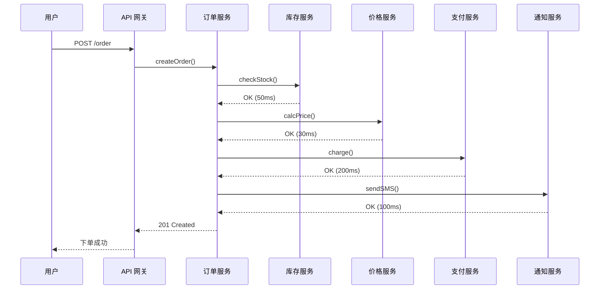
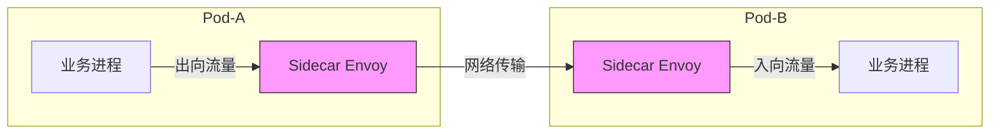
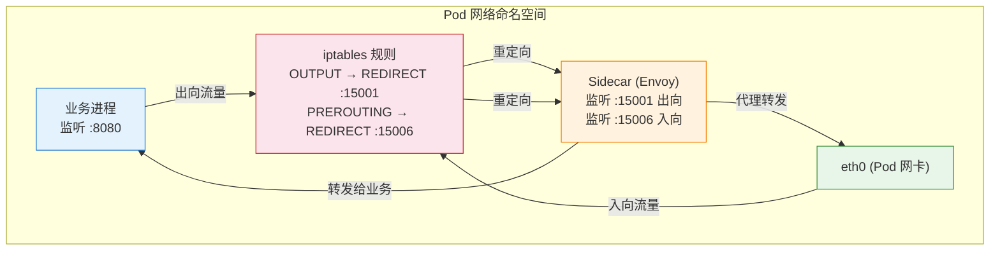
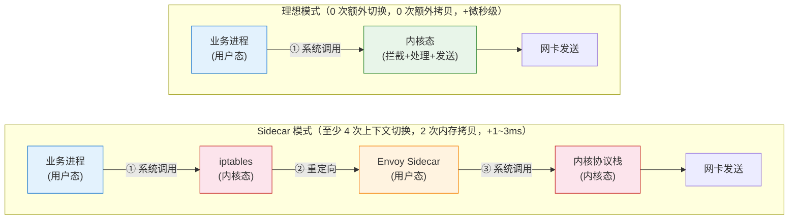
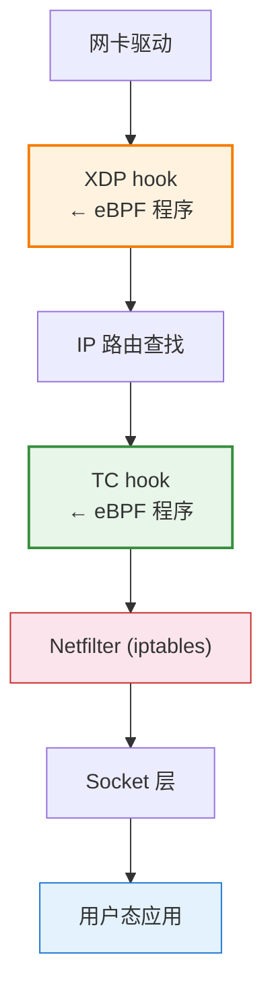
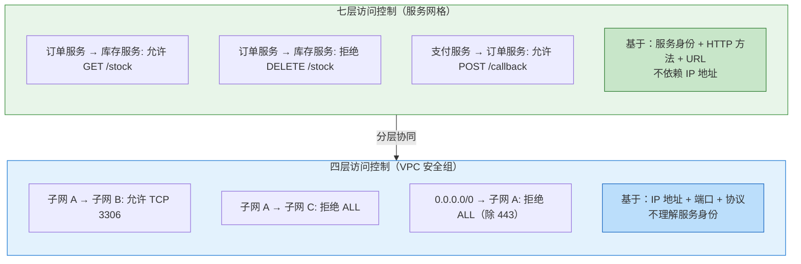

# 31. 微服务的流量治理：服务网格与 eBPF

监控大屏一片绿色。链路延迟 1ms，丢包率 0%，所有 AZ 健康，所有路由正常。但客服系统里，"下单失败"的投诉在过去 10 分钟增加了 300%。

运维团队排查了所有基础设施指标，一切正常。直到有人打开了微服务的调用链追踪，发现订单服务调用库存服务的 P99 延迟从 50ms 飙到了 2 秒。库存服务的某个 Pod 在做 Full GC，每次暂停 1.5 秒。订单服务设置了 2 秒超时和 3 次重试，6 秒后返回错误。用户看到的是"下单失败"。

问题不在网络，不在基础设施，在应用层的服务调用链上。上一章末尾指出了这个天花板：网络层的工具工作在四层，而微服务调用的治理需求在七层。如果没有调用链追踪，这条链路是隐形的——你甚至不知道订单服务调用了库存服务，更不知道是库存服务的哪个 Pod 在拖慢整条链路。

## 31.1 基础设施之上的隐形流量

到目前为止，我们关注的主要是一种方向的流量：用户到服务。请求从公网出发，经过 DNS 解析、CDN 缓存、DDoS 清洗、WAF 过滤、负载均衡，最终到达后端服务器。这条路径是"南北向"的，从外部进入内部。

但在微服务架构下，一个用户请求到达后端后，故事才刚刚开始。

用户点击"下单"，请求到达 API 网关。API 网关调用订单服务，订单服务调用库存服务检查库存，调用价格服务计算折扣，调用支付服务扣款，调用通知服务发送确认短信。一个用户请求，触发了 5-10 次内部调用。这些 Pod 之间的调用是"东西向"的，不经过公网，不经过 CDN 和 WAF，完全在 VPC 内部流转。

**图 31.1：一次下单请求的调用链**

一个中等规模的微服务系统可能有 200 个服务、2000 个 Pod。每个用户请求触发 10-20 次内部调用。每秒 1 万个用户请求，意味着每秒 10-20 万次 Pod 之间的调用。东西向流量的规模，往往远超南北向。

这些调用需要治理。库存服务的某个 Pod 在做 Full GC，响应时间从 50ms 飙到 2 秒——订单服务需要超时控制，不能无限等待。库存服务连续失败——订单服务需要熔断，暂停调用让它恢复。新版本上线——需要灰度发布，先把 10% 的流量切到新版本验证。出了问题——需要调用链追踪，知道延迟卡在哪个环节。

但网络层的工具看不到这些。四层的工具解决四层的问题。微服务调用的治理需求在七层——需要理解 HTTP 协议、需要解析请求内容、需要追踪调用链路。

## 31.2 从 SDK 到 Sidecar：治理逻辑放在哪里

最直觉的做法是把治理逻辑写在业务代码里。每个服务的开发者自己实现：调用库存服务超时 500ms 就重试，重试 3 次就熔断。200 个服务各自实现，超时阈值不统一、重试策略不一致、熔断逻辑各异。而且这些逻辑散落在业务代码中，运维团队看不到全局的流量拓扑。

改进方案是统一的 SDK——Spring Cloud、Dubbo 这类框架把治理逻辑标准化。所有服务引入同一个 SDK，SDK 提供统一的超时、重试、熔断、服务发现能力。这比各自实现好多了，但很快遇到三个结构性问题。

第一，语言绑定。SDK 通常只支持一种语言。Java 的 SDK 写得再好，Go 服务用不了，Python 服务用不了。一个微服务系统里有三四种语言是常态，每种语言都需要一套功能等价的 SDK，开发和维护成本翻倍。

第二，升级困难。SDK 发现了一个 Bug，修复后发布新版本。200 个服务都需要升级 SDK 版本、重新编译、重新部署。半年后可能还有 30% 的服务跑着旧版本。版本碎片化带来的行为不一致，比没有 SDK 时更难排查。

第三，职责混淆。流量治理是基础设施的职责——超时、重试、熔断、限流，这些和业务逻辑无关。但 SDK 方案把它混入了业务代码，业务开发者需要理解和配置治理参数，运维团队无法独立控制。

三个问题的共同根源是：治理逻辑和业务代码耦合在同一个进程里。语言绑定是因为 SDK 必须和业务代码用同一种语言。升级困难是因为 SDK 和业务代码打包在同一个二进制里。职责混淆是因为两者运行在同一个进程空间。

如果把治理逻辑从业务进程中彻底剥离出来呢？不改一行业务代码，不引入任何 SDK，但所有 Pod 之间的调用都自动具备超时控制、重试、熔断、可观测性。

思路是这样的：在业务代码"不知情"的情况下，在网络层拦截所有进出 Pod 的流量，由一个独立的代理来执行治理策略。具体做法：在每个 Pod 旁边运行一个 Sidecar 代理（通常是 Envoy）。Pod 发出的所有流量先经过 Sidecar，Sidecar 解析请求内容（HTTP 方法、URL、Header），执行治理策略，然后转发给目标 Pod 的 Sidecar。目标 Pod 的 Sidecar 接收请求，执行入向策略，再转发给 Pod 内的业务进程。

**图 31.2：Sidecar 代理的流量路径**

关键问题是：Sidecar 如何"劫持"Pod 的流量？Pod 里的业务进程并不知道 Sidecar 的存在，它以为自己直接和目标 Pod 通信。

答案是 iptables。每个 Pod 有自己的网络命名空间（第 8 章讲过的 Linux 网络命名空间）。在 Pod 的网络命名空间中，配置 iptables 规则：所有出向流量（OUTPUT 链）通过 REDIRECT 规则重定向到 Sidecar 的监听端口（15001）；所有入向流量（PREROUTING 链）也重定向到 Sidecar 的监听端口（15006）。

**图 31.3：iptables 流量劫持的原理**

> 蓝色 = 业务进程（对劫持无感知），橙色 = Sidecar（透明代理），红色 = iptables（流量劫持点），绿色 = 网卡。业务进程以为自己直接和目标通信，实际流量被 iptables 重定向到了 Sidecar。

业务进程向目标 IP 发起连接，内核在 OUTPUT 链上匹配到 REDIRECT 规则，把目的地址改成 127.0.0.1:15001，流量被送到了 Sidecar。Sidecar 解析原始的目的地址（通过 SO_ORIGINAL_DST socket option 获取），知道业务进程本来要连的是谁，然后代替业务进程去建立连接。整个过程对业务进程完全透明。

Sidecar 拿到了七层流量之后，能做的事情远超四层的安全组和路由表：

**超时控制**——调用库存服务超过 500ms 自动断开，不让一个慢服务拖垮整条调用链。**重试**——第一次调用失败，自动重试，最多 3 次，每次换一个不同的 Pod。**熔断**——库存服务连续 5 次超时，暂停调用 30 秒，让它有时间恢复。**限流**——每秒最多调用库存服务 1000 次，超出的请求直接返回 429。**灰度发布**——10% 的流量发到新版本 Pod，90% 发到旧版本，基于 HTTP Header 中的版本标识路由。**调用链追踪**——在 HTTP Header 中注入 Trace ID，串联整条调用链，每个 Sidecar 记录自己这一跳的耗时。

而且，每个 Sidecar 都在记录经过它的每一次调用：源服务、目标服务、HTTP 方法、URL、状态码、响应时间。汇总所有 Sidecar 的数据，就能构建出完整的流量拓扑。

## 31.3 Sidecar 的结构性代价

Sidecar 的能力很诱人——不改业务代码，自动获得七层治理和可观测性。但它有三个结构性代价，不是"优化一下就能消除"的。

**延迟增加。** 每次 Pod 间调用，流量要经过两个 Sidecar（源端一个，目标端一个）。每个 Sidecar 需要解析 HTTP 请求、查找路由规则、执行策略判断、转发，增加 1-3ms 的延迟。单独看 1-3ms 似乎不多，但一条调用链经过 5 个服务就是 10 个 Sidecar，额外增加 10-30ms。对于 P99 延迟要求在 100ms 以内的实时交易系统，额外的 30ms 意味着延迟预算被 Sidecar 吃掉了将近三分之一。

**资源消耗。** 每个 Pod 旁边都运行一个 Envoy 进程，通常每个 Sidecar 占用 50-100MB 内存、0.1-0.5 个 CPU 核。2000 个 Pod 就是 2000 个 Sidecar，总共消耗 100-200GB 内存、200-1000 个 CPU 核。在资源紧张的集群里，Sidecar 的开销可能占到总资源的 10-15%。

**运维复杂度。** Sidecar 需要和业务 Pod 一起部署、升级、监控。如果 Envoy 崩溃，Pod 的所有流量都会中断（因为 iptables 规则还在，流量还是会被重定向到已经不存在的 Sidecar 端口）。Sidecar 的版本升级需要滚动重启所有 Pod，2000 个 Pod 的滚动重启可能持续数小时。

三个代价的根本原因相同：Sidecar 在用户态运行。Pod 的业务进程发出一个包，内核处理 iptables 规则，把包从内核态送到用户态的 Sidecar 进程，Sidecar 处理完后再把包送回内核态，内核再把包发出去。一次调用，流量在内核态和用户态之间来回穿越了多次，每次穿越都有上下文切换和内存拷贝的开销。

**图 31.4：Sidecar 模式下的数据路径**

> 蓝色 = 用户态业务进程，橙色 = 用户态 Sidecar，红色 = 内核态穿越点，绿色 = 内核态一次性处理。流量每穿越一次用户态/内核态边界，就有一次上下文切换和内存拷贝。

如果能在内核态直接完成流量治理——拦截、解析、策略判断、转发，一气呵成，不需要把流量送到用户态——上下文切换和内存拷贝的开销就消失了。有没有一种方式，能在内核里运行自定义的流量处理逻辑？

## 31.4 eBPF：把治理逻辑下沉到内核

第 28 章讲 Flow Log 时提到过 eBPF——它可以在内核的网络栈中插入自定义的处理逻辑，用于采集流量元数据。但 eBPF 的能力远不止采集。

eBPF 程序可以挂载在内核网络栈的多个位置。两个最重要的挂载点：

**TC（Traffic Control）**——在内核的流量控制层，包已经经过了协议栈的基本处理（IP 路由查找、Netfilter 等），eBPF 程序可以在这里修改包头、重定向流量、丢弃包。TC 是 Sidecar 流量劫持的替代位置——原来用 iptables REDIRECT 做的事情，eBPF 在 TC 层可以做得更高效。

**XDP（eXpress Data Path）**——在网卡驱动层，包刚从网卡收上来，还没有进入内核协议栈。这是内核中最早能触碰到包的位置，延迟最低，但能做的事情也最受限（包还没有经过协议栈处理，很多上下文信息还不可用）。

**图 31.5：eBPF 在内核网络栈中的挂载位置**

> 橙色 XDP = 最早、最快、功能受限（包还没进协议栈）。绿色 TC = 协议栈处理后、功能更丰富（可修改包头、重定向）。红色 Netfilter = 传统 iptables（被 eBPF 替代的目标）。

以 Cilium 为代表的方案，用 eBPF 程序替代了 iptables 规则和 Sidecar 代理的部分功能。Pod 发出的流量在 TC 层被 eBPF 程序拦截，直接在内核态完成：

**负载均衡**——eBPF 程序查找目标服务的后端 Pod 列表，选择一个健康的 Pod，修改包的目的 IP 地址，直接转发。不需要经过用户态的 Envoy。

**访问控制**——eBPF 程序检查源 Pod 和目标 Pod 的身份标签（Cilium 用 Kubernetes 的 Label 作为身份标识），判断是否允许这次调用。不需要 iptables 规则。

**连接追踪和流量统计**——eBPF 程序记录每次连接的源、目的、字节数、包数、延迟，写入 eBPF Map（内核态的高效哈希表），用户态的监控程序定期读取。

> **eBPF Map 是什么？**
>
> eBPF Map 是内核态的键值存储，eBPF 程序可以在处理每个包时读写 Map 中的数据。它的作用类似于 Sidecar 中 Envoy 的内存数据结构，但运行在内核态，访问速度快得多。常见的 Map 类型包括哈希表、数组、LRU 缓存等。用户态程序可以通过系统调用读取 Map 的内容，实现内核态采集、用户态展示的分工。

性能优势是显著的。没有用户态/内核态的上下文切换，没有额外的内存拷贝。延迟开销从 Sidecar 的 1-3ms 降到微秒级。不需要为每个 Pod 运行一个 Sidecar 进程，2000 个 Pod 节省了 100-200GB 内存和数百个 CPU 核。

但 eBPF 有一个结构性的限制：它在内核态运行，能做的事情受限于内核的能力。

四层的功能——负载均衡、访问控制、连接追踪——eBPF 做得很好，甚至比 iptables 更高效。这些功能只需要看包头（IP、端口、协议），不需要解析应用层内容。

七层的功能——HTTP 请求解析、基于 URL 的路由、基于 Header 的灰度发布、gRPC 协议处理——在内核态实现非常复杂。HTTP 协议的解析涉及变长头部、分块传输、压缩编码，这些逻辑在内核态写起来既困难又危险（内核代码的 Bug 会导致整个系统崩溃，不像用户态进程崩溃只影响自己）。

这是一个清晰的分界线：四层用 eBPF，七层用 Sidecar。

实际部署中，很多方案采用混合模式。四层的功能（负载均衡、网络策略、连接追踪）用 eBPF 在内核态完成——这部分流量最大、对性能最敏感。七层的功能（HTTP 路由、灰度发布、调用链追踪）仍然用代理完成，但不再是每个 Pod 一个 Sidecar，而是每个节点一个共享代理（per-node proxy），多个 Pod 共享一个代理进程，减少了资源消耗。

这不是"eBPF 取代 Sidecar"的故事，而是"在合适的层次用合适的工具"的工程权衡。两者的边界随着 eBPF 能力的演进在持续移动——今天需要 Sidecar 做的事情，明天可能 eBPF 就能在内核态完成。但"内核态能做的事情有上限"这个基本约束不会消失。

## 31.5 两层访问控制：安全组与服务网格

eBPF + Sidecar 的混合方案解决了微服务流量治理的性能和功能问题。但这里有一个容易混淆的边界需要厘清。

服务网格能控制"订单服务能否调用库存服务"，安全组也能控制"Pod A 能否访问 Pod B"——两者都在做"访问控制"。有了服务网格，还需要安全组吗？

两者的工作层次和防护目标完全不同，所以都需要。

安全组工作在四层，基于 IP 地址和端口号。它不知道"订单服务"和"库存服务"是什么，它只知道"10.0.1.15:8080 能否访问 10.0.2.23:3306"。在微服务架构下，Pod 的 IP 是动态分配的——Pod 重启后 IP 变了，扩容后新 Pod 的 IP 是新的，缩容后旧 IP 被回收。用安全组管理微服务的访问控制，需要频繁更新规则，而且粒度太粗——只能控制到 IP + 端口，不能控制到 HTTP 方法 + URL。

服务网格的访问控制基于服务身份（Service Identity），而不是 IP 地址。"订单服务可以调用库存服务的 GET /stock 接口，但不能调用 DELETE /stock 接口"——这是七层的、基于内容的访问控制。服务身份不随 Pod 的 IP 变化而变化，不管库存服务的 Pod 跑在哪个节点、分配了什么 IP，它的身份始终是"库存服务"。

**图 31.6：安全组与服务网格的职责分层**

> 绿色 = 七层服务网格（细粒度，基于服务身份和 HTTP 语义）。蓝色 = 四层安全组（粗粒度，基于 IP 和端口）。两者分层协同：安全组是"围墙"，服务网格是"门禁"。

两者是分层协同的关系。安全组是"围墙"——在基础设施层划定边界，控制子网之间、VPC 之间的网络隔离。这是粗粒度的、基于网络拓扑的隔离，不管上面跑的是微服务还是单体应用，安全组都在工作。服务网格是"门禁"——在应用层控制服务之间的调用权限，粒度细到 HTTP 方法和 URL 路径。

如果只有服务网格没有安全组，一个恶意的 Pod 绕过了服务网格（比如直接用 IP 地址访问，不经过 Sidecar），就能访问任何其他 Pod。安全组在四层兜底，即使七层的控制被绕过，四层的隔离仍然生效。

如果只有安全组没有服务网格，安全组允许子网 A 访问子网 B 的 8080 端口，但无法区分"正常的 GET 请求"和"恶意的 DELETE 请求"。所有经过四层放行的流量，在七层是不受控的。

安全组管的是"网络上谁能到达谁"，服务网格管的是"业务上谁能调用谁的什么接口"。一个是物理世界的围墙，一个是逻辑世界的权限系统。两者缺一不可。